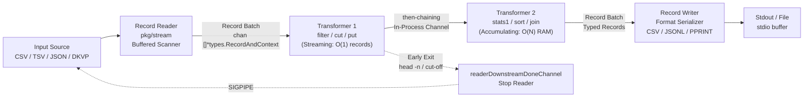

# Miller

> [!summary] Claim
> Miller (`mlr`) bridges line-oriented Unix pipelines and schema-aware data formats by streaming records as insertion-ordered key-value maps through chained in-process transformers, avoiding intermediate serialization overhead and positional index failures while isolating memory retention strictly to accumulating operations.

Part of [Structured Data and HTTP](README.md) in [Shell and Unix Engineering](../README.md).

## TL;DR

- Mechanism: Miller parses delimited text, JSON, or key-value pairs into typed record streams passed through Go channel pipelines where transformers mutate named fields in a single process without OS pipe overhead.
- Rule: Chain multi-stage operations using the `then` keyword inside a single `mlr` process rather than piping separate `mlr` instances over shell pipes.
- Trap: Emitting heterogeneous records to standard RFC 4180 CSV aborts execution with a schema change error unless records are regularized with `unsparsify`, partitioned with `group-like`, or exported to JSON Lines.
- Portability fact: Miller 6 is a complete Go rewrite of the original C implementation, shipping as a static single binary across Linux, macOS, FreeBSD, and native Windows without Cygwin (release assets for all four, plus AIX, as of 6.23.0 in 2026-11).
- When not to use it: When datasets require multidimensional relational indexing, transactional updates, or complex nested graph traversals, where an embedded analytical database like DuckDB or a full programming language is required.

## Mental model



Input records flow from the file descriptor into format-specific scanners that construct insertion-ordered, dynamically typed key-value maps.
Batches of records pass between transformer verbs across buffered Go channels inside the same process memory space, eliminating operating system context switches and inter-process byte re-encoding.
Streaming verbs like `filter`, `cut`, and `put` inspect and mutate records individually before immediately yielding them to the downstream channel.
Accumulating verbs like `sort`, `tac`, and `join` retain records in internal hash tables or slices until end-of-file before emitting transformed batches.
The final record writer serializes the in-memory maps into the desired target format, while early-terminating consumers such as `head` signal the reader over `readerDownstreamDoneChannel` that it can stop reading (`pkg/stream/stream.go`, `pkg/transformers/aaa_chain_transformer.go`); once `mlr` exits, an upstream process still writing to its pipe receives `SIGPIPE`.
Measured with `mlr 6.13.0` on the macOS host (as of 2026-11), `mlr seqgen --stop 10000000 | mlr head -n 5` still took about 4.1 s, the same as the `seqgen` stage alone (with 1000000 records bash `PIPESTATUS` showed `141 0`), so do not count on an upstream `mlr` stopping promptly.

## How it works

### The Record Stream Architecture

Standard Unix tools like `cut`, `awk`, and `sort` operate on plain text split by byte or character delimiters (POSIX.1-2024 XCU 4 Utilities, cut, awk, sort).
These tools assume positional column indexes (`$1`, `$2`), which break silently when columns are reordered, new fields are introduced, or fields contain quoted delimiters with embedded newlines (RFC 4180 Section 2).
Miller models data as a stream of discrete records.
Internally, each record is an insertion-ordered associative array mapping string field keys to dynamic scalar or container values (`Mlrval`).
The supported data formats include Delimited Key-Value Pairs (`DKVP`, Miller's native format), comma-separated values (`CSV`), tab-separated values (`TSV`), aligned pretty-print (`PPRINT`), transposed tabular (`XTAB`), positional text (`NIDX`), Markdown tables, and JSON / JSON Lines (RFC 8259).

In Miller 6, the streaming engine is implemented in Go under `pkg/stream` (as of 2026-11).
Execution proceeds through three decoupled phases: record reading, verb transformation, and record writing.
The reader initializes an `io.Reader` and tokenizes the byte stream according to the specified input format options (`--icsv`, `--ijson`, `--idkvp`).
Parsed records are grouped into batches to amortize Go channel coordination overhead.
The maximum number of records per batch is governed by `--records-per-batch`, which defaults to 500 records (`DEFAULT_RECORDS_PER_BATCH = 500` in `pkg/cli/option_types.go`; `mlr help flags` does not print the default).
These batches are passed across Go channels to the first transformer verb.

### In-Process `then`-Chaining vs Shell Pipelines

A central design strength of Miller is verb composition using the `then` keyword.
In traditional shell pipelines, combining three transformations requires three separate processes connected by operating system pipes:

```sh
mlr --csv filter '$status == 200' data.csv | mlr --csv put '$total = $price * $qty' | mlr --csv stats1 -a mean -f total
```

In this shell pipeline, the operating system creates two pipes via `pipe(2)` (Linux man-pages pipe(2)).
The first `mlr` process parses the CSV text into records, filters them, serializes surviving records back into ASCII CSV bytes, and writes them to standard output.
The kernel copies those bytes through the pipe buffer (64 KiB by default on Linux per pipe(7); 16 KiB growing to 64 KiB on macOS, as measured in the shell matrix) into the second `mlr` process address space.
The second process parses the CSV bytes a second time, validates headers, evaluates the mathematical expression, serializes records to CSV bytes again, and writes to the second pipe.
The third process parses the CSV bytes a third time before computing the arithmetic mean.

Using Miller native `then`-chaining eliminates intermediate serialization:

```sh
mlr --csv filter '$status == 200' then put '$total = $price * $qty' then stats1 -a mean -f total data.csv
```

All three verbs execute inside a single process instance.
Records remain in their native in-memory representation.
Pointers to record batches pass directly between transformer routines across internal Go channels.
Data is parsed from text exactly once upon entry and formatted to text exactly once upon exit.
This eliminates two complete serialization-deserialization cycles and the `write(2)` and `read(2)` system calls that move every buffer of bytes through each intermediate pipe.
Measured with `mlr 6.13.0` on the macOS host (as of 2026-11), a four-verb chain over 100000 records used 0.13 s of CPU in one process against 0.39 s for the same four verbs as a four-process pipeline.

### Streaming Verbs vs Accumulating Verbs

Miller verbs fall into two main operational categories, with a bounded-retention middle ground (Miller documentation, streaming-and-memory):

Streaming verbs:
Verbs such as `cat`, `cut`, `filter`, `put`, `head` (with non-negative `-n`), `step`, `rename`, `reorder`, `regularize`, `reshape` (wide-to-long), and `unsparsify -f` operate on records incrementally.
`tail` streams only in its `-n +N` start-at-record form; plain `tail -n 10` retains the last ten records.
A record batch enters the transformer, mutations or selections occur in place, and the batch is immediately forwarded to the downstream channel.
The number of records held by a streaming stage is O(1) with respect to total input size, unless a `put` or `filter` expression itself accumulates `@` variables keyed by field values.
Record retention depends only on the `--records-per-batch` parameter and the size of individual records, but resident memory is not flat: `cmd/mlr/main.go` calls `debug.SetGCPercent(500)`, and measured with `mlr 6.13.0` on the macOS host (as of 2026-11) `mlr --csv put` peaked at 130 MiB RSS on 100000 records and 411 MiB on 1000000 records, falling to 142 MiB with `--records-per-batch 1` at 3.6 times the wall time.
These verbs can process unbounded continuous inputs such as `tail -f` log streams indefinitely without accumulating records.

Accumulating verbs:
Verbs such as `sort`, `tac`, `group-by`, `group-like`, `unsparsify` (without `-f`), `fraction`, and `reshape -s` must retain every record in memory until end of input.
For example, `sort` cannot emit its first output record until it has received the final record and encountered EOF, because the very last record might have the smallest sort key.
`tail` and `top` retain only a fixed number of records, and `stats1` and `stats2` retain only summary arithmetic, a set of running accumulators for every unique group-by combination encountered across the stream; their memory is bounded, but they still emit only at end of stream.
If a full-retention verb appears anywhere in a `then` chain, that stage acts as a memory barrier: all upstream records are ingested and buffered before any records are emitted downstream.

### Joins and Memory Bounds

The `join` verb matches records between a specified left file (`-f left.csv`) and the streaming right input.
By default, `mlr join` operates with unsorted input (`-u`).
In unsorted mode, Miller ingests the entire left file into an in-memory hash table indexed by the join keys (`-j`, or `-l` and `-r`).
Once the left table is fully loaded, Miller streams the right input file record by record.
Matching records are paired and emitted immediately.
Because the left dataset resides entirely in RAM, the left file size must not exceed available system memory.
The right dataset, however, is fully streamed and can be arbitrarily large.

When both the left file and right input are pre-sorted lexically by their join fields, passing `-s` (or `--sorted-input`) enables stream-merge joining.
In sorted mode, Miller buffers only records that share the current active key from each stream.
As soon as the join key advances, older records are freed.
This reduces the join memory footprint from O(N_left) to O(K_duplicates), enabling multi-gigabyte joins in constant memory.

Join pairing modes support inner joins (default), left outer joins (`--ul`), right outer joins (`--ur`), full outer joins (`--ul --ur`), and anti-joins (`--np --ul` or `--np --ur`).

### The Domain-Specific Language (DSL)

The `put` and `filter` verbs embed a complete programming language tailored for record streams.
The DSL executes an implicit loop over every record.
Within expressions:
- Record fields are referenced by a leading dollar sign: `$status`, `$latency_ms`.
- Dynamic field names are accessed using bracket syntax: `$[expr]`, allowing computed column names like `$["metric_" . string(i)]`.
- Positional field access uses double brackets for the name and triple brackets for the value: on `x=3,y=4`, `$[[1]]` is `x` and `$[[[1]]]` is `3` (measured with `mlr 6.13.0`), and `$[[[NF]]]` is the last value.
- Out-of-stream variables are prefixed with an at-sign: `@total_bytes`, `@counts[$service]`.
- Out-of-stream variables persist across records throughout the entire process lifetime.
- Context variables expose execution metadata: `NR` (total records read so far across all input files), `FNR` (record number within current file), `NF` (number of fields in current record), `FILENAME` (path to current input file), and `ENV["VAR"]` (environment variable access).
- Lifecycle blocks: `begin { ... }` runs before any records are read, and `end { ... }` runs after stream completion.
- Null coalescing: Miller distinguishes between absent fields and null or empty fields.
- The `??` operator evaluates to its right-hand operand only if the left-hand field is absent from the record (lab test 5).
- The `???` operator evaluates to its right-hand operand if the left-hand field is either absent or an empty string (lab test 5).
- Output emission: The `emit` keyword inserts out-of-stream variables into the output stream as newly generated records.
- DSL blocks can also redirect outputs directly to external files or pipes: `tee > "/tmp/alerts-" . $service, $*`, `emit > "/tmp/alerts-" . $service, $*`, or `print | "logger -t mlr", "text"` (the `tee` and `print |` forms checked with `mlr 6.13.0`).

### CSV Schema Changes and Record Heterogeneity

Standard RFC 4180 CSV requires a static rectangular grid where every row conforms to the column list declared in the initial header line (RFC 4180 Section 2).
Real-world data streams, however, frequently contain heterogeneous records.
For instance, error records may contain an `error_code` field, while success records contain `payload_size`.
When Miller writes to standard CSV (`--ocsv`) and detects a record whose keys differ from the first record, it immediately aborts with exit status 1 (lab test 2), after writing the records before the change:

```
mlr: CSV schema change: first keys "id,status"; current keys "id,status,error"
mlr: exiting due to data error
```

The current documentation (record-heterogeneity, as of 2026-11, Miller 6.23.0) shows exactly this abort for a later record that adds a key, and `mlr 6.13.0` prints the same message with a trailing period.
Version matters here: measured with `mlr 6.13.0`, a later record with the same number of keys but different names aborted (lab test 2), but a later record with fewer keys was written with empty cells and one with an extra key was written as a ragged `2,bad,x` row under the old two-column header, both with exit status 0.
Do not rely on the abort as a schema check; validate the schema explicitly.

Miller provides four distinct strategies to handle heterogeneous record streams:
1. `unsparsify`:
This accumulating verb buffers records, computes the union of all observed keys across the entire stream, and fills missing columns with empty strings to produce a uniform rectangular CSV (lab test 3).
2. `group-like`:
This accumulating verb groups records having identical key signatures together.
Combined with `--ocsvlite`, Miller emits a blank line followed by a new header line whenever the field schema changes (measured with `mlr 6.13.0`).
`--no-auto-unsparsify` is documented to do the same for `--ocsv`, but with `mlr 6.13.0` a same-count key rename still aborted with that flag set, so prefer `--ocsvlite`.
3. Explicit filtering and projection:
Use `cut -f id,status` or `having-fields --at-least id,status` to enforce a known schema before the CSV writer stage.
4. Non-rectangular formats:
Output to schema-agnostic formats like JSON Lines (`--ojsonl`), DKVP (`--odkvp`), or XTAB (`--oxtab`), where each record independently declares its own keys without rectangular constraints.

## Numbers and limits

| Metric / Parameter | Value / Limit | Source |
| --- | --- | --- |
| Default record batch size (`--records-per-batch`) | 500 records | `DEFAULT_RECORDS_PER_BATCH = 500` in `pkg/cli/option_types.go` (`mlr help flags` does not print the default) |
| Streaming peak RSS on 100k records (3.3 MB CSV, 4 columns) | 130.0 MiB, 0.04 s wall (`mlr --csv put`) | measured on macOS host with `mlr 6.13.0`, `/usr/bin/time -l` (as of 2026-11) |
| Accumulating peak RSS on 100k records (3.3 MB CSV, 4 columns) | 152.0 MiB, 0.11 s wall (`mlr --csv sort -nr`) | measured on macOS host with `mlr 6.13.0`, `/usr/bin/time -l` (as of 2026-11) |
| Streaming throughput on 1M records (34 MB CSV) | ~3.2 million records/s (0.31 s wall time), 410.6 MiB peak RSS; 142 MiB and 1.13 s with `--records-per-batch 1` | measured on macOS host with `mlr 6.13.0` (as of 2026-11); Go GC target set by `debug.SetGCPercent(500)` in `cmd/mlr/main.go` |
| Accumulating wall time on 1M records (34 MB CSV) | 1.28 s wall time, 1300 MiB peak RSS (`mlr --csv sort -nr`) | measured on macOS host with `mlr 6.13.0` (as of 2026-11) |
| Single-process `then`-chain vs 4-stage pipe CPU speedup | 3.0x CPU time reduction (0.13 s vs 0.39 s user plus system on 100k rows) | measured on macOS host with `mlr 6.13.0` (as of 2026-11) |
| Pipe context switches on 100k rows | 15 voluntary context switches for the whole `then`-chain process | measured on macOS host via `/usr/bin/time -l` (as of 2026-11) |
| Standard integer representation (`int`) | Signed 64-bit integer (`int64`, -9223372036854775808 to 9223372036854775807); `+` auto-overflows to float (`9223372036854775807 + 1` is `9223372036854776000`), `.+` wraps to -9223372036854775808 | Miller documentation, `type-arithmetic-info`; measured with `mlr 6.13.0` |
| Floating point representation (`float`) | IEEE 754 double precision (64-bit float) | Miller documentation, `type-arithmetic-info` |
| Maximum string literal length | Bounded only by available Go heap memory | Miller 6 Go runtime memory limits |
| Stdio output buffer flush threshold | Flushes after every record when output is a terminal; less often when output is a pipe or file | `mlr help flags` (`--fflush`, `--no-fflush`) |
| Pipeline buffer size | Linux 64 KiB; macOS 16 KiB growing to 64 KiB (65536 bytes measured) | measured in shell matrix; Linux man-pages pipe(7) |
| Pipeline failure exit code on `SIGPIPE` | 141 (128 + 13) in bash 3.2, bash 5.3 and zsh 5.9 (measured); 397 in yash; 13 in macOS ksh93u+ 2012 (measured); 0 in dash without pipefail | lab test 9 on the macOS host shells; shell matrix |

## Portability

Miller itself is an external compiled binary, so shell and utility differences affect command invocation, argument quoting, process substitution, pipeline exit status propagation, and input sorting preparation.

| Environment | Behavior | Evidence |
| --- | --- | --- |
| POSIX sh | Basic single-process `mlr` invocations work; pipeline exit status reflects the last stage unless `set -o pipefail` is on, which POSIX.1-2024 now specifies (Austin Group Defect 789), though not every `sh` implements it yet | POSIX.1-2024 XCU 2.9.2 |
| macOS bash 3.2 | Supports `set -o pipefail`; requires care with multi-line DSL quoting; pipeline failure returns 141 | lab test 9 (run as macOS `/bin/sh`); measured on macOS host |
| current bash (5.3+) | Full feature support; process substitution `<(mlr ...)` works for left-file join inputs; `PIPESTATUS` tracks all stages (`141 0` for `mlr seqgen ... \| mlr head`) | measured on macOS host with bash 5.3.20 |
| zsh native (5.9) | Supports `pipefail` and `pipestatus`; word splitting is disabled by default; process substitution `<(mlr ...)` works for `join -f` | lab test 9; measured on macOS host with zsh 5.9 |
| zsh (`--emulate sh`) | Conforms to POSIX word-splitting rules; the pipeline status is that of the last stage (0 when `mlr head` truncates) and `set -o pipefail` gives 141 for `mlr seqgen ... \| mlr head` | shell matrix divergence guide; measured on macOS host with zsh 5.9 and `mlr 6.13.0` (as of 2026-11) |
| dash (0.5.12) | Lacks `pipefail`, and because `set` is a special built-in a failing `set -o pipefail` exits the shell with status 2 even with `\|\| true`, so probe it as `(set -o pipefail) 2>/dev/null && set -o pipefail`; pipeline returns status of last command (0 when `mlr head` truncates); requires separate status capture | lab test 9 under macOS `/bin/dash`; measured on macOS host |
| posh (0.14.1) | Lacks `sleep` builtin; pipeline returns status of last command; aborts on empty `"$@"` under `set -u` | shell matrix divergence guide |
| ksh93 (1.0.10) | ksh93u+m uses sockets instead of pipes between pipeline stages, so an upstream writer can see `ECONNRESET` instead of `EPIPE`; signal exit statuses report 256 + N; macOS ksh93u+ 2012 with `pipefail` returned 13 for the `SIGPIPE`-killed `mlr` stage | shell matrix divergence guide; lab test 9 under macOS `/bin/ksh` |
| mksh (R59) | Signal exit statuses report 128 + N; lacks `disown` builtin | shell matrix divergence guide |
| yash (2.58.1) | Signal exit statuses report 384 + N; `pipefail` on `SIGPIPE` yields status 397 | shell matrix divergence guide |
| BusyBox ash (1.37.0) | Signal exit statuses report 128 + N | shell matrix divergence guide |
| GNU coreutils (9.5+) | `sort -t, -k1,1` supports parallel sorting (`--parallel`), memory limits (`-S`), and stable ordering (`-s`) before `mlr join -s`; run it under `LC_ALL=C` so the order is bytewise, as Miller's lexical comparison expects | GNU coreutils documentation (as of 2026-11) |
| BSD / macOS utilities | macOS `sort` (2.3-Apple) also accepts `--parallel`, `-S`, and `-s`; pipe buffer starts at 16 KiB | measured on macOS host (`sort --help`, as of 2026-11); shell matrix |
| BusyBox utilities (1.37.0) | Compact `sort` and `head` | Alpine Linux matrix image |
| Miller 5.x (legacy C) | Written in C; single-threaded; no arrays in the DSL; Miller 6 notes describe its Windows support as improved "with or without MSYS2" | Miller documentation, new-in-miller-6 |
| Miller 6.x (modern Go) | Complete Go rewrite ("ported from C to Go"); goroutines and channel pipelines; first-class arrays; Windows regression testing on each commit; DSL parser generated by GOCC in 6.13.0 and by PGPG on the main branch (as of 2026-11; latest release 6.23.0) | Miller documentation, new-in-miller-6; `pkg/parsing/README.md` at v6.13.0 and main |

## Worked example

The [lab](../labs/09-miller/) contains a complete verification suite in `labs/09-miller/miller.bats` and a production processing script in `labs/09-miller/process_logs.sh`.

The script under test, `labs/09-miller/process_logs.sh`, performs an in-process multi-stage aggregation on HTTP access logs joined with service metadata:

```sh
#!/bin/sh
# process_logs.sh: aggregate and analyze HTTP access logs joined with service metadata.
# Uses Miller to perform in-process joins, filtering, and per-group latency statistics.
set -eu

SCRIPT_DIR=$(cd "$(dirname "$0")" && pwd)
MLR=${MLR:-$(command -v mlr 2>/dev/null || echo "$SCRIPT_DIR/../../bin/mlr")}

if [ ! -x "$MLR" ]; then
  printf 'process_logs.sh: mlr binary not found or not executable: %s\n' "$MLR" >&2
  exit 1
fi

usage() {
  printf 'Usage: %s <access_logs.csv> <services.csv>\n' "$0" >&2
  exit 2
}

[ "$#" -eq 2 ] || usage

LOGS_FILE=$1
SERVICES_FILE=$2

[ -f "$LOGS_FILE" ] || {
  printf 'File not found: %s\n' "$LOGS_FILE" >&2
  exit 1
}
[ -f "$SERVICES_FILE" ] || {
  printf 'File not found: %s\n' "$SERVICES_FILE" >&2
  exit 1
}

# In-process pipeline:
# 1. drop health-check requests
# 2. join with services metadata on "path" (unsorted hash join)
# 3. classify each request's severity in the DSL
# 4. aggregate count, min, mean, and max latency grouped by service_tier, severity
# 5. sort the groups by service_tier, then severity
# shellcheck disable=SC2016 # single quotes protect Miller DSL expressions from shell expansion
"$MLR" --norc --csv \
  filter '$path != "/healthz"' \
  'then' join -u -j path -f "$SERVICES_FILE" \
  'then' put '
    if ($status >= 500) {
      $severity = "CRITICAL"
    } elif ($latency_ms > 200) {
      $severity = "WARNING"
    } else {
      $severity = "NORMAL"
    }
  ' \
  'then' stats1 -a count,min,mean,max -f latency_ms -g service_tier,severity \
  'then' sort -f service_tier,severity \
  "$LOGS_FILE"
```

Given input access logs:

```csv
id,path,status,latency_ms
1,/api/v1/checkout,200,50
2,/api/v1/checkout,500,250
3,/api/v1/catalog,200,80
4,/api/v1/catalog,200,220
5,/healthz,200,5
6,/api/v1/login,200,40
```

and metadata table `services.csv`:

```csv
path,service_tier,team
/api/v1/checkout,tier-1,payments
/api/v1/catalog,tier-2,search
/api/v1/login,tier-1,auth
```

Running the script outputs:

```csv
service_tier,severity,latency_ms_count,latency_ms_min,latency_ms_mean,latency_ms_max
tier-1,CRITICAL,1,250,250,250
tier-1,NORMAL,2,40,45,50
tier-2,NORMAL,1,80,80,80
tier-2,WARNING,1,220,220,220
```

The lab suite `labs/09-miller/miller.bats` exercises nine discriminating test cases:

```
1..9
ok 1 process_logs.sh aggregates metrics correctly across joined service metadata
ok 2 heterogeneous CSV records cause schema change error without unsparsify
ok 3 unsparsify rectifies heterogeneous CSV records into rectangular output
ok 4 single-process then-chaining matches multi-process shell pipeline output
ok 5 absent-coalesce ?? vs absent-or-empty ??? distinguish undefined from empty fields
ok 6 mlr join anti-join emits only unlinked records from the left file
ok 7 wide-to-long and long-to-wide reshape pivots preserve data integrity
ok 8 DSL state accumulation across records using out-of-stream variables
ok 9 early pipeline termination triggers SIGPIPE in upstream producer with status 141
```

## Pitfalls

> [!warning] Local directory `.mlrrc` code execution (CVE-2020-15167)
> Trigger: Running `mlr` inside a repository or directory containing an untrusted `.mlrrc` file without `--norc`.
> Symptom: In Miller 5.9.0, which introduced `.mlrrc` support, a `.mlrrc` in the current working directory could set `prepipe` and so run arbitrary commands under the victim privileges (GHSA-mw2v-4q78-j2cw; fixed in 5.9.1).
> Current Miller still reads `./.mlrrc` but rejects `--prepipe`, `--load`, and `--mload` there (customization docs); measured with `mlr 6.13.0`, `prepipe` and `prepipex` lines in `./.mlrrc` fail with `mlr: parse error at file "./.mlrrc"`, while a harmless `ojson` line silently changes the output format.
> Fix: Always pass `--norc` on the command line or set `export MLRRC="__none__"` in automated scripts, CI/CD runners, and shared server environments, so a planted `.mlrrc` can neither run code on old versions nor change formats on current ones.

> [!warning] Aborted pipeline due to CSV schema change
> Trigger: Performing joins, JSON conversions, or record concatenations where subsequent records contain additional, missing, or renamed fields when emitting CSV (`--ocsv`).
> Symptom: The command halts abruptly with `mlr: CSV schema change: first keys "..."; current keys "..."` and exits with code 1 (lab test 2); with `mlr 6.13.0` an added or dropped key can instead produce a ragged or filled row with exit status 0, which is worse because nothing fails.
> Fix: Pipe into `then unsparsify` to normalize missing fields with empty strings, use `--ocsvlite` to re-emit headers, or switch to JSON Lines (`--ojsonl`) or DKVP (`--odkvp`).

> [!warning] High memory latency in `tail -f` streaming due to record batching
> Trigger: Piping a continuous real-time log into `mlr` (e.g. `tail -f access.log | mlr --csv cat`).
> Symptom: No output appears on the terminal for long intervals until 500 records accumulate, making interactive debugging seem hung.
> Fix: Pass `--records-per-batch 1` and `--fflush` to disable internal channel batching and force immediate per-record stdout flushing (the streaming-and-memory docs recommend `tail -f some-file | mlr --records-per-batch 1 ...`).

> [!warning] Unsorted hash join memory exhaustion
> Trigger: Running `mlr join -u -j id -f huge_file.csv stream.csv` where the left file exceeds available physical RAM.
> Symptom: The process memory climbs monotonically until the operating system OOM killer terminates `mlr` with `SIGKILL`.
> Fix: Sort both inputs lexically by join key beforehand and pass `-s` (or `--sorted-input`) to enable constant-memory stream-merge joining; `mlr join --help` warns that unsorted input to `-s` silently leaves records unpaired.
> A bare `sort -t, -k1,1 file.csv` also sorts the header line into the data and splits quoted commas, so keep the header out, `(head -n 1 file.csv; tail -n +2 file.csv | LC_ALL=C sort -t, -k1,1)`, and use it only when the key column is never quoted.

> [!warning] Silent null coalescence bugs with `??` vs `???`
> Trigger: Using `$field ?? "default"` to provide a fallback value for an empty CSV cell `""`.
> Symptom: The fallback is ignored and the empty string is preserved, because in Miller `??` checks only for field absence, not empty strings.
> Fix: Use the triple-question operator `$field ??? "default"` to coalesce both absent fields and empty strings.

> [!warning] Silent command failure masked by missing `pipefail`
> Trigger: Running `mlr ... | consumer` in standard POSIX `sh` or `dash` without `set -o pipefail`.
> Symptom: If `mlr` encounters a data parsing error or schema change and exits with status 1, the pipeline returns 0 if the downstream consumer exits normally.
> Fix: In bash/zsh, always enable `set -o pipefail`; in dash/posh, check intermediate process exit statuses using temporary files or FIFO redirections.
> In a portable script, probe for the option as `(set -o pipefail) 2>/dev/null && set -o pipefail`: a bare failing `set -o pipefail` exits dash with status 2, `|| true` notwithstanding, because `set` is a special built-in (measured with macOS `/bin/dash`).

## Security and robustness

- Untrusted input and shell command injection: The Miller DSL includes `system(cmd)`, which runs a command string through a shell, and `exec(cmd, [args], {options})`, which runs an executable with an argument array and no shell (`mlr help function exec`).
Prefer `exec` with an argument array, and never construct DSL expressions or `system` command strings by interpolating untrusted shell variables or field values.
An input containing `"; rm -rf /; "` will execute arbitrary shell commands with the privileges of the script runner.
Pass runtime parameters through environment variables (`ENV["PARAM"]`) rather than string concatenation.

- Arbitrary file writes via DSL redirection: The DSL `emit` and `print` statements support dynamic file and pipe redirection: `emit > "/var/log/data-" . $tenant, $*` or `emit | $cmd`.
If the path or command string incorporates unvalidated field data, an attacker can trigger path traversal (`../../etc/shadow`) or pipe execution attacks.
Restrict write targets strictly to sanitized whitelists.

- Configuration file poisoning: Miller 5.9.0 introduced `.mlrrc` support, and a `.mlrrc` in the current working directory could set `prepipe` to run arbitrary code, which is CVE-2020-15167 (published 2020-09-02, NVD CVSS 3.1 base score 8.6; fixed in 5.9.1).
Current Miller processes `$HOME/.mlrrc`, then `$XDG_CONFIG_HOME/miller/mlrrc` (default `$HOME/.config/miller/mlrrc`), then `./.mlrrc`, unless `MLRRC` is set, and rejects `--prepipe`, `--load`, and `--mload` inside any of them (customization docs, as of 2026-11).
In multi-tenant or automated execution environments, always set `MLRRC="__none__"` or provide the `--norc` flag.

- Memory exhaustion from malicious CSV payloads: RFC 4180 permits fields to span multiple physical lines when enclosed in double quotes (RFC 4180 Section 2).
An unclosed opening quote in an untrusted CSV stream causes Miller scanner to buffer the remainder of the file into memory searching for the closing quote.
Enforce file size limits and execution timeouts using `timeout` or `ulimit -v` (see [[Resource-Limits-and-ulimit]]).

- Terminal escape injection: When Miller outputs raw values or uses `--opprint` to write untrusted user strings directly to a terminal, ANSI escape sequences embedded in fields can rewrite terminal state or trigger shell actions (see [[Terminal-Escape-Injection]]).
Sanitize untrusted text with `clean_whitespace` or strip control characters before terminal display.

## The principal's view

The choice between Miller, standard Unix tools, relational query engines, and full programming languages is an architectural trade-off between streaming latency, schema flexibility, and maintainability.

Use standard Unix tools (`cut`, `awk`, `grep`, `sort`) only when the input is guaranteed to be simple ASCII/UTF-8 single-line text with fixed delimiters, no quoted commas, no embedded newlines, and immutable positional schemas.
The moment data adopts RFC 4180 CSV, JSON, or key-value structures, standard text tools become liabilities that introduce silent data corruption.

Use Miller when you require high-throughput streaming record transformations in shell scripts without bringing in heavy language runtimes.
Miller excels at converting between structured formats on the fly (`--c2j`, `--j2c`, `--c2p`).
Miller excels at in-process streaming ETL pipelines via `then`-chaining that eliminate serialization bottlenecks.
Miller excels at fast statistical reductions and percentiles (`stats1`) on continuous server log streams.
Miller excels at schema manipulation where columns need to be addressed by name rather than arbitrary column numbers.

Switch away from Miller to [[DuckDB-from-the-Shell]] or [[sqlite3-from-the-Shell]] when data transformations involve complex multi-table joins, subqueries, window functions, SQL compatibility, or analytical queries across tens of gigabytes of historical parquet or CSV files.
Databases provide cost-based query optimizers, vectorized execution, and columnar storage that outperform record-by-record processing on large historical analytical scans.

Switch to a full programming language (Go, Python, Rust) when the transformation requires custom network I/O, complex nested document manipulation, strict schema validation (Protobuf or JSON Schema), or when business logic exceeds what can be cleanly maintained in a Miller DSL one-liner (see [[When-to-Stop-Using-Text-Tools]]).

## Interview questions

> [!question] L5: What happens when `mlr --csv cat` encounters a record with keys different from the first record in the file?
>
> > [!success]- Answer
> > Miller aborts execution immediately and emits an error message indicating a CSV schema change.
> > RFC 4180 CSV requires a rectangular structure where every data row strictly conforms to the header line.
> > Because standard CSV cannot represent varying column schemas mid-stream, Miller exits with status 1 to prevent writing a corrupted file (lab test 2, a same-count key rename).
> > A strong answer adds the version caveat: measured with `mlr 6.13.0`, a later record with fewer keys was filled with empty cells and one with an extra key was written as a ragged row, both with exit status 0, while the current docs show an abort for an added key.
> >
> > Follow-up: Which Miller verb can you insert into the pipeline to rectify this error without changing the output format?

> [!question] L5: Why does `mlr --csv filter ... then put ... then stats1 ...` execute faster than piping three separate `mlr` commands together?
>
> > [!success]- Answer
> > The `then` keyword chains transformers inside a single operating system process.
> > Records are parsed from text into internal in-memory maps exactly once upon entry and serialized to text once upon exit.
> > Inter-stage records are passed across Go channels as pointers without being serialized to ASCII CSV bytes and copied through OS pipe buffers.
> >
> > Follow-up: What system calls are avoided by using in-process `then`-chaining instead of shell pipes?

> [!question] L6: Predict the output of this Miller DSL snippet on an empty CSV cell:
>
> ```sh
> printf 'val\n\n' | mlr --csv put '$a = $val ?? "FALLBACK_A"; $b = $val ??? "FALLBACK_B"'
> ```
>
> > [!success]- Answer
> > It prints `val,a,b` followed by `,,FALLBACK_B` (measured with `mlr 6.13.0`; the CSV writer quotes only when a field needs it).
> > The `??` operator only coalesces if the field is absent from the record, but `$val` is present with an empty string value.
> > The `???` operator coalesces if the field is either absent or an empty string, so `$b` receives `"FALLBACK_B"`.
> >
> > Follow-up: Under what circumstances would `$a` actually receive `"FALLBACK_A"`?

> [!question] L6: Debug this shell script, which fails intermittently or consumes unbounded memory in production:
>
> ```sh
> #!/bin/sh
> mlr --csv join -j customer_id -f daily_transactions.csv customer_master.csv > merged.csv
> ```
>
> > [!success]- Answer
> > By default, `mlr join` operates in unsorted mode (`-u`) and buffers the entire left file (`-f daily_transactions.csv`) in RAM as a hash table.
> > If the daily transaction volume exceeds available physical memory, the process exhausts RAM and gets killed by the OOM killer.
> > To fix it, swap the arguments so the smaller table (`customer_master.csv`) is the left file, or pre-sort both files and pass `-s` to perform a constant-memory stream-merge join.
> > Additionally, if the join produces unmatched rows with differing column sets, standard CSV output will abort unless piped through `then unsparsify`.
> >
> > Follow-up: How do you perform a left anti-join in Miller to find transactions with no matching customer record?

> [!question] L6: Why does running `tail -f access.log | mlr --csv filter '$status == 500'` appear to freeze on an interactive terminal?
>
> > [!success]- Answer
> > Miller groups records into internal batches (governed by `--records-per-batch`, which defaults to 500 records) to amortize channel coordination overhead.
> > On a low-traffic stream, Miller buffers records until 500 items are gathered before passing them to the filter and writing output.
> > Passing `--records-per-batch 1` and `--fflush` forces immediate per-record channel transfer and stdout flushing.
> >
> > Follow-up: How does Miller decide whether to enable `--fflush` automatically on standard output?

> [!question] L6: Explain how wide-to-long and long-to-wide reshape operations differ in their memory characteristics.
>
> > [!success]- Answer
> > Wide-to-long reshaping (`reshape -i ... -o ...`) is a pure streaming operation requiring O(1) memory (the streaming-and-memory docs list `reshape` as streaming "if not long-to-wide").
> > For each wide input record read, Miller immediately emits multiple long records to the downstream channel.
> > Long-to-wide reshaping (`reshape -s ...`) is an accumulating operation requiring O(N) memory.
> > Miller must buffer all incoming records until EOF to discover all distinct keys before reconstructing the wide rectangular records.
> >
> > Follow-up: Can you use `reshape -s` in a continuous `tail -f` log pipeline?

> [!question] L7: How would you redesign a legacy pipeline processing a 200 GB CSV dump with quoted multiline JSON payloads when line-oriented text tools corrupt the record stream?
>
> > [!success]- Answer
> > Standard Unix tools break because RFC 4180 CSV allows quoted fields to contain newlines, which `awk` and `sed` incorrectly treat as record boundaries.
> > Miller natively parses RFC 4180 CSV, preserving multi-line quoted fields intact inside single records.
> > To extract and analyze the embedded JSON, chain `mlr --csv json-parse -f payload then flatten` to unpack JSON keys directly into dot-separated column headers.
> > Ensure the pipeline uses `then` chaining to avoid writing intermediate 200 GB uncompressed files to disk.
> >
> > Follow-up: If the embedded JSON schemas vary wildly across rows, what output format should you choose instead of CSV?

> [!question] L7: Explain the security implications of CVE-2020-15167 in Miller and how modern deployments mitigate configuration poisoning.
>
> > [!success]- Answer
> > Miller version 5.9.0 introduced support for loading `.mlrrc` configuration files, including one in the current working directory (GHSA-mw2v-4q78-j2cw).
> > An attacker could commit a malicious `.mlrrc` containing a `prepipe` line such as `prepipe touch you_were_attacked; cat` into a shared git repository or data archive.
> > When a user ran any `mlr` command on a file inside that directory, Miller executed the prepipe command under the victim user privileges, and the trailing `cat` let the file print normally, hiding the attack.
> > Miller 5.9.1 fixed it, and current Miller rejects `--prepipe`, `--load`, and `--mload` in any `.mlrrc` (customization docs); NVD scores it CVSS 3.1 8.6.
> > Modern deployments still pass `--norc` on all automated CLI invocations or set `MLRRC="__none__"` in the environment, because `./.mlrrc` is still read and can silently change formats.
> >
> > Follow-up: Does Miller 6 execute system commands from DSL expressions, and how should untrusted user input be sanitized?

> [!question] L7+: Compare the architectural trade-offs between Miller record-at-a-time row streaming and DuckDB vectorized columnar execution for high-volume shell data pipelines.
>
> > [!success]- Answer
> > Miller processes data as a stream of individual associative map records passed across Go channels, achieving minimal time-to-first-record latency and low constant memory overhead for unbounded streams.
> > DuckDB processes data in vectorized columnar chunks (2048 tuples per vector by default, `DEFAULT_STANDARD_VECTOR_SIZE` in `src/include/duckdb/common/vector_size.hpp`) using SIMD instructions and column-oriented memory layouts, achieving order-of-magnitude higher throughput on bulk analytical queries.
> > Miller excels at real-time streaming transformations, format interop conversions, and heterogeneous log feeds where records arrive incrementally and lack a fixed schema.
> > DuckDB excels at complex multi-table joins, window aggregates, and analytical scans over static multi-gigabyte CSV or Parquet files where vectorized execution amortizes interpretation overhead across columnar vectors.
> >
> > Follow-up: When would pipeline memory constraints force you to choose Miller sorted join over DuckDB?

## Related

Prerequisites: [[CSV-Quoting-and-Edge-Cases]]

Next: [[xsv-and-qsv]]

See also: [[jq-Language]], [[jq-Paths-and-Updates]], [[jq-Streaming-Large-Inputs]], [[yq-Variants-and-YAML-Hazards]], [[XML-with-xmlstarlet]], [[DuckDB-from-the-Shell]], [[sqlite3-from-the-Shell]], [[When-to-Stop-Using-Text-Tools]]

API Engineering goes deeper in [[20-API-Engineering/README|API Engineering]]: [[20-API-Engineering/05-Pagination-Filtering-and-Query-Patterns/README|Pagination Filtering and Query Patterns]]; start with [[Streaming-Exports-and-NDJSON-for-Unbounded-Collections]].

## Further reading

- [Miller Documentation](https://miller.readthedocs.io/en/latest/): The definitive reference manual covering all Miller 6 verbs, DSL functions, and format conversion options.
- [RFC 4180: Common Format and MIME Type for CSV Files](https://www.rfc-editor.org/rfc/rfc4180): The IETF standard defining rectangular CSV grammar, quoting rules, and field delimiters.
- [RFC 8259: The JavaScript Object Notation (JSON) Data Interchange Format](https://www.rfc-editor.org/rfc/rfc8259): The JSON specification governing nested objects, arrays, and string escaping.
- [John Kerl's Miller GitHub Repository](https://github.com/johnkerl/miller): Source code for the Go implementation, issue tracking, and architectural release notes.
- [CVE-2020-15167 Vulnerability Record](https://nvd.nist.gov/vuln/detail/CVE-2020-15167): National Vulnerability Database advisory detailing the working-directory configuration injection flaw.
- [POSIX.1-2024 Shell & Utilities](https://pubs.opengroup.org/onlinepubs/9799919799/): Official specification for classic column-oriented utilities including `awk`, `cut`, `join`, and `sort`.
