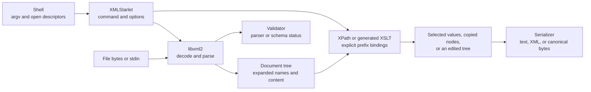

# XML with xmlstarlet

> [!summary] Claim
> XMLStarlet turns XML bytes into a namespace-aware tree, so a reliable shell job must specify what to match in that tree and verify what it writes back.

## TL;DR

- `xmlstarlet sel` compiles its command-line template into XSLT, while `ed` evaluates each XPath against a mutable XML tree.
- Bind each element namespace by URI with `-N`, and check the expected match count before editing.
- A well-formed document can violate its schema, and a successful edit can match zero nodes or fail to save.
- POSIX specifies the shell argument and redirection rules, while XML behavior depends on the installed XMLStarlet and its linked libraries.
- Move to a parser API when you need bounded-memory extraction, strict external-resource policy, byte-preserving changes, or XML signatures.

## Mental model



The shell passes XPath as an argument and leaves XML bytes on a file descriptor or in a named file.
XMLStarlet chooses the parse options, and libxml2 decodes the bytes and builds the tree for selection, editing, or transformation.
XPath resolves prefixes through its own namespace context and selects nodes or computes values.
The serializer decides which bytes are emitted, while validation checks the input against the selected grammar and reports a separate status.

## How it works

### From shell arguments to the XML data model

`xmlstarlet` is a separate executable.
The shell removes syntactic quotes and passes the quoted XPath as one argument, so `'*'` reaches XPath as a wildcard and `'@id'` reaches XPath as an attribute test.
Keep literal expressions in single quotes and quote path and variable expansions, as in `xmlstarlet sel -T -t -v 'count(/catalog/item)' "$file"` (POSIX.1-2024 XCU 2.2, 2.6.5, 2.6.6, and 2.9.1.4).
Shell quoting protects the command boundary, and XPath still interprets the argument as executable expression text.

With `< "$file"` the shell opens the file on descriptor 0 before command execution (POSIX.1-2024 XCU 2.7.1).
For tree-based commands in XMLStarlet 1.7.0, `xmlstarReadFile()` maps the filename `-` to `xmlReadFd(STDIN_FILENO, ...)` and sends other names to `xmlReadFile()`.
In libxml2 2.15.0, `xmlReadFile()` obtains input through the resource loader, and `xmlReadFd()` installs a descriptor-backed input object.
For ordinary uncompressed input, the default local-file backend opens the file with `fopen(..., "rb")` and reads through `fread()`, while `xmlFdRead()` uses `read(2)` directly (XMLStarlet 1.7.0 `src/xml.c` and libxml2 2.15.0 `parser.c` and `xmlIO.c`).
The library reads buffered chunks, and the parser reads across chunk boundaries as it recognizes names, references, and markup.
Feeding a pipe changes the source of those chunks while `sel` still waits for a parsed document tree.

XML 1.0 allows a declaration, comments and processing instructions around the document element, and a document type declaration before it (XML 1.0 Sections 2.1 and 2.8).
An element can span lines, several siblings can occupy one line, and a CDATA section can carry text resembling a tag (Sections 2.4 and 2.7).
XML processors must support UTF-8 and UTF-16, and encoding detection combines the initial bytes with the encoding declaration (Section 4.3.3 and Appendix F).
Use XML output encoding options to serialize to another encoding after successful parsing.
For an HTTP response, retain the media type and charset until the encoding decision is made, because a body saved to disk no longer carries the HTTP header (RFC 7303 Sections 3.2 and 8).
If the producer supplies conflicting encoding metadata, diagnose the conflict before transforming the file.

End-of-line handling turns literal CRLF and lone CR into LF before parsing.
Attribute normalization also turns literal tab, LF, and CR into spaces, with further trimming and collapsing for declared non-CDATA attributes.
A character reference is handled by its own rule, so `&#xA;` in an attribute can yield an LF when a literal line break would yield a space (XML 1.0 Sections 2.11 and 3.3.3).
XMLStarlet can also see DTD-defaulted attributes that have no lexical occurrence in the input, depending on the command's parse options.
A DOM-based edit can preserve parsed content while changing indentation, quotes, attribute order, or how a character was spelled.

XPath 1.0 models the document node, element, attribute, text, namespace, processing instruction, and comment as distinct node types (XPath 1.0 Section 5).
`/` starts at the document node and `/*` selects its element child.
An element's string-value concatenates its descendant text in document order, so `string(.)` on `<p>See <em>this</em> now</p>` includes `this` while `text()` selects only the direct text children.
Use `string(.)` for the logical text, `-c .` when child structure must survive, and a verified contract for any whitespace normalization.
`normalize-space()` trims edges and collapses runs of XML whitespace, so it can change a part number, message, or preformatted field (XPath 1.0 Section 4.2).

### Resolve namespaces before debugging XPath

A namespaced name is identified by the namespace URI string and local name.
A document can switch from a default namespace to a prefix, or use a different prefix entirely, while preserving the expanded name (Namespaces in XML 1.0 Sections 2.1 to 2.3 and 6).
Namespace names compare as case-sensitive strings, and the parser does not dereference the URI for an XPath name test.
Default namespaces apply to unprefixed element names in the XML, while an unprefixed attribute remains in no namespace (Section 6.2).

For `<catalog xmlns="urn:example:catalog"><item id="a"/></catalog>`, bind `-N c=urn:example:catalog` and query `/c:catalog/c:item/@id`.
In the XPath 1.0 expression, an unprefixed element name test also means no namespace, so `/catalog/item` selects nothing here (XPath 1.0 Section 2.3).
An unbound prefix is an evaluation or compilation error, distinct from a bound prefix that selects an empty node-set.
`local-name()` and `namespace-uri()` help inspect an unfamiliar document, but a production predicate using only `local-name()` also admits foreign vocabularies with the same spelling.

XMLStarlet imports declarations from the source root by default and recognizes `_` and `DEFAULT` as aliases for the root's default namespace starting in 1.5.0, released July 7, 2013 (XMLStarlet `NEWS`).
With `sel`, the first parseable input supplies automatic declarations for the stylesheet that later inputs reuse.
With `ed`, namespace setup happens for each document, and explicit mappings are registered after document mappings (XMLStarlet 1.7.0 `src/xml_select.c`, `do_file()`, and `src/xml_edit.c`, `edProcess()`).
Place `--no-doc-namespace` before the subcommand and the `-N` bindings in the subcommand's global options, before `-t` or the edit actions.
This makes the query vocabulary independent of the producer's choice of prefix.
Bind any nested vocabulary explicitly, since automatic import only examines declarations on the root.

### XPath context and the selection template

A location step consists of an axis, a node test, and optional predicates (XPath 1.0 Sections 2.1 to 2.5).
`@id` uses the attribute axis, `.//c:item` searches under the current node, and a leading `//c:item` searches from the document root.
`//c:item[1]` can yield the first matching child of several parents, while `(//c:item)[1]` filters the combined result and keeps its first node in document order.
For the reverse `preceding-sibling::` axis, `preceding-sibling::c:item[1]` selects the nearest preceding matching sibling.
Put predicates on the step whose context you intend to filter, because positions are computed again after each predicate.

XPath 1.0 has node-set, boolean, number, and string values (Section 3).
`[2]` is a positional test, while `[@enabled]` checks whether the attribute exists even if its value is `false`.
Use `[@enabled="true"]` when the vocabulary defines that lexical value as true.
`item/@state = "ready"` is existential across the node-set, and `item/@state != "ready"` can also be true on the same document if another item has a different state (Section 3.4).
To require every item to have a ready state, check for at least one `item` and for the absence of an `item[not(@state="ready")]`.
`id("a")` looks up an ID recognized by the data model, so a field named `id` in an arbitrary document still needs an explicit `[@id="a"]` predicate unless ID typing is established (Sections 4.1 and 5.2).

Use `/c:catalog/c:item` when the schema fixes the path.
A descendant search can inspect every candidate under its context, and nesting a descendant search inside `-m` repeats work per matched node.
Use a shared traversal or a program with an index if each record scans the same large subtree.
XPath numbers use IEEE 754 double precision, so keep identifiers and exact decimal amounts as strings when extracting and convert them in a program with appropriate types (XPath 1.0 Sections 3.5 and 4.4).

`selPrepareXslt()` builds a stylesheet tree, `selGenTemplate()` emits the instructions, and `do_file()` compiles the stylesheet with `xsltParseStylesheetDoc()` and writes the result with `xsltSaveResultToFile()` (XMLStarlet 1.7.0 `src/xml_select.c`).
`-t` starts a template, `-m` introduces a for-each and changes the context node, `-i` gates output, and `-b` leaves one nesting level.
Inside a loop, relative XPath such as `@id` works on that match.
Use `-o` for literal separators, `-n` for record breaks, `-e` and `-a` to construct elements and attributes, and `-c` to copy a selected subtree.
For sorted matches use `-s` immediately after the match, as in `-s A:N:L '@priority'` for ascending numeric order (XMLStarlet 1.7.0 `src/select-usage.txt` and `caseSortFunction()`).

XPath `string(node-set)` takes the first node's string-value in document order (XPath 1.0 Section 4.2).
XMLStarlet `sel -v` first invokes XSLT `value-of` and then iterates over the remaining nodes through `exslt:node-set()`, adding a newline before each remaining value (XMLStarlet 1.7.0 `selPrepareXslt()`).
Use `-m ... -v ... -n` when you need explicit per-record boundaries and `-v 'string(...)'` or `-v '(...) [1]'` when you mean a single value.
An absent element, an empty element, and a whitespace-only element become indistinguishable once a pipeline applies the wrong normalization.
Count or test node existence before converting to text when the distinction matters.

Use `-T` for plain text because XML output escapes markup characters, and use `-R` when a receiver requires one wrapping element around constructed results.
Output from multiple input files is emitted per file, so it needs external framing if a receiver expects one XML document.
Choose XML serialization when arbitrary selected text can contain the record delimiter, and use a real CSV writer for a CSV destination.
An XPath `count(...)` renders `0` on an empty node-set, while a bare match loop can render nothing and return failure.
`sel -Q` suppresses output and can exit on the first result with children, so it does not validate a batch of files.
Keep the invocations per file when you need a status and diagnostic attributable to every input (XMLStarlet 1.7.0 `selMain()` and `do_file()`).

Use `sel -C` to inspect the generated stylesheet when nesting or context is unclear.
The upstream 1.7.0 changelog records a fix to this option (`sel --comp: fixed` in `NEWS` for 1.7.0, released September 7, 2026).
When diagnosing an explicit namespace binding, generate with no input-file operand and pass `-N` so that the generated stylesheet is self-contained (XMLStarlet 1.7.0 `selMain()`).
Support for extra EXSLT functions comes from the linked libraries and the context in which XMLStarlet registers them.
The extension set for a generated stylesheet and for `ed`'s standalone XPath context can differ (XMLStarlet 1.7.0 `checkNsRefs()`, `xsltInitLibXml()`, and `edProcess()`).

### Validation checks the grammar you select

Use `xmlstarlet val -w "$file"` for XML well-formedness, `val -E "$file"` for validation against the document's own DTD, or `val -d "$dtd" "$file"` for an explicitly supplied DTD.
Use `val -s "$schema" "$file"` for XSD and `val -r "$schema" "$file"` for RELAX NG when the binary includes libxml2 schema support.
A DTD declares element content models, attributes, and entities, and can supply attribute defaults (XML 1.0 Sections 2.8, 3.2, 3.3, and 4).
XSD can check namespace-qualified structure, simple types, and identity constraints (XML Schema Part 1 Sections 2 and 3.11).
RELAX NG matches patterns over expanded names, children, attributes, text, and datatypes, including unordered content expressed through `interleave` (RELAX NG Sections 2 and 6).
Choose the schema version and vocabulary explicitly, and represent application rules such as an intended single update separately when the schema does not enforce them.

`valMain()` reads a whole tree for `-d` and calls `valAgainstDtd()`, which parses the specified DTD and validates the document.
For the other modes it drives `xmlTextReaderRead()`, optionally sets a schema validation context, and checks `xmlTextReaderIsValid()` for validating modes (XMLStarlet 1.7.0 `src/xml_validate.c`).
The reader can consume input incrementally, but DTDs, schema state, identity checks, and validation algorithms can still retain data.
A successful well-formedness check establishes XML syntax under the selected parser settings and says nothing about business meaning.
The validation path initializes its parse options with `XML_PARSE_DTDLOAD | XML_PARSE_DTDATTR` even for `-w` in 1.6.1 and 1.7.0, so well-formedness checking alone is not an external-resource policy.

Use `-q` to suppress result listings, `-e` for diagnostic detail, `-g` and `-b` to list good or bad filenames, and `-S` when you want the batch to stop at an error.
Avoid treating list output as your status channel, since filenames can contain newlines and a quiet valid run writes no status line.
Pass an actual operand for every validation, including explicit `-` for stdin on a compatible build, because the reader loop runs over operands.
Pin the validator and the complete schema set, including imports, and include a known invalid fixture so schema support cannot silently disappear.

### Editing applies operations in order

`edProcess()` sets each action's XPath context to the document node, evaluates the action's selector, and applies it to the selected nodes before evaluating the next action (XMLStarlet 1.7.0 `src/xml_edit.c`).
`-u selector -v literal` updates with a literal value and `-u selector -x expression` computes the replacement against each target's context.
Update an attribute when only that attribute should change, and update a specific text node when neighboring markup must remain, since updating the element's value can replace its children.
`-d` deletes matches, `-r ... -v name` renames nodes, and `-m source destination` moves selected nodes into a destination that must resolve to one node.
`-i` and `-a` insert before and after the matched node, while `-s` inserts a child, using `-t elem|text|attr -n name` and an optional `-v value`.
`--var name xpath` can retain a selection for later actions, and the predefined `$prev` refers to nodes from the previous insertion operation.
Read selectors from left to right against the evolving tree, especially after a rename, removal, or move.
When adding namespaced elements or attributes, check their expanded names after serialization because insertion, prefix binding for XPath, and namespace declarations in the output operate at different layers.

`edOutput()` parses the source, applies the operations, and calls `xmlSaveToFilename()`, `xmlSaveDoc()`, and `xmlSaveClose()`.
Without `-L` the serializer writes to stdout, so shell redirection can send the result to a new file.
With `-L` the program opens the input pathname for output, with no temporary sibling and no atomic pathname replacement.
On the standard libxml2 local-file path, the save context opens through the output callback in write mode and uses buffered `fwrite()` (libxml2 2.15.0 `xmlsave.c` and `xmlIO.c`).
Opening a regular file for truncating output discards its old contents before serialization finishes (POSIX.1-2024 `open()`, `O_TRUNC`).
Both XMLStarlet versions examined leave save-call return values unchecked in `edOutput()`.
A zero status therefore does not prove a selector matched, a file opened for output, or every written byte reached storage.

For a live file, validate the original, verify match cardinality, write to private scratch space on the target filesystem, then validate the candidate and re-query the postcondition.
Publish by same-filesystem `rename()` to a trusted destination when readers need to see the old or new pathname contents as a unit (POSIX.1-2024 `rename()`).
A rename publishes a replacement inode, so ownership, mode, ACLs, symlinks, and other hard links require an explicit policy.
Coordinate writers or check a revision under the publication lock to avoid losing a concurrent update.
Atomic pathname visibility and power-loss durability are distinct requirements, so a durable update needs a checked file and directory synchronization protocol appropriate to the filesystem.

### Transform, format, canonicalize, or inspect

Use `xmlstarlet tr rules.xsl input.xml` when the transformation is clearer as a checked-in XSLT stylesheet with named templates, explicit modes, and an output method.
The processor compiles the stylesheet, applies templates to an input tree, and serializes the result as XML, HTML, or text according to the stylesheet (XSLT 1.0 Sections 5 and 16 and XMLStarlet 1.7.0 `src/trans.c`).
Pass an expression parameter with `-p 'limit=10'` or a string parameter with `-s "label=$label"` after the stylesheet operand and before input files.
`trParseParams()` constructs an XPath string literal for `-s` and rejects values containing both kinds of quote in the upstream versions examined.
For arbitrary text parameters, use a typed binding in an API or carry the value as XML data.
`--embed` permits embedded stylesheet use and `--xinclude` enables inclusion when built in, both of which broaden the resource surface.
`--maxdepth` adjusts libxslt's transformation depth setting and does not turn the XML parser into an unlimited parser.

`xmlstarlet fo` parses and serializes XML again, with indentation controls such as `-n`, `-t`, and `-s 2` and output encoding via `-e`.
`fo -C` converts CDATA sections to text nodes, `-N` cleans redundant namespace declarations, `-D` removes the DTD from the resulting tree, and `-o` omits the declaration.
Dropping a DTD after parsing cannot undo any resources already loaded during parsing.
`fo -R` is best-effort recovery, so use strict validation at the boundary where corruption must be rejected.
Whitespace in mixed content and text-only nodes can carry meaning, and formatting is a poor default for byte-sensitive or signed inputs (XML 1.0 Section 2.10 and XMLStarlet 1.7.0 `src/xml_format.c`).

`xmlstarlet c14n --without-comments "$file"` emits inclusive Canonical XML 1.0.
Canonicalization serializes a defined node-set in UTF-8, sorts namespace declarations and attributes, expands empty-element syntax, writes normalized character content, and omits the XML declaration and DTD (Canonical XML 1.0 Sections 1.1 and 2).
The `--exc-with-comments` and `--exc-without-comments` modes select Exclusive Canonical XML 1.0, where visibly used prefixes and the optional inclusive prefix list control namespace rendering for subsets (Exclusive XML Canonicalization 1.0 Section 3).
The optional XPath file supplies a node-set expression and its namespace declarations, so selecting only an element node can omit its attributes, namespace nodes, and descendants.
The four switches in `c14nMain()` choose the two 1.0 algorithms with or without comments, and the CLI provides no switch for Canonical XML 1.1 (XMLStarlet 1.7.0 `src/xml_C14N.c`).
Canonicalization preserves significant text and does not generally make documents with different prefix spellings or indentation compare equal.
Choose the canonicalization algorithm and node-set from the protocol when verifying a signature, and use a signature verifier that validates the signed references and checks the identity of the nodes the application consumes (XML Signature 1.1 Sections 3.2 and 6.5).

`xmlstarlet el -u "$file"` inventories sorted unique element paths and `el -a` includes attribute paths.
Treat those strings as a guide to structure, since the reader reports source qualified names and an XPath still needs its own bindings (XMLStarlet 1.7.0 `src/xml_elem.c`).
`pyx` renders parsed events into line records and `p2x` consumes that representation, which can be useful for inspection or established PYX tooling.
`esc` and `unesc` encode and decode XML escapes in text and do not parse document structure, validate field semantics, or escape XPath expressions (XMLStarlet 1.7.0 `src/xml_pyx.c`, `src/xml_depyx.c`, and `src/xml_escape.c`).

## Numbers and limits

| Boundary | Value | Source and scope |
| --- | --- | --- |
| Parsing encodings | UTF-8 and UTF-16 are required | XML 1.0 Fifth Edition, 2008, Section 4.3.3 |
| XPath and stylesheet standards | XPath 1.0 and XSLT 1.0 | W3C Recommendations, 1999, and XMLStarlet 1.7.0, as of 2026-11 |
| XPath integer precision | All integers with absolute value at most 2^53 are exactly representable | Derived from the IEEE 754 double-precision type in XPath 1.0 Section 3.5, 1999, with 53 bits of significand precision |
| Element nesting | 256 by default, 2048 with `XML_PARSE_HUGE` | libxml2 2.15.0 `parser.c` `nodePush()`, as of 2026-11 |
| Entity nesting | 20 by default, 40 with `XML_PARSE_HUGE` | libxml2 2.15.0 `parser.c` `xmlCtxtPushInput()`, as of 2026-11 |
| Text node size bound | 10,000,000 bytes by default, 1,000,000,000 with `XML_PARSE_HUGE` | libxml2 2.15.0 `parserInternals.h` and `parser.c`, as of 2026-11 |
| Name length bound | 50,000 bytes by default, 10,000,000 with `XML_PARSE_HUGE` | libxml2 2.15.0 `parserInternals.h` and `parser.c`, as of 2026-11 |
| Entity amplification | Default factor 5, checked after 1,000,000 accounting units with a fixed cost of 20 per reference | libxml2 2.15.0 `xmlParserEntityCheck()` and `XML_MAX_AMPLIFICATION_DEFAULT` in `parserInternals.c`, as of 2026-11 |
| `sel -T` with no rendered result vs a rendered zero | Status 1 with no output for the lab's empty loop, status 0 with a scalar `0` for the count | Lab assertions, reproduced once with XMLStarlet 1.6.1 and libxml2 2.13.9 on Alpine 3.22, 2026-11 |
| `val -q` with the schema in the lab | Status 0 for the valid catalog, status 1 for a well-formed catalog rejected by the schema | Lab assertions, reproduced once with XMLStarlet 1.6.1 and libxml2 2.13.9 on Alpine 3.22, 2026-11 |

The libxml2 thresholds are library and parser-option limits, not a job-wide file size or memory budget.
The ordinary `sel` and `ed` paths build trees, and `sel` also produces a transformation result, so peak memory includes nodes, strings, context, input buffering, and output intermediates.
For predictable production sizing, measure peak RSS with the producer's node density, text size, and XPath shape, and set independent input, output, CPU, and memory limits.
Treat `XML_PARSE_HUGE` as a libxml2 API option described for comparison.
The old libxml2 overflow fixed for CVE-2022-40303 illustrates the risk of relaxing parsing limits on very large inputs.

## Portability

| Environment | Portability contract and behavior |
| --- | --- |
| POSIX `sh` | Single and double quotes, `$(...)`, scalar variable assignments, `\|\|`, redirection (`<`, `>`), and `trap ... 0` are standardized syntax (POSIX.1-2024 XCU 2.2, 2.6.3, 2.7, 2.9.3.4 OR Lists, and `trap`). |
| macOS Bash 3.2 | macOS `/bin/sh` runs Bash 3.2.57 in POSIX mode; standard parameter expansions, command substitutions, and exit status reporting execute without bashisms (the `/bin/sh` identity is confirmed by `/bin/sh --version` on the host, as of 2026-11; XMLStarlet is not installed there, so the lab itself was not run on it). |
| Current Bash (5.2.37 in the matrix images, 5.3 on the host) | Supports standard POSIX syntax, array variables, and `pipefail` (POSIX.1-2024 XCU 2.9.2); passes quoted paths containing whitespace and glob characters without field splitting or pathname expansion (POSIX.1-2024 XCU 2.6.5 and 2.6.6). |
| Native zsh | Parameter expansion does not perform field splitting by default (`SH_WORD_SPLIT` off); double quotes ensure cross-shell compatibility (zsh documentation, Expansion Section 14.3). |
| zsh `--emulate sh` | Emulation enables `SH_WORD_SPLIT` and POSIX mode; unquoted parameter expansions undergo field splitting, while quoted expansions preserve arguments intact (zsh documentation, Invocation and Options). |
| dash (0.5.12) | Minimal POSIX-compliant shell; strictly executes standard POSIX expansions and control structures without non-standard syntax (Debian 13 matrix environment). |
| ksh93 (ksh93u+m 1.0.10) | Standard parameter evaluation and command substitutions; uses `pipe(2)` instead of sockets under `set -o posix` for deterministic pipeline behavior (measured in the shell matrix); preserves quoted arguments intact. |
| mksh (R59) | Standard POSIX parameter expansion, command substitution, and exit traps; passes quoted filenames containing spaces and brackets cleanly. |
| yash (2.58.1) | Conforms to POSIX shell execution; outside POSIX mode `<(cmd)` is process redirection rather than process substitution, and POSIX mode rejects it (measured in the shell matrix), but standard POSIX substitutions and expansions execute per standard. |
| posh (0.14.1) | Minimal POSIX shell; passes quoted parameters to external binaries without word splitting or alias expansion. |
| BusyBox ash (1.37.0) | Lightweight POSIX shell; handles standard command execution, pipelines, redirections, and exit traps reliably (Alpine 3.22 matrix environment; the lab script ran once under Alpine `sh` with XMLStarlet 1.6.1, 2026-11). |
| GNU coreutils | `mktemp -d TEMPLATE` creates directories from trailing `X` placeholders; supports `--tmpdir` (GNU coreutils manual). |
| BSD and macOS | `mktemp -d TEMPLATE` creates a scratch directory from an explicit trailing-`X` template without requiring GNU extensions (Apple and FreeBSD `mktemp(1)`). |
| BusyBox utilities | The `mktemp` applet supports `-d` and requires a template ending in at least six `X` characters when a template is supplied (BusyBox usage documentation; a five-`X` template fails with `Invalid argument` on Alpine 3.22). |
| uutils coreutils | `mktemp` supports `-d` and an explicit path template with trailing `X` placeholders (uutils documentation). |
| XMLStarlet package | The CLI binary (`xml` or `xmlstarlet`) provides portable subcommand syntax (`sel`, `ed`, `val`, `tr`, `c14n`, `fo`, `el`) across Linux and macOS, with feature limits governed by linked libxml2 and libxslt versions. |

The test defines the same quoted-argument and result contract for every shell, and the shell rows above rest on the cited sources and earlier shell-matrix measurements because the matrix run for this lab is paused.
The script uses no shell-specific syntax for propagating a pipeline status.
POSIX.1-2024 specifies `pipefail` in XCU 2.9.2, and using explicit input and output files removes that dependency from the example.

XMLStarlet 1.7.0 is available from the revived upstream project and Homebrew (as of 2026-11), while the original SourceForge 1.6.1 release dates to August 9, 2014, and 1.7.0 followed on September 7, 2026 (XMLStarlet `NEWS`).
Older builds can differ in stdin, serialization, network support, and parser limits depending on the linked libxml2 and libxslt.
XMLStarlet bug #134 (2025, Arch Linux) reports `val --err -` failing with `couldn't read file '-'` under libxml2 2.13.8 and 2.14.5, and `xmlstarReaderForFile()` in 1.7.0 handles the initial `-` operand by opening a reader on descriptor 0.
A package can backport its own fix, so verify the actual combination or pass a named file when compatibility matters.

## Worked example

The [lab](../labs/09-xml-with-xmlstarlet/) edits a trusted, local catalog with an archive element that shares the local name `item`.
The RELAX NG fixture checks the shape and permitted states, while the script independently checks that the target is unique and pending.
The precondition applies `[last()=1]` after filtering by ID and before filtering by state, so a second item with the same ID fails even if its state is different.
The output is a display report whose fixed fixture values contain neither the field separator nor a line break.

Run the following from the lab directory.

```sh
sh ./catalog.sh ./catalog.xml ./catalog.rng .
```

The script below is the lab's `catalog.sh`.

```sh
#!/bin/sh

if [ "$#" -ne 3 ]; then
  printf 'Usage: %s CATALOG SCHEMA SCRATCH_PARENT\n' "$0" >&2
  exit 2
fi

catalog=$1
schema=$2
scratch=$(mktemp -d "$3/xmlstarlet.XXXXXXXX") || exit 1
trap 'rm -f "$scratch/edited.xml"; rmdir "$scratch"' 0
edited=$scratch/edited.xml
ns=c=urn:example:catalog

xmlstarlet val -q -r "$schema" "$catalog" || exit 1
pending='/c:catalog/c:item[@id="b"]/@state'
matches=$(xmlstarlet --no-doc-namespace sel -T -N "$ns" -t \
  -v 'count(/c:catalog/c:item[@id="b"][last()=1][@state="pending"])' "$catalog") || exit 1
if [ "$matches" != 1 ]; then
  printf 'Expected one pending item b, found %s\n' "$matches" >&2
  exit 1
fi

xmlstarlet --no-doc-namespace ed -N "$ns" \
  -u "$pending" -v active "$catalog" >"$edited" || exit 1
xmlstarlet val -q -r "$schema" "$edited" || exit 1
state=$(xmlstarlet --no-doc-namespace sel -T -N "$ns" -t \
  -v "string($pending)" "$edited") || exit 1
if [ "$state" != active ]; then
  printf 'Expected item b to be active, found %s\n' "$state" >&2
  exit 1
fi

xmlstarlet --no-doc-namespace sel -T -N "$ns" -t \
  -m '/c:catalog/c:item[@state="active"]' \
  -v '@id' -o ' | ' -v 'string(.)' -n "$edited"
```

Captured stdout from one run under Alpine 3.22 `sh` (BusyBox ash 1.37.0) with XMLStarlet 1.6.1, compiled against libxml2 2.13.7 and linked with 2.13.9, and libxslt 1.1.43 (2026-11).
This capture was not repeated with XMLStarlet 1.7.0 or on the macOS host.

```text
a | Salt & Pepper
b | Tea
```

The catalog's default namespace and the explicit `c` binding identify the same vocabulary, so the archive's `old:item` is excluded.
The edit changes only `b`'s `state` attribute, and `-T` prints the parsed ampersand in item `a` as text.
The tests also check a wrong namespace, scalar versus empty output, multi-node `-v`, invalid and duplicate inputs, and a canonicalization result.

## Pitfalls

> [!warning] A correct spelling matches zero nodes
> Trigger this by running `/catalog/item` against a document whose catalog has a default namespace.
> The XPath is valid but the count is zero, and an unprefixed edit can serialize an unchanged document.
> Bind the namespace URI explicitly, use prefixed element tests, and check the count independently of the edit status (Namespaces in XML 1.0 Section 6.2 and XPath 1.0 Section 2.3).

> [!warning] The output exists but the update did not land
> This occurs if `ed -L` cannot open a target or if a save fails after opening it.
> XMLStarlet bug #136 (2026) records `ed --inplace`, the long form of `-L`, on Linux: `openat()` with `O_WRONLY|O_CREAT|O_TRUNC` returns `EACCES` and the process still exits with status zero.
> The unchecked save path in `edOutput()` explains why a successful command status is insufficient.
> Write to a private candidate, validate it, verify the intended change, then publish with a checked rename. [XMLStarlet bug #136](https://sourceforge.net/p/xmlstar/bugs/136/)

> [!warning] Source and destination refer to the same file
> In `xmlstarlet ed -u '/item/@state' -v active "$file" > "$file"`, the shell opens and truncates the destination before XMLStarlet opens the input.
> Parsing then fails on an empty file, and the original bytes have already been lost.
> Use a separate candidate path under a trusted directory (POSIX.1-2024 XCU 2.7.2 and `open()`).

> [!warning] The text looks identical but its byte representation changed
> Trigger this by using `ed` on a vocabulary whose maintainers care about numeric-reference spellings, entity references, indentation, or XML signatures.
> A CLDR contributor reported that an XMLStarlet 1.6.1 edit rewrote entity spellings while trying to update unrelated XML data, turning a `&quot;` reference in text into a literal `"`.
> Check whether the contract requires byte preservation, parsed equivalence, or the byte stream from a named canonicalization algorithm before choosing the tooling. [XMLStarlet bug #133](https://sourceforge.net/p/xmlstar/bugs/133/)

> [!warning] Shell quoting was correct but the filename still breaks XPath
> A named input containing a single quote can fail in `sel` even when the path is passed as one shell argument.
> The reported XPath error comes from the predefined `inputFile` parameter, which `do_file()` constructs by surrounding the filename with apostrophes; XMLStarlet 1.6.1 reports `Evaluating user parameter inputFile failed` and exits with status 4 for `it's.xml`.
> Feed the single document through stdin on a compatible build when the stylesheet does not need the original base URI, or stage a copy under a controlled name with a defined resource policy. [XMLStarlet bug #123](https://sourceforge.net/p/xmlstar/bugs/123/)

> [!warning] Validation inherited the wrong contract
> Trigger this by using the default well-formedness mode while expecting an external DTD to be mandatory.
> A 1.6.1 report on Windows and Linux shows `val -b -e`, which runs the default well-formedness mode, printing `failed to load external entity` for a missing external DTD but exiting with status zero.
> Select an explicit validation mode, pin its schema and dependencies, and exercise a conforming document and a structurally valid document that violates the schema. [XMLStarlet bug #116](https://sourceforge.net/p/xmlstar/bugs/116/)

> [!warning] Expanded data outgrows the parse budget
> Trigger this class of failure by accepting expansion-heavy XML without bounding parser resources, or by loosening parser limits for unusually large trusted documents and reusing the setting on an open input path.
> CVE-2022-40303 records integer overflows and a typical segmentation fault in pre-2.10.3 libxml2 for multi-gigabyte XML with `XML_PARSE_HUGE` enabled.
> Update the library and bound input size, expansion, memory, and wall time independently for uploads. [CVE record](https://raw.githubusercontent.com/CVEProject/cvelistV5/main/cves/2022/40xxx/CVE-2022-40303.json), [libxml2 fix](https://github.com/GNOME/libxml2/commit/c846986356fc149915a74972bf198abc266bc2c0)

## Security and robustness

### Keep the executable languages separate from data

Treat the shell command, XPath, XML, and XSLT as different grammars.
Shell quoting preserves an argument, but an interpolated variable can still change the structure of an XPath expression or an XSLT expression parameter.
Use fixed selectors, allowlist constrained identifiers before incorporating them into a selector, or use an API that binds variables as typed values.
For replacement text, `ed -u ... -v "$value"` takes a literal, and the serializer applies XML escaping in its proper context.
An XML escape such as `&apos;` is not a general XPath quoting mechanism.
Prefer a dedicated XML producer for generated documents because it can reject illegal XML characters and emit attribute and character content in the correct context.

For local filenames, quote each argument and pass option-like relative names with a `./` prefix while leaving absolute paths intact.
Keep URLs and local paths distinct in the input contract, since libxml2 reader functions accept resource names and can interpret them through URI and catalog resolution.
Pass one file per checked command when a partial batch would be ambiguous.
Preserve diagnostics on stderr and capture status immediately when a step's failure must prevent publication.
If you use `$(...)`, the shell strips all trailing newlines, so keep arbitrary extracted text in files or streams when trailing line breaks are significant (POSIX.1-2024 XCU 2.6.3).

### Make resource loading an explicit policy

DTD validation, DTD defaults, entity substitution, XInclude, schema includes and imports, and XSLT `document()` or stylesheet imports open distinct paths to additional resources (XML 1.0 Sections 4.2 and 5.1, XSLT 1.0 Sections 2.6 and 12.1, and XML Schema Part 1).
An external entity can disclose local data if the process can read it and the expanded value reaches output.
Apache POI's CVE-2019-12415 disclosure describes this outcome for an XML export tool (`XSSFExportToXml` in POI before 4.1.1) that parsed user-supplied workbooks, including exposure of local files or internal network resources. [Apache POI disclosure](https://poi.apache.org/index.html?lang=eng)

For example, `selMain()` uses `XML_PARSE_NOENT` for entity substitution and `XML_PARSE_DTDATTR` for default attributes.
`run_c14n()` requests both plus `XML_PARSE_DTDLOAD`.
`XML_PARSE_NONET` governs supported network access and does not prohibit reads from the local filesystem.
The libxml2 documentation says that since 2.15 it removed the last built-in network client and passes `XML_PARSE_NONET` on to custom resource loaders.
Moreover, in XMLStarlet 1.7.0, `trParseOptions()` updates a `nonet` field but `xsltRun()` builds its parse flags without consulting that field.
A help listing or the absence of `--net` is therefore insufficient evidence of an I/O restriction (XMLStarlet 1.7.0 `src/xml_select.c`, `src/xml_C14N.c`, `src/xml_trans.c`, `src/trans.c`, and the libxml2 parser API).

For untrusted documents, use a patched parser with a resource loader that denies external access by default, conditionally permits pinned schema resources, and bounds the size and expansion of the input.
libxml2 exposes `XML_PARSE_NO_XXE` starting in 2.13.0 and `xmlCtxtSetResourceLoader()` starting in 2.14.0.
The first disables external DTD and entity loading, while a resource loader can enforce a policy for other approved resource types.
XMLStarlet 1.7.0 also enables `XML_PARSE_UNZIP` in its main file and reader wrappers when built with libxml2 2.14 or newer, so a wire-size limit alone does not bound decompressed input.
Use a credential-free worker with a restricted filesystem and no network if operating the CLI at a trust boundary.
For XSLT, constrain compilation and execution, use libxslt's file and network security preferences where applicable, and treat extension functions as code in the host's trust domain. [libxml2 parser API](https://gnome.pages.gitlab.gnome.org/libxml2/html/parser_8h.html), [libxslt security framework](https://gnome.pages.gitlab.gnome.org/libxslt/devhelp/libxslt-security.html)

## The principal's view

Choose XMLStarlet for a versioned, bounded XML artifact when the contract is a small set of XPath predicates, an explicit validation step, and a reviewable output.
A command that checks its source, emits a candidate, and queries its own postcondition can be a maintainable release or migration tool.
A checked-in XSLT stylesheet is easier to review once the transformation needs named rules, multiple output branches, or templates applied across many levels.
Its cost is another language and a larger runtime surface that needs pinned imports, reproducible tests, and a resource policy.

Use a streaming reader or SAX-based program when a job can decide from the current record and memory must stay bounded as the input grows.
An arbitrary tree query can require earlier siblings, document-wide state, or the last matching node, so streaming may require an index, a second pass, or a narrower query contract.
Use a parser API when a service needs deadlines, structured errors, tested parameter binding, or strict external resource controls.
Use a signature library for XML signatures and a format-aware editing workflow when callers require lexical preservation.
For production changes to shared files, decide who can write, what identifies the expected source revision, and which validation and durability properties must hold before publication.

## Interview questions

> [!question] L5: Why does `xmlstarlet sel -T -t -v 'count(/catalog/item)' "$file"` print zero when the tags are plainly visible?
>
> > [!success]- Answer
> > Inspect the catalog's expanded name, since the XPath name `catalog` has no namespace.
> > Bind the document's namespace URI with `-N c=...` and select `/c:catalog/c:item`.
> >
> > Follow-up: Under that default namespace, why is the unprefixed attribute still queried with `@id`?

> [!question] L5: Predict the output of `-v 'string(/r/x)' -o '|' -v 'count(/r/x)'` under `sel -T -t` for `<r><x>A</x><x>B</x></r>`.
>
> > [!success]- Answer
> > The expression emits `A|2` with no terminating newline, because `string()` uses the first node's string-value and `count()` uses the entire node-set.
> >
> > Follow-up: What changes if the first `-v` receives `/r/x` directly?

> [!question] L5: When would a document pass `val -w` but fail `val -r`?
>
> > [!success]- Answer
> > The parser can accept matching tags and well-formed references even when the selected schema rejects a missing required element, an unexpected namespace, or an invalid value.
> >
> > Follow-up: Where would you enforce the requirement that exactly one record has the requested ID?

> [!question] L6: Debug this script: `xmlstarlet ed -u '/r/@mode' -v new "$file" > "$file"`.
>
> > [!success]- Answer
> > The shell truncates the file before XMLStarlet can read it.
> > Write a separate candidate, check its schema and the updated attribute, then rename it on the same filesystem.
> >
> > Follow-up: What happens to other hard links and readers that already hold the old file open?

> [!question] L6: What is the difference between `//c:item[1]` and `(//c:item)[1]`?
>
> > [!success]- Answer
> > The step predicate keeps the first matching child for each applicable parent.
> > The parenthesized expression first forms the node-set and then keeps its first node in document order.
> >
> > Follow-up: Which preceding sibling does `preceding-sibling::c:item[1]` select?

> [!question] L6: Why can both `item/@state = "ready"` and `item/@state != "ready"` be true?
>
> > [!success]- Answer
> > XPath 1.0 compares a node-set to a string by looking for a node satisfying each comparison.
> > One item's attribute can satisfy equality and another can satisfy inequality.
> >
> > Follow-up: Write a condition that also rejects an empty list and items with missing state.

> [!question] L6: Why can piping a huge file to `sel` still exhaust memory?
>
> > [!success]- Answer
> > Descendant traversal and XSLT execute over a libxml2 tree, which the command builds even when it reads the bytes from a pipe.
> > The transformation also constructs a result tree that can amplify output.
> >
> > Follow-up: What state would a streaming extractor need to compute the last matching value?

> [!question] L7+: How would you publish an XML change with concurrent writers and readers?
>
> > [!success]- Answer
> > Validate and edit a known revision in private scratch space, then check the result's schema and the intended change.
> > Serialize writers or compare the expected revision while locked, and publish by a checked same-filesystem rename.
> > Set the metadata and durability requirements explicitly before deciding how to synchronize the file and its directory.
> >
> > Follow-up: Where is the commit point, and how can a retry determine whether it already happened?

> [!question] L7+: How do you let a validator use one approved schema while it processes untrusted XML?
>
> > [!success]- Answer
> > Pin the schema and dependencies, deny external document resources by default, and permit only the resolved resources the validation contract requires.
> > Apply parser and worker resource budgets and keep credentials and other readable data out of the worker.
> >
> > Follow-up: Which resource-loading paths remain after disabling external entities?

> [!question] L7+: Why can two documents with the same expanded element names have different canonical bytes?
>
> > [!success]- Answer
> > Canonicalization follows a specified algorithm and input node-set, and it can retain differences such as prefix spelling or significant whitespace.
> > A signature verifier must use the algorithm and references specified by the signature and verify that the business logic consumes the verified nodes.
> >
> > Follow-up: Why is checking a digest of an entire pretty-printed document insufficient for XML Signature verification?

## Related

Prerequisites: [[yq-Variants-and-YAML-Hazards]]

Next: [[CSV-Quoting-and-Edge-Cases]]

See also: [[jq-Language]], [[jq-Paths-and-Updates]], [[jq-Streaming-Large-Inputs]], [[Miller]], [[xsv-and-qsv]], [[sqlite3-from-the-Shell]], [[DuckDB-from-the-Shell]], [[curl-in-Depth]], [[HTTP-Retries-and-Timeouts-with-curl]], [[When-to-Stop-Using-Text-Tools]], [[Content-Negotiation-Media-Types-and-Charsets]], [[20-API-Engineering/README|API Engineering]], [[20-API-Engineering/01-HTTP-Semantics-and-Wire-Protocols/README|HTTP Semantics and Wire Protocols]], [[20-API-Engineering/23-History-and-Primary-Sources/README|History and Primary Sources]]

## Further reading

- [XMLStarlet user guide](https://xmlstar.sourceforge.net/doc/UG/) documents the command family and shows templates and namespace bindings.
- [XMLStarlet 1.7.0 source and NEWS](https://codeload.github.com/xmlstarlet/xmlstarlet/tar.gz/refs/tags/1.7.0) define the current command paths and fixes.
- [XML 1.0](https://www.w3.org/TR/REC-xml/) defines well-formedness, entity processing, attribute normalization, and encoding rules.
- [Namespaces in XML 1.0](https://www.w3.org/TR/xml-names/) defines expanded names and the scope of default namespaces.
- [XPath 1.0](https://www.w3.org/TR/1999/REC-xpath-19991116/) defines context, ordering, predicates, and type conversions.
- [XSLT 1.0](https://www.w3.org/TR/1999/REC-xslt-19991116) specifies the transformation and serialization model underlying `sel` and `tr`.
- [XML Schema Structures](https://www.w3.org/TR/xmlschema-1/) and [RELAX NG](https://www.oasis-open.org/committees/relax-ng/spec-20011203.html) define the two schema validation models.
- [Canonical XML 1.0](https://www.w3.org/TR/2001/REC-xml-c14n-20010315), [Exclusive XML Canonicalization 1.0](https://www.w3.org/TR/xml-exc-c14n/), and [Canonical XML 1.1](https://www.w3.org/TR/xml-c14n11/) define different canonicalization contracts, with 1.1 revising subset treatment of `xml:id` and `xml:base`.
- [XML Signature 1.1](https://www.w3.org/TR/xmldsig-core1/) specifies canonicalization, references, and core signature validation.
- [RFC 7303](https://www.rfc-editor.org/rfc/rfc7303.html) defines XML media types and the interaction between transport metadata and byte encoding.
- [libxml2 parser options](https://gnome.pages.gitlab.gnome.org/libxml2/html/parser_8h.html) describe parser limits and the API for controlling resources.
- [POSIX.1-2024 Shell Command Language](https://pubs.opengroup.org/onlinepubs/9799919799/utilities/V3_chap02.html) defines argument expansion, redirection, command substitution, and exit status.
