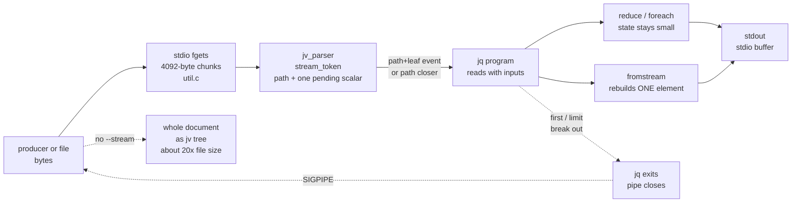

# jq Streaming for Large Inputs

> [!summary] Claim
> `jq --stream` replaces the parsed document with a lazy sequence of `[path, leaf]` events, so memory is bounded by nesting depth and the largest single scalar rather than by input size, at the price of a slower, lower-level programming model in which you reduce or filter in the stream and rebuild only one element at a time.

Part of [Structured Data and HTTP](README.md) in [Shell and Unix Engineering](../README.md).

## TL;DR

- Mechanism: with `--stream` the parser in `jv_parse.c` keeps only a path array and one pending scalar, and emits `[path, leaf]` for every scalar or empty container and `[path]` when an array or object closes, so jq can start work before the input ends and never holds the document.
- Rule: run `jq -n --stream` and pull events with `inputs` inside `reduce`, `foreach`, `first`, or `limit`; to get records back, rebuild one top-level element at a time with `fromstream`, and convert once to NDJSON if more than one pass is needed.
- Trap: the documented `fromstream(1|truncate_stream(inputs))` idiom silently drops every scalar, `[]`, and `{}` element of a top-level array, and leaving out `-n` silently loses the first event.
- Portability fact: `--stream` and `--seq` date from jq 1.5, `--stream-errors` implies `--stream` only from 1.7, the non-streaming parser refuses nesting beyond 256 (jq 1.6, 1.7.1) or 10000 (jq 1.8.x) but the streaming parser has no depth check, and gojq has `--stream` but no `--seq` while the jaq CLI source I read has no stream option.
- When not to use it: when the data fits in memory with room to spare (`.[]` was faster here), when the source can emit NDJSON, when one scalar is the large part (a 40 MiB string still peaked at 85 MiB), or when you need joins, sorts, or random access, where a database or a real program is the right tool.

## Mental model



Bytes flow left to right in 4 KiB-class chunks into a parser that never builds the tree: it turns each scalar into an event as soon as the next delimiter arrives and discards it once the jq program has consumed it.
The program pulls events lazily through `inputs`, so a reducer keeps only its accumulator and `fromstream` keeps only the element under construction.
The dotted arrows are the early-exit path: `first` or `limit` breaks out of the `inputs` loop, jq exits, the pipe's read end closes, and the producer is killed by `SIGPIPE` on its next write.
The last dotted arrow is the alternative you avoid: without `--stream`, jq materializes the whole document first, which measured about 20 times the file size here.

## How it works

### Input layer

jq reads input through stdio, not `mmap` and not one large `read`.
`jq_util_input_read_more` in `util.c` fills a 4096-byte buffer `buf` with `fgets`, asking for at most `sizeof(buf) - 4` = 4092 bytes so a multi-byte UTF-8 sequence cut at the end can be completed with a follow-up `fread` (jq-1.8.2 src/util.c, `jq_util_input_read_more`).
Each chunk is handed to the parser with `jv_parser_set_buf(parser, buf, len, !is_last)` and the main loop pulls values with `jv_parser_next` (jq-1.8.2 src/util.c, `jq_util_input_next_input`).
The `--stream` flag only sets `JV_PARSE_STREAMING` in the parser flags (jq-1.8.2 src/main.c, `main`); nothing else about input handling changes, so the unit of work is still "one parser result", which in streaming mode is one event.
Without `-n`, `main` calls the program once per parser result, with that result as `.`; with `-n` the program runs once with `null` as `.` and pulls results itself through `input` and `inputs`.
`inputs` is defined in jq as `try repeat(input) catch if .=="break" then empty else error end` (jq-1.8.2 src/builtin.jq, `inputs`), so it is a generator that ends at EOF.

### The streaming parser

`parser_init` allocates `p->path = jv_array()` only when `JV_PARSE_STREAMING` is set (jq-1.8.2 src/jv_parse.c, `parser_init`).
The parser state is deliberately tiny: `path` (array of numbers for array indexes and strings for object keys), `last_seen` (an enum such as `JV_LAST_OPEN_ARRAY`, `JV_LAST_COLON`, `JV_LAST_VALUE`), `output` (the event being assembled), and `next` (the pending scalar).
`stream_token` handles each structural character (jq-1.8.2 src/jv_parse.c, `stream_token`):

- `[` appends index `0` to `path` and sets `last_seen` to open-array; `{` appends `null` as a placeholder key.
- `:` stores the pending string in `next` into the last slot of `path` as the object key.
- `,` turns the pending scalar into `output = [path, value]` and then increments the array index or resets the key slot to `null`.
- `]` and `}` emit the last leaf with a third element `true` (an internal marker), pop `path`, and mark an empty container as a leaf `[path, []]` or `[path, {}]`.

`stream_check_done` then splits that three-element internal output into two events: first `[path, value]`, then, on the next call, `[path]` truncated to the closing path (jq-1.8.2 src/jv_parse.c, `stream_check_done`).
So `{"a":[1,{"b":2}],"c":[],"d":{}}` becomes

```
[["a",0],1]
[["a",1,"b"],2]
[["a",1,"b"]]
[["a",1]]
[["c"],[]]
[["d"],{}]
[["d"]]
```

The closing event `[["a",1,"b"]]` closes the innermost object; its path is that of the last child, not of the container, which is why a closer repeats the path of the leaf before it and carries no value (jq-1.8.2 src/jv_parse.c, `stream_check_done`).
A top-level scalar has the empty path (`[[],3]`) and no closer, and a top-level array of one element closes with `[[0]]`, a path of length one.
That length-one closer is what `fromstream` uses as its "the top-level value is complete" signal.

Three consequences follow from this design, and all three were verified in the lab or by hand:

- **Latency.** A scalar is emitted only when the next delimiter arrives (`,`, `]`, `}`), so the last element of an array appears with the closing bracket, and a top-level number only at the next token or EOF.
- **Memory is path depth plus one token.** `tokenadd` appends every byte of a string or number to `tokenbuf`, which starts at 256 bytes and doubles (jq-1.8.2 src/jv_parse.c, `tokenadd`); a string leaf is therefore buffered whole, then copied into a `jv` string, so the peak for one big string is a power-of-two buffer plus the copy; because only touched pages count toward RSS, that measured as about two copies of the string (85 MiB for a 40 MiB string, by hand).
- **Cost per event is O(depth).** Every event carries a copy of `path` (`JV_ARRAY(jv_copy(p->path), ...)`), and a mutation of a shared array copies it, so the total work for a document with N leaves at depth D is about N times D, not N.

### No depth limit in streaming mode

The non-streaming parser refuses nesting beyond `MAX_PARSING_DEPTH` inside `parse_token`: 256 in jq 1.6 and 1.7.1 and 10000 since jq 1.8.0 (jq-1.6 and jq-1.7.1 src/jv_parse.c define it as 256; the jq 1.8 NEWS lists "Increase the maximum parsing depth for JSON to 10000"; jq-1.8.2 src/jv_parse.c defines 10000).
The check `p->stackpos >= MAX_PARSING_DEPTH` appears twice, both in `parse_token`; `stream_token` has none (checked in the jq 1.6, 1.7.1, and 1.8.2 sources).
RFC 8259 allows both behaviors: "An implementation may set limits on the maximum depth of nesting" (RFC 8259 section 9).
The practical effect is on adversarial or generated input, covered under Pitfalls and Security.

### Builtins that work on events

jq 1.8.2 defines the streaming helpers in jq itself (jq-1.8.2 src/builtin.jq):

```jq
def truncate_stream(stream):
  . as $n | null | stream | . as $input | if (.[0]|length) > $n then setpath([0];$input[0][$n:]) else empty end;
def fromstream(i): {x: null, e: false} as $init |
  # .x = object being built; .e = emit and reset state
  foreach i as $i ($init
  ; if .e then $init else . end
  | if $i|length == 2
    then setpath(["e"]; $i[0]|length==0) | setpath(["x"]+$i[0]; $i[1])
    else setpath(["e"]; $i[0]|length==1) end
  ; if .e then .x else empty end);
def tostream:
  path(def r: (.[]?|r), .; r) as $p |
  getpath($p) |
  reduce path(.[]?) as $q ([$p, .]; [$p+$q]);
```

`fromstream` is a `foreach` over events whose state is `{x, e}`: `x` is the value under construction and `e` says "emit now".
A two-element event runs `setpath(["x"]+path; value)`, and `e` becomes true when the path is empty (a top-level scalar); a one-element closer sets `e` only when its path has length one.
When `e` is true the next step resets the state, so memory is one top-level value.
`truncate_stream` with depth `1` drops the first path component, which is how the idiom `fromstream(1|truncate_stream(inputs))` turns "the elements of a top-level array" into top-level values.
The jq 1.8 manual documents the idiom shape with `1|truncate_stream(...)` and its example outputs `["b"]` (jq 1.8 manual, "Streaming").

The idiom has a hole: `truncate_stream` keeps an event only if `(.[0]|length) > $n`.
A scalar element of a top-level array has path `[0]`, length one, which is not greater than 1, so it is discarded; an empty `[]` or `{}` element is a leaf event with the same short path and is also discarded.
Only elements that open a nested container survive, because their leaf events have longer paths.
The lab proves it: `[1,2,{"a":3},"s",[4]]` yields only `{"a":3}` and `[4]`, and `[[],{},1,{"k":[]}]` yields only `{"k":[]}`.
The lab's `to-ndjson.sh` repairs it by rewriting a depth-one leaf into a top-level value before `fromstream` sees it.
To pull one subtree out of a large object, filter on the first path component and truncate by the depth of the wanted elements: `jq -cn --stream 'fromstream(2|truncate_stream(inputs|select(.[0][0]=="items")))'` printed `{"a":1}` and `{"b":[2,3]}` for `{"meta":{"n":2},"items":[{"a":1},{"b":[2,3]}],"tail":[{"z":0}]}` (by hand, jq 1.8.2).
That form keeps the scalar-dropping hole of the idiom and reads to the end of the input unless a `first` or `limit` wraps it.
`tostream` produces the same events from an in-memory value: on `{"a":[1,2]}` it printed the four events that `--stream` prints for the same text (by hand), so a program written against events can be tested without a file.

### Early exit and backpressure

For a positive `$n`, `limit` is `label $out | foreach expr as $item ($n; . - 1; $item, if . <= 0 then break $out else empty end)` and `first(g)` is `label $out | g | ., break $out` (jq-1.8.2 src/builtin.jq).
Both stop pulling from the generator as soon as they have enough, which for `expr = inputs` means jq stops calling `jq_util_input_next_input` and stops reading stdin.
After jq exits, the kernel closes the read end; the next `write(2)` by the producer raises `SIGPIPE`, or returns `EPIPE` if the signal is ignored (see [[SIGPIPE-and-EPIPE]]).
The pipe buffer bounds how far a producer can run ahead: 64 KiB on Linux, and on macOS it starts at 16 KiB and grows to 64 KiB (measured in the shell matrix), so a producer writing megabytes cannot finish before a consumer that exits after its first chunk.
The lab uses exactly this: a producer that writes 400000 records and then creates a marker file leaves no marker when `first(inputs)` ends the pipeline.
Stdout is a stdio stream, so a downstream consumer sees results in blocks unless you pass `--unbuffered`, which calls `fflush(stdout)` after every output value (jq-1.8.2 src/main.c, `process`).
POSIX does not require the shell to wait for every stage: "the shell shall wait for the last command specified in the pipeline to complete, and may also wait for all commands to complete" (POSIX.1-2024 XCU 2.9.2), and the exit status is the last command's unless `pipefail` is on.

### Errors, `--stream-errors`, and `--seq`

A syntax error in streaming mode arrives after the events before it were already emitted and consumed.
In plain `--stream` mode `main` prints `jq: parse error: ...` and exits with `JQ_ERROR_UNKNOWN`, which is 5 (jq-1.8.2 src/main.c, `main`; 1.7.1 uses the same constant, jq 1.6's `main` sets `ret = 4` at that site).
With `--stream-errors` the parser builds the error as an event `[message, path]` instead (jq-1.8.2 src/jv_parse.c, `make_error`), so the program sees it as an ordinary input and the process exits 0 unless the program fails.
In jq 1.6 `main` sets only `JV_PARSE_STREAM_ERRORS` for this flag, and `parser_init` clears that flag unless streaming is on, so in 1.6 it has to be combined with `--stream`; the 1.7.1 help text says it "implies --stream", and 1.8.2 sets both flags (jq-1.6 and jq-1.7.1 src/main.c).
At EOF in the middle of a value the parser reports `Unfinished JSON term at EOF`, which is how a truncated download shows up.

`--seq` switches the parser to RFC 7464 framing: every text is preceded by RS (0x1E) and, on output, followed by LF (RFC 7464 section 2.2).
`parser_init` starts a `--seq` parser in `JV_PARSER_WAITING_FOR_RS`, so input without any RS is discarded with `Unfinished abandoned text at EOF`.
After a bad text the parser skips to the next RS and continues, which is RFC 7464 section 2.3 ("Incomplete/Invalid JSON Texts Need Not Be Fatal"); `main` prints `ignoring parse error` and keeps going.
Truncation detection depends on what came before the RS: `seq_check_truncation` requires that the last character was not whitespace (jq-1.8.2 src/jv_parse.c, `seq_check_truncation`), so a text cut off right before a newline and an RS is dropped without any warning (measured, covered by a lab test).
`--seq` with `--stream` uses `stream_seq_check_truncation`, which flags any open container, but events from the cut-off text that were already produced are not retracted (measured: `[["b",0],1]` appeared for a truncated `{"b":[1,`).

### Choosing among representations

| Need | Tool |
| --- | --- |
| One pass, small answer (count, sum, first N, extract one path) | `jq -n --stream` with `reduce`, `foreach`, `first`, `limit` |
| Many passes over records of a huge array | convert once to NDJSON with `to-ndjson.sh`, then `jq -c` per line, or better, ask the producer for NDJSON |
| Each record needs the whole record | `fromstream` per element, or NDJSON |
| Data fits in memory comfortably | plain `jq '.[]'`, which was the fastest option here |
| `--slurp` combined with `--stream` | avoid: it collects every event into one array (lab test), which gives up the memory bound |
| Joins, sorts, group-bys across the data | [[DuckDB-from-the-Shell]] or [[sqlite3-from-the-Shell]] |

## Numbers and limits

All measurements: jq 1.8.2, macOS 27.3 on arm64 (Apple silicon), measured 2026-11-26 and re-measured 2026-11-27 (the figures below are the later run), single runs unless a lab test says otherwise.
"By hand" means I ran the command here and saw the output; "lab" means a test in the lab asserts it.
Wall times are single runs and carry the noise of one run.

| Quantity | Value | Source |
| --- | --- | --- |
| Input read chunk | 4096-byte buffer, `fgets` of at most 4092 bytes | jq-1.8.2 src/util.c, `jq_util_input_read_more` |
| Parser depth limit, non-streaming | 256 (jq 1.6, 1.7.1), 10000 (jq 1.8.0 and later) | `MAX_PARSING_DEPTH` in jq-1.6, jq-1.7.1, jq-1.8.2 src/jv_parse.c; jq 1.8 NEWS |
| Depth limit, streaming parser | none; 20000 levels accepted, 200000 levels accepted and the first leaf event printed | lab (20000); by hand (200000) |
| Cost of dumping every event of a 200000-deep document | did not finish in 120 s, killed | by hand, one run |
| `fromstream` on deep input | a scalar inside 9999 nested arrays works, inside 10000 nested arrays it fails with `Path too deep`: `fromstream` calls `setpath(["x"]+path; ...)`, so that leaf path of 10000 elements becomes 10001, over `MAX_PATH_DEPTH` (10000) | by hand, jq 1.8.2; jq-1.8.2 src/jv_aux.c, `MAX_PATH_DEPTH`, added for CVE-2026-33947 (jq 1.8.2 NEWS) |
| Largest array or object (non-streaming) | 536870912 (2^29) elements | jq 1.8 NEWS, CVE-2024-23337 entry |
| Largest string or number token | 2^30 - 1 = 1073741823 bytes: `tokenadd` returns `Token too long` when `tokenlen > INT_MAX / 2` and must double, and the last allowed buffer is 2^30 | jq-1.8.2 src/jv_parse.c, `tokenadd`; by hand, a string of 1073741823 bytes was accepted (peak RSS 2,152,710,144 bytes, two copies) and one of 1073741824 bytes failed with `jq: parse error: Token too long at line 1, column 1073741825` and exit 5 |
| Peak RSS, `.[]` on 3.0 MB array of 50000 records | 64,405,504 bytes (about 21x the file) | by hand, `peak-rss` |
| Peak RSS, `.[]` on 12.4 MB array of 200000 records | 252,493,824 bytes (about 20x) | by hand, `peak-rss` |
| Peak RSS, `.[]` on 62.7 MB array of 1000000 records | 1,262,993,408 bytes (about 20x) | by hand, `peak-rss` |
| Peak RSS, `--stream` count of leaves, same three files | 3,162,112 / 3,129,344 / 3,145,728 bytes | by hand; lab asserts under 64 MiB and under 4 MiB growth for 4x input |
| Peak RSS, `--stream` on one 40 MiB string | 89,063,424 bytes (85 MiB) | by hand; lab asserts at least 40 MiB |
| Peak RSS, `--stream` and plain parse of one 200 MB string | 405,176,320 and 405,192,704 bytes | by hand: streaming did not help |
| Wall time on the 62.7 MB, 1M-record file | `.[]` 2.63 s; `--stream` reduce count 2.98 s; the textbook `fromstream` rebuild 17.94 s; `to-ndjson.sh` 20.26 s | by hand, one run each |
| Wall time, NDJSON form of the same data, `.id` per line | 1.08 s at 3,047,424 bytes peak RSS | by hand, one run |
| `jq -s length` on the NDJSON | 0.97 s but 1,200,275,456 bytes peak | by hand, one run |
| Pipe buffer | Linux 64 KiB; macOS 16 KiB growing to 64 KiB (65536 measured) | measured in the shell matrix, 2026-10 |
| Exit status, parse error | 5 (`JQ_ERROR_UNKNOWN`) in jq 1.7.1 and 1.8.2; `ret = 4` in the jq 1.6 source | jq src/main.c in each tag; observed 5 on 1.8.2 |
| `ru_maxrss` unit | bytes on macOS, KiB on Linux | `peak-rss.c` normalizes it; Linux unit per getrusage(2) on man7.org ("in KiB"); macOS bytes, by hand: a C probe that touched 209715200 bytes (200 MiB) of one allocation reported `ru_maxrss` 211238912, which is bytes (a KiB count would be near 205000) |

## Portability

`jq` is an external program, so the shell contributes only argv, redirections, and the pipeline.
The lab's scripts carry a `#!/bin/sh` line and therefore run under the host's system `sh`; the `LAB_SHELL` under test builds the pipelines around them.
Every test has passed at least once under each of bash 5.3.15, zsh, and dash on this host (macOS, jq 1.8.2), and all 27 passed again under bash in an independent run on 2026-11-27; this lab has not been run under the other shells, and no test branches on the shell family.

| Environment | Behavior | Evidence |
| --- | --- | --- |
| POSIX sh | The shell waits for the last pipeline command, may also wait for the rest; status is the last command's unless `pipefail` | POSIX.1-2024 XCU 2.9.2 |
| macOS bash 3.2 | Not run as `LAB_SHELL`; a failing `jq --stream` in the middle of a pipeline gave status 0 under `sh` (bash 3.2.57 in POSIX mode) | by hand, 2026-11-26 |
| current bash | Full lab passes under bash 5.3.15; with `pipefail` the same failing pipeline gave status 5 | lab and by hand, 2026-11-26 |
| zsh native | Same assertions pass; do not write a stderr-to-pipe redirect followed by `>/dev/null` before a pipe, because `MULTIOS` then duplicates stdout into the pipe | lab passes under zsh here; by hand, 2026-11-27: `echo hi 2>&1 >/dev/null \| cat` printed `hi` under zsh, and nothing under `setopt nomultios`, `emulate sh`, or bash; zshmisc(1), "Redirection", MULTIOS: a pipe is an implicit redirection, so `date >foo \| cat` writes to both |
| zsh with `--emulate sh` | The lab was not run under it; the `MULTIOS` probe above printed nothing under `emulate sh` | by hand, 2026-11-27 |
| dash | Same assertions pass; Debian's dash 0.5.12-12 (through its patch `0021-jobs-Implement-pipefail-option.patch`) and Homebrew's dash 0.5.13.5 both accept `set -o pipefail` and report 1 for `false \| true`, but a dash build without it rejects the option, so probe with `set -o pipefail 2>/dev/null` or check `jq` status separately | lab passes under dash here; `pipefail` checked by hand in the Debian image and on the host, 2026-11-27; Debian dash patch list; see also [[SIGPIPE-and-EPIPE]] |
| ksh93 | Pipeline stages use sockets in 1.0.10, so a cut-off producer can see `ECONNRESET` instead of `EPIPE`; a killed stage reports 256 + N | measured in the shell matrix; this lab does not assert it |
| mksh, posh, BusyBox ash | The lab was not run under them | not run for this lab |
| yash | A stage killed by `SIGPIPE` reports 384 + N, so a `pipefail` status is 397, not 141 | measured in the shell matrix; this lab does not assert it |
| GNU, BSD and macOS, BusyBox, uutils utilities | The lab uses `awk`, `head -c`, `tr`, `od -An -tx1`, `wc -c`, `cmp`, `grep -c`; run only with macOS utilities here | not run on other platforms |
| jq 1.5 | introduced `--stream` and `--seq` | jq NEWS, "New features in 1.5" |
| jq 1.6 | depth limit 256; `--stream-errors` sets only the error flag; parse-error site sets `ret = 4` | jq-1.6 src/jv_parse.c, src/main.c |
| jq 1.7.1 | depth limit 256; `--stream-errors` implies `--stream`; parse error exit 5 | jq-1.7.1 src/jv_parse.c, src/main.c |
| jq 1.8.0 and later | depth limit 10000 non-streaming only; `skip/2` added | jq 1.8 NEWS; jq-1.8.2 src/jv_parse.c |
| gojq | CLI has a `--stream` option; README says `--seq` is not supported ("not used commonly"); stream implementation not read | gojq cli/cli.go and README on main (as of 2026-11) |
| jaq | no `--stream` or `--seq` option in the CLI help (latest release v3.2.0) | jaq/src/help.txt and cli.rs on main (as of 2026-11) |

## Worked example

The [lab](../labs/09-jq-streaming-large-inputs/) holds 27 tests.
The central script converts an array to NDJSON while holding one element at a time:

```sh
#!/bin/sh
# to-ndjson.sh [FILE...]: the streaming equivalent of `jq -c '.[]'`.
# Emits each element of every top-level array, and each member value of every top-level object,
# as one compact line, holding one element at a time instead of the whole document.
# The stock `fromstream(1|truncate_stream(inputs))` drops elements that are scalars or empty containers (a leaf at
# depth 1 has a path of length 1, which truncate_stream(1) discards); the depth-1 branch here
# rewrites such a leaf into a top-level value so fromstream emits it.
# -n is required: without it jq consumes the first event as `.` and `inputs` never sees it.
exec jq -cn --stream '
  fromstream(
    inputs
    | (.[0] | length) as $d
    | if $d == 0 then empty
      elif $d == 1 then (if length == 2 then [[], .[1]] else empty end)
      else [.[0][1:]] + .[1:]
      end
  )
' -- "$@"
```

Run on `[1,2,{"a":3},"s",[4]]`, it matches `jq -c '.[]'`, where the textbook idiom prints only the last two lines:

```
1
2
{"a":3}
"s"
[4]
```

A leaf-only reduction needs no rebuild at all:

```sh
#!/bin/sh
# leaf-sum.sh FIELD [FILE...]: sum every number whose path ends in FIELD, in constant memory.
# FIELD is passed with --arg, never spliced into the program text, so any string is safe.
set -eu
field=${1:?usage: leaf-sum.sh FIELD [FILE...]}
shift
exec jq -n --stream --arg f "$field" '
  reduce (inputs | select(length == 2 and .[0][-1] == $f) | .[1]) as $v (0; . + $v)
' -- "$@"
```

```
$ gen-array.sh 1000 | leaf-sum.sh score
49500
```

The memory claim, from the lab's `peak-rss` helper (peak resident set size of the child, in bytes; one run each on this host):

```
file                       jq -c '.[]'      jq -n --stream reduce
3.0 MB   (50000 records)      64,405,504            3,162,112
12.4 MB (200000 records)     252,493,824            3,129,344
62.7 MB (1M records)       1,262,993,408            3,145,728
```

The streaming column stays flat as the input grows more than twentyfold; the parsed column grows with it.
Expected lab output for the whole file is `1..27` followed by 27 `ok` lines (bats TAP format).

## Pitfalls

> [!warning] Forgetting `-n`
> Trigger: `jq --stream 'fromstream(1|truncate_stream(inputs))' file` without `-n`.
> Symptom: the first event becomes `.`, which `inputs` never sees, so the first element silently loses its first leaf: on three generated records the first output was `{"name":"user-0",...}` with no `id`, while the other two were intact and the line count was still three.
> Fix: always `jq -n --stream` when the program calls `inputs`; the lab test "forgetting -n" fails if that behavior changes.

> [!warning] The textbook idiom drops scalars and empty containers
> Trigger: `fromstream(1|truncate_stream(inputs))` on an array whose elements are numbers, strings, `[]`, or `{}`.
> Symptom: those elements vanish with exit status 0; `[1,2,{"a":3},"s",[4]]` yields two of five elements.
> Fix: rewrite depth-one leaves as top-level events, as `to-ndjson.sh` does, or sum and filter on leaves directly and skip the rebuild.

> [!warning] Streaming one big scalar saves nothing
> Trigger: a document whose bulk is a single string, such as an embedded base64 blob.
> Symptom: peak RSS for a 200 MB string was 405 MB with `--stream` and 405 MB without; a 40 MiB string peaked at 85 MiB.
> Fix: split such data at the source, or extract the field with a tool that can seek (for example `dd` on known offsets) instead of a JSON parser.

> [!warning] Streaming is slower per byte, and rebuilding is much slower
> Trigger: choosing `--stream` for a file that fits in memory.
> Symptom: on a 62.7 MB, 1M-record array, plain `.[]` took 2.63 s and used 1.26 GB; `--stream` counting took 2.98 s at 3 MB; rebuilding records with `fromstream` took 17.94 s, because every event runs `setpath` on a growing path.
> Fix: measure first; if memory allows, do not stream; if it does not, stream to NDJSON once and process lines.

> [!warning] A failure in the middle of a stream leaves a prefix
> Trigger: a truncated or malformed input (a cut-off download) read as `jq --stream ... | consumer`.
> Symptom: the consumer has already received every event before the error; `jq` exits 5, but the pipeline exits with the consumer's status, 0 without `pipefail` (measured: 0 without it, 5 with it in bash).
> Fix: write to a temporary file and rename after a check of `jq`'s own status, or use `pipefail` where the shell has it; the lab asserts the events-then-error behavior and exit status.

> [!warning] Duplicate keys and closing events
> Trigger: reducing over paths with `select(.[0][0] == "k")` or assuming each path appears once.
> Symptom: `{"a":1,"a":2}` produces two leaf events for `["a"]` where a parsed document keeps only the last, and a filter without `length == 2` also matches the closing events, which share the path prefix (by hand, `select(.[0][0] == "y")` on `{"x":1,"y":[2]}` printed `[["y",0],2]`, `[["y",0]]`, and `[["y"]]`; the lab's injected `select-key-unsafe.sh` shows the same closers).
> Fix: guard every filter with `length == 2` and decide explicitly how repeated paths combine.

> [!warning] Joining paths with a dot is lossy
> Trigger: printing `path | join(".")` to build greppable lines.
> Symptom: `{"a.b":1}` and `{"a":{"b":1}}` both print `a.b=1`, and array indexes are numbers, not strings, until `tostring`.
> Fix: print paths as JSON with `tojson`, or use a separator that cannot occur in keys, and keep the raw path when it matters.

> [!warning] No depth limit when streaming
> Trigger: untrusted input with deeply nested brackets.
> Symptom: a 20000-deep document is accepted, but each event copies a path of that length; dumping all events for a 200000-deep file ran past 120 s before I killed it, while the non-streaming parser rejected 20000 levels in about 10 ms with `Exceeds depth limit for parsing`; in jq 1.8.2 `fromstream` then fails at depth 10000 with `Path too deep`, because its `setpath` path is one element longer than the document depth and `MAX_PATH_DEPTH` is 10000 (jq-1.8.2 src/jv_aux.c; the CVE-2026-33947 fix).
> Fix: bound time and memory with `timeout` and a resource limit (see [[Resource-Limits-and-ulimit]]), and treat a depth error from `fromstream` as bad input rather than a jq bug.

> [!warning] `--seq` quirks
> Trigger: feeding RS-less text, or a text truncated before a newline.
> Symptom: input with no RS prints `Unfinished abandoned text at EOF` and no output, exit 0; a truncated text followed by newline and RS is dropped with no warning; in `--stream --seq` mode events from the truncated text are still emitted.
> Fix: frame input with RS and LF (RFC 7464) and count the outputs you expect.

> [!warning] Splicing a shell variable into the program text
> Trigger: `jq "select(.[0][0] == \"$key\")"` with a key from a user or a file.
> Symptom: with key `x" or true or "` the filter becomes `... or true or ""` and every event, including closers, passes (lab test, `select-key-unsafe.sh`).
> Fix: pass data with `--arg k "$key"` and use `$k` in the program, as `select-key.sh` does.

## Security and robustness

- Parser-level jq vulnerabilities do not go away because you stream: the stream parser shares `tokenadd` and literal handling with the normal parser.
  CVE-2026-43894 (numeric literals of about INT_MAX digits overflowed in `decNumberFromString`) was fixed in 1.8.2 by rejecting literals longer than `DEC_MAX_DIGITS`, 999999999 (jq 1.8.2 NEWS; NVD record).
  CVE-2024-23337 (index overflow, DoS, up to and including 1.7.1) is in the NVD and the NEWS for 1.8.0.
  CVE-2026-40164 describes a fixed, publicly known MurmurHash3 seed that let roughly 100 KB of crafted keys make jq's object tables quadratic (NVD record), fixed in 1.8.2 by randomizing the seed (jq 1.8.2 NEWS).
- Pin the version in pipelines that handle untrusted JSON and take 1.8.2 or later, whose NEWS lists a batch of 2026 fixes for stack overflow, NUL truncation, and parser buffer handling.
- Bound resources: `timeout`, a memory limit by the container or cgroup, and a depth sanity check where the source is untrusted; see [[Resource-Limits-and-ulimit]].
- Never build jq programs from shell strings; use `--arg`, `--argjson`, or `--slurpfile`, and put `--` before file names that can start with a dash (see [[Command-Injection]] and [[Argument-Injection-and-Double-Dash]]).
- Raw output (`-r`) writes string contents including control characters to the terminal; filter or escape before printing untrusted values (see [[Terminal-Escape-Injection]]).
- Check completeness: a truncated file produces a valid-looking prefix of events; require the closing event or a size or hash check from the producer.
- Use `set -o pipefail` or capture `jq`'s status separately wherever the shell supports it; POSIX.1-2024 standardizes `pipefail` (XCU 2.9.2).

## The principal's view

The decision is about where the structure is cut, not about jq flags.
If you own the producer, change it: emit NDJSON or paginate (see [[Streaming-Exports-and-NDJSON-for-Unbounded-Collections]]), and the whole topic of this note disappears, because every line is a bounded document and ordinary `jq -c` works at line speed.
If you do not own it and the file is one huge document, use `jq -n --stream` for single-pass answers, because the memory bound is real and measurable: about 3 MB flat against 20 times the file size.
Take the downside knowingly: the program is harder to read and review, `fromstream` rebuilds were about seven times slower than `.[]` here, there is no depth guard, and one huge scalar defeats the whole approach.
Switch tools when the program starts to need random access, joins, or sorting: [[DuckDB-from-the-Shell]] and [[sqlite3-from-the-Shell]] take over for joins and sorts, [[Miller]] and [[xsv-and-qsv]] handle flat records, and [[When-to-Stop-Using-Text-Tools]] covers the signal that the pipeline should become a program with a real incremental parser (Go `json.Decoder`, Python `ijson`, Rust `serde_json::Deserializer`; I did not read those here).
Budget the failure modes too: a truncated input, a producer cut off by `first`, and an exit status hidden by a pipeline are the incidents, not the happy path.

## Interview questions

> [!question] L5: What does `jq -c --stream .` print for `{"a":[1,2]}`?
>
> > [!success]- Answer
> > It prints `[["a",0],1]`, then `[["a",1],2]`, then `[["a",1]]`, then `[["a"]]`.
> > The first two are leaf events `[path, value]`, the last two are closers `[path]` for the array and the object.
> > A closer's path is the path of the last child, so the array's closer is `[["a",1]]`.
> >
> > Follow-up: Why does the top-level closer have a path of length one, and what uses that?

> [!question] L5: Why does `jq --stream 'reduce inputs as $e (0; .+1)'` count one fewer event than the same command with `-n`?
>
> > [!success]- Answer
> > Without `-n`, jq runs the program once per input and passes the first event as `.`.
> > `inputs` yields only the remaining events, so the counter misses the first.
> > With `-n` the program starts with `null` and sees every event through `inputs`.
> >
> > Follow-up: What breaks, silently, if you forget `-n` in a `fromstream(inputs)` program?

> [!question] L5: Where does the memory of `jq -n --stream` go compared with `jq '.[]'`?
>
> > [!success]- Answer
> > The streaming parser keeps a path array whose length is the nesting depth, one pending scalar, and the token buffer.
> > The normal parser builds the whole tree, which was about 20 times the file size in my measurement.
> > Streaming memory is flat as the input grows, but a single huge string is buffered whole either way.
> >
> > Follow-up: What would you check before choosing streaming for a 5 GB file?

> [!question] L6: Debug this script, which prints three lines but gets the first record wrong - why?
>
> ```sh
> jq -c --stream 'fromstream(1|truncate_stream(inputs))' records.json
> ```
>
> > [!success]- Answer
> > It lacks `-n`, so the first event (the first leaf of the first record, its `id`) becomes `.` and never reaches `inputs`.
> > `fromstream` then rebuilds the first record without that leaf, and the line count stays the same, so nothing looks wrong.
> > The fix is `jq -cn --stream ...`.
> > The idiom also drops scalar and empty-container elements, which this input does not have, so it is the second bug waiting.
> >
> > Follow-up: How would you write a test that fails on this bug?

> [!question] L6: Predict the output of `printf '[1,[],{"k":[]}]' | jq -cn --stream 'fromstream(1|truncate_stream(inputs))'`.
>
> > [!success]- Answer
> > It prints `{"k":[]}` only.
> > The element `1` and the empty array `[]` are leaf events with a path of length one, and `truncate_stream(1)` keeps only events whose path is longer than one.
> > `{"k":[]}` has a leaf `[[2,"k"],[]]` with a path of length two, so it survives.
> > The lab asserts the same behavior for `[[],{},1,{"k":[]}]`.
> >
> > Follow-up: How would you change the program so that all elements come out?

> [!question] L6: Why is rebuilding records with `fromstream` about seven times slower than `.[]` on a file that fits in memory?
>
> > [!success]- Answer
> > Every event runs `setpath(["x"]+path; value)` inside a `foreach`, plus a path copy and a state reset per record, so work grows with events times depth.
> > The normal parser does one tree build in C.
> > In my single runs it was 17.94 s against 2.63 s on 62.7 MB, but memory was 3 MB against 1.26 GB.
> >
> > Follow-up: What do you do when you need records and the file does not fit?

> [!question] L6: When `producer | jq -n 'first(inputs)'` exits quickly, what happens to the producer?
>
> > [!success]- Answer
> > `first` breaks out of `inputs`, jq exits, and the read end of the pipe closes.
> > The producer's next `write` gets `SIGPIPE`, or `EPIPE` if it ignores the signal, and ends before it finishes.
> > The pipe buffer is only 64 KiB (16 KiB at first on macOS), so the producer cannot have written much more than jq read.
> > The lab proves this with a marker file that only a complete producer creates.
> >
> > Follow-up: What does `pipefail` report for that pipeline in bash, ksh93, and yash?

> [!question] L7: A nightly job parses a 200 GB single-document export with `jq -s`, so how would you fix it?
>
> > [!success]- Answer
> > First, change the contract: ask the producer for NDJSON or pages, so each unit is bounded and the failure of one unit is isolated.
> > If that is impossible, use `jq -n --stream` for single-pass reductions, and `to-ndjson.sh`-style rebuilding to land NDJSON on disk once, then process lines in parallel.
> > Add the failure handling: a completeness check (the final closer or a size and hash from the producer), `pipefail` or separate status capture, a temporary file with rename, and `timeout` plus a memory cap because there is no depth guard.
> > Measure on a slice before committing: single runs here showed streaming a count ran about 1.1 times longer than parsing and rebuilding about seven times longer.
> >
> > Follow-up: When would you stop using jq entirely for this job?

> [!question] L7: Untrusted JSON reaches an API gateway that shells out to jq, so what are the streaming-specific risks?
>
> > [!success]- Answer
> > The streaming parser has no depth check, so a 200000-deep document makes every event copy a very long path, which is quadratic work; dumping the events did not finish in 120 s.
> > `fromstream` has its own limit and fails at depth 10000 on jq 1.8.2 (`MAX_PATH_DEPTH` in `setpath`), so behavior depends on the consumer.
> > Tokens are buffered whole, so one big string defeats the memory bound.
> > Add resource limits and a timeout, pin a patched jq, never splice request data into the program, and prefer a purpose-built bounded parser at a trust boundary.
> >
> > Follow-up: Which of these would a unit test catch, and which needs a load test?

> [!question] L7+: Why does the stream parser emit `[path]` closers, and could `fromstream` work without them?
>
> > [!success]- Answer
> > Leaf events alone do not say when a container ends, and an empty container, a deeper container, or the next sibling cannot be told apart from continued nesting.
> > `fromstream` needs the closer of length one to know that a top-level element is complete, and it emits at that moment.
> > Without closers a rebuilder would have to wait for the next element or EOF, which loses incremental output and fails for the last element.
> > The parser also holds the last scalar until the next delimiter, which is why the closer and the last leaf are produced together.
> >
> > Follow-up: What does that imply for the latency of the last element in a live stream?

## Related

Prerequisites: [[jq-Paths-and-Updates]]

Next: [[yq-Variants-and-YAML-Hazards]]

See also: [[Structured-Data-Wrangling-Jq-Yq-and-Coreutils]]

Also: [[jq-Language]], [[Streaming-Exports-and-NDJSON-for-Unbounded-Collections]], [[SIGPIPE-and-EPIPE]], [[pipefail-and-PIPESTATUS]], [[Resource-Limits-and-ulimit]], [[When-to-Stop-Using-Text-Tools]], [[DuckDB-from-the-Shell]]

API Engineering goes deeper in [[20-API-Engineering/README|API Engineering]]: [[20-API-Engineering/05-Pagination-Filtering-and-Query-Patterns/README|Pagination Filtering and Query Patterns]], [[20-API-Engineering/21-AI-and-LLM-API-Engineering/README|AI and LLM API Engineering]]; start with [[Streaming-Exports-and-NDJSON-for-Unbounded-Collections]].

## Further reading

- jq 1.8 manual, "Streaming" and the command-line options `--stream`, `--stream-errors`, `--seq`, `--unbuffered` (jq-1.8.2 docs/content/manual/v1.8/manual.yml): the contract for event shapes and flags.
- jq `src/jv_parse.c` (`stream_token`, `stream_check_done`, `tokenadd`, `MAX_PARSING_DEPTH`): the implementation this note describes.
- jq `src/builtin.jq` (`fromstream`, `truncate_stream`, `tostream`, `limit`, `first`, `inputs`): the helpers in jq itself.
- jq `NEWS.md` for 1.8.0 through 1.8.2: depth limit change, `skip/2`, and the 2026 security fixes.
- RFC 7464, JavaScript Object Notation (JSON) Text Sequences: the framing `--seq` implements, and why a truncated text must not be fatal.
- RFC 8259, section 9: implementations may limit text size and nesting depth, which explains the parser differences.
- POSIX.1-2024 XCU 2.9.2, Pipelines: what the shell waits for and which status a pipeline reports.
- NVD records CVE-2024-23337, CVE-2026-40164, CVE-2026-43894: the primary descriptions of the jq issues cited here.
- gojq and jaq repositories: the alternative implementations compared in the portability table.
