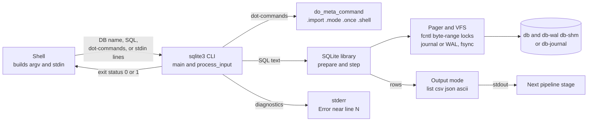

# sqlite3 from the Shell

> [!summary] Claim
> The `sqlite3` command is a line-oriented filter in front of an embedded database whose locks and sync calls hit the file system on every process start, so a pipeline that treats it as a text tool must pin the output mode, check the exit status, batch writes into one transaction, and never splice shell values into SQL.

Part of [Structured Data and HTTP](README.md) in [Shell and Unix Engineering](../README.md).

## TL;DR

- Mechanism: after the database name, every argument is a SQL statement or a dot-command; with no such argument the CLI reads stdin; each process is one connection that takes `fcntl` byte-range locks on the file and syncs it at commit.
- Rule: write `sqlite3 -csv -header DB 'SQL'` or `-json` or `-ascii`, never the bare default; pre-create tables with explicit types; wrap bulk writes in one transaction; pass values through `readfile()` or a real binding, not string interpolation.
- Trap: the same command prints boxes on a terminal and `a|b` in a pipe (3.53.0 and later), `.import` can create `ANY` columns that turn `00501` into `501`, and each autocommit statement costs one sync (3000 inserts: 5.237 s, in one transaction: 0.024 s, measured here).
- Portability: the shell only builds argv and stdin, so quoting is the sole shell-dependent part (here-documents are POSIX; `$'...'` is not in dash 0.5.12 or posh); the `sqlite3` binary varies far more (Apple 3.54.0, Homebrew 3.54.1, Debian 13 3.46.1, Alpine 3.22 3.49.2).
- Not for: several hosts sharing one file over NFS or SMB, many concurrent writers, untrusted callers that need parameter binding (use a language binding), or large analytic scans (see [[DuckDB-from-the-Shell]]).

## Mental model



The shell hands `sqlite3` a database name plus either extra arguments or a stdin stream, and the CLI sorts each piece into dot-commands, which it executes itself, and SQL, which it hands to the library one complete statement at a time.
The library takes locks on the database file through the pager and VFS, writes a rollback journal or a write-ahead log, and syncs at commit, so the cost and the failure modes of a "one-line query" are those of a database transaction, not of `cat`.
Result rows go through the active output mode to stdout, where the next stage sees only bytes; diagnostics go to stderr; and the process exit status collapses every failure into 1, so a pipeline that ignores the status cannot tell success from a half-applied script.

## How it works

### Two programs under one name

"SQLite" is the library and `sqlite3` is a separate application, the CLI, that passes input to the library (cli.html section 1.1).
Everything in this note that starts with a dot is the CLI, not SQL, and dot-commands never reach `sqlite3_prepare()` (cli.html section 3.3).
The CLI source is one generated file, `shell.c`, built from `src/shell.c.in` (cli.html section 24.1); citations below are to `shell.c.in` as fetched from the project mirror on 2026-11-21, which is newer than any distro build.

### Startup: argv, the rc file, then the arguments

`main` makes a first pass over argv.
The first argument that is not an option becomes the database name; every later non-option argument is queued as SQL or a dot-command and sets `readStdin = 0`, so stdin is then never read (shell.c.in, `main`; cli.html section 23.1).
An argument starting with `-` is an option, one or two dashes are equivalent, and a bare `--` ends option parsing (cli.html section 23.2; shell.c.in, `main`, `nOptsEnd`).
If the database file does not exist the open is delayed, so a typo alone creates nothing, but running any statement calls `open_db()` and creates a zero-byte file; the lab shows `sqlite3 typo.db 'select 1'` leaving an empty `typo.db`, and `-readonly` refusing with status 1 and creating nothing.

Next the CLI processes an initialization file: `-init FILE` if given, else `$XDG_CONFIG_HOME/sqlite3/sqliterc` or `~/.config/sqlite3/sqliterc` if it exists, else `~/.sqliterc` (shell.c.in, `process_sqliterc`, `find_xdg_file`).
The home directory comes from `getpwuid(getuid())` first and only then from `HOME` (shell.c.in, `find_home_dir`); measured here, exporting a different `HOME` did not change which rc file was read, while `XDG_CONFIG_HOME` did, on both the Apple and the Homebrew build.
The command-line options are applied in a second pass after the rc file, so options override it (shell.c.in, `main` comment), and `-cmd` strings run first and separately from the plain arguments, a historical quirk the source comment itself calls "goofy".
A hidden rc file that sets `.mode csv` therefore changes the output of a script that never mentions a mode, which is why scripts should pass `-init /dev/null` or set every option they depend on; the lab runs `-init` with a file and with `/dev/null`.

Since 3.53.0 an argument after the database that names a non-empty `*.sql` or `*.txt` file is read as a script of SQL and dot-commands (changes.html, 3.53.0; shell.c.in, `isScriptFile`, which also accepts `*.clitest` and rejects files whose size is a multiple of 512 and that open as a database).
The same check runs on the first positional argument, so `sqlite3 query.sql 'select 1'` does not open `query.sql` as a database; it runs it as a script and then takes `select 1` as the database name.
Measured on the Apple 3.54.0 and the Homebrew 3.54.1 builds: that call created a file literally named `select 1`.
The security consequence is in the Security section.

### Input: lines, complete statements, dot-commands

`process_input` reads one line at a time (shell.c.in, `process_input`).
A line that begins with `.` or `#` at the left margin, while no SQL is pending, is a dot-command or a CLI comment; anything else is appended to a SQL buffer.
The buffer is executed when a line contains a `;` and `line_is_complete()` agrees that the accumulated text is complete, which is `sqlite3_complete()` semantics, so a `;` inside a string, a comment, or a `CREATE TRIGGER` body does not end the statement (cli.html sections 3.1 and 22).
Dot-commands are one physical line, take no comments, and cannot appear at a continuation prompt (cli.html section 3.1).
Dot-command arguments are split on whitespace, `'...'` and `"..."` group words, and C-style backslash escapes work only inside double quotes (cli.html section 3.2); that last rule is why `.parameter set` mangles a value containing a backslash (Pitfalls).

Errors do not stop a stdin script by default.
`runOneSqlLine` prints `Parse error near line N:` or `Runtime error near line N:` (or `Error in the 2nd command line argument:` for arguments) to stderr and returns 1, `process_input` counts it in `errCnt`, and the loop continues unless `-bail` or `.bail on` is set (shell.c.in, `runOneSqlLine`, `process_input`).
The process exit status is `errCnt > 0`: 0 or 1, never the SQLite result code.
Statements given as arguments behave differently: the first failing argument ends the program (shell.c.in, `main`, the `!readStdin` loop).
The lab asserts both: a stdin script `select 1; selec 2; select 3;` prints `1` and `3` and exits 1, with `-bail` prints `1` and exits 1, and three arguments print `1` and exit 1.

`.shell` and `.system` call `system(3)` with the arguments joined by single spaces, quoting any argument that contains a space, and report a non-zero result only as a stderr line, never as the CLI's exit status (shell.c.in, `do_meta_command`).
`.once FILE`, `.output FILE` and `.read FILE` accept a leading `|` to mean a command through `popen` (cli.html sections 7.1 and 7.2; shell.c.in, `sqlite3_popen` call sites).
`.once` redirects only the next SQL statement; the lab runs `.once o.txt` with two selects and finds `1` in the file and `2` on stdout.

### Output: the mode is part of your data format

When both stdin and stdout are terminals the CLI is interactive; otherwise it is in batch mode (shell.c.in, `main`: `stdin_is_interactive = isatty(0)`, `stdout_is_console = isatty(1)`).
From 3.53.0 the default for a terminal is `qbox` (Unicode boxes, text quoted as SQL literals, columns squeezed to the screen width, values truncated to 5 lines and 300 characters), while batch mode keeps the legacy `list` format: `|` between columns, newline between rows, no limits (climode.html sections 1.1 and 2).
climode.html calls this change 3.52.0, but changes.html lists 3.52.0 as withdrawn with all of its features moved to 3.53.0, so the first release is 3.53.0 (2026-04-09).
Measured by hand with `script(1)` as the pty, `.mode` printed `.mode qbox --limits on --quote relaxed --sw auto --textjsonb on` on both the Apple and the Homebrew build, and `.mode list` when stdout was a pipe.
A pipeline that works in a pipe and prints boxes at a prompt is not a bug in your script; it is the default.
`-batch` forces batch I/O and `.mode batch` and `.mode tty` pick either default (climode.html section 3.10).

The modes a script should use, and what they do to awkward data (climode.html sections 3.1 to 3.4; lab):

| Mode | Column separator | Row separator | Quoting | NULL shows as |
|---|---|---|---|---|
| `list` (batch default) | `\|` | newline | none | empty string |
| `csv` | `,` | CRLF always | RFC 4180 | empty string |
| `tabs` | tab | newline | RFC 4180 style, `--quote off` for none | empty string |
| `ascii` | 0x1f | 0x1e | none | empty string |
| `json` | n/a | n/a | JSON escapes | `null` |
| `quote` | `,` | newline | SQL literals | `NULL` |

`list` mode is ambiguous by construction: a value containing `|` or a newline is indistinguishable from a separator, and a NULL is indistinguishable from an empty string (measured: `select null, ''` prints a bare `|`).
The lab renders one row holding `a|b`, `x<newline>y` and `say "hi", ok`: `list` prints two lines that cannot be told from two rows, `csv` quotes it per RFC 4180 and ends the row with CRLF, `json` escapes it, and `ascii` separates fields with 0x1f and rows with 0x1e so the bytes survive any field content except those two.
CSV rows end in CRLF even on Unix, because RFC 4180 requires it and the `.crlf` setting does not apply to CSV (climode.html section 5), so pipe `csv` output through `tr -d '\r'` before feeding line tools.
Since 3.50.0 the CLI also renders control characters in values as `^[` style caret sequences, so an ESC in a column cannot drive your terminal; measured, `select char(27)||'[31mx'` printed `^[[31mx`, and `-escape off` printed the raw 0x1b (climode.html section 4; see [[Terminal-Escape-Injection]]).
A NUL inside a text value cuts the CLI output at the NUL, and `length()` counts only the characters before it (nulinstr.html; lang_corefunc.html; lab: `length('a'||char(0)||'b')` is 1 and `hex(...)` is `610062`).

### Import: a CSV reader that binds text

`.import FILE TABLE` (shell.c.in, `dotCmdImport`) reads records with the RFC 4180 reader unless the mode is `ascii`, with `--csv`, `--ascii`, `--colsep`, `--rowsep`, `--skip N`, `--schema`, `--esc` and `--qesc` options (shell.c.in, usage comment above `dotCmdImport`; cli.html section 7.5).
Separators must be a single ASCII byte, and `FILE` may be `|command` or `<<LABEL` to read the lines that follow in a script.
If the table does not exist it is created from the first row, and that row is not data; if it exists, every row including the first is data, which is why `--skip 1` exists (cli.html section 7.5).
The insert loop prepares `INSERT INTO t VALUES(?,...)` and calls `sqlite3_bind_text` for every field, so every value arrives as TEXT and the column's affinity decides what is stored (datatype3.html section 3.1; shell.c.in, `dotCmdImport`).
It wraps the whole import in one `BEGIN` and `COMMIT` when no transaction is open, which is why importing 100000 rows took 0.291 s here, but it does not roll back on a bad row: a row whose INSERT fails is reported on stderr, counted, and skipped while the others commit, and the exit status becomes 1 (measured: a duplicate key on row 3 of 4 left rows 1, 2 and 4 committed).
Rows with too few fields are padded with NULL and rows with too many are truncated, each with a warning on stderr but exit status 0; an unterminated quote swallows the rest of the file into one field (lab: the `ragged` mode).
An empty CSV field imports as the empty string, not NULL.

The auto-created column type is the trap.
The source on trunk emits column names with no declared type, which gives the column BLOB affinity and keeps text as text; the Homebrew 3.54.1 build did exactly that (`CREATE TABLE "t"("id", "name", "zip")`, and `00501` stayed `00501`).
The Apple 3.54.0 build declared every column `ANY` (measured: `"id" ANY, "name" ANY, "zip" ANY`), and a declared type of `ANY` in a non-STRICT table matches none of the INT, CHAR, CLOB, TEXT, BLOB, REAL, FLOA, DOUB rules, so the affinity is NUMERIC and `00501` became the integer 501 (datatype3.html section 3.1).
The `ANY` is upstream behavior, not an Apple change: `shell.c.in` at the `version-3.53.0` tag builds the column list with `cname||' ANY'` (the `zCollectVar` query in `zAutoColumn`), and trunk check-in `f55434ab30` of 2026-06-01 removed it ("Remove the data type ANY added to the shell's CSV exports"), so the `version-3.54.0` and `version-3.54.1` tags emit untyped columns.
The Apple binary's source ID is dated 2026-04-09 12:25:13, about 44 minutes after the 3.53.0 release check-in (2026-04-09 11:41:38, changes.html), which fits a snapshot taken just after the 3.53.0 release and before that removal.
Older CLIs created TEXT columns (the lab accepts `TEXT`, none, or `ANY`, and asserts that the declared type predicts the stored value; the Debian 13 and Alpine 3.22 binaries are not run here, but upstream `shell.c.in` at `version-3.46.1` and `version-3.49.2` also emits untyped columns).
The portable rule is never to let `.import` create the table: create it first with explicit types, ideally `STRICT`, and import with `--skip 1`.

### Parameters: what the CLI can bind

Unnamed `?` parameters are left NULL; named parameters (`:name`, `@name`, `$name`, `?NNN`) are looked up in a `temp.sqlite_parameters` table that `.parameter init`, `.parameter set KEY VALUE`, `.parameter list` and `.parameter clear` manage (cli.html section 15).
`.parameter set` evaluates `VALUE` as SQL if it can and quotes it as text if that fails, and it goes through the dot-command argument parser first, so double-quoted arguments get backslash processing; if evaluation of the text fails silently the parameter is bound to something else than you meant (cli.html section 15; lab).
The CLI adds `readfile(X)` and `writefile(X,Y)` from `ext/misc/fileio.c` (cli.html section 7.3), and `readfile()` is the one way to get arbitrary bytes into a query without any quoting: write the value to a file with `printf '%s'`, bind the file name, and use `cast(readfile(:f) as text)`.
The lab proves this on the three values that break the alternatives: a single-quote injection, a backslash-n pair, and a double quote.
The other quoting-free route is a hex literal, `cast(x'7827...' as text)`, built with `od -An -tx1 | tr -d ' \n'`; The lab runs it on the value `x' or 1=1 --` and gets the same text back (`-A n` and `-t x1` are specified by POSIX `od`; BusyBox `od_bloaty.c` accepts both and Alpine 3.22 builds BusyBox with `CONFIG_DESKTOP=y` and `CONFIG_OD=y`; uutils `od` parses `-A` with an `n` radix; the BusyBox and uutils binaries were not run).

### Connections, locks, and what `fcntl` does

Every `sqlite3` process opens one connection (the CLI can hold several at once with `.connection`: cli.html section 18 says up to 10, numbered 0 to 9, but `shell.c.in` declares `aAuxDb[5]` on trunk and at 3.54.0, and both measured builds silently ignore `.conn 5` through `.conn 9` with status 0, so the real limit is 5), and a connection holds one of five lock states on the main file: UNLOCKED, SHARED, RESERVED, PENDING, EXCLUSIVE (lockingv3.html section 3.0).
On Unix they are POSIX advisory byte-range locks taken with `fcntl(F_SETLK)` in `unixLock` (os_unix.c, `unixLock`, `unixFileLock`), at offsets derived from `PENDING_BYTE`, which defaults to 0x40000000 with `RESERVED_BYTE` one byte after it (os.h).
In WAL mode the coordination between connections moves to `fcntl` locks on the `-shm` file: the write, checkpoint and recover locks and the reader marks (os_unix.c, `unixShmSystemLock`, and the lock-layout comment above `unixPosixAdvisoryLocks`).
POSIX says all process-owned locks on a file are removed when the process closes any descriptor for that file, even a different one (POSIX.1-2024 XSH `fcntl`), which is why `unixClose` parks a descriptor on `pInode->pUnused` instead of closing it while locks are outstanding (os_unix.c, `unixClose`, `setPendingFd`, `closePendingFds`).
It is also why the corruption guide forbids carrying an open connection across `fork()` and warns about threads that `close()` a descriptor to the database (howtocorrupt.html sections 2.2 and 2.7), and why a network file system with broken lock emulation corrupts it (howtocorrupt.html section 2.1; lockingv3.html warns that POSIX locking is buggy or missing on many NFS implementations).

### Transactions, the busy handler, and why deferred upgrades lose

Without `BEGIN` every statement is its own transaction and commits (syncs) when it finishes; `BEGIN` is DEFERRED by default, so no lock is taken until the first statement, `BEGIN IMMEDIATE` takes the write lock at once, and `EXCLUSIVE` is the same as IMMEDIATE in WAL mode (lang_transaction.html sections 2.2 and 2.3).
A read transaction that later tries to write is "upgraded" if possible and fails with SQLITE_BUSY if another connection has changed or is changing the database (lang_transaction.html section 2.1).
The CLI installs no busy handler; `.timeout MS` calls `sqlite3_busy_timeout()` (shell.c.in, `do_meta_command`, `.timeout`) and `PRAGMA busy_timeout` does the same, with a documented maximum of 2147483647 ms (pragma.html).
A busy handler cannot help an upgrade that failed because the snapshot is stale: the lab starts connection A with a plain `begin` and a read, lets connection B commit a row, then A inserts.
In WAL mode A fails with `database is locked`, its `insert` never happens, and A's trailing `commit` commits nothing, so the rows end as `1,200` with exit status 1 in A.
With `begin immediate` B is shut out instead (its `.timeout 300` expires with `database is locked`) and A's write survives: `1,100`.
In rollback-journal mode with a deferred `begin`, A's open read transaction blocks B's commit, so B fails and A wins.
The separate `busy` test shows the working pattern: a bare writer fails at once with status 1, and a writer that sets `.timeout 20000` stays blocked (the lab checks the process is still alive after the lock has been held for more than a second) and succeeds with status 0 once the holder commits.

### Journals, WAL, and sync

The default journal mode is DELETE: a rollback journal is written next to the database, and deleting it is the commit (pragma.html, `journal_mode`; wal.html section 2).
`PRAGMA journal_mode=WAL` is the one journal setting that persists in the database file: the two file-format bytes at offsets 18 and 19 become 2, and an older library that sees them refuses the file (wal.html sections 3.3 and 10); the lab reads them back with `readfile()` and gets `0202` in WAL mode and `0101` after `journal_mode=delete`.
Writers append frames to `DB-wal` and a commit is a commit record, so readers do not block the writer and vice versa; there is still exactly one writer at a time (wal.html section 2.2).
The wal-index lives in `DB-shm`, an ordinary mmapped file that rarely exceeds 32 KiB and is never synced; WAL needs all processes on one host (wal.html sections 1 and 7).
A checkpoint copies frames back into the database; the automatic one runs when a commit leaves the WAL at 1000 pages or more, and `PRAGMA wal_checkpoint(TRUNCATE)` returns one row of three integers (busy flag, pages in the log, pages checkpointed) and truncates the log (wal.html section 3.1; pragma.html, `wal_checkpoint`).
The lab shows `DB-wal` non-empty after a commit and 0 bytes after `wal_checkpoint(truncate)`, with the busy flag 0 and the two page counts equal.
Checkpoint starvation by overlapping readers can make the WAL grow without bound (wal.html section 6).
`PRAGMA synchronous` defaults to FULL (2) in the rollback-journal modes (`DEFAULT_SYNCHRONOUS=2` in both measured builds; the WAL default is 1 on the Apple build and 2 on the Homebrew build, per `DEFAULT_WAL_SYNCHRONOUS`), and in WAL mode NORMAL keeps the database consistent after a power loss but can lose the most recent commits (pragma.html, `synchronous`).
The wal.html page also records a rare WAL-reset bug present from 3.7.0 through 3.51.2, fixed in 3.51.3 (2026-03-13) with backports to 3.44.6 and 3.50.7 (wal.html section 11); it needs two connections writing or checkpointing at the same instant, so it matters to servers more than to a cron script, but it is a reason to know which `sqlite3` your fleet runs.

### Copying a live database

`cp` of a database that is being written can capture old and new pages together; the supported ways are the online backup API (`.backup`), `VACUUM INTO 'file'` (3.27 and later, which refuses to overwrite an existing file and writes a minimal copy), `sqlite3_rsync` (3.47.0, which can copy over SSH) and `.dump` piped into a new database (howtocorrupt.html section 1.2; lang_vacuum.html section 2.1; rsync.html; cli.html section 9).
A copy is safe only if no transaction is in progress, and the `-wal` or `-journal` file must travel with the database or committed data can be lost (howtocorrupt.html sections 1.2 and 1.4; wal.html section 4).
The lab builds a database with an index, a quote, a blob with a NUL byte, a NULL and `1e300`, copies it all three ways, and checks that the rows match and `pragma integrity_check` says `ok`; a second `VACUUM INTO` onto the same file exits 1.
`.dump` writes `PRAGMA foreign_keys=OFF;` and one transaction, and it stops at the first NUL in a text value (nulinstr.html).

### Types, strictness, and the settings you must not trust

Column types are advice: an `INTEGER` column holds `'abc'` as text and a `STRICT` table (3.37.0) refuses it with `cannot store TEXT value in INTEGER column` (quirks.html section 3; stricttables.html section 2; lab).
Foreign key enforcement is off unless the connection says `PRAGMA foreign_keys=ON`, per connection, so a second `sqlite3` process starts from the default again (quirks.html section 4; pragma.html, `foreign_keys`; lab, which flips the setting in one process and reads the default in the next).
Double-quoted strings are accepted when they match no identifier, so a misspelled column silently becomes a string; the CLI disabled this by default in 3.41.0 (quirks.html section 8), but the Apple build still had `dqs_dml on` (measured with `.dbconfig`), the Homebrew build had it off.
`PRAGMA trusted_schema` is ON by default for compatibility, and the documentation advises switching it off on every connection (pragma.html, `trusted_schema`).

## Numbers and limits

| Quantity | Value | Source or how produced | Date |
|---|---|---|---|
| Max length of a string, BLOB or row | 1,000,000,000 bytes default; hard ceiling 2,147,483,645 | limits.html | 2026-11 |
| Max columns per table or result | 2000 default, 32767 ceiling | limits.html | 2026-11 |
| Max SQL statement length | 1,000,000,000 bytes | limits.html | 2026-11 |
| Max tables in a join | 64 | limits.html | 2026-11 |
| Max expression depth, compound SELECT terms, LIKE pattern | 1000, 500, 50000 bytes | limits.html | 2026-11 |
| Function arguments | 1000 since 3.48.0 (2025-01-14); Apple build reports 127 | limits.html; `PRAGMA compile_options` on /usr/bin/sqlite3 | 2026-11 |
| Host parameters | 32766 default since 3.32.0; Apple build 500000, Homebrew build 250000 | limits.html; `PRAGMA compile_options` | 2026-11 |
| Attached databases | 10 default, 125 ceiling | limits.html | 2026-11 |
| Pages per database | 4,294,967,294 default since 3.45.0; Apple build 1,073,741,823 (about 4.4 TB at 4096-byte pages, arithmetic) | limits.html; `PRAGMA compile_options` | 2026-11 |
| Page size | powers of two, 512 to 65536; default 4096 | limits.html; `PRAGMA page_size` measured | 2026-11 |
| Maximum database size | about 281 TB (4,294,967,294 pages of 65536 bytes) | limits.html | 2026-11 |
| CLI simultaneous connections | 5 (`.connection` numbers 0 to 4); cli.html section 18 says 10 (0 to 9) | `aAuxDb[5]` in shell.c.in (trunk and 3.54.0); measured: `.conn 5` and `.conn 9` ignored with status 0 on both builds | 2026-11-21 |
| `busy_timeout` maximum, default | 2,147,483,647 ms; default 0 (measured: `pragma busy_timeout` printed 0) | pragma.html; measured | 2026-11 |
| WAL autocheckpoint threshold | 1000 pages (about 4 MB at 4096) | wal.html section 6; `DEFAULT_WAL_AUTOCHECKPOINT=1000` in compile options | 2026-11 |
| Typical wal-index size | rarely above 32 KiB, never synced | wal.html section 7 | 2026-11 |
| 3000 single-row INSERT statements on stdin, no `BEGIN`, rollback journal | 5.237 s (about 1.75 ms per commit) | hand-run once, `/usr/bin/sqlite3` 3.54.0, Apple M3 Pro, APFS, macOS 27.3; not in the lab | 2026-11-21 |
| The same 3000 statements inside one `BEGIN` and `COMMIT` | 0.024 s | same run | 2026-11-21 |
| The same 3000 statements, WAL mode, no `BEGIN` (this build's WAL default is `synchronous=NORMAL`) | 0.356 s | same run | 2026-11-21 |
| 300 separate `sqlite3 db 'insert ...'` processes | 23.544 s (about 78 ms each) | same run | 2026-11-21 |
| `.import --csv` of 100000 rows (2 columns) | 0.291 s | same run; file written with `awk` | 2026-11-21 |

The four timing rows come from a single run of one script on one machine, not repeated and not under the lab, so treat them as orders of magnitude: the per-commit cost is dominated by syncs, and I did not trace which system call the Apple build issues.
Process-per-row costs about 45 times the autocommit loop because each process pays startup, open, lock, journal and sync again.

## Portability

The shell never changes what `sqlite3` does; it changes how you get SQL into it.
Table 1 is the shell side.

| Shell | Quoted here-document passes `$` and backticks to `sqlite3` | `$'...'` for newlines in SQL | Lab status |
|---|---|---|---|
| POSIX sh | required (POSIX.1-2024 XCU 2.7.4) | specified in POSIX.1-2024 XCU 2.2.4, absent from older shells | scripts use portable constructs only |
| macOS bash 3.2 (`/bin/sh`) | lab test, passed under `/bin/sh` on 2026-11-21 | yes, measured: `printf %s $'a\nb' \| wc -c` printed 3 | 31 of 31 tests passed (one test on a rerun) |
| bash 5.3 | lab test, matrix pending | yes, measured with bash 5.3.15 (3) | matrix pending |
| zsh native | lab test, matrix pending | yes (shell matrix: `$'\x4142'` item lists zsh with bash and yash) | matrix pending |
| zsh `--emulate sh` | lab test, matrix pending | yes, measured here (3) | matrix pending |
| dash | lab test, matrix pending | not in 0.5.12 (shell matrix); a newer Homebrew dash here printed 3 | matrix pending |
| ksh93 | lab test, matrix pending | yes, measured with macOS `/bin/ksh` 93u+ (3) | matrix pending |
| mksh | lab test, matrix pending | yes, with a different `\x` width (shell matrix) | matrix pending |
| yash | lab test, matrix pending | yes, no `\u` or `\U` (shell matrix) | matrix pending |
| posh | lab test, matrix pending | no (shell matrix) | matrix pending |
| BusyBox ash | lab test, matrix pending | yes, without `\c`, `\e`, `\E`, `\u`, `\U` (shell matrix) | matrix pending |

Rule: put multi-line SQL in a quoted here-document, not in `$'...'`, and let `sqlite3` read it from stdin.
`.shell` always runs through `system(3)`, so `/bin/sh`, not the shell under test, interprets those command strings (shell.c.in, `do_meta_command`).
Two shell facts from the matrix matter to scripts that wrap `sqlite3`: posh does not treat `export` as a declaration utility (`export x=$v` splits on spaces), and posh aborts on an empty `"$@"` under `set -u`.

Table 2 is the `sqlite3` side, the part that varies.

| Behavior | Apple `/usr/bin/sqlite3` | Homebrew `sqlite3` | Debian 13 `sqlite3` | Alpine 3.22 `sqlite` |
|---|---|---|---|---|
| Version string | 3.54.0 2026-04-09 (the release log dates 3.53.0 to 2026-04-09 11:41:38 and 3.54.0 to 2026-10-09, so this is a snapshot taken 44 minutes after 3.53.0, not the 3.54.0 release) | 3.54.1 2026-10-16 | 3.46.1-7+deb13u2 (packages.debian.org, as of 2026-11) | 3.49.2-r1 (pkgs.alpinelinux.org, as of 2026-11) |
| `.import` auto-created column type | `ANY`, measured | none, measured | none in upstream 3.46.1 `shell.c.in`; binary not run | none in upstream 3.49.2 `shell.c.in`; binary not run |
| `.dbconfig dqs_dml` default | on, measured; `DQS=3` in compile options | off, measured; `DQS=0` | on: the compile options in `libsqlite3.so.0.8.6` of the 3.46.1-7+deb13u2 arm64 package list no `DQS=`, and `main.c` makes an undefined `SQLITE_DQS` mean DQS_DML on; not run | on: the compile options in the 3.49.2-r1 arm64 `sqlite3` binary list no `DQS=`, same rule; not run |
| `load_extension()` SQL function | absent, `OMIT_LOAD_EXTENSION` in compile options, `.load` is an unknown command | present, measured | present by build flags (`-DSQLITE_ENABLE_LOAD_EXTENSION`, `--enable-load-extension` in debian/rules); not run | present: no `OMIT_LOAD_EXTENSION` in the compile options of the 3.49.2-r1 arm64 `sqlite3` binary, which contains the `.load` help text, and `open_db` enables extension loading when that macro is unset; not run |
| Default mode when stdout is a pty | `qbox`, measured | `qbox`, measured | before 3.53.0, so `list` by the release log; not run | before 3.53.0, so `list` by the release log; not run |
| `-wal` and `-shm` after the last connection exits | left behind, measured | removed, measured | removed by design (wal.html section 4); no Debian patch title or compile option mentions WAL deletion, but this was not run and the Apple build shows that a vendor build can differ | removed by design (wal.html section 4); the only Alpine patch is the CVE-2025-6965 fix, but this was not run |
| Script-file arguments (`*.sql`, `*.txt`) | run as scripts, measured | run as scripts, measured | before 3.53.0, not run | before 3.53.0, not run |
| `.diskused` | absent from `.help` | present | not before 3.54.0 | not before 3.54.0 |
| `DEFAULT_WAL_SYNCHRONOUS` | 1 | 2 | 2 (`DEFAULT_WAL_SYNCHRONOUS=2` in the library's compile options; not run) | 2 (`DEFAULT_WAL_SYNCHRONOUS=2` in the binary's compile options; not run) |
| `THREADSAFE` | 2 | 1 | 1 (`-DSQLITE_THREADSAFE=1` in debian/rules); not run | 1 (`THREADSAFE=1` in the binary's compile options; `--enable-threadsafe` in APKBUILD); not run |

A script that depends on any row above has to say so or probe for it (`PRAGMA compile_options`, `.dbconfig`, `sqlite3 -version`); the lab does that for the first row by asserting only that the declared type predicts the stored value.

Utilities the lab and the examples use, and what is known here:

| Utility | Behavior that matters | Known |
|---|---|---|
| `wc -c` | pads its count on macOS (`       3`) | measured on macOS; the lab strips with `tr -d '[:space:]'` for all implementations |
| `sleep` | integer seconds only in the lab, no fractions | by design |
| `od -An -tx1` | used for the hex-literal technique outside the lab | POSIX `od` options (`-A n`, `-t x1`); BusyBox with `CONFIG_DESKTOP` (as in Alpine 3.22) and uutils accept them; the lab runs it on the host `od` only |
| `sed`, `tr`, `grep -q`, `grep -x`, `touch`, `dirname`, `kill -0` | POSIX options only | GNU, BusyBox and uutils not run here; matrix pending |

## Worked example

[lab](../labs/09-sqlite3-from-the-shell/)

The lab has one bats file, `sqlite3_from_the_shell.bats` (31 tests), and these scripts under test: `import_csv.sh`, `formats.sh`, `bind.sh`, `locks.sh`, `wal_files.sh`, `copies.sh`, plus the marker helpers `waitfor.sh` and `fsize.sh`.
`SQLITE3` names the binary (default `sqlite3`), and a missing binary fails every test.
The script below is `bind.sh`, byte for byte: it looks one value up in `users.name` three ways, and the tests feed it the same hostile values.

```sh
#!/bin/sh
# bind.sh MODE DB VALUE: look VALUE up in users.name by three ways of getting it into the SQL.
#   interpolate  splice VALUE into the SQL text between single quotes (the injectable way)
#   literal      double the single quotes and set it with `.parameter set` (breaks on " and backslash)
#   readfile     write VALUE to a file and read it as a blob inside SQL (no quoting of VALUE at all)
# Prints the matching names, one per line; a stray usage message shows up on the same stream.
SQLITE3=${SQLITE3:-sqlite3}
mode=$1
db=$2
value=$3
"$SQLITE3" "$db" <<'SQL' || exit 1
create table if not exists users(id integer primary key, name text);
delete from users;
insert into users(name) values('ann'), ('bob'), ('a\nb'), ('say "hi"');
SQL
case $mode in
  interpolate)
    "$SQLITE3" "$db" "select name from users where name = '$value' order by id"
    ;;
  literal)
    esc=$(printf '%s' "$value" | sed "s/'/''/g")
    "$SQLITE3" "$db" ".parameter init" ".parameter set :v \"'$esc'\"" \
      "select name from users where name = :v order by id" 2>&1
    ;;
  readfile)
    valfile=$db.value
    printf '%s' "$value" >"$valfile"
    "$SQLITE3" "$db" ".parameter init" ".parameter set :f \"'$valfile'\"" \
      "select name from users where name = cast(readfile(:f) as text) order by id"
    ;;
  *)
    echo "usage: bind.sh interpolate|literal|readfile DB VALUE" >&2
    exit 2
    ;;
esac
```

What the tests assert, with the table `users` holding `ann`, `bob`, `a\nb` (backslash, n) and `say "hi"`:

```text
bind.sh interpolate DB "nobody' or '1'='1"   ->  ann / bob / a\nb / say "hi"   (every row: injected)
bind.sh literal     DB "nobody' or '1'='1"   ->  (no output)
bind.sh literal     DB 'a\nb'                ->  (no output; \n became a newline inside .parameter set)
bind.sh literal     DB 'say "hi"'            ->  usage text from .parameter, no row
bind.sh readfile    DB "nobody' or '1'='1"   ->  (no output)
bind.sh readfile    DB 'a\nb'                ->  a\nb
bind.sh readfile    DB 'say "hi"'            ->  say "hi"
```

The two-connection test is `locks.sh upgrade`, which orders the processes with marker files instead of sleeps.
This is a simplified excerpt of its `upgrade` function (the lab file also checks every step and writes the stderr files):

```sh
printf '%s;\n' "$begin"                       # A: begin, or begin immediate
printf 'select count(*) from t;\n'            # A: takes its read snapshot
printf '.shell touch %s/a_read; /bin/sh %s %s/b_done\n' "$dir" "$waitfor" "$dir"
printf 'insert into t values(100);\n'         # A: tries to write after B committed
printf 'commit;\n'
# B, in the foreground, once a_read exists:
#   sqlite3 "$db" '.timeout 300' 'insert into t values(200);'; touch b_done
```

Expected lab output, which the tests compare exactly (captured assertions; `A` is the reader, `B` the second writer):

```text
wal, begin:             A_rc=1 A_locked=yes B_rc=0 B_locked=no  rows=1,200
wal, begin immediate:   A_rc=0 A_locked=no  B_rc=1 B_locked=yes rows=1,100
delete, begin:          A_rc=0 A_locked=no  B_rc=1 B_locked=yes rows=1,100
busy:                   bare_writer_rc=1 timeout_writer_blocked_while_A_held=yes A_rc=0 timeout_writer_rc=0 rows=1,3
formats csv:            a|b,"x<LF>y","say ""hi"", ok"<CR><LF>
formats ascii:          a|b<US>x<LF>y<US>say "hi", ok<RS>
formats json:           [{"a":"a|b","b":"x\ny","c":"say \"hi\", ok"}]
wal_files.sh:           wal / wal_bytes_after_commit / <positive byte count> / 0|0|0 /
                        wal_bytes_after_truncate / 0 / reopened_journal_mode=wal /
                        header_version_bytes_wal=0202 / header_version_bytes_delete=0101
copies.sh:              dump rows=match integrity=ok / backup rows=match integrity=ok /
                        vacuum rows=match integrity=ok / vacuum_into_existing_rc=1
import_csv.sh auto:     declared=[ANY] zip=501   (Apple 3.54.0; a build with untyped columns prints declared=[] zip=00501)
import_csv.sh typed:    Ann|00501|text and Bob|10001|text
```

Run once on 2026-11-21 under `sh` (macOS `/bin/sh`, bash 3.2 in POSIX mode) with `/usr/bin/sqlite3` 3.54.0: `1..31`, 14.0 s wall; 30 tests were `ok` and the `.parameter set` test failed on a wrong expected usage string, then passed when rerun alone after the assertion text was corrected.
The shells other than `/bin/sh` and the other `sqlite3` builds are for the matrix.

## Pitfalls

> [!warning] Splicing a shell value into SQL
> Trigger: `sqlite3 db "select ... where name = '$name'"` with a value such as `nobody' or '1'='1`.
> Symptom: the condition is always true and every row comes back (lab: `bind.sh interpolate` prints all four rows); with `;` the value can carry a second statement or a dot-command on a new line.
> Fix: never build SQL by string concatenation; bind through a language binding, or in shell read the value with `cast(readfile(:f) as text)` after `printf '%s' "$value" > file`, which the lab shows is inert for the quote, backslash and double-quote cases.
> The SQLite limits page itself says to use host parameters instead of embedding data in the statement (limits.html, "Maximum Length Of An SQL Statement").

> [!warning] `.parameter set` is not a safe binder
> Trigger: doubling the single quotes and writing `.parameter set :v "'...'"` around an arbitrary value.
> Symptom: a value containing a backslash is changed because backslash escapes are processed inside double-quoted dot-command arguments (cli.html section 3.2), so `a\nb` becomes a newline and matches nothing; a value containing a double quote ends the argument, the command prints its usage text, `:v` stays NULL, and the query returns no rows with exit status 0 (lab: the backslash case prints nothing with status 0, and the double-quote case exits 0, prints the `.parameter` usage text and never returns the row).
> Fix: use the `readfile()` route above, or restrict the values to a validated alphabet and fail closed.

> [!warning] Statements that run after an error
> Trigger: `sqlite3 db < migrate.sql` where statement 2 fails.
> Symptom: statement 3 still runs, the exit status is 1, and the database holds a half-applied migration (lab: `1`, `3`, status 1).
> Fix: wrap the script in `BEGIN;` and `COMMIT;` and start with `.bail on` or pass `-bail`, check the status of the whole pipeline, and for pipelines see [[Exit-Status-and-Wait-Status]] and [[pipefail-and-PIPESTATUS]].

> [!warning] One process per row
> Trigger: `while read ...; do sqlite3 db "insert ..."; done`.
> Symptom: 300 invocations took 23.544 s here, about 78 ms each, because every process opens the file, takes locks and syncs a commit; the same work in one process and one transaction is two orders of magnitude cheaper (3000 rows in 0.024 s).
> Fix: generate one SQL stream or one CSV and run one `sqlite3`; use `.import --csv --skip 1` into a pre-created table.

> [!warning] `.import` creating the table
> Trigger: `.import --csv file.csv t` where `t` does not exist, on a build that declares the columns `ANY`.
> Symptom: `00501` is stored as 501 and a long numeric id may lose digits to REAL; the same command on another build keeps the text, so the bug travels with the binary (lab: the declared type decides; measured on Apple 3.54.0 versus Homebrew 3.54.1).
> Fix: `create table t(id integer, name text, zip text) strict;` then `.import --csv --skip 1 file.csv t`, and read the stderr warnings, because short and long rows are padded or truncated with exit status 0.

> [!warning] A database named like a script
> Trigger: `sqlite3 "$f" ...` where `$f` ends in `.sql` or `.txt` and is a small non-database file, or `sqlite3 report.sql 'select 1'`.
> Symptom: from 3.53.0 the file is executed as SQL and dot-commands, `.shell` included (measured: a three-line `evil.txt` containing `.shell touch pwned` created `pwned`, also under `-readonly` and with `./evil.txt`); and the next argument silently becomes the database name, creating a file called `select 1`.
> Fix: run untrusted files with `-safe` (which refused `.shell` in my test) or open them as `file:NAME?mode=ro`, which did not trigger script mode when I tried it; `./` and `-readonly` did not help; see [[Argument-Injection-and-Double-Dash]].

> [!warning] The hidden initialization file
> Trigger: a user or CI image with `~/.sqliterc` or `~/.config/sqlite3/sqliterc` containing `.mode csv` or `.headers on`.
> Symptom: the same script prints different bytes on different machines, and the home directory is looked up through `getpwuid` before `HOME` so `HOME=/tmp/clean` does not isolate it.
> Fix: pass `-init /dev/null` and every `-csv`/`-json`/`-header` option explicitly (lab: `-init rc.sql` versus `-init /dev/null`).

> [!warning] Reading a CSV export as lines
> Trigger: `sqlite3 -csv db 'select ...' | while read line` on data with embedded newlines, or comparing against `\n` when the output ends in `\r\n`.
> Symptom: one record splits across iterations, and a trailing `\r` sticks to the last field (lab: csv mode ends rows with CR LF and quotes the newline).
> Fix: strip `\r`, or use `-ascii` with a reader that splits on 0x1e and 0x1f, or `-json` with [[jq-Language]]; see [[CSV-Quoting-and-Edge-Cases]].

> [!warning] Deferred transactions that read then write
> Trigger: `BEGIN; SELECT ...; INSERT ...;` in two cron jobs.
> Symptom: in WAL mode the second job to write after the other has committed gets `database is locked` and its statement is lost, and `.timeout` does not help because the snapshot is stale, not merely locked (lab: `A_rc=1 A_locked=yes rows=1,200`).
> Fix: `BEGIN IMMEDIATE` for any transaction that will write, plus `.timeout` so the second job queues (lab: `bare_writer_rc=1` versus `timeout_writer_rc=0`).

> [!warning] Copying a live database with `cp`, or losing the WAL
> Trigger: a backup job that copies `app.db` while a writer is active, or restores only `app.db` after a crash.
> Symptom: the copy mixes old and new pages, or committed transactions that lived in `app.db-wal` vanish (howtocorrupt.html sections 1.2 and 1.4; wal.html section 4).
> Fix: `sqlite3 app.db ".backup 'copy.db'"`, `VACUUM INTO`, or `sqlite3_rsync`; copy `-wal` and `-journal` with the database if you must copy files, and only when no transaction is in progress.

> [!warning] WAL on a network file system
> Trigger: a database in WAL mode on NFS or SMB, opened from two hosts.
> Symptom: the shared-memory wal-index cannot be shared between hosts, and POSIX locks are buggy or missing on many NFS implementations, so concurrent use corrupts the file (wal.html section 1; lockingv3.html; howtocorrupt.html section 2.1).
> Fix: keep one host per database file, or use a client-server database; the whentouse page names "many computers over a network" as the case for another engine (whentouse.html).

> [!warning] The WAL-reset bug in older libraries
> Trigger: two connections writing or checkpointing at the same instant on a build from 3.7.0 through 3.51.2.
> Symptom: rare database corruption; the project could not reproduce it organically and found it on 2026-03-03 (wal.html section 11).
> Fix: run 3.51.3 or later, or one of the backports 3.44.6 and 3.50.7; check your distribution's package, because Debian 13 ships 3.46.1 and Alpine 3.22 ships 3.49.2 as of 2026-11 and their patch levels were not inspected here.

## Security and robustness

- Treat SQL text as code.
  The only safe ways to put a value into it are a binding or a value the SQL never parses; `readfile()` plus `printf '%s'` is the shell-side route that needs no quoting (Pitfalls).
- Untrusted SQL files or databases: start with `-safe`, which disables `.open` (except for `:memory:` or with `--hexdb`), `ATTACH`, `edit()`, `fts3_tokenizer()`, `load_extension()`, `readfile()`, `writefile()`, `.archive`, `.backup`, `.save`, `.import`, `.load`, `.log`, `.shell`, `.system`, `.excel`, `.once` and `.output` (cli.html section 23.3); `--nonce` and `.nonce` exist to re-allow one audited command and are dangerous by the documentation's own words.
  The lab runs `.shell touch marker` plainly (marker created, status 0) and under `-safe` (no marker, status 1).
  `-unsafe-testing` turns defenses off and misbehavior that needs it "will generally not be considered a bug" (cli.html section 23.4).
- Untrusted databases are an attack surface for the library itself: NVD records CVE-2025-6965, memory corruption when the number of aggregate terms exceeds the number of columns, for versions before 3.50.2 (NVD, published 2025-07-15; CVSS 4.0 base score 7.2 from the CNA, cve-coordination@google.com, and NVD's own CVSS 3.1 score 7.7); a distribution may backport the fix, so read its changelog instead of comparing version strings.
  Use `.limit` and `PRAGMA trusted_schema=OFF` on connections that open files you did not create, and `-readonly` where you only read (cli.html section 23; pragma.html, `trusted_schema`).
- The script-file rule above makes "open this file with `sqlite3`" a code-execution primitive for `*.sql`, `*.txt` and `*.clitest` names from 3.53.0 on; the `file:` URI form avoided it in my test, `-safe` neutralized `.shell`, and neither `./` nor `-readonly` did.
- Secrets: SQL passed as an argument is visible in the process table for the life of the process; send it on stdin from a quoted here-document ([[Here-Documents]]), and do not log the SQL.
- Durability is a setting, not a given: `synchronous=NORMAL` in WAL mode keeps the file consistent but can lose the last commits on power loss, and `synchronous=OFF` can corrupt on an operating-system crash (pragma.html, `synchronous`); `fsync` that lies defeats all of it (howtocorrupt.html section 3).
- Concurrency: lock failures are exit status 1 with `database is locked` on stderr; a pipeline that retries must key on that text or, better, use `.timeout` and `BEGIN IMMEDIATE` so there is nothing to retry (see [[File-Locking-Semantics]] for the POSIX lock model and [[flock]] for serializing whole jobs).
- Output into a terminal: since 3.50.0 control characters are caret-escaped, but `-escape off` and any consumer that is not the CLI see raw bytes, so sanitize before display ([[Terminal-Escape-Injection]]).
- Temporary files: create scratch databases with `mktemp -d` and clean them with a trap ([[mktemp]], [[Cleanup-Traps-and-Re-Raising-Signals]]); never let an argument choose a directory that a script later removes.

## The principal's view

The decision is whether a step belongs in a shell pipeline at all, and the answer for `sqlite3` is yes for a narrow, well-fenced job: a local, single-host, single-file store that a script builds, queries and throws away or archives.
In that role it replaces `sort | uniq -c | join` chains and ad hoc `awk` with a real query engine, real types when you ask for them (`STRICT`), and transactions, and it is the right target for `.import` of a CSV you want to slice several ways ([[xsv-and-qsv]] and [[Miller]] cover the row-at-a-time alternatives).
The costs are the ones this note enumerates: a mode that changes with the terminal, a status that is only 0 or 1, a build that varies by platform, a file whose safety depends on the file system, and a quoting boundary where every mistake is an injection.
Pin the binary (or at least print `sqlite3 -version` into the logs), pin the mode and rc handling, and put the schema in a checked-in `.sql` file piped from a quoted here-document.

Choose a different tool when:
- the data is large and analytic and you want columnar scans, parallelism and CSV or Parquet directly: [[DuckDB-from-the-Shell]];
- many hosts or many writers share state: a client-server database, with `sqlite3` only as a local cache;
- values come from untrusted input: a program in a language with bound parameters, not a shell that must quote them ([[When-to-Stop-Using-Text-Tools]]);
- you need to react to partial failure, retries with backoff, or resume points: a program that sees result codes, not a 0-or-1 exit status.

Trade-off: the CLI gets you a transactional store in one line, at the price of process-per-statement semantics unless you keep one process and one transaction open; the discipline is to make the shell script generate one stream of SQL and run `sqlite3` exactly once.

## Interview questions

> [!question] L5: Why does `sqlite3 app.db 'select a, b from t'` print boxes at your prompt but `x|y` in a cron job, and how does a script become immune to that?
>
> > [!success]- Answer
> > The CLI chooses its default mode from `isatty` on stdin and stdout.
> > From 3.53.0 a terminal gets `qbox` and batch mode keeps the legacy `list` format.
> > A script passes its mode explicitly, for example `-csv -header` or `-json` or `-ascii`, and also `-init /dev/null` so a user's rc file cannot change it.
> >
> > Follow-up: Which separators does `-ascii` use and why is it safer than `list`?

> [!question] L5: What is the exit status of `printf 'select 1;\nselec 2;\nselect 3;\n' | sqlite3 :memory:`, and what is printed?
>
> > [!success]- Answer
> > Stdout gets `1` and `3`, stderr gets a `Parse error near line 2`, and the status is 1.
> > The CLI counts errors, keeps going, and exits `errCnt > 0`.
> > With `-bail` it prints only `1` and still exits 1.
> >
> > Follow-up: What changes if the three statements are three separate command-line arguments?

> [!question] L5: Predict the output: after `printf 'a,b\n1,00501\n' > z.csv`, what do `sqlite3 d.db '.import --csv z.csv t' 'select typeof(b), b from t'` print on a build whose `.import` declares `ANY` columns, and on one that declares none?
>
> > [!success]- Answer
> > With `ANY` columns the affinity is NUMERIC, so it prints `integer|501`.
> > With no declared type the affinity is BLOB, text stays text, and it prints `text|00501`.
> > The portable fix is to create `t` with `b text` first, ideally `strict`, and import with `--skip 1`.
> >
> > Follow-up: Why does a column typed `ANY` have NUMERIC affinity in a non-STRICT table?

> [!question] L6: Debug this script, which loads a CSV into a table: what is wrong and how do you fix it?
>
> ```sh
> #!/bin/sh
> while IFS=, read -r id name; do
>   sqlite3 app.db "insert into users values($id, '$name');"
> done < users.csv
> ```
>
> > [!success]- Answer
> > It runs one process per row, so every row pays open, lock and sync (about 78 ms each measured here, against 3000 rows in 0.024 s inside one transaction).
> > It splits CSV on bare commas, so quoted fields, embedded newlines and a header row break it, and a last line without a newline is dropped by `read`.
> > It splices `$name` into SQL, so `O'Brien` is a syntax error and `x'); drop table users; --` is an injection.
> > Fix: `sqlite3 app.db` with `create table if not exists users(id integer, name text) strict;` and `.import --csv --skip 1 users.csv users`, all in one process and one transaction.
> >
> > Follow-up: What does `.import` do with a row that has too few fields, and what is the exit status?

> [!question] L6: Two cron jobs each run `BEGIN; SELECT count(*) ...; INSERT ...; COMMIT;` and one of them occasionally loses its insert with `database is locked`, even though both set `.timeout 5000`, so what is happening?
>
> > [!success]- Answer
> > A deferred `BEGIN` takes a read snapshot at the `SELECT`.
> > If the other job commits before this one writes, upgrading a stale snapshot to a writer fails with SQLITE_BUSY, and a busy handler cannot make the snapshot fresh.
> > In WAL mode the failed `INSERT` is lost and the later `COMMIT` commits nothing; the lab shows `rows=1,200` and status 1.
> > Use `BEGIN IMMEDIATE` so the write lock is taken first and `.timeout` can queue the second job.
> >
> > Follow-up: Why does `BEGIN IMMEDIATE` behave the same as `BEGIN EXCLUSIVE` in WAL mode?

> [!question] L6: 3000 autocommit inserts took 5.237 s and 0.024 s in one transaction, so where did the time go, and what would you do if each row must be durable?
>
> > [!success]- Answer
> > Each autocommit statement is its own transaction, and a commit syncs the journal and the database, so cost scales with commits, not rows.
> > Batch the rows into one transaction when per-row durability is not needed.
> > If it is, WAL mode avoids the double write of a rollback journal (0.356 s for the same 3000 rows here without `BEGIN`, with this build's WAL default of `synchronous=NORMAL`, which can lose the last commits on power loss); `synchronous=FULL` adds a log sync per commit and is the durable setting.
> >
> > Follow-up: What does WAL `synchronous=NORMAL` guarantee after a power loss?

> [!question] L7+: Design a nightly backup of a live WAL-mode database that three services write to, which mechanism do you pick, and what can still go wrong?
>
> > [!success]- Answer
> > Use `.backup` or `VACUUM INTO` (which refuses to overwrite) into a temporary name on the same file system, run `PRAGMA integrity_check` on the copy, then `rename` it into place; use `sqlite3_rsync` to ship it to another host.
> > Do not `cp` the file, and if you must copy files take `-wal` with it and only when no transaction is running.
> > Remaining risks: the backup takes a read lock and can be starved or can starve a checkpoint, `VACUUM INTO` needs room for a full copy, and a restore that forgets a surviving `-wal` file can mix generations.
> >
> > Follow-up: Why is the rename step part of the design rather than a nicety?

> [!question] L7+: A team puts the database on a shared NFS home directory and runs the same script from three hosts, so what is your position?
>
> > [!success]- Answer
> > Reject it.
> > WAL needs shared memory that hosts cannot share, and the rollback-journal mode needs POSIX byte-range locks that many NFS implementations get wrong, and the SQLite documentation says broken locking leads to corruption.
> > Give each host its own database and merge, or move the state to a client-server database; use `flock` only to serialize whole jobs on one host.
> > POSIX also removes all of a process's locks on a file when that process closes any descriptor to it, which is why SQLite defers `close()` internally and why a second copy of SQLite or any other code in the same process that opens and closes the database file drops the locks silently (howtocorrupt.html sections 2.2 and 2.3); another process opening the file does not.
> >
> > Follow-up: What does `unixClose` do when locks are still held, and why?

> [!question] L7+: A triage script runs `sqlite3 "$f" .tables` over files from untrusted bug reports, so what is the exposure and how do you close it?
>
> > [!success]- Answer
> > Since 3.53.0 an argument that is a non-empty `*.sql`, `*.txt` or `*.clitest` file that is not itself a database is executed as SQL and dot-commands, so a crafted `report.txt` with `.shell` runs commands as the script's user; `./` and `-readonly` do not stop it.
> > Use `-safe`, open files as `file:NAME?mode=ro`, run in a throwaway container or user, and prefer a parser that never executes the input.
> > Separately, a hostile database file is an attack surface for the library, as CVE-2025-6965 shows.
> >
> > Follow-up: What exactly does `-safe` disable, and what does `.nonce` give back?

> [!question] L7+: When does a `sqlite3` pipeline stop being a pipeline and become a program?
>
> > [!success]- Answer
> > When the script needs to branch on more than 0 or 1, retry with backoff on specific errors, bind untrusted values, or hold one connection across steps.
> > When more than one process must write, when output must be parsed without loss, or when the quoting layers (shell, SQL, CSV) outnumber the lines of logic.
> > Then use a language with bound parameters and result codes, keep `sqlite3` for ad hoc inspection, and see [[When-to-Stop-Using-Text-Tools]].
> >
> > Follow-up: Which part of the lab's `locks.sh` would be a few lines in a language binding, and which part would not?

## Related

Prerequisites: [[xsv-and-qsv]]

Next: [[DuckDB-from-the-Shell]]

See also: [[CSV-Quoting-and-Edge-Cases]], [[Miller]], [[jq-Language]], [[When-to-Stop-Using-Text-Tools]], [[Here-Documents]], [[Quoting-Backslash-Single-and-Double]], [[Dollar-Single-Quotes]], [[Quoting-Across-Tool-Boundaries]], [[Exit-Status-and-Wait-Status]], [[pipefail-and-PIPESTATUS]], [[File-Locking-Semantics]], [[Atomic-Rename-and-fsync]], [[flock]], [[Command-Injection]], [[Argument-Injection-and-Double-Dash]], [[Terminal-Escape-Injection]], [[mktemp]].

API Engineering goes deeper in [[20-API-Engineering/README|API Engineering]]: [[20-API-Engineering/05-Pagination-Filtering-and-Query-Patterns/README|Pagination Filtering and Query Patterns]], [[20-API-Engineering/13-Database-Access-and-Transactions-for-APIs/README|Database Access and Transactions for APIs]]; start with [[Offset-Limit-Pagination-Mechanics-Cost-and-Window-Drift]].

## Further reading

- [Command Line Shell For SQLite](https://www.sqlite.org/cli.html): the CLI's own contract, including the dot-command rules, `.import`, `-safe` and the option list.
- [CLI output modes](https://www.sqlite.org/climode.html): the `.mode` options, the tty versus batch defaults and control-character escaping.
- [Write-Ahead Logging](https://www.sqlite.org/wal.html): the WAL file lifecycle, checkpointing, the shared-memory limits and the WAL-reset bug.
- [Transaction](https://www.sqlite.org/lang_transaction.html): DEFERRED, IMMEDIATE and EXCLUSIVE semantics and read-to-write upgrades.
- [File Locking And Concurrency In SQLite Version 3](https://www.sqlite.org/lockingv3.html): the five lock states and the NFS warning.
- [How To Corrupt An SQLite Database File](https://www.sqlite.org/howtocorrupt.html): the concrete ways file copies, locks, `fork()` and `fsync` break it.
- [Quirks, Caveats, and Gotchas In SQLite](https://www.sqlite.org/quirks.html): flexible typing, foreign keys off, double-quoted strings.
- [Datatypes In SQLite](https://www.sqlite.org/datatype3.html) and [STRICT Tables](https://www.sqlite.org/stricttables.html): the affinity rules behind the `.import` trap.
- [Implementation limits](https://www.sqlite.org/limits.html): every default and ceiling in the numbers table.
- [PRAGMA statements](https://www.sqlite.org/pragma.html): `journal_mode`, `synchronous`, `busy_timeout`, `wal_checkpoint`, `trusted_schema`.
- [VACUUM](https://www.sqlite.org/lang_vacuum.html), [Online Backup API](https://www.sqlite.org/backup.html) and [sqlite3_rsync](https://www.sqlite.org/rsync.html): the supported ways to copy a live database.
- [NUL characters in strings](https://www.sqlite.org/nulinstr.html): why `length()`, `quote()` and `.dump` stop at a NUL.
- [shell.c.in](https://raw.githubusercontent.com/sqlite/sqlite/master/src/shell.c.in) and [os_unix.c](https://raw.githubusercontent.com/sqlite/sqlite/master/src/os_unix.c): the CLI's `main`, `process_input`, `dotCmdImport` and the Unix `fcntl` lock code.
- [POSIX.1-2024 Shell Command Language](https://pubs.opengroup.org/onlinepubs/9799919799/utilities/V3_chap02.html): quoting (2.2) and here-documents (2.7.4).
- [POSIX.1-2024 fcntl](https://pubs.opengroup.org/onlinepubs/9799919799/functions/fcntl.html): the rule that closing any descriptor drops the process's locks on the file.
- [NVD CVE-2025-6965](https://services.nvd.nist.gov/rest/json/cves/2.0?cveId=CVE-2025-6965): an SQLite memory-corruption record with the fixed version.
- [Release history](https://www.sqlite.org/changes.html): the dates for 3.27.0 (VACUUM INTO), 3.51.3 (WAL-reset fix) and 3.53.0 (CLI renovation and script arguments).
