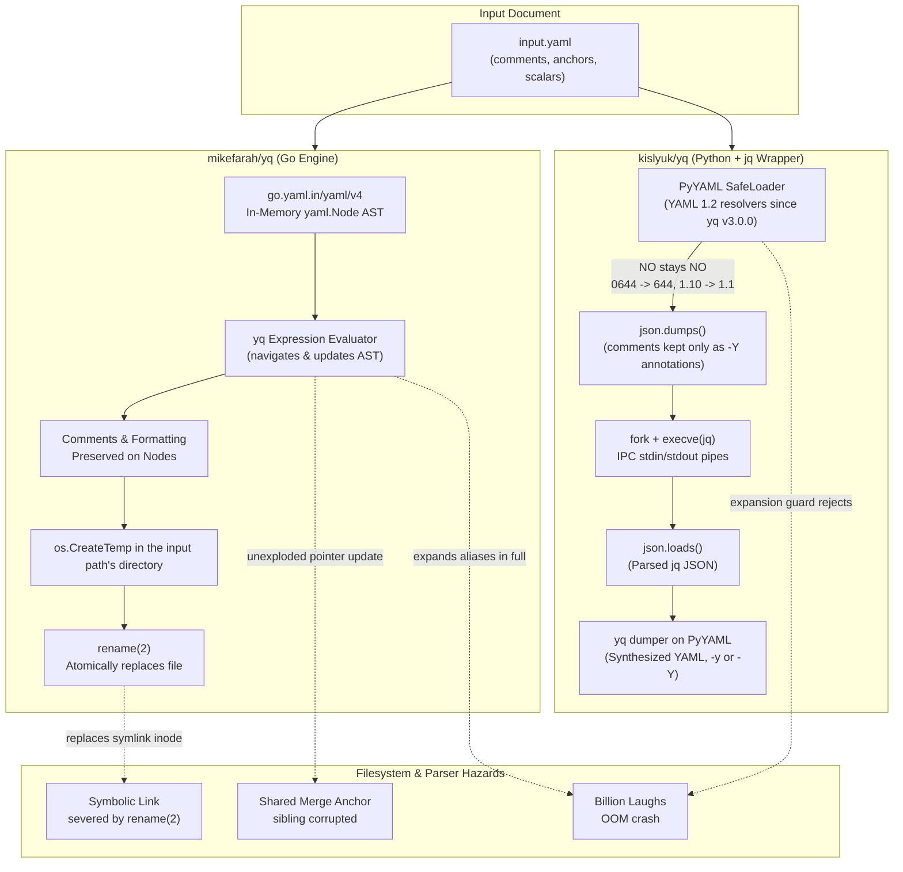

# yq Variants and YAML Hazards

> [!summary] Claim
> Two incompatible command-line tools share the executable name `yq`, while YAML itself contains implicit type coercion rules, anchor expansion hazards, and in-place file mutation traps that silently corrupt production configurations unless engineers explicitly verify tool provenance, force scalar string types, isolate references, and handle filesystem links.

Part of [Structured Data and HTTP](README.md) in [Shell and Unix Engineering](../README.md).

## TL;DR

- Mechanism: `mikefarah/yq` (written in Go) parses YAML directly into an in-memory Abstract Syntax Tree of `yaml.Node` structures to preserve comments and formatting, whereas `kislyuk/yq` (written in Python) acts as a transcoding wrapper that converts YAML to JSON via PyYAML, delegates query processing to an external `jq` subprocess via pipes, and transcodes the resulting JSON back to YAML only when `-y` or `-Y` is given.
- Rule: verify which `yq` binary is installed in CI/CD environments before invoking it, quote all scalar values that resemble booleans, sexagesimal integers, or octal file modes, and call `explode(.)` before mutating mapped fields when anchors are present.
- Trap: running `yq -i` (v4.54.3) on a symbolic link replaces the link itself with a regular file via `rename(2)` instead of mutating the underlying target, severing whatever kept that link pointed at a managed file.
- Portability fact: `brew install yq` installs `mikefarah/yq`, while `apt-get install yq` and `pip install yq` install `kislyuk/yq`, causing immediate pipeline failures because `kislyuk/yq` rejects `eval` expressions while `mikefarah/yq` rejects `-y`.
- When not to use it: when configurations require relational joins across multiple documents, streaming processing of multi-gigabyte event logs, or mathematical certainty against schema drift, where a typed programming language with a strict YAML 1.2 parser or a dedicated database like [[DuckDB-from-the-Shell]] is mandatory.

## Mental model



The diagram contrasts the two fundamentally divergent architectures operating under the identical binary name `yq`.
On the left, `mikefarah/yq` loads the file into an AST of `yaml.Node` elements, evaluates its internal expression engine directly against those nodes, retains comment metadata, and writes out changes via a temporary file in the input path's directory and `rename(2)`, which severs symlinks unless the real target path is resolved beforehand.
On the right, `kislyuk/yq` runs PyYAML's `SafeLoader` with its own YAML 1.2 implicit resolvers (since v3.0.0, 2022-07-04, per its changelog), so unquoted `NO` and `22:22` stay strings while `1.10` still becomes the float `1.1`; it drops comments during JSON conversion unless `-Y` encodes them as annotation keys (v4.1.0 and later), pipes the JSON stream through an external `jq` process, and re-encodes the stream back to YAML when asked.
Plain PyYAML (`yaml.safe_load`) still applies YAML 1.1 rules, coercing `NO` to `false` and `22:22` to `1342` (measured with PyYAML 6.0.4).
Both tools interact with underlying parser and filesystem hazards: `mikefarah/yq` risks mutating shared anchor nodes unless `explode(.)` is invoked and expands anchor bombs in full, while current `kislyuk/yq` refuses them with `yq: Error: detected unsafe YAML entity expansion` (measured with v4.4.5).

## How it works

### The Collision of Two Independent Tools

The command-line ecosystem contains two prominent, completely incompatible utilities named `yq`.
Understanding the exact architectural lineage of the tool installed in `$PATH` is the primary prerequisite for writing reliable automation.

The first tool is `mikefarah/yq`, written by Mike Farah in Go.
It is a self-contained, statically compiled binary that does not depend on `jq` or Python.
Its GitHub repository was created on 2015-09-26 (GitHub API `created_at`); early releases used flag-based verbs (`yq r`, `yq w`, `yq m`, `yq d` in v1 through v3), and version 4.0.0 of `mikefarah/yq` removed all v3 subcommands and replaced them with an expressive query language modeled after `jq`.
Version 4 provides two distinct evaluation commands: `eval` (aliased as `e`, and the default command since v4.18.1 when no subcommand is specified, per `release_notes.txt`), which processes a multi-document stream sequentially one YAML document AST at a time (`cmd/evaluate_sequence_command.go`), and `eval-all` (aliased as `ea`), which loads every YAML document across all input files into memory simultaneously as a single `list.List` of `yqlib.CandidateNode` objects (`cmd/evaluate_all_command.go`, `pkg/yqlib/all_at_once_evaluator.go`) to support cross-document reduction and merging (`select(fileIndex == 0) * select(fileIndex == 1)`).
Its query engine evaluates expressions such as `yq '.a.b | select(.c == "foo")' file.yaml` or `yq eval -i '.a.b = "bar"' file.yaml`.
As of v4.54.3 its `go.mod` requires `go.yaml.in/yaml/v4` (v4.0.0-rc.7, the YAML organization's continuation of `go-yaml`, imported by `pkg/yqlib/decoder_yaml.go`) alongside `github.com/goccy/go-yaml`, and it represents each document as a graph of `yqlib.CandidateNode` structures built from the decoded nodes.

The second tool is `kislyuk/yq`, written by Andrey Kislyuk in Python and distributed via PyPI.
It is an explicit transcoding wrapper around the system `jq` binary (`yq/__init__.py`).
When invoked as `yq '.' file.yaml`, it imports Python's `yaml` (PyYAML) module, parses the YAML input into native Python dictionaries and lists with a loader derived from `yaml.SafeLoader` (`CSafeLoader` when available) whose implicit resolvers are replaced by YAML 1.2 rules (`set_yaml_grammar` in `yq/loader.py`), serializes that data to JSON, and executes `subprocess.Popen` on `jq` (`yq/__init__.py`).
By default, `kislyuk/yq` sends the JSON stream to `jq` via `stdin` and writes `jq`'s raw JSON output directly to `stdout`; it only converts the resulting JSON back into YAML, through its own PyYAML dumper (`get_dumper` in `yq/dumper.py`), when `-y` (`--yaml-output`) or `-Y` (`--yaml-roundtrip`) is explicitly supplied.

This design divergence creates complete CLI incompatibility.
If a script written for `kislyuk/yq` uses `yq -y '.foo' input.yaml`, running it against `mikefarah/yq` fails immediately with `Error: unknown shorthand flag: 'y' in -y` (measured with v4.54.3, exit status 1).
Conversely, if a script written for `mikefarah/yq` uses `yq eval '.foo' input.yaml`, running it against `kislyuk/yq` treats `eval` as the `jq` filter and `.foo` as a file name, and fails with `jq: error: eval/0 is not defined at <top-level>, line 1, column 1:` followed by `yq: Error reading YAML input (.foo): FileNotFoundError` (measured with `kislyuk/yq` 4.4.5 and jq 1.8.2, exit status 1).
Package managers compound this conflict: Homebrew installs `mikefarah/yq` under `brew install yq` (packaging `kislyuk/yq` separately as `python-yq`, which conflicts with `yq`), while Debian and Ubuntu package `kislyuk/yq` as `yq` (Debian bookworm 3.1.0, Debian trixie 3.4.3, Ubuntu noble 3.1.0, as of 2026-11), and `pip install yq` installs `kislyuk/yq` (4.4.5 as of 2026-11).

### AST Manipulation vs. Transcoding Pipelines

The internal representation of data dictates how each tool handles non-structural metadata like comments, blank lines, and node styles.

In `mikefarah/yq`, the parsing layer creates a tree of `yaml.Node` structs.
Each `yaml.Node` retains:
1. `Kind`: document, sequence, mapping, scalar, or alias; the resolved type (`!!str`, `!!int`, `!!bool`) lives in the separate `Tag` field.
2. `Style`: tagged, double-quoted, single-quoted, literal block (`|`), folded block (`>`), or flow.
3. `HeadComment`, `LineComment`, and `FootComment`: comment strings associated with the token.
4. `Anchor`: the anchor name string if defined via `&`.
5. `Alias`: a direct pointer to the target `yaml.Node` if referenced via `*`.

When `mikefarah/yq` executes an update expression such as `.service.port = 9090`, it traverses the tree of pointers, locates the child scalar node under the key `port`, updates the node's value string to `"9090"`, and leaves all adjacent comment fields and structural layout intact.
When serialized back to disk, the YAML encoder re-emits the original comments and indentation.

In `kislyuk/yq`, the document undergoes two lossy transcoding phases.
First, PyYAML reads the YAML stream.
PyYAML tokenizes the input, but its scanner skips comments while looking for the next token and never emits a comment token at all (PyYAML 6.0.4 `yaml/tokens.py` defines no comment token class), and Python's primitive types (`dict`, `list`, `str`, `int`, `float`, `bool`) cannot store comment associations anyway.
Second, the data is serialized into JSON via `json.dumps()`.
Because RFC 8259 defines no comment syntax for JSON, comments, anchor topologies, and block formatting styles are destroyed on the default and `-y` paths.
`kislyuk/yq` does not use `ruamel.yaml` (its 4.4.5 dependencies are PyYAML, xmltodict, tomlkit, and argcomplete); instead, since v4.1.0 (2026-07-03, "Implement YAML comment roundtripping" in its changelog), `-Y` loads through a comment-preserving loader that smuggles comments, tags, and styles through `jq` as extra annotation keys (for example `__yq_tag_*__` and `__yq_style_*__` in `yq/loader.py`) and re-applies them on output.
Measured with 4.4.5: `yq -Y '.a = 2'` keeps both a head comment and a line comment, while `yq -y '.a = 2'` drops them.

### YAML Specification Divergences: 1.1 vs. 1.2

The YAML specification has undergone radical revisions that introduce severe silent bugs when parsing unquoted configuration scalars.

The YAML 1.1 specification (published in 2005) defined extensive implicit typing rules in its default type repository.
Under YAML 1.1 `tag:yaml.org,2002:bool` (yaml.org/type/bool.html), the following 22 unquoted scalar tokens are parsed as booleans:
- True: `y`, `Y`, `yes`, `Yes`, `YES`, `true`, `True`, `TRUE`, `on`, `On`, `ON`
- False: `n`, `N`, `no`, `No`, `NO`, `false`, `False`, `FALSE`, `off`, `Off`, `OFF`

This produces the infamous "Norway Problem": an ISO-3166 two-letter country code `country: NO` is parsed by YAML 1.1 as boolean `false`.
Similarly, application flags like `enabled: yes` or `feature: on` become booleans rather than strings.
Note an implementation nuance inside Python's ecosystem: while the YAML 1.1 `tag:yaml.org,2002:bool` specification regexp lists all 22 tokens (including single-character `y`, `Y`, `n`, `N`), PyYAML's `yaml/resolver.py` defines an 18-token boolean regexp that omits single-letter `y`, `Y`, `n`, and `N` while still coercing `NO`, `no`, `No`, `yes`, `on`, and `off` to booleans (measured with PyYAML 6.0.4: `yaml.safe_load` returns `False` for `NO` and the string `'y'` for `y`), whereas Go's legacy `gopkg.in/yaml.v2` coerced all 22 tokens (`resolve.go` on the `v2` branch lists `y`, `Y`, `n`, and `N`).
Furthermore, YAML 1.1 defined sexagesimal (base-60) numbers under `tag:yaml.org,2002:int` with the regular expression `^[-+]?[1-9][0-9_]*(:[0-5]?[0-9])+$` (yaml.org/type/int.html).
Consequently, an unquoted Docker port mapping like `ports: 22:22` is parsed as `22 * 60 + 22 = 1342` (measured with PyYAML 6.0.4), and `53:53` becomes `3233`, whereas `80:80` remains the string `"80:80"` because the trailing `80` exceeds the `[0-5]?[0-9]` base-60 digit ceiling of `59`.
File permissions with leading zeros like `mode: 0644` are parsed under YAML 1.1 (`^[-+]?0[0-7_]+$`) as base-8 octal integers, producing decimal integer `420` (measured with PyYAML 6.0.4).
Unquoted two-component version strings with trailing zeros such as `version: 1.10` are resolved as floating-point numbers (`tag:yaml.org,2002:float`), silently truncating `"1.10"` to `1.1` upon serialization.

The YAML 1.2 specification (published in 2009, revised in 2021 as 1.2.2) explicitly eliminated these traps.
YAML 1.2 defines three formal schemas:
1. Failsafe Schema: provides only generic strings, sequences, and mappings with no implicit scalar resolution.
2. JSON Schema: restricts implicit types to strict JSON rules, recognizing only lowercase `true` and `false`.
3. Core Schema: the recommended default schema.
It restricts boolean resolution to six tokens (`true`, `True`, `TRUE`, `false`, `False`, `FALSE`; YAML 1.2.2 Section 10.3.2).
It drops sexagesimal notation completely, treating `22:22` as a string.
It requires the explicit `0o` prefix for octal numbers (`0o644`).
Under the YAML 1.2 Core schema, `0644` matches the decimal integer pattern `[-+]? [0-9]+` and resolves to `644`.
Scalar strings like `NO`, `yes`, `on`, and `off` remain plain strings.

The hazard arises because tools use conflicting specification implementations:
- Plain PyYAML (`yaml.safe_load`) still defaults to YAML 1.1, so any Python program that loads configuration with it coerces `NO` to `false` and `22:22` to `1342`.
`kislyuk/yq` stopped inheriting that default in v3.0.0 (2022-07-04): its changelog says it "now uses the YAML 1.2 grammar when parsing and rendering YAML documents", and v4.0.0 (2026-07-02) added `0o` octals.
Measured with `kislyuk/yq` 4.4.5, `NO`, `on`, and `22:22` stay strings, `0644` becomes `644`, `0o644` becomes `420`, and `1.10` becomes the float `1.1`; its `-y` output still defaults to the 1.1 grammar (`--yaml-output-grammar-version`), so it re-quotes `'NO'` and `'on'` for 1.1 readers.
The 1.1 coercions therefore survive in `kislyuk/yq` releases older than 3.0.0, in Python code calling PyYAML directly, and in Go programs still on `gopkg.in/yaml.v2`.
- `mikefarah/yq` follows YAML 1.2 Core rules for booleans and strings (`NO` and `22:22` are parsed as `!!str`, measured with v4.54.3).
It tags `0644` as `!!int` and converts it to `644` in JSON, while `0o644` becomes `420` (measured with v4.54.3; lab test 5 asserts the `644`).
This is yq's own number handling, not a property of every Go YAML library: `gopkg.in/yaml.v3` still decodes the 1.1 spelling `0644` into the Go integer `420` "for compatibility" (comment beside `strconv.ParseInt(plain, 0, 64)` in `resolve.go` on the `v3` branch).

```
YAML Input       | PyYAML 6.0.4 safe_load  | kislyuk/yq 4.4.5 JSON | mikefarah/yq 4.54.3 JSON
-----------------|-------------------------|-----------------------|-------------------------
country: NO      | false (boolean)         | "NO" (string)         | "NO" (string)
switch: on       | true (boolean)          | "on" (string)         | "on" (string)
ports: 22:22     | 1342 (base-60 integer)  | "22:22" (string)      | "22:22" (string)
mode: 0644       | 420 (octal integer)     | 644 (decimal integer) | 644 (decimal integer)
mode: 0o644      | "0o644" (string)        | 420 (octal integer)   | 420 (octal integer)
version: 1.10    | 1.1 (float)             | 1.1 (float)           | 1.10 (number, literal kept)
```

Every cell above was measured by hand on 2026-11-27.

### The JSON Superset Myth

YAML 1.2.2 Section 1.2 (YAML History) says the 1.2 revision's "primary focus was making YAML a strict superset of JSON", which is usually read as "any valid JSON document is valid YAML".
In real shell and Unix pipelines, this claim breaks down across three specific boundaries:

First, duplicate mapping keys.
RFC 8259 Section 4 specifies that JSON object names SHOULD be unique, but does not strictly forbid duplicates; most JSON parsers operate on a "last key wins" basis.
In contrast, YAML 1.2.2 Section 3.2.1.1 (Nodes) defines a mapping as a set of key/value pairs "with the restriction that each of the keys is unique".
A duplicate key in one mapping therefore makes the document invalid YAML.
A strict YAML parser rejects valid JSON streams containing duplicated keys with a fatal syntax error.

Second, indentation using tab characters.
In RFC 8259 Section 2, horizontal tab characters (ASCII `0x09`) are standard whitespace allowed anywhere between structural tokens.
In YAML 1.2.2 Section 6.1 (Indentation Spaces), "tab characters must not be used in indentation".
If an automated script reformats a JSON document with tab indentation and feeds it into a block-style YAML pipeline, the parser terminates with:
`found character that cannot start any token` (`mikefarah/yq` v4.54.3 prints `go-yaml load error in scanner ... found character that cannot start any token` and exits 1; lab test 8).

Third, multi-document delimiters.
JSON has no concept of multi-document streams; multiple root objects in a single file represent invalid syntax unless framed as a JSON text sequence (RFC 7464, each text prefixed by the ASCII record separator `0x1E`) or as NDJSON (newline-delimited JSON, a community convention with no RFC).
YAML uses explicit directives and document boundaries (`---` start of document, `...` end of document).
When `mikefarah/yq` processes a multi-document YAML stream with `yq eval`, it executes the expression sequentially over each document, outputting them separated by `---`.
If passed to a downstream tool expecting a single JSON object, the downstream consumer crashes on the second document.

### In-Place Mutation Mechanics and Inode Severing

Modifying a configuration file in-place using `yq -i` introduces critical Unix filesystem hazards.

In `mikefarah/yq` v4.54.3, in-place editing is implemented in `pkg/yqlib/write_in_place_handler.go` (`writeInPlaceHandlerImpl.CreateTempFile` and `FinishWriteInPlace`) and `pkg/yqlib/file_utils.go` (`tryRenameFile` and `copyFileContents`).
The tool does not truncate and overwrite the target file directly on the primary code path.
Instead, it:
1. Calls `os.Lstat` and `os.Stat` on the path given, refuses a non-symlink target with no write bits (`cannot write in place to read-only file`), and calls `os.CreateTemp(filepath.Dir(path), ".yq-inplace-")` to create the temporary file in the same directory as that path; it then copies the target's mode bits with `os.Chmod` and its owner with `changeOwner`.
2. Encodes the modified `yaml.Node` AST into the temporary file.
3. Calls `tryRenameFile(tempPath, path)` from `FinishWriteInPlace`; if `os.Lstat` shows the path is a symbolic link, it deliberately calls `os.Rename` onto the link and returns that result with no fallback (release note for v4.54.3, #2973: "replace symbolic links instead of modifying their targets"); otherwise it calls `os.Rename`, which maps directly to the POSIX `rename(2)` system call.
4. If `rename(2)` onto a regular file fails (the source comment says the rename cannot be done "when running in docker to a file targeted in a mounted volume"), `tryRenameFile` falls back to `copyFileContents`, which opens the target path with `os.Create` (`O_RDWR|O_CREATE|O_TRUNC`), copies the bytes non-atomically via `io.Copy`, calls `Sync`, and then removes the temp file.

Because the temporary file lives in the same directory as the path being replaced, the `EXDEV` (cross-device link) failure that hits tools staging edits in `/tmp` does not arise on this path.
Older v4 releases staged the file through a shared `createTempFile()` helper that called `os.CreateTemp("", "temp")`, which places it in the system temporary directory (v4.30.8 and v4.52.1 `pkg/yqlib/file_utils.go`), so a rename onto a path on another device fails with `EXDEV` and drops into the `copyFileContents` fallback.
To treat links, v4.52.1 added "Add symlink check to file rename util (#2576)": if the target is a symbolic link, `tryRenameFile` skipped the rename and copied the new contents through the link into its target, so the link survived and the target was rewritten non-atomically; v4.54.3 reversed this to replace the link.
The v4.30.8 code had no link check, so a same-device rename replaced the link and a cross-device one wrote through it.

This dual-path mechanism causes three severe failures in production infrastructure:

First, symlink destruction and non-atomic truncation.
Under POSIX specification (POSIX.1-2024 XSH `rename`), `rename(old, new)` atomically points the directory entry `new` to the inode referenced by `old`.
If `new` is a symbolic link, `rename(2)` succeeds and does NOT follow the symlink to overwrite the target file.
Instead, it removes the symbolic link directory entry and replaces it with the new regular file inode (lab test 2 asserts both the severed link and the untouched target).
Any layout that relies on a link pointing at a managed file (dotfile managers such as GNU Stow, `/etc/alternatives`-style switch links, release directories selected through a `current` link) silently diverges from its source after one `yq -i`; v4.54.3 even replaces a link whose target is read-only, leaving a writable copy behind.
Kubernetes ConfigMap and Secret volumes also expose each key as a link into a versioned `..data` directory, but Kubernetes always mounts those volumes read-only ("A ConfigMap is always mounted as `readOnly`" and "A Secret is always mounted as `readOnly`" in the volume types reference), so there `os.CreateTemp` in the volume directory fails and `yq -i` errors out instead of severing the link.
When `rename(2)` onto a regular file fails instead, the `copyFileContents` fallback truncates the live target non-atomically in place, exposing readers to an empty or half-written configuration file if the process is killed mid-copy.

Second, hard link detachment.
If a file has multiple hard links (`st_nlink > 1`), replacing the path via `rename(2)` allocates a new inode for that path.
The remaining hard links continue to point to the old inode, silently breaking synchronization between mirrored configurations.

Third, containerized UID permission failures.
The official `mikefarah/yq` image's `Dockerfile` (v4.54.3) creates user and group `yq` with uid and gid 1000 and switches to `USER yq`.
When a CI pipeline bind-mounts a host workspace owned by `root` or another UID and invokes `yq -i`, the edit fails with `permission denied`, typically when `os.CreateTemp` cannot create the temporary file in a directory uid 1000 cannot write, or when the copy fallback cannot open the target for writing.

### In-Memory Pointer Aliasing and Anchor Corruption

YAML allows graph references through anchors (`&name`) and aliases (`*name`), commonly used with merge keys (`<<: *name`) to share base configurations.
In `mikefarah/yq`, this exposes a dangerous pointer-aliasing trap.

When the Go YAML decoder builds a node tree for a document containing an anchor and alias, the alias node's `Alias` field points directly to the in-memory address of the anchored `yaml.Node`.
If an engineer executes an assignment expression targeting a field in the aliased map:
`yq eval -i '.development.timeout = 1000' config.yaml`
the expression evaluator traverses into the map, resolves the field through the alias pointer, and modifies the `yaml.Node` value.
Because the underlying memory node is shared, the mutation modifies the base anchor itself!
Consequently, any other environment referencing that anchor (such as `.production`) is silently modified to `timeout: 1000` (lab test 6 asserts this with v4.54.3; test 7 asserts that `explode(.)` prevents it).
To safely isolate mutations, the script must explicitly invoke the `explode(.)` operator:
`yq eval -i 'explode(.) | .development.timeout = 1000' config.yaml`
The `explode(.)` function traverses the AST and deep-copies every aliased subtree into an independent node tree, severing the shared pointer graph before mutation occurs.

## Numbers and limits

All measurements: `mikefarah/yq` version v4.54.3 (as of 2026-11, arm64 Darwin), `kislyuk/yq` 4.4.5 with PyYAML 6.0.4 and jq 1.8.2 where named, Apple Silicon macOS 27.3, single runs captured on 2026-11-26 and re-measured by the verifier on 2026-11-27.
Measurements labeled "lab" are asserted by the Bats test suite in `labs/09-yq-variants-and-yaml-hazards/`.
Measurements labeled "by hand" were executed in a shell session on that host.

| Quantity | Value | Source |
| --- | --- | --- |
| Binary size (`mikefarah/yq` v4.54.3 Homebrew build, as of 2026-11) | 14,604,642 bytes (13.9 MiB, Mach-O 64-bit arm64 executable) | by hand (`ls -l`, `file`) |
| Baseline startup RSS (`mikefarah/yq`) | 12,910,592 bytes (12.3 MiB) on 2026-11-27; 12,828,672 bytes on 2026-11-26 | by hand (`/usr/bin/time -l yq --version`) |
| YAML 1.1 boolean scalar tokens | 22 tokens (`y`, `yes`, `true`, `on`, `n`, `no`, `false`, `off` and case variants) | YAML 1.1 type repository, `tag:yaml.org,2002:bool` (yaml.org/type/bool.html) |
| YAML 1.2 Core schema boolean tokens | 6 tokens (`true`, `True`, `TRUE`, `false`, `False`, `FALSE`) | YAML 1.2.2 Specification, Section 10.3.2 |
| YAML 1.2 JSON schema boolean tokens | 2 tokens (`true`, `false`) | YAML 1.2.2 Specification, Section 10.2.1.2 |
| Billion laughs explosion (8 levels, 5-fold, flow sequences) | 16,113,307 bytes of JSON from an 8-line YAML file; 693,600,256 bytes (661 MiB) peak RSS, 1.08 s wall time | by hand (`yq -o=json eval '.'`, `/usr/bin/time -l`) |
| Same bomb through `kislyuk/yq` 4.4.5 | rejected: `yq: Error: detected unsafe YAML entity expansion` | by hand |
| In-place edit tempfile pattern | `.safe-yaml.XXXXXX` in the resolved target's directory (lab script); `.yq-inplace-*` in the input path's directory (raw `yq` v4.54.3) | lab (`safe-yaml-update.sh`); `os.CreateTemp` in `pkg/yqlib/write_in_place_handler.go` |
| Exit status, parse syntax error (`mikefarah/yq`) | 1 | lab (`yq eval '.' tabs.yaml`, test 8) |
| Exit status, input parse error (`jq`) | 5 (`JQ_ERROR_UNKNOWN`) | by hand (`printf '{' \| jq .` under jq 1.8.2); [[jq-Streaming-Large-Inputs]] |
| Exit status, YAML parse error (`kislyuk/yq`) | 1 (`yq: Error reading YAML input (...): ParserError`) | by hand (`kislyuk/yq` 4.4.5) |
| Exit status, missing key without `-e` | 0 (prints `null`) | lab (`yq '.missing' file.yaml`) |
| Exit status, missing key with `-e` (`--exit-status`) | 1 (prints `null`, exits 1) | lab (`yq -e '.missing' file.yaml`) |
| Alias expansion limit in `gopkg.in/yaml.v3` | no fixed node count: alias-driven decoding may reach 99% of work up to 400,000 decode operations, scaling down to 10% at 4,000,000 | `allowedAliasRatio` in `decode.go` (`v3` branch); `go.yaml.in/yaml/v4` v4.0.0-rc.7, which yq v4.54.3 uses, applies the same ratios in `DefaultAliasCheck` (`internal/libyaml/options.go`) and adds a default maximum nesting depth of 10,000 |
| Standard pipe buffer capacity | Linux 65,536 bytes (64 KiB); macOS 16,384 bytes growing to 64 KiB | measured in shell matrix, 2026-10 |

## Portability

The table records how shells, utilities, and `yq` implementations behave across platforms.
`yq` is an external utility, so the shell under test provides argv handling, quoting, redirections, and pipeline error propagation.
All 11 tests in the accompanying lab passed in one run on the macOS host on 2026-11-27 (default lab shell, `yq` v4.54.3); no other shell or container was run for this note.

| Environment | Behavior | Evidence |
| --- | --- | --- |
| POSIX sh | Wait status reflects the last pipeline stage unless `pipefail` is enabled; unquoted parameter expansions undergo field splitting and pathname expansion; `rename(2)` replaces a target symbolic link rather than following it | (POSIX.1-2024 XCU 2.9.2, XSH `rename`) |
| macOS bash 3.2 | Default `/bin/sh` on macOS (3.2.57); supports `set -o pipefail`; command substitution strips all trailing newlines; expands `$'...'` inside double-quoted `${v:-$'...'}` even in POSIX mode | measured in shell matrix; [[Bash-3-2-on-macOS]] |
| current bash (5.3) | Supports `set -o pipefail`; returns status 1 on `yq -e` failure in a pipeline; execs the final command of `bash -c 'cmd1; cmd2'` in place of the shell | lab and shell matrix measurements |
| zsh (native, 5.9) | Does not field-split unquoted parameter expansions by default (`SH_WORD_SPLIT` off); `MULTIOS` duplicates output when multiple redirections precede a pipe | measured in shell matrix |
| zsh (`--emulate sh`) | Enables POSIX field splitting (`SH_WORD_SPLIT` on) and disables `MULTIOS`, matching POSIX sh parameter passing to `yq` | measured in shell matrix |
| dash (0.5.12) | Default `/bin/sh` on Debian and Ubuntu; lacks `$'...'`; Debian's 0.5.12 build accepts `set -o pipefail`, but dash builds without it require running `yq -e` outside a pipeline or capturing status explicitly; forks the last command in `dash -c` | measured in shell matrix; `set -o pipefail` measured by hand in the Debian matrix image on 2026-11-27; [[SIGPIPE-and-EPIPE]] |
| ksh93 (2012 / 1.0.10) | Reports signal death as `256 + N`; ksh93u+m 1.0.10 connects default pipeline stages with sockets unless `set -o posix` switches to `pipe(2)`; arithmetic reads leading-zero integers as decimal (`m=010; $((m + 1))` is 11, as in zsh, where bash and dash give 9) | measured in shell matrix |
| mksh (R59) | Non-interactive mode catches `SIGTERM`; lacks `disown`; Alpine R59 2020/10/31 includes a builtin `cat` whereas Debian R59 2025/04/26 execs `/usr/bin/cat` | measured in shell matrix |
| yash (2.58.1) | Reports signal death as `384 + N` (`397` for `SIGPIPE` under `pipefail`); `<(cmd)` is process redirection rather than process substitution and is rejected in POSIX mode | measured in shell matrix |
| posh (0.14.1) | Does not treat `export` or `readonly` as declaration utilities (`export VAR=$val` field-splits unquoted rhs); aborts on empty `"$@"` under `set -u` (`@: parameter not set`); lacks `$'...'` | measured in shell matrix; lab (`safe-yaml-update.sh`) |
| BusyBox ash (1.37.0) | Default `/bin/sh` on Alpine; supports `set -o pipefail` and basic `$'...'` (without `\u`, `\U`, `\e`, `\c`); execs final command in `sh -c` | measured in shell matrix |
| GNU / BSD / BusyBox / uutils utilities | GNU, BusyBox, and uutils `readlink -f` canonicalize chains, whereas strict POSIX and historic BSD `readlink` only guarantee reading one link target (`readlink FILE`); `mktemp DIR/template.XXXXXX` is portable across all four | (POSIX.1-2024 XCU `readlink`); lab (`safe-yaml-update.sh`) |
| `mikefarah/yq` (Go v4) | Standalone Go binary; uses `eval` and `eval-all`; preserves comments via `yaml.Node` AST; YAML 1.2 booleans (`NO` is `!!str`), decimal `0644` -> `644` in JSON; replaces a symlink path with a regular file on `-i` (v4.54.3) | lab assertions (tests 1-10); `tryRenameFile` in `pkg/yqlib/file_utils.go` |
| `kislyuk/yq` (Python, 4.4.5 as of 2026-11) | Python wrapper around `jq`; emits JSON by default and YAML with `-y`/`-Y`; `-i` only with `-y`/`-Y`/`-t`/`-T`/`-x`; strips comments via JSON transcoding except in `-Y` roundtrip mode (v4.1.0+); parses with YAML 1.2 resolvers since v3.0.0, so `NO` and `22:22` stay strings and `0644` -> `644`, while plain PyYAML 6.0.4 coerces `NO` -> `false`, `22:22` -> `1342`, `0644` -> `420` | by hand (`kislyuk/yq` 4.4.5, PyYAML 6.0.4); `yq/loader.py`; `kislyuk/yq` `Changes.rst` |

## Worked example

The [lab](../labs/09-yq-variants-and-yaml-hazards/) provides an executable test harness verifying `yq` variant detection, symlink preservation, anchor isolation, and scalar typing.

The central production script, `safe-yaml-update.sh`, resolves symbolic links to prevent `rename(2)` from severing them, creates temporary files in the target directory to avoid cross-device `EXDEV` failures, copies the target's mode onto the temporary file with `cp -p` (`mktemp` creates it as `0600`, measured on macOS), separates variable assignment from `export` for `posh` portability, isolates merge anchors via `explode(.)`, and forces explicit string tags on ambiguous scalars:

```sh
#!/bin/sh
# safe-yaml-update.sh: safely update a field in a YAML file in-place.
# Avoids symlink destruction, cross-device EXDEV rename errors,
# and YAML type coercion traps.
# Requires: mikefarah/yq v4.
set -eu

show_help() {
  printf 'Usage: %s [OPTIONS] FILE PATH VALUE\n' "$0"
  printf 'Options:\n'
  printf '  --as-string        Force the value to be stored as a string (tag: !!str)\n'
  printf '  --isolate-anchors  Explode aliases first to prevent cross-anchor corruption\n'
  printf '  --help             Show this help\n'
}

force_string=0
isolate_anchors=0

while [ "$#" -gt 0 ]; do
  case "$1" in
    --as-string)
      force_string=1
      shift
      ;;
    --isolate-anchors)
      isolate_anchors=1
      shift
      ;;
    --help | -h)
      show_help
      exit 0
      ;;
    --)
      shift
      break
      ;;
    -*)
      printf 'Error: unrecognized option: %s\n' "$1" >&2
      show_help >&2
      exit 2
      ;;
    *)
      break
      ;;
  esac
done

if [ "$#" -ne 3 ]; then
  printf 'Error: expected exactly 3 arguments (FILE, PATH, VALUE), got %d\n' "$#" >&2
  show_help >&2
  exit 2
fi

input_file=$1
yaml_path=$2
new_val=$3

if [ ! -e "$input_file" ]; then
  printf 'Error: file not found: %s\n' "$input_file" >&2
  exit 1
fi

# Detect yq variant; this script targets mikefarah/yq v4 expression syntax.
if ! command -v yq >/dev/null 2>&1; then
  printf 'Error: yq is not installed\n' >&2
  exit 1
fi

raw_ver=$(yq --version 2>&1 || true)
case "$raw_ver" in
  *"mikefarah"*)
    ;;
  *)
    printf 'Error: safe-yaml-update requires mikefarah/yq (Go engine), found: %s\n' "$raw_ver" >&2
    exit 1
    ;;
esac

# 1. Resolve symlinks: under POSIX rename(2), renaming a file onto a symlink
# replaces the symlink inode itself, severing the link and leaving the target
# file untouched. To preserve the symlink, we must mutate the real target.
target_file=$input_file
while [ -h "$target_file" ]; do
  dest=$(readlink "$target_file") || {
    printf 'Error: failed to readlink %s\n' "$target_file" >&2
    exit 1
  }
  case "$dest" in
    /*)
      target_file=$dest
      ;;
    *)
      link_dir=$(dirname "$target_file")
      target_file="$link_dir/$dest"
      ;;
  esac
done

# 2. Check for hazardous scalar types requiring string quoting:
# Norway problem (all 22 YAML 1.1 boolean tokens): y/n, yes/no, on/off, true/false
# Octal numbers: 0644, 0755, 0o644
# Sexagesimal numbers: 22:22
case "$new_val" in
  NO | no | No | YES | yes | Yes | ON | on | On | OFF | off | Off | true | false | TRUE | FALSE | True | False | y | Y | n | N)
    force_string=1
    ;;
  0[0-7]* | 0o[0-7]* | 0O[0-7]*)
    force_string=1
    ;;
  [0-9]*:[0-9]*)
    force_string=1
    ;;
  *)
    ;;
esac

# 3. Create temporary file in the SAME directory as the target file.
# Using /tmp can cross filesystem mount points, triggering EXDEV on rename(2).
target_dir=$(dirname "$target_file")
tmp_file=$(mktemp "$target_dir/.safe-yaml.XXXXXX")
trap 'rm -f "$tmp_file"' EXIT INT TERM
# mktemp creates the file with mode 0600; copy the target's mode bits (and
# owner, where permitted) so the rename does not silently tighten permissions.
cp -p "$target_file" "$tmp_file"

# 4. Construct the yq expression.
# If isolating anchors, run explode(.) first so updating an aliased node
# does not silently mutate the base anchor or sibling references.
expr=""
if [ "$isolate_anchors" -eq 1 ]; then
  expr="explode(.) | "
fi

# Inject value via env variable to prevent expression injection.
# Assign and export in two statements so posh 0.14.1 does not field-split.
SAFE_YQ_VAL=$new_val
export SAFE_YQ_VAL
if [ "$force_string" -eq 1 ]; then
  expr="${expr}${yaml_path} = env(SAFE_YQ_VAL) | ${yaml_path} tag = \"!!str\""
else
  expr="${expr}${yaml_path} = env(SAFE_YQ_VAL)"
fi

# 5. Process target into the temporary file.
yq eval "$expr" "$target_file" >"$tmp_file"

# 6. Atomic replacement via rename(2).
mv "$tmp_file" "$target_file"
trap - EXIT INT TERM
```

Executing the script by hand (`safe-yaml-update.sh service-link.yaml .service.country NO`, then `.service.mode 0644`, around `ls -l` and `yq -o=json '.service'`) demonstrates that the symlink remains intact and both the Norway country code and file mode retain explicit string typing.
The verifier re-ran it on 2026-11-27 and got the same output apart from timestamps; before the `cp -p` line was added, that run also showed `config.yaml` coming back as mode `0600`, and with it the file keeps `0644`:

```
=== Initial State ===
lrwxr-xr-x@ 1 shreejitverma  staff  11 Nov 26 16:04 service-link.yaml -> config.yaml
service:
  name: payment-gateway
  country: "GB"
  port: 8080
=== Run safe-yaml-update.sh ===
=== Resulting State ===
lrwxr-xr-x@ 1 shreejitverma  staff  11 Nov 26 16:04 service-link.yaml -> config.yaml
service:
  name: payment-gateway
  country: "NO"
  port: 8080
  mode: "0644"
=== JSON Output Verification ===
{
  "name": "payment-gateway",
  "country": "NO",
  "port": 8080,
  "mode": "0644"
}
```

Running `bats labs/09-yq-variants-and-yaml-hazards/yq_yaml_hazards.bats` produces:

```
1..11
ok 1 detect-yq identifies the installed yq variant
ok 2 raw yq in-place edit severs a symbolic link
ok 3 safe-yaml-update preserves symbolic link and mutates real target
ok 4 safe-yaml-update forces string tag on Norway country code
ok 5 safe-yaml-update forces string tag on octal permission code
ok 6 unexploded alias mutation corrupts shared base anchor
ok 7 safe-yaml-update with isolate-anchors prevents cross-environment corruption
ok 8 tab character in block indentation triggers parser error and exit status 1
ok 9 exit status flag -e returns 1 on missing key and 0 on present key
ok 10 security flag security-disable-file-ops blocks load operator
ok 11 shell under test belongs to a recognized shell family
```

## Pitfalls

> [!warning] Binary Identity Crisis (mikefarah vs. kislyuk CLI Collision)
> - Trigger: Running a shell script written for `kislyuk/yq` (e.g. `yq -y '.foo' config.yaml`) on a system where `brew install yq` or binary installation placed `mikefarah/yq` into `$PATH`, or vice versa.
> - Symptom: The command crashes with `Error: unknown shorthand flag: 'y' in -y` on `mikefarah/yq`, or `jq: error: eval/0 is not defined` on `kislyuk/yq`, breaking deployment pipelines.
> - Fix: Probe `yq --version` in the script prelude to detect the variant (`mikefarah/yq` prints `yq (https://github.com/mikefarah/yq/) version v4.54.3`; `kislyuk/yq` prints `yq 4.4.5` followed by the `jq` version), or invoke explicit wrappers (such as `python3 -m yq` or pinning the full binary path `/usr/local/bin/yq-go`).

> [!warning] The Norway Country Code Trap
> - Trigger: Storing unquoted two-letter ISO country codes such as `country: NO` in YAML configurations parsed by YAML 1.1 tools (such as plain PyYAML, `kislyuk/yq` releases before 3.0.0, or Go's `gopkg.in/yaml.v2`).
> - Symptom: The parser coerces `NO` into boolean `false`, causing geolocation filters, tax calculation modules, or regional server provisioning to silently fail or skip Norway.
> - Fix: Explicitly wrap all two-letter country codes, boolean-like words (`"yes"`, `"no"`, `"on"`, `"off"`), and version numbers in double quotes, and enforce linting with `yamllint` rules configured for `truthy`.

> [!warning] The Docker Port Sexagesimal Trap
> - Trigger: Defining port mappings without quotes in Docker Compose or Kubernetes files (e.g. `ports: - 22:22`).
> - Symptom: Under YAML 1.1 parsers, `22:22` is parsed as a base-60 sexagesimal integer, binding the service to port `1342` instead of port `22`.
> - Fix: Quote all port definitions (`ports: - "22:22"`), as the Compose Specification requires of short-syntax ports: "`HOST:CONTAINER` should always be specified as a (quoted) string, to avoid conflicts with yaml base-60 float".

> [!warning] In-Place Mutation Severing Symlinks and ConfigMaps
> - Trigger: Invoking `yq -i 'expr' path.yaml` (v4.54.3) on a path that is a symbolic link, common with dotfile managers, switch links, and release `current` links; read-only Kubernetes ConfigMap volumes make `yq -i` fail instead.
> - Symptom: The POSIX `rename(2)` call replaces the symbolic link directory entry with a new regular file, leaving the real target file untouched and severing whatever later updates the target (lab test 2).
> - Fix: Resolve the target file path via `readlink` before performing in-place edits, or use `safe-yaml-update.sh`.

> [!warning] Cross-Environment Mutation via Unexploded Merge Anchors
> - Trigger: Updating an environment-specific key in a YAML document that inherits defaults via merge keys (`<<: *base`) using `mikefarah/yq` without exploding aliases.
> - Symptom: Mutating `development.timeout = 1000` mutates the underlying `yaml.Node` referenced by the anchor pointer, silently corrupting `production.timeout` to `1000`.
> - Fix: Run `explode(.)` in the `yq` expression pipeline prior to updating mapping keys, ensuring that all aliased subtrees are detached into independent node structures.

> [!warning] Billion Laughs Denial of Service (YAML Anchor Bomb)
> - Trigger: Parsing untrusted YAML payloads containing deeply nested anchors and aliases (CVE-2019-11253; the related CVE-2019-11254 covers excessive CPU while the Kubernetes API server parses malicious YAML).
> - Symptom: The parser attempts to expand the references recursively, exhausting CPU and memory and causing an Out-Of-Memory (OOM) panic in API gateways or CI/CD daemons; `mikefarah/yq` v4.54.3 turns an 8-line bomb into 16,113,307 bytes of JSON at a 661 MiB peak RSS (measured by hand).
> - Fix: Restrict input payload size, disable anchor resolution on untrusted inputs, or ensure the parser enforces alias expansion limits (such as the alias ratio limit in `gopkg.in/yaml.v3` `allowedAliasRatio`, or the expansion guard that makes `kislyuk/yq` 4.4.5 reject the bomb).

> [!warning] Octal File Permission Corruption
> - Trigger: Writing unquoted numeric file permissions like `mode: 0644` in configuration files.
> - Symptom: YAML 1.1 parses `0644` as octal integer `420`, while YAML 1.2 Core schema (and both current `yq` variants) parses it as decimal integer `644`, and Go's `gopkg.in/yaml.v3` still decodes it as `420`; when converted to JSON or passed to `chmod`, `644` decimal evaluates to octal `01204`, corrupting filesystem security bits.
> - Fix: Use explicit string quoting (`mode: "0644"`) or standard YAML 1.2 octal prefix syntax (`mode: 0o644`).

> [!warning] Trailing-Zero Version Truncation (`1.10` to `1.1`)
> - Trigger: Writing unquoted two-part version numbers ending in zero (such as `version: 1.10` or `go: 1.20`) in CI/CD workflows or Kubernetes manifests.
> - Symptom: Both YAML 1.1 and YAML 1.2 Core schema resolve `1.10` as an IEEE-754 float (`!!float`), silently stripping the trailing zero during JSON transcoding or PyYAML serialization and downgrading the target version to `1.1` or `1.2` (measured: `kislyuk/yq` 4.4.5 emits `1.1`; `mikefarah/yq` v4.54.3 happens to keep the literal `1.10` in JSON).
> - Fix: Quote all version identifiers (`version: "1.10"`) or pass `--as-string` to force the `!!str` tag when mutating values via `yq`.

> [!warning] Tab Indentation Scanner Failure
> - Trigger: Pasting JSON or text containing leading horizontal tab characters (ASCII `0x09`) into block-indented YAML.
> - Symptom: The YAML parser fails immediately with `found character that cannot start any token` because YAML block indentation strictly forbids tabs.
> - Fix: Run `expand -t 2` or enforce pre-commit hooks to expand tabs into ASCII space characters.

## Security and robustness

Parsing YAML in shell pipelines introduces distinct security vectors that do not exist in line-oriented text processing:

First, arbitrary code execution via custom object tags.
In dynamic language environments such as Python and Ruby, YAML parsers historically supported deserializing native language objects via tags.
PyYAML's `yaml.load()` historically constructed arbitrary Python objects, allowing remote code execution via `!!python/object/apply:os.system ["command"]`, and even the restricted `FullLoader` stayed exploitable: CVE-2020-1747 (PyYAML before 5.3.1) and CVE-2020-14343 (before 5.4) both describe arbitrary code execution through `full_load` or `FullLoader` (NVD).
In Ruby on Rails, CVE-2013-0156 permitted object-injection attacks, and with them remote code execution, via XML parameter parsing that could carry YAML (NVD: Rails before 2.3.15, 3.0.19, 3.1.10, and 3.2.11).
While `mikefarah/yq` does not instantiate native language classes, it supports custom constructors and operators.
When using Python-based wrappers, engineers must verify that `yaml.SafeLoader` or `yaml.safe_load()` is strictly enforced; `kislyuk/yq` 4.4.5 builds its loader on `yaml.SafeLoader` (`CSafeLoader` when available) in `yq/loader.py`.

Second, operator sandbox escapes in `mikefarah/yq`.
Modern releases of `mikefarah/yq` include powerful built-in expression operators that interact with the host environment.
The `load()` operator reads arbitrary files from disk:
`yq eval 'load("/etc/passwd")' dummy.yaml`
The `env()` operator reads arbitrary environment variables:
`yq eval 'env(AWS_SECRET_ACCESS_KEY)' dummy.yaml`
If a shell pipeline evaluates user-supplied expressions against YAML files (for example, in webhooks or query APIs), an attacker can extract sensitive secrets or read arbitrary system files.
To secure `yq` in untrusted contexts, invoke it with explicit security flags:
`yq --security-disable-file-ops --security-disable-env-ops eval "$USER_EXPR" input.yaml`
With the first flag, `load("/etc/hosts")` fails with a "file operations have been disabled" error and exit status 1 (lab test 10).
Additionally, `yq` contains a `system` operator allowing external process execution; it is off unless `--security-enable-system-operator` is given (`yq --help`, v4.54.3), so verify that flag is never activated on untrusted input.

Third, command injection via `yq -o=shell`.
`mikefarah/yq` provides an output format (`-o=shell`) designed to serialize YAML structures into shell variable assignments.
Developers frequently write:
`eval "$(yq -o=shell eval '.' config.yaml)"`
Although `yq` sanitizes key names (converting invalid identifier characters to underscores) and wraps values in single quotes, `-o=shell -r` emitted unsafe values unquoted until v4.54.2 fixed it (GHSA-h2cv-65fq-jgrp in the release notes), and setting `--security-force-never-escape-shell-output` restores that raw output, allowing immediate arbitrary command execution via backticks or semicolons.
Even with quoting, untrusted keys that contain environment overrides (such as `PATH`, `IFS`, or `LD_PRELOAD`) can compromise the evaluating shell session.
Never use `eval "$(yq -o=shell ...)"` on untrusted configurations.

Fourth, denial of service via YAML bombs.
Kubernetes CVE-2019-11253 demonstrated that authorized users can make the Kubernetes API server consume excessive CPU or memory by submitting malicious YAML or JSON payloads, and CVE-2019-11254 that malicious YAML can burn excessive CPU in the API server's YAML parsing (NVD).
Because `kislyuk/yq` must expand every alias into a full JSON representation before invoking `jq`, it has carried guards since v2.13.0 ("Armor against entity expansion attacks") and v4.3.0 (merge-expansion guard), and 4.4.5 rejects an 8-level bomb with `yq: Error: detected unsafe YAML entity expansion`; `mikefarah/yq` v4.54.3 expands the same file in full, reaching a 661 MiB peak RSS (both measured by hand).
Always enforce file size limits using `head -c` before routing untrusted YAML streams into shell processors.

## The principal's view

A staff-plus engineer recognizes that YAML is fundamentally a human-authoring format, not a robust machine-to-machine data interchange protocol.
YAML's design prioritized aesthetic brevity for humans writing configuration files by hand, introducing complex scanning states, implicit type heuristics, indentation rules, and graph reference capabilities.
Every convenience feature designed for human ergonomics becomes a latent defect when processed mechanically in automated pipelines.

When designing infrastructure, establish three mandatory boundaries:

First, standardize the toolchain explicitly.
Never allow a bare `yq` invocation in shared CI/CD scripts or container environments where the binary could resolve to either `mikefarah/yq` or `kislyuk/yq`.
If using `mikefarah/yq`, pin the exact major version (`v4`) and verify its presence in build containers.
If your organization requires exact `jq` syntax compatibility, use `kislyuk/yq` deliberately, but run it as `python3 -m yq` to eliminate binary lookup ambiguity.

Second, treat YAML as an untrusted input surface.
Require all configuration files to pass strict schema validation (via JSON Schema, Kubeval, or Cue) before ingestion.
Enforce static analysis using `yamllint` to ban unquoted ambiguous scalars (`truthy` rule), merge keys (`<<`), and tab characters.
In storage and internal RPCs, transcode YAML to JSON or Protocol Buffers at the edge boundary; never pass raw YAML through internal microservice pipelines.

Third, recognize the threshold where shell tools must be retired.
When configuration transformations require multi-document joins, complex schema patching across hundreds of microservices, or cryptographic signature verification, stop writing shell wrappers around `yq`.
Transition to a compiled Go or Rust utility that uses strict YAML 1.2 libraries, validates against concrete type schemas, and logs structural diffs cleanly.

## Interview questions

> [!question] L5: Explain why the command `yq '.country' config.yaml` might output `false` when the input file contains `country: NO`.
>
> > [!success]- Answer
> > Under the YAML 1.1 specification, unquoted scalar values such as `NO`, `no`, `yes`, `true`, `on`, and `off` are implicitly resolved to boolean types (`tag:yaml.org,2002:bool`).
> > If the file is parsed by a YAML 1.1 processor, such as plain PyYAML or a `kislyuk/yq` release older than 3.0.0 (which used PyYAML's default resolvers), the two-letter ISO country code for Norway is converted into the boolean value `false`.
> > Under YAML 1.2 Core schema, `NO` is treated as a regular string; both current variants follow it (`kislyuk/yq` 4.4.5 and `mikefarah/yq` v4.54.3 print `NO`, measured by hand), but legacy tools and code that calls PyYAML directly retain the 1.1 coercion behavior.
> > Wrapping the scalar in quotes (`country: "NO"`) forces the parser to assign the string tag `!!str` and prevents coercion.
> >
> > Follow-up: How does YAML 1.2 differ from YAML 1.1 regarding octal file permissions like `0644`?

> [!question] L5: What happens when an engineer runs `yq -i '.port = 8080' /etc/app/config.yaml` where `config.yaml` is a symbolic link?
>
> > [!success]- Answer
> > `mikefarah/yq` implements in-place editing by writing output to a temporary file in the same directory as the path given and atomically replacing that path using the POSIX `rename(2)` system call (`tryRenameFile` in `pkg/yqlib/file_utils.go`, v4.54.3).
> > Under POSIX semantics, `rename(2)` replaces the directory entry itself rather than following the symbolic link to the underlying target file.
> > The symbolic link is unlinked and replaced with an independent regular file containing the updated content, while the original target file remains unmodified (lab test 2).
> > Anything that later updates the target, such as a dotfile manager or a deploy that repoints a `current` link, no longer reaches this path; a read-only Kubernetes ConfigMap volume instead makes the edit fail, because the temporary file cannot be created there.
> >
> > Follow-up: How can a shell script safely update the target of a symbolic link in-place without severing it?

> [!question] L6: Predict the output: A developer runs the following commands using `mikefarah/yq` v4:
> ```sh
> cat << 'EOF' > test.yaml
> base: &ref
>   timeout: 5000
> dev:
>   <<: *ref
> prod:
>   <<: *ref
> EOF
> yq eval -i '.dev.timeout = 1000' test.yaml
> yq eval '.prod.timeout' test.yaml
> ```
> What does the final command print, and why?
>
> > [!success]- Answer
> > The final command prints `1000`.
> > In `mikefarah/yq`, YAML merge keys and aliases are parsed as pointers referencing the shared in-memory `yaml.Node` AST of the anchor `base`.
> > When the update expression assigns `1000` to `.dev.timeout`, the evaluator updates the scalar node reached through the alias pointer without cloning the subtree.
> > Because `base` and all referencing aliases share the exact same node memory, modifying the field under `dev` mutates the anchor, causing `prod.timeout` to reflect `1000`.
> > To avoid mutating sibling references, the developer must prepend `explode(.)` to deep-copy the alias trees into independent nodes.
> >
> > Follow-up: Does converting the YAML file to JSON and back via `jq` exhibit this same anchor mutation behavior?

> [!question] L6: Debug this script: A deployment pipeline running on Ubuntu fails intermittently when updating configuration files.
> ```sh
> #!/bin/sh
> set -eu
> yq -i '.database.host = "db.internal"' config.yaml
> ```
> The script works on developer laptops running macOS, but fails in the Ubuntu CI runner with `yq: -i/--in-place can only be used with -y/-Y/-t/-T/-x`.
> Identify the root cause and provide a portable fix.
>
> > [!success]- Answer
> > On developer laptops, macOS Homebrew installs `mikefarah/yq` (written in Go), where `-i` is the valid shorthand flag for `--inplace`.
> > On Ubuntu, `apt-get install yq` or preinstalled Python environments install `kislyuk/yq`, which is a Python wrapper around `jq`.
> > In `kislyuk/yq`, `-i` cannot be used without an explicit transcode output flag (such as `-y` for YAML), so it exits 1 with that message (measured with 4.4.5), and its argument parsing differs from Go `yq`.
> > To fix the issue portably, the pipeline should probe the installed binary's identity using `yq --version` or ensure the Go binary is installed via official release downloads or containers.
> >
> > Follow-up: How does `kislyuk/yq`'s internal process execution model impact performance when processing thousands of small YAML files?

> [!question] L6: Why is YAML 1.2 not a true drop-in superset of JSON in automated Unix pipelines, despite the specification's claims?
>
> > [!success]- Answer
> > YAML 1.2.2 Section 1.2 says the 1.2 revision aimed at making YAML a strict superset of JSON, but real-world implementations diverge on multiple structural rules.
> > First, YAML requires unique mapping keys (YAML 1.2.2 Section 3.2.1.1), whereas RFC 8259 Section 4 only says names SHOULD be unique, causing strict YAML parsers to reject valid JSON.
> > Second, YAML indentation prohibits horizontal tab characters (ASCII `0x09`; YAML 1.2.2 Section 6.1), whereas JSON allows tabs anywhere as whitespace.
> > Third, JSON does not define multi-document boundaries, while YAML uses `---` and `...`, creating syntax errors if downstream JSON tools receive multi-document streams.
> > Fourth, YAML parsers differ in their handling of non-UTF encodings and Byte Order Marks (BOM); RFC 8259 Section 8.1 says implementations MUST NOT add a BOM to networked JSON text.
> >
> > Follow-up: How does feeding tab-indented JSON into `mikefarah/yq` manifest at the scanner layer?

> [!question] L7: Design a secure, high-throughput pipeline that ingests untrusted YAML configurations submitted by external users and generates validated JSON for internal microservices.
>
> > [!success]- Answer
> > The ingestion gateway must treat YAML as an untrusted, high-risk deserialization format.
> > First, bound input payload size using `head -c 1M` to prevent disk and memory exhaustion.
> > Second, use a parser that strictly implements YAML 1.2 Core schema, explicitly disabling custom tag deserialization (`!`) to block code execution vulnerabilities.
> > Third, enforce recursion depth limits (e.g. maximum 50 levels) and alias resolution counts (maximum 1,000 nodes) to neutralize Billion Laughs anchor bombs before expansion.
> > Fourth, validate the resulting data against an explicit JSON Schema using a compiled validator, rejecting duplicate keys and unexpected types.
> > Finally, serialize the validated data into canonical RFC 8259 JSON or binary Protocol Buffers before forwarding it over internal RPC channels.
> >
> > Follow-up: Why is running `eval "$(yq -o=shell config.yaml)"` dangerous even if the YAML parser sanitizes value strings?

> [!question] L7: How does `rename(2)` interact with cross-filesystem mount points when performing in-place edits with `yq -i`, and what failure modes emerge in containerized environments?
>
> > [!success]- Answer
> > The POSIX `rename(old, new)` system call is atomic only within a single filesystem volume; it cannot move an inode across filesystem boundaries.
> > When a tool creates a temporary file in `/tmp` and attempts to rename it onto a configuration file on `/etc` or an attached persistent volume, `rename(2)` fails with errno `EXDEV` (Invalid cross-device link).
> > Tools that react to `EXDEV` by copying fall back to a non-atomic operation that opens the target file, truncates it, and writes the bytes sequentially; `mikefarah/yq` v4.54.3 avoids `EXDEV` by staging its temporary file in the target path's directory, but still takes this copy fallback (`copyFileContents`) whenever `rename(2)` onto a regular file fails, as with a file bind-mounted into a container.
> > If the container process is terminated by `SIGKILL` (such as the Kubernetes OOM killer) or power is cut during this copy window, the configuration file is left completely empty or partially written.
> > Robust in-place update utilities must create their temporary files in the exact same directory as the target file (`mktemp "$(dirname "$target")/.tmp.XXXXXX"`) to guarantee intra-device atomic `rename(2)` execution.
> >
> > Follow-up: What filesystem race condition occurs if multiple processes attempt in-place `rename(2)` updates on the same configuration file simultaneously?

> [!question] L7: Compare the performance characteristics and memory footprints of `mikefarah/yq` versus `jq --stream` when filtering specific records from a 2 GiB structured data file.
>
> > [!success]- Answer
> > `mikefarah/yq` loads the entire document into an in-memory `yaml.Node` Abstract Syntax Tree before evaluating expressions, requiring memory proportional to the full parsed graph (measured, as of 2026-11 with v4.54.3 on macOS: a 23,927,780-byte YAML list of 300,000 small records peaked at 2,929,999,872 bytes RSS, about 122 times the input, so a 2 GiB file of that shape would need roughly 245 GiB and end in an OOM kill; the ratio depends on the record shape).
> > Even in multi-document streaming mode (`eval`), `mikefarah/yq` parses each individual document into an AST in memory.
> > In contrast, `jq --stream` operates as a true token-level streaming event parser that keeps only the current path array and one pending scalar in memory, maintaining a constant memory footprint (measured with jq 1.8.2 on the equivalent 28,127,781-byte JSON array: 3,129,344 bytes peak RSS, about 3 MiB) regardless of file size.
> > However, `jq --stream` cannot natively parse YAML without an external transcoding stage, meaning the upstream YAML parser remains the bottleneck.
> > For multi-gigabyte structured data, configurations should be converted once to NDJSON and processed via `jq --stream` or loaded directly into an embedded analytical engine like DuckDB.
> >
> > Follow-up: Why cannot YAML block structures be parsed as a true single-pass streaming event format without maintaining indentation stack state?

## Related

Prerequisites: [[jq-Streaming-Large-Inputs]]

Next: [[XML-with-xmlstarlet]]

See also: [[Structured-Data-Wrangling-Jq-Yq-and-Coreutils]]

API Engineering goes deeper in [[20-API-Engineering/README|API Engineering]]: [[20-API-Engineering/08-OpenAPI-JSON-Schema-and-Contracts/README|OpenAPI JSON Schema and Contracts]]; start with [[YAML-Media-Type-RFC-9512-and-OpenAPI-YAML-Parser-Hazards]].

## Further reading

- [YAML 1.2.2 Specification (2021)](https://yaml.org/spec/1.2.2/): The authoritative specification defining Core schema scalar resolution, tab prohibitions, and JSON compatibility boundaries.
- [YAML 1.1 Specification (2005)](https://yaml.org/spec/1.1/): The legacy specification responsible for the Norway problem, sexagesimal base-60 numbers, and PyYAML's default type coercion.
- [kislyuk/yq changelog](https://github.com/kislyuk/yq/blob/develop/Changes.rst): Dates the switch to YAML 1.2 parsing (v3.0.0), `0o` octals (v4.0.0), comment roundtripping (v4.1.0), and the expansion guards.
- [mikefarah/yq Repository](https://github.com/mikefarah/yq): Source code and documentation for the Go-based standalone AST processor.
- [kislyuk/yq Repository](https://github.com/kislyuk/yq): Source code for the Python transcoding wrapper that drives the system `jq` binary.
- [RFC 8259 (JSON Data Interchange Format)](https://www.rfc-editor.org/rfc/rfc8259): The standard defining JSON syntax, whitespace, and duplicate key recommendations.
- [RFC 9512 (YAML Media Type)](https://www.rfc-editor.org/rfc/rfc9512): The official 2024 IANA registration of `application/yaml` and the `+yaml` structured syntax suffix.
- [CVE-2019-11253 (Kubernetes API Server YAML Bomb)](https://nvd.nist.gov/vuln/detail/CVE-2019-11253): Vulnerability report detailing denial of service via YAML anchor expansion attacks in Kubernetes control planes.
- [POSIX.1-2024 Shell & Utilities (XCU Chapter 2)](https://pubs.opengroup.org/onlinepubs/9799919799/utilities/V3_chap02.html): Official specification governing pipeline exit status, parameter expansions, and signal handling.
