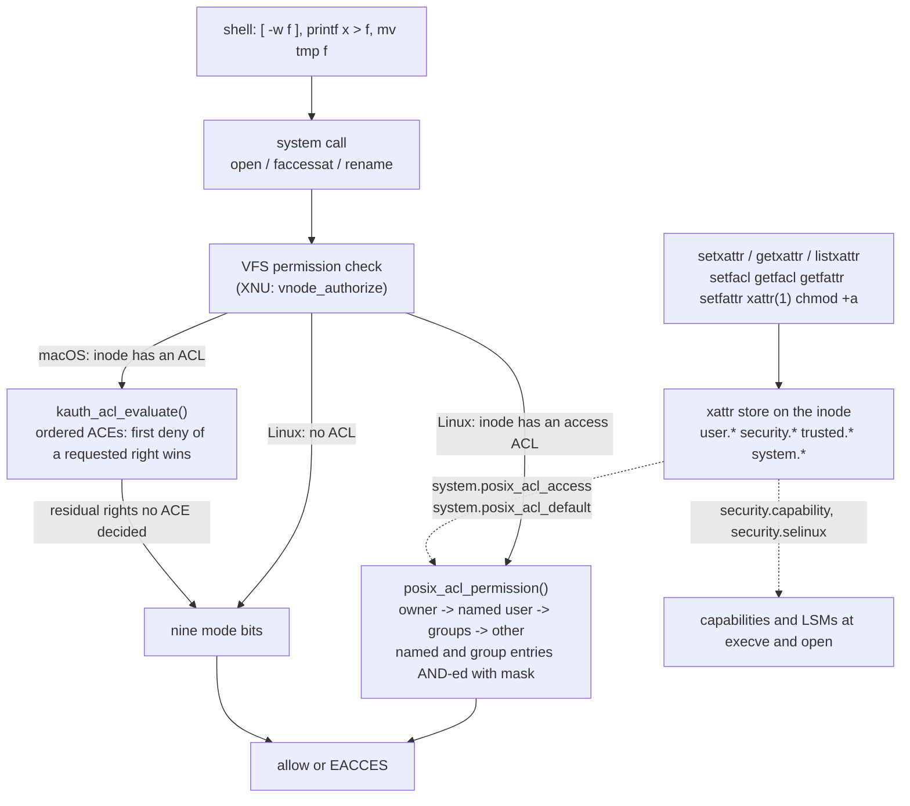

# ACLs and Extended Attributes

> [!summary] Claim
> An ACL is a richer permission check that the kernel stores beside the inode, on Linux literally as an extended attribute, so it travels with the inode and not with the name: every tool or idiom that makes a new inode (write-then-rename, plain `cp`, an archiver without `--acls --xattrs`) silently drops it, and every check that reads only `st_mode` gets the wrong answer.

Part of [Files, Filesystems, and Permissions](README.md) in [Shell and Unix Engineering](../README.md).

## TL;DR

- Mechanism: extended attributes are named byte strings attached to an inode (`setxattr(2)`, `getxattr(2)`, `listxattr(2)`); a Linux POSIX.1e ACL is the binary value of `system.posix_acl_access`, and the kernel consults it in `posix_acl_permission()` instead of the nine mode bits.
- Rule: ask the kernel, never `st_mode` - use `access`/`faccessat` (the `test -r/-w/-x` builtin in bash, dash, zsh, ksh93, mksh, yash and posh does), or better, just attempt the operation and handle the error.
- Trap: on a file with a named-user or named-group entry, the group bits that `ls -l` shows and `chmod g-w` changes are the ACL mask, not the owning group, so `chmod 600` quietly revokes every named entry.
- Portability fact: POSIX.1e was withdrawn (sponsorship ended January 1998), so Linux ships draft-17 ACLs with a mask and no deny, macOS ships NFSv4-style ordered allow/deny ACEs with separate write and append rights, and FreeBSD offers both; POSIX.1-2024 only says "additional or alternate" mechanisms may exist (XBD 4.7).
- When not to use it: do not build an authorization model out of ACLs on shared trees if you can use groups plus setgid directories; ACLs do not survive common copy, archive, and rename paths, and they are invisible to anyone reading `ls -l`.

## Mental model



A shell never evaluates an ACL itself: every redirection, `mv`, and (in most shells) `test -w` turns into a system call, and the kernel's VFS layer decides.
On Linux the VFS asks whether the inode carries an access ACL; if it does, `posix_acl_permission()` in `fs/posix_acl.c` picks exactly one matching entry (owner, then named user, then owning or named groups, then other) and, for every entry except owner and other, also requires the mask to grant the bits; if it does not, the classic nine mode bits decide.
On macOS, `vnode_authorize_simple()` in `bsd/vfs/vfs_subr.c` runs `kauth_acl_evaluate()` over the ordered ACEs, returns `EACCES` on the first deny of a requested right, and hands any right the ACL did not decide (the "residual") to the POSIX mode bits.
The dotted arrows are storage: on Linux the ACL is literally the value of the `system.posix_acl_access` extended attribute (and `system.posix_acl_default` on directories), stored with the inode alongside `user.*` attributes, SELinux labels, and file capabilities, which is why anything that creates a new inode starts with none of them.

## How it works

### Extended attributes: the storage layer

An extended attribute is a (name, value) pair attached to an inode, separate from the data and from `struct stat`.
Linux added the calls in Linux 2.4 and glibc 2.3 (`setxattr(2)` HISTORY): `setxattr`, `lsetxattr`, `fsetxattr`, `getxattr`, `listxattr`, `removexattr`, and their `l` (do not follow a symlink) and `f` (by descriptor) variants.
`setxattr` takes `XATTR_CREATE` ("fails if the named attribute exists already", `EEXIST`) or `XATTR_REPLACE` ("fails if the named attribute does not already exist", `ENODATA`); with neither flag it creates or replaces.
`listxattr` returns one buffer of NUL-terminated names; FreeBSD's `extattr_list_file(2)` instead returns length-prefixed names that are "not terminated by ASCII 0", so parsing code is not portable.

Linux names carry a namespace prefix, and `xattr(7)` defines four:
- `user.*`: arbitrary data, guarded by the file's permission bits ("read permission is required to retrieve the attribute value", write permission to change it).
- `trusted.*`: visible and accessible only to processes with `CAP_SYS_ADMIN`.
- `security.*`: owned by the LSMs (`security.selinux`) and by file capabilities (`security.capability`, whose writes require `CAP_SETFCAP`, `capabilities(7)`); with no LSM, everyone can read and writes need `CAP_SYS_ADMIN`.
- `system.*`: kernel objects such as ACLs, with per-attribute policy.

The `user.*` restriction is enforced in `xattr_permission()` in `fs/xattr.c`: regular files and directories pass, a sticky directory allows writes only to its owner or a capable caller (`inode_owner_or_capable()`), and any other type gets `EPERM` for a write and `ENODATA` for a read (`xattr_permission_error()`).
The reason, per `xattr(7)`, is that permission bits on device files and symlinks guard something other than content, and a world-writable sticky `/tmp` would otherwise let anyone attach unquota'd data to other users' entries.
Mainline master (as of 2026-11) also lets `S_IFSOCK` inodes through in that switch, added by the commit "xattr: support extended attributes on sockets" dated 2026-03-02 (git.kernel.org log of `fs/xattr.c`); kernels before it return the `default:` error, so do not rely on socket xattrs.
An unknown prefix is rejected by `xattr_resolve_name()` with `EOPNOTSUPP`, which is also what a filesystem without xattr support returns.

The size checks live in the system-call layer, before any filesystem sees the request:
- `setxattr_copy()` returns `E2BIG` when the value exceeds `XATTR_SIZE_MAX` (65536).
- `import_xattr_name()` copies the name into a fixed `XATTR_NAME_MAX + 1` buffer and returns `ERANGE` for a name of 256 bytes or more, and for an empty name; the 255-byte limit includes the `user.` prefix.
- `do_getxattr()` clamps the caller's buffer to `XATTR_SIZE_MAX` and converts the handler's `ERANGE` into `E2BIG` only when the buffer is already at the maximum.
- A caller that does not know a value's size calls `getxattr` with size 0 first: "these calls return the current size of the named extended attribute" (`getxattr(2)`); the size can change before the second call, so loop on `ERANGE`.
Filesystems then add their own ceilings: ext2/3/4 require every name and value of one file to fit in a single block (1024, 2048, or 4096 bytes), and Btrfs limits name, value, and overhead to the nodesize, 16 KiB by default (`xattr(7)`).

macOS has no namespaces: a name is any UTF-8 string up to `XATTR_MAXNAMELEN` (127 bytes, `<sys/xattr.h>`), the calls take an extra `position` and `options` argument (`XATTR_NOFOLLOW`, `XATTR_CREATE`, `XATTR_REPLACE`), the VFS bound is `XATTR_MAXSIZE` = `INT32_MAX` (XNU `bsd/sys/xattr.h`), and Apple uses reserved names such as `com.apple.FinderInfo` and `com.apple.ResourceFork`.
On the macOS host used for the lab, a file the test created already carried a `com.apple.provenance` attribute before the test touched it, so a lab that lists all names must filter by its own prefix (`xattr_probe list FILE user.`).

### POSIX.1e ACLs on Linux

The POSIX.1e and POSIX.2c drafts (security extensions: ACLs, audit, capabilities, MAC, information labels) lost their sponsorship in January 1998, and draft 17 was then made publicly available (Gruenbacher 2003).
`acl(5)` says Linux implements "the full set of functions and utilities" of draft 17, and POSIX.1-2024 never standardized any ACL interface: XBD 4.7 only permits "additional" mechanisms, which "shall only further restrict the access permissions", and "alternate" mechanisms, which must be enabled per file by explicit action and "be disabled for a file after the file permission bits are changed for that file with chmod()".

An ACL is a list of entries, each a tag, an optional qualifier, and `rwx` bits (`acl(5)`):
- `ACL_USER_OBJ` (the owner), `ACL_GROUP_OBJ` (the owning group), `ACL_OTHER`: exactly one each, and together they are the "minimal ACL", identical to the nine mode bits.
- `ACL_USER` and `ACL_GROUP` with a uid or gid qualifier: zero or more, unique per id.
- `ACL_MASK`: required as soon as any `ACL_USER` or `ACL_GROUP` entry exists; it is "the maximum access" those entries and `ACL_GROUP_OBJ` can grant.

The access check (`acl(5)` "ACCESS CHECK ALGORITHM", `posix_acl_permission()` in `fs/posix_acl.c`) selects one entry and stops:
1. If the effective uid owns the file, `ACL_USER_OBJ` alone decides (the code jumps to `check_perm` with no mask).
2. Else, a matching `ACL_USER` entry decides, AND-ed with the mask (`goto mask`, then `(pa->e_perm & mask_obj->e_perm & want) == want`).
3. Else, if any of the caller's groups matches `ACL_GROUP_OBJ` or an `ACL_GROUP` entry, access is granted if one matching group entry, AND-ed with the mask, grants all requested bits; if groups matched but none granted, the result is `EACCES` and `ACL_OTHER` is never consulted.
4. Else `ACL_OTHER` decides.
Step 1 means a named-user entry for the owner's own uid is dead weight, and step 3 means membership in a matching group can deny access that `other` would have granted; the lab asserts the first on Linux.

The mask is the design's central compromise.
With an extended ACL, the three group bits of `st_mode` map to `ACL_MASK` rather than `ACL_GROUP_OBJ` (`acl(5)` "CORRESPONDENCE BETWEEN ACL ENTRIES AND FILE PERMISSION BITS"), so the group bits become "an upper bound of the permissions that any entry in the group class will grant" (Gruenbacher 2003).
That keeps ACL-unaware programs safe: a program that does `chmod(path, 0600)` to make a file private gets exactly that, because `__posix_acl_chmod_masq()` writes the new group bits into `mask_obj->e_perm` and leaves the named entries and `ACL_GROUP_OBJ` untouched.
The same mechanism makes `chmod g+w` nondestructive: it restores the mask, and with it every named entry's original rights.
`setfacl` recalculates the mask by default as "the union of all permissions of the owning group, and all named user and group entries" (`setfacl(1)`), unless you pass `-n` or an explicit `m::` entry, and `getfacl` prints `#effective:` beside every entry the mask cuts down.

On the wire and on disk the ACL is a little-endian blob (`include/uapi/linux/posix_acl_xattr.h`): a 4-byte header `a_version` = `POSIX_ACL_XATTR_VERSION` (2), then 8-byte entries of `__le16 e_tag`, `__le16 e_perm`, `__le32 e_id`, with tag values `ACL_USER_OBJ` 0x01, `ACL_USER` 0x02, `ACL_GROUP_OBJ` 0x04, `ACL_GROUP` 0x08, `ACL_MASK` 0x10, `ACL_OTHER` 0x20 and `e_id` = `ACL_UNDEFINED_ID` (-1) for entries without a qualifier (`include/uapi/linux/posix_acl.h`).
`posix_acl_valid()` rejects permission bits outside `rwx`, a mask out of order (`if (state != ACL_GROUP)` returns `EINVAL`), and a named uid with no mapping in the caller's user namespace.
The lab's `xattr_probe acl-set` writes this blob with a plain `setxattr("system.posix_acl_access")`, which proves the point that no `libacl` is needed: `setfacl` is a convenience layer over the same system call.
When an ACL is set, `posix_acl_update_mode()` recomputes the mode and clears `S_ISGID` unless the caller is in the owning group or has `CAP_FSETID`; the absence of that clearing was CVE-2016-7097 (see Pitfalls).

### Default ACLs and inheritance

A directory may also carry `system.posix_acl_default`, which plays "no direct role in access checks" (Gruenbacher 2003) and only seeds new children at creation time:
- A new file gets the parent's default ACL as its access ACL; a new subdirectory gets it as both its access and its default ACL.
- `posix_acl_create_masq()` then intersects each class with the `mode` argument of `open`, `mkdir`, or `mknod` (for example `pa->e_perm &= (mode >> 6) | ~S_IRWXO` for the owner entry), so the mode still caps the result.
- The umask is not applied: `posix_acl_create()` reaches `*mode &= ~current_umask()` only when the parent has no default ACL ("The umask has no effect if a default ACL exists", Gruenbacher 2003).
Inheritance is static: changing a directory's default ACL changes nothing that already exists, unlike Windows' dynamic inheritance (Gruenbacher 2003).

### NFSv4-style ACLs: macOS and FreeBSD

macOS implements a different model through `kauth`: each file has one ordered list of ACEs, each naming a user or group (by GUID internally) and allowing or denying a set of rights (`chmod(1)` "ACL MANIPULATION OPTIONS").
Rights are finer than `rwx`: `read`, `write`, `append`, `execute`, `delete`, `readattr`, `writeattr`, `readextattr`, `writeextattr`, `readsecurity`, `writesecurity`, `chown` on files, plus `list`, `search`, `add_file`, `add_subdirectory`, `delete_child` and the inheritance flags `file_inherit`, `directory_inherit`, `limit_inherit`, `only_inherit` on directories.
`kauth_acl_evaluate()` (XNU `bsd/kern/kern_authorization.c`) proceeds "from the top down, with access denied if any ACE denies any of the requested rights, or granted if all of the requested rights are satisfied by the ACEs so far"; `chmod +a` keeps the canonical order local deny, local allow, inherited deny, inherited allow.
Whatever the ACEs leave undecided falls back to the mode bits (`vnode_authorize_simple()` maps residual `WRITE_DATA` and friends to `VWRITE` and calls `vnode_authorize_posix()`), so a macOS ACL can both add to and subtract from the mode, and `chmod` of the mode leaves the ACEs in place (`chmod -N` removes them; the lab asserts both).
The rights that an `open` requests come from `vn_authorize_open_existing()`: `O_APPEND` without `O_TRUNC` requests `KAUTH_VNODE_APPEND_DATA` instead of `KAUTH_VNODE_WRITE_DATA`, so `deny write` does not stop `>>`; the lab measured `printf ... >> f` succeed and `printf ... > f` fail on the same file.
macOS's `<sys/acl.h>` marks the POSIX.1e types `ACL_TYPE_ACCESS` and `ACL_TYPE_DEFAULT` "not supported" and uses only `ACL_TYPE_EXTENDED`, with `ACL_MAX_ENTRIES` 128.
FreeBSD supports both POSIX.1e ACLs and, since FreeBSD 8.1, NFSv4 ACLs; its `setfacl(1)` tells them apart by entry shape (three colon-separated fields versus four or five with an `allow` or `deny` type), and `-d`, `-k`, `-n` apply only to POSIX.1e while `-a` (insert at a position) applies only to NFSv4.
NFSv4 ACLs are not compatible with POSIX ACLs, and proposals to add a mask concept to NFSv4 were rejected (Gruenbacher 2003), which is why mapping between the two over NFS or Samba loses information.

### How a shell's `test` reaches the ACL

POSIX defines `-r`, `-w`, and `-x` as true when the permission "is granted, as defined in 1.1.1.4 File Read, Write, and Creation" (XCU `test`), which is the kernel's answer, ACLs included.
Shells get there in two ways:
- Ask the kernel: bash `sh_eaccess()` (bash-5.3 lib/sh/eaccess.c) calls `faccessat(AT_FDCWD, path, mode, AT_EACCESS)` when available and falls back to the mode-bit `sh_stataccess()` only for `/dev/fd/N` paths (and for root `-x` on FreeBSD, Solaris, and AIX); dash uses `test_file_access()` with `faccessat(..., AT_EACCESS)` when `HAVE_FACCESSAT` is configured (dash 0.5.12 src/bltin/test.c); yash `check_access()` (path.c) tries `faccessat` with `AT_EACCESS` first; zsh `doaccess()` (Src/cond.c) and mksh `test_eval()` for `-r` and `-w` (funcs.c) call `access()`; ksh93u+m `sh_access()` (bltins/test.c) calls `access()` when real and effective ids match and swaps them with `setreuid` otherwise; posh 0.14.1 `test_eaccess()` (c_test.c) calls `eaccess()`, which its `sh.h` defines as `access()`.
- Compute from `st_mode`: BusyBox `test_eaccess()` (coreutils/test.c) picks the owner, group, or other triplet from `stat` and tests the bits, so it never sees an ACL, a read-only mount, or an LSM; dash's fallback `test_access()` does the same when built without `faccessat`.
`access()` uses the real ids and `faccessat(AT_EACCESS)` the effective ids; the difference matters only in setuid contexts, but the ACL is honored either way.

## Numbers and limits

| Quantity | Value | Source |
| --- | --- | --- |
| Linux max xattr name, including prefix | 255 bytes (`XATTR_NAME_MAX`); 256 gives `ERANGE` | `include/uapi/linux/limits.h`, `fs/xattr.c` `import_xattr_name()` (master, as of 2026-11); lab Linux arm (not run on Linux here) |
| Linux max xattr value | 65536 bytes (`XATTR_SIZE_MAX`); 65537 gives `E2BIG` | `limits.h`, `fs/xattr.c` `setxattr_copy()`; lab Linux arm |
| Linux max `listxattr` buffer | 65536 bytes (`XATTR_LIST_MAX`) | `limits.h` |
| ext2/3/4 xattr space per file | all names and values in one block: 1024, 2048, or 4096 bytes | `xattr(7)` (as of 2026-11) |
| Btrfs xattr space | name + value + overhead <= nodesize, 16 KiB by default | `xattr(7)` |
| POSIX ACL xattr size | 4-byte header + 8 bytes per entry; a 5-entry ACL is 44 bytes | `posix_acl_xattr.h` (arithmetic) |
| ext2/3 shared EA block reference limit | 1024 inodes per shared block | Gruenbacher 2003 |
| Cold-cache access check, ext2, no ACL vs five-entry ACL | 9 vs 1743 microseconds (Linux 2.4.20, Athlon 1.1 GHz, 2003) | Gruenbacher 2003; warm cache drops to about 1-2 microseconds |
| macOS max xattr name | 127 bytes (`XATTR_MAXNAMELEN`); 128 gives `ENAMETOOLONG` | SDK `<sys/xattr.h>`; measured by the lab on macOS (APFS), 2026-11-15 |
| macOS VFS max xattr value | `INT32_MAX` (`XATTR_MAXSIZE`) | XNU `bsd/sys/xattr.h` (main, as of 2026-11) |
| APFS xattr value accepted | 65537 bytes (lab); 67108864 bytes (64 MiB, the probe's own cap) also accepted | measured on macOS APFS, 2026-11-15 |
| macOS ACEs per ACL | 128 (`ACL_MAX_ENTRIES`) | SDK `<sys/acl.h>` |
| POSIX.1e/2c sponsorship withdrawn | January 1998, draft 17 | Gruenbacher 2003 |
| CVE-2016-7097 | setgid kept across ACL `setxattr`, Linux through 4.8.2, CVSS 3.0 4.4 | NVD |

## Portability

How each shell's `test -r/-w/-x` decides, which is the only ACL-relevant thing a shell does itself:

| Shell | `-r`/`-w`/`-x` implementation | Honors an ACL? | Evidence |
| --- | --- | --- | --- |
| POSIX sh | "permission ... is granted" per XCU 1.1.1.4 | required to | XCU `test` |
| macOS bash 3.2 (`/bin/bash`, `/bin/sh`) | kernel check | yes: deny-write ACE gives false | lab, macOS 2026-11-15 |
| bash 5.3 | `sh_eaccess()` -> `faccessat(AT_EACCESS)` | yes | bash-5.3 lib/sh/eaccess.c; lab macOS |
| zsh 5.9 native and `--emulate sh` | `doaccess()` -> `access()` | yes | zsh Src/cond.c; lab macOS |
| dash | `test_file_access()` -> `faccessat(AT_EACCESS)` if `HAVE_FACCESSAT`, else mode bits | yes when built with `faccessat` | dash 0.5.12 src/bltin/test.c; lab macOS (Homebrew dash) |
| ksh93 | `sh_access()` -> `access()` | yes | ksh93u+m bltins/test.c; lab macOS (ksh93u+ 2012) |
| mksh | `access()` for `-r`/`-w`, `ksh_access()` for `-x` | yes | mksh funcs.c `test_eval()`; matrix not run |
| yash | `check_access()` -> `faccessat(AT_EACCESS)` first | yes | yash path.c; matrix not run |
| posh | `test_eaccess()` -> `eaccess()`, which `sh.h` defines as `access()` | yes | posh 0.14.1 c_test.c and sh.h (Debian sources); the lab's Linux arm cannot tell (owner bits agree with the ACL) |
| BusyBox ash | `test_eaccess()` from `st_mode` only | no | BusyBox coreutils/test.c |

How utilities treat ACLs and xattrs:

| Operation | GNU coreutils | uutils | BusyBox | macOS / BSD |
| --- | --- | --- | --- | --- |
| `cp SRC DST` | no xattrs, no ACL (`preserve_xattr = false`) | no xattrs (cp.rs uses `Attributes::NONE` without `-p` or `-a`) | none | xattrs yes, ACL no (lab, macOS) |
| `cp -p` | mode, owner, times, and the ACL (`xcopy_acl()`), not `user.*` | no xattrs (cp.rs: xattr is "intentionally NOT" in the `-p` set, citing GNU parity); the ACL best-effort via `copy_acls()` when the mode is preserved (main, as of 2026-11) | no xattrs or ACL | ACL and xattrs (`cp(1)`; measured) |
| `cp -a` | xattrs and ACL, failures silent (`reduce_diagnostics`) | xattrs yes (lab expects) | none (`copy_file.c` copies only an SELinux context) | xattrs and ACL (`-a` = `-RpP`) |
| `cp --preserve=xattr` | xattrs, failure is an error (`require_preserve_xattr`) | supported option | n/a | n/a |
| `mv` across filesystems | copies xattrs, failure ignored in move mode | not checked | not checked | not checked |
| `ls -l` indicator | `+` ACL, `.` SELinux context only, `?` unknown (`ls.c`) | not checked | none | `@` xattrs, else `+` ACL (`ls(1)`); `@` wins (measured) |
| view or edit | `getfacl`/`setfacl` (acl package), `getfattr`/`setfattr` (attr package) | - | none built in | `ls -le`, `chmod +a/-a/-N`, `xattr(1)` |
| archive | GNU tar `--acls`, `--xattrs`, `--selinux` (off by default); rsync `-A` (implies `-p`), `-X`; `rsync -a` has neither | - | - | macOS `tar` (bsdtar): xattrs by default when creating, ACLs only with `--acls` ("except on Mac OS X", `tar(1)`); `ditto`: ACLs and xattrs by default since Mac OS X 10.5 (`ditto(1)`) |

## Worked example

The [lab](../labs/10-acls-and-extended-attributes/) compiles `xattr_probe.c`, a direct front end to the xattr system calls (the matrix images ship neither `getfattr` nor `setfacl`), and drives `rewrite.sh` under every shell in the matrix.
`rewrite.sh`, verbatim:

```sh
#!/bin/sh
# rewrite: replace a file's contents the three ways scripts usually do it,
# so a test can check which ways keep the inode, and with it the file's
# extended attributes and ACL.
# Usage: rewrite.sh truncate|append|rename FILE TEXT
#   truncate  printf TEXT > FILE                      (same inode, O_TRUNC)
#   append    printf TEXT >> FILE                     (same inode, O_APPEND)
#   rename    write FILE.tmp.PID, then mv it over FILE (new inode)
# Exit status: that of the failing step, 0 on success, 2 on a usage error.
set -u
if [ "$#" -ne 3 ]; then
  printf 'usage: rewrite.sh truncate|append|rename FILE TEXT\n' >&2
  exit 2
fi
mode=$1 file=$2 text=$3
case $mode in
  truncate) printf '%s\n' "$text" >"$file" ;;
  append) printf '%s\n' "$text" >>"$file" ;;
  rename)
    tmp=$file.tmp.$$
    printf '%s\n' "$text" >"$tmp" || exit
    mv -f "$tmp" "$file"
    ;;
  *)
    printf 'rewrite.sh: unknown mode %s\n' "$mode" >&2
    exit 2
    ;;
esac
```

The test that pins the rename behavior, verbatim from `acls_xattrs.bats`:

```sh
@test "truncating and appending redirections keep xattrs; write-then-rename drops them" {
  local mode
  for mode in truncate append rename; do
    "$PROBE" set "$F" user.lab.note kept >/dev/null
    run_lab "$LAB_DIR/rewrite.sh" "$mode" "$F" new
    [ "$status" -eq 0 ]
    run "$PROBE" get "$F" user.lab.note
    case $mode in
      truncate | append) [ "$output" = kept ] ;;
      rename)
        case $KERNEL in
          Linux) [ "$output" = ENODATA ] ;;
          Darwin) [ "$output" = ENOATTR ] ;;
          *) false ;;
        esac
        ;;
      *) false ;;
    esac
  done
}
```

A simplified excerpt of the same steps run by hand on macOS, with the probe built from the lab's `xattr_probe.c`, and its captured output:

```sh
for mode in truncate append rename; do
  ./xp set f user.lab.note kept >/dev/null
  sh rewrite.sh "$mode" f new
  printf '%-8s -> %s\n' "$mode" "$(./xp get f user.lab.note)"
done
printf 'size 65537 -> %s\n' "$(./xp size f user.lab.big 65537)"
printf 'name 128   -> %s\n' "$(./xp namelen f 128)"
```

```text
truncate -> kept
append   -> kept
rename   -> ENOATTR
size 65537 -> ok
name 128   -> ENAMETOOLONG
```

On Linux the lab expects `ENODATA` for the rename, `E2BIG` for 65537 bytes, and `ERANGE` only at a 256-byte name.
The ACL tests on Linux go through the raw blob: `xattr_probe acl-set "$F" 6 6 4 6 4` writes `user::rw- user:EUID:rw- group::r-- mask::rw- other::r--`, `ls -l` must then show `-rw-rw-r--` (the mask in the group slot), and after `chmod g-w` the decoded ACL must read:

```text
user::rw-
user:1000:rw-
group::r--
mask::r--
other::r--
```

(`1000` is the matrix containers' uid; the test compares against `id -u`.)
On macOS all eight tests passed under `sh` (bash 3.2 POSIX mode) on 2026-11-15, and the `test -w` rows in the Portability table were measured by hand under `/bin/bash` 3.2.57, bash 5.3.20, zsh 5.9 native and `--emulate sh`, Homebrew dash, and ksh93u+ 2012; the Linux arms are written from the kernel source and are for the integrator's matrix to confirm.

## Pitfalls

> [!warning] Write-then-rename strips ACLs, xattrs, labels, and capabilities
> Trigger: the atomic-update idiom `printf ... > f.tmp && mv f.tmp f` (see [[Atomic-Rename-and-fsync]]) on a file that carries an ACL or xattrs.
> Symptom: after the first deploy, a service account loses access, an SELinux label reverts to the directory default, or `security.capability` vanishes; the lab shows the `user.*` attribute gone (`ENOATTR`/`ENODATA`) after `rename` and intact after `>` and `>>`.
> Fix: give the temporary file the target's metadata before writing into it, for example `cp -p f f.tmp && printf ... > f.tmp && mv f.tmp f` (GNU `-p` copies the ACL; add `--preserve=xattr` or use `-a` for `user.*`; BusyBox copies neither), or rewrite in place when atomicity matters less than metadata.

> [!warning] chmod on an ACL'd file edits the mask
> Trigger: a hardening step runs `chmod 600 file` or `chmod g-rwx` on a file with named-user entries.
> Symptom: `getfacl` still lists `user:alice:rw-` but with `#effective:---`, and alice gets `EACCES`; `__posix_acl_chmod_masq()` wrote the group bits into the mask.
> Fix: change the ACL with `setfacl -m u:alice:rw-,m::rw-` after any `chmod`, or treat `chmod` and ACLs as owned by one tool in configuration management.

> [!warning] A default ACL overrides the umask
> Trigger: a script sets `umask 077` and writes a secret with `>` into a directory that has a default ACL granting a group read.
> Symptom: the new file is group-readable, because `posix_acl_create()` applies the umask only when there is no default ACL, and `>` opens with mode 0666.
> Fix: create secrets with an explicit restrictive creation mode, which `posix_acl_create_masq()` still intersects: POSIX `mkstemp()` creates "as if by" `open(pathname, O_RDWR|O_CREAT|O_EXCL, S_IRUSR|S_IWUSR)`, so a temporary from [[mktemp]] renamed into place has an empty group class; also check `getfacl -d` on the target directory.

> [!warning] BusyBox `test -w` reads only the mode bits
> Trigger: an Alpine container script guards a write with `[ -w "$f" ]` on a file whose ACL, read-only mount, or LSM denies the write, or grants it beyond the mode.
> Symptom: the guard and the write disagree; BusyBox's `test_eaccess()` computes from `st_mode`, while the `open` goes through the kernel.
> Fix: drop the pre-check and attempt the operation, testing its exit status; that also removes the check-then-use race described in [[Path-Resolution-and-Symlink-Races]].

> [!warning] macOS deny write does not deny append
> Trigger: `chmod +a "user:svc deny write" log` to freeze a log.
> Symptom: `printf ... >> log` still succeeds, because `vn_authorize_open_existing()` requests `APPEND_DATA`, not `WRITE_DATA`, for `O_APPEND` without `O_TRUNC`; the lab measured exactly this.
> Fix: deny both rights, `chmod +a "user:svc deny write,append" log`, and verify with an append attempt.

> [!warning] Copies and archives drop metadata by default
> Trigger: `cp`, `cp -a` on BusyBox, `tar` without `--acls --xattrs`, or `rsync -a` without `-A -X`.
> Symptom: restored trees lose ACLs and `user.*` attributes; GNU `cp -a` and GNU `mv` across filesystems lose them silently when the target filesystem cannot store them (`reduce_diagnostics`, and `! x->move_mode` in `copy.c`); a non-root rsync copies only `user.*` ("A normal user only copies the user.* namespace", `rsync(1)`).
> Fix: name the flags explicitly (`cp --preserve=all`, `tar --acls --xattrs --selinux`, `rsync -AX`) and verify a restore with `getfacl -R` or `getfattr -d -m - -R` diffs.

> [!warning] CVE-2016-7097: setting an ACL kept the setgid bit
> Trigger: on Linux through 4.8.2, changing a file's permissions by setting its ACL with `setxattr` instead of `chmod`.
> Symptom: the kernel "preserves the setgid bit during a setxattr call, which allows local users to gain group privileges by leveraging the existence of a setgid program with restrictions on execute permissions" (NVD CVE-2016-7097; the NVD record links upstream commit 073931017b49).
> Fix: kernels since then clear `S_ISGID` in `posix_acl_update_mode()` unless the caller is in the owning group or has `CAP_FSETID`; keep kernels patched and audit setgid binaries that carry ACLs.

> [!warning] CVE-2023-0386: file capabilities copied up through overlayfs
> Trigger: copying a file with `security.capability` from a nosuid mount through OverlayFS with mismatched uid mapping.
> Symptom: "unauthorized access to the execution of the setuid file with capabilities" and local privilege escalation (NVD CVE-2023-0386, CVSS 3.1 7.8).
> Fix: patched kernels; treat xattr copy-up as a privilege boundary, and see [[Linux-Capabilities]] for what `security.capability` grants.

## Security and robustness

- Treat an ACL as part of the file's security state: back it up (`getfacl -R --absolute-names > acls.txt`, restore with `setfacl --restore`) and diff it in audits, because `ls -l` shows only a `+` and the mask in place of the group bits.
- Never decide access from `stat` output in a script; `faccessat` is still only a hint because of the race between check and use, so the authoritative check is the operation itself.
- Default ACLs bypass the umask, so a umask-based security argument is incomplete on any tree with a default ACL; check with `getfacl -d DIR`.
- `user.*` attributes are writable by anyone with write permission on the file, so never trust their content as provenance or authorization data; `trusted.*` (`CAP_SYS_ADMIN`) and `security.*` exist for that.
- File capabilities (`security.capability`) and SELinux labels (`security.selinux`) are xattrs, so every copy, archive, or container-layer tool is a place where privileges can be lost (broken tools) or carried (escalation, CVE-2023-0386).
- On NFS, the server's ACL model governs; Linux NFSv3 clients use the ACCESS RPC to ask the server (`noacl` disables it), and NFSv4 ACLs do not map one-to-one onto POSIX ACLs (Gruenbacher 2003).
- Attribute values cross machines with different byte orders, so store them in an architecture-independent format (`xattr(7)` NOTES); the POSIX ACL blob is defined little-endian for that reason.

## The principal's view

The decision is whether permissions on a shared tree are expressed in ACLs or in groups.
ACLs win when the access pattern genuinely does not fit one owner and one group (a build cache shared by two service accounts and an auditor, a Samba share mapped from Windows semantics), and default ACLs are the only way on Linux to make every new file in a directory group-writable regardless of each writer's umask.
The cost is operational: ACLs are invisible in `ls -l`, interact with `chmod` through the mask, do not survive the atomic-rename idiom, BusyBox `cp`, default `tar`, or `rsync -a`, and differ in semantics between Linux, macOS, and NFSv4, so every tool in the pipeline has to be audited for them.
A staff engineer usually prefers a dedicated group plus a setgid directory and a documented umask, keeps ACLs for the few places that need them, makes configuration management the only writer of those ACLs, and adds a `getfacl -R` snapshot to the restore drill.
For xattrs, use them for metadata that may be lost (caches, provenance hints, `user.*` tags), never as the only copy of anything that matters; if the data must survive copies, put it in the file or a sidecar.
When the policy itself is complex (per-tenant rules, time-based access), move it out of the filesystem into an application or policy engine; filesystem ACLs are a coarse, per-inode cache of policy, not a policy language.

## Interview questions

> [!question] L5: Where does Linux store a file's POSIX ACL, and what follows from that for scripts that rewrite files?
>
> > [!success]- Answer
> > It is the value of the `system.posix_acl_access` extended attribute on the inode, a little-endian blob of a version header and 8-byte entries.
> > Anything that makes a new inode starts without it, so write-to-temp-then-`mv` drops the ACL, while `>` and `>>` reuse the inode and keep it.
> > Copy tools keep it only when told to: GNU `cp -p` or `-a`, `tar --acls`, `rsync -A`.
> >
> > Follow-up: Which of these also loses `security.capability`, and what breaks when it does?

> [!question] L5: What do the group bits shown by `ls -l` mean on a file that has a named-user ACL entry?
>
> > [!success]- Answer
> > They are the ACL mask, the upper bound for named users, named groups, and the owning group, not the owning group's own rights.
> > `chmod g-w` rewrites the mask, and `getfacl` then shows `#effective:` where entries are cut down.
> >
> > Follow-up: Why did the POSIX.1e designers map the group bits to the mask instead of to the owning group?

> [!question] L6: Predict the output. On Linux, as uid 1000 and owner of `f`, after `setfacl -m u:1000:rw- f; chmod u-w f`, what does `[ -w f ] && echo yes || echo no` print, and why?
>
> > [!success]- Answer
> > It prints `no`.
> > The access check stops at the first matching class, and the owner matches `ACL_USER_OBJ`, now `r--`; the named entry for the same uid is never consulted.
> > The lab asserts this with `user::r--` and `user:EUID:rw-` in every shell family.
> >
> > Follow-up: Would the answer change for a different user named in a `user:` entry, and what role would the mask play?

> [!question] L6: Debug this script. On Alpine it sometimes prints "skipped" for a log the service can write, and at other times the append fails with "Permission denied" although the guard passed. `if [ -w "$log" ]; then printf '%s\n' "$msg" >> "$log" && echo updated; else echo skipped; fi`
>
> > [!success]- Answer
> > BusyBox `test -w` computes from `st_mode` alone: a named-user ACL entry that grants write makes it say no ("skipped"), and an ACL, read-only mount, or LSM that denies write makes it say yes while the kernel refuses the `open`.
> > Even a kernel-backed guard races with the write, since the ACL can change between the two calls.
> > Remove the guard and test the write: `if printf '%s\n' "$msg" >> "$log"; then echo updated; else echo failed >&2; fi`.
> >
> > Follow-up: Why is even a correct `faccessat`-based `test -w` a weak guard?

> [!question] L6: A directory has `default:group:dev:rwx`. A deploy script does `umask 077; printf '%s' "$token" > dir/token`. Who can read the token?
>
> > [!success]- Answer
> > The `dev` group can, subject to the mask: with a default ACL present the kernel does not apply the umask, and `>` opens with 0666, so the inherited group-class entries survive.
> > Creating the file through `mktemp` (mode 0600 at `open`) caps the group class at `---`, because the creation mode is still intersected.
> >
> > Follow-up: How would you detect this class of problem across a fleet?

> [!question] L6: On macOS, an admin sets `chmod +a "user:svc deny write" app.log` to stop a compromised service from tampering with its log. What still works and why?
>
> > [!success]- Answer
> > Appending still works: `O_APPEND` without `O_TRUNC` requests the `append` right, not `write`, in `vn_authorize_open_existing()`.
> > Truncating or overwriting fails; the fix is `deny write,append`, and possibly `delete` on the file and `delete_child` on the directory.
> >
> > Follow-up: How does Linux's model differ, given POSIX ACLs have no deny entries and no separate append right?

> [!question] L7+: Your platform team wants to grant a second service account write access to a shared release directory. Compare a POSIX ACL with a group plus setgid directory, and say what you would choose.
>
> > [!success]- Answer
> > Both work at check time; the difference is lifecycle.
> > ACLs need a default ACL for new files, interact with every `chmod` through the mask, vanish through atomic rename, `rsync -a`, and default `tar`, and are invisible in `ls -l`.
> > A group plus `g+s` on the directory and a umask of 002 for both accounts is visible, survives every copy tool, and is understood by every engineer.
> > I would choose the group unless a third principal with different rights appears, and then I would make configuration management the only writer of the ACLs and add `getfacl -R` snapshots to backups.
> >
> > Follow-up: What breaks in the group design when one writer uses `install -m 0644`?

> [!question] L7+: Why did POSIX never standardize ACLs, and what does that mean for portable tooling today?
>
> > [!success]- Answer
> > The 1003.1e and 1003.2c security drafts lost sponsorship in January 1998 and draft 17 was published as-is; POSIX.1-2024 only permits "additional" and "alternate" mechanisms in XBD 4.7.
> > As a result Linux implements draft 17 with a mask and no deny, macOS and NFSv4 use ordered allow and deny ACEs with finer rights, and FreeBSD supports both, so there is no portable ACL API, text format, or tar representation that round-trips exactly.
> > Portable tooling should treat ACLs as opaque, platform-specific metadata, preserve them with platform tools, and verify by re-reading rather than by assuming.
> >
> > Follow-up: How does Samba map a Windows deny ACE onto a POSIX ACL, and what is lost?

> [!question] L7+: Design a check that proves a backup and restore preserved ACLs, xattrs, and file capabilities.
>
> > [!success]- Answer
> > Before backup, dump `getfacl -R -n --absolute-names` and `getfattr -R -d -m - -e hex` (all namespaces, including `security.*` as root) to files.
> > Restore into a scratch filesystem of the same type, dump again with the same flags, and diff; any difference fails the drill.
> > Also test the edge cases: a setgid binary with an ACL, a file with `security.capability`, a directory with a default ACL, and a file with a 64 KiB attribute on a filesystem that may not store it.
> >
> > Follow-up: Which part of this check fails if the restore runs as a non-root user with rsync?

## Related

Prerequisites: [[Permissions-umask-and-Special-Bits]]

Next: [[setuid-and-Interpreted-Scripts]]

See also: [[Inodes-and-Links]], [[Atomic-Rename-and-fsync]], [[Atomic-Writes]], [[Path-Resolution-and-Symlink-Races]], [[Mounts-and-Mount-Namespaces]], [[The-test-Builtin]], [[mktemp]], [[Linux-Capabilities]], [[tar-and-Archives]], [[rsync-Algorithm-and-Usage]]

## Further reading

- [acl(5)](https://man7.org/linux/man-pages/man5/acl.5.html): the Linux definition of entry types, the access check algorithm, and default ACL inheritance.
- [xattr(7)](https://man7.org/linux/man-pages/man7/xattr.7.html): the four namespaces, why `user.*` is restricted, and per-filesystem limits.
- [setxattr(2)](https://man7.org/linux/man-pages/man2/setxattr.2.html): the system call, its flags, and its error codes.
- [Andreas Gruenbacher, POSIX Access Control Lists on Linux (USENIX FREENIX 2003)](https://www.usenix.org/legacy/publications/library/proceedings/usenix03/tech/freenix03/full_papers/gruenbacher/gruenbacher_html/main.html): the design rationale for the mask, storage in EA blocks, measured costs, and NFS and Samba interoperability.
- [fs/posix_acl.c](https://raw.githubusercontent.com/torvalds/linux/master/fs/posix_acl.c): `posix_acl_permission()`, `__posix_acl_chmod_masq()`, `posix_acl_create()`, and `posix_acl_update_mode()`, the code behind every claim above.
- [fs/xattr.c](https://raw.githubusercontent.com/torvalds/linux/master/fs/xattr.c): `xattr_permission()` and the size and name checks.
- [POSIX.1-2024 XBD 4.7 File Access Permissions](https://pubs.opengroup.org/onlinepubs/9799919799/basedefs/V1_chap04.html): the only standard text on additional and alternate access mechanisms.
- [XNU vfs_subr.c](https://raw.githubusercontent.com/apple-oss-distributions/xnu/main/bsd/vfs/vfs_subr.c): `vn_authorize_open_existing()` and `vnode_authorize_simple()`, how macOS maps opens to rights and falls back to the mode.
- [macOS chmod(1) source](https://raw.githubusercontent.com/apple-oss-distributions/file_cmds/main/chmod/chmod.1): the right names, inheritance flags, and canonical ordering for `chmod +a` (the note quotes the man page installed on the lab host).
- [NVD CVE-2016-7097](https://nvd.nist.gov/vuln/detail/CVE-2016-7097): the setgid-preservation bug in ACL `setxattr`.
- [rsync(1)](https://download.samba.org/pub/rsync/rsync.1): what `-A` and `-X` copy, and which namespaces a non-root user gets.
