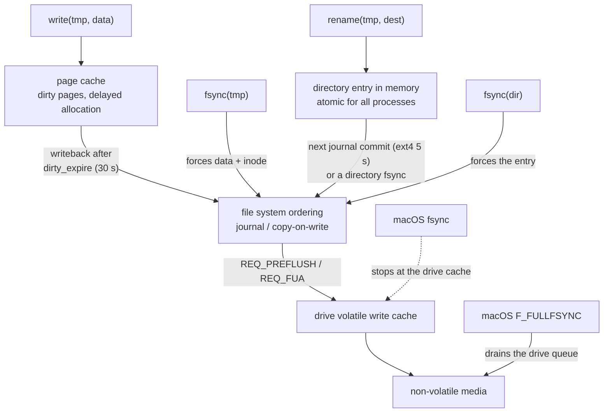

# Atomic Rename and fsync

> [!summary] Claim
> `rename(2)` makes a replacement atomic for every running process, but POSIX.1-2024 says outright that after a crash "rename("a","b") may result in b being created without a being removed" and that later operations may reach storage before earlier ones, so a replacement survives power loss only when the new file is `fsync`ed before the rename and its directory is `fsync`ed after it, with each flush checked and never retried, and on macOS only when the flush is `F_FULLFSYNC`, which the lab measured at about 200 times the cost of `fsync`.

Part of [Files, Filesystems, and Permissions](README.md) in [Shell and Unix Engineering](../README.md).

## TL;DR

- Mechanism: `rename` changes one directory entry in the in-memory file system, atomically and serializably for other processes (`(POSIX.1-2024 XBD 4.4)`), while the page cache writes data, inodes, and directory entries back to storage later and in no promised order (`(POSIX.1-2024 XBD 4.11)`); `fsync(fd)` forces one file's data and attributes down, including the drive's volatile cache on Linux ("This includes writing through or flushing a disk cache", `(fsync(2), DESCRIPTION)`).
- Rule: write the new content to a temporary file in the destination's directory, set its mode, `fsync` it, `rename` it over the destination, then `fsync` the directory (opened `O_RDONLY`; `O_WRONLY` gives `EISDIR`, lab test 2); a cross-directory move needs both directories flushed.
- Trap: a failed `fsync` is not retryable on Linux: the failed pages are marked clean and the error is reported once (Linux 4.13+ `errseq_t`), so a second `fsync` can return 0 with the data gone; PostgreSQL now PANICs instead (`data_sync_retry = off`).
- Portability: POSIX has no `sync`, `fsync`, or `mktemp` utility; GNU `sync FILE` (coreutils 8.24+) and BusyBox `sync FILE` call `fsync(2)`, FreeBSD ships `fsync(1)`, and macOS `sync` ignores its operands and exits 0 (lab test 10), while macOS `fsync(2)` does not flush the drive cache at all; only `F_FULLFSYNC` does, at 4.9 ms against 23 us for `fsync` on the lab machine.
- When not to use it: for many small records (use an append-only log with one flush per batch), for multi-file transactions (use SQLite or a database), for scratch or regenerable files (no flush at all), and from shell scripts on macOS, where no shipped utility flushes a directory durably; use a language whose `fsync` maps to `F_FULLFSYNC` (Rust `sync_all`, Go `File.Sync`).

## Mental model



Every arrow on the left is a separate path to storage with its own timing, and nothing ties them together unless the program forces it.
`write` only dirties pages; the flusher threads write them out once they are older than `dirty_expire_centisecs` (30 s by default), and ext4's delayed allocation does not even pick their blocks before that.
`rename` is finished, for every process on the machine, the moment it returns, but the changed directory entry reaches disk with the next journal commit, which can come before the data it points to.
The two `fsync` calls are the only arrows the program controls: the first pins the data under the temporary name before any name points at it, the second pins the new name.
Below the file system, a flush on Linux sends a cache flush or a forced-unit-access write to the drive; on macOS plain `fsync` stops at the drive's cache, and only `F_FULLFSYNC` drains it.

## How it works

### Two guarantees with two different specifications

Atomicity and durability are specified in different places and fail in different ways.

Atomicity is a property of the in-memory file system.
POSIX.1-2024 requires every operation that modifies a directory, "for example creating, unlinking, or renaming a file", to "either have its entire effect and succeed, or ... not affect the file system and ... fail", and to be serializable (`(POSIX.1-2024 XBD 4.4)`).
For `rename` itself, "a directory entry named new shall remain visible to other threads throughout the renaming operation and refer either to the file referred to by new or old before the operation began", and "If the rename() function fails for any reason other than [EIO], any file named by new shall be unaffected" (`(POSIX.1-2024 XSH rename, DESCRIPTION)`).
Linux phrases it from the reader's side: "there is no point at which another process attempting to access newpath will find it missing", with "probably ... a window in which both oldpath and newpath refer to the file being renamed" (`(rename(2), DESCRIPTION)`).

Durability is a property of what storage holds after a crash, and until 2024 POSIX said almost nothing about it.
POSIX.1-2024 added XBD 4.11 "File System Cache" (the 2017 edition's chapter 4 has no such section, and no 4.4 "Directory Operations" either): cache entries "shall be transferred to the underlying storage as the result of successful calls to fdatasync(), fsync(), or aio_fsync(), and may be transferred to storage automatically at other times".
Its notes are the clearest statement anywhere of what a crash may leave:

- "If the system crashes before the cache is fully transferred, later operations' effects may be present in storage with earlier effects missing."
- Operations that modify several directory entries, blocks, or attributes, "(e.g., mkdir(), rename(), write() with large buffer size, open() with O_CREAT) may have only part of their effects transferred", "not necessarily done in any order. For example, only the second half of a write() may be transferred; or rename("a","b") may result in b being created without a being removed."
- The atomic units of transfer are "directory entries (for directory contents), aligned data blocks of the fundamental file system block size (for regular-file contents ...), and all attributes of a single file".

So a crash after an unflushed write-then-rename may legally leave the new name pointing at a file whose data never arrived, and may leave both the temporary name and the new name.
The macOS and FreeBSD `rename(2)` pages go further than POSIX for the name only: "an instance of new will always exist, even if the system should crash in the middle of the operation" (macOS 27.3 `rename(2)`); that says nothing about the data the name leads to.

### What rename does, down to the VFS

`rename` changes names, never data.
The renamed inode keeps its number: the lab's C probe records `st_ino` of the temporary file before the rename and finds it under the destination name afterwards (`ino_kept=yes`, lab test 6), and the shell helper sees the destination's inode number change (`same_inode=no`, lab test 12).
The replaced inode loses one link; "If one or more processes have the file open when the last link is removed, the link shall be removed before rename() returns, but the removal of the file contents shall be postponed until all references to the file are closed" (`(POSIX.1-2024 XSH rename)`), which is why open descriptors keep reading the old content ([[Atomic-Writes]]).
`rename` marks the parent directories' modification and status-change times; whether the renamed file's own `ctime` changes is left open ("Some implementations mark for update the last file status change timestamp of renamed files and some do not", `(POSIX.1-2024 XSH rename, APPLICATION USAGE)`).

The strangest rule is the same-file case: "If the old argument and the new argument resolve to either the same existing directory entry or different directory entries for the same existing file, rename() shall return successfully and perform no other action", so that `rename("x", "x")` "does not remove the file" (`(POSIX.1-2024 XSH rename, RATIONALE)`).
Linux implements it at the top of `vfs_rename()` in `fs/namei.c` (`if (source == target) return 0;`), before any file system code runs.
Lab test 5 links `a` to `b`, calls `rename("a", "b")`, and gets `rename=ok a=yes b=yes nlink=2`: success, and both names still exist.

The flags (`RENAME_NOREPLACE`, `RENAME_EXCHANGE`, macOS `RENAME_SWAP`), `EXDEV`, and what `mv` adds on top are in [[cp-mv-and-Rename-Semantics]].

### The page cache: when data reaches disk on its own

Linux writes dirty pages back from flusher threads.
`mm/page-writeback.c` sets `dirty_writeback_interval = 5 * 100` and `dirty_expire_interval = 30 * 100` centiseconds: the threads wake every 5 s and write data that has been dirty for longer than 30 s (`Documentation/admin-guide/sysctl/vm.rst` documents both tunables).
Journaled metadata has its own clock: ext4 commits its running transaction at least every `commit=nrsec` seconds, "The default value is 5 seconds", and the same page warns that "due to delayed allocation even older data can be lost on power failure since writeback of those data begins only after time set in /proc/sys/vm/dirty_expire_centisecs" (`ext4.rst`); btrfs commits every 30 s by default (`commit=<seconds>`, "since: 3.12, default: 30", btrfs-progs `ch-mount-options.rst`).
Those two clocks are the root of the classic failure: the metadata (including a rename) can commit seconds before the data it refers to is even allocated.

### The fsync family

| Call | What it guarantees on return | Specification |
|---|---|---|
| `fsync(fd)` | "synchronized I/O file integrity completion": data plus all attributes, including times | `(POSIX.1-2024 XSH fsync)`, `(POSIX.1-2024 XBD 3.369)` |
| `fdatasync(fd)` | "synchronized I/O data integrity completion": data plus only the metadata needed to read it back (size yes, `mtime` no) | `(POSIX.1-2024 XSH fdatasync)`, `(POSIX.1-2024 XBD 3.368)` |
| `open(..., O_SYNC)` / `O_DSYNC` | every `write` behaves as if followed by `fsync` / `fdatasync`; Linux has no real `O_RSYNC` | `(POSIX.1-2024 XSH open)`, `open(2)` |
| `sync()` | POSIX: "scheduled for writing ... not necessarily complete upon return"; Linux waits for completion | `(POSIX.1-2024 XSH sync)`, `sync(2)` |
| `syncfs(fd)` | Linux only: `sync` restricted to one file system; reports writeback errors since Linux 5.8 | `sync(2)` |
| `sync_file_range` | starts or waits for writeback of a byte range; no metadata, no drive cache flush | `sync_file_range(2)` |
| macOS `fcntl(fd, F_FULLFSYNC)` | `fsync` plus a drive cache flush | macOS `fcntl(2)` |
| macOS `fcntl(fd, F_BARRIERFSYNC)` | `fsync` plus an ordering barrier, no durability promise | macOS `fcntl(2)` |

Points that matter in practice:

- The definitions treat a directory as a file whose data is its entries: "an operation that modifies a directory is considered to be a write operation, and a directory's entries are considered to be the data" (`(POSIX.1-2024 XBD 3.368)`), so `fdatasync` on a directory is enough for its entries.
  The same definition admits a gap: "This standard provides no way to synchronize the contents or attributes of a symbolic link".
- POSIX.1-2024 (Austin Group defect 672) added the directory case to `fsync`'s APPLICATION USAGE: an application that creates a file "can invoke fsync() on the directory to ensure that the directory's entries and file attributes are synchronized", while "For most applications, synchronizing the directory's entries should not be necessary".
  Linux is blunter: "Calling fsync() does not necessarily ensure that the entry in the directory containing the file has also reached disk", and the fix is "an explicit fsync() on a file descriptor for the directory" (`(fsync(2), DESCRIPTION)`).
- A directory must be opened read-only for this: `open` fails with `EISDIR` when "The named file is a directory and oflag includes O_WRONLY or O_RDWR" (`(POSIX.1-2024 XSH open, ERRORS)`), and lab test 2 shows `wronly=EISDIR rdonly_fsync=ok rdonly_fdatasync=ok` on macOS.
- A read-only descriptor is enough for a file too (lab test 3).
  Linux notes that under System V Release 4 the descriptor "needs to be opened for writing", which is "forbidden by POSIX, but nevertheless survives in HP-UX and AIX" (`(fsync(2), HISTORY)`), and GNU `sync` opens operands `O_WRONLY` on AIX and Cygwin for that reason (`sync_arg()` in `src/sync.c`).
- Flushing is a property of the file, not of the descriptor: GNU `dd` syncs "even if w_bytes is zero, as fsync and fdatasync flush out write requests from other processes too" (`synchronize_output()` in `src/dd.c`).
- `fsync` on a pipe, FIFO, or socket fails with `EINVAL` ("fd is bound to a special file ... which does not support synchronization", `fsync(2)`).
  The kernel path is `vfs_fsync_range()` in `fs/sync.c`, which returns `-EINVAL` when the file has no `f_op->fsync`; lab test 4 measures `fsync=EINVAL fdatasync=EINVAL` for a pipe on macOS too.
- `sync_file_range` is a trap with a warning label: it is "extremely dangerous and should not be used in portable programs", "None of these operations writes out the file's metadata", and it "does not flush disk write caches and thus does not provide any data integrity" (`sync_file_range(2)`).

### Below the file system: the drive's cache

Most drives acknowledge writes once they sit in a volatile cache.
Linux's block layer gives file systems two tools: `REQ_PREFLUSH`, which "will make sure the volatile cache of the storage device has been flushed before the actual I/O operation is started", and `REQ_FUA`, which makes sure "that I/O completion for this request is only signaled after the data has been committed to non-volatile storage" (`Documentation/block/writeback_cache_control.rst`).
A driver for a device with a volatile cache advertises `BLK_FEAT_WRITE_CACHE` (and `BLK_FEAT_FUA` if it supports FUA); for a device without one, the block layer completes empty flush requests itself.
That is how Linux `fsync` keeps its promise to include "writing through or flushing a disk cache"; ext4's `barrier=0` / `nobarrier` turns off the ordering of journal commits, which "If your disks are battery-backed ... may safely improve performance" and otherwise trades durability for speed (`ext4.rst`).
XFS's `xfs_file_fsync()` forces the log, and its comment notes that "The log force will flush the caches for all devices before writing the log records" (`fs/xfs/xfs_file.c`).

macOS draws the line elsewhere.
Its `fsync(2)` says that while fsync "will flush all data from the host to the drive ... the drive itself may not physically write the data to the platters for quite some time and it may be written in an out-of-order sequence", that "This is not a theoretical edge case", and it points to `F_FULLFSYNC`, which "asks the drive to flush all buffered data to permanent storage" and, because it "drains the entire queue of the device and acts as a barrier", also persists everything `fsync`ed before it on that device; it is "implemented on HFS, MS-DOS (FAT), Universal Disk Format (UDF) and APFS" (macOS 27.3 `fsync(2)`, `fcntl(2)`).
`F_BARRIERFSYNC` is the cheaper middle: `fsync` plus a barrier, so that "no file can possibly get persisted with the effect of the second phase without the effect of the first one", with "no assumption ... on what has been persisted or not when this call returns".
The lab's benchmark (macOS 27.3, Apple M3 Pro, internal SSD, APFS, 200 iterations of a 4 KiB in-place rewrite) measured a median of 23 us for `fsync`, 186 us for `F_BARRIERFSYNC`, and 4913 us for `F_FULLFSYNC`.
That ratio is why most macOS software does not pay it unless asked: SQLite's `PRAGMA fullfsync` and `checkpoint_fullfsync` default to off ("Only Mac OS X supports F_FULLFSYNC"), and Git's `core.fsyncMethod` default on macOS is `writeout-only`, which "issues pagecache writeback requests, but ... data added to the repository may not be durable in the event of a system crash" (`Documentation/config/core.adoc`).
Language runtimes chose the other way: Rust's `File::sync_all` and `sync_data` call `fcntl(fd, F_FULLFSYNC)` on Apple targets (`library/std/src/sys/fs/unix.rs`), and Go's `File.Sync` does the same "because on OS X, SYS_FSYNC doesn't fully flush contents to disk", falling back to `fsync` when `F_FULLFSYNC` returns `ENOTSUP` (for example on SMB mounts, `internal/poll/fd_fsync_darwin.go`).

### Why the unflushed pattern loses data, file system by file system

The pattern `write tmp; rename tmp dest` without `fsync` is what most programs did, and each Linux file system grew a different heuristic for it after ext4 broke it in 2009 (Corbet, "ext4 and data loss", LWN, 2009-03-11; the zero-length-file report was Launchpad bug 317781).
ext3 in `data=ordered` mode forced data blocks out before committing metadata every 5 s, so the pattern worked by accident; ext4's delayed allocation left the data unallocated, so the journal committed the rename long before the data existed.

| File system | What the kernel does for the unflushed replace (read from the kernel source as of 2026-11, not crash-tested) | Guarantee |
|---|---|---|
| ext4, `data=ordered` (default), `auto_da_alloc` (default) | `ext4_rename()` in `fs/ext4/namei.c`: `if (new.inode && !test_opt(new.dir->i_sb, NO_AUTO_DA_ALLOC)) ext4_alloc_da_blocks(old.inode);` so blocks are allocated and, in ordered mode, written before the rename commits; truncating to 0 sets `EXT4_STATE_DA_ALLOC_CLOSE` (`ext4_truncate()`), and `ext4_release_file()` flushes on the last close | "roughly the same level of guarantees as ext3" (`ext4.rst`); off with `noauto_da_alloc` |
| ext4, `data=writeback` | "Data ordering is not preserved, data may be written into the main file system after its metadata has been committed", and a crash can expose "stale data ... in recently written files" | none |
| ext4, `data=journal` | data goes through the journal; disables delayed allocation; "deprecated and support will be removed in January 2028" | ordered, slow |
| btrfs | `btrfs_rename()`: when a regular file replaces a non-empty file (`new_inode && S_ISREG(old_inode->i_mode) && new_inode->i_size`), `filemap_flush(old_inode->i_mapping)` to "Start IO on it now"; truncating a non-empty file to 0 sets `BTRFS_INODE_FLUSH_ON_CLOSE` (`btrfs_setsize()`), acted on in `btrfs_release_file()` | writeback started, not waited for |
| XFS | no rename heuristic (`xfs_rename()` in `fs/xfs/xfs_inode.c` does not flush); a truncate sets `XFS_ITRUNCATED` (`xfs_iops.c`), and `xfs_file_release()` calls `filemap_flush()` on the last close "to combat the notorious NULL files problem" | narrows the truncate window only |

Pillai et al. measured where these heuristics leave applications: they studied the persistence properties of six Linux file systems with their BOB tool, and with ALICE found 60 crash vulnerabilities in 11 applications; the "safe rename" heuristic "only matches (and thus fixes) three discovered vulnerabilities", the `O_TRUNC` close heuristic "does not affect any of the vulnerabilities we discovered", "Linux ext2 and btrfs freely reorder directory operations", and "Six applications require fsync() calls on directories" (OSDI 2014, sections 2 and 4).
Heuristics start writeback; they do not wait for it, they differ per file system and mount option, and they do not exist on other kernels.
The protocol is the only portable answer.

### The protocol, and why each step is where it is

1. Create the temporary file in the destination's directory, because `rename` cannot cross file systems (`EXDEV`) and the directory you will `fsync` must be the one that holds both names.
2. Write the data, set the mode (and owner), and check every status, including `close`: on NFS the client writes back at `close`, which gives it "an opportunity to report write errors to the application via the return code from close(2)" (`nfs(5)`, close-to-open consistency).
3. `fsync` the temporary file.
   This is the step that defeats XBD 4.11's "later operations' effects may be present in storage with earlier effects missing": once it returns, the data and inode are on storage before any name points at them.
   Flushing after the mode change means the flush covers the mode too (lab test 13 sees the flusher called with the file already `-rw-r-----`).
4. `rename` the temporary file over the destination.
5. `fsync` the directory, so the new entry is on storage; until then, a crash may legally restore the old name, or (per XBD 4.11) leave both names.
   If the file moved between directories, both directories changed and both need a flush.
6. On recovery, expect leftovers: a temporary file that was never renamed, or (XBD 4.11) one that was renamed but whose old entry survived; sweep them by name pattern.

Jeff Moyer's LWN guide gives the same five-step list (create on the same file system, write, `fsync` the temporary file, rename, `fsync` the directory) and notes that whether a new file needs a directory `fsync` "is actually file system (and mount option) dependent", so portable code always does it ("Ensuring data reaches disk", LWN, 2011-09-07).
SQLite does the directory step for its own files: "On Unix, the directory that contains the super-journal is also synced", and for the rollback journal it "tries to prevent this by opening and syncing the directory containing the rollback journal at the same time it syncs the journal file itself" (`atomiccommit.html`).

### When fsync fails

A failed `fsync` is the hardest part of this topic, because the obvious reaction, retrying, is wrong.

- POSIX: "If the fsync() function fails, outstanding I/O operations are not guaranteed to have been completed" (`(POSIX.1-2024 XSH fsync, RETURN VALUE)`), and the rationale explicitly permits "a null implementation" where storage cannot be made safe.
- Linux marks pages clean after a failed writeback.
  At LSFMM 2017, Jeff Layton described error handling during writeback as "something of a mess", with the failed page "left in the page cache marked clean and up-to-date" (LWN, "Handling writeback errors", 2017-04-04).
- Linux 4.13 introduced `errseq_t`: a 32-bit value whose low bits hold the error and whose upper bits are a counter, plus a "seen" flag, so that each open file can tell whether a new error happened since it last looked (`lib/errseq.c`).
  The VFS documentation states the resulting contract: "After an error has been reported on one request, subsequent requests on the same file descriptor should return 0", and the kernel reports errors "to fsync on all file descriptions that were open at the time that the error occurred" (`Documentation/filesystems/vfs.rst`, "Handling errors during writeback"; `fsync(2)`, `EIO`).
- PostgreSQL found the consequence in 2018 ("fsyncgate"): its checkpointer opens files late and retries, so a lost writeback could be followed by a successful `fsync` (Corbet, "PostgreSQL's fsync() surprise", LWN, 2018-04-18).
  PostgreSQL now PANICs on `fsync` failure, backpatched to 9.4 (PostgreSQL wiki "Fsync Errors"), and its documented default `data_sync_retry = off` explains why: "the second attempt may be reported as successful, when in fact the data has been lost ... the only way to avoid data loss is to recover from the WAL".
- The same wiki page records other kernels: FreeBSD keeps failed buffers dirty so later `fsync` calls retry and fail (since 11.1 it drops them once the device has gone away); NetBSD and OpenBSD invalidated them, though the page notes that a later OpenBSD commit "changed the behaviour, analysis needed"; and macOS "buffers are invalidated, code similar to NetBSD" (as of 2026-11).
- Rebello et al. injected `fsync` failures into ext4, XFS, and btrfs and found that "all three file systems mark pages clean after fsync fails, rendering techniques such as application-level retry ineffective", that ext4 and XFS keep the new data in memory while btrfs "reverts to the previous consistent state", and that none of five databases handled every case (USENIX ATC 2020).

For a script the rule is simple: treat a failed flush before the rename as "do not publish" (the old file is intact), and a failed directory flush after the rename as "visible but not known to be durable"; never loop on it.

### What a shell script can call

POSIX.1-2024 XCU has no `sync`, `fsync`, or `mktemp` utility (`idx/utilities.html` lists `dd` and `mv` but none of those three), so every flush from a script depends on the userland:

- GNU `sync` accepts operands since coreutils 8.24 (2015-07-03: "sync no longer ignores arguments", NEWS); `sync_arg()` opens each one `O_RDONLY | O_NONBLOCK` (falling back to `O_WRONLY`), clears `O_NONBLOCK`, and calls `fsync`, `fdatasync` (`-d`), or `syncfs` (`-f`); write-only operands work since 8.31 (2019-03-10).
- BusyBox `sync [-df] [FILE]...` does the same when built with `FEATURE_SYNC_FANCY` (default y) and otherwise warns that it ignores its arguments (`bb_warn_ignoring_args()`) and calls `sync()`; BusyBox also has an `fsync [-d] FILE...` applet (`CONFIG_FSYNC`, default y), and its `sync -f` ignores `syncfs` errors on the stated grounds that "syncfs is documented to only fail with EBADF", which stopped being true in Linux 5.8 (`coreutils/sync.c`).
- uutils `sync FILE` differs from GNU: it opens each operand with `O_NONBLOCK` (so a missing file is an error with status 1) but then calls the global `sync(2)` instead of `fsync` on the operand; only `-d` (`sync_data`) and `-f` (`syncfs`, Linux, Android, and Windows) act per file (`src/uu/sync/src/sync.rs`, as of 2026-11, read from source and not run here).
- FreeBSD ships `fsync(1)` ("first appeared in FreeBSD 4.3"), which opens each file `O_RDONLY | O_NONBLOCK` and calls `fsync(2)`, exiting greater than 0 on any failure; FreeBSD and macOS `sync(8)` take no operands and call `sync(2)`.
- macOS `sync -- FILE` exits 0 without opening `FILE` (lab test 10: `sync -- missing` gives `rc=0`), so its exit status cannot tell you that nothing file-specific happened, and macOS `sync(2)` "may return before the buffers are completely flushed".
- `dd if=/dev/null of=FILE conv=notrunc,fsync` is the one file flush GNU, BSD and macOS, and BusyBox `dd` all accept ([[Atomic-Writes]]); it cannot flush a directory, because `dd` opens its output for writing and a directory gives `EISDIR`.
- `dd conv=fsync` writing to a pipe fails: GNU prints "fsync failed for 'standard output': Invalid argument" and BSD "fsyncing stdout: Invalid argument", both exit 1 (lab test 11); GNU `conv=fdatasync` ignores `EINVAL` but then falls back to `fsync`, which fails the same way (`synchronize_output()` in `src/dd.c`).
- In BusyBox `dd` (`coreutils/dd.c`, as of 2026-11), `conv=fsync` is honored only with `FEATURE_DD_IBS_OBS`, and the `fsync(ofd)` call comes before the final `write_and_stats(obuf, ocount, ...)` that writes a partial output block when `ibs` and `obs` differ, so with `ibs != obs` the tail block is written after the flush (`dd_main()` in `coreutils/dd.c`: `fsync(ofd)`, then `if (ocount != 0) write_and_stats(obuf, ocount, ...)`; confirmed by reading the source, not by a run).
- macOS ships `/usr/bin/perl` (5.34.1 on macOS 27.3), whose `IO::Handle` `sync` method "synchronizes a file's in-memory state with that on the physical medium" via `fsync`; `perl -MIO::Handle -e 'open(my $f, "<", $ARGV[0]) or die; $f->sync or die' DIR` succeeded on a directory here, but it is plain `fsync`, not `F_FULLFSYNC`.

The lab's `durable_replace` therefore takes its flusher from `DR_FSYNC` (any command that flushes the path it is given) and otherwise uses `sync --`, but first proves the flusher opens its operand: it flushes a path that does not exist and refuses to run (status 3) if that succeeds, which is exactly how macOS `sync` behaves (lab test 17).

## Numbers and limits

| Quantity | Value | Source |
|---|---|---|
| Linux flusher wake-up interval | 5 s (`dirty_writeback_interval = 5 * 100` centiseconds) | `mm/page-writeback.c` (as of 2026-11) |
| Linux age before dirty data is written back | 30 s (`dirty_expire_interval = 30 * 100`) | `mm/page-writeback.c` (as of 2026-11) |
| ext4 journal commit interval | 5 s default (`commit=nrsec`) | `ext4.rst` (as of 2026-11) |
| btrfs transaction commit interval | 30 s default, warning above 300 s, option since Linux 3.12 | btrfs-progs `ch-mount-options.rst` (as of 2026-11) |
| ext4 `data=journal` | deprecated; removal planned for January 2028 | `ext4.rst` (as of 2026-11) |
| Atomic units of transfer to storage | one directory entry; one aligned file system block; all attributes of one file | POSIX.1-2024 XBD 4.11 |
| `errseq_t` | 32 bits: errno in the low bits, a "seen" flag, a counter above | `lib/errseq.c` |
| Linux `fsync` reports errors to every open description | since Linux 4.13 | `fsync(2)`, `vfs.rst` |
| `syncfs` exists / reports writeback errors | Linux 2.6.39 / Linux 5.8 | `sync(2)` |
| GNU `sync FILE` | coreutils 8.24 (2015-07-03); write-only operands 8.31 (2019-03-10) | coreutils NEWS |
| GNU `dd conv=fsync` after a write error | syncs anyway since 9.1 (2022-04-15) | coreutils NEWS |
| FreeBSD `fsync(1)` | since FreeBSD 4.3 | `fsync.1` |
| `sync_file_range` granularity | pages: offset rounded down, end rounded up | `sync_file_range(2)` |
| Crash vulnerabilities, ALICE study | 60 in 11 applications (persistence properties of 6 Linux file systems studied separately); safe-rename heuristic fixes 3; 6 applications need directory `fsync` | Pillai et al., OSDI 2014 |
| Overwrite 4 KiB, no flush | p50 1 us, max 6 us | lab `fsprobe bench`, N=200, macOS 27.3, M3 Pro, APFS, 2026-11-15 |
| Overwrite 4 KiB + `fsync` | p50 23 us, max 35 us | same run |
| Overwrite 4 KiB + `fdatasync` | p50 28 us, max 53 us | same run |
| Overwrite 4 KiB + `F_BARRIERFSYNC` | p50 186 us, max 904 us | same run |
| Overwrite 4 KiB + `F_FULLFSYNC` | p50 4913 us, max 11058 us (about 200x `fsync`) | same run |
| Full replace (create, write, rename) without flush | p50 162 us, max 335 us | same run |
| Full replace with `fsync` file + `fsync` directory | p50 209 us, max 3607 us | same run |
| Full replace with `F_FULLFSYNC` file + directory | p50 10032 us, max 14422 us | same run |
| Lab | 17 tests; 17/17 under `sh` (bash 3.2), dash, zsh, `zsh --emulate sh`, ksh93u+ 2012, bash 5.3 | run 2026-11-15 on macOS 27.3 |

The benchmark numbers are one run on one machine; they show ratios, not a specification, and a Linux machine with a drive that reports a volatile cache pays the cache flush inside plain `fsync`.

## Portability

The kernel and the utilities decide this topic, not the shell: every shell the lab ran gave the same 17 results, and the lab's expectations branch on `uname -s` and on the `sync` and `dd` implementation, never on the shell family.
"Run here" means the suite ran under that shell on macOS 27.3; "lab asserts" means the test encodes the expected value for the matrix to confirm.

| Shell | `durable_replace` with a function as `DR_FSYNC` (tests 12 to 16) | Probe and utility tests (1 to 11, 17) |
|---|---|---|
| POSIX sh | uses only functions, `.`, `case`, `$((...))`, and `"$@"`, all POSIX; `mktemp` is not a POSIX utility | not shell-specific |
| macOS bash 3.2 (`/bin/sh`) | pass (run here) | pass (run here) |
| bash 5.3 | pass (run here) | pass (run here) |
| zsh 5.9 native | pass (run here); counts leftovers with `find`, because a non-matching `.dr.*` glob aborts native zsh | pass (run here) |
| `zsh --emulate sh` | pass (run here) | pass (run here) |
| dash 0.5.13 | pass (run here) | pass (run here) |
| ksh93 | pass (run here, ksh93u+ 2012); ksh93u+m lab asserts | pass (run here) |
| mksh | lab asserts | lab asserts |
| yash | lab asserts | lab asserts |
| posh | lab asserts | lab asserts |
| BusyBox ash | lab asserts | lab asserts |

| Behavior | GNU coreutils (9.7 run, 9.12 source) | BSD and macOS | BusyBox 1.37 | FreeBSD | uutils |
|---|---|---|---|---|---|
| `sync -- FILE` | `fsync(FILE)`; missing file: "error opening", status 1 (lab test 10, `src/sync.c`; measured on Debian 13, coreutils 9.7) | operands ignored, `sync(2)`, status 0 (lab test 10, macOS `sync(8)`) | `fsync(FILE)` with `FEATURE_SYNC_FANCY`, else warning and `sync()` (`sync.c`); missing file: "can't open", status 1 (measured on Alpine 3.22) | no operands (`sync.8`) | opens each operand, so a missing file gives an error and status 1, then runs the global `sync(2)` and never `fsync`s the operand (`src/uu/sync/src/sync.rs`, as of 2026-11; read from source) |
| `sync -d FILE` / `sync -f FILE` | `fdatasync` / `syncfs` | not available | same as GNU with `FEATURE_SYNC_FANCY`; `-f` ignores `syncfs` errors | not available | `-d` calls `sync_data` and requires an operand; `-f FILE` is `syncfs` on Linux, Android, and Windows (`sync.rs`) |
| `fsync FILE` utility | none | none on macOS | `fsync [-d] FILE...` (`CONFIG_FSYNC`) | `fsync(1)` | none (no `src/uu/fsync` in the tree, as of 2026-11) |
| `dd ... conv=fsync` to a pipe | status 1, `EINVAL` (lab test 11; measured on Debian 13) | status 1, `EINVAL` (lab test 11) | status 1, "Invalid argument" (`fsync(ofd)` then die; measured on Alpine 3.22) | not checked | with no `of=`, `Dest::fsync()` only flushes the Rust stdout buffer, so no `fsync(2)` is issued and a pipe does not fail (`src/uu/dd/src/dd.rs`, read from source) |
| `dd oflag=` for synchronous writes | `oflag=sync` (`O_SYNC`), `oflag=dsync` (`O_DSYNC`) (`src/dd.c`) | macOS `oflag=fsync` (`O_FSYNC`), `oflag=sync` (`O_SYNC`) (macOS `dd(1)`) | none (`seek_bytes`, `append`, `direct` only) | `oflag=fsync`, `oflag=sync`; also `conv=fdatasync` (`dd.1`) | `oflag=sync` (`O_SYNC`), `oflag=dsync` (`O_DSYNC`); `conv=fsync` and `conv=fdatasync` call `sync_all` and `sync_data` on a file output (`dd.rs`) |
| `fsync(2)` reaches the drive's media | yes on Linux (`fsync(2)`) | no on macOS; needs `F_FULLFSYNC` | Linux semantics | not checked here | n/a |
| `fsync` / `fdatasync` on a pipe | `EINVAL` on Linux (`fsync(2)`; `fsprobe pipe` run once on Debian 13) | `EINVAL` on macOS (lab test 4) | Linux kernel decides (`EINVAL`, same kernel) | not checked; `fsync(2)` documents `EINVAL` for sockets only | n/a |

## Worked example

The [lab](../labs/10-atomic-rename-and-fsync/) has three files: `fsprobe.c`, a C probe with one mode per system-call fact plus a tiny `fsync(1)` (it acts as one when invoked through a link named `fsync`); `durable.sh`, the shell helper; and `durable.bats`, 17 tests.
`durable.sh`, verbatim:

```sh
# shellcheck shell=sh
# durable.sh - durable_replace: replace a file so that readers see the old or the new
# content, and so that after a crash the name holds the old or the new content too.
# Source it: . ./durable.sh
#
#   durable_replace MODE DEST CMD [ARG...]
#
# Runs CMD with standard output on a temporary file in DEST's directory, then:
#   1. chmod MODE on the temporary file
#   2. flush the temporary file (data, size, and mode) to storage
#   3. rename it over DEST (one atomic directory update)
#   4. flush DEST's directory, so the new directory entry is on storage
# Returns CMD's status if CMD fails, the flusher's status if a flush fails, 2 for usage
# or setup errors, and 3 when no flusher that honors its operands is available.
# DEST is untouched unless step 3 ran; a failure in step 4 means "new content visible,
# not yet known to be durable".
#
# The flusher is "$DR_FSYNC PATH" when DR_FSYNC is set (FreeBSD and BusyBox ship an
# fsync utility; the lab builds one), else "sync -- PATH", which calls fsync(2) on PATH
# in GNU coreutils 8.24+ and BusyBox built with FEATURE_SYNC_FANCY. macOS sync ignores
# its operands and calls sync(2), so durable_replace refuses to run with it (status 3).
# Variables use a dr_ prefix because POSIX sh has no "local".

dr_flush() {
  if [ -n "${DR_FSYNC-}" ]; then
    "$DR_FSYNC" "$1"
  else
    sync -- "$1"
  fi
}

# dr_check_flusher DIR: a flusher that really opens its operand must fail on a missing
# path; one that ignores operands (macOS sync) succeeds, and is useless here.
dr_check_flusher() {
  [ "${dr_flusher_ok-}" = 1 ] && return 0
  if dr_flush "$1/.dr-missing.$$" 2>/dev/null; then
    echo "durable_replace: '${DR_FSYNC:-sync}' ignores its operands; set DR_FSYNC to an fsync tool" >&2
    return 3
  fi
  dr_flusher_ok=1
}

durable_replace() {
  if [ "$#" -lt 3 ]; then
    echo "usage: durable_replace MODE DEST CMD [ARG...]" >&2
    return 2
  fi
  dr_mode=$1
  dr_dest=$2
  shift 2
  case $dr_dest in
    */)
      echo "durable_replace: $dr_dest: trailing slash" >&2
      return 2
      ;;
    */*) dr_dir=${dr_dest%/*} ;;
    *) dr_dir=. ;;
  esac
  dr_dir=${dr_dir:-/}
  dr_check_flusher "$dr_dir" || return
  dr_tmp=$(mktemp "$dr_dir/.dr.XXXXXX") || return 2
  if "$@" >"$dr_tmp"; then
    :
  else
    dr_rc=$?
    rm -f -- "$dr_tmp"
    return "$dr_rc"
  fi
  # chmod before the flush, so the flush also covers the new mode.
  chmod -- "$dr_mode" "$dr_tmp" || {
    dr_rc=$?
    rm -f -- "$dr_tmp"
    return "$dr_rc"
  }
  dr_flush "$dr_tmp" || {
    dr_rc=$?
    rm -f -- "$dr_tmp"
    return "$dr_rc"
  }
  mv -f -- "$dr_tmp" "$dr_dest" || {
    dr_rc=$?
    rm -f -- "$dr_tmp"
    return "$dr_rc"
  }
  dr_flush "$dr_dir"
}
```

Test 13 replaces `DR_FSYNC` with a function that logs what it is asked to flush and what the destination holds at that moment, then calls the real `fsync` tool; verbatim from `durable.bats`:

```sh
    log() {
      if [ ! -e "$1" ]; then
        echo "check-missing"
        return 1
      elif [ -d "$1" ]; then
        echo "dir dest=$(cat dest)"
      else
        echo "file mode=$(ls -l "$1" | cut -c1-10) dest=$(cat dest)"
      fi
      "$FS" "$1"
    }
    FS=$2
    DR_FSYNC=log
    durable_replace 640 dest printf "NEW\n"
    echo "rc=$?"
```

The core of the C probe's replace mode, as a simplified excerpt of `mode_replace()` in `fsprobe.c` (error handling and the status line removed):

```c
int fd = mkstemp(tmp);                 /* DIR/.rf.XXXXXX, O_EXCL, mode 0600 */
write_all(fd, text, strlen(text));
fchmod(fd, 0644);
flush_fd(fd, method);                  /* fsync, fdatasync, or F_FULLFSYNC */
close(fd);                             /* a failed close also means: do not rename */
rename(tmp, dest);                     /* atomic for every process */
int dfd = open(dir, O_RDONLY);         /* O_WRONLY would fail with EISDIR */
flush_fd(dfd, method);                 /* make the new directory entry durable */
```

Captured on 2026-11-15 (macOS 27.3, APFS) under `/bin/sh`; each line is what the matching lab test asserts.
Test 13 (flush order) and test 17 (plain `sync` on macOS):

```text
check-missing
file mode=-rw-r----- dest=OLD
dir dest=NEW
rc=0
durable_replace: 'sync' ignores its operands; set DR_FSYNC to an fsync tool
rc=3 content=OLD
```

The probe modes behind tests 1, 2, 4, 5, and 7:

```text
$ fsprobe features
fdatasync=yes full_fsync=yes barrier_fsync=yes
$ fsprobe dirfd .
wronly=EISDIR rdonly_fsync=ok rdonly_fdatasync=ok
$ fsprobe pipe
fsync=EINVAL fdatasync=EINVAL
$ fsprobe samefile .
rename=ok a=yes b=yes nlink=2
$ fsprobe replace . dest3 NEW full
flush=full:ok rename=ok ino_kept=yes dirsync=ok
```

And the benchmark (`fsprobe bench DIR 200`), whose numbers feed the table above; test 9 runs it with 5 iterations and checks only the shape of each line and that no median exceeds its maximum:

```text
method=overwrite+none n=200 p50_us=1 max_us=6
method=overwrite+fdatasync n=200 p50_us=28 max_us=53
method=overwrite+fsync n=200 p50_us=23 max_us=35
method=overwrite+full n=200 p50_us=4913 max_us=11058
method=overwrite+barrier n=200 p50_us=186 max_us=904
method=replace+none n=200 p50_us=162 max_us=335
method=replace+fsync n=200 p50_us=209 max_us=3607
method=replace+full n=200 p50_us=10032 max_us=14422
```

Read the first block top to bottom: the helper first proved its flusher fails on a missing path, flushed the temporary file after `chmod 640` while `dest` still read `OLD`, renamed, and only then flushed the directory, with `dest` already `NEW`.
With plain macOS `sync` it refused before creating anything, because a flusher that ignores its operand would make the word "durable" a lie.
On Linux the same tests expect `full_fsync=no`, `flush=full:unsupported` with status 2 and the old file intact, and `sync -- missing` failing with "error opening" under GNU coreutils.
One run of the probe and the utilities in a Debian 13 container (overlayfs) printed exactly those values, plus the macOS results for `dirfd`, `pipe`, and `samefile`.

## Pitfalls

> [!warning] Atomic is not durable
> Trigger: `write tmp; mv tmp dest` with no flush, on any file system without a replace heuristic (XFS, ext4 with `noauto_da_alloc`) or on any kernel other than Linux.
> Symptom: after a power cut `dest` exists with zero length or old blocks, the ext4 2009 failure (LWN 322823, Launchpad 317781); POSIX.1-2024 XBD 4.11 allows exactly this.
> Fix: `fsync` the temporary file before the rename; in a script, `durable_replace` with a flusher that opens its operand.

> [!warning] Flushing the file but not the directory
> Trigger: `fsync(fd); close(fd); rename(tmp, dest);` and nothing after.
> Symptom: after a crash the old name, or both names, come back; ALICE found six of eleven applications needing directory `fsync` calls (Pillai et al., OSDI 2014).
> Fix: open the directory `O_RDONLY` (not `O_WRONLY`, which gives `EISDIR`) and `fsync` it after the rename; for a move between directories, flush both; after `mkdir -p`, flush each new parent too.

> [!warning] Retrying a failed fsync
> Trigger: `while ! fsync(fd); do sleep 1; done`, or logging the error and carrying on.
> Symptom: the retry returns 0 because Linux marked the failed pages clean and reported the error once (`vfs.rst`); the data is gone and the program believes it is safe, the PostgreSQL 2018 failure (LWN 752063).
> Fix: treat the failure as data loss: abort before the rename, keep the old file, and recover from a source of truth; PostgreSQL PANICs (`data_sync_retry = off`).

> [!warning] Trusting fsync on macOS
> Trigger: a macOS program or script that relies on `fsync` (or `sync`) for power-loss safety.
> Symptom: the data reached the drive's cache, not its media; macOS `fsync(2)` says writes may be lost or reordered on power loss and that "This is not a theoretical edge case".
> Fix: `fcntl(fd, F_FULLFSYNC)`, which Rust `sync_all` and Go `File.Sync` already use; budget for it, since the lab measured 4.9 ms against 23 us.

> [!warning] sync FILE that silently does something else
> Trigger: `sync "$file"` in a script written on Linux and run on macOS, or on BusyBox built without `FEATURE_SYNC_FANCY`.
> Symptom: status 0 either way; macOS ignores the operand and runs a global `sync(2)` that "may return before the buffers are completely flushed" (lab test 10).
> Fix: probe the flusher with a missing path once and refuse to continue if it succeeds (`dr_check_flusher` in the lab), or require a real tool (`fsync` on FreeBSD and BusyBox, GNU `sync`).

> [!warning] dd conv=fsync on a pipe
> Trigger: `producer | dd conv=fsync | consumer`, or `dd of=/dev/stdout conv=fsync` with standard output on a pipe.
> Symptom: the data passes through, then `dd` exits 1 with `Invalid argument`, which breaks `set -e` scripts and `pipefail` checks (lab test 11).
> Fix: flush the file that finally receives the data, never a pipe; `conv=fsync` belongs on `of=FILE`.

> [!warning] Heuristics as a protocol
> Trigger: relying on ext4 `auto_da_alloc` or btrfs's rename flush, because "ext4 handles it".
> Symptom: correct on a laptop, data loss on XFS, on `noauto_da_alloc` mounts, or on btrfs, whose `filemap_flush()` starts writeback without waiting; ALICE found the safe-rename heuristic fixed 3 of 60 vulnerabilities.
> Fix: write the explicit two-flush protocol; heuristics are a safety net for programs you cannot change.

> [!warning] Disabled flushes below the file system
> Trigger: ext4 `nobarrier` or `barrier=0`, a virtual disk with cache mode set to ignore flushes, or a drive that lies about its cache.
> Symptom: `fsync` returns quickly and the data is lost anyway; `ext4.rst` reserves `nobarrier` for battery-backed storage, and macOS `fcntl(2)` notes that "Certain FireWire drives have also been known to ignore the request".
> Fix: measure `fsync` latency on the real stack (the lab's `bench` mode): a few microseconds on a device with a volatile cache means something is not flushing.

> [!warning] sync_file_range as durability
> Trigger: `sync_file_range(fd, 0, 0, SYNC_FILE_RANGE_WRITE)` to "save" a file cheaply.
> Symptom: no metadata, no drive cache flush, nothing guaranteed after a crash (`sync_file_range(2)`, "extremely dangerous").
> Fix: use it only to start writeback early, followed by `fdatasync` or `fsync` for the guarantee.

## Security and robustness

- `data=writeback` on ext4 can expose "stale data ... in recently written files in case of an unclean shutdown, which could be a security exposure" (`ext4.rst`): after a crash, a file's new length can cover blocks that still hold another file's old data; ordered mode exists to prevent that.
- Leftovers are expected, not exceptional: XBD 4.11 allows a crash to leave the temporary name, both names, or a partly written temporary file, so the recovery path must tolerate and sweep `.dr.*`-style names and must never treat a leftover as authoritative.
- Validate content before the rename (a parser, a checksum, a size check), because the flush makes a bad file just as durable as a good one ([[Checksums-and-Integrity]]).
- On NFS, `rename` can report failure after the server has done it ("you can not assume that if the operation failed, the file was not renamed", `rename(2)`, BUGS), and `fsync` can fail with `ENOSPC` or `EDQUOT` for a write that seemed to succeed (`fsync(2)`), so check both and design the retry to accept "already renamed".
- Flushing is not a privileged operation: any process that can open a file read-only can `fsync` it (lab test 3), and `sync` flushes everything; a busy system's latency can depend on other users' flushes, which is one reason databases keep their files on dedicated file systems.
- Never let a flush failure fall back silently to "assume it worked": `durable_replace` returns the flusher's status and distinguishes "not published" (before the rename) from "published, durability unknown" (after it).
- Linux `O_TMPFILE` plus `linkat` publishes a file that never had a temporary name, which removes the leftover problem; it needs file system support (`open(2)`) and does not replace a name atomically on its own ([[Atomic-Writes]]).
- Temporary-name creation must still be exclusive (`O_EXCL`, `mktemp`) in a directory others can write; see [[Path-Resolution-and-Symlink-Races]] and [[mktemp]].

## The principal's view

The decision is not "should we fsync" but which failure each piece of state must survive and who pays for it.
A process crash needs only the atomic rename; a kernel crash needs the two `fsync` calls; a power cut on macOS needs `F_FULLFSYNC`; a device that lies needs hardware with power-loss protection, which no system call can buy.
Each step up costs latency the lab can measure: about 0.2 ms for a durable 4 KiB replace with `fsync` on the test machine, and about 10 ms with `F_FULLFSYNC`, so a loop that durably rewrites a file per record is capped near 100 records per second on macOS.

A staff-plus engineer writes the policy down per artifact: configuration files and deployment state get the full protocol; caches, build outputs, and anything regenerable get none; high-rate data goes into an append-only log or a database that batches many records per flush (group commit) and already implements recovery.
They standardize one reviewed primitive per language instead of letting each team rediscover the order of calls, and they make the failure semantics part of it: a failed flush aborts, it never retries.

The shell is the weakest layer for this.
It can sequence the steps, but it cannot flush a directory portably, cannot express `F_FULLFSYNC`, and on macOS its only `sync` silently does something else.
Use the shell for orchestration with a real flusher passed in (GNU `sync`, BusyBox or FreeBSD `fsync`, or a 30-line C tool like the lab's), and move the update into Rust, Go, or C, or into SQLite, when the data matters more than the convenience.

## Interview questions

> [!question] L5: What does `rename` guarantee, and what does it not guarantee?
>
> > [!success]- Answer
> > It guarantees that the destination name always refers to either the old file or the new one for every running process, and that a failure other than `EIO` leaves the destination unaffected.
> > It does not guarantee anything about storage after a crash: POSIX.1-2024 XBD 4.11 says the rename may be only partly transferred, for example creating the new name without removing the old one, and later operations may reach storage before earlier ones.
> > It does not move or flush data; the renamed inode keeps its number.
> >
> > Follow-up: Which two calls turn the atomic replace into a durable one, and in what order?

> [!question] L5: Predict the output: `ln a b` on an existing file `a`, then a C program calls `rename("a", "b")` and prints its return value and whether `a` and `b` exist.
>
> > [!success]- Answer
> > It prints a return value of 0 and that both `a` and `b` still exist, with a link count of 2.
> > POSIX requires `rename` to "return successfully and perform no other action" when both names refer to the same file, and Linux returns early from `vfs_rename()` when source and target are the same inode.
> > The lab's `samefile` mode prints `rename=ok a=yes b=yes nlink=2`.
> >
> > Follow-up: Why did the standard choose this behavior instead of removing `a`?

> [!question] L5: Why do you open a directory with `O_RDONLY` to `fsync` it, and does `fsync` need a writable descriptor for a file?
>
> > [!success]- Answer
> > Opening a directory with `O_WRONLY` or `O_RDWR` fails with `EISDIR`, as POSIX `open` specifies, so read-only is the only way to get a descriptor to flush.
> > `fsync` works on read-only descriptors for files too on Linux, macOS, and the BSDs, because it flushes the file, not the descriptor's writes.
> > System V Release 4, HP-UX, and AIX required a writable descriptor, which is why GNU `sync` opens operands for writing on AIX and Cygwin.
> >
> > Follow-up: What does `fsync` return for a pipe, and why?

> [!question] L6: Debug this deploy step, which lost `/etc/app/app.conf` contents after a power cut on an XFS host: `render > /etc/app/.app.conf.new && sync && mv /etc/app/.app.conf.new /etc/app/app.conf`
>
> > [!success]- Answer
> > The `sync` runs before the `mv`, so it flushes the new file but not the rename, and nothing flushes the directory afterwards; a crash can restore the old directory state or, per XBD 4.11, a partial one.
> > If the host had been macOS, `sync` would also have returned before the data was on media, and plain `fsync` would still have stopped at the drive cache.
> > `sync` is also global and slow on a busy machine, and its status is ignored here.
> > XFS has no rename heuristic, so the ext4 safety net that hid this on developers' laptops does not exist.
> > Fix: `sync -- "$tmp"` (GNU, or `fsync` on FreeBSD and BusyBox), check it, `mv -f`, then `sync -- /etc/app` and check that too, or use a tool that does both flushes.
> >
> > Follow-up: How would you detect in CI that a script's flusher ignores its operands?

> [!question] L6: Your service logs "fsync failed: EIO" on its state file, retries, and the retry succeeds; is the data safe?
>
> > [!success]- Answer
> > No.
> > On Linux the failed writeback marks the pages clean and records the error in the mapping's `errseq_t`; it is reported once to each description open at the time, so the next `fsync` returns 0 although the data never reached storage and may be evicted.
> > ext4 and XFS keep the new data in memory until eviction while btrfs reverts to the previous state (Rebello et al.), so even a read-back check can mislead.
> > The correct response is to treat the update as lost: do not rename, keep the old version, and rebuild from a source of truth, as PostgreSQL does by panicking and replaying its WAL.
> >
> > Follow-up: Why was this worse before Linux 4.13 for a process that opened the file after the error?

> [!question] L6: Why is `fdatasync` enough for a database page rewrite but not always for a new file?
>
> > [!success]- Answer
> > `fdatasync` guarantees data integrity completion: the data plus only the metadata needed to read it back, so an in-place rewrite of existing blocks skips the `mtime` update.
> > A new or extended file changes its size and allocates blocks, which `fdatasync` must flush too, so the saving disappears.
> > Neither call flushes the directory entry that names a new file, which needs a separate `fsync` (or `fdatasync`) on the directory.
> >
> > Follow-up: What does `O_DSYNC` change compared with calling `fdatasync` after each write?

> [!question] L7+: Explain, layer by layer, why ext4 lost files written with write-then-rename in 2009, why ext3 had not, and what ext4, btrfs, and XFS do today.
>
> > [!success]- Answer
> > ext3 in ordered mode wrote a file's data blocks before committing the metadata that referenced them, every 5 seconds, so the rename's commit dragged the data with it by accident.
> > ext4's delayed allocation does not allocate blocks until writeback, so the journal committed the rename while the data had no blocks, giving zero-length files after a crash.
> > ext4 now calls `ext4_alloc_da_blocks()` in `ext4_rename()` when replacing a file and flushes on the last close after a truncate to zero, unless mounted `noauto_da_alloc`.
> > btrfs starts writeback with `filemap_flush()` in `btrfs_rename()` without waiting, and XFS only flushes on the last close after a truncate.
> > None of that is a contract; the portable protocol is `fsync` the file, rename, `fsync` the directory.
> >
> > Follow-up: What does ALICE's result that the safe-rename heuristic fixed 3 of 60 vulnerabilities tell you about relying on it?

> [!question] L7+: Design durable configuration updates for a fleet that runs Linux servers and macOS build agents, written by shell-based deploy tooling.
>
> > [!success]- Answer
> > Separate orchestration from the primitive: the shell decides what to write, a small reviewed tool performs write, flush, rename, and directory flush with checked errors.
> > On Linux the tool uses `fsync` (the kernel flushes the drive cache); on macOS it uses `F_FULLFSYNC` for both the file and the directory, accepting milliseconds per update.
> > The tool refuses to run if it cannot flush (as `durable_replace` refuses macOS `sync`), validates content before the rename, sets owner and mode on the temporary file, and returns distinct statuses for "not published" and "published, durability unknown".
> > Recovery sweeps temporary names, and an update that must cover several files publishes a new directory and switches one symlink ([[install-and-Atomic-Deployment]]).
> > CI runs the lab-style probes on every target to catch a flusher that ignores its operand or a stack where `fsync` costs microseconds.
> >
> > Follow-up: Which parts of this would you move into SQLite instead, and why?

> [!question] L7+: A benchmark shows `fsync` at 25 us on one machine and 5 ms on another with similar SSDs; what do you investigate?
>
> > [!success]- Answer
> > First whether both calls reach the media: macOS `fsync` stops at the drive cache while `F_FULLFSYNC` drains it, and the lab measured exactly this ratio between them on one machine.
> > On Linux, check whether the device advertises a volatile write cache, whether it has power-loss protection (so a flush is cheap and safe), and whether a mount option (`nobarrier`) or a hypervisor cache mode discards flushes.
> > Then check the file system's journal mode and whether the measurement included allocation, since `fdatasync` on an overwrite is cheaper than on an append.
> > A microsecond flush on a device with a volatile cache and no power-loss protection is a durability bug, not a performance win.
> >
> > Follow-up: How would you prove a drive honors flushes, given that POSIX says `fsync` cannot be tested without a real power cut?

## Related

Prerequisites: [[setuid-and-Interpreted-Scripts]]

Next: [[Sparse-Files-and-Holes]]

See also: [[Atomic-Writes]], [[cp-mv-and-Rename-Semantics]], [[install-and-Atomic-Deployment]], [[Inodes-and-Links]], [[File-Locking-Semantics]], [[Path-Resolution-and-Symlink-Races]], [[Mounts-and-Mount-Namespaces]], [[mktemp]], [[dd-and-Block-IO]], [[Four-Userlands-GNU-BSD-BusyBox-uutils]], [[PIPE_BUF-and-Write-Atomicity]], [[Checksums-and-Integrity]], [[Locking-and-Stale-Locks]]

## Further reading

- POSIX.1-2024 XBD 4.4 and 4.11: https://pubs.opengroup.org/onlinepubs/9799919799/basedefs/V1_chap04.html - the new sections that define directory atomicity and exactly what a crash may leave.
- POSIX.1-2024 XBD 3.368 and 3.369: https://pubs.opengroup.org/onlinepubs/9799919799/basedefs/V1_chap03.html - data integrity versus file integrity completion, the difference between `fdatasync` and `fsync`.
- POSIX.1-2024 XSH `rename`: https://pubs.opengroup.org/onlinepubs/9799919799/functions/rename.html - the visibility guarantee, the same-file rule, and its rationale.
- POSIX.1-2024 XSH `fsync`: https://pubs.opengroup.org/onlinepubs/9799919799/functions/fsync.html - the directory case and the "null implementation" rationale.
- Linux fsync(2): https://man7.org/linux/man-pages/man2/fsync.2.html - the directory-entry caveat and the 4.13 error-reporting change.
- Linux `Documentation/filesystems/vfs.rst`: https://raw.githubusercontent.com/torvalds/linux/master/Documentation/filesystems/vfs.rst - the writeback error contract that makes retries unsafe.
- Linux `Documentation/block/writeback_cache_control.rst`: https://raw.githubusercontent.com/torvalds/linux/master/Documentation/block/writeback_cache_control.rst - how `fsync` becomes a drive cache flush or FUA write.
- ext4 admin guide: https://raw.githubusercontent.com/torvalds/linux/master/Documentation/admin-guide/ext4.rst - data modes, `commit`, `barrier`, and `auto_da_alloc`.
- Moyer, "Ensuring data reaches disk" (LWN, 2011): https://lwn.net/Articles/457667/ - the buffering layers and the five-step replace protocol.
- Corbet, "ext4 and data loss" (LWN, 2009): https://lwn.net/Articles/322823/ - the incident that exposed the unflushed rename pattern.
- Corbet, "PostgreSQL's fsync() surprise" (LWN, 2018): https://lwn.net/Articles/752063/ - why a failed `fsync` is data loss.
- Pillai et al., "All File Systems Are Not Created Equal" (OSDI 2014): https://www.usenix.org/system/files/conference/osdi14/osdi14-paper-pillai.pdf - measured persistence properties of six file systems and 60 application vulnerabilities.
- Rebello et al., "Can Applications Recover from fsync Failures?" (ATC 2020): https://www.usenix.org/system/files/atc20-rebello.pdf - what ext4, XFS, and btrfs do after a failed `fsync`, and how five databases cope.
- PostgreSQL wiki, "Fsync Errors": https://wiki.postgresql.org/wiki/Fsync_Errors - per-kernel behavior after writeback errors.
- GNU coreutils `src/sync.c`: https://raw.githubusercontent.com/coreutils/coreutils/master/src/sync.c - the reference implementation of a file-level flush from the shell.
