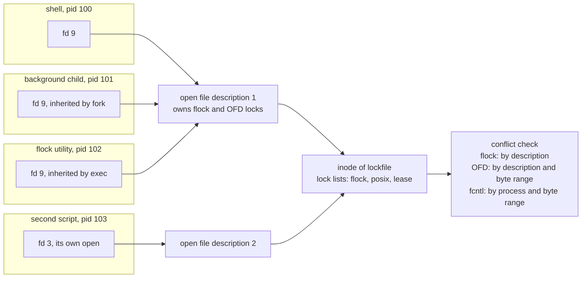

# File Locking Semantics

> [!summary] Claim
> A Unix file lock is advisory state the kernel hangs on an inode and assigns to an owner, and every surprise in shell locking (locks lost on an unrelated `close`, locks held by a forgotten background child, two holders after `rm`) follows from which owner the API picked: the process (`fcntl` `F_SETLK`), the open file description (`flock`, `F_OFD_SETLK`), or nobody (a `mkdir` or `set -C` lock file).

Part of [Files, Filesystems, and Permissions](README.md) in [Shell and Unix Engineering](../README.md).

## TL;DR

- Mechanism: the shell opens a lock file on a descriptor (`9>>lockfile`), a utility such as `flock` locks that descriptor, and the kernel records the lock against the open file description the shell created, so the lock lives until the last descriptor sharing that description closes.
- Rule: lock a file you never delete, open it with `>>` or `<` so you never truncate it, hold it on a descriptor that only the critical section inherits, and treat exit status 1 from `flock -n` as "busy" and every other non-zero status as a bug.
- Trap: a process-owned `fcntl` lock is dropped by any `close` of any descriptor for that file in the process (POSIX.1-2024 XSH `close()`), which is how SQLite documents corruption from a thread that merely reads the file, and how a `zsh` `zsystem flock` is lost to a single `>>` redirection.
- Portability fact: POSIX.1-2024 standardizes only `fcntl` record locks (process-owned and, new in Issue 8, OFD-owned) and `lockf()`, and no locking utility at all; `flock(2)` is BSD, `flock(1)` is util-linux or BusyBox, macOS ships `lockf(1)` instead, and Linux keeps `flock` and `fcntl` locks independent while macOS and FreeBSD make them conflict.
- When not to use it: across hosts, on NFS or SMB, against a non-cooperating writer, or when the protected resource is not a file; use a lease with a fencing token (a coordination service or a database advisory lock) or let the supervisor (`systemd`, a job scheduler) guarantee a single instance.

## Mental model



The shell's redirection creates open file description 1, and `fork` and `exec` hand copies of descriptor 9 to the background child and to `flock` without creating a new description.
When `flock` calls `flock(9, LOCK_EX)`, the kernel records the lock on the inode with description 1 as its owner, so the lock outlives the `flock` process: the shell and the background child still reference description 1.
The second script opens the same path and gets description 2, so its `flock(3, LOCK_EX|LOCK_NB)` is refused with `EWOULDBLOCK` until every descriptor for description 1 is closed, in all three processes.
A process-owned `fcntl` lock would instead be keyed by the pid that called `fcntl`, which is why such a lock taken by a helper process vanishes the moment the helper exits.

## How it works

### Three owners for one kind of lock

Every lock the kernel tracks is a pair (owner, range) attached to an inode, and the APIs differ only in who the owner is and how much of the file the range covers.

| API | Standard | Owner | Range | Inherited by `fork` | Released by |
| --- | --- | --- | --- | --- | --- |
| `fcntl(F_SETLK, F_SETLKW)` | POSIX.1-2024 XSH `fcntl()` | the process (XBD 3.289 Process-Owned File Lock) | bytes, `l_len` 0 means to the largest offset | no | any `close` of any descriptor for the file by that process, or process exit |
| `fcntl(F_OFD_SETLK, F_OFD_SETLKW)` | POSIX.1-2024 (Austin Group Defects 768 and 1671, Issue 8, per XSH `fcntl()` CHANGE HISTORY); Linux 3.15 | the open file description (XBD 3.237 OFD-Owned File Lock) | bytes | shared, same description | last close of the description |
| `lockf()` | POSIX.1-2024 XSI | the process (XBD 3.289 names `lockf()` as a source of process-owned locks; on Linux it is "just an interface on top of fcntl(2) locking", lockf(3)) | bytes from the current offset, exclusive only | no | as `fcntl` on Linux; POSIX leaves its relation to `fcntl` unspecified |
| `flock()` | none (BSD; first in 4.2BSD) | the open file description | whole file | shared, same description | `LOCK_UN` through any sharing descriptor, or last close |

POSIX.1-2024 XSH `fcntl()` states that process-owned locks are not inherited by a child, that OFD-owned locks are "shared across all file descriptors that are associated with the owning open file description, regardless of which process holds the file descriptor", and that a process-owned exclusive lock blocks any OFD-owned lock on the same bytes and vice versa, even inside one process.
XSH `close()` states the rule that causes most trouble: "All process-owned file locks that the calling process owns on the file associated with the file descriptor shall be unlocked."
The FreeBSD-derived macOS `fcntl(2)` page calls this "the completely stupid semantics of System V and IEEE Std 1003.1-1988 ("POSIX.1")" and gives the canonical example: a password-file updater that calls `getpwnam(3)` loses its lock because the library opens and closes the database.

All three are advisory: they only stop processes that ask for a conflicting lock.
The `fcntl()` rationale explains why POSIX declined mandatory locking: it overloaded the set-group-ID bit, its interaction with truncation was unclear, anyone could lock a publicly readable file (blocking logins), and memory-mapped files cannot be enforced.
Linux made mandatory locking a build option in 4.5 and dropped it in 5.15 (fcntl_locking(2)), and the `flock` system call now ignores `LOCK_MAND` with a one-time kernel warning (`SYSCALL_DEFINE2(flock)` in `fs/locks.c`).

### The Linux code path

`flock(fd, op)` enters `SYSCALL_DEFINE2(flock)` in `fs/locks.c`.
It rejects a descriptor with neither `FMODE_READ` nor `FMODE_WRITE` (an `O_PATH` descriptor) with `EBADF`, so any readable descriptor can take an exclusive lock; the lab proves `flock` succeeds on `O_RDONLY` where an `fcntl` write lock fails with `EBADF` (`check_fmode_for_setlk()` requires `FMODE_WRITE` for `F_WRLCK` and `FMODE_READ` for `F_RDLCK`).
A filesystem with its own `->flock` method (NFS, SMB, FUSE) gets the request; otherwise `locks_lock_file_wait()` calls `flock_lock_inode()`.
`flock_lock_inode()` walks the inode's `flc_flock` list: an existing lock from the same `struct file` with the same type is a no-op, and one with a different type is deleted before the conflict scan runs.
That deletion is why a shared-to-exclusive conversion is not atomic (flock(2) NOTES): if another holder blocks the new type, the call returns `EAGAIN` (or sleeps), and the old lock is already gone.

`fcntl(F_SETLK)` and `fcntl(F_OFD_SETLK)` share `fcntl_setlk()`.
For the OFD commands it requires `l_pid == 0` (else `EINVAL`), sets `FL_OFDLCK`, and makes the `struct file` the owner (`flc_owner = filp`); for the classic commands the owner is the caller's `files_struct`, which every thread of a process shares (fcntl_locking(2): "The threads in a process share locks").
`posix_lock_inode()` then splits, merges, or replaces byte ranges, because one owner holds at most one lock type per byte.
Before sleeping in `F_SETLKW`, `posix_locks_deadlock()` follows the chain "owner of the blocking lock waits for" and returns `EDEADLK` on a cycle, giving up (no error) once its hop counter exceeds `MAX_DEADLK_ITERATIONS` (10), so it examines at most 11 blockers; it returns early for `FL_OFDLCK`, because, in the comment's words, the owner "is not even nominally tied to a thread of execution", and `flock` has no detector at all.

Release is wired into two different places.
Every `close()` runs `filp_flush()` in `fs/open.c`, which calls `locks_remove_posix(filp, id)` to drop every process-owned lock this process holds on the inode, whichever descriptor took it.
Only the last reference to a `struct file` reaches `__fput()` and `locks_remove_file()`, which removes the OFD locks (`locks_remove_posix(filp, filp)`), the `flock` locks (`locks_remove_flock()`), and leases.
`/proc/locks` prints each lock through `lock_get_status()`: `FLOCK  ADVISORY`, `POSIX  ADVISORY`, or `OFDLCK ADVISORY`, the type, the owner pid (`-1` for OFD locks, from `locks_translate_pid()`), `major:minor:inode`, and the range, where a `flock` lock is always `0 EOF` (proc_locks(5)); `lslocks(8)` formats the same data.

### The XNU and BSD code path

XNU keeps one list per vnode for all three kinds and tags each entry `F_FLOCK`, `F_POSIX`, or `F_OFD_LOCK` (`lf_advlock()` in `bsd/kern/kern_lockf.c`).
Because the list is shared, a `flock` lock and an `fcntl` lock conflict on macOS (measured by the lab), as FreeBSD's flock(2) promises: "If a file is locked by a process through flock(), any record within the file will be seen as locked from the viewpoint of another process using fcntl(2) or lockf(3), and vice versa."
Linux states the opposite for local files: "there is no interaction between the types of lock placed by flock() and fcntl(2)" (flock(2) VERSIONS).
In `lf_setlock()` a non-blocking request returns `EAGAIN` before anything else happens, and only a blocking `flock` upgrade first clears its shared lock ("we must first remove any shared locks that we hold before we sleep waiting for an exclusive lock"); so a failed `LOCK_EX|LOCK_NB` upgrade keeps the shared lock on macOS and loses it on Linux (both measured by the lab).
Deadlock detection runs only when both the request and the blocker are `F_POSIX`, matching the macOS fcntl(2) statement "No deadlock detection is performed for OFD file locks."
`F_GETLK` on macOS reports `l_pid` as -1 for a `flock` or OFD lock (macOS fcntl(2), measured by the lab), while on Linux `F_GETLK` does not see a `flock` lock at all.

### What the shell contributes

A shell never takes a lock; it creates and distributes open file descriptions, and that decides who owns a `flock` or OFD lock.

- `exec 9>>lockfile` opens description 1 on descriptor 9 for the rest of the script, and every later `fork` copies it, so every background job and every daemon the script starts holds the lock unless it runs with `9>&-`.
- `{ ...; } 9>>lockfile` and `( ... ) 9>>lockfile` scope descriptor 9 to the group; the shell closes it when the group ends, which releases the lock if no child still holds a copy.
- `flock lockfile cmd` lets util-linux `flock` open the file itself (`O_RDONLY|O_NOCTTY|O_CREAT` by default in `open_file()`), lock it, `fork`, and run `cmd`, which inherits the descriptor unless `-o` closes it in the child.
- ksh93 and mksh mark descriptors above 2 opened by `exec` close-on-exec, so `exec 9>>lockfile; flock -n 9` makes `flock` see a closed descriptor (`EBADF`), while the group forms still work; the lab asserts this per family, mksh documents it ("Any file descriptors greater than 2 which are opened or dup(2)'d in this way are not made available to other executed commands"), and `c_exec()` in mksh `funcs.c` skips the `FD_CLOEXEC` step in `posix` and `sh` mode.
- A process-owned `fcntl` lock taken by a helper utility dies with the helper, because the owner is the helper's pid, so no external command can hold a classic `fcntl` lock on the shell's behalf (the lab shows "locked" then "free"); this is why util-linux 2.41 added `flock --fcntl` as an OFD lock, and its commit message says "we cannot usefully directly expose the POSIX F_SETLK/F_SETLKW commands".

zsh is the only shell in this matrix with a locking builtin: `zmodload zsh/system; zsystem flock FILE` opens `FILE` (which must exist) `O_RDWR`, or `O_RDONLY` with `-r`, marks the descriptor close-on-exec unless `-e` is given, and takes a whole-file `fcntl` `F_SETLK`/`F_SETLKW` lock (`bin_zsystem_flock()` in `Src/Modules/system.c`).
Because that is a process-owned lock in the shell process, the zsh manual warns that `print -u` to the descriptor or any redirection to the file in the same shell releases it; the lab shows `: >>lockfile` turning "busy" into "free".
With `-t TIMEOUT` it polls with `F_SETLK` every `-i` seconds (default 1) and returns status 2 on timeout.

### The utilities

util-linux `flock(1)` (`sys-utils/flock.c`) offers `-s`, `-x`, `-u`, `-n`, `-w SECONDS` (a timer whose signal interrupts the blocking call with `EINTR`, set up by `setup_timer()`), `-E CODE` for the conflict status (default 1), `-o`, `-c`, `-F` (no fork), `--fcntl` (OFD locks, util-linux 2.41), and `--start`/`--length` (byte ranges, 2.42); everything else exits with a `<sysexits.h>` code, and a signalled child is reported as 128 plus the signal number.
`-E` takes 0 to 255 (anything else is a usage error), and the same code is used for `-n` conflicts, `-w` timeouts, and `EACCES` (which `fcntl` may return for a conflict); `--verbose` prints "failed to get lock" or "timeout while waiting to get lock" to tell them apart.
`-o` closes the descriptor only in the forked child, so `-F` (exec without forking, leaving `flock` no process to close it in) and `-o` are rejected as incompatible (util-linux 2.42 `flock.c`, as of 2026-11).
With `--fcntl` or `--start`/`--length`, an exclusive lock opens the file `O_WRONLY`, because an `F_OFD_SETLK` write lock needs a writable descriptor (`flock.c`: "an exclusive lock requires that the file is open for write").
When `flock` gets `EBADF` or `EIO` on a read-only descriptor for a non-shared lock on a named file the caller can write (`access(R_OK|W_OK)`), it reopens that file `O_RDWR` and retries, for NFSv4, where `flock` is emulated with `fcntl` and an exclusive lock needs write access.
BusyBox `flock` supports `-s`, `-x`, `-u`, `-n`, and `-c` only, opens `O_RDONLY|O_NOCTTY|O_CREAT`, and leaves the descriptor open in the command it runs (a `//TODO? close_on_exec_on(fd);` comment marks the spot).
macOS has no `flock(1)`; its `lockf(1)` (from FreeBSD 2.2) locks with `flock(2)` semantics, removes the lock file on exit unless `-k` is given, accepts a descriptor (`lockf -s -t 5 9`), and exits 75 (`EX_TEMPFAIL`) when the file is already locked.
macOS `shlock(1)`, written for the 1986 NNTP distribution, is a `link(2)` dot-lock with a pid inside, and its own page marks it deprecated in favour of `lockf(1)`.
`flock` is a util-linux program, not a coreutils one, so neither GNU coreutils nor uutils coreutils provides it.

### Name-based locks: mkdir, noclobber, link

A lock can also be the existence of a name, created by an operation that fails if the name exists.
`mkdir` fails with `EEXIST`; `open(O_CREAT|O_EXCL)` performs "the check for the existence of the file and the creation of the file" atomically and fails on a symbolic link (XSH `open()`); and `set -C` makes `>` use that operation for regular files (POSIX.1-2024 XCU 2.7.2), so `(set -C; : >lockfile)` is a shell test-and-set.
Linux open(2) adds that `O_EXCL` works on NFS only with NFSv3 or later, and documents the portable fallback: `link(2)` a unique file to the lock name, then trust a link count of 2 from `stat(2)`.
These locks have no owner the kernel knows, so they never release themselves: `SIGKILL`, an OOM kill, or a power cut leaves them behind (the lab leaves both a `mkdir` lock and a noclobber lock stale after `kill -9`), and stale-lock recovery by pid has the race that `shlock(1)` BUGS describes: a recycled pid makes a dead owner look alive.
They also have no wait queue and no shared mode, so a waiter must poll.

### Network filesystems

Since Linux 2.6.12 an NFS client emulates `flock` as a whole-file `fcntl` lock, so on NFS the two kinds conflict, and the `local_lock` mount option (2.6.37) can keep them local instead (flock(2) HISTORY).
Since Linux 5.5, CIFS/SMB emulates `flock` with SMB byte-range locks on the whole file, and those are enforced: I/O through another descriptor fails with `EACCES` (flock(2) VERSIONS).
fcntl_locking(2) documents that an NFSv4 client before Linux 3.12 "might lose and regain a lock without ever being aware of the fact", and that since 3.12 (at least for NFSv4) a lost lock makes later reads and writes fail with `EIO` until the lock is removed or the descriptor is closed (`nfs.recover_lost_locks=1` restores the old behavior).

## Numbers and limits

| Quantity | Value | Source |
| --- | --- | --- |
| Linux deadlock-detector chain depth | the walk stops once its counter exceeds `MAX_DEADLK_ITERATIONS` (10), so at most 11 blockers are examined; longer cycles go undetected | `fs/locks.c`, mainline (as of 2026-11) |
| Deadlock detection | process-owned `fcntl` only; none for OFD or `flock` | `posix_locks_deadlock()`; XNU `lf_setlock()`; lab: `EDEADLK` vs. a 3 s wait ended by `SIGALRM` |
| Linux lease break time | 45 s default, sysctl `fs.lease-break-time` | `fs/locks.c` `lease_break_time` (as of 2026-11) |
| OFD locks | Linux 3.15; POSIX.1-2024; `F_OFD_SETLK` is 90 in the macOS SDK | fcntl_locking(2); XSH `fcntl()`; `sys/fcntl.h` in the macOS 27 SDK on this host (as of 2026-11) |
| `flock` over NFS / SMB | emulated since Linux 2.6.12 / 5.5 | flock(2) |
| Mandatory locking | optional from Linux 4.5, removed in 5.15 | fcntl_locking(2) |
| `fcntl` range | `l_len` 0 means "to the largest possible value of the file offset" | XSH `fcntl()` |
| `flock -n` / `-w` conflict status | 1 unless `-E` | util-linux `flock.c` `conflict_exit_code` |
| `lockf(1)` conflict status | 75 (`EX_TEMPFAIL`) | FreeBSD lockf(1) |
| `zsystem flock -t` | polls every 1 s by default; timeout capped at 2^30-1 s; status 2 on timeout | zsh `mod_system.yo` |
| Chubby lock-delay after a holder fails | up to one minute | Burrows, OSDI 2006, section 2.4 |
| Uncontended lock+unlock pair, macOS arm64 (Darwin 27.3) | `flock` 654 / 596 ns, `fcntl` 1041 / 760 ns, OFD 936 / 780 ns | lab `lockprobe bench 100000`, two runs on this host (2026-11-15), drafter's then verifier's; run-to-run spread is large, so expect a different absolute value elsewhere |

## Portability

Kernel semantics (measured by the lab's probe on macOS 27.3, and on Linux by one run of the same probe in the Debian 13 matrix image, kernel 7.2, 2026-11-15; FreeBSD cells come from its man pages, and "not run" means neither measured nor documented there):

| Behavior | Linux | macOS (XNU) | FreeBSD | Evidence |
| --- | --- | --- | --- | --- |
| Second open in one process, `flock` | busy | busy | not run | lab `owner` |
| Second open in one process, `fcntl` | granted (same owner) | granted | not run | lab `owner` |
| OFD vs. `fcntl`, same process | busy | busy | not run | lab `owner`; XSH `fcntl()` |
| Unrelated `close` drops `fcntl` lock | yes | yes | yes (XSH `close()`; FreeBSD fcntl(2)) | lab `close` |
| `fork` child shares lock | `flock`, OFD yes; `fcntl` no | same | `flock` yes (flock(2) NOTES); `fcntl` no (XSH `fcntl()`; FreeBSD fcntl(2)) | lab `fork` |
| Exclusive lock on `O_RDONLY` | `flock` ok; `fcntl`, OFD `EBADF` | same | not run | lab `rdonly`; `check_fmode_for_setlk()` |
| `flock` vs. `fcntl` conflict | independent (local fs) | conflict | conflict (flock(2) NOTES) | lab `mix` |
| Failed `LOCK_SH` -> `LOCK_EX\|LOCK_NB` | shared lock lost | shared lock kept | not run | lab `upgrade`; `flock_lock_inode()`, `lf_setlock()` |
| `F_GETLK` on a `flock` lock | no conflict reported | `l_pid` -1 | not run | lab `getlk` |

Shells (the lab asserts every family arm; `exec` rows also match the matrix measurements in [[Close-on-Exec-and-Descriptor-Inheritance]]):

| Shell | `exec 9>>f` reaches `flock 9` | `{ } 9>>f` or `( ) 9>>f` reaches it | Locking builtin | `set -C` test-and-set |
| --- | --- | --- | --- | --- |
| POSIX sh | unspecified (XCU 2.15 `exec` leaves descriptors above 2 to the implementation) | yes | none | required (XCU 2.7.2) |
| macOS bash 3.2 (`/bin/sh`) | yes | yes | none | yes |
| bash 5.x | yes | yes | none | yes |
| zsh native and `--emulate sh` | yes | yes | `zsystem flock` (`fcntl`) | yes |
| dash | yes | yes | none | yes |
| ksh93 (93u+ 2012, 93u+m 1.0.10) | no, close-on-exec (`flock` exits 65 in the Debian matrix image); yes under 93u+m `set -o posix` (measured there) | yes | none | yes |
| mksh | no, close-on-exec; yes in `posix` mode (measured in the Debian matrix image) or `sh` mode (`c_exec()` in `funcs.c`) | yes | none | yes |
| yash, posh, BusyBox ash | yes | yes | none | yes |

Utilities:

| Implementation | Locking utility | Timeout | Conflict status | Close in child | Byte ranges |
| --- | --- | --- | --- | --- | --- |
| util-linux 2.42 | `flock` | `-w` | 1, `-E` | `-o` | `--fcntl --start --length` |
| BusyBox 1.37 | `flock` | none (`-n` only) | 1 | no | no |
| macOS, FreeBSD | `lockf` (no `flock`) | `-t` | 75 | not applicable (descriptor form) | no |
| GNU coreutils, uutils coreutils | none | | | | |

## Worked example

The [lab](../labs/10-file-locking-semantics/) has a C probe, `lockprobe.c`, for the kernel facts above, `with-lock.sh` as the portable fallback, and two bats files that assert both per shell family and per kernel.
`lockprobe lockfd FD KIND` locks an inherited descriptor and exits, playing the part of `flock FD` on macOS, where `flock(1)` does not exist; `lockprobe test FILE KIND` opens the file afresh and prints `free` or `busy`.

The core idiom, as `shell.bats` runs it (excerpt):

```sh
{ "$1" lockfd 9 flock; "$1" test "$2" flock; } 9>>"$2"
# locked
# busy
```

The same lock taken through `exec`, where ksh93 and mksh hide descriptor 9 from the external command (excerpt):

```sh
exec 9>>"$2"; "$1" lockfd 9 flock; echo "status $?"; "$1" test "$2" flock
# bash, dash, zsh, yash, posh, BusyBox ash:   locked / status 0 / busy
# ksh93, mksh:                                EBADF / status 2 / free
```

A background child that inherits the descriptor keeps the lock after the shell's group has ended, until the child exits (excerpt):

```sh
( "$1" lockfd 9 flock; /bin/sleep 2 >/dev/null 2>&1 & ) 9>>"$2"; "$1" test "$2" flock; /bin/sleep 3; "$1" test "$2" flock
# locked
# busy
# free
```

`with-lock.sh`, verbatim, is what to use when no `flock(1)` exists and a stale lock after a crash is acceptable:

```sh
#!/bin/sh
# with-lock.sh: run a command while holding a mkdir lock, in portable POSIX sh.
# Usage: with-lock.sh LOCKDIR COMMAND [ARG...]
# mkdir is atomic (it fails with EEXIST if the name exists), so exactly one caller wins.
# Exit status: COMMAND's status; 75 if a live process holds the lock; 76 if the lock is
# stale (its recorded owner is gone). A stale lock is reported, never broken automatically:
# two waiters that both "break" it can each remove the other's fresh lock.
set -u
if [ "$#" -lt 2 ]; then
  printf 'usage: with-lock.sh LOCKDIR COMMAND [ARG...]\n' >&2
  exit 64
fi
lock=$1
shift

if ! mkdir "$lock" 2>/dev/null; then
  owner=$(cat "$lock/pid" 2>/dev/null) || owner=
  # An empty pid file means the owner is between mkdir and writing it: treat as held.
  # kill -0 also fails with EPERM for another user's live process, so share locks per user.
  if [ -z "$owner" ] || kill -0 "$owner" 2>/dev/null; then
    printf 'with-lock: %s held by pid %s\n' "$lock" "${owner:-unknown}" >&2
    exit 75
  fi
  printf 'with-lock: %s is stale (pid %s is gone); remove it by hand\n' "$lock" "$owner" >&2
  exit 76
fi

# From here on the lock is ours: release it on every exit the shell can see.
# SIGKILL cannot be trapped, which is why a mkdir lock can go stale and a kernel lock cannot.
trap 'rm -f "$lock/pid"; rmdir "$lock"' EXIT
trap 'exit 129' HUP
trap 'exit 130' INT
trap 'exit 143' TERM
printf '%s\n' "$$" >"$lock/pid"

"$@"
status=$?
exit "$status"
```

The lab asserts: `with-lock.sh L sh -c 'echo inside; exit 7'` prints `inside`, exits 7, and removes `L`; a nested `with-lock.sh L` exits 75 with `with-lock: L held by pid N`; after `sh -c 'kill -9 $PPID'` kills the holder, the next call exits 76 with `with-lock: L is stale (pid N is gone); remove it by hand`; and a `SIGTERM` to the holder ends it with status 143 and the lock removed.

The kernel probe printed this on macOS 27.3 (arm64), identical across two runs; on Linux (Debian 13 matrix image, kernel 7.2, one run) every line was the same except `free` for both `flock`/`fcntl` `mix` lines, `no conflict reported` for the `flock` `F_GETLK` line, and `lost` for the upgrade, as the lab asserts:

```text
flock, second open in the same process: busy
fcntl, second open in the same process: granted
ofd, second open in the same process: busy
ofd held, fcntl in the same process: busy
flock after closing an unrelated descriptor: busy
fcntl after closing an unrelated descriptor: free
ofd after closing an unrelated descriptor: busy
flock after the parent closes, child still open: busy
fcntl after the parent closes, child still open: free
ofd after the parent closes, child still open: busy
flock exclusive lock on an O_RDONLY descriptor: ok
fcntl exclusive lock on an O_RDONLY descriptor: EBADF
ofd exclusive lock on an O_RDONLY descriptor: EBADF
flock held, fcntl tester: busy
fcntl held, flock tester: busy
ofd held, fcntl tester: busy
F_GETLK on a flock lock: l_pid -1
F_GETLK on a fcntl lock: l_pid is the holder
F_GETLK on a ofd lock: l_pid -1
upgrade while another process shares: busy
shared lock after the failed upgrade: kept
fcntl AB-BA cycle: EDEADLK
ofd AB-BA cycle: undetected, B waited until its 3 s alarm (EINTR)
flock AB-BA cycle: undetected, B waited until its 3 s alarm (EINTR)
```

## Pitfalls

> [!warning] An unrelated close drops a process-owned lock
> Trigger: a process holds an `fcntl` `F_SETLK` lock (directly, through `lockf()`, or through `zsh` `zsystem flock`) and any code in the process opens and closes the same file.
> Symptom: the lock silently disappears; another process gets it and both write.
> SQLite's "How To Corrupt An SQLite Database File" section 2.2 describes exactly this: a thread that opens the database to read 16 bytes and closes it drops every other thread's locks, and SQLite 3.51.0 (2025-11-04) added extra defenses against locks broken by `close()`, which help when a WAL-mode database is accessed from multiple processes.
> In zsh, `: >>lockfile` in the holding shell is enough (the lab shows it).
> Fix: use `flock` or OFD locks, whose owner is the open file description; in zsh, write to the file only from a subshell, as the zsh manual advises.

> [!warning] The lock follows a background child
> Trigger: `exec 9>>lockfile; flock -n 9 || exit 1` at the top of a script that later starts a daemon or a background job.
> Symptom: the script exits but the next run reports "already running" for as long as the daemon lives, because the daemon holds open file description 1 (the lab shows "busy" until the child exits).
> Fix: start long-lived children with `9>&-`, or use `flock -o FILE cmd`, which closes the descriptor in the command; do not reach for `flock -u 9` in the child, because unlocking through a shared description unlocks it for the parent too (macOS flock(2) NOTES).

> [!warning] ksh93 and mksh hide `exec` descriptors from `flock`
> Trigger: `exec 9>>lockfile; flock -n 9 || exit 0` under ksh93 or mksh outside `posix` mode.
> Symptom: `flock` gets `EBADF`, prints an error, and exits with `EX_DATAERR` (65), which `|| exit 0` reads as "another instance is running", so the job never runs and nothing alarms.
> Fix: use `{ ...; } 9>>lockfile`, or name the descriptor on the command line (`flock -n 9 9<&9`), which [[Close-on-Exec-and-Descriptor-Inheritance]] shows passes it down in both shells, and test the status: 1 means busy, anything else is an error.

> [!warning] Deleting or recreating the lock file
> Trigger: an `EXIT` trap that runs `rm -f "$lockfile"`, `lockf(1)` without `-k`, or a cleanup cron job that prunes old lock files.
> Symptom: holder A has the old inode locked; B opens the path, creates a new inode, and locks it; now two processes hold "the" lock (the lab shows "locked" then "free" after `rm`).
> SQLite section 2.5 describes the same split for a database unlinked while in use.
> FreeBSD lockf(1) recommends `-k` because without it "no guarantees around lock ordering can be made".
> Fix: create the lock file once and never delete it; if a path must be deleted, the holder must re-`stat` the path after locking and retry when the inode differs from the descriptor's.

> [!warning] The upgrade that loses the lock
> Trigger: holding `flock -s 9` and calling `flock -x -n 9` to upgrade while another reader holds the shared lock.
> Symptom: on Linux the upgrade fails with status 1 and the shared lock is gone too (`flock_lock_inode()` deletes before checking), so a writer can slip in while the script believes it still reads safely; on macOS the shared lock survives (lab `upgrade`).
> Fix: never upgrade; take the exclusive lock from the start, or release and re-validate everything read under the shared lock.

> [!warning] Truncating the lock file
> Trigger: `exec 9>lockfile` on a lock file that also stores the holder's pid.
> Symptom: every contender truncates the file at open, before it even tries the lock, so the holder's pid vanishes and stale-lock diagnostics read an empty file.
> Fix: open with `9>>lockfile` (append, no truncation) or `9<lockfile` on Linux local filesystems, where a read-only descriptor can take an exclusive `flock`.

> [!warning] Name locks go stale and pids get recycled
> Trigger: a `mkdir`, `set -C`, or `shlock` lock whose owner dies by `SIGKILL`, OOM kill, or power loss.
> Symptom: every later run refuses to start; or, if it "breaks" stale locks by checking the recorded pid, a recycled pid makes a dead lock look alive (`shlock(1)` BUGS), and two breakers racing can each delete the other's fresh lock.
> Fix: prefer a kernel lock, which the kernel releases when the last descriptor closes; if a name lock is unavoidable, report staleness instead of breaking it, as `with-lock.sh` does.

> [!warning] A root script makes its lock file in /tmp
> Trigger: a privileged script runs `exec 9>/tmp/job.lock` or `set -C; : >/tmp/job.lock` in a world-writable directory.
> Symptom: an attacker pre-creates the name as a symlink, a FIFO, or a regular file they own; NVD CVE-2025-67091 records a GL.iNet AX1800 firmware script, run as root, that "uses shell redirection to create a lock file in the world-writable /tmp directory".
> The noclobber rationale (POSIX.1-2024 XRAT C.2.7.2) warns that in a directory such as `/tmp` another process can create a FIFO with the lock's name, "causing multiple processes to simultaneously open the same lock file instead of one succeeding and the others failing".
> Fix: put lock files in a directory only the owner can write (`/run/lock/NAME` created at boot, `$XDG_RUNTIME_DIR`, or a `mktemp -d` directory), and on Linux keep `fs.protected_regular` at 1 or 2 (kernel `Documentation/admin-guide/sysctl/fs.rst`).
At 1 an `O_CREAT` open of a regular file you do not own is refused in a world-writable sticky directory, unless the directory's owner owns the file; 2 extends that to group-writable sticky directories; 0 leaves it unrestricted.

> [!warning] Locks on network filesystems change meaning
> Trigger: the lock file lives on NFS or SMB, often because a home directory or a shared build cache is a network mount.
> Symptom: on NFS `flock` becomes an `fcntl` lock (so it now conflicts with `fcntl` users and an exclusive lock can need a writable descriptor), and a lock can be lost behind the client's back, surfacing later as `EIO`; on SMB since Linux 5.5 the lock is enforced and other descriptors get `EACCES`.
> Fix: keep lock files on a local filesystem, and coordinate across hosts with a lease service, not a file lock.

## Security and robustness

A `flock` lock is a denial-of-service lever for anyone who can open the file: Linux grants `LOCK_EX` on a read-only descriptor (lab `rdonly`), so a world-readable lock file lets any local user block a job indefinitely by holding the lock.
Chubby deliberately chose the other rule: "acquiring a lock in either mode requires write permission so that an unprivileged reader cannot prevent a writer from making progress" (Burrows, OSDI 2006, section 2.4); on Unix, get the same effect with mode `0600` lock files in a directory only the service account can write.
The POSIX rationale's argument against mandatory locks (anyone could lock a publicly readable file and block logins) applies to advisory locks in miniature: the victim is only the cooperating program, but that is the program you care about.

Open the lock file the way you open any file in a hostile directory: create it with `O_CREAT|O_EXCL` or `O_NOFOLLOW` from a privileged tool, or keep it in a private directory, because a shell redirection cannot pass `O_NOFOLLOW` and follows symlinks, as [[Path-Resolution-and-Symlink-Races]] shows.
Locks do not protect data from a writer that never asks, including the same script's own `> file` that truncates before checking anything; protect the data path itself with [[Atomic-Rename-and-fsync]] (write a temporary file, then `rename`) so a crashed or unlocked writer cannot leave a torn file.
A lock is a liveness hazard as well as a safety tool: a blocked `flock` without `-w` or `-n` waits forever, so every interactive or scheduled use needs a bound, and `flock -w` is implemented with a timer whose signal interrupts the blocking system call, not by polling.
Every kernel lock dies with its last descriptor, so the only way to keep one across a crash is to keep a process alive, and the only way to lose one unexpectedly is a `close` you did not see; audit descriptor inheritance with `lsof` or `/proc/PID/fd`, and audit holders with `/proc/locks` or `lslocks`, whose OFD entries show pid -1.

## The principal's view

The decision is the scope of the mutual exclusion, not the syntax.
For one host and one cooperating program, a `flock` on a descriptor scoped to the critical section is the right default: the kernel releases it on every kind of death, it costs about a microsecond (lab, macOS), and its failure modes are the ones above, all visible in `/proc/locks`.
Choose OFD locks (`flock --fcntl`, or `F_OFD_SETLK` in C) when you need byte ranges, threads, or interoperation with C programs that use `fcntl`, such as glibc `lckpwdf()` on `/etc/.pwd.lock`, which the util-linux commit cites as the motivating case.
Choose a name lock (`mkdir`) only when the platform lacks a locking utility and the cost of a manual cleanup after a crash is acceptable, and never auto-break it.
Across hosts, a file lock is the wrong tool: NFS loses locks, SMB enforces them, and no lock survives a network partition gracefully, so use a lease from a coordination service or a database advisory lock, and pass a fencing token, what Chubby calls a sequencer ("an opaque byte-string that describes the state of the lock immediately after acquisition"), to the protected resource so it can reject a request from a holder whose lease already expired.
Often the cleanest answer is to delete the lock and let the component that starts the work own the single instance: a supervisor that tracks one named unit, or a queue with one consumer, serializes work without any lock file.
When the protected state is more than a file and a shell script is juggling descriptors, inheritance rules, and timeouts to keep it consistent, move the logic into a language where the lock is a scoped object (a context manager around Python's `fcntl.flock`, a guard type in Rust, a `defer`-released lock in Go) and keep the shell as a thin caller.

## Interview questions

> [!question] L5: What do you check when a cron job that starts with `exec 9>/var/lock/report.lock; flock -n 9 || exit 0` never runs again on Linux after the first night, though no copy of it is in `ps`?
>
> > [!success]- Answer
> > The lock is owned by the open file description, not by the script, so any process that inherited descriptor 9 still holds it.
> > Find the holder with `lslocks` or by matching the inode in `/proc/locks` and checking `/proc/PID/fd`; typically a daemon or background job the script started.
> > Fix it by starting long-lived children with `9>&-` or by locking with `flock -o FILE cmd`.
> > Also check the status handling: `|| exit 0` hides `flock` errors such as `EBADF`, which ksh93 and mksh produce for `exec` descriptors.
> >
> > Follow-up: Why would `flock -u 9` inside the daemon be the wrong fix?

> [!question] L5: Predict the output on Linux and on macOS: `{ lockfd 9 flock; rm -f lock; : >lock; test lock flock; } 9>>lock`, where `lockfd` locks descriptor 9 and `test` opens the path afresh and prints `free` or `busy`.
>
> > [!success]- Answer
> > `locked` then `free` on both systems.
> > The lock is on the first inode; `rm` removes the name, and `: >lock` creates a new inode with the same name.
> > `test` opens the new inode, which nobody has locked, so two processes can each believe they hold "the" lock.
> > The lab asserts this output for every shell family.
> >
> > Follow-up: How can a holder detect that its locked inode is no longer the one the path names?

> [!question] L6: Why does `fcntl(F_SETLK)` from a helper utility not work as a shell lock, while `flock` from the same utility does?
>
> > [!success]- Answer
> > A process-owned `fcntl` lock is keyed by the process that called `fcntl`, so it is released when the helper exits, a moment after it was taken.
> > A `flock` (or OFD) lock is keyed by the open file description, which the shell created with the redirection and still references after the helper exits.
> > The lab shows `locked` then `free` for `fcntl` and `locked` then `busy` for OFD through the same descriptor.
> > This is why util-linux added `flock --fcntl` as an OFD lock, not as `F_SETLK`.
> >
> > Follow-up: What does `zsystem flock` in zsh do differently so that `fcntl` works there, and what new trap does that create?

> [!question] L6: Debug this script: it is meant to let many readers run in parallel and upgrade to a writer when needed.
> ```sh
> exec 9<>state.db.lock
> flock -s 9
> read_state
> if needs_update; then
>   flock -x -n 9 || { echo busy; exit 1; }
>   write_state
> fi
> ```
>
> > [!success]- Answer
> > On Linux a conversion deletes the shared lock before checking for conflicts (`flock_lock_inode()`), so when another reader holds a shared lock the upgrade fails and this process holds no lock at all.
> > The script then exits, which is safe here, but a variant that waits (`flock -x 9`) can be overtaken: another writer may get the lock between the release and the grant, so the data read under the shared lock may be stale by the time it writes.
> > On macOS a failed non-blocking upgrade keeps the shared lock, so the script behaves differently per kernel (lab `upgrade`).
> > Fix: take `flock -x` before reading when an update is possible, or re-read and re-validate everything after the exclusive lock is granted.
> >
> > Follow-up: How would two readers that both try a blocking upgrade at the same time behave?

> [!question] L6: What is the difference between `exec 9>>lock` and `{ ...; } 9>>lock` for locking under ksh93, mksh, and bash?
>
> > [!success]- Answer
> > In bash, dash, zsh, yash, posh, and BusyBox ash both forms pass descriptor 9 to external commands such as `flock`.
> > ksh93 and mksh mark descriptors above 2 opened by `exec` close-on-exec (outside ksh93u+m and mksh `posix` mode), so `flock 9` sees `EBADF` after `exec 9>>lock`.
> > The group form opens the descriptor for the group's commands without close-on-exec in every shell the lab covers, and it also scopes the lock, releasing it when the group ends.
> >
> > Follow-up: Which exit status does util-linux `flock` give for `EBADF`, and why does it matter for `flock -n 9 || exit 0`?

> [!question] L6: When two processes each lock one byte and then each waits for the other's byte, what happens with classic `fcntl` locks, with OFD locks, and with `flock` on two files?
>
> > [!success]- Answer
> > With classic `fcntl` locks the second waiter gets `EDEADLK`: the kernel follows the wait-for chain before sleeping (`posix_locks_deadlock()`, which on Linux gives up after examining 11 blockers, one past `MAX_DEADLK_ITERATIONS`).
> > With OFD locks nothing is detected, because the owner is a file description, not a thread, so both sleep until a signal or timeout.
> > `flock` has no detector either; the lab shows both cases waiting until a 3 s `SIGALRM`.
> > Detection is a "may fail" in POSIX, so portable code must avoid cycles by lock ordering, not rely on `EDEADLK`.
> >
> > Follow-up: Why can Linux report `EDEADLK` when no deadlock exists?

> [!question] L7+: How do you review a design that makes a nightly job single-instance across a fleet by putting `flock` on a lock file in an NFS-mounted home directory?
>
> > [!success]- Answer
> > On NFS, `flock` is emulated as a whole-file `fcntl` lock (Linux 2.6.12+), so its semantics change: it conflicts with `fcntl` users, may need a writable descriptor, and depends on the lock manager and lease recovery.
> > A client can lose a lock during a partition or server restart; recent Linux clients then fail I/O with `EIO`, older ones could lose and regain it unaware.
> > A paused or partitioned holder can keep running after its lock is gone, so the protected resource must check a fencing token (Chubby's sequencer) or the design is unsafe by construction.
> > Recommend a lease from a coordination service or a database advisory lock, plus a fencing token, or a scheduler that guarantees one run.
> >
> > Follow-up: What should happen to an in-flight job whose lease expired while it was paused?

> [!question] L7+: Why did POSIX.1-2024 add OFD-owned locks instead of fixing the close semantics of process-owned locks, and how should a library author choose between them?
>
> > [!success]- Answer
> > Decades of programs were written against the process-owned close semantics, so changing them would silently change those programs; adding a second owner type (Austin Group Defects 768 and 1671, applied in Issue 8) gives new code safe semantics and leaves old code alone.
> > OFD locks are released only on the last close of the description, are shared through `dup` and `fork`, and work between threads that open the file separately.
> > They conflict with process-owned locks, so a library can use them to interoperate with old `fcntl` users of the same file.
> > A library should use OFD locks unless it must support a platform without them, and must never hold a process-owned lock on a file the application might also open.
> >
> > Follow-up: What does deadlock detection lose when you switch to OFD locks?

> [!question] L7+: How do you answer an engineer who proposes replacing all `flock` use with `mkdir` locks "for portability to macOS"?
>
> > [!success]- Answer
> > `mkdir` is atomic and portable, but the kernel does not know its owner, so it is never released on `SIGKILL`, OOM kill, or power loss, and every crash needs a human.
> > Automatic stale breaking by pid is racy: pids are recycled (`shlock(1)` BUGS), and two breakers can delete each other's fresh locks.
> > It has no wait queue or shared mode, so waiters poll and readers serialize.
> > macOS already has a kernel lock utility, `lockf(1)`, with a descriptor form; use it there and `flock` on Linux behind one wrapper, and keep `mkdir` only as a last resort that reports staleness.
> >
> > Follow-up: How would you test the wrapper so that it fails if the lock is not actually exclusive?

## Related

Prerequisites: [[inotify-and-fswatch]]

Next: [[Path-Resolution-and-Symlink-Races]]

See also: [[flock]], [[Locking-and-Stale-Locks]], [[File-Descriptors-and-Open-File-Descriptions]], [[Close-on-Exec-and-Descriptor-Inheritance]], [[Redirection-Order-and-Semantics]], [[Atomic-Rename-and-fsync]], [[Inodes-and-Links]], [[Mounts-and-Mount-Namespaces]], [[Daemonization]], [[Traps-and-EXIT]], [[Cleanup-Traps-and-Re-Raising-Signals]], [[Temporary-File-Attacks]], [[mktemp]], [[cron]]

## Further reading

- POSIX.1-2024 XSH `fcntl()`: the normative text for process-owned and OFD-owned record locks, their conflicts, `EDEADLK` as a "may fail", and the rationale for rejecting mandatory locking.
- POSIX.1-2024 XSH `close()` and XBD 3.237, 3.289: the close-releases-everything rule and the two owner definitions.
- POSIX.1-2024 XSH `lockf()`: the XSI exclusive-only interface whose locks XBD 3.289 counts as process-owned but whose interaction with `fcntl` locks is left unspecified.
- POSIX.1-2024 XCU 2.7.2 and XSH `open()`: the atomic noclobber and `O_EXCL` test-and-set behind name-based locks.
- Linux `fs/locks.c` (`flock_lock_inode()`, `posix_lock_inode()`, `posix_locks_deadlock()`, `locks_remove_posix()`, `locks_remove_file()`): the implementation of every semantic in this note.
- Linux man-pages fcntl_locking(2), flock(2), and proc_locks(5): OFD history, NFS and SMB behavior, deadlock-detection limits, and the `/proc/locks` format.
- XNU `bsd/kern/kern_lockf.c` (`lf_advlock()`, `lf_setlock()`): why macOS mixes `flock` and `fcntl` locks and keeps a shared lock on a failed non-blocking upgrade.
- util-linux `sys-utils/flock.c` and flock(1): the reference shell locking utility, including the commit that added `--fcntl` and explains why classic `fcntl` locks cannot be exposed to scripts.
- zsh `mod_system.yo` and `Src/Modules/system.c`: `zsystem flock`, the only shell builtin lock, and its documented close trap.
- SQLite, "How To Corrupt An SQLite Database File", sections 2.2 and 2.5: a production database's account of lost POSIX locks and unlinked files.
- Burrows, "The Chubby lock service for loosely-coupled distributed systems" (OSDI 2006), section 2.4: advisory locks, write permission to lock, sequencers, and lock-delay, the vocabulary for going beyond one host.
