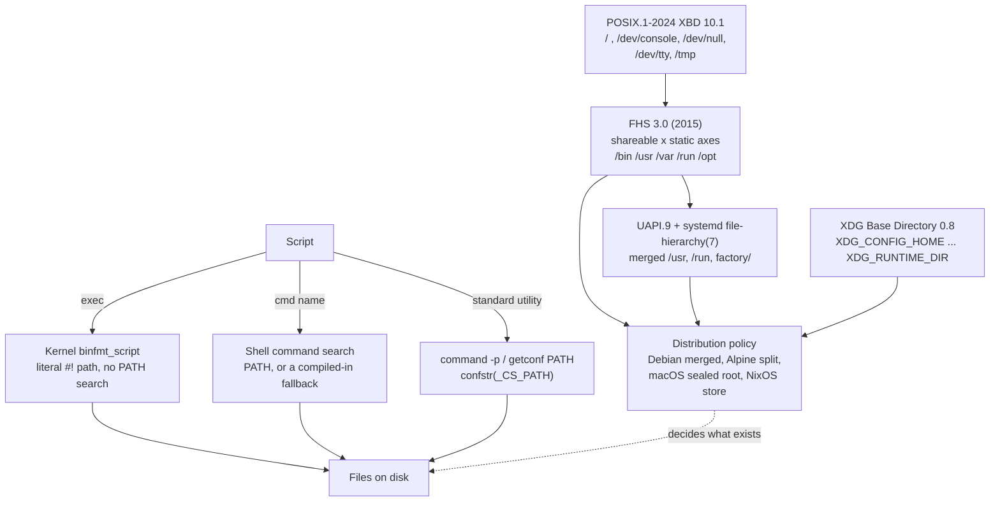

# Filesystem Hierarchy Standard

> [!summary] Claim
> POSIX guarantees a script only `/`, `/dev/null`, `/dev/tty`, `/dev/console` and `/tmp`, so every other path a script names (`/bin/sh`, `/usr/bin/env`, `/usr/local`, `/run`, `~/.config`) is a convention from the FHS, a distribution, or XDG, and robust scripts either discover those paths at run time or pin the platform that guarantees them.

Part of [Files, Filesystems, and Permissions](README.md) in [Shell and Unix Engineering](../README.md).

## TL;DR

- Mechanism: the kernel and libc hard-code only a handful of paths (`/sbin/init`, `/dev/console`, `/bin/sh` in `system(3)`, the ELF interpreter), and everything else in the tree is placed by convention: FHS 3.0 (2015) along two axes, shareable versus unshareable and static versus variable, now carried forward by UAPI.9 and systemd's `file-hierarchy(7)`.
- Rule: find standard utilities with `command -p` or `PATH=$(command -p getconf PATH)`, write variable data to `/var` or `/run` and user data to the XDG directories, and never write to `/usr` outside a package manager.
- Trap: a script that runs with no `PATH` gets each shell's compiled-in fallback, which ranges from `/usr/local/bin:...:/sbin:.` (bash 4.3+, current directory included) to no search at all (yash) to `/no-such-path` (nixpkgs bash), as the lab measures.
- Portability fact: `/bin` is a symlink to `usr/bin` on Debian 12 and later, a real directory of BusyBox links on Alpine 3.22, and a sealed read-only directory on macOS, where `/usr/bin/sh` does not exist at all.
- When not to use it: do not treat the FHS as a contract on NixOS, macOS, Android, or minimal containers; there, ship your own runtime (container image, Nix closure) or resolve every path through `command -v`, `getconf PATH`, and environment variables.

## Mental model



The top row is a stack of authorities: POSIX fixes five names, the FHS builds the classic Unix layout on top of them, UAPI.9 and systemd revise it for merged `/usr` and image-based systems, XDG adds the per-user layer, and each distribution decides what actually exists on disk.
A script reaches that disk by three different roads.
The kernel follows a `#!` line as a literal path with no search, so the interpreter path must exist byte for byte.
A bare command name goes through the shell's command search, which uses `PATH` when it is set and a shell-specific compiled-in list when it is not.
`command -p` and `getconf PATH` ask the C library for the standard utility path, `confstr(_CS_PATH)`, which is the only path list POSIX promises will find the standard utilities.

## How it works

### 1. What POSIX actually guarantees

POSIX.1-2024 XBD 10.1 requires exactly three directories and three files: `/`, `/dev`, and `/tmp`, plus `/dev/null`, `/dev/tty`, and `/dev/console` (POSIX.1-2024 XBD 10.1).
`/dev/null` and `/dev/tty` "shall be both readable and writable"; reads from `/dev/null` "shall always return end-of-file"; `/dev/console` "need not be readable or writable" (POSIX.1-2024 XBD 10.1).
For `/tmp`, applications "shall be allowed to create files in this directory, but shall not assume that such files are preserved between invocations of the application" (POSIX.1-2024 XBD 10.1).
Strictly conforming applications "shall not assume the ability to create files in any of these directories, unless specified" (POSIX.1-2024 XBD 10.1), so even `/` and `/dev` are read-only as far as a portable program knows.

POSIX deliberately does not name `/bin`, `/usr/bin`, or the shell's location.
The `sh` utility's application usage says "the standard PATH to the shell cannot be assumed to be either /bin/sh or /usr/bin/sh, and should be determined by interrogation of the PATH returned by getconf PATH", and gives `/usr/xpg4/bin/sh` as a possible answer to `command -v sh` (POSIX.1-2024 XCU `sh`, APPLICATION USAGE).
It recommends rewriting `#!` lines at install time with the result, and prints an installer that splits `getconf PATH` on `:` and tests `[ -x "${i}"/sh ]` for each entry (POSIX.1-2024 XCU `sh`, APPLICATION USAGE).
That example loop keeps the last match rather than the first, which is the opposite of a `PATH` search; the lab's `first_in_list` takes the first.

Three more POSIX pieces carry the hierarchy into scripts.
`confstr(_CS_PATH)` "returns a string that can be used as a PATH environment variable setting that will reference the standard shell and utilities" (POSIX.1-2024 XSH `confstr`, RATIONALE), and `getconf PATH` prints the same value.
`command -p` performs "the command search using a default value for PATH that is guaranteed to find all of the standard utilities", and the rationale adds that it exists so a script can find the right `getconf` before it trusts any `PATH` (POSIX.1-2024 XCU `command`); the standard's own example is `PATH="$(command -p getconf PATH):$PATH"`.
XBD 8.3 defines `TMPDIR` as "a pathname of a directory made available for programs that need a place to create temporary files", and says that if `PATH` "is unset or is set to null ... the path search is implementation-defined", and that a zero-length prefix (`::`, a leading or a trailing `:`) is "a legacy feature that indicates the current working directory" (POSIX.1-2024 XBD 8.3).
POSIX.1-2024 has no `mktemp` utility (its page under `utilities/` returns 404), so the safe temporary-file primitive is the C function `mkstemp()`, wrapped by the non-standard but universal `mktemp(1)` (see [[mktemp]]).

### 2. What the kernel and libc hard-code

The Linux kernel knows only a few paths by name.
`kernel_init()` runs the initramfs `/init` (`ramdisk_execute_command`), then an `init=` argument, then `CONFIG_DEFAULT_INIT`, then tries `/sbin/init`, `/etc/init`, `/bin/init`, and `/bin/sh` in that order before it panics with "No working init found" (Linux `init/main.c`, `kernel_init`).
`console_on_rootfs()` opens `/dev/console` and duplicates it three times with `init_dup()`, giving the first process descriptors 0, 1, and 2 (Linux `init/main.c`).
For a script, the kernel's `binfmt_script` reads the `#!` line from the first `BINPRM_BUF_SIZE` bytes, 256 in current kernels (Linux `include/uapi/linux/binfmts.h`), and execs the named interpreter by its literal path; there is no `PATH` search, which is why `#!/usr/bin/env bash` exists (see [[env-and-Shebang-Tricks]]).
A dynamically linked ELF executable names its loader in `PT_INTERP`, "a null-terminated pathname to invoke as an interpreter" (Linux `elf(5)`), so the loader directory is part of the binary ABI; UAPI.9 keeps `/lib64` as a compatibility symlink "on architectures whose ABI places the dynamic loader in this path" for exactly that reason.

The C library adds two more fixed points.
glibc's `system()` spawns `SHELL_PATH`, defined as `"/bin/sh"` (glibc `sysdeps/posix/system.c`, `do_system`), and `<paths.h>` defines `_PATH_BSHELL` as `"/bin/sh"`, `_PATH_DEFPATH` as `"/usr/bin:/bin"`, and `_PATH_STDPATH` as `"/usr/bin:/bin:/usr/sbin:/sbin"` (glibc `sysdeps/generic/paths.h`).
When `PATH` is unset, glibc's `execvp()` searches `CS_PATH` (glibc `posix/execvpe.c`, `__execvpe_common`), which is `"/bin:/usr/bin"` (glibc `sysdeps/unix/confstr.h`); `exec(3)` documents the same default.
musl's `confstr(_CS_PATH)` also returns `"/bin:/usr/bin"` (musl `src/conf/confstr.c`), while its `_PATH_DEFPATH` is `"/usr/local/bin:/bin:/usr/bin"` (musl `include/paths.h`).
macOS `<paths.h>` has `_PATH_DEFPATH` `"/usr/bin:/bin"` and `_PATH_STDPATH` `"/usr/bin:/bin:/usr/sbin:/sbin"` (Apple Libc `include/paths.h`), and `getconf PATH` on macOS 27.3 printed `/usr/bin:/bin:/usr/sbin:/sbin` in the lab.

### 3. The FHS 3.0 model

FHS 3.0 is dated March 19, 2015 and published by the LSB Workgroup of the Linux Foundation; its lineage is FSSTND, released February 14, 1994 with revisions on October 9, 1994 and March 28, 1995, renamed FHS when the scope widened to other Unix-like systems with help from the BSD community (FHS 3.0 7.2).
Its organizing idea is two independent axes: shareable versus unshareable and static versus variable, with "files that differ in either of these respects ... located in different directories" so each class can live on its own filesystem (FHS 3.0 chapter 2).
The example matrix puts `/usr` and `/opt` in shareable static, `/etc` and `/boot` in unshareable static, `/var/mail` and `/var/spool/news` in shareable variable, and `/var/run` and `/var/lock` in unshareable variable (FHS 3.0 chapter 2).
The rationale for `/var` is the whole design in one sentence: "the /var hierarchy was created and all variable files were transferred from /usr to /var. Consequently /usr can now be mounted read-only" (FHS 3.0 chapter 2).

The root filesystem "must be adequate to boot, restore, recover, and/or repair the system", and "applications must never create or require special files or subdirectories in the root directory" (FHS 3.0 3.1).
Fourteen directories, or symlinks to directories, are required in `/`: `bin`, `boot`, `dev`, `etc`, `lib`, `media`, `mnt`, `opt`, `run`, `sbin`, `srv`, `tmp`, `usr`, `var`; `home`, `root`, and `lib<qual>` are required only if the subsystem is installed (FHS 3.0 3.2, 3.3).
`/bin` must hold 33 named commands, from `cat` to `uname`, including `sh` ("POSIX compatible command shell"), and "if /bin/sh is not the POSIX compatible shell command itself, it must be a hard or symbolic link to the real shell command" (FHS 3.0 3.4.2).
`/sbin` must hold only `shutdown`; the split from `/bin` "was not created for security reasons" but to separate commands everyone runs from administration commands (FHS 3.0 3.16, footnote 19).
`/etc` holds static host-specific configuration and "no binaries", though executable scripts are allowed (FHS 3.0 3.7.1, footnote 2).

`/usr` "is shareable, read-only data" that "must not be written to", and needs `bin`, `lib`, `local`, `sbin`, and `share` (FHS 3.0 4.1, 4.2).
`/usr/local` is for the administrator's own installs, "needs to be safe from being overwritten when the system software is updated", and must contain `bin`, `etc`, `games`, `include`, `lib`, `man`, `sbin`, `share`, and `src`, and after a fresh install no other directories except the optional ones 4.9.3 lists (FHS 3.0 4.9.2).
`/usr/libexec` is optional and holds internal binaries not meant to be run directly; FHS 3.0 accepts it or `/usr/lib` but each application "must choose one way or the other" (FHS 3.0 4.7).
`/opt/<package>` holds add-on packages, with host configuration in `/etc/opt` and variable data in `/var/opt`; `/opt/bin`, `/opt/doc`, `/opt/include`, `/opt/info`, `/opt/lib`, and `/opt/man` are reserved for the local administrator (FHS 3.0 3.13).

`/var` must contain `cache`, `lib`, `local`, `lock`, `log`, `opt`, `run`, `spool`, and `tmp`, and "must not be linked to /usr" (FHS 3.0 5.1, 5.2).
`/var/cache` data must be regenerable and "deleted without data loss"; `/var/lib/<name>` is private state that "must not be exposed to regular users" (FHS 3.0 5.5, 5.8).
`/var/tmp` holds temporary files that "must not be deleted when the system is booted", while for `/tmp` deletion at boot is only recommended, "because system administration is not within the scope of this standard" (FHS 3.0 5.15, 3.18).

`/run` is the FHS 3.0 addition for "system information data describing the system since it was booted"; it "must be cleared ... at the beginning of the boot process", replaces `/var/run`, and "should not be writable for unprivileged users" (FHS 3.0 3.15, footnote 17).
`/var/run` may be a symlink to `/run`, and "programs should not access both /var/run and /run directly, except to access /var/run/utmp" (FHS 3.0 5.13).
Two on-disk formats are normative and show up in scripts:

- PID files are `/run/<program-name>.pid` holding "the process identifier in ASCII-encoded decimal, followed by a newline", so PID 25 is three bytes; readers "should ignore extra whitespace, leading zeroes, absence of the trailing newline, or additional lines" (FHS 3.0 3.15.2).
- Device lock files are `/var/lock/LCK..<device>`, for example `LCK..ttyS0`, in "HDB UUCP lock file format": the PID "as a ten byte ASCII decimal number, with a trailing newline", so PID 1230 is six spaces, `1230`, and a newline, eleven bytes (FHS 3.0 5.9).

The Linux annex requires `/dev/null`, `/dev/zero`, and `/dev/tty`, calls `/proc` "the de-facto standard Linux method for handling process and system information", and declares `/sys` structure "otherwise unspecified" (FHS 3.0 6.1.3, 6.1.5, 6.1.7).

### 4. The merged /usr and the successors to FHS

FHS 3.0 never anticipated `/bin` becoming a symlink, but it allows it: every required directory may be "a symbolic link to" one (FHS 3.0 3.2).
Fedora's UsrMove feature, targeted at Fedora 17, moved everything into `/usr` and left "only symlinks in the root filesystem" so the operating system could be mounted read-only, snapshotted, or shared as one tree, noting that "advanced features in today's systems can not really bootup with an empty /usr anymore" (Fedora UsrMove feature page).
Debian 12 made merged `/usr` mandatory: `/bin`, `/sbin`, `/lib`, and `/lib64` are symlinks into `/usr`, older systems are converted on upgrade, `dpkg --search /usr/bin/bash` stops identifying the owning package, local software that relies on `/usr/bin/name` and `/bin/name` being different files is unsupported, and systems whose base layer is not directly writable (WSL1, multi-layer overlayfs containers) "cannot be safely converted" (Debian 12 release notes 5.1.14).
systemd v255 removed support for split-usr (a separately mounted `/usr` in late boot) and unmerged-usr (parallel `/bin` and `/usr/bin`), v256 added an `unmerged-bin` taint for a separate `/usr/sbin`, and v258 removed the `-Dsplit-usr=` build option (systemd `NEWS`).
Alpine announced a merge for 3.23 on October 1, 2025, keeping `/usr/bin` and `/usr/sbin` separate "for now", then the 3.23.0 announcement of December 3, 2025 postponed it to a later release (Alpine usr-merge post; Alpine 3.23.0 announcement), so the Alpine 3.22 image in the shell matrix should be a split layout, which the lab's `layout` test reports.

systemd's `file-hierarchy(7)` now defers to UAPI.9, "Linux File System Hierarchy", version 0.1, which is stricter than FHS in separating vendor defaults from local configuration and simpler in putting all vendor files under `/usr` (UAPI.9 Description).
UAPI.9 makes `/bin`, `/sbin`, `/usr/sbin`, `/lib`, and `/var/run` compatibility symlinks; it discourages `/opt` ("Using /opt/ is not recommended") in favor of `/usr/lib/<vendor>`; it adds `/usr/share/factory/etc` as pristine vendor configuration; it says `/tmp` is "usually mounted as a tmpfs instance, and should hence not be used for larger files"; and it asks that `/run` be "the only location to place sockets and FIFOs" (UAPI.9).
For normal users UAPI.9 lists the only writable places: `/tmp`, `/var/tmp`, `/dev/shm`, `$HOME`, and `$XDG_RUNTIME_DIR`; unprivileged system processes get only the first three and should obtain private `/var` or `/run` directories through `StateDirectory=`, `RuntimeDirectory=`, or `tmpfiles.d`; it also recommends `nosuid,nodev` on the shared temporary directories (UAPI.9 Write Access).
The Linux `hier(7)` page follows FHS and records drift, for example X11R6 "present in FHS 2.3, removed in FHS 3.0" (Linux `hier(7)`).

### 5. The BSD and macOS hierarchies

FreeBSD's `hier(7)` keeps the classic split: `/bin` holds "fundamental BSD user utilities", and `/usr/local` holds "local executables, libraries, etc" installed by the ports and packages system, with its own `bin`, `etc`, `lib`, `libexec`, and more (FreeBSD `hier(7)`).
macOS ships a `hier(7)` that calls itself "a historical sketch of the filesystem hierarchy" and still lists `/mach_kernel` (macOS 27.3 `man 7 hier`).
The real macOS layout is shaped by the read-only system volume: "the root mount point is read-only as of macOS 10.15", "all writeable paths must reside on the data volume, which is mounted at /System/Volumes/Data", and `/etc/synthetic.conf` asks `apfs.util` to synthesize empty directories or symlinks at `/` during early boot (macOS `synthetic.conf(5)`).
On the lab host, `mount` reports `/` as "apfs, sealed, local, read-only", `/etc`, `/tmp`, and `/var` are symlinks into `/private`, and `/etc/synthetic.conf` creates `nix` and `run -> private/var/run` for a nix-darwin install, so this host has a `/run` that stock macOS lacks.
Homebrew installs to `/opt/homebrew` on Apple Silicon and `/home/linuxbrew/.linuxbrew` on Linux "so that you don't need sudo after Homebrew's initial installation" (Homebrew Installation docs), which means the directory sits on the data volume, outside the sealed root.

### 6. The per-user layer: XDG Base Directory

The XDG Base Directory Specification, version 0.8 dated May 8, 2021, defines `XDG_DATA_HOME` (default `$HOME/.local/share`), `XDG_CONFIG_HOME` (`$HOME/.config`), `XDG_STATE_HOME` (`$HOME/.local/state`), `XDG_CACHE_HOME` (`$HOME/.cache`), the search lists `XDG_DATA_DIRS` (`/usr/local/share/:/usr/share/`) and `XDG_CONFIG_DIRS` (`/etc/xdg`), and `XDG_RUNTIME_DIR` (no default).
Each default applies when the variable "is either not set or empty", and "all paths set in these environment variables must be absolute. If an implementation encounters a relative path ... it should consider the path invalid and ignore it" (XDG Base Directory 0.8).
The home directory is "more important than any of the base directories" in the matching `_DIRS` list, so a lookup checks `XDG_CONFIG_HOME` first and then each `XDG_CONFIG_DIRS` entry in order.
`XDG_RUNTIME_DIR` "MUST be owned by the user", with "Unix access mode ... 0700", must live on a local, fully featured filesystem, must not survive a logout or reboot, and files in it may be cleaned up unless their access time is touched "at least once every 6 hours" or they carry the sticky bit; when it is unset, applications "should fall back to a replacement directory with similar capabilities and print a warning" (XDG Base Directory 0.8).
FHS 3.0 itself points at XDG for home-directory layout and asks programs not to assume `/home` but to "query for it" with `getpwent` and friends (FHS 3.0 3.8).

### 7. What a shell does when PATH is missing

A script started by `cron`, `env -i`, a stripped `sudo`, or a container entrypoint can begin with no `PATH`, and POSIX leaves the search implementation-defined (POSIX.1-2024 XBD 8.3).
Each shell answers differently, from source and as measured by the lab's `fallback-path` probe:

- bash sets `PATH` to `DEFAULT_PATH_VALUE` with `set_if_not` (bash-5.3 `variables.c`, `initialize_shell_variables`), which is `/usr/local/bin:/usr/local/sbin:/usr/bin:/usr/sbin:/bin:/sbin:.` since bash 4.3 and `/usr/gnu/bin:/usr/local/bin:/bin:/usr/bin:.` in 3.2 through 4.2 (bash `config-top.h` in each tarball); both end in `.`, the current directory; Debian's `deb-bash-config.diff` and Alpine's APKBUILD leave it unchanged, and nixpkgs compiles in `/no-such-path`, measured on the lab host.
- dash initializes `PATH` from `defpathvar`, `/usr/local/sbin:/usr/local/bin:/usr/sbin:/usr/bin:/sbin:/bin`, and `command -p` searches the same list (dash `src/var.c`, `src/exec.c`).
- zsh sets its `path` array to `/bin /usr/bin /usr/ucb /usr/local/bin` (zsh `Src/init.c`), a list that still remembers BSD's `/usr/ucb`.
- BusyBox ash initializes `PATH` from `BB_PATH_ROOT_PATH`, `/sbin:/usr/sbin:/bin:/usr/bin`, and `command -p` uses `bb_default_path`, the same string with the two `sbin` entries skipped (BusyBox `include/libbb.h`, `shell/ash.c`).
- mksh uses `<paths.h>` `_PATH_DEFPATH` when defined, else `confstr(_CS_PATH)`, else `/bin:/usr/bin:/sbin:/usr/sbin` (mksh `main.c`), so it inherits glibc's and macOS's `/usr/bin:/bin` or musl's `/usr/local/bin:/bin:/usr/bin`.
- posh sets `def_path` from `confstr(_CS_PATH)` (posh `main.c`), which is `/bin:/usr/bin` under glibc.
- yash never sets `PATH`; with it unset, `which()` returns NULL for a `NULL` directory list, so no external command is found, and only `command -p` reaches a default list, `_PATH_STDPATH` when `<paths.h>` defines it and `confstr(_CS_PATH)` otherwise (yash `path.c`, `which`, `get_default_path`; `variable.c`, `init_variables`).
- ksh93 leaves `PATH` unset but searches `defpath()`, built from `astconf("PATH")`, the AST `getconf PATH` (ksh93u+m `src/cmd/ksh93/sh/path.c`, `pathinit`, `std_path`).

`command -p` has its own sharp edges.
bash inserts whatever `command -p` finds into the hash table, on purpose: `execute_disk_command` calls `search_for_command (pathname, CMDSRCH_HASH|(stdpath ? CMDSRCH_STDPATH : 0))` with a comment showing how to stop it (bash-5.3 `execute_cmd.c`, `execute_disk_command`), so after `PATH=/nowhere; command -p ls`, a bare `ls` still works in bash and fails everywhere else the lab ran.
dash and BusyBox ash set `updatetbl = (path == pathval())` and so never cache an alternate-path result (dash `src/exec.c`, BusyBox `shell/ash.c`, `find_command`); mksh skips `ktenter` for `FC_DEFPATH` (mksh `exec.c`, `findcom`).
ksh93u+ 2012 fails `command -p ls` outright in a non-interactive shell, measured on macOS; ksh93u+m fixed it on 2020-05-19 because "the internal variable holding the default PATH value was not correctly initialised" (ksh93u+m `NEWS`).

### 8. Detecting the layout from a script

POSIX.1-2024 added `pathname1 -ef pathname2` to `test` (Austin Group Defect 375; POSIX.1-2024 XCU `test`, CHANGE HISTORY), which is true when both pathnames "resolve to existing directory entries for the same file"; implementations compare device and inode after resolving symlinks.
`[ /bin -ef /usr/bin ]` therefore detects a merged `/usr` without parsing `readlink` output, and `[ /bin/sh -ef /usr/bin/sh ]` checks that both names reach one file.
The lab's `layout` mode prints `bin=split usr_bin_sh=absent var_run=same` on the macOS host (where `/run` exists only because of `synthetic.conf`), and asserts on every platform that a merged layout implies `/bin/sh` and `/usr/bin/sh` are the same file while a split layout has two distinct directory inodes.

## Numbers and limits

| Quantity | Value | Source |
|---|---|---|
| Paths POSIX requires | 3 directories (`/`, `/dev`, `/tmp`) and 3 files (`/dev/null`, `/dev/tty`, `/dev/console`) | POSIX.1-2024 XBD 10.1 |
| FHS 3.0 required top-level directories | 14, plus 3 conditional (`home`, `root`, `lib<qual>`) | FHS 3.0 3.2, 3.3 |
| FHS 3.0 required commands in `/bin` | 33, including `sh`, `sed`, `mount`, `su` | FHS 3.0 3.4.2 |
| FHS 3.0 required `/var` subdirectories | 9 | FHS 3.0 5.2 |
| FHS 3.0 required `/usr/local` subdirectories | 9 | FHS 3.0 4.9.2 |
| PID file for PID 25 | 3 bytes (`2`, `5`, newline) | FHS 3.0 3.15.2 |
| HDB lock file for PID 1230 | 11 bytes (10-byte right-aligned PID plus newline); lab asserts | FHS 3.0 5.9; lab `hdb-lock` |
| FSSTND releases | 1994-02-14, 1994-10-09, 1995-03-28 | FHS 3.0 7.2 |
| FHS 3.0 date | 2015-03-19 | FHS 3.0 title page |
| XDG Base Directory version | 0.8, 2021-05-08 | XDG spec header (as of 2026-11) |
| `XDG_RUNTIME_DIR` mode, cleanup grace | 0700; touch atime every 6 hours or set sticky bit | XDG Base Directory 0.8 |
| systemd `/tmp`, `/var/tmp` age limits | 10 days, 30 days (`q /tmp 1777 root root 10d`) | systemd `tmpfiles.d/tmp.conf` (as of 2026-11) |
| Debian 13 `/tmp` | tmpfs, up to 50% of RAM by default | Debian 13 release notes 5.1.6 |
| Kernel init fallback order | `/sbin/init`, `/etc/init`, `/bin/init`, `/bin/sh` | Linux `init/main.c`, `kernel_init` (as of 2026-11) |
| `#!` line buffer | 256 bytes (`BINPRM_BUF_SIZE`) | Linux `include/uapi/linux/binfmts.h` (as of 2026-11) |
| `confstr(_CS_PATH)` | `/bin:/usr/bin` (glibc, musl); `/usr/bin:/bin:/usr/sbin:/sbin` from `getconf PATH` on macOS 27.3 | glibc `confstr.h`; musl `confstr.c`; lab `standard-path` on the host |
| bash fallback `PATH` change | bash 4.3 (3.2 to 4.2 used `/usr/gnu/bin:/usr/local/bin:/bin:/usr/bin:.`) | bash `config-top.h` in the 3.2, 4.2, 4.3 tarballs; lab |
| systemd split-usr support removed | v255 (build option removed in v258) | systemd `NEWS` |

## Portability

Shell behavior, proven by the lab on the host shells (`/bin/bash`, bash 5.3, dash, zsh, `zsh --emulate sh`, ksh93u+ 2012); the cells for the other shells are read from source and were not run (as of 2026-11).
The fallback `PATH` cells were checked against each shell's source (bash `config-top.h`, dash `var.c`, zsh `init.c`, BusyBox `libbb.h`, mksh `main.c`, posh `main.c`, yash `path.c`, ksh93u+m `path.c`), as were the no-cache rule for `command -p` in dash, BusyBox ash, mksh, posh, and yash.
In yash, `command -p` calls `get_command_path_default`, which keeps no hash entry, so a later bare `ls` searches only `PATH` (yash `path.c`, `exec.c`); in posh, `findcom` resolves a `FC_DEFPATH` lookup into a static temporary entry instead of the hash table (posh `exec.c`).
The `$((0042))` cells read as octal from source: BusyBox `strto_arith_t` takes base 8 after a leading `0` (BusyBox `shell/math.c`), yash's `xwcstol(..., 0, ...)` is `wcstol` with base 0 (yash `arith.c`, `util.c`), and posh's `getint` sets base 8 (posh `var.c`).
mksh R59 has the same `_PATH_DEFPATH` then `confstr(_CS_PATH)` logic in its `main.c` as current source (mksh tag `mksh-R59`); whether a distribution patches it was not checked.
No run covers ksh93u+m's bare `ls` after `command -p`, so that cell is left undetermined.

| Shell | `PATH` after `env -i SHELL -c` | Command search with no `PATH` | `command -p ls` with `PATH=/nonexistent-dir` | Bare `ls` afterwards | `n=0042; echo $((n))` |
|---|---|---|---|---|---|
| POSIX sh | implementation-defined (XBD 8.3) | implementation-defined | required to succeed (XCU `command`) | not specified | 34 (octal constant, XCU 2.6.4) |
| macOS bash 3.2 (`/bin/bash`, `/bin/sh`) | `/usr/gnu/bin:/usr/local/bin:/bin:/usr/bin:.` | found | ok | ok (hashed) | 34 |
| bash 4.3 to 5.3 upstream | `/usr/local/bin:/usr/local/sbin:/usr/bin:/usr/sbin:/bin:/sbin:.` | found | ok | ok (hashed) | 34 |
| bash from nixpkgs | `/no-such-path` | not found | ok | ok (hashed) | 34 |
| zsh native (run with `-f`) | `/bin:/usr/bin:/usr/ucb:/usr/local/bin` | found | ok | fail | 42 |
| zsh `--emulate sh` | `/bin:/usr/bin:/usr/ucb:/usr/local/bin` | found | ok | fail | 34 (`OCTAL_ZEROES` is set in sh emulation) |
| dash | `/usr/local/sbin:/usr/local/bin:/usr/sbin:/usr/bin:/sbin:/bin` | found | ok | fail | 34 |
| ksh93u+ 2012 (macOS) | unset | found (AST `getconf PATH`) | fail | fail | 42 |
| ksh93u+m 1.0.10 | unset | found | ok (fixed 2020-05-19) | not determined | 42 |
| mksh R59 | glibc and macOS `/usr/bin:/bin`; musl `/usr/local/bin:/bin:/usr/bin` | found | ok | fail | 42 (octal only in POSIX mode, `mksh(1)`) |
| yash 2.58 | unset | not found | ok | fail | 34 |
| posh 0.14 | `/bin:/usr/bin` (`confstr`) | found | ok | fail | 34 (`getint` treats a leading 0 as base 8) |
| BusyBox ash 1.37 | `/sbin:/usr/sbin:/bin:/usr/bin` | found | ok | fail | 34 |

Platform layout, from the cited release notes and the lab's `layout` and `standard-path` modes:

| Platform | `/bin` | `/bin/sh` is | `getconf PATH` | `/run` | Writable by a package manager only |
|---|---|---|---|---|---|
| Debian 12, 13 | symlink to `usr/bin` (merged, mandatory since 12) | dash 0.5.12 (shell matrix) | `/bin:/usr/bin` (glibc `CS_PATH`) | reported by the lab's `layout` mode | `/usr` |
| Alpine 3.22 | real directory (merge postponed past 3.23) | BusyBox ash 1.37 (shell matrix) | `/bin:/usr/bin` (musl `confstr`) | reported by the lab's `layout` mode | `/usr` |
| macOS 27.3 | real directory on a sealed read-only volume; no `/usr/bin/sh` (lab) | bash 3.2.57 in POSIX mode (shell matrix) | `/usr/bin:/bin:/usr/sbin:/sbin` (lab) | absent unless `synthetic.conf` creates it (`synthetic.conf(5)`; this host has one) | the sealed root; installs go to `/usr/local`, `/opt`, or the data volume |
| FreeBSD | real directory of "fundamental BSD user utilities" (`hier(7)`) | not measured | not measured | not measured | base system; ports and packages go to `/usr/local` (`hier(7)`) |

## Worked example

The [lab](../labs/10-filesystem-hierarchy-standard/) has one probe, `fhs_probe.sh`, with eight modes and thirteen bats tests.
This verbatim excerpt (lines 76 to 113 of `fhs_probe.sh`) is the POSIX installer idea done right: ask the C library for the standard path through `command -p`, split it without `IFS` so native zsh behaves, and refuse relative entries.

```sh
first_in_list() {
  rest=$2:
  while [ -n "$rest" ]; do
    entry=${rest%%:*}
    rest=${rest#*:}
    case $entry in
      /*)
        if [ -f "$entry/$1" ] && [ -x "$entry/$1" ]; then
          printf '%s\n' "$entry/$1"
          return 0
        fi
        ;;
      *) ;; # empty or relative: means the current directory in PATH; never trust it here
    esac
  done
  return 1
}

standard_path() {
  # command -p makes the lookup of getconf itself independent of the caller's PATH.
  std=$(command -p getconf PATH) || die 'command -p getconf PATH failed'
  [ -n "$std" ] || die 'getconf PATH printed nothing'
  printf 'getconf_path=%s\n' "$std"
  shpath=$(first_in_list sh "$std") || die "no sh in $std"
  printf 'sh=%s\n' "$shpath"
}

fallback_path() {
  [ "$#" -ge 1 ] || die 'fallback-path needs a shell command'
  case $1 in
    /*) ;;
    *) die 'fallback-path needs an absolute shell path (env -i leaves no PATH to search)' ;;
  esac
  # shellcheck disable=SC2016 # the expansions belong to the shell started with env -i
  /usr/bin/env -i "$@" -c '
    printf "path=%s\n" "${PATH-<unset>}"
    if command -v ls >/dev/null 2>&1; then echo search=found; else echo search=notfound; fi'
}
```

Output captured on the lab host (macOS 27.3, `/bin/sh` is bash 3.2.57), one probe run per line:

```text
$ sh fhs_probe.sh posix-files
root=dir dev=dir tmp=dir
null=char null_read_bytes=0 null_write=ok
tty=char
$ sh fhs_probe.sh layout
bin=split usr_bin_sh=absent var_run=same
$ sh fhs_probe.sh standard-path
getconf_path=/usr/bin:/bin:/usr/sbin:/sbin
sh=/bin/sh
$ sh fhs_probe.sh fallback-path /bin/bash
path=/usr/gnu/bin:/usr/local/bin:/bin:/usr/bin:.
search=found
$ sh fhs_probe.sh fallback-path /opt/homebrew/bin/dash
path=/usr/local/sbin:/usr/local/bin:/usr/sbin:/usr/bin:/sbin:/bin
search=found
$ sh fhs_probe.sh fallback-path /bin/ksh
path=<unset>
search=found
```

The `posix-files` lines are asserted verbatim on every platform.
The `layout` line is host-specific; the test asserts only its invariants (merged implies `usr_bin_sh=same`; split implies two directory inodes).
The `fallback-path` values are asserted per shell family and version exactly as in the Portability table.
All thirteen tests passed under `sh`, `/bin/bash`, bash 5.3, dash 0.5.13, zsh 5.9.2, `zsh --emulate sh`, and ksh93u+ 2012 on the host; the mksh, yash, posh, BusyBox, and ksh93u+m arms are taken from the cited sources and wait for the matrix.

## Pitfalls

> [!warning] Hard-coding `/bin/bash` or `/usr/bin/python3`
> Trigger: a `#!/bin/bash` script copied to FreeBSD, NixOS, or a distroless image.
> Symptom: `bad interpreter: No such file or directory` before a single line runs, because the kernel follows the `#!` path literally.
> Fix: use `#!/bin/sh` for POSIX code, `#!/usr/bin/env bash` where `env` is guaranteed, or rewrite the line at install time from `getconf PATH` as POSIX's `sh` page recommends; FreeBSD installs ports under `/usr/local` (`hier(7)`), so bash is not in `/bin` there.

> [!warning] A script inherits no `PATH`
> Trigger: `env -i`, a supervisor or test harness that calls `execve` with an empty environment, or a container entrypoint started with a cleared environment.
> Symptom: commands vanish in yash and nixpkgs bash, and in bash the fallback ends in `.`, so a binary named `ls` in the working directory runs.
> Fix: set `PATH` explicitly in the first lines, ideally `PATH=$(command -p getconf PATH)` plus the directories you own, then `export PATH`.

> [!warning] bash keeps what `command -p` found
> Trigger: `PATH=/opt/app/bin; command -p grep ...; grep ...` in bash.
> Symptom: the second, bare `grep` runs `/usr/bin/grep` from the hash table even though `/usr/bin` is not in `PATH`; the same script fails with 127 in dash, zsh, and BusyBox ash (lab, `command -p` test).
> Fix: do not rely on either behavior; use `command -p` on every call that needs the standard path, or `hash -r` after it in bash.

> [!warning] Writing to `/usr` or `/`
> Trigger: an installer running `cp tool /usr/bin` or `mkdir /data`, or `pip install` into the system interpreter.
> Symptom: `Read-only file system` on macOS 10.15 and later (sealed system volume), files silently overwritten at the next package upgrade elsewhere, or pip refusing with PEP 668's `EXTERNALLY-MANAGED` marker in the stdlib directory.
> Fix: install to `/usr/local` or `/opt/<package>` as FHS 3.0 4.9 and 3.13 require, use a virtual environment for Python, and on macOS use `synthetic.conf` only for mount points and package-manager roots.

> [!warning] Assuming `/bin/foo` and `/usr/bin/foo` are different files
> Trigger: a backup, diff, or uninstall script that treats the two paths as independent, or a Docker layer that copies a real `/bin` directory over the symlink.
> Symptom: double counting, deleting through one name what the other name still needs, or a broken image after a base-layer upgrade; Debian 12 notes that such software "must be fixed or removed" and that overlayfs base layers "cannot be safely converted" (Debian 12 release notes 5.1.14).
> Fix: compare with `[ a -ef b ]`, and never replace `/bin`, `/lib`, or `/lib64` with directories in an image built on a merged distribution.

> [!warning] Treating `/tmp` as large or persistent
> Trigger: unpacking a multi-gigabyte archive in `/tmp`, or leaving state there across reboots or long jobs.
> Symptom: `No space left on device` on Debian 13, where `/tmp` is a tmpfs capped at 50% of RAM, or files removed by `systemd-tmpfiles` after 10 days without access (Debian 13 release notes 5.1.6; systemd `tmp.conf`).
> Fix: honor `TMPDIR`, put large or long-lived scratch data in `/var/tmp` (30 days, survives reboot), and put runtime sockets in `XDG_RUNTIME_DIR` or `/run/<package>`.

> [!warning] Predictable names in shared directories
> Trigger: `echo data >/tmp/app.lock` or a root-owned cleanup job that follows paths in `/tmp`.
> Symptom: a local user pre-creates a symlink or hard link and redirects the write; `systemd-tmpfiles` itself shipped CVE-2017-18078 (hard links let users change ownership of `/etc/passwd`) and CVE-2018-6954 (symlinks in non-terminal path components, "even if the fs.protected_symlinks sysctl is turned on") (NVD).
> Fix: create with `mktemp` or `mkstemp()`, keep the kernel's `fs.protected_symlinks`, `protected_hardlinks`, `protected_fifos`, and `protected_regular` on (Linux `Documentation/admin-guide/sysctl/fs.rst`), and see [[Path-Resolution-and-Symlink-Races]].

> [!warning] Parsing a PID file with arithmetic
> Trigger: `pid=$(cat /run/app.pid); kill "$((pid))"` on a file written as `0042` or in HDB format with leading blanks.
> Symptom: bash, dash, BusyBox, yash, posh, and `zsh --emulate sh` read `0042` as octal 34 and signal the wrong process; native zsh, ksh93, and mksh read 42 (lab, octal test).
> Fix: strip blanks and leading zeroes textually and validate digits with `case`, as the lab's `pidfile` mode does; FHS 3.0 3.15.2 asks readers to tolerate exactly these variations.

> [!warning] Splitting colon lists with `IFS` in native zsh
> Trigger: `IFS=:; for d in $XDG_DATA_DIRS` in a script that zsh runs natively.
> Symptom: one iteration with the whole string, because native zsh does not field split unquoted parameter expansions (shell matrix).
> Fix: walk the list with `${rest%%:*}` and `${rest#*:}`, which every shell in the matrix handles identically, and drop empty and relative entries as XDG requires.

> [!warning] Using both `/var/run` and `/run`
> Trigger: one daemon writes `/run/app.pid` and the init script reads `/var/run/app.pid` on a system where they are different directories.
> Symptom: stale or missing PID files on systems that have not made `/var/run` a symlink.
> Fix: pick one, prefer `/run`, and follow FHS 3.0 5.13: "Programs should not access both /var/run and /run directly".

## Security and robustness

`PATH` is the first trust decision a script makes, and every directory in it must be writable only by principals you already trust.
On the lab host `/opt/homebrew` is owned by the login user, so any process running as that user can place a `ls` that shadows `/bin/ls` for every shell that puts Homebrew first; that is fine for an interactive account and wrong for a root job, a CI runner with shared credentials, or a setuid-adjacent helper.
For privileged or unattended scripts, start from `PATH=$(command -p getconf PATH)`, append only root-owned directories, and never include `.` or an empty element, which POSIX defines as the current directory (POSIX.1-2024 XBD 8.3).
Never rely on a shell's fallback `PATH`: bash's ends in `.` and the others disagree on whether `/usr/local` or `sbin` is included at all.

World-writable directories (`/tmp`, `/var/tmp`, `/dev/shm`) are where name races live.
Use `mkstemp`-style creation, keep the kernel's `protected_*` sysctls enabled, and mount them `nosuid,nodev` as UAPI.9 recommends; `noexec` breaks programs that generate code there, so UAPI.9 calls it acceptable only on special-purpose systems.
`/run` "should not be writable for unprivileged users; it is a major security problem if any user can write in this directory" (FHS 3.0 footnote 17); per-user runtime data belongs in `XDG_RUNTIME_DIR`, which the lab checks for ownership and mode 0700 before trusting it.

Robustness means surviving read-only and partially populated trees.
UAPI.9 asks applications "to execute without write access" to `/usr` and `/etc`, to fall back to defaults when `/etc` is empty, and to recreate their `/var` subdirectories when missing; systemd's `StateDirectory=`, `RuntimeDirectory=`, `CacheDirectory=`, and `LogsDirectory=` create them with the right owner so a daemon need not start as root just to `mkdir`.
`/var/cache` must be disposable and `/var/lib` must not be, so backups and image rebuilds can treat them differently (FHS 3.0 5.5, 5.8).

## The principal's view

The decision is not "follow the FHS" but which contract a piece of software is allowed to assume, and that choice sets its portability and its blast radius.
For a script that must run on arbitrary Unix hosts, assume only the POSIX minimum, resolve utilities through `command -p` and `getconf PATH`, use `TMPDIR` and the XDG variables with their spec defaults, and treat `/bin/sh` and `/usr/bin/env` as the only interpreter paths that are close to universal.
For software you ship, choose the platform instead of guessing it: a container image, a Nix closure, or a distribution package pins the layout, and the package manager is the only writer of `/usr`.
For services on systemd hosts, adopt UAPI.9 and let the unit file declare state, cache, runtime, and log directories; that moves path policy out of code and into one reviewed file.

The trade-off is portability against simplicity.
Discovery code costs lines and makes failures stranger; pinning a platform costs image size and update work but makes every path a constant.
The merged `/usr` is the clearest example of the industry choosing the second: one read-only vendor tree that can be snapshotted, shared, and verified, at the cost of breaking the rare software that treated `/bin` and `/usr/bin` as different.
When path discovery, privilege separation, and cleanup logic grow past a page of shell, move the logic into the init system (unit directives, `tmpfiles.d`) or into a language with real error handling, and keep the shell as a thin launcher.

## Interview questions

> [!question] L5: Which directories and files does POSIX require on every conforming system, and what may an application do with `/tmp`?
>
> > [!success]- Answer
> > POSIX.1-2024 XBD 10.1 requires `/`, `/dev`, and `/tmp`, plus `/dev/null`, `/dev/tty`, and `/dev/console`.
> > `/dev/null` and `/dev/tty` must be readable and writable; `/dev/console` need not be.
> > Applications may create files in `/tmp` but must not assume they survive between invocations.
> > Nothing about `/bin`, `/usr`, or the location of `sh` is required.
> >
> > Follow-up: How does a POSIX script find the standard `sh` then?

> [!question] L5: What is the difference between `/tmp`, `/var/tmp`, `/run`, and `XDG_RUNTIME_DIR`?
>
> > [!success]- Answer
> > `/tmp` is for small temporary files, often tmpfs, recommended to be cleared at boot (FHS 3.0 3.18) and aged after 10 days by systemd's default `tmp.conf`.
> > `/var/tmp` must survive reboots (FHS 3.0 5.15) and is aged after 30 days.
> > `/run` is boot-scoped system runtime data, cleared at boot and not writable by ordinary users (FHS 3.0 3.15).
> > `XDG_RUNTIME_DIR` is the per-user equivalent, mode 0700, removed at full logout (XDG Base Directory 0.8).
> >
> > Follow-up: Where should a user-level daemon put its UNIX socket, and why not `/tmp`?

> [!question] L5: Write the FHS PID file and HDB lock file contents for PID 1230.
>
> > [!success]- Answer
> > A PID file is `1230` followed by a newline, five bytes (FHS 3.0 3.15.2).
> > An HDB lock file is the PID right-aligned in ten bytes plus a newline: six spaces, `1230`, newline, eleven bytes (FHS 3.0 5.9).
> > In shell, `printf '%10s\n' 1230` produces the lock format.
> >
> > Follow-up: Why should the reader strip leading zeroes without using `$((...))`?

> [!question] L6: Predict the output of `env -i /bin/bash -c 'echo "$PATH"'` on macOS, on Debian 13, and with bash from nixpkgs.
>
> > [!success]- Answer
> > macOS ships bash 3.2, so it prints `/usr/gnu/bin:/usr/local/bin:/bin:/usr/bin:.`.
> > Debian 13 ships bash 5.2 with upstream `DEFAULT_PATH_VALUE`, so it prints `/usr/local/bin:/usr/local/sbin:/usr/bin:/usr/sbin:/bin:/sbin:.`.
> > nixpkgs compiles in `/no-such-path`, so it prints that and finds no external commands.
> > `set_if_not` binds the variable without exporting it (bash-5.3 `variables.c`), so children see no `PATH`, and glibc's `execvp` in those children falls back to `CS_PATH`.
> >
> > Follow-up: Which part of the bash 4.3+ value is a security problem, and what replaces it?

> [!question] L6: Debug this script: it works when run as `bash deploy.sh` and fails with `grep: not found` under `sh deploy.sh` on Debian.
>
> > [!success]- Answer
> > The script contains `PATH=/opt/deploy/bin` followed by `command -p grep -q ok status.txt` and later a bare `grep`.
> > bash's `execute_disk_command` hashes what `command -p` finds, so the later bare `grep` reuses `/usr/bin/grep` from the hash table.
> > Debian's `sh` is dash, whose `find_command` never updates the table for an alternate path, so the bare `grep` searches only `/opt/deploy/bin` and fails.
> > The fix is `PATH=/opt/deploy/bin:$(command -p getconf PATH)` once at the top, not per-call `command -p`.
> >
> > Follow-up: What would ksh93u+ 2012 have done with the `command -p` line?

> [!question] L6: Why does `/lib64` survive as a symlink on some fully merged-/usr systems?
>
> > [!success]- Answer
> > A dynamically linked ELF executable records its loader's pathname in `PT_INTERP` (`elf(5)`), and some architecture ABIs put that loader under `/lib64`.
> > The kernel opens that path literally, so the compatibility symlink must survive the merge; UAPI.9 keeps `/lib64` only "on architectures whose ABI places the dynamic loader in this path".
> > The same reasoning applies to `/bin/sh` for `system(3)` and to `#!` lines.
> >
> > Follow-up: What breaks if a container build replaces the `/lib64` symlink with a directory?

> [!question] L6: How do you detect a merged `/usr` from a POSIX shell, and what should a script do differently on each layout?
>
> > [!success]- Answer
> > `[ /bin -ef /usr/bin ]` is true when both names resolve to the same file (in practice, the same device and inode after following symlinks); `-ef` is in POSIX.1-2024 `test` via Austin Group Defect 375.
> > A well-written script should do nothing differently: it should resolve commands through `PATH` and never assume `/bin/x` and `/usr/bin/x` are distinct or identical.
> > Layout detection belongs in packaging, backup, and image-building tools, where double counting or symlink replacement matters.
> >
> > Follow-up: Why is `readlink /bin` a worse test?

> [!question] L7: You own a fleet-wide agent installed on Debian, Alpine, and macOS; where do binaries, config, state, cache, logs, and sockets go, and how do upgrades and read-only roots affect the answer?
>
> > [!success]- Answer
> > On Linux, the package manager puts binaries in `/usr/bin` and private helpers in `/usr/lib/<agent>`, vendor defaults in `/usr/share/factory/etc` or compiled in, and local config in `/etc/<agent>`.
> > State goes to `/var/lib/<agent>`, cache to `/var/cache/<agent>`, logs to the journal or `/var/log/<agent>`, and sockets and PID files to `/run/<agent>`, created by `StateDirectory=` and friends.
> > On macOS the sealed root rules out `/usr`, so the agent lives under `/usr/local` or `/Library`, and `/run` does not exist without `synthetic.conf`.
> > The agent must start with an empty `/etc` and missing `/var` subdirectories, and never write to `/usr` at run time.
> >
> > Follow-up: How do you test that the agent survives a read-only `/etc`?

> [!question] L7: Your organization debates standardizing on `#!/usr/bin/env bash` versus `#!/bin/bash` versus `#!/bin/sh`; what do you decide?
>
> > [!success]- Answer
> > `#!/bin/sh` is the most portable path, but it gives you dash, BusyBox ash, or bash 3.2 in POSIX mode, so it suits POSIX-only code.
> > `#!/bin/bash` fails on FreeBSD, NixOS, and many minimal images and pins macOS to bash 3.2.
> > `#!/usr/bin/env bash` finds the first bash on `PATH`, which is portable but lets `PATH` choose the interpreter, so it is wrong for privileged scripts.
> > A reasonable policy is `#!/bin/sh` for portable tooling, `#!/usr/bin/env bash` for developer tooling with a minimum-version check, and absolute interpreter paths in images you build.
> >
> > Follow-up: How would you enforce the policy in CI?

## Related

Prerequisites: [[Mounts-and-Mount-Namespaces]]

Next: [[inotify-and-fswatch]]

See also: [[Command-Search-and-PATH]], [[env-and-Shebang-Tricks]], [[mktemp]], [[Path-Resolution-and-Symlink-Races]], [[Permissions-umask-and-Special-Bits]], [[Inodes-and-Links]], [[The-proc-Filesystem]], [[Environment-Variables-and-Inheritance]], [[Arithmetic-Expansion]], [[Field-Splitting-and-IFS]], [[Locking-and-Stale-Locks]], [[Daemonization]], [[Bash-3-2-on-macOS]], [[Userland-Portability-Traps]], [[Four-Userlands-GNU-BSD-BusyBox-uutils]], [[install-and-Atomic-Deployment]], [[Configuration-Precedence]], [[Reading-the-POSIX-Standard]]

## Further reading

- [FHS 3.0](https://refspecs.linuxfoundation.org/FHS_3.0/fhs-3.0.txt) - the normative text, including the rationale sections that explain each split.
- [POSIX.1-2024 XBD 10.1](https://pubs.opengroup.org/onlinepubs/9799919799/basedefs/V1_chap10.html) - the complete list of paths a portable program may rely on.
- [POSIX.1-2024 XCU sh](https://pubs.opengroup.org/onlinepubs/9799919799/utilities/sh.html) - the application usage on locating `sh` with `getconf PATH` and rewriting `#!` lines.
- [POSIX.1-2024 XCU command](https://pubs.opengroup.org/onlinepubs/9799919799/utilities/command.html) - `command -p` and the rationale for a trusted default path.
- [UAPI.9 Linux File System Hierarchy](https://raw.githubusercontent.com/uapi-group/specifications/main/specs/linux_file_system_hierarchy.md) - the current systemd-era successor, with write-access rules and package location tables.
- [XDG Base Directory Specification](https://specifications.freedesktop.org/basedir-spec/latest/) - the per-user layer and its exact defaults.
- [Debian 12 release notes 5.1.14](https://www.debian.org/releases/bookworm/amd64/release-notes/ch-information.en.html) - what a mandatory merged `/usr` breaks in practice.
- [Linux init/main.c](https://raw.githubusercontent.com/torvalds/linux/master/init/main.c) - the handful of paths the kernel itself hard-codes.
