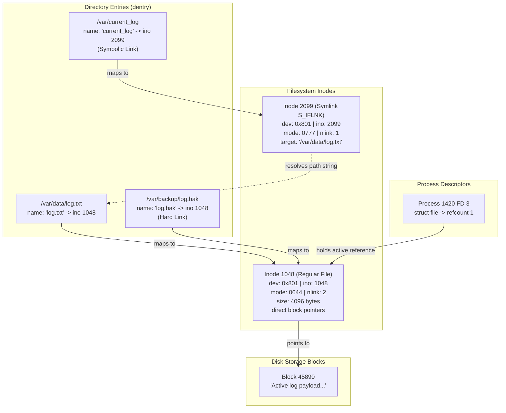

# Inodes and Links

> [!summary] Claim
> Unix separates file identity from file naming: an inode owns file metadata and data blocks, directory entries map pathnames to inode numbers, hard links add directory entries pointing to an existing inode and increment `st_nlink`, symbolic links store target path strings in dedicated inodes, and space is reclaimed only when `st_nlink` reaches zero and every open file description referencing the inode is closed.

Part of [Files, Filesystems, and Permissions](README.md) in [Shell and Unix Engineering](../README.md).

## TL;DR

- Mechanism: File identity is the pair `(st_dev, st_ino)`; directory entries map names to inode numbers, `link(2)` increments `st_nlink` without copying data, `symlink(2)` stores a path string in an independent inode, and `unlink(2)` decrements `st_nlink`, freeing disk blocks only when `st_nlink == 0` and all referencing file descriptors close.
- Rule: Compare file identities with `[ "$file1" -ef "$file2" ]`, detect potential broken symlinks with `[ -e "$p" ] || [ -L "$p" ]`, and execute atomic symlink replacement pointing to directories using feature-detected `mv -T` (GNU) or `mv -h` (macOS/BSD) to prevent descending into the target.
- Trap: Appending a trailing slash to a symlink operand (`symlink/`) forces path resolution to follow the link per `(POSIX.1-2024 XBD 4.16)`, so `rm -rf symlink/` can destroy the target rather than the link: measured in the shell matrix, GNU coreutils 9.7 `rm` empties the target directory, macOS `rm` deletes the target directory itself, and BusyBox 1.37.0 `rm` removes only the link (as of 2026-11).
- Portability: `test -ef` was formally standardized in POSIX.1-2024 Issue 8 (Austin Group Defect 375), yet posh 0.14.1 still rejects it; `readlink` and `realpath` utilities were added in POSIX.1-2024; directory `st_nlink` counts vary across filesystems: `2 + subdirectories` on ext4, `2 + total_entries` on macOS APFS, and a constant `1` on Btrfs.
- When not to use it: Never use hard links across filesystem or mount boundaries (which fail with `EXDEV`), never attempt hard linking directories (blocked with `EPERM` or `EISDIR` to prevent graph cycles), and never rely on unlinked open files for long-term storage across service restarts.

## Mental model



A filesystem directory entry is merely a tuple mapping a human-readable component name to an inode number.
Two distinct directory entries can map to the same inode number, creating hard links that share identical permissions, ownership, timestamps, and disk blocks.
The hard link count `st_nlink` on the inode tracks how many directory entries reference it.
A symbolic link is a distinct file containing a path string in its own inode payload; when resolved during path lookup, the kernel replaces the symlink component with that stored path.
Processes access files through file descriptors pointing to kernel open file descriptions, which hold an active reference count on the in-memory inode.
Unlinking a path removes its directory entry and decrements `st_nlink`, but the inode and its allocated disk blocks remain on disk until `st_nlink` reaches zero and every process referencing that inode closes its file descriptor.

## How it works

### The inode and directory separation

In traditional Unix filesystems (V7, BSD FFS, Linux ext2/3/4, XFS, FreeBSD UFS), files do not have intrinsic names.
A file is an index node (inode).
The inode stores all metadata: device identifier (`st_dev`), inode number (`st_ino`), file mode and type (`st_mode`), ownership (`st_uid`, `st_gid`), hard link count (`st_nlink`), file size in bytes (`st_size`), timestamps (`st_atim`, `st_mtim`, `st_ctim`), allocation block count (`st_blocks`), and pointers or extent trees mapping logical offsets to physical disk blocks.
Per `(POSIX.1-2024 XBD <sys/stat.h>)`, file identity is uniquely determined by the combination of `st_dev` and `st_ino`.
At any given moment, distinct files have distinct file identities, and hard links to the same file have the identical file identity.

A directory is a specialized file whose data blocks contain directory entries (dentries).
In ext4 on-disk layout (`struct ext4_dir_entry_2`), each entry contains an inode number (`__le32 inode`), entry length (`__le16 rec_len`), name length (`__u8 name_len`), file type indicator (`__u8 file_type`), and the filename byte string (`char name[EXT4_NAME_LEN]`), per `fs/ext4/ext4.h`.
The directory maps names to inode numbers; it does not store file data or permissions.
When a process executes `open("/path/to/file", O_RDONLY)`, the kernel path resolution engine traverses directory entries until it resolves the final component to an inode number, loads the corresponding `struct inode` into the VFS inode cache, and creates an open file description (`struct file`).

### Hard links and link(2)

The `link(const char *path1, const char *path2)` and `linkat(int fd1, const char *path1, int fd2, const char *path2, int flag)` system calls atomically create a new directory entry pointing to an existing file's inode `(POSIX.1-2024 XSH link)`.
In the Linux kernel VFS layer, `vfs_link` in `fs/namei.c` governs this operation:
1. It validates that the parent directory and target inode reside on the same superblock: `if (dir->i_sb != inode->i_sb) return -EXDEV;`.
Because inode numbers are local to a specific filesystem instance, a hard link cannot cross mount boundaries; `do_linkat` already returns `EXDEV` earlier when the two paths sit on different mounts (`old_path.mnt != new_path.mnt`), so even two bind mounts of one filesystem cannot be linked across.
2. It verifies that the source is not append-only or immutable: `if (IS_APPEND(inode) || IS_IMMUTABLE(inode)) return -EPERM;`.
3. It forbids hard linking directories: `if (S_ISDIR(inode->i_mode)) return -EPERM;`.
4. It verifies link limits against filesystem boundaries: `if (max_links && inode->i_nlink >= max_links) return -EMLINK;`.
5. It delegates to the underlying filesystem driver: `dir->i_op->link(old_dentry, dir, new_dentry)`.

In ext4 (`ext4_link` in `fs/ext4/namei.c`), the filesystem adds a directory entry in the target directory via `ext4_add_entry()` and increments the inode link count via `ext4_inc_count(inode)`.
The inode status change timestamp (`st_ctim`) of the target file is marked for update, and the modification (`st_mtim`) and status change (`st_ctim`) timestamps of the destination directory are updated `(POSIX.1-2024 XSH link)`.
The data blocks of the file are untouched; no disk blocks are copied or reallocated.

### Linking to symlinks, to open descriptors, and finding links from the shell

By default `link(2)` and `linkat(2)` do not dereference `oldpath` when it is a symlink: the new name becomes a hard link to the symlink inode itself.
POSIX.1-2001 said `link()` should dereference, Linux has not done so since 2.0, and POSIX.1-2008 made it implementation-defined (`link(2)` VERSIONS).
Pass `AT_SYMLINK_FOLLOW` (since Linux 2.6.18) to `linkat` to link to the symlink's target instead (`linkat(2)`).
Because the answer is implementation-defined, portable scripts that need a particular result should resolve the target first, for example with `readlink`, rather than rely on `ln` without `-s`.

Linux can also link an open file descriptor into the namespace.
`linkat(fd, "", AT_FDCWD, "/path/for/file", AT_EMPTY_PATH)` (since Linux 2.6.39) needs `CAP_DAC_READ_SEARCH`; without it, and with procfs mounted, `linkat(AT_FDCWD, "/proc/self/fd/<fd>", newdirfd, newname, AT_SYMLINK_FOLLOW)` is the alternative (`linkat(2)`).
This is how an `O_TMPFILE` file opened without `O_EXCL` is given a name (`open(2)`).
It does not resurrect a file that was already unlinked: linking `/proc/self/fd/<fd>` for a deleted file fails with `ENOENT`, so a file whose link count reached zero cannot be recovered by hard linking (`linkat(2)` ERRORS).

Standard and common tools expose the same identity model:
- `ls -i` prints the inode number, and `ls -l` prints the link count in its second column (`stat -f %l` on BSD and macOS, `stat -c %h` on GNU).
- `find . -samefile a` lists every name under `.` that shares `a`'s inode, and `find . -links 3` lists files with exactly three links; both are extensions beyond POSIX `find`, whose primaries are specified in `find`.
- `cp -l a c` creates `c` as a hard link to `a` instead of copying; `cp -al` clones a tree as a link farm, so a later in-place write through either name changes both.
- `lsof +L1` lists open files whose link count is below one, which is the `df` versus `du` gap described below.

On the macOS 27.3 host, `ln a b`, `cp -l a c`, `ls -i`, `find . -samefile a`, `find . -links 3`, and `stat -f %l a` all agree: three names, one inode, link count 3 (as of 2026-11).

### File deletion, unlink(2), and open unlinked files

Unix has no "delete file" system call.
The interface is `unlink(const char *path)` or `unlinkat(int fd, const char *path, int flag)` `(POSIX.1-2024 XSH unlink)`.
In `vfs_unlink` (`fs/namei.c`):
1. The kernel checks directory search and write permissions: write access to the containing directory is required, but permissions on the file itself are irrelevant.
2. If the directory has its sticky bit set (`S_ISVTX`), the caller's effective UID must match either the file owner UID or the directory owner UID `(POSIX.1-2024 XSH unlink)`.
3. The filesystem driver removes the directory entry and decrements the inode link count: `drop_nlink(inode)` in ext4.
4. If `inode->i_nlink == 0`, ext4 adds the inode to the orphan list in the filesystem superblock via `ext4_orphan_add(handle, inode)`.

Per `(POSIX.1-2024 XSH unlink)`:
"When the file's link count becomes 0 and no process has a reference to the file via an open file descriptor or a memory mapping, the space occupied by the file shall be freed and the file shall no longer be accessible.
If one or more processes have such a reference to the file when the last link is removed, the link shall be removed before unlink() returns, but the removal of the file contents shall be postponed until there are no such references to the file."

When an active process holds an open file descriptor, the kernel maintains an in-memory VFS reference (`i_count > 0`).
Even though `st_nlink == 0` and the file is unlinked from the directory tree, the process can continue to read, write, seek, and `fstat` the descriptor.
The file's blocks remain allocated on disk.
When the process closes the file descriptor (or terminates), the VFS decrements `i_count`.
When `i_count` drops to zero and `st_nlink` is zero, the kernel triggers inode eviction: `ext4_evict_inode` truncates all allocated extents, returns blocks to the block allocation bitmap, clears the inode entry in the inode allocation bitmap, and removes the inode from the orphan list.
Only then is disk space reclaimed.
This design explains the classic operational discrepancy between `du` (which sums files visible in directory trees) and `df` (which reads allocated blocks from the filesystem superblock).
An unlinked 100 GiB file held open by a daemon is invisible to `du`, while `df` reports 100 GiB consumed until the holding process terminates.

### Symbolic links and symlink(2)

A symbolic link is created via `symlink(const char *path1, const char *path2)` or `symlinkat(const char *path1, int fd, const char *path2)` `(POSIX.1-2024 XSH symlink)`.
Unlike a hard link, a symbolic link creates a new inode with file type `S_IFLNK`.
The string `path1` is stored as the data payload of the symlink inode.
Per `(POSIX.1-2024 XSH symlink)`:
"The string pointed to by path1 shall be treated only as a string and shall not be validated as a pathname."
The target does not need to exist when the symlink is created.
A symlink whose target does not exist is a dangling or broken symlink.

Filesystems optimize symlink storage.
In Linux ext4 (`ext4_symlink` in `fs/ext4/namei.c`), the stored length `disk_link.len` includes the terminating NUL (`fscrypt_prepare_symlink` sets it to `len + 1`), and it is compared with `EXT4_N_BLOCKS * 4` (60 bytes, the 15 4-byte entries of `i_data`); so a target of 59 bytes or shorter is stored directly inside the inode structure itself.
This is a fast symlink (`ext4_fast_symlink_inode_operations`).
A fast symlink allocates zero disk blocks (`st_blocks == 0`) and requires zero disk I/O beyond reading the inode itself.
If the target path is 60 bytes or longer, ext4 allocates a separate data block to store the path string, setting `ext4_symlink_inode_operations`.
In XFS, a short target is stored inline in the inode's data fork when it fits the inode literal area, and XFS caps every symlink target at 1,024 bytes (`XFS_SYMLINK_MAXLEN` in `fs/xfs/libxfs/xfs_format.h`), so no XFS symlink exceeds 1,024 bytes inline or otherwise.

Reading the raw target string is performed via `readlink(const char *path, char *buf, size_t bufsize)` or `readlinkat()` `(POSIX.1-2024 XSH readlink)`.
Critically, `readlink(2)` does not append a null terminator byte (`\0`): POSIX leaves the rest of `buf` unspecified and says conforming applications should not assume the result is null-terminated `(POSIX.1-2024 XSH readlink)`.
It returns the count of bytes copied into `buf`; callers must ensure `buf[n] = '\0'`.
The lab's probe fills `buf` with a sentinel byte before the call and reports `nul_written=no` on the macOS host.

### Path resolution and trailing slash semantics

Pathname resolution is governed by `(POSIX.1-2024 XBD 4.16 Pathname Resolution)`.
When the kernel encounters a symlink during path traversal:
If the symlink is an intermediate component (for example `sym` in `sym/file`), the kernel always resolves the symlink, replacing `sym` with its target string, and continues traversal relative to the directory containing the symlink.
If the symlink is the final component of the path:
1. Functions designed to operate on links themselves (`lstat`, `readlink`, `unlink`, `rename`, `lchown`) do not follow the link.
2. System calls opening or inspecting targets (`open`, `stat`, `chmod`) follow the link.
3. Crucially, per `(POSIX.1-2024 XBD 4.16)`:
A pathname ending with a trailing slash (`/`) cannot be resolved successfully unless the component before the slash resolves to an existing directory.
Therefore, adding a trailing slash to any pathname forces the kernel to follow symbolic links.
If `link_to_file` is a symlink pointing to a regular file, referencing `link_to_file/` fails with `ENOTDIR` because the target is not a directory.
If `link_to_dir` is a symlink pointing to a directory, referencing `link_to_dir/` dereferences the link and resolves to the target directory.

This rule dictates shell behavior:
`rm symlink` unlinks the symbolic link itself.
`rm -r symlink/` resolves `symlink/` to the target directory, and what happens next depends on the implementation, measured in the shell matrix (as of 2026-11):
GNU coreutils 9.7 `rm -rf link/` descends into the target directory and unlinks its contents, leaving the empty target directory and the link;
macOS `rm -rf link/` deletes the target directory itself, leaving a dangling link;
BusyBox 1.37.0 `rm -rf link/` (Alpine's default `rm`) removes only the link and leaves the target intact.
POSIX says `rm` shall not traverse directories by following symbolic links into other parts of the hierarchy `(POSIX.1-2024 XCU rm)`, but a trailing slash makes the operand itself name the directory, which is why the results diverge.

### Symlink loop detection and ELOOP

Circular symlink chains (`a -> b -> a`) would cause infinite loops during kernel path lookup.
To guarantee termination, POSIX specifies `SYMLOOP_MAX` `(POSIX.1-2024 <limits.h>)`, requiring implementations to support at least `{_POSIX_SYMLOOP_MAX}` (8) consecutive symlink traversals before failing with `ELOOP` ("Too many levels of symbolic links").
In the Linux kernel (`include/linux/namei.h` and `fs/namei.c`), `include/linux/namei.h` defines two constants, but only one bounds traversal:
- `MAX_NESTED_LINKS = 8`: still defined in `include/linux/namei.h`, but no longer consulted by `fs/namei.c`; since the nonrecursive path walk, the symlink stack (`nd->stack`) grows to `MAXSYMLINKS` entries, so nesting is bounded by the same 40-link total.
- `MAXSYMLINKS = 40`: the maximum total number of symbolic links that can be followed across an entire pathname resolution path walk (`nd->total_link_count`).
When `total_link_count >= 40`, `reserve_stack()` aborts and returns `-ELOOP`.
On macOS and FreeBSD (`sys/param.h`), `MAXSYMLINKS` is defined as 32 (macOS SDK `sys/param.h` and FreeBSD `sys/sys/param.h`; `getconf SYMLOOP_MAX` prints 32 on the macOS host, as of 2026-11).

### Directory hard links and directory link counts

Hard links to directories are forbidden in modern Unix operating systems.
If a directory could have multiple parent directory entries, the filesystem would become an arbitrary directed graph rather than a directed acyclic tree.
Cycles in directory graphs cause tree walkers (`find`, `du`, `tar`, `rm -rf`) to loop infinitely, create orphaned subtrees where `..` no longer points to the true topological parent, and prevent `fsck` from validating directory reachability.
In Linux `vfs_link` (`fs/namei.c`), directory linking is unconditionally rejected: `if (S_ISDIR(inode->i_mode)) return -EPERM;`.

Historically, early Unix (V6/V7) permitted the superuser to hard-link directories using `mknod` or `link` to construct initial directory structures.
In Mac OS X 10.5 (Leopard) through macOS 10.15 (Catalina), Apple implemented directory hard links in HFS+ specifically for Time Machine backups.
Each hourly snapshot was a full directory tree where unchanged directories were hard-linked into a hidden `/.HFS+ Private Directory Data\r` folder.
Because the layout depends on directory hard links, general-purpose tools such as `rsync` cannot reliably replicate a Time Machine volume; replication has to image the whole filesystem (Wikipedia, "Time Machine (macOS)", citing Apple and Pond's "How Time Machine Works its Magic").
In macOS 11 Big Sur, Apple rebuilt Time Machine on APFS snapshot technology, and APFS itself does not support directory hard links (Wikipedia, "Time Machine (macOS)").
Apple's Time Machine support article confirms that some older versions of macOS created backup disks in Mac OS Extended (HFS+) format instead of APFS (Apple Support 102423, as of 2026-11).

Directory link count arithmetic reveals fundamental filesystem design differences:
On traditional Unix filesystems (ext2/3/4, UFS):
1. An empty directory has `st_nlink = 2`: one entry in its parent directory, and its own `.` entry (`ext4_init_new_dir` in `fs/ext4/namei.c`).
2. Each subdirectory created within it increments the parent directory's `st_nlink` by 1 via `ext4_inc_count(dir)`, because the child subdirectory contains a `..` entry pointing back to the parent.
3. Regular files inside a directory do not have `..` entries and therefore do not increment the directory's `st_nlink`.
4. Thus, on ext4: `st_nlink = 2 + (number of subdirectories)`.
Classic GNU `find` exploited this invariant for leaf directory optimization: once `st_nlink - 2` subdirectories had been processed in a directory, `find` knew that all remaining entries were non-directories and skipped calling `stat()` on them.
Current GNU `find` walks with gnulib `fts`, which keeps only the narrower form: a directory whose `st_nlink` is exactly 2 (`MIN_DIR_NLINK`) is treated as having no subdirectories, and only on Linux file system types it trusts; `leaf_optimization()` in `lib/fts.c` disables it for unknown types, AFS, CIFS, NFS, and procfs, and on non-Linux hosts.
When an indexed ext4 directory exceeds 65,000 links (`EXT4_LINK_MAX`), ext4's `dir_nlink` feature sets `st_nlink = 1` (`ext4_inc_count` checks `is_dx(inode)` and `i_nlink > EXT4_LINK_MAX`), signaling to tree-walkers that link count optimization must be disabled.

On macOS APFS:
APFS does not follow Unix `2 + subdirectories` arithmetic.
Instead, APFS sets directory `st_nlink = 2 + (total directory entries)`, measured on the macOS 27.3 host: an empty directory reports 2, two regular files raise it to 4, and one subdirectory more raises it to 5 (as of 2026-11).
Creating a regular file inside an APFS directory increments the directory's `st_nlink` by 1.
On Btrfs:
Directories keep `st_nlink = 1`: a new inode starts with one link, and the only `inc_nlink()` call in `fs/btrfs/inode.c` is in `btrfs_link`, so `btrfs_mkdir` never raises the parent's count (source read on master, as of 2026-11; not measured on a Btrfs mount).
The flag `-noleaf` in GNU `find` disables the leaf optimization, ensuring correct traversal on filesystems (FAT, ISO9660, and Btrfs under classic `find`) where `st_nlink` does not reflect subdirectory counts; with gnulib `fts` the only remaining risk is a file system that reports exactly 2 for a directory that has subdirectories, because a count of 1 (Btrfs) or an over-count (APFS) never triggers the shortcut.

### File identity comparison in the shell

Shell scripts test whether two pathnames refer to the identical underlying file using the `-ef` binary operator:
`[ "$file1" -ef "$file2" ]`
Standardized in POSIX.1-2024 Issue 8 (Austin Group Defect 375), `pathname1 -ef pathname2` is defined as:
"True if pathname1 and pathname2 resolve to existing directory entries for the same file; otherwise, false."
Support predates the standard in most shells, but not all: measured in the shell matrix, dash, bash, zsh, ksh93, mksh, yash, and BusyBox ash accept `-ef`, while posh 0.14.1 fails with `[: -ef: unexpected operator/operand` (as of 2026-11).
In GNU Bash (`filecomp` in `test.c` calling `same_file` in `general.c`) and GNU Coreutils (`src/test.c` calling `psame_inode`):
1. The shell calls `stat()` on both pathnames.
Because `stat()` is used instead of `lstat()`, symbolic links are dereferenced to their targets.
2. If either `stat()` fails (for example file does not exist, broken symlink, or permission denied along path prefix), `-ef` returns false (exit status 1).
3. If both `stat()` calls succeed, the shell evaluates:
`(st1.st_dev == st2.st_dev) && (st1.st_ino == st2.st_ino)`.
If device and inode numbers match, the expressions refer to the same file.

## Numbers and limits

| Property / Limit | Value | System / Standard | Source |
|---|---|---|---|
| `_POSIX_LINK_MAX` | 8 | POSIX minimum | POSIX.1-2024 `<limits.h>` |
| `_POSIX_SYMLINK_MAX` | 255 bytes | POSIX minimum | POSIX.1-2024 `<limits.h>` |
| `_POSIX_SYMLOOP_MAX` | 8 loops | POSIX minimum | POSIX.1-2024 `<limits.h>` |
| Maximum hard links (`LINK_MAX`) | 65,000 | Linux ext4 | Linux `fs/ext4/ext4.h` (`EXT4_LINK_MAX`) |
| Maximum hard links (`LINK_MAX`) | 2,147,483,647 (2^31 - 1) | Linux XFS | Linux `fs/xfs/libxfs/xfs_format.h` |
| Maximum hard links (`LINK_MAX`) | 65,535 | Linux Btrfs | Linux `include/uapi/linux/btrfs_tree.h` (`BTRFS_LINK_MAX`, checked per inode in `btrfs_link`) |
| Maximum hard links (`LINK_MAX`) | 32,767 | macOS APFS | Measured via `getconf LINK_MAX /` on macOS 27.3 (as of 2026-11) |
| Maximum symlink loop depth | 40 links | Linux VFS | Linux `include/linux/namei.h` (`MAXSYMLINKS`) |
| Nested symlink stack depth | 40 links (`MAX_NESTED_LINKS` = 8 is defined but unused by `fs/namei.c`) | Linux VFS | Linux `include/linux/namei.h`, `fs/namei.c` (stack sized by `MAXSYMLINKS`) |
| Maximum symlink loop depth | 32 links | macOS / FreeBSD | macOS SDK and FreeBSD `sys/param.h`; `getconf SYMLOOP_MAX` on macOS 27.3 (as of 2026-11) |
| Fast symlink inline threshold | 59-byte target (60 bytes with NUL) | Linux ext4 | Linux `ext4_symlink` in `fs/ext4/namei.c` (`disk_link.len > EXT4_N_BLOCKS * 4`) |
| Maximum symlink target | 1,024 bytes (inline only if it fits the inode literal area) | Linux XFS | Linux `fs/xfs/libxfs/xfs_format.h` (`XFS_SYMLINK_MAXLEN`) |
| Empty directory `st_nlink` | 2 | ext4 / APFS | ext4 `ext4_init_new_dir`; measured on macOS 27.3 APFS (as of 2026-11) |
| Directory `st_nlink` model | `2 + subdirectories` | Linux ext4 | Linux `ext4_inc_count` (`fs/ext4/namei.c`) |
| Directory `st_nlink` model | `2 + total entries` | macOS APFS | Measured on macOS 27.3 (2, then 4 with two files, then 5 with a subdirectory; as of 2026-11) |
| Directory `st_nlink` model | 1 (constant) | Linux Btrfs | Linux `fs/btrfs/inode.c` (`btrfs_mkdir` never calls `inc_nlink`; the only call is in `btrfs_link`) |
| Directory `st_nlink` overflow | 1 (pinned) | Linux ext4 | Linux `ext4_inc_count` with `dir_nlink` |

## Portability

| Environment / Utility | `test -ef` Support | `test -h` / `test -L` | `ln -sfn` (Symlink Swap) | `mv -T` vs `mv -h` for Symlink Replacement | `readlink` Utility Availability |
|---|---|---|---|---|---|
| POSIX.1-2024 `sh` | Supported (Issue 8 Defect 375) | Both supported | Not specified (`-n` non-standard) | Neither in POSIX; relies on C `rename(2)` | Supported (`readlink [-n]`, Issue 8) |
| macOS `bash 3.2.57` | Supported | Both supported | Supported (`-h` or `-n`) | `mv -h` supported; `mv -T` rejected | `/usr/bin/readlink` (BSD; `-f` works on macOS 27.3, as of 2026-11) |
| GNU `bash 5.2.37` (Debian 13, Alpine) | Supported | Both supported | Supported (`-n`) | `mv -T` supported; `mv -h` rejected | `/usr/bin/readlink` (GNU coreutils 9.7 on Debian) |
| `dash 0.5.12` | Supported | Both supported | Depends on utility in `PATH` | Depends on utility in `PATH` | System utility in `PATH` |
| `zsh 5.9` (native) | Supported | Both supported | Supported (`-n`) | System utility in `PATH` | System utility in `PATH` |
| `zsh --emulate sh` | Supported | Both supported | Supported (`-n`) | System utility in `PATH` | System utility in `PATH` |
| `ksh93u+m 1.0.10` | Supported | Both supported | Supported (`-n`) | System utility in `PATH` | System utility in `PATH` |
| `mksh R59` | Supported | Both supported | Supported (`-n`) | System utility in `PATH` | System utility in `PATH` |
| `yash 2.58.1` | Supported | Both supported | Supported (`-n`) | System utility in `PATH` | System utility in `PATH` |
| `posh 0.14.1` | Not supported (`[: -ef: unexpected operator/operand`, measured in the shell matrix) | Both supported | System utility in `PATH` | System utility in `PATH` | System utility in `PATH` |
| `BusyBox 1.37.0 ash` | Supported | Both supported | Supported (`-n`) | `mv -T` supported (measured in Alpine's and Debian's BusyBox 1.37.0) | `readlink` supported (`-f` supported; `-e` and `-m` rejected) |
| GNU coreutils | N/A (`test` implements `-ef` with `psame_inode` in `src/test.c`) | `test -h` / `-L` | `ln -sfn` and `ln -sfT` supported | `mv -T` supported; `mv -h` invalid | `readlink -f`, `-e`, `-m` supported |
| macOS / FreeBSD userland | N/A (`test` binary has `-ef`) | `test -h` / `-L` | `ln -sfh` and `ln -sfn` supported | `mv -h` supported (macOS and FreeBSD `mv(1)`); `mv -T` invalid | `readlink -f` works on macOS 27.3 (as of 2026-11); `realpath` also present |
| uutils coreutils (Rust) | N/A (`test` has `-ef`) | `test -h` / `-L` | `ln -sfn` and `ln -sfT` supported | `mv -T` supported | `readlink -f`, `-e`, `-m` supported (uutils `ln.rs`, `mv.rs`, `readlink.rs`, `test.rs` on main, as of 2026-11) |

## Worked example

The test lab [lab](../labs/10-inodes-and-links/) contains the test script `link_probe.sh` and the low-level C system call probe `probe.c`.
The shell harness implements discriminating checks for hard links, symlinks, atomic directory symlink swapping, and trailing slash resolution:

```sh
#!/bin/sh
set -eu

# link_probe.sh - test harness for inode and link behaviors
# Implements discriminating probes for hard links, symlinks, and directory semantics.

die() {
  printf 'error: %s\n' "$1" >&2
  exit 1
}

usage() {
  cat <<'EOF'
usage: link_probe.sh <command> [args...]

commands:
  hardlink <dir>       verify hard link count and inode sharing
  symlink <dir>        verify symlink classification and dangling link checks
  atomic_swap <dir>    verify atomic symlink replacement pointing to directories
  trailing_slash <dir> verify trailing slash resolution semantics
EOF
  exit 1
}

cmd_hardlink() {
  dir="${1:-}"
  [ -n "$dir" ] || die "hardlink requires directory"
  [ -d "$dir" ] || die "directory does not exist: $dir"

  base="$dir/base.txt"
  link1="$dir/link1.txt"
  link2="$dir/link2.txt"

  printf 'initial payload\n' >"$base"
  ln "$base" "$link1"
  ln "$base" "$link2"

  if [ "$base" -ef "$link1" ] && [ "$link1" -ef "$link2" ]; then
    printf 'ef_hardlink=true\n'
  else
    printf 'ef_hardlink=false\n'
  fi

  # Modify content through link2, read through base
  printf 'updated via link2\n' >"$link2"
  content=$(cat "$base")
  printf 'read_via_base=%s\n' "$content"

  # Remove base and link1, verify link2 survives with full content
  rm -f "$base" "$link1"
  if [ -f "$link2" ]; then
    surviving=$(cat "$link2")
    printf 'surviving_content=%s\n' "$surviving"
  else
    printf 'surviving_content=missing\n'
  fi
}

cmd_symlink() {
  dir="${1:-}"
  [ -n "$dir" ] || die "symlink requires directory"
  [ -d "$dir" ] || die "directory does not exist: $dir"

  target="$dir/target.txt"
  symlink="$dir/symlink.txt"
  broken="$dir/broken.txt"

  printf 'target payload\n' >"$target"
  ln -s target.txt "$symlink"
  ln -s nonexistent.txt "$broken"

  # Classification tests
  [ -h "$symlink" ] && h_sym="yes" || h_sym="no"
  [ -L "$symlink" ] && l_sym="yes" || l_sym="no"
  [ -e "$symlink" ] && e_sym="yes" || e_sym="no"

  [ -h "$broken" ] && h_brk="yes" || h_brk="no"
  [ -L "$broken" ] && l_brk="yes" || l_brk="no"
  [ -e "$broken" ] && e_brk="yes" || e_brk="no"

  # -ef follows symlinks to existing target
  [ "$symlink" -ef "$target" ] && ef_valid="yes" || ef_valid="no"
  [ "$broken" -ef "$broken" ] && ef_broken="yes" || ef_broken="no"

  printf 'valid_symlink: -h=%s -L=%s -e=%s -ef_target=%s\n' "$h_sym" "$l_sym" "$e_sym" "$ef_valid"
  printf 'broken_symlink: -h=%s -L=%s -e=%s -ef_self=%s\n' "$h_brk" "$l_brk" "$e_brk" "$ef_broken"
}

cmd_atomic_swap() {
  dir="${1:-}"
  [ -n "$dir" ] || die "atomic_swap requires directory"
  [ -d "$dir" ] || die "directory does not exist: $dir"

  v1="$dir/release_v1"
  v2="$dir/release_v2"
  mkdir "$v1" "$v2"
  printf 'version 1\n' >"$v1/version.txt"
  printf 'version 2\n' >"$v2/version.txt"

  # Initial pointer
  ln -s release_v1 "$dir/current"
  initial=$(cat "$dir/current/version.txt")
  printf 'initial_version=%s\n' "$initial"

  # Create staging symlink
  ln -s release_v2 "$dir/current.tmp"

  # Atomically replace current. Detect whether mv accepts -T (GNU) or -h (macOS/BSD)
  if mv -T "$dir/current.tmp" "$dir/current" 2>/dev/null; then
    swap_mode="gnu_T"
  elif mv -h "$dir/current.tmp" "$dir/current" 2>/dev/null; then
    swap_mode="bsd_h"
  else
    # Fallback: rename(2) via small C helper if probe binary exists, or unlink+link
    die "neither mv -T nor mv -h supported on this host"
  fi

  swapped=$(cat "$dir/current/version.txt")
  printf 'swap_mode=%s\n' "$swap_mode"
  printf 'swapped_version=%s\n' "$swapped"
}

cmd_trailing_slash() {
  dir="${1:-}"
  [ -n "$dir" ] || die "trailing_slash requires directory"
  [ -d "$dir" ] || die "directory does not exist: $dir"

  regular="$dir/file.txt"
  sub_dir="$dir/subdir"
  printf 'hello\n' >"$regular"
  mkdir "$sub_dir"

  link_file="$dir/link_file"
  link_dir="$dir/link_dir"
  ln -s file.txt "$link_file"
  ln -s subdir "$link_dir"

  # Trailing slash on symlink to regular file must fail with ENOTDIR
  if cat "$link_file/" >/dev/null 2>&1; then
    file_slash="succeeded"
  else
    file_slash="enotdir"
  fi

  # Trailing slash on symlink to directory must succeed
  if [ -d "$link_dir/" ]; then
    dir_slash="directory"
  else
    dir_slash="failed"
  fi

  printf 'file_slash=%s\n' "$file_slash"
  printf 'dir_slash=%s\n' "$dir_slash"
}

[ $# -ge 1 ] || usage

cmd="$1"
shift
case "$cmd" in
  hardlink) cmd_hardlink "$@" ;;
  symlink) cmd_symlink "$@" ;;
  atomic_swap) cmd_atomic_swap "$@" ;;
  trailing_slash) cmd_trailing_slash "$@" ;;
  *) usage ;;
esac
```

Running the harness modes in fresh temporary directories under macOS `/bin/sh` (bash 3.2.57 in POSIX mode) on the macOS 27.3 host produces this output (as of 2026-11); on GNU systems `swap_mode` reads `gnu_T`:

```text
=== hardlink ===
ef_hardlink=true
read_via_base=updated via link2
surviving_content=updated via link2
=== symlink ===
valid_symlink: -h=yes -L=yes -e=yes -ef_target=yes
broken_symlink: -h=yes -L=yes -e=no -ef_self=no
=== atomic_swap ===
initial_version=version 1
swap_mode=bsd_h
swapped_version=version 2
=== trailing_slash ===
file_slash=enotdir
dir_slash=directory
```

Executing the compiled C helper `probe.c` confirms kernel VFS behavior directly:

```text
=== unlinked ===
before_nlink=1
after_nlink=0
bytes_read=21
payload=active inode payload
=== link_dir ===
errno=EPERM
=== symloop ===
errno=ELOOP
=== readlink ===
target=sample_target_string
len=20
nul_written=no
```

On the macOS host, the bats test suite (bats 1.14.0) passes all 10 tests; the shell matrix has not been run on this lab, and tests 1 to 3, which use `-ef`, skip themselves under posh 0.14.1 because it rejects the operator:

```text
1..10
ok 1 hard links share file identity and data modification
ok 2 test -ef across shells evaluates hard links vs distinct files
ok 3 symlink classification distinguishes symlinks from targets and dangling links
ok 4 trailing slash forces symlink resolution to directory and rejects regular files
ok 5 atomic symlink swap updates directory pointer without descending
ok 6 unlinked open file keeps data blocks accessible until close
ok 7 kernel forbids creating hard links to directories
ok 8 symlink loop returns ELOOP upon path resolution
ok 9 readlink returns raw target without null termination
ok 10 lstat vs stat distinguishes symlink inode from target inode
```

## Pitfalls

> [!warning] Trailing slash on symlink to directory in rm -rf
> Trigger: Running `rm -rf symlink_dir/` when `symlink_dir` is a symbolic link pointing to a directory.
> Symptom: Rather than unlinking the symlink itself, `rm` follows the trailing slash per `(POSIX.1-2024 XBD 4.16 Pathname Resolution)` and destroys the target: measured in the shell matrix, GNU coreutils 9.7 unlinks the contents of the target directory and macOS `rm` deletes the target directory itself, while BusyBox 1.37.0 removes only the link (as of 2026-11).
> Fix: Always strip trailing slashes before passing paths to `rm`: `rm -rf "${target_path%/}"`.

> [!warning] Non-atomic symlink replacement descends into target directory
> Trigger: Running `ln -sf new_target current` or `mv current.tmp current` when `current` is an existing symlink pointing to a directory.
> Symptom: Instead of replacing `current`, standard `ln` and `mv` treat `current` as an existing destination directory, creating a nested entry inside the directory it points to (`current/new_target` for `ln`, `current/current.tmp` for `mv`) and leaving the live service pointing to the obsolete release.
> Fix: In GNU environments use `mv -T current.tmp current` or `ln -sfn new_target current`; in macOS/BSD use `mv -h current.tmp current` or `ln -sfh new_target current`; in strict portable POSIX shell use a C wrapper calling `rename(2)` directly.

> [!warning] Unlinked open files exhaust filesystem capacity invisibly
> Trigger: Running `rm /var/log/app.log` while a running application process holds an open write file descriptor on the log file.
> Symptom: `du -sh /var/log` shows disk usage decreased to zero, but `df -h` continues to show the filesystem at 100% capacity, eventually causing subsequent write operations to fail with `ENOSPC`.
> Fix: Do not delete open log files directly; truncate them with `: > /var/log/app.log` or instruct the daemon to reopen its log files via signal (for example `SIGHUP` or `SIGUSR1`), and identify unlinked open files consuming space using `lsof +L1` or `find /proc/*/fd -lname '*deleted*'`.

> [!warning] Dangling symlinks falsely report non-existence to test -e
> Trigger: Writing defensive checks such as `if [ ! -e "$file" ]; then touch "$file"; fi` in directories containing broken symbolic links.
> Symptom: `test -e` follows the symlink to its target, finds that the target does not exist, and returns false; the subsequent file creation then clobbers or fails unexpectedly if an exclusive creation flag (`O_EXCL`) is used.
> Fix: Test whether a directory entry exists regardless of target validity using `[ -e "$path" ] || [ -L "$path" ]`.

> [!warning] Cross-device hard link creation failure
> Trigger: Calling `ln source /mnt/backup/source` when the source and destination reside on different mounts or subvolumes.
> Symptom: `ln` terminates with error exit status and reports `Invalid cross-device link` (`EXDEV`).
> Fix: Hard links require identical filesystems because inode numbers are only locally unique; use symbolic links (`ln -s`) or file-level copy operations (`cp` or reflinks with [[Reflinks-and-copy_file_range]]) across mount boundaries.

> [!warning] Directory leaf optimization failure on non-ext4 filesystems
> Trigger: Executing directory tree searches using legacy GNU `find` scripts without `-noleaf` on filesystems whose directory `st_nlink` does not follow `2 + subdirectories` (FAT, ISO9660, some network and FUSE filesystems; Btrfs and APFS also break the convention).
> Symptom: `find` prematurely terminates directory recursion or skips subdirectories because `st_nlink` does not equal `2 + subdirectories`; with current gnulib `fts` this needs a directory that reports exactly 2 while holding subdirectories, so Btrfs (1) and APFS (an over-count) are safe, and the shortcut is already off for unknown types, AFS, CIFS, NFS, procfs, and non-Linux hosts (`leaf_optimization()` in gnulib `lib/fts.c`).
> Fix: Pass `-noleaf` to `find` when operating on network filesystems, CD-ROM filesystems, or filesystems that do not implement traditional Unix directory link count arithmetic.

## Security and robustness

### Hard link attacks and fs.protected_hardlinks

In multi-user Unix environments with shared world-writable directories such as `/tmp` and `/var/tmp`, hard links historically served as a prime vector for local privilege escalation; the kernel's `fs.rst` describes the class as hardlink-based time-of-check-to-time-of-use races in world-writable directories and credits the fix to restrictions from Openwall and grsecurity (no single CVE).
An unprivileged user could create a hard link inside `/tmp` pointing to a sensitive file owned by another user (for example `/etc/shadow` or a setuid binary), or link to an administrator's configuration file.
When a privileged cron job, daemon, or administrator opened `/tmp/vulnerable_file` without `O_EXCL`, or attempted to change permissions with `chmod`, the operation followed the inode and modified the target system file.
Furthermore, unprivileged users could "pin" vulnerable, obsolete setuid binaries against removal during security updates by creating hard links to them, preventing the kernel from reclaiming their disk blocks even after the system administrator replaced the file in `/usr/bin`.

To eliminate this vulnerability, Linux kernel 3.6 introduced the `fs.protected_hardlinks` sysctl (`Documentation/admin-guide/sysctl/fs.rst`; commit `800179c9b8a1` "fs: add link restrictions", 2012-07-29, absent from the v3.5 `Documentation/sysctl/fs.txt` and present in v3.6).
Implemented in `may_linkat` in `fs/namei.c`, when `fs.protected_hardlinks = 1` (the kernel's built-in default is 0; systemd's `sysctl.d/50-default.conf` sets both `fs.protected_hardlinks` and `fs.protected_symlinks` to 1, so the restriction is on wherever `systemd-sysctl` runs, as of 2026-11):
The kernel refuses hard link creation unless:
1. The calling process filesystem UID (`fsuid`) matches the owner UID of the source file; or
2. The caller holds `CAP_FOWNER` within the user namespace; or
3. The source file is "safe" (`safe_hardlink_source`): it is a regular file, not setuid, not executable setgid, and readable and writable by the calling user.
If none of these conditions are met, `linkat(2)` fails with `-EPERM` and emits an audit event (`AUDIT_ANOM_LINK`).

### Symlink attacks and fs.protected_symlinks

Symlink time-of-check-to-time-of-use (TOCTOU) races in `/tmp` represent one of the most prolific vulnerability classes in Unix history.
An attacker observes a privileged script about to create `/tmp/install.log`, and preemptively creates a symbolic link `/tmp/install.log -> /etc/shadow`.
When the privileged root script opens `/tmp/install.log` with `O_WRONLY|O_CREAT|O_TRUNC`, it truncates and overwrites `/etc/shadow`.

Linux kernel 3.6 introduced `fs.protected_symlinks` (`Documentation/admin-guide/sysctl/fs.rst`).
Implemented in `may_follow_link` in `fs/namei.c`:
When `fs.protected_symlinks = 1`, symlinks in sticky world-writable directories (`(dir_mode & (S_ISVTX|S_IWOTH)) == (S_ISVTX|S_IWOTH)`) are followed only if:
1. The symlink's UID matches the follower's `fsuid`; or
2. The parent directory owner matches the symlink's owner.
Crucially, even `CAP_DAC_OVERRIDE` (root) does not bypass this check: root processes attempting to follow an untrusted user's symlink in `/tmp` fail with `EACCES`.

However, application-level flaws can still circumvent path-based mitigations if path resolution is performed outside sticky directories.
In CVE-2018-6954, `systemd-tmpfiles` attempted to apply recursive ownership changes (`Z` configuration entries) to directory trees.
While it avoided following symlinks on the terminal component, an unprivileged user could replace an intermediate, non-terminal directory component with a symlink during traversal, causing `systemd-tmpfiles` to follow the symlink and grant the unprivileged user recursive ownership of root filesystem directories.
NVD records that this affects systemd through 237 and occurs even with `fs.protected_symlinks` turned on.

In CVE-2019-14271, the `docker cp` utility chrooted into a container filesystem as root on the host to copy files out.
Because the glibc nsswitch facility dynamically loaded `libnss_*.so` libraries from inside that chroot, a shared library planted in the container ran code in the host-side helper, achieving full container breakout (Docker 19.03.x before 19.03.1, per NVD); the lesson for this note is that a privileged process resolving any path inside an attacker-controlled tree, not only symlinks, is the hazard.

### Modern defenses: openat2 and path resolution flags

To eliminate symlink races entirely at the systems level, Linux 5.6 introduced `openat2(2)` with `struct open_how` resolution flags:
- `RESOLVE_NO_SYMLINKS`: completely forbids resolving any symbolic link anywhere along the pathname; if any component is a symlink, the call immediately fails with `-ELOOP`.
- `RESOLVE_BENEATH`: forbids resolving any pathname component that escapes the directory represented by the directory file descriptor (including `..` components or absolute symlinks).
- `RESOLVE_IN_ROOT`: treats the directory file descriptor as the root directory (`/`), constraining all symlinks within that tree.
Using `openat2(2)` with these flags enables container runtimes, web servers, and package managers to manipulate untrusted directory trees without exposing the host to symlink traversal vulnerabilities.

## The principal's view

A staff-plus engineer evaluates filesystem links through the lens of identity guarantees, atomic deployments, and disk lifecycle contracts:

1. Link primitives define operational boundaries:
Hard links establish identical data sharing within a single filesystem instance.
They are ideal for content-addressable storage deduplication (for example Git object databases or build artifact caches), but hazardous for application configuration files: editing a hard-linked file in place mutates all linked references, while an editor that saves by renaming over the target breaks the hard link identity silently.
Symbolic links establish loose references across filesystem boundaries and provide the standard mechanism for version switching and rolling deployments.
Reflinks (`ioctl(FICLONE)`, [[Reflinks-and-copy_file_range]]) provide copy-on-write extent sharing with independent inode identities, combining the space efficiency of hard links with the isolation of regular files.

2. Production symlink swaps require strict atomicity contracts:
In zero-downtime blue-green application deployments, swapping a `current -> releases/v2` pointer must be instantaneous and uninterrupted.
Never run `rm current && ln -s releases/v2 current`: the time window between `rm` and `ln` leaves the path non-existent, causing concurrent requests to fail with `ENOENT`.
Never run `ln -sf releases/v2 current` or `mv current.tmp current` without verifying target flags: if `current` is a symlink to an existing directory, both commands create the new entry inside the directory `current` points to (`current/v2` for `ln`, `current/current.tmp` for `mv`) rather than replacing the pointer.
In production automation:
- Stage a temporary link in the same directory: `ln -s "releases/v2" "current.tmp.$$"`.
- Execute atomic rename: feature-detect `mv -T` (GNU) or `mv -h` (macOS/BSD), or invoke a small C utility calling `rename(2)` directly.
Under `rename(2)`, if `newpath` is an existing symlink pointing to a directory, `rename(2)` does not follow the symlink; it replaces the directory entry atomically.

3. Inode monitoring is mandatory:
Filesystems allocate a finite number of inodes at format time (ext4 defaults to one inode per 16 KiB of disk space, `inode_ratio = 16384` in e2fsprogs `misc/mke2fs.conf.in`).
Workloads that generate millions of small files (for example mail spools, caching proxies, container overlay layers) can exhaust inodes while disk byte capacity remains 90% free.
Monitor `df -i` alongside `df -h`.
When `df` indicates 100% capacity but `du` cannot account for the bytes, inspect unlinked open files immediately with `lsof +L1`.

4. When to use a different tool:
Shell scripts lack direct access to fine-grained kernel VFS primitives like `openat2(2)`, `renameat2(2)` (`RENAME_EXCHANGE`), or `O_TMPFILE`.
When implementing security-critical path traversal across untrusted user input, high-throughput container volume isolation, or cross-platform atomic tree swaps, write the subsystem in C, Rust, or Go using explicit descriptor-relative system calls rather than shelling out to userland utilities.

## Interview questions

> [!question] L5: Predict the output: what does this script print and why?
> ```sh
> printf "data\n" > a.txt
> ln a.txt b.txt
> rm a.txt
> printf "more\n" >> b.txt
> cat b.txt
> [ -f a.txt ] || printf "a is gone\n"
> ```
>
> > [!success]- Answer
> > The script prints `data`, followed by `more`, followed by `a is gone`.
> > `ln a.txt b.txt` creates a second directory entry referencing the same inode, incrementing `st_nlink` to 2.
> > `rm a.txt` unlinks the directory entry `a.txt` and decrements `st_nlink` to 1, leaving the inode and its data blocks intact.
> > Writing to `b.txt` modifies the shared inode's data blocks directly.
> >
> > Follow-up: What would happen to the contents of `b.txt` if an editor opened `a.txt`, truncated it, and wrote new content prior to the `rm` command?

> [!question] L5: What occurs when a file is deleted while held open by a process, and why does df not reclaim the space?
>
> > [!success]- Answer
> > `unlink(2)` removes the directory entry and decrements the inode's `st_nlink` to zero.
> > Because the running process holds an active open file description in the kernel, the VFS reference count `i_count` remains greater than zero.
> > The kernel keeps the inode and allocated disk blocks active so the process can continue reading and writing.
> > `du` cannot find the file because it traverses directory entries, while `df` queries the superblock for allocated blocks.
> > The disk blocks are freed only when the last process closes the file descriptor or terminates.
> >
> > Follow-up: What diagnostic command finds which processes are holding unlinked files open on a full disk?

> [!question] L6: Debug this script: why does a blue-green deployment script fail on its second deploy?
> ```sh
> # deploy.sh
> NEW="$1"
> ln -s "$NEW" /opt/app/current.tmp
> mv /opt/app/current.tmp /opt/app/current
> ```
>
> > [!success]- Answer
> > On the initial deploy, `/opt/app/current` does not exist, so `mv` renames `current.tmp` to `current` as expected.
> > On the second deploy, `/opt/app/current` is an existing symlink that resolves to a directory.
> > Standard `mv` follows the destination symlink and moves `current.tmp` inside `/opt/app/current/current.tmp`.
> > The live service continues pointing to the old release, and the new version is orphaned inside the old directory.
> > Fix the issue by using `mv -T` on GNU or `mv -h` on BSD/macOS to treat the destination symlink as a file without following it.
> >
> > Follow-up: How do you implement this symlink swap portably across both Linux and macOS in a pure POSIX environment?

> [!question] L6: Why does test -e return false for a broken symbolic link, and how must a script verify directory entry presence?
>
> > [!success]- Answer
> > Per `(POSIX.1-2024 XCU test)`, all file evaluation primaries except `-h` and `-L` dereference symbolic links to their targets.
> > When evaluating a broken symlink, `test -e` calls `stat()`, which fails with `ENOENT` because the target does not exist.
> > `test -e` reports false even though the directory entry for the symlink exists in the directory.
> > A script checking whether a filename is available before creation must test `[ -e "$p" ] || [ -L "$p" ]`.
> >
> > Follow-up: What error occurs if a script tests `[ ! -e "$p" ]` and then runs `open("$p", O_CREAT|O_EXCL)` when `$p` is a broken symlink?

> [!question] L6: Why does rm -rf symlink/ behave differently from rm -rf symlink?
>
> > [!success]- Answer
> > Per `(POSIX.1-2024 XBD 4.16 Pathname Resolution)`, a trailing slash forces pathname resolution to follow a symbolic link to its target directory.
> > When given `rm -rf symlink`, `rm` operates on the symlink itself via `unlink(2)`, deleting only the link.
> > When given `rm -rf symlink/`, the kernel resolves the path to the target directory.
> > `rm -rf` then recursively traverses into the target directory and unlinks all its contents; measured in the shell matrix, GNU coreutils 9.7 leaves the emptied directory, macOS `rm` also deletes the target directory, and BusyBox 1.37.0 removes only the link (as of 2026-11).
> >
> > Follow-up: How should scripts sanitize user-supplied path variables to ensure trailing slashes do not cause unintended target traversal?

> [!question] L7: How do ext4 and XFS store fast symlinks versus slow symlinks, and what is the impact on I/O and block allocation?
>
> > [!success]- Answer
> > In ext4, if the target path is 59 bytes or shorter (60 with its terminating NUL, compared against `EXT4_N_BLOCKS * 4` in `ext4_symlink`), the path string is stored directly within the inode's 60-byte block pointer area (`i_data`).
> > This fast symlink requires no data block allocation, reports `st_blocks == 0`, and requires zero disk read I/O beyond fetching the inode table entry.
> > If the target path is 60 bytes or longer, ext4 allocates a separate filesystem block and stores an extent pointer in the inode.
> > XFS stores short symlinks within the inode literal area of the data fork when they fit, and caps every symlink target at 1,024 bytes (`XFS_SYMLINK_MAXLEN`).
> > Slow symlinks add a data block read to every cold-cache traversal of the link, on top of the inode read.
> >
> > Follow-up: How can an administrator verify whether a symlink on an ext4 filesystem is fast or slow using standard utilities?

> [!question] L7: Why do Unix kernels prohibit hard links to directories, what was Apple's historical HFS+ exception, and why was it abandoned?
>
> > [!success]- Answer
> > Directory hard links allow creating cycles in the directory graph, turning the filesystem hierarchy from a tree into a general directed graph.
> > Graph cycles break directory traversal tools (`find`, `du`, `tar`), which would loop infinitely or require cycle-detection hashtables.
> > They also corrupt `..` parent pointer resolution and prevent `fsck` from validating directory reachability.
> > Apple implemented directory hard links in HFS+ for Time Machine snapshots, storing actual directory records in a hidden directory.
> > Time Machine in macOS 11 moved to APFS snapshots, and APFS does not support directory hard links.
> >
> > Follow-up: What is the directory link count `st_nlink` convention on ext4 versus macOS APFS?

> [!question] L7+: Explain Linux fs.protected_hardlinks and fs.protected_symlinks down to the VFS check functions. What attacks did they prevent, and what vulnerabilities remain?
>
> > [!success]- Answer
> > `fs.protected_hardlinks` is enforced in `may_linkat` in `fs/namei.c`.
> > It blocks creating hard links to files not owned by the caller unless the caller has `CAP_FOWNER` or the source file is regular, non-setuid, and readable and writable.
> > This prevents local users from linking to sensitive files (for example `/etc/shadow`) or pinning outdated setuid binaries in `/tmp`.
> > `fs.protected_symlinks` is enforced in `may_follow_link` in `fs/namei.c`.
> > It prevents processes from following symlinks in sticky world-writable directories unless the symlink owner matches the follower UID or the directory owner UID.
> > This stops attackers from planting symlinks in `/tmp` to trick root processes into clobbering system files.
> > However, they do not protect against symlinks in non-sticky directories: `may_follow_link` runs for every symlink followed, intermediate components included, but only restricts links whose parent is sticky and world-writable, so a user-owned directory swapped for a symlink mid-walk still redirects a privileged process (CVE-2018-6954, which NVD notes occurs even with `fs.protected_symlinks` on).
> >
> > Follow-up: How does the `openat2(2)` system call with `RESOLVE_NO_SYMLINKS` provide a complete architectural fix for symlink traversal attacks?

## Related

Prerequisites: [[File-Descriptors-and-Open-File-Descriptions]], [[Reading-the-POSIX-Standard]]
Next: [[Permissions-umask-and-Special-Bits]]
See also: [[Atomic-Rename-and-fsync]], [[Sparse-Files-and-Holes]], [[Mounts-and-Mount-Namespaces]], [[Filesystem-Hierarchy-Standard]], [[inotify-and-fswatch]], [[File-Locking-Semantics]], [[Path-Resolution-and-Symlink-Races]], [[cp-mv-and-Rename-Semantics]], [[Reflinks-and-copy_file_range]]

## Further reading

- [POSIX.1-2024 Base Definitions Chapter 4.16 Pathname Resolution](https://pubs.opengroup.org/onlinepubs/9799919799/basedefs/V1_chap04.html): Authoritative specification of path resolution, trailing slash handling, and symlink replacement.
- [POSIX.1-2024 System Interfaces link](https://pubs.opengroup.org/onlinepubs/9799919799/functions/link.html): Formal specification of `link(2)` and `linkat(2)` semantics, error codes, and link count guarantees.
- [POSIX.1-2024 System Interfaces unlink](https://pubs.opengroup.org/onlinepubs/9799919799/functions/unlink.html): Specification of file unlinking, link count decrements, and deferred space reclamation for open files.
- [POSIX.1-2024 System Interfaces symlink](https://pubs.opengroup.org/onlinepubs/9799919799/functions/symlink.html): Specification of symbolic link creation and string payload contracts.
- [Linux Kernel VFS Name Resolution source (fs/namei.c)](https://raw.githubusercontent.com/torvalds/linux/master/fs/namei.c): Primary source implementation of `vfs_link`, `vfs_unlink`, `may_linkat`, and `may_follow_link`.
- [Linux Kernel Documentation on VFS Sysctls](https://raw.githubusercontent.com/torvalds/linux/master/Documentation/admin-guide/sysctl/fs.rst): Detailed security rationale for `protected_hardlinks` and `protected_symlinks`.
- [Linux commit 800179c9b8a1 "fs: add link restrictions"](https://github.com/torvalds/linux/commit/800179c9b8a1): The 2012 change that added `protected_hardlinks` and `protected_symlinks` in Linux 3.6.
- [National Vulnerability Database CVE-2018-6954](https://nvd.nist.gov/vuln/detail/CVE-2018-6954): Vulnerability record of `systemd-tmpfiles` intermediate symlink traversal allowing root ownership hijack.
- [National Vulnerability Database CVE-2019-14271](https://nvd.nist.gov/vuln/detail/CVE-2019-14271): Analysis of Docker container breakout via `docker cp` symlink and dynamic library hijacking.
