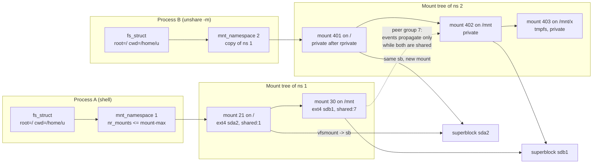

# Mounts and Mount Namespaces

> [!summary] Claim
> A path names a file only relative to a mount tree, and on Linux every process carries its own copy of that tree, so "which file does this path reach, with which options, on which filesystem" is a per-process question that a script must answer from `/proc/self/mountinfo`, not from `st_dev`, `df` prefixes, or `/etc/mtab`.

Part of [Files, Filesystems, and Permissions](README.md) in [Shell and Unix Engineering](../README.md).

## TL;DR

- Mechanism: a mount attaches a (superblock, root dentry) pair over a directory of a parent mount; path lookup crosses into the top-most mount stacked at that directory, and on Linux the set of mounts is a per-process mount namespace (`CLONE_NEWNS`, Linux 2.4.19) copied at `unshare(2)` or `clone(2)` and linked to other namespaces only through propagation peer groups.
- Rule: to learn which mount serves a path, read `/proc/self/mountinfo` (decode its `\ooo` escapes, take the longest directory-prefix mount point, then the top-most mount stacked there), or call `findmnt --target`, `mountpoint`, or `statmount(2)`; `df -P` is the only POSIX way and it reports a mount point, not a prefix.
- Trap: on Linux `rename(2)` and `link(2)` fail with `EXDEV` whenever source and target sit on different mounts, even two bind mounts of one filesystem (`fs/namei.c`, `filename_renameat2`, `filename_linkat`), so `mv` silently becomes copy-then-delete and loses atomicity.
- Portability fact: POSIX defines a mount point only as a directory whose `st_dev` differs from its parent's (POSIX.1-2024 XBD 3.210) and standardizes no `mount` utility or system call; mount namespaces, bind mounts, and propagation are Linux-only, FreeBSD's nullfs gives a bind-like view with a different `st_dev`, and macOS has neither (its firmlinks make `df -P /tmp` report `/System/Volumes/Data`, measured by the lab).
- When not to use it: a mount namespace isolates the mount list, not users, PIDs, or the network; for sandboxing reach for a container runtime or `systemd` (`PrivateTmp=`, `ProtectSystem=`) that combines it with user namespaces, seccomp, and `pivot_root(2)`, and never treat `chroot(2)` or `noexec` as a security boundary.

## Mental model



Each process reaches files through its `fs_struct` (root and current directory) and its mount namespace; `unshare(CLONE_NEWNS)` gives process B a namespace whose tree is a copy of A's, with new mount IDs that point at the same superblocks, so both namespaces read and write the same bytes on `sda2` and `sdb1`.
What differs is only the list of attachments: the tmpfs B mounts on `/mnt/x` exists in B's tree alone.
The dotted arrow is the one channel between the trees: while `/mnt` is `shared` in both namespaces the two copies are peers in group 7 and a mount under one is replayed under the other; `unshare(1)` cuts that channel by default by making every copied mount private (`mount --make-rprivate /`, util-linux 2.27 and later, `mount_namespaces(7)` NOTES).

## How it works

### 1. A mount is an attachment, not a filesystem

The kernel keeps two objects apart.
A superblock is one instance of a filesystem (one ext4 volume, one tmpfs, one proc instance); a mount (`struct mount`, embedding the public `struct vfsmount`) says "show the tree under dentry D of superblock S at directory P of parent mount M".
`/proc/PID/mountinfo` prints both halves: field 4 is the root of the mount inside its filesystem and field 3 is the superblock's `st_dev` (`proc_pid_mountinfo(5)`; `show_mountinfo()` prints `MAJOR(sb->s_dev)` and `MINOR(sb->s_dev)`, `fs/proc_namespace.c`).
Since Linux 2.4 one filesystem can be mounted at many points and many mounts can be stacked on one point (`mount(2)` HISTORY).

Mounting over a non-empty directory hides its contents without touching them; the XNU manual says the files "are swept under the carpet so to speak, and are unavailable until the filesystem is unmounted" (XNU `bsd/man/man2/mount.2`).
Hidden files still occupy space, which is why `du` on a mounted tree and `df` on the parent filesystem can disagree.

Path lookup crosses a mount point when it reaches a dentry that has mounts attached and continues at the root of the top-most one; when several mounts are stacked at one path, the top-most is "the one that is not the parent of any other mount at the same location" (`proc_pid_mountinfo(5)`, field 2).
`..` at the root of a mount steps back to the parent mount: "path/.." refers to the parent directory of "path", outside of the filesystem hierarchy on the device (`path_resolution(7)`, "Mount points").

POSIX knows only the observable residue of all this: a mount point is "Either the system root directory or a directory for which the `st_dev` field of structure stat differs from that of its parent directory" (POSIX.1-2024 XBD 3.210).
That definition cannot see a Linux bind mount of a directory from the same filesystem, because both sides report the same `st_dev`.
POSIX standardizes no `mount` or `umount` utility and no `mount()` function; its portable windows onto mounts are `df -P`, `find -xdev` and `-mount`, `du -x`, `statvfs()` with `ST_RDONLY` and `ST_NOSUID` (POSIX.1-2024 XBD `<sys/statvfs.h>`), and the `EXDEV` error of `rename()` and `link()`.

### 2. The Linux mount(2) system call

`mount(source, target, fstype, mountflags, data)` performs one of five operations, chosen by testing flags in this order: `MS_REMOUNT`, `MS_BIND`, a propagation flag (`MS_SHARED`, `MS_PRIVATE`, `MS_SLAVE`, `MS_UNBINDABLE`), `MS_MOVE`, and otherwise a new mount (`mount(2)` DESCRIPTION).
It requires `CAP_SYS_ADMIN` (`mount(2)`); inside a user namespace that means the capability over the namespace that owns the mount namespace, which is how an unprivileged user can mount in a namespace of their own (NVD CVE-2022-0185 calls it "namespaced CAP_SYS_ADMIN").

Flags live at two levels.
`MS_NODEV`, `MS_NOEXEC`, and `MS_NOSUID` are per mount since Linux 2.4, `MS_NOATIME` and `MS_NODIRATIME` since 2.6.16, `MS_RELATIME` since 2.6.20, and `MS_RDONLY` can be set per mount or per superblock since 2.6.16; `MS_DIRSYNC`, `MS_LAZYTIME`, `MS_MANDLOCK`, `MS_SILENT`, and `MS_SYNCHRONOUS` are per superblock, so changing them through one mount changes every mount of that filesystem (`mount(2)`).
`mountinfo` keeps the two apart: field 6 holds per-mount options and field 11 per-superblock options, which is one of the defects of `/proc/PID/mounts` that `mountinfo` (Linux 2.6.26) fixed (`proc_pid_mountinfo(5)`).

A bind mount (`MS_BIND`, Linux 2.4) makes a file or directory subtree visible at a second place; it ignores `fstype`, `data`, and every flag except `MS_REC`, and copies the source mount's options (`mount(2)`, "Creating a bind mount").
Without `MS_REC` only the one mount is bound; with it every submount except unbindable ones is replicated (`MS_REC` since 2.4.11).
A read-only bind therefore takes two calls: bind, then `MS_REMOUNT | MS_BIND | MS_RDONLY` (since 2.6.26), which replaces all per-mount flags at once, so any flag to keep must be repeated (`mount(2)`, "Remounting an existing mount").
`mount -o bind,ro` hides the second call, and util-linux says so: "This solution is not atomic" (`mount(8)`).

`MS_MOVE` (Linux 2.4.18) relocates a subtree atomically: "at no point is the subtree unmounted" (`mount(2)`).

Since Linux 5.2 a file-descriptor-based API splits these steps: `fsopen(2)` creates a filesystem context, `fsconfig(2)` sets parameters, `fsmount(2)` returns a detached mount as a file descriptor, `open_tree(2)` clones an existing tree into one, and `move_mount(2)` attaches it (glibc 2.36 wrappers; `fsopen(2)`, `open_tree(2)`, `move_mount(2)` HISTORY).
`mount_setattr(2)` (Linux 5.12) changes options and propagation recursively and atomically and is how idmapped mounts are created; `open_tree_attr()` (Linux 6.15) combines the clone with attribute changes.
Because every step works on a file descriptor rather than a path, the new API removes the path races that the old string-based call invites (section 6 and CVE-2021-30465).

### 3. Unmounting

`umount2(target, flags)` removes the top-most mount at `target` and fails with `EBUSY` while anything holds a reference to it: an open file, a current or root directory, or a submount (`umount(2)`).
`MNT_DETACH` (Linux 2.4.11) is the lazy unmount behind `umount -l`: it makes the mount unreachable for new lookups at once, disconnects it and everything below it from the mount table, and finishes the unmount when the last reference drops.
`MNT_FORCE` asks the filesystem to abort pending requests and is implemented only by network and FUSE-like filesystems (9p, ceph, cifs, fuse, lustre, NFS as of Linux 4.12); `MNT_EXPIRE` (2.6.8) unmounts only an idle mount on the second call; `UMOUNT_NOFOLLOW` (2.6.34) refuses to follow a symbolic link at `target`, which protects set-user-ID-root programs that let unprivileged users unmount (`umount(2)`).
An unmount of a shared mount is propagated to its peers and slaves; the `umount(2)` manual warns that recursively bind mounting `/` onto a subdirectory and then lazily unmounting that subdirectory "will cause every mount in the mount namespace to be lazily unmounted" when every mount is shared.

### 4. Reading the mount table

`/proc/PID/mountinfo` is generated per read by `show_mountinfo()` (`fs/proc_namespace.c`) and has, per line:

```text
36 35 98:0 /mnt1 /mnt2 rw,noatime master:1 - ext3 /dev/root rw,errors=continue
(1)(2)(3)   (4)   (5)      (6)      (7)   (8) (9)   (10)         (11)
```

The fields are mount ID, parent mount ID, `st_dev`, root within the filesystem, mount point relative to the reader's root, per-mount options, zero or more optional fields (`shared:N`, `master:N`, `propagate_from:N`, `unbindable`), a lone `-`, filesystem type, source, and per-superblock options; parsers "should ignore all unrecognized optional fields" (`proc_pid_mountinfo(5)`).
Mount points are printed by `seq_path_root(m, ..., " \t\n\\")`, which calls `seq_mangle_path()` to write each space, tab, newline, and backslash as a backslash and three octal digits, so `/mnt/my disk` appears as `/mnt/my\040disk` (`fs/proc_namespace.c`, `fs/seq_file.c`).
Sources and type names go through `mangle()`, whose escape set also includes `#` (`seq_escape(m, s, " \t\n\\#")`).
Mounts whose mount point lies outside the reader's root (after `chroot(2)`) are skipped (`SEQ_SKIP`), so a parent ID may name a mount that has no line of its own.

`/proc/PID/mounts` is the older fstab-style view of the same namespace, and util-linux recommends making `/etc/mtab` a symbolic link to it because a user-space mtab "cannot reliably work with namespaces, containers and other advanced Linux features" (`mount(8)`).
Linux 6.8 added `listmount(2)` and `statmount(2)` to query mounts by 64-bit ID without parsing text (kernelnewbies Linux 6.8); util-linux `mountpoint(1)` uses `statmount(2)` there and falls back to `mountinfo` on older kernels, while BusyBox `mountpoint` still applies the POSIX `st_dev` test plus a same-inode check (`util-linux/mountpoint.c`).

macOS and FreeBSD have no `mountinfo`; `mount` with no arguments prints `device on path (type, options)`, and `df -P` follows POSIX.
On macOS the root volume is a sealed read-only snapshot (`/dev/disk3s3s1 on / (apfs, sealed, local, read-only, journaled)` on the lab host, Darwin 27.3.0) and writable paths such as `/private/var` and `/Users` live on `/System/Volumes/Data` through firmlinks, so the mount point that `df -P` names is not a prefix of the path the kernel reports (lab test `dfroot`).

### 5. Mount namespaces

A mount namespace is the list of mounts a process sees (`mount_namespaces(7)`).
`fork(2)` shares it and `execve(2)` keeps it (`mount(2)` NOTES; lab test `inherit`); `clone(2)` or `unshare(2)` with `CLONE_NEWNS` creates a new one whose list is a copy of the old, and `unshare(CLONE_NEWNS)` implies `CLONE_FS` (`unshare(2)`).
In the kernel, `copy_mnt_ns()` calls `copy_tree()` on the old root with `CL_COPY_UNBINDABLE | CL_EXPIRE`, then walks the old and new trees in step so that the caller's root and current directory move to the copies (`fs/namespace.c`).
Each namespace is a handle at `/proc/PID/ns/mnt` (Linux 3.8, `namespaces(7)`); `setns(2)` joins one and requires `CAP_SYS_CHROOT` and `CAP_SYS_ADMIN` in the caller's user namespace and `CAP_SYS_ADMIN` over the target, and a caller that shares `CLONE_FS` state with another process (every thread of a multithreaded process does) cannot join (`setns(2)`).
That last rule is why `nsenter(1)` and container runtimes switch mount namespaces from a single-threaded process before starting any threads.
A namespace dies with its last process (or bind-mounted handle), and its mounts are then unmounted implicitly (`mount_namespaces(7)`); the lab's tmpfs disappears that way.
Two counters bound the cost: `fs.mount-max` caps mounts per namespace (default 100000, `sysctl_mount_max` in `fs/namespace.c`; `mount(2)` reports `ENOSPC` beyond it, counted in every namespace a mount would propagate to, `count_mounts()`), and `user.max_mnt_namespaces` caps namespaces per user (`namespaces(7)`).

A namespace owned by a different user namespace than its source is "less privileged" and the kernel hardens the copy (`mount_namespaces(7)`, "Restrictions on mount namespaces"):
shared mounts become slaves (`copy_mnt_ns()` adds `CL_SLAVE`), so nothing mounted inside can propagate out;
`lock_mnt_tree()` always sets `MNT_LOCK_ATIME` on every copied mount and adds `MNT_LOCK_READONLY`, `MNT_LOCK_NODEV`, `MNT_LOCK_NOSUID`, or `MNT_LOCK_NOEXEC` for each of those flags the mount already carries, so a mount that arrived read-only cannot be made writable and `mount -o remount,rw` fails with `EPERM`;
and every copied submount except expirable ones gets `MNT_LOCKED` (`lock_mnt_tree()`, `fs/namespace.c`), so `umount2()` of it fails with `EINVAL`, because unmounting would reveal what the more privileged namespace hid (the manual's example is a `/dev/null` bind over `/etc/shadow`).
Stacking a new mount on a locked one is allowed.
Since Linux 3.18 a file that is a mount point only in another namespace can be renamed or removed, which unmounts it there; before that the attempt failed with `EBUSY` and let unprivileged users pin files by mounting over them.

### 6. Propagation

Shared subtrees (Linux 2.6.15) let a mount event in one namespace replay elsewhere (`mount_namespaces(7)`; kernel `Documentation/filesystems/sharedsubtree.rst`).
Every mount has one type: `shared` (member of a peer group; events under it go to every peer and come back from them), `slave` (receives from a master peer group, sends nothing), `private` (no propagation), or `unbindable` (private and refuses `MS_BIND`; pruned from `MS_REC` copies).
A mount can be slave and shared at once.
The kernel default for a new mount is private unless its parent is shared, but "systemd(1) automatically remounts all mounts as MS_SHARED on system startup", so in practice the default is shared (`mount_namespaces(7)` NOTES).
That is why `unshare(1)` since util-linux 2.27 makes every mount private in the new namespace unless given `--propagation unchanged`, and why BusyBox `unshare` initializes `prop_flags = MS_REC | MS_PRIVATE` (`util-linux/unshare.c`).
A program that calls `unshare(CLONE_NEWNS)` itself must do the same, for example `mount(NULL, "/", NULL, MS_SLAVE | MS_REC, NULL)`, or its mounts leak into the parent namespace.

Unbindable mounts exist to stop "mount explosion": recursively binding `/` under each of three home directories without them replicates every earlier bind at every later one, growing the table exponentially (24 mounts after three binds in the `mount_namespaces(7)` example).
`pivot_root(2)` refuses to run when the parents of `new_root` and of the current root are shared, precisely so that it "never propagates any changes to another mount namespace".

### 7. chroot versus pivot_root

`chroot(2)` changes only the caller's root directory: it does not change the current directory or close descriptors, so a privileged process escapes with `mkdir foo; chroot foo; cd ..` (`chroot(2)`).
`pivot_root(new_root, put_old)` changes the root mount of the whole namespace, moving the old root under `put_old` and every process whose root or current directory was the old root to the new one; `new_root` must be a mount point (bind it onto itself if not) and the call cannot pivot the initial ramfs (`pivot_root(2)`).
Container runtimes use `chdir(new_root); pivot_root(".", "."); umount2(".", MNT_DETACH);`, which stacks the old root on the new one and then lazily unmounts it without a temporary directory (`pivot_root(2)`, "pivot_root(".", ".")").

### 8. What crossing a mount does to a script

`rename()` and `link()` are only atomic inside one mount on Linux: both compare the `vfsmount` of source and destination before checking permissions and return `EXDEV` if they differ (`filename_renameat2()`, `filename_linkat()` in `fs/namei.c`), which includes two bind mounts of one filesystem, while POSIX only promises `EXDEV` for "different file systems" (POSIX.1-2024 XSH `rename()`, `link()`).
XNU orders its checks differently: `linkat_internal()` runs the MAC and `KAUTH_VNODE_LINKTARGET` authorization on the source before its "cannot link across mountpoints" test, so on macOS `link("/dev/null", ...)` fails with `EPERM` where Linux gives `EXDEV` (`bsd/vfs/vfs_syscalls.c`; lab test `xdev_link`).
FreeBSD follows the Linux order: `kern_linkat_vp()` compares `v_mount` of the source and the target directory and returns `EXDEV` before `can_hardlink()` and the MAC check run (`sys/kern/vfs_syscalls.c`, as of 2026-11).
POSIX `mv` handles `EXDEV` by duplicating the hierarchy and then removing the source (POSIX.1-2024 XCU `mv`), so the rename that callers think is atomic becomes a copy that a crash can leave half-done; see [[Atomic-Rename-and-fsync]].

`noexec` is enforced at `execve()`: `do_open_execat()` returns `EACCES` when `path_noexec()` sees `MNT_NOEXEC` or `SB_I_NOEXEC` (`fs/exec.c`), and `do_mmap()` refuses `PROT_EXEC` file mappings of such files, private or shared (the `MAP_SHARED` cases fall through to the `MAP_PRIVATE` check), with `EPERM` (`mm/mmap.c`).
A shell reports the `EACCES` as "Permission denied" with status 126, but `sh ./script.sh` works, because the kernel executes `/bin/sh` and the shell merely reads the script as data.
`nosuid` makes the kernel ignore set-user-ID and set-group-ID bits and file capabilities (since Linux 2.4 silently, not with `EPERM`), and `nodev` makes device nodes unopenable (`mount(2)`); see [[setuid-and-Interpreted-Scripts]].

Tree walkers stop at mounts only when asked: `find -xdev` does not descend below a directory with a different `st_dev` but still acts on that directory, while `-mount` (added in POSIX.1-2024, Austin Group Defect 1133) skips it too, and `du -x` counts only files on the operand's device (POSIX.1-2024 XCU `find`, `du`).
GNU `rm --one-file-system` skips directories "on a file system different from that of the corresponding command line argument", and `--preserve-root=all` rejects any operand "on a separate device from its parent" (`rm(1)`, coreutils 9.11); all three tests are `st_dev` tests, so a bind mount of the same filesystem is crossed.

## Numbers and limits

| Quantity | Value | Source |
|---|---|---|
| Mounts per namespace (`fs.mount-max`) | 100000 default; `ENOSPC` beyond, counted in every namespace a mount propagates to | `fs/namespace.c` `sysctl_mount_max`, `count_mounts()` (as of 2026-11); `mount(2)` ERRORS |
| `mountinfo` fixed fields | 10, plus zero or more optional fields before the `-` separator | `proc_pid_mountinfo(5)` (as of 2026-11) |
| Characters escaped in a mount point | 4: space, tab, newline, backslash, each as `\ooo` (4 bytes) | `fs/proc_namespace.c` `show_mountinfo()`, `fs/seq_file.c` `seq_mangle_path()` (as of 2026-11); decoded by the lab |
| Characters escaped in a mount source or type | 5: the four above plus `#` | `fs/proc_namespace.c` `mangle()` (as of 2026-11) |
| Peer group IDs | start at 1, may be reused | `mount_namespaces(7)` |
| Mount namespaces | Linux 2.4.19 | `mount(2)` NOTES, `mount_namespaces(7)` HISTORY |
| Bind mounts / `MS_MOVE` / `MS_REC` and `MNT_DETACH` | Linux 2.4 / 2.4.18 / 2.4.11 | `mount(2)`, `umount(2)` |
| Shared subtrees | Linux 2.6.15 | `mount_namespaces(7)` |
| `mountinfo`; read-only bind remount | Linux 2.6.26 | `proc_pid_mountinfo(5)`, `mount(2)` |
| `/proc/PID/ns/mnt` handle | Linux 3.8 | `namespaces(7)` |
| Rename or unlink of a mount point from another namespace allowed | Linux 3.18 (was `EBUSY`) | `mount_namespaces(7)` |
| Fd-based mount API (`fsopen`, `fsmount`, `open_tree`, `move_mount`) | Linux 5.2, glibc 2.36 | `fsopen(2)`, `open_tree(2)`, `move_mount(2)` |
| `MS_NOSYMFOLLOW`; `mount_setattr(2)`; `openat2(2)` `RESOLVE_NO_XDEV` | Linux 5.10; 5.12; 5.6 | `mount(2)`, `mount_setattr(2)`, `openat2(2)` |
| `listmount(2)`, `statmount(2)`; `open_tree_attr()` | Linux 6.8; 6.15 | kernelnewbies Linux 6.8; `open_tree(2)` |
| `unshare(1)` makes new mounts private by default | util-linux 2.27 and later | `unshare(1)`, `mount_namespaces(7)` |
| CVE-2021-33910 trigger | FUSE mount point path longer than 8 MB crashes systemd PID 1 | Qualys advisory, oss-security 2021-07-20 |
| macOS `df -P "$TMPDIR"` mount point | `/System/Volumes/Data` (not a prefix of `/private/var/...`) | measured by the lab, Darwin 27.3.0 (2026-11) |
| macOS `link("/dev/null", tmp)` | `EPERM`; Linux `EXDEV` | measured by the lab on Darwin 27.3.0; Linux by `fs/namei.c` order (lab asserts it, not run here) |

## Portability

| Environment | Mount table for scripts | Is PATH a mount point | Bind mount | Namespaces | Cross-mount `link()` |
|---|---|---|---|---|---|
| POSIX.1-2024 | `df -P` "Mounted on" column only (XCU `df`) | `st_dev` differs from parent (XBD 3.210) | Not specified | Not specified | `EXDEV` allowed across file systems (XSH `link()`) |
| POSIX `sh`, dash, bash 3.2 and 5.3, zsh native and `--emulate sh`, ksh93u+ 2012 | `mounts.sh lookup` parses `mountinfo` identically (13 of 13 lab tests pass in each, run on macOS) | Same | n/a | n/a | n/a (kernel property) |
| mksh, yash, posh, BusyBox ash, ksh93u+m | Same script; uses only XCU 2.6.2 parameter expansion, `read -r`, `case`, and `printf %b` with `\0ooo` (lab asserts identical output; matrix run pending) | Same | n/a | n/a | n/a |
| Linux, util-linux | `/proc/self/mountinfo`, `findmnt --target`, `statmount(2)` (6.8+) | `mountpoint` uses `statmount(2)` or `mountinfo` (sees bind mounts) | `mount --bind`, `--rbind` | `unshare -m` (rprivate by default), `nsenter -m`, `setns(2)` | `EXDEV` even between bind mounts of one filesystem (`filename_linkat()`) |
| Linux, BusyBox | `/proc/self/mountinfo` | `mountpoint` compares `st_dev` and inode with `..` (misses same-filesystem bind mounts) | `mount --bind` | `unshare` defaults to `MS_REC` plus `MS_PRIVATE` | As Linux |
| macOS (Darwin 27.3.0) | `mount`, `df -P`; no `/proc` (lab) | `st_dev`; firmlinks make `df -P` name `/System/Volumes/Data` for `/private/var` paths (lab) | No kernel bind mount | None (lab `mntns`: unsupported) | `EPERM` first for a source the caller may not link (lab; `linkat_internal()`) |
| FreeBSD | `mount`, `df -P`, `nmount(2)` (FreeBSD 5.0) | `st_dev` | `mount_nullfs`: "A different device number for the virtual copy is returned by stat(2)" (`mount_nullfs(8)`) | Jails, not mount namespaces | `EXDEV` first, as on Linux: `kern_linkat_vp()` tests `v_mount` before `can_hardlink()` and MAC (`sys/kern/vfs_syscalls.c`, as of 2026-11) |
| GNU coreutils | `df -P`, `find -xdev`, `du -x`, `rm --one-file-system` | `st_dev` based | n/a | n/a | `mv` falls back to copy and remove on `EXDEV` (POSIX `mv`) |

## Worked example

The [lab](../labs/10-mounts-and-mount-namespaces/) holds `mounts.sh` (a POSIX `sh` mountinfo reader and a `df -P` probe), `mountinfo.fixture` (a synthetic mount table with an escaped space, an escaped backslash, three mounts stacked on `/srv` listed out of order, and every propagation tag), `xdev_link.c`, `mntns.c`, and `mounts.bats`.

Simplified excerpt of `mounts.sh` (usage text, the stack-climbing loop, the output loop, and the `live` and usage modes are omitted):

```sh
decode() {
  d_esc=$(printf '%s\n' "$1" | sed 's/\\\([0-7][0-7][0-7]\)/\\0\1/g')
  d_out=$(printf '%bx' "$d_esc")
  d_out=${d_out%x}
}

parse_line() {
  p_rest=$1
  f_id=${p_rest%% *}
  p_rest=${p_rest#* }
  f_parent=${p_rest%% *}
  p_rest=${p_rest#* }
  p_rest=${p_rest#* } # (3) major:minor
  p_rest=${p_rest#* } # (4) root of the mount inside its filesystem
  f_point=${p_rest%% *}
  p_rest=${p_rest#* }
  p_rest=${p_rest#* } # (6) per-mount options
  case $p_rest in
    "- "*)
      f_opt=
      p_rest=${p_rest#- }
      ;;
    *" - "*)
      f_opt=${p_rest%% - *}
      p_rest=${p_rest#* - }
      ;;
    *)
      return 1
      ;;
  esac
  f_type=${p_rest%% *}
  case $f_id$f_parent in
    "" | *[!0-9]*) return 1 ;;
    *) return 0 ;;
  esac
}

# in lookup(): keep the longest mount point that is PATH or a directory prefix of it
    case $d_out in
      /) l_hit=yes ;;
      *)
        case $l_path in
          "$d_out" | "$d_out"/*) l_hit=yes ;;
          *) l_hit=no ;;
        esac
        ;;
    esac

# and in dfroot: the POSIX df -P mount point is the rest of line 2 after "NN% "
    df_out=$(df -P "$2")
    printf '%s\n' "$df_out" | sed -n '2s/^[^%]*%  *//p'
```

`decode` turns the kernel's `\ooo` into the `\0ooo` form that `printf %b` must accept (POSIX.1-2024 XCU `printf`) and appends a sentinel `x` so that a decoded trailing newline survives command substitution.
`parse_line` splits on single spaces with parameter expansion because a `mountinfo` field never holds a raw space, which keeps the parse independent of `IFS` (posh inherits `IFS` from the environment, measured in the shell matrix) and of native zsh's refusal to split unquoted expansions.
The quoted `"$d_out"` in the `case` pattern makes the mount point literal, so a mount point containing `*` or `[` cannot act as a glob, and the `"$d_out"/*` arm rejects `/mnt/my diskette` as a match for `/mnt/my disk`.

Output captured on the lab host (macOS 27.3, `/bin/sh` is bash 3.2.57); the fixture results are the same on every system because they read the fixture, not the kernel:

```text
$ ./mounts.sh decode 'a\040b\134c'
<a b\c>
$ ./mounts.sh lookup '/mnt/my disk/photos' mountinfo.fixture
id=30 point=</mnt/my disk> fstype=ext4 propagation=shared:7
$ ./mounts.sh lookup '/mnt/my diskette' mountinfo.fixture
id=21 point=</> fstype=ext4 propagation=shared:1
$ ./mounts.sh lookup /srv/x mountinfo.fixture
id=42 point=</srv> fstype=tmpfs propagation=private
$ ./mounts.sh lookup /srv/data/f mountinfo.fixture
id=50 point=</srv/data> fstype=ext4 propagation=unbindable
$ ./mounts.sh live /proc/self
mountinfo: unavailable
$ ./mounts.sh dfroot /
/
$ ./mounts.sh dfroot "$TMPDIR"
/System/Volumes/Data
```

The C probes, as the lab asserts them (macOS lines measured on the host; Linux lines are the lab's assertions and were not run here):

```text
# macOS 27.3
$ ./xdev_link /dev/null "$BATS_TEST_TMPDIR/null-link"     # exit 1
link=EPERM
$ ./mntns isolate "$BATS_TEST_TMPDIR/scratch"
mntns: unsupported
# Linux (expected)
$ ./mounts.sh live /proc/self
id=<N> point=</proc> fstype=proc propagation=<tags or private>
$ ./xdev_link /dev/null "$BATS_TEST_TMPDIR/null-link"     # exit 1
link=EXDEV
$ ./mntns inherit
child_shares_parent_mntns=yes
$ ./mntns isolate "$BATS_TEST_TMPDIR/scratch"             # where unprivileged user namespaces are allowed
mntns=new child_sees=yes parent_sees=no
$ ./mntns isolate "$BATS_TEST_TMPDIR/scratch"             # under Docker's default seccomp profile
failed_at=unshare errno=EPERM parent_sees=no
```

All 13 tests passed once under `sh` (bash 3.2.57), bash 5.3.15, dash, zsh 5.9.2, `zsh --emulate sh`, and ksh93u+ 2012-08-01 on the macOS host; the Linux arms run in the integrator's matrix.
`isolate` names the refused stage because creating a user namespace is host policy: Docker's default seccomp profile denies `unshare` "with the exception of `unshare --user`" (Docker seccomp documentation), and the probe asks for `CLONE_NEWUSER | CLONE_NEWNS` in one call.

## Pitfalls

> [!warning] Writing into a mount point that is not mounted
> Trigger: a backup or log job writes to `/mnt/backup` after the disk failed to mount, or after a lazy unmount.
> Symptom: the job succeeds, fills the root filesystem through the bare directory, and the data vanishes from view once the real disk is mounted over it (hidden, still consuming space).
> Fix: check the mount before writing with `mountpoint -q /mnt/backup` (util-linux, mountinfo-based) or `findmnt --mountpoint`, write into a subdirectory that exists only on the mounted filesystem, and leave the bare mount point directory owned by root with mode `0755` or less so unprivileged writers fail.

> [!warning] Grepping /proc/mounts for a path with a space
> Trigger: `awk '$2 == "/mnt/my disk"' /proc/mounts` or `grep " /mnt/my disk " /proc/self/mountinfo`.
> Symptom: no match, because the kernel writes the mount point as `/mnt/my\040disk`; a newline in a mount point arrives as `\012`, and a backslash as `\134`.
> Fix: decode `\ooo` before comparing (the lab's `decode`), or ask a tool that decodes for you: `findmnt -n -o TARGET --target PATH`.

> [!warning] The st_dev test misses bind mounts
> Trigger: deciding "is this a mount point" with `stat` of the directory and its parent, BusyBox `mountpoint`, or the POSIX definition (XBD 3.210).
> Symptom: a bind mount of a directory from the same filesystem reports "not a mountpoint", so a guard skips it, and `find -xdev`, `du -x`, and `rm --one-file-system` walk straight through it.
> Fix: on Linux consult `mountinfo` (util-linux `mountpoint`, `findmnt`, `statmount(2)`); when deleting trees that may contain bind mounts, unmount first or check `mountinfo` for any mount point under the tree.

> [!warning] mv across mounts is not a rename
> Trigger: `mv tmpfile final` where the two directories are different mounts, including two bind mounts of one filesystem (a container volume and its parent, for instance).
> Symptom: Linux returns `EXDEV` from `rename()`, `mv` copies and then removes (POSIX `mv`), readers can see a partial `final`, and a crash can leave both or neither.
> Fix: create the temporary file in the destination directory so the final step is a same-mount `rename()`; see [[Atomic-Rename-and-fsync]].

> [!warning] noexec stops ./script but not sh script
> Trigger: running an installer from a `noexec` `/tmp` or `/dev/shm`.
> Symptom: `./install.sh` fails with "Permission denied" and status 126 (`execve()` returns `EACCES` from `do_open_execat()`), which looks like a mode problem although the mode is `0755`; `sh install.sh` works.
> Fix: check `findmnt -n -o OPTIONS --target /tmp` for `noexec`, run the interpreter explicitly or use a directory on an exec-allowed mount, and do not rely on `noexec` to stop scripts, which any interpreter can read.

> [!warning] Lazy unmount of a recursive bind of / unmounts everything
> Trigger: `mount --rbind / /chroot/host` on a systemd host (every mount shared), then `umount -l /chroot/host` during cleanup.
> Symptom: the unmount propagates through the peer groups and lazily unmounts every mount in the namespace (`umount(2)` NOTES), taking `/proc`, `/sys`, and data volumes out from under running services.
> Fix: `mount --make-rprivate /chroot/host` (or `--make-rslave`) before unmounting, or do the bind inside `unshare -m`, whose copies are private.

> [!warning] Mounts that leak out of an unshare
> Trigger: a program calls `unshare(CLONE_NEWNS)` and mounts, or a user runs `unshare -m --propagation unchanged`.
> Symptom: because systemd made the copied mounts shared, the new mounts appear in the host namespace as well.
> Fix: after `unshare(CLONE_NEWNS)` call `mount(NULL, "/", NULL, MS_REC | MS_PRIVATE, NULL)` (or `MS_SLAVE`) as `unshare(1)` and BusyBox `unshare` do, and verify with `findmnt -o TARGET,PROPAGATION`.

> [!warning] A file in a service's /tmp that the admin cannot see
> Trigger: a unit with `PrivateTmp=yes` writes `/tmp/report.csv`; an operator looks for it with `ls /tmp`.
> Symptom: the file is not there, because the service runs in its own mount namespace whose `/tmp` and `/var/tmp` are not shared, and they are deleted when the service stops (`systemd.exec(5)`).
> Fix: look through the service's namespace: `nsenter -t "$(systemctl show -p MainPID --value unit)" -m ls /tmp`, or read `/proc/PID/root/tmp`; deliver artifacts to a directory meant for sharing, such as `/var/lib/unit`.

> [!warning] Parsing a hostile mount table (CVE-2021-33910)
> Trigger: an unprivileged user creates a FUSE mount under a directory whose total path exceeds 8 MB.
> Symptom: systemd parses `/proc/self/mountinfo` and passes the mount point to `strdupa()`, which allocates on the stack with `alloca()`, exhausting the stack and crashing PID 1 (Qualys advisory, oss-security 2021-07-20; NVD: systemd before 246.15, 247.8, 248.5, and 249.1).
> Fix: treat mount point strings as attacker-controlled and unbounded; never copy them to the stack, and in shell never assume a mount point fits in a fixed-size field or contains no escaped characters.

## Security and robustness

Mount operations require `CAP_SYS_ADMIN` in the user namespace owning the mount namespace, and unprivileged user namespaces grant exactly that, which turns rarely used filesystem code into local attack surface.
CVE-2022-0185 was a heap overflow in `legacy_parse_param()` of the filesystem context code that an unprivileged user could reach "in case of unprivileged user namespaces enabled" (NVD, published 2022-02-11); CVE-2023-0386 let a local user gain privileges when overlayfs copied "a capable file from a nosuid mount into another mount" (NVD, 2023-03-22).
Distributions answer by restricting unprivileged user namespaces (Docker's default seccomp profile blocks `unshare` except `unshare --user`, and denies `mount`, `umount2`, `pivot_root`, and `setns`; Docker seccomp documentation), which is why the lab's isolation test accepts a named refusal.

Container runtimes build a root filesystem out of bind mounts, so path races at mount time are their recurring bug class.
CVE-2021-30465 let a container with "a fairly specific mount configuration" break out of runc before 1.0.0-rc95 through "a symlink-exchange attack that relies on a race condition" on a mount destination (NVD).
CVE-2025-31133 and CVE-2025-52565 (NVD, published 2025-11-06) followed the same pattern: runc did not verify that the source of a masking bind mount was really `/dev/null`, or that `/dev/pts/$n` was safe to bind onto `/dev/console`, so an attacker could get a writable copy of `/proc/sysrq-trigger` or `/proc/sys/kernel/core_pattern`; fixed in runc 1.2.8, 1.3.3, and 1.4.0-rc.3.
CVE-2024-21626 showed the descriptor side of the same boundary: a leaked descriptor gave a container process "a working directory in the host filesystem namespace" (NVD; runc 1.1.12 fixed it); the mount namespace hid the host tree, and a descriptor still reached it.
The robust pattern is to resolve and verify by file descriptor: `openat2(2)` with `RESOLVE_NO_XDEV` (refuse to cross any mount, "including all bind mounts"), `RESOLVE_NO_SYMLINKS` or `RESOLVE_BENEATH`, then attach with `open_tree(2)` and `move_mount(2)` instead of passing a path string to `mount(2)`; for unmounting through a path an untrusted user controls, use `UMOUNT_NOFOLLOW`.

For scripts, the defensive rules follow from the mechanism.
Mount user-writable scratch space (`/tmp`, `/dev/shm`, removable media) with `nosuid,nodev`, and add `noexec` as hygiene, not as a security boundary.
Locked flags make a read-only bind trustworthy in a less privileged namespace: the inner root cannot remount it read-write (`EPERM`), and cannot unmount a locked submount to see what it covers (`EINVAL`).
`chroot` is not a sandbox (the `chroot(2)` escape), and a mount namespace alone is not either: without a user namespace, seccomp, and `pivot_root`, a root process inside can remount, `setns`, or open host paths through inherited descriptors and `/proc/PID/root`.

## The principal's view

The decision is where filesystem isolation and policy live: in the mount tree of a namespace you control, in a container runtime, or in per-unit systemd settings, and whether scripts may assume one global tree.
On a modern Linux host they may not: two processes on one machine can resolve `/tmp/x` to different files, a path can change meaning when a peer mounts over it, and the only truthful answer to "what is here" is the reader's own `mountinfo` or `statmount(2)`.
So staff-plus engineers push isolation into declarative layers (`PrivateTmp=`, `ProtectSystem=strict`, `BindReadOnlyPaths=`, and `ReadWritePaths=` in `systemd.exec(5)`, or a container runtime's root filesystem plus `pivot_root(2)`) and keep imperative `mount` calls in scripts to a minimum, because every imperative call must also choose a propagation type, survive partial failure, and be undone.
The trade-off is debuggability: the more you isolate, the less an operator's shell sees, so build in `nsenter` runbooks and expose artifacts through deliberately shared paths.

Use a different tool when the requirement is not really about the mount list.
For "this job must not write outside its directory", use a dedicated user and file permissions, not a namespace.
For "atomic publish", keep writes inside one mount and use `rename()`; no mount trick makes a cross-mount move atomic.
For portable code that must run on macOS and BSD too, avoid namespaces entirely and confine assumptions to `df -P`, `statvfs()`, and `EXDEV` handling, or move the logic into a language with a proper filesystem library and test it on every target.

## Interview questions

> [!question] L5: A nightly cron job writes backups to `/mnt/backup`, and one morning the root filesystem is full although the backup disk is nearly empty - what happened, and how do you make the job safe?
>
> > [!success]- Answer
> > The backup disk was not mounted when the job ran, so `/mnt/backup` was an ordinary directory on the root filesystem and the job filled it.
> > When the disk was mounted again, it covered those files, so they are invisible yet still use space on `/`.
> > Unmount the disk (or bind mount `/` elsewhere) to find and delete the hidden files.
> > Make the job check `mountpoint -q /mnt/backup` or `findmnt --mountpoint /mnt/backup` before writing, and write into a subdirectory that exists only on the backup filesystem.
> >
> > Follow-up: Why does `du -sh /` not show the hidden files while `df /` counts them?

> [!question] L5: Predict the output of `mkdir -p /tmp/a; touch /tmp/a/x; sudo unshare -m sh -c 'mount -t tmpfs none /tmp/a; ls /tmp/a; touch /tmp/a/y'; ls /tmp/a` on a systemd-based Linux host.
>
> > [!success]- Answer
> > Inside the new namespace `ls /tmp/a` prints nothing, because the empty tmpfs covers the directory and hides `x`.
> > The final `ls /tmp/a`, run in the original namespace, prints `x` only.
> > `unshare(1)` (util-linux 2.27 and later) made every copied mount private, so the tmpfs did not propagate, and `y` lived on that tmpfs, which vanished when the namespace's last process exited.
> > With `--propagation unchanged` the tmpfs would have propagated through the shared root mount and the outer `ls` would show `y`.
> >
> > Follow-up: What would the outer `ls` show if the inner command were `mount --bind /etc /tmp/a` with default propagation?

> [!question] L5: Debug this script: `mp=$(awk -v d="$1" '$2 == d {print $2}' /proc/mounts); [ -n "$mp" ] || { echo "$1 is not mounted"; exit 1; }` reports that `/media/usb stick` is not mounted, although `mount` lists it.
>
> > [!success]- Answer
> > The kernel escapes space, tab, newline, and backslash in mount points as three-digit octal, so the second field is `/media/usb\040stick`, and the string comparison fails.
> > The fix is to decode `\ooo` before comparing, or to use `findmnt -n --mountpoint "$1"` or `mountpoint -q "$1"`, which decode for you.
> > Also note that a path is "mounted" only if it is the mount point itself; `/media/usb stick/sub` would need a longest-prefix lookup, not equality.
> >
> > Follow-up: Which extra character does the kernel escape in the source field, and why does that matter for `/etc/fstab` syntax?

> [!question] L6: Why does `mv /srv/data/tmp.123 /srv/data/final` succeed instantly on one host but turn into a slow copy inside a container where `/srv/data` and `/srv/data/tmp.123`'s directory are two bind mounts of the same disk?
>
> > [!success]- Answer
> > Linux `rename()` compares the mounts (`vfsmount`) of the two parent directories, not their filesystems, and returns `EXDEV` if they differ (`filename_renameat2()` in `fs/namei.c`).
> > Two bind mounts of one ext4 volume are two mounts, so `rename()` fails with `EXDEV` even though the inode could be relinked.
> > POSIX `mv` treats `EXDEV` as "duplicate then remove", so the operation becomes a copy, loses atomicity, and doubles I/O.
> > The fix is to create the temporary file in the destination directory so the final step is a same-mount rename.
> >
> > Follow-up: What does POSIX actually promise about `EXDEV`, and why is Linux stricter?

> [!question] L6: Explain shared, slave, private, and unbindable propagation, and why `unshare(1)` changes propagation by default.
>
> > [!success]- Answer
> > A shared mount is in a peer group; mounts and unmounts under it are replayed on every peer and received from them.
> > A slave receives events from its master peer group but sends none; a private mount neither sends nor receives; an unbindable mount is private and also refuses to be bind mounted, and it is pruned from recursive binds.
> > The kernel default for a new mount is private unless its parent is shared, but systemd remounts everything shared at boot.
> > So a fresh `unshare(CLONE_NEWNS)` copy is still wired to the host through peer groups, and `unshare(1)` runs the equivalent of `mount --make-rprivate /` to make the namespace actually isolated.
> >
> > Follow-up: How do you read a mount's propagation from `/proc/self/mountinfo`, and what does `propagate_from:N` add?

> [!question] L6: An installer fails with `./install.sh: Permission denied` although `ls -l` shows `-rwxr-xr-x`, yet `sh install.sh` works - what is going on?
>
> > [!success]- Answer
> > The file lives on a mount with `noexec`, typically `/tmp` or `/dev/shm`.
> > `execve()` refuses it in `do_open_execat()` when `path_noexec()` sees `MNT_NOEXEC`, returning `EACCES`, which the shell prints as "Permission denied" with status 126.
> > `sh install.sh` executes `/bin/sh` from an exec-allowed mount, and the shell only reads the script as data, so `noexec` does not apply.
> > Confirm with `findmnt -n -o OPTIONS --target install.sh`.
> >
> > Follow-up: What does `noexec` do to `mmap(PROT_EXEC)` of a shared library on that mount?

> [!question] L7: Inside a rootless container, uid 0 runs `umount /etc/shadow` and `mount -o remount,rw /data` and both fail - explain each error from the kernel's point of view.
>
> > [!success]- Answer
> > The container's mount namespace is owned by a user namespace different from the host's, so it is "less privileged".
> > When it was copied, `lock_mnt_tree()` set `MNT_LOCKED` on every non-expirable submount, locked the atime flags, and locked whichever of the read-only, nodev, nosuid, and noexec flags each mount already had.
> > `umount2()` on a locked mount fails with `EINVAL` (which `umount(8)` reports confusingly as "not mounted"), because unmounting would reveal what the host hid under it.
> > Remounting `/data` read-write fails with `EPERM` because `MNT_LOCK_READONLY` is set; you may still stack a new mount on top of either.
> >
> > Follow-up: Why are shared mounts turned into slaves in the same copy, and what attack does that prevent?

> [!question] L7: A container runtime must bind mount a user-supplied host path into a container - how do you design the operation so that symlinks and races cannot redirect it?
>
> > [!success]- Answer
> > Resolve the source and the destination by file descriptor, never by repeated string lookups: open them with `openat2(2)` using `RESOLVE_BENEATH` (or `RESOLVE_IN_ROOT`) and `RESOLVE_NO_SYMLINKS` relative to a trusted directory descriptor.
> > Verify the opened object (type, device, inode) before use, as the fixes for CVE-2025-31133 had to for `/dev/null`.
> > Create the mount with `open_tree(fd, "", OPEN_TREE_CLONE | AT_EMPTY_PATH)` and attach it with `move_mount()` to the destination descriptor, so no path is re-resolved between check and use; set read-only and propagation with `mount_setattr(2)` atomically.
> > Do all of it in a single-threaded helper inside the target mount namespace, because `setns(2)` into a mount namespace fails for a process sharing `CLONE_FS`.
> >
> > Follow-up: What did CVE-2021-30465 exploit in runc's older string-based approach?

> [!question] L7: A service needs a private `/tmp`, a read-only `/usr`, and a writable `/var/lib/svc` on a fleet of systemd hosts, debuggable in production - how do a wrapper script using `unshare` and `mount` and systemd unit settings compare?
>
> > [!success]- Answer
> > A wrapper script must create the namespace, choose propagation for every mount, perform each bind and remount (a read-only bind is two `mount(2)` calls and not atomic), and handle partial failure, all before dropping privileges.
> > systemd's `PrivateTmp=`, `ProtectSystem=`, and `ReadWritePaths=` declare the same result, and systemd applies it per unit with tested ordering and cleanup.
> > Both produce a per-service mount namespace that operators cannot see from their own shell, so the runbook must include `nsenter -t PID -m` or `/proc/PID/root`.
> > Prefer the declarative settings; reserve scripts for hosts without systemd, and keep them small enough to audit.
> >
> > Follow-up: How would you prove in CI that the service cannot write to `/usr`?

## Related

Prerequisites: [[Sparse-Files-and-Holes]]

Next: [[Filesystem-Hierarchy-Standard]]

See also: [[Inodes-and-Links]], [[Atomic-Rename-and-fsync]], [[Path-Resolution-and-Symlink-Races]], [[Permissions-umask-and-Special-Bits]], [[setuid-and-Interpreted-Scripts]], [[File-Locking-Semantics]], [[inotify-and-fswatch]], [[The-proc-Filesystem]], [[Namespaces-from-the-Shell-unshare-and-nsenter]]

## Further reading

- [POSIX.1-2024 XBD 3.210 Mount Point](https://pubs.opengroup.org/onlinepubs/9799919799/basedefs/V1_chap03.html#tag_03_210) - the only portable definition, and why it cannot see bind mounts.
- [POSIX.1-2024 XCU df](https://pubs.opengroup.org/onlinepubs/9799919799/utilities/df.html) - the `-P` output format, the one portable mount table query.
- [POSIX.1-2024 XCU mv](https://pubs.opengroup.org/onlinepubs/9799919799/utilities/mv.html) - the `EXDEV` fallback that turns a rename into a copy.
- [POSIX.1-2024 XCU find](https://pubs.opengroup.org/onlinepubs/9799919799/utilities/find.html) - `-xdev` versus the new `-mount`.
- [mount_namespaces(7)](https://man7.org/linux/man-pages/man7/mount_namespaces.7.html) - propagation types, transition tables, and the restrictions on less privileged namespaces, with worked sessions.
- [mount(2)](https://man7.org/linux/man-pages/man2/mount.2.html) - operation order, per-mount versus per-superblock flags, and every error.
- [umount(2)](https://man7.org/linux/man-pages/man2/umount.2.html) - lazy, forced, and expiring unmounts, and the shared-mount warning.
- [proc_pid_mountinfo(5)](https://man7.org/linux/man-pages/man5/proc_pid_mountinfo.5.html) - the field-by-field format and the top-most mount rule.
- [pivot_root(2)](https://man7.org/linux/man-pages/man2/pivot_root.2.html) - how a container changes its root mount, including the `pivot_root(".", ".")` idiom.
- [Linux fs/namespace.c](https://git.kernel.org/pub/scm/linux/kernel/git/torvalds/linux.git/tree/fs/namespace.c) - `copy_mnt_ns()`, `lock_mnt_tree()`, `count_mounts()`, and `sysctl_mount_max`.
- [Linux fs/proc_namespace.c](https://git.kernel.org/pub/scm/linux/kernel/git/torvalds/linux.git/tree/fs/proc_namespace.c) - exactly what `mountinfo` prints and how it escapes.
- [Linux Documentation/filesystems/sharedsubtree.rst](https://git.kernel.org/pub/scm/linux/kernel/git/torvalds/linux.git/tree/Documentation/filesystems/sharedsubtree.rst) - the design document for shared subtrees.
- [openat2(2)](https://man7.org/linux/man-pages/man2/openat2.2.html) - `RESOLVE_NO_XDEV` and the other resolution limits for race-free path handling.
- [XNU bsd/vfs/vfs_syscalls.c](https://github.com/apple-oss-distributions/xnu/blob/main/bsd/vfs/vfs_syscalls.c) - `linkat_internal()` and the macOS order of link checks.
- [FreeBSD mount_nullfs(8)](https://man.freebsd.org/cgi/man.cgi?query=mount_nullfs&sektion=8) - the BSD loopback layer and its distinct device number.
- [Qualys advisory for CVE-2021-33910](https://www.openwall.com/lists/oss-security/2021/07/20/2) - how an 8 MB mount point path crashed PID 1.
- [NVD CVE-2021-30465](https://nvd.nist.gov/vuln/detail/CVE-2021-30465) - the runc mount destination symlink-exchange race.
