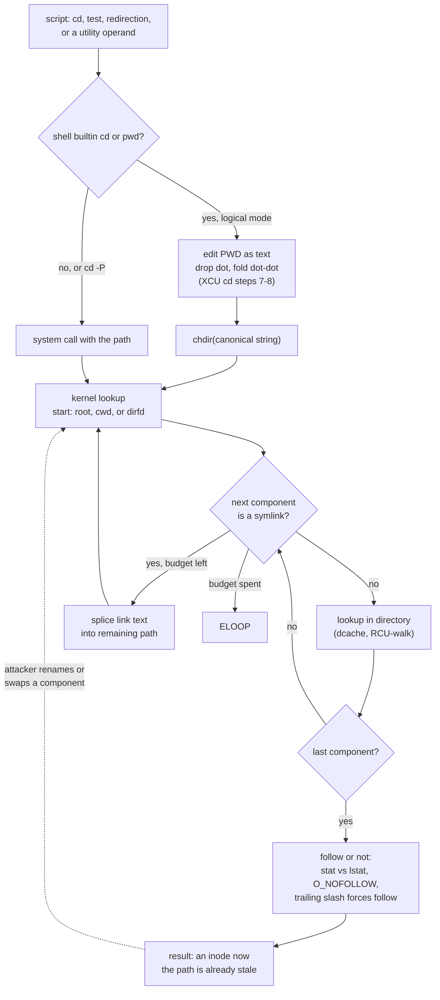

# Path Resolution and Symlink Races

> [!summary] Claim
> A pathname is not a reference to a file but a program the kernel re-executes on every call, one directory lookup per component with symbolic links spliced in as they are met, so any check a script makes on a path says nothing about what the next call on the same path will reach, and the only sound defenses are to resolve once into a descriptor, to refuse links during the walk, or to work only in directories no one else can write.

Part of [Files, Filesystems, and Permissions](README.md) in [Shell and Unix Engineering](../README.md).

## TL;DR

- Mechanism: the kernel walks a pathname component by component from the root or the current directory, splices the contents of each symbolic link it meets into the remaining path, and stops after a fixed budget of links per lookup (40 on Linux, 32 on macOS and FreeBSD), while the shell's `cd` and `pwd` keep a separate, purely textual "logical" path in `PWD`.
- Rule: never check a path and then use it (`[ -f "$p" ] && cat "$p"`, `[ ! -h "$p" ] && echo > "$p"`); create with `O_EXCL` semantics (`set -C`, `mktemp`), publish with `rename`, refuse links with `O_NOFOLLOW` or `openat2(RESOLVE_NO_SYMLINKS)`, and keep scratch work in a private `mktemp -d` directory.
- Trap: `O_NOFOLLOW`, `test -h`, `lstat`, and `rm` act only on the last component, so a symbolic link in any earlier directory component is still followed, and a trailing slash (`link/`) makes even those follow the last one.
- Portability fact: `cd l/../x` succeeds in bash (outside POSIX mode) and zsh by silently falling back to the physical path when the logical one does not exist, and fails in dash, ksh93, mksh, yash, and BusyBox ash, as POSIX.1-2024 XCU `cd` step 10 implies.
- When not to use the shell: once a script must operate safely inside a directory tree that an untrusted user can write (a shared `/tmp`, a container volume, an upload area), it needs descriptor-relative system calls (`openat`, `openat2`, `fstatat`, `unlinkat`) that no shell exposes; write that step in C, Go, Rust, or Python.

## Mental model



A command in a script reaches the filesystem by one of two routes.
The builtin `cd` (and `pwd`) in logical mode first rewrites the operand as a string against the shell's `PWD`, folding `..` textually, and only then calls `chdir`; every other route hands the raw path to a system call.
In the kernel, lookup starts at the process root for an absolute path, at the current directory for a relative one, or at a directory descriptor for the `*at` calls.
For each component the kernel asks whether it is a symbolic link: if not, it looks the name up in the directory it has reached; if so, it splices the link's text in front of whatever remains and keeps walking, charging one unit of a fixed per-lookup budget, and returns `ELOOP` once the budget is gone.
The last component is special: whether it is followed depends on the call (`stat` versus `lstat`, `open` with or without `O_NOFOLLOW`), except that a trailing slash always forces it.
The dotted arrow is the whole security problem: the inode the walk produced is correct only at the instant of the walk, and anyone who can write a directory on the path can make the next walk of the same string end somewhere else.

## How it works

### The specification: XBD 4.16

POSIX defines resolution once, in XBD 4.16 Pathname Resolution, and every interface inherits it (POSIX.1-2024 XBD 4.16).
Each filename is located in the directory specified by its predecessor; a leading `/` makes the predecessor the process root, and otherwise it is the current working directory "or for certain interfaces the directory identified by a file descriptor passed to the interface", which is the hook for `openat` and friends.
A component longer than `{NAME_MAX}` is an error.
When a symbolic link is met, resolution stops on the link itself only if all three hold: it is the last component, there is no trailing slash, and the function acts on links (as `lstat`, `unlink`, `rename`, and `readlink` do).
In every other case the system "shall prefix the remaining pathname, if any, with the contents of the symbolic link", and a relative result is resolved from "the directory containing the symbolic link", not from the caller's current directory.
Two edge cases are pinned down: an empty link either fails with `ENOENT` or stands for the link's own directory, and a link whose contents are only slashes keeps its own leading slashes and drops those of the remainder.
If the combined string exceeds `{PATH_MAX}` the implementation may fail with `ENAMETOOLONG`.
Loops fail with `ELOOP`, and an implementation may also fail once "more symbolic links were followed than the implementation allows", a limit that "shall not be smaller than {SYMLOOP_MAX}", whose minimum `{_POSIX_SYMLOOP_MAX}` is 8 (POSIX.1-2024 XBD `<limits.h>`).
Dot names the predecessor, dot-dot its parent, and at the root dot-dot may name the root itself.
A null pathname never resolves, and a path that begins with exactly two slashes may have its first component "interpreted in an implementation-defined manner", while three or more collapse to one.

The trailing-slash rule is stricter than intuition: a path with a non-slash character and a trailing slash "shall not be resolved successfully unless the last pathname component before the trailing <slash> characters resolves (with symbolic links followed) to an existing directory" or to a directory about to be created.
So `link/` always means the target of `link`, never the link, and a footnote names `rename()` and `renameat()` as the only interfaces that add further constraints (POSIX.1-2024 XBD 4.16, footnote 1).

The last paragraph of 4.16 is the formal root of every race in this note: resolution of a given pathname "shall yield the same results when used by any interface ... as long as there are no changes to any files evaluated during pathname resolution for the given pathname between resolutions".
Nothing promises that two calls on one string resolve alike if a directory or link on the way changed in between.

### What follows the last component

The rule is per call, and scripts mostly meet it through utilities and `test`.
`stat`, `open`, `chdir`, `test -f`, `test -d`, and `test -e` follow a final link; `lstat`, `test -h` and `test -L` ("If the final component of pathname is a symbolic link, that symbolic link is not followed"), `unlink`, `rm`, `rename`, and `readlink` act on the link itself (POSIX.1-2024 XCU `test`).
Creation is where scripts get hurt.
`open` with `O_CREAT` but without `O_EXCL` follows a final link, and if the link dangles it creates the file the link names, wherever that is; this is the classic `/tmp` attack, and the lab's `dangling` mode shows `printf data > dang` creating `victim` beside it.
With `O_CREAT | O_EXCL`, "if path names a symbolic link, open() shall fail and set errno to [EEXIST], regardless of the contents of the symbolic link" (POSIX.1-2024 XSH `open`), which is why `mktemp` and `set -C` are safe and plain `>` is not (see [[mktemp]]).
`O_NOFOLLOW` makes `open` fail with `ELOOP` if the path names a symbolic link (XSH `open`), and the rationale says why it exists: to avoid "substituting a symbolic link to a sensitive file (e.g., a device) while a privileged application is running".
FreeBSD deliberately returns `EMLINK` instead, "to distinguish it from the case of too many symbolic link traversals" (FreeBSD `open.2`, STANDARDS), while Linux and macOS return `ELOOP` (Linux `open(2)`; XNU `open.2`; measured on macOS by the lab's C probe).
`rename` never follows either name's final link: "if newpath refers to a symbolic link, the link will be overwritten" (Linux `rename(2)`), which is what makes write-then-rename safe against a planted link.

### The kernel walk on Linux

Linux implements 4.16 in `fs/namei.c`, and Neil Brown's `Documentation/filesystems/path-lookup.rst` is the maintainer's guide to it.
`link_path_walk()` consumes every component but the last; `walk_component()` looks each up, first in RCU-walk mode without taking references or locks and falling back to REF-walk when the dentry cache cannot answer locklessly (path-lookup.rst).
When `step_into()` meets a symbolic link it calls `pick_link()`, which calls `reserve_stack()`, and that function holds the whole limit in one line: `if (unlikely(nd->total_link_count++ >= MAXSYMLINKS)) return -ELOOP;` (Linux `fs/namei.c`, `reserve_stack`), with `#define MAXSYMLINKS 40` in `include/linux/namei.h`.
The counter lives in the per-lookup `nameidata`, so the 40 links are shared by every component of one lookup, not counted per component: the lab shows this when a single `pre -> .` link in a directory component makes a chain of exactly the limit fail with `ELOOP`.
path-lookup.rst records the history: there used to be "a further limit of eight on the maximum depth of recursion", raised to 40 when a separate stack was implemented; `nameidata` embeds room for two pending link remainders and allocates a 40-entry stack only when a lookup nests deeper.
It also quotes Linus Torvalds on why a limit exists even without loops: "it's a latency and DoS issue too ... it's about users triggering unreasonable CPU resources."
The final component is handled outside `link_path_walk()` by `open_last_lookups()` or `lookup_last()`, which hand a trailing link back to the loop "as many as 40 times if the last component of each symlink is another symlink" (path-lookup.rst).

Three kernel policies hook into `pick_link()`.
`may_follow_link()` runs only when the `WALK_TRAILING` flag is set, that is, for the last component, and implements `fs.protected_symlinks`: in a sticky world-writable directory a link is followed only if the follower's filesystem UID owns the link or the directory's owner owns the link, and otherwise the call fails with `EACCES` (Linux `fs/namei.c`, `may_follow_link`; `proc_sys_fs(5)`).
`LOOKUP_NO_SYMLINKS` (set by `openat2`'s `RESOLVE_NO_SYMLINKS`) and a mount flagged `MNT_NOSYMFOLLOW` (`mount -o nosymfollow`, `MS_NOSYMFOLLOW` since Linux 5.10 per `mount(2)`) both make `pick_link()` return `ELOOP` for any link anywhere in the path.
`LOOKUP_BENEATH` (from `RESOLVE_BENEATH`) makes `follow_dotdot()` and absolute jumps return `EXDEV` instead of leaving the starting directory.

### macOS, FreeBSD, and the other limits

XNU and FreeBSD both define `MAXSYMLINKS` as 32 in `sys/param.h` (XNU `bsd/sys/param.h`; FreeBSD `sys/sys/param.h`), and the lab's `chain` mode measures 32 on macOS 27.3: `f32` opens, `f33` fails with "Too many levels of symbolic links".
`PATH_MAX` is 4096 bytes including the terminating null on Linux (`include/uapi/linux/limits.h`) and 1024 on macOS (`bsd/sys/syslimits.h`); both use `NAME_MAX` 255.
The XNU header warns that "Many filesystems (including HFS & APFS) may support names longer than `NAME_MAX` bytes", so these are interface limits, not on-disk ones.

### The shell's second resolver: logical PWD

POSIX gives `cd` an algorithm of its own that runs before the kernel sees anything (POSIX.1-2024 XCU `cd`, DESCRIPTION steps 1 to 10).
Step 7 prefixes a relative operand with `PWD` unless `-P` is in effect.
Step 8 canonicalizes that string: it deletes dot components, and for each dot-dot deletes it together with the preceding component, after checking only that the preceding component "refer[s] (in the context of pathname resolution with symbolic links followed) to a directory".
Step 9 may shorten an over-long result to a relative path, and step 10 calls `chdir` and, in logical mode, sets `PWD` to the canonical string; under `-P` it sets `PWD` to what `pwd -P` would print.
Logical is the default: "If neither -L nor -P is specified, the operand shall be handled dot-dot logically" (XCU `cd`, OPTIONS).
So after `cd l` where `l -> a/b`, `pwd` prints `.../l` and `pwd -P` prints `.../a/b`; `cd ..` returns to the directory holding `l`, while `cd -P l/..` lands in `a` (lab mode `logical`).
`pwd -L` prints `PWD` only if it is an absolute path to the current directory with no dot or dot-dot components, and otherwise behaves as `-P`; `pwd -P` must print a path with no symbolic link components (POSIX.1-2024 XCU `pwd`).
POSIX.1-2024 added `cd -e`: with `-P`, exit 1 if the directory changed but `PWD` could not be determined (XCU `cd`, OPTIONS).

The two resolvers disagree whenever a link is followed by `..`, and the shells disagree about what to do when the logical string names nothing.
bash's `change_to_directory()` canonicalizes with `sh_canonpath(t, PATH_CHECKDOTDOT|PATH_CHECKEXISTS)`, which returns null as soon as the folded prefix is not an existing directory (bash-5.3 `lib/sh/pathcanon.c`, `sh_canonpath`).
In POSIX mode that null fails `cd` at once; otherwise bash marks the canonicalization as failed and calls `chdir` on the unfolded absolute string (`$PWD/l/../x`), which the kernel resolves physically (bash-5.3 `builtins/cd.def`, `change_to_directory`).
A second fallback, "Try what the user passed verbatim", runs only when `chdir` on a successfully canonicalized string fails (same function).
The bash manual lists the POSIX-mode difference: "`cd` will fail instead of falling back to physical mode" (bash-5.3 `doc/bashref.texi`, Bash POSIX Mode).
zsh does the same in `cd_try_chdir()`: "We try the full path first. If that fails, try the argument to cd relatively" (zsh `Src/builtin.c`, `cd_try_chdir`), and it does so in `--emulate sh` too (measured).
dash's `docd()` canonicalizes with `updatepwd()`, a purely textual fold of dot and dot-dot, and calls `chdir` once with no retry (dash `src/cd.c`, `docd`, `updatepwd`); BusyBox ash inherited the same `docd()` (BusyBox `shell/ash.c`, `docd`).
mksh simplifies the path with `simplify_path()` and calls `chdir` only on the simplified string, once per `CDPATH` candidate, never on the operand as typed (mksh `misc.c`, `c_cd`), and yash fails in step 8 itself when `canonicalize_path()` returns null (yash `path.c`, `change_directory`).
The lab's `fallback` mode builds `a/b`, `a/x`, and `l -> a/b`, then runs `cd l/../x`: the logical string is `./x`, which does not exist, while the kernel's `l/../x` is `a/x`, which does.
Run once in the shell-matrix images (Debian 13 and Alpine 3.22, 2026-11-15), it printed `/a/x` under bash and zsh and `FAIL` under dash, ksh93u+m 1.0.10, mksh, posh, yash, and BusyBox ash, with `followed=40` and `via-fd=pinned` in every shell.

Each shell also offers a switch to make `cd` physical by default.
bash has `set -o physical` (alias `set -P`): "Bash does not resolve symbolic links when executing commands such as `cd`" (bash-5.3 `bashref.texi`, The Set Builtin).
zsh has `CHASE_LINKS`, which resolves links to their true values on every `cd`, and `CHASE_DOTS`, which goes physical only when the operand contains `..` (zsh `Doc/Zsh/options.yo`).
mksh tests `Flag(FPHYSICAL)` in `c_cd` (mksh `misc.c`), set by `set -o physical`.
dash, ksh93 (both ksh93u+ 2012 and ksh93u+m 1.0.10), yash, posh, and BusyBox ash reject `set -o physical` and `set -P` (measured in the shell matrix and on macOS), so `cd -P` on each call is their only physical mode.

### Utilities that resolve: realpath, readlink, and traversal

POSIX.1-2024 is the first edition with `realpath` and `readlink` utilities, both "First released in Issue 8" (XCU `realpath`, `readlink`).
`readlink FILE` prints the raw contents of a link and fails if `FILE` is not one; the `-f` option of many implementations was left out "as the realpath utility provides equivalent functionality with a choice of behaviors" (XCU `readlink`, RATIONALE).
`realpath -e` requires the final component to exist; `realpath -E` tolerates `ENOENT` on it; with no option the canonicalization is "in an unspecified manner" (XCU `realpath`).
GNU `realpath` defaults to `CAN_ALL_BUT_LAST`, the `-E` behavior, accepts `-E` itself only since coreutils 9.8 ("realpath now supports -E, which specifies the default behavior", coreutils NEWS; Debian 13's 9.7 rejects it, measured), and adds `-m` (nothing need exist) and `-s` or `-L` for no link resolution (coreutils `src/realpath.c`, `main`); uutils defaults to `MissingHandling::Normal`, which "allows the final component to not exist" (uutils `realpath.rs`).
BusyBox `realpath` calls `xmalloc_realpath_coreutils()`, which emulates GNU when the last component is missing, but joins a relative link target to the caller's current directory rather than the link's directory (BusyBox `libbb/xreadlink.c`; the lab asserts the resulting path).
macOS 27.3's `/bin/realpath` accepts only `-q`, rejects `-e` and `-E`, and fails on a missing final component (measured).
For traversal, POSIX forbids `rm -R` from following links ("shall not traverse directories by following symbolic links into other parts of the hierarchy, but shall remove the links themselves", XCU `rm`), and gives `chown -R`, `chgrp -R`, and `find` the `-H` (follow command-line links), `-L` (follow all), and `-P` (follow none) options, with `find` physical by default (XCU `chown`, `find`).

### The race: time of check to time of use

A script that tests a path and then uses it makes two independent resolutions, and 4.16 guarantees them nothing in common.
The Linux `access(2)` page puts it bluntly: using `access()` to check before `open()` "creates a security hole, because the user might exploit the short time interval between checking and opening the file to manipulate it."
The attacker needs only write permission on some directory the victim's path passes through, and two primitives: `symlink`, and `rename` (or Linux's atomic `renameat2(RENAME_EXCHANGE)`, available since Linux 3.15 per `rename(2)`) to swap a link and a directory in one step.
The shell is especially exposed because it cannot hold a reference to a file across commands: every `[ ... ]`, every redirection, and every utility operand starts a fresh walk from the string.
The lab's `toctou` mode replays the window deterministically: the check `[ ! -h out ]` passes, a link `out -> protected` appears, and `printf clobbered > out` writes through it.
The descriptor-based fix moves the decision into the call that acts (`O_NOFOLLOW`, `O_EXCL`, `rename`) or pins a directory once and resolves relative to it (`openat`).
The XSH rationale states the purpose of `openat()` in exactly these terms: "Any part of the path of a file could be changed in parallel to a call to open() ... By opening a file descriptor for the target directory and using the openat() function it can be guaranteed that the opened file is located relative to the desired directory" (POSIX.1-2024 XSH `open`, RATIONALE).

### Resolution under control: openat2, O_RESOLVE_BENEATH, O_NOFOLLOW_ANY

Linux 5.6 added `openat2()` with a `resolve` field (`openat2(2)`):
`RESOLVE_NO_SYMLINKS` rejects a link in any component (unlike `O_NOFOLLOW`, which "affects the handling of symbolic links only in the final component");
`RESOLVE_BENEATH` fails with `EXDEV` if any component, absolute link, or dot-dot would leave the `dirfd` tree;
`RESOLVE_IN_ROOT` treats `dirfd` as a per-call `chroot`, so absolute links resolve inside it;
`RESOLVE_NO_MAGICLINKS` refuses `/proc/PID/fd/*`-style magic links;
`RESOLVE_NO_XDEV` refuses mount crossings; and `RESOLVE_CACHED` (Linux 5.12) fails with `EAGAIN` unless the dentry cache can answer.
`RESOLVE_BENEATH` and `RESOLVE_IN_ROOT` may fail with `EAGAIN` when the kernel "could not ensure that a '..' component didn't escape (due to a race condition or potential attack)", and the caller may retry.
The man page records that `RESOLVE_BENEATH` was modeled on FreeBSD's `O_BENEATH` "but avoided a well-known correctness bug", and that FreeBSD 13 replaced it with `O_RESOLVE_BENEATH`, now functionally equivalent; FreeBSD returns `ENOTCAPABLE` for an escape (FreeBSD `open.2`).
macOS has `O_NOFOLLOW_ANY` ("do not follow symlinks in the entire path", `ELOOP`) and `O_RESOLVE_BENEATH` (`ENOTCAPABLE`), plus `O_UNIQUE`, which refuses a file with more than one hard link (XNU `bsd/man/man2/open.2`, `bsd/sys/fcntl.h`).
Where none of these exist, the portable equivalent is the lab's `rprobe walk`: open the trusted directory, then `openat(fd, component, O_DIRECTORY | O_NOFOLLOW)` for each component, refusing `..` and absolute paths, so no link anywhere in the path is followed and nothing a writer does to the path after a step can redirect the earlier steps.

### Descriptors as anchors, and magic links

A shell can open a directory with `exec 3<dir`, and on Linux `/dev/fd/3` is a link into `/proc/self/fd/3`, a magic link that resolves to the open directory itself, so `/dev/fd/3/f` keeps working after the directory is renamed; macOS implements `/dev/fd` with a device filesystem and the same path fails with "Not a directory" (lab mode `pin`, measured on macOS; see [[dev-fd-and-dev-stdin]]).
The Linux `symlink(7)` page explains why magic links are dangerous as well as useful: they do not follow the normal link rules and can reach objects outside the caller's view, which is why `openat2` has `RESOLVE_NO_MAGICLINKS`.
CVE-2024-21626 is the canonical failure: a file descriptor leaked into `runc exec` let a container process start with "a working directory in the host filesystem namespace" (NVD).

## Numbers and limits

| Quantity | Value | Source |
|---|---|---|
| `{_POSIX_SYMLOOP_MAX}`, the minimum any system may set for `{SYMLOOP_MAX}` | 8 | POSIX.1-2024 XBD `<limits.h>` |
| Links followed per lookup, Linux | 40 (`MAXSYMLINKS`), shared by all components | `include/linux/namei.h`, `fs/namei.c` `reserve_stack` (as of 2026-11) |
| Links followed per lookup, macOS 27.3 and FreeBSD | 32 (`MAXSYMLINKS`) | XNU and FreeBSD `sys/param.h`; 32 measured on macOS by the lab |
| Former Linux recursion-depth limit | 8, raised to 40 with a separate stack | path-lookup.rst |
| Pending link remainders embedded in Linux `nameidata` | 2, then a 40-entry stack is allocated | path-lookup.rst |
| `PATH_MAX`, Linux | 4096 bytes including the null | `include/uapi/linux/limits.h` |
| `PATH_MAX`, macOS | 1024 bytes | XNU `bsd/sys/syslimits.h` |
| `{_POSIX_PATH_MAX}` / `{_XOPEN_PATH_MAX}` | 256 / 1024 | POSIX.1-2024 XBD `<limits.h>` |
| `NAME_MAX`, Linux and macOS | 255 | same headers |
| `{_POSIX_NAME_MAX}` / `{_XOPEN_NAME_MAX}` | 14 / 255 | POSIX.1-2024 XBD `<limits.h>` |
| `{_POSIX_SYMLINK_MAX}`, bytes in a link | 255 | POSIX.1-2024 XBD `<limits.h>` |
| `open`+`close` through 0, 1, 8, 16, 32 links (12-component absolute path, best of 5 x 200000) | 11.4, 11.9, 15.1, 18.3, 25.3 microseconds, so about 0.43 microseconds per extra link | measured here, macOS 27.3, Apple M3 Pro, 2026-11-15 |
| Docker `docker cp` read exploit success (CVE-2018-15664) | under 1% per attempt; 2 of 336 attempts in 10 s | Aleksa Sarai, oss-security 2019-05-28 |
| Rust `remove_dir_all` exploit (CVE-2022-21658) | "reliably ... within a couple of seconds" | Rust Security Response WG, 2022-01-20 |
| Linux kernel versions | `protected_symlinks` and `protected_hardlinks` 3.6; `RENAME_EXCHANGE` 3.15; `protected_regular` 4.19; `openat2` 5.6; `MS_NOSYMFOLLOW` 5.10; `RESOLVE_CACHED` 5.12 | `proc_sys_fs(5)`, `rename(2)`, `openat2(2)`, `mount(2)` |
| `fs.protected_symlinks` default | 0 in the kernel; systemd ships `fs.protected_symlinks = 1` | `proc_sys_fs(5)`; systemd `sysctl.d/50-default.conf` |

The timing row is a single machine's best case with every dentry cached; the base cost is dominated by the 12 components of a deep absolute path, and an uncached lookup that touches disk or the network costs orders of magnitude more.
The win from a race is not about the window's width: Sarai's read exploit needed hundreds of tries and still ran in seconds.

## Portability

Shell `cd` and `pwd` behavior.
"Lab" means the lab asserts the cell and the integrator's matrix runs it; "measured" means it ran here on macOS 27.3; "Linux" means the lab's probe ran once in the Debian 13 and Alpine 3.22 shell-matrix images on 2026-11-15; "source" names the function read.

| Shell | `pwd` after `cd l` (`l -> a/b`) | `cd ..` from there | `cd l/../x`, `x` only under `a` | Physical-by-default switch |
|---|---|---|---|---|
| POSIX sh (XCU `cd`) | `.../l` (logical is the default) | directory holding `l` | fails (step 8 folds `l/..` textually, step 10 `chdir` finds nothing) | none required |
| bash 3.2 (macOS `/bin/bash`) | `.../l` (measured) | holding dir (measured) | succeeds, `a/x` (measured) | `set -o physical` (bash manual) |
| bash 3.2 as macOS `/bin/sh`, or any bash in POSIX mode | `.../l` (measured: bash 5.3.15 as `sh`) | holding dir | fails (measured: bash 3.2.57 as `/bin/sh` and with `-o posix`; bash manual, POSIX mode) | `set -o physical` |
| bash 5.3 | `.../l` (measured; Linux) | holding dir (measured; Linux) | succeeds, `a/x` (measured; Linux; `cd.def` `change_to_directory`) | `set -o physical`, `set -P` |
| zsh 5.9 native | `.../l` (measured; Linux) | holding dir (measured; Linux) | succeeds (measured; Linux; `cd_try_chdir`) | `setopt CHASE_LINKS`, `CHASE_DOTS` (options.yo) |
| zsh `--emulate sh` | `.../l` (measured) | holding dir (measured) | succeeds (measured) | same options |
| dash | `.../l` (measured; Linux) | holding dir (measured; Linux) | fails (measured; Linux; `docd` has no retry) | `cd -P` only (`set -o physical` rejected, Linux) |
| ksh93u+ 2012 (macOS) | `.../l` (measured) | holding dir (measured) | fails (measured) | `cd -P` only (`set -o physical` rejected, measured) |
| ksh93u+m 1.0.10 | `.../l` (Linux) | holding dir (Linux) | fails (Linux; lab) | `cd -P` only (`set -o physical` rejected, Linux) |
| mksh | `.../l` (Linux) | holding dir (Linux) | fails (source: `c_cd`; Linux; lab) | `set -o physical` (`Flag(FPHYSICAL)` in `c_cd`; Linux) |
| yash | `.../l` (Linux) | holding dir (Linux) | fails (source: `change_directory` step 8; Linux; lab) | `cd -P` only (`set -o physical` rejected, Linux) |
| posh | `.../l` (Linux) | holding dir (Linux) | fails (Linux; lab) | `cd -P` only (`set -o physical` rejected, Linux) |
| BusyBox ash | `.../l` (Linux) | holding dir (Linux) | fails (source: `docd`; Linux; lab) | `cd -P` only (`set -o physical` rejected, Linux) |

Kernel and utility behavior.

| Behavior | Linux | macOS 27.3 | FreeBSD | Source |
|---|---|---|---|---|
| Links per lookup | 40 (Linux images) | 32 (measured) | 32 | `namei.h`; `sys/param.h` |
| `O_NOFOLLOW` on a final link | `ELOOP` | `ELOOP` (measured) | `EMLINK` | `open(2)`; XNU `open.2`; FreeBSD `open.2` |
| No links in any component | `openat2` `RESOLVE_NO_SYMLINKS`; `nosymfollow` mount | `O_NOFOLLOW_ANY` | none: `open.2` lists only `O_NOFOLLOW` (last component) and `O_RESOLVE_BENEATH` (as of 2026-11) | `openat2(2)`; XNU and FreeBSD `open.2` |
| Stay beneath a directory | `RESOLVE_BENEATH` (`EXDEV`) | `O_RESOLVE_BENEATH` (`ENOTCAPABLE`) | `O_RESOLVE_BENEATH` (`ENOTCAPABLE`), FreeBSD 13+ | same |
| `/dev/fd/N/name` through a directory descriptor | works (magic link; Linux images) | fails, "Not a directory" (measured) | only if `fdescfs` is mounted with `linrdlnk` or `rdlnk`; by default entries are character devices (source: FreeBSD `fdescfs(4)`; not run) | lab `pin` |
| Kernel follow restriction in sticky dirs | `fs.protected_symlinks` | none found | none found | `proc_sys_fs(5)` |

| Utility behavior | GNU coreutils 9.12 | macOS 27.3 | BusyBox | uutils |
|---|---|---|---|---|
| `realpath` on a missing final component | prints the path (`CAN_ALL_BUT_LAST`) | fails (measured) | prints the path (`xmalloc_realpath_coreutils`) | prints the path (`MissingHandling::Normal`; source) |
| `realpath sub/link`, `link -> nofile` | `.../sub/nofile` (lab; Debian 9.7) | fails (measured) | `$PWD/nofile`, the wrong directory (source; lab; Alpine and Debian BusyBox 1.37.0) | `.../sub/nofile` (source: `canonicalize` pops the link name and pushes the target onto the link's directory; the lab arm is not run, since uutils is in neither matrix image) |
| `realpath -e`, `-E` (POSIX.1-2024) | both since 9.8 (coreutils NEWS); 9.7 rejects `-E` (Debian 13, measured) | neither: "illegal option" (measured) | neither: treated as file operands (source: `realpath_main` parses no options; Linux) | both (source) |
| `readlink -f` | yes | yes (measured) | yes if built with `FEATURE_READLINK_FOLLOW` (source; enabled in both images, where it also prints `$PWD/nofile`) | yes, the same `canonicalize` as `realpath` with physical resolution (source: uutils `readlink.rs`; not run) |
| `dd oflag=nofollow` | yes: "Too many levels of symbolic links" (measured, `gdd` 9.12 and Debian 9.7) | "unknown open flag nofollow" (measured) | "invalid argument 'nofollow' to 'oflag'" (Linux, 1.37.0) | Linux and Android only, where it sets `O_NOFOLLOW`; elsewhere rejected as unimplemented (source: uutils `dd` `parseargs.rs`, `dd.rs`; not run) |
| `mv file linktodir` | moves into the directory (lab) | moves into the directory (measured) | lab | lab |
| Replace the link instead | `mv -T` (measured) | `mv -h` (measured) | none: `mv -T` refuses with "'dl' is a directory" (Alpine, 1.37.0) | `-T` is accepted and disables target-directory handling (source: uutils `mv.rs`; not run) |

## Worked example

The [lab](../labs/10-path-resolution-and-symlink-races/) has a POSIX `sh` probe with nine modes, a C probe for the system-call view, and a bats suite of 12 tests.
This is a verbatim excerpt of `resolve-probe.sh`, the `fallback` and `toctou` arms:

```sh
  fallback)
    mkdir -p a/b a/x || exit 2
    ln -s a/b l || exit 2
    if cd l/../x 2>/dev/null; then
      here=$(pwd -P) || exit 2
      rel "$here"
    else
      echo FAIL
    fi
    ;;
```

```sh
  toctou)
    # Unsafe: check, then use. The attacker's swap is simulated inside the window, so the
    # outcome is deterministic; a real attacker loops until the scheduler gives the same order.
    printf 'original\n' >protected || exit 2
    if [ ! -h out ]; then
      ln -s protected out || exit 2 # attacker: plant the link after the check
      printf 'clobbered\n' >out || exit 2
    fi
    unsafe=$(cat protected)
    # Safer: write a private file, then rename it over the name; rename replaces the link itself.
    printf 'original\n' >protected || exit 2
    priv=$(mktemp -d "$base/w.XXXXXX") || exit 2
    printf 'fresh\n' >"$priv/new" || exit 2
    mv -f "$priv/new" out || exit 2
    safe=$(cat protected) || exit 2
    islink=$(yn -h out)
    now=$(cat out) || exit 2
    printf 'unsafe: protected=%s\nrename: protected=%s out-is-link=%s out=%s\n' \
      "$unsafe" "$safe" "$islink" "$now"
    ;;
```

Output captured on macOS 27.3 with dash, each mode in a fresh `mktemp -d` directory (`fallback` repeated under bash 5.3 and zsh 5.9):

```text
$ sh resolve-probe.sh logical DIR
pwd=/l pwd-P=/a/b cd-..=/ cd-P-l/..=/a
$ sh resolve-probe.sh fallback DIR
FAIL
$ sh resolve-probe.sh relative DIR
readlink=target cat=sub
$ sh resolve-probe.sh chain DIR
followed=32
$ sh resolve-probe.sh slash DIR
h(l)=y h(l/)=n d(l/)=y h(dang)=y e(dang)=n
$ sh resolve-probe.sh dangling DIR
victim=data dang-still-link=y
$ sh resolve-probe.sh toctou DIR
unsafe: protected=clobbered
rename: protected=original out-is-link=n out=fresh
$ sh resolve-probe.sh mvdir DIR
dl-is-link=y realdir=newfile
$ sh resolve-probe.sh pin DIR
old-exists=n via-fd=FAIL
/opt/homebrew/bin/bash fallback: /a/x
zsh fallback: /a/x
```

On Linux the lab asserts `followed=40` and `via-fd=pinned`.
The C probe's `walk` mode is the descriptor-relative fix in miniature; with `root/esc -> ../outside` and `root/d/f` present it prints:

```text
$ rprobe walk root d/f
inside
$ rprobe walk root esc/f
refused esc: symbolic link
$ rprobe walk root d/../../x
refused ..: dot-dot
```

The bats suite ran once here under bash 5.3.15 as `sh`, bash 3.2.57, bash 5.3.20, dash, zsh 5.9.2, `zsh --emulate sh`, and ksh93u+ 2012: 84 of 84 tests passed.
The first run failed one test in a way worth keeping: the C probe opened `$BATS_TEST_TMPDIR/f32`, and on macOS that directory sits under `/var`, itself a link to `private/var`, so the absolute path spent one of the 32 links before reaching the chain and `f32` failed with `ELOOP`; the test now uses the physical path and asserts the shared budget on purpose.

## Pitfalls

> [!warning] Check-then-use on a path
> Trigger: `[ -f "$f" ] && cat "$f"`, `[ ! -h "$f" ] && echo x > "$f"`, `[ -w "$f" ]` before writing, or any `access()`-style precheck in a directory another user can write.
> Symptom: the check passes and the use acts on a different file, often one the attacker cannot write but the victim can; the lab's `toctou` mode overwrites `protected`.
> Fix: drop the precheck and make the acting call carry the condition: `set -C` or `mktemp` for exclusive creation, write-then-`mv` for replacement, `O_NOFOLLOW` (GNU `dd oflag=nofollow`) for opening, or move the work into a private `mktemp -d` directory.
> Incident: Rust's `std::fs::remove_dir_all` "first checked whether the thing it was about to delete was a symlink" and then recursed, and attackers won the race "within a couple of seconds" (CVE-2022-21658, fixed in Rust 1.58.1).

> [!warning] O_NOFOLLOW and test -h protect only the last component
> Trigger: a script checks `[ ! -h "$dir/$name" ]` or a program opens `"$dir/$name"` with `O_NOFOLLOW`, while `$dir` itself passes through a writable directory.
> Symptom: an attacker replaces an earlier directory component with a link and the open lands outside the intended tree; the lab shows `rprobe nofollow pre/f0` succeeding through `pre -> .`.
> Fix: walk from a trusted directory descriptor with `openat(O_NOFOLLOW | O_DIRECTORY)` per component, or use `openat2(RESOLVE_NO_SYMLINKS | RESOLVE_BENEATH)`, macOS `O_NOFOLLOW_ANY`, or FreeBSD `O_RESOLVE_BENEATH`.
> Incident: Docker's `FollowSymlinkInScope` resolved a container path safely and then used the string later, so a `RENAME_EXCHANGE` loop between a directory and a link to `/` gave `docker cp` root read and write access to the host (CVE-2018-15664; Sarai, oss-security 2019-05-28).

> [!warning] Writing through a dangling link
> Trigger: `echo data > /tmp/app.log` (or any `>` without `set -C`) in a sticky world-writable directory where another user pre-created `app.log -> /home/victim/.bashrc` or a link to a name that does not exist yet.
> Symptom: the write creates or truncates the link's target with the victim's privileges; the lab's `dangling` mode creates `victim`.
> Fix: never write fixed names in shared directories; create with `mktemp`, or `set -C` so `>` uses `O_EXCL`, which fails with `EEXIST` on any link; on Linux, keep `fs.protected_symlinks = 1` (systemd's default) as a second line, knowing it applies only in sticky world-writable directories and only to the last component.

> [!warning] A trailing slash re-enables following
> Trigger: `rm -rf "$dir/"`, `[ -h "$p/" ]`, `chown -R user "$link/"`, or `cp -R "$link/" dest`, where the operand came from user input or a glob ending in `/`.
> Symptom: the tool acts on the link's target rather than the link; `test -h l/` is false and `test -d l/` true in the lab's `slash` mode, as XBD 4.16 requires.
> Fix: strip trailing slashes from operands that might be links (`p=${p%/}` while `p` is not `/`), and use `chown -h`, `chown -R -P`, `find -P`, and `cp -P` when the link itself is meant.

> [!warning] mv onto a link to a directory
> Trigger: the write-then-rename pattern `mv -f "$tmp" "$dest"` where an attacker made `$dest` a link to a directory.
> Symptom: `mv` sees an existing directory and moves the file into it instead of replacing `$dest`; the lab's `mvdir` mode puts `newfile` inside `realdir`.
> Fix: do the rename in a directory only you can write, or use GNU `mv -T` or macOS `mv -h`, which replace the link instead of moving into its target (both measured here: GNU coreutils 9.12 and macOS 27.3); `rename(2)` itself never follows `newpath`.

> [!warning] Logical cd lies about where you are
> Trigger: `cd "$link/.."` or `cd ..` after entering a link, then a relative path that only exists physically, or a mix of `cd` (logical) and a utility such as `ls ..` (physical).
> Symptom: `cd` and the kernel disagree about the parent; in bash and zsh a failed logical `cd` silently succeeds physically, so the script ends up somewhere it did not intend, while dash, ksh93, mksh, yash, and BusyBox fail.
> Fix: use `cd -P` (and `pwd -P`) in scripts, or `set -o physical` in bash, so the shell and every utility agree.

> [!warning] The `..` race in recursive deletion
> Trigger: a recursive tool that descends with `chdir(subdir)` and climbs back with `chdir("..")`, run by root over a tree a user can rearrange.
> Symptom: the user moves the directory being deleted higher in the tree mid-walk, so `..` names a directory above the intended root and the tool keeps deleting there.
> Fix: descriptor-relative traversal (`openat` and `unlinkat` from a held directory descriptor, as modern `fts` does) and never a path or `..` walk; in scripts, rely on `rm -rf` from a current coreutils rather than hand-written `cd`-and-delete loops (see [[Safe-rm-and-Destructive-Operations]]).
> Incident: GNU fileutils 4.1 and earlier, where moving "a low-level directory to a higher level as it is being deleted ... causes fileutils to chdir to a '..' directory that is higher than expected, possibly up to the root file system" (CVE-2002-0435).

> [!warning] Container mount targets swapped mid-setup
> Trigger: a privileged runtime resolves a mount destination inside a directory an untrusted container also writes.
> Symptom: "runc can be tricked into mounting outside of the container rootfs by swapping the target of a mount with a symlink" (runc GHSA-c3xm-pvg7-gh7r).
> Fix: resolve and mount by descriptor (the advisory points at `libpathrs`), and treat any path under an attacker-writable directory as untrusted until opened.
> Incident: CVE-2021-30465, runc before 1.0.0-rc95.

## Security and robustness

Map every path the script touches to the set of users who can write each directory along it; if that set is larger than the users the script trusts, every check-then-use on that path is a vulnerability, not a style issue (see [[Shell-Threat-Model]]).
The defenses form a ladder, cheapest first.
First, do not operate in shared directories at all: put scratch state under a private `mktemp -d` directory created with mode 0700, so the only writer on the path is you.
Second, make each acting call atomic with its condition: `set -C` or `mktemp` to create, `mv` within one directory to publish (see [[Atomic-Rename-and-fsync]]), `ln -s` to create a link (it fails if the name exists), `rm` to remove a link rather than its target.
Third, refuse links where the shell cannot: `dd oflag=nofollow` on GNU systems, `chown -h`, `find -P`, and options that make traversal physical.
Fourth, hand the step to a language with descriptor-relative calls: `openat`, `fstatat(AT_SYMLINK_NOFOLLOW)`, `unlinkat`, `openat2` with `RESOLVE_BENEATH | RESOLVE_NO_SYMLINKS` on Linux, `O_RESOLVE_BENEATH` on FreeBSD and macOS, and `fstat` on the opened descriptor to verify device, inode, owner, and type after the open rather than before it.
Fifth, rely on kernel policy as depth, not as the plan: `fs.protected_symlinks` and `fs.protected_regular` stop the classic sticky-directory attacks but do nothing for a privileged process walking a user-writable directory that is not sticky and world-writable, and `nosymfollow` mounts break legitimate links.
A privileged script should also drop privilege before touching user-controlled paths when it can, because `protected_symlinks` deliberately lets a link's owner follow it: if root impersonates the user, the user's own links can only reach what the user could reach.
Validate path strings only for what string checks can establish (no NUL, no leading `-`, a fixed prefix after canonicalization), and remember that canonicalizing with `realpath` and then using the result is itself a check-then-use.

## The principal's view

The decision is where the trust boundary for filesystem names sits.
If every directory on every path the system touches is writable only by the identity running it, path races cannot happen and plain shell is fine; the cost of enforcing that is a private working directory per job and a rule that privileged automation never reads or writes under a user-controlled tree.
If the system must act inside directories that other principals write (multi-tenant hosts, container volumes, build caches, upload directories, `/tmp` on shared machines), then string-based shell is the wrong tool for that step, and the decision is which descriptor-based library to standardize on: Linux `openat2`, `libpathrs` in the container world, or the `*at` family with explicit `O_NOFOLLOW` walking for portability to macOS and the BSDs.
The trade-off is portability and simplicity against provable safety: `openat2` is Linux-only, macOS spells the same ideas `O_NOFOLLOW_ANY` and `O_RESOLVE_BENEATH`, and a component-by-component walk is portable but slower and easy to get subtly wrong (it must refuse `..`, re-check type with `fstat`, and handle mount points).
Kernel hardening (`protected_symlinks`, `protected_regular`, `nosymfollow`) belongs in the fleet baseline, but a staff-plus engineer does not let a design depend on it, because it covers only sticky world-writable directories and only the last component.
On the shell side, the review rule for a codebase is short: `cd -P` and `pwd -P` in scripts, no fixed names in shared directories, no precheck before an action that can carry the condition itself, and a flagged review for any root-run script that touches a path containing a user-writable component.

## Interview questions

> [!question] L5: What does POSIX say happens when a symbolic link is the last component of a path, and which calls act on the link itself?
>
> > [!success]- Answer
> > The link is followed unless all three hold: it is the last component, there is no trailing slash, and the function acts on links itself (POSIX.1-2024 XBD 4.16).
> > `lstat`, `unlink`, `rename`, `readlink`, `rm`, and `test -h` act on the link; `stat`, `open`, `chdir`, `test -e`, and `test -f` follow it.
> > A trailing slash forces following, so `test -h link/` is false for a link to a directory.
> >
> > Follow-up: What does `open` with `O_CREAT` do on a dangling link, and how does adding `O_EXCL` change that?

> [!question] L5: Predict the output, run in an empty directory under dash: `mkdir -p a/b; ln -s a/b l; cd l; pwd; cd ..; pwd; cd -P l/..; pwd`
>
> > [!success]- Answer
> > It prints `DIR/l`, then `DIR`, then `DIR/a` (with `DIR` the starting directory).
> > `cd` is logical by default, so `PWD` keeps the link name and `cd ..` deletes the last component of that string (POSIX.1-2024 XCU `cd`, step 8).
> > `cd -P` skips the textual fold, so the kernel resolves `l` to `a/b` before applying `..`, landing in `a`.
> > The lab's `logical` mode prints exactly `pwd=/l pwd-P=/a/b cd-..=/ cd-P-l/..=/a`.
> >
> > Follow-up: What does `pwd -P` print in the middle step, and why?

> [!question] L6: `cd l/../x` works in bash and fails in dash on the same tree; why, and which behavior does POSIX require?
>
> > [!success]- Answer
> > Both canonicalize the operand against `PWD` textually, so `l/../x` becomes `./x`, which does not exist when `x` lives under the link's target.
> > bash's `change_to_directory()` sees `sh_canonpath()` fail the existence check and, when not in POSIX mode, calls `chdir` on the unfolded string `$PWD/l/../x` instead, while zsh's `cd_try_chdir()` retries the operand as typed; either way the kernel resolves `l` first and finds `a/x`.
> > dash, ksh93, mksh, yash, and BusyBox call `chdir` once on the canonical string and fail, which is what XCU `cd` steps 8 to 10 describe; bash in POSIX mode also fails.
> >
> > Follow-up: How would you make a script's `cd` behavior identical across all of them?

> [!question] L6: Debug this script, run by root from cron: `if [ ! -e /tmp/report.txt ]; then generate > /tmp/report.txt; chmod 644 /tmp/report.txt; fi`
>
> > [!success]- Answer
> > Between the `-e` check and the redirection any local user can create `/tmp/report.txt -> /etc/shadow` or a link to a name that does not yet exist, and root's `>` follows it, truncating or creating the target.
> > `chmod` then follows the link too, so the attacker can make a protected file world-readable.
> > On Linux with `fs.protected_symlinks = 1` the redirection fails with `EACCES` because the link sits in a sticky world-writable directory and is owned by someone else, but the design is still wrong.
> > Fix: `dir=$(mktemp -d) || exit`, generate into `"$dir/report.txt"`, and if a fixed public name is required, publish from a root-owned directory with a rename.
> >
> > Follow-up: Why does `set -C` close the creation race but not the `chmod` one?

> [!question] L6: How many symbolic links will Linux follow while resolving one path, and what counts against the limit?
>
> > [!success]- Answer
> > 40 (`MAXSYMLINKS` in `include/linux/namei.h`), checked in `reserve_stack()` against `nd->total_link_count`, a counter for the whole lookup.
> > Links in directory components and the final component share it, so a path with one linked directory component can follow only 39 more; the lab shows a chain of exactly the limit failing behind `pre -> .`.
> > macOS and FreeBSD use 32, and POSIX only requires at least `{_POSIX_SYMLOOP_MAX}`, 8.
> >
> > Follow-up: Why does Linux bound non-looping chains at all, rather than detecting real cycles?

> [!question] L6: Why is `realpath` followed by an open of the result not a safe way to confine access to a directory?
>
> > [!success]- Answer
> > `realpath` resolves the path once and returns a string; the later open resolves that string again, and anyone who can write a directory on it can swap in a link between the two.
> > The canonical string being inside the allowed tree proves only that it was inside at the time of the check.
> > Safe confinement resolves and opens in one call: `openat2(dirfd, path, RESOLVE_BENEATH)` on Linux, `O_RESOLVE_BENEATH` on FreeBSD and macOS, or a per-component `openat(O_NOFOLLOW)` walk.
> >
> > Follow-up: What extra flag would you add to keep `/proc/self/fd` magic links from escaping?

> [!question] L7+: Design the file-handling layer for a privileged agent that extracts user-supplied archives into per-tenant directories on a shared host.
>
> > [!success]- Answer
> > Treat every tenant directory as attacker-writable and never resolve a tenant path as a string with privilege.
> > Open the tenant root once as a directory descriptor, then create every entry with `openat2(RESOLVE_IN_ROOT | RESOLVE_NO_MAGICLINKS)` or `RESOLVE_BENEATH | RESOLVE_NO_SYMLINKS`, `mkdirat`, and `O_EXCL | O_NOFOLLOW`, rejecting absolute names and `..` before the call as a fast path, not as the defense.
> > Do the extraction with the tenant's identity (or in a user namespace) so that the kernel's own permission checks bound the damage if a bug remains.
> > Add `fs.protected_symlinks` and `fs.protected_regular` and per-tenant mounts with `nosymfollow` where links are not needed, and test with a concurrent `RENAME_EXCHANGE` loop, the technique used against Docker in CVE-2018-15664.
> >
> > Follow-up: What breaks on macOS and how would you degrade the design there?

> [!question] L7+: A postmortem says "we added a check that the target is not a symlink before deleting it"; is that a fix?
>
> > [!success]- Answer
> > No: a separate check is the bug pattern itself, as Rust's `remove_dir_all` showed (CVE-2022-21658), because the attacker swaps a directory for a link after the check.
> > The fix must make the destructive call refuse links: open each directory with `O_NOFOLLOW | O_DIRECTORY` relative to its parent descriptor, enumerate and `unlinkat` within that descriptor, and verify with `fstat` on the descriptor, not with `lstat` on the path.
> > The same reasoning killed the chdir-and-`..` design of GNU fileutils (CVE-2002-0435).
> >
> > Follow-up: Which platforms lacked the APIs to fix this, according to the Rust advisory?

> [!question] L5: In a script, when does `mv -f new dest` replace a symbolic link at `dest`, and when does it not?
>
> > [!success]- Answer
> > If `dest` is a link to a regular file (or dangles), `mv` renames over it and the link is replaced, because `rename(2)` never follows `newpath`.
> > If `dest` is a link to a directory, `mv` treats `dest` as an existing directory and moves `new` into it, as the lab's `mvdir` mode shows.
> > Publish only into a directory you control, or use GNU `mv -T` or macOS `mv -h`, which replace the link itself.
> >
> > Follow-up: Why is a trailing slash on `dest` worse still?

## Related

Prerequisites: [[File-Locking-Semantics]], [[Inodes-and-Links]]

Next: [[Temporary-File-Attacks]]

See also: [[mktemp]], [[Atomic-Rename-and-fsync]], [[Atomic-Writes]], [[cp-mv-and-Rename-Semantics]], [[Safe-rm-and-Destructive-Operations]], [[find-Expressions]], [[Mounts-and-Mount-Namespaces]], [[dev-fd-and-dev-stdin]], [[The-proc-Filesystem]], [[Close-on-Exec-and-Descriptor-Inheritance]], [[Bash-POSIX-Mode]], [[Shell-Threat-Model]], [[setuid-and-Interpreted-Scripts]], [[Permissions-umask-and-Special-Bits]]

## Further reading

- [POSIX.1-2024 XBD 4.16 Pathname Resolution](https://pubs.opengroup.org/onlinepubs/9799919799/basedefs/V1_chap04.html): the normative algorithm, including trailing slashes, empty links, and the no-changes caveat.
- [POSIX.1-2024 XCU cd](https://pubs.opengroup.org/onlinepubs/9799919799/utilities/cd.html): the ten-step logical `cd` algorithm every shell implements or deviates from.
- [POSIX.1-2024 XSH open](https://pubs.opengroup.org/onlinepubs/9799919799/functions/open.html): `O_NOFOLLOW`, `O_EXCL` on links, and the rationale for `openat`.
- [POSIX.1-2024 XCU realpath](https://pubs.opengroup.org/onlinepubs/9799919799/utilities/realpath.html): the new utility and its `-e` and `-E` semantics with worked examples.
- [Linux path-lookup.rst](https://raw.githubusercontent.com/torvalds/linux/master/Documentation/filesystems/path-lookup.rst): Neil Brown's walk through RCU-walk, REF-walk, and symlink handling in `fs/namei.c`.
- [openat2(2)](https://man7.org/linux/man-pages/man2/openat2.2.html): every `RESOLVE_*` flag and its failure modes.
- [path_resolution(7)](https://man7.org/linux/man-pages/man7/path_resolution.7.html) and [symlink(7)](https://man7.org/linux/man-pages/man7/symlink.7.html): Linux's own statement of the rules and of magic links.
- [Linux sysctl fs.rst](https://raw.githubusercontent.com/torvalds/linux/master/Documentation/admin-guide/sysctl/fs.rst): `protected_symlinks`, `protected_hardlinks`, `protected_regular`, and why they exist.
- [Aleksa Sarai on CVE-2018-15664](https://seclists.org/oss-sec/2019/q2/131): a complete symlink-exchange exploit write-up with success rates.
- [Rust advisory for CVE-2022-21658](https://blog.rust-lang.org/2022/01/20/cve-2022-21658/): a modern standard library falling to check-then-use, and the descriptor-based fix.
- [runc GHSA-c3xm-pvg7-gh7r](https://github.com/opencontainers/runc/security/advisories/GHSA-c3xm-pvg7-gh7r): the mount-target swap (CVE-2021-30465) and the case for `libpathrs`.
