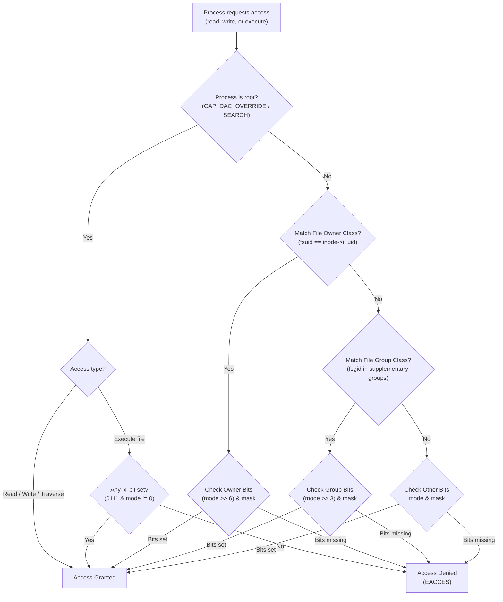

# Permissions, umask, and Special Bits

> [!summary] Claim
> Unix filesystem security rests on twelve mode bits evaluated in strict class order (owner before group before other), modified at inode creation by the process file mode creation mask (`mode & ~umask`), and augmented by three special bits whose execution privilege, group inheritance, and deletion restrictions are enforced directly by the kernel VFS.

Part of [Files, Filesystems, and Permissions](README.md) in [Shell and Unix Engineering](../README.md).

## TL;DR

- Mechanism: Inode mode bits comprise 3 special bits (`setuid`, `setgid`, `sticky`) and 9 permission bits (`rwx` for owner, group, other); access is evaluated by matching the calling process identity against exactly one class (`POSIX.1-2024 XBD 4.7`), while creation permissions are masked by `mode & ~umask` (`POSIX.1-2024 XSH umask`).
- Rule: Always set an explicit `umask` (such as `0027` or `0077`) in automated scripts and services before creating files, stage sensitive files using `mktemp` (`0600`) or explicit subshell masks, and write `chmod a+x` instead of `chmod +x` when cross-user execution is intended.
- Trap: The negative permissions trap: matching the file owner UID locks the caller into the owner class, so an owner with `0000` is denied access even if group or other bits grant `rwx`.
- Portability: Bare `umask` prints four octal digits (`0022`) in bash, dash, ksh93, yash, and BusyBox ash, but three digits (`022`) in zsh (native and `--emulate sh`), mksh, and posh (measured in the shell matrix); `umask -p` is a bash extension (including macOS `/bin/sh`) and is rejected by dash, ksh93, zsh, mksh, yash, posh, and BusyBox; on Linux a `setgid` directory passes its group to new entries and its `g+s` bit to new subdirectories, while macOS (like BSD) gives new entries the parent directory's group whether or not `setgid` is set and does not copy `g+s` to new subdirectories (measured on macOS APFS).
- When not to use it: Discretionary access control (DAC) bits cannot express multi-user collaboration beyond a single primary group; when distinct users or services need fine-grained read and write rights, use POSIX Access Control Lists (see [[ACLs-and-Extended-Attributes]]).

## Mental model



When a process requests file access, the kernel evaluates identity in strict hierarchical stages.
Superuser processes bypass standard checks: read, write, and directory traversal succeed unconditionally, but executing a regular file requires that at least one execute bit (`0111`) is set anywhere in the mode.
For unprivileged processes, the kernel tests ownership first: if the process filesystem UID matches the inode UID, the owner bits alone determine the outcome, and group or other bits are never consulted.
If the UID does not match, the kernel checks whether the file GID matches the process effective GID or any supplementary group ID; if so, group bits alone determine access.
Only when neither owner nor group matches does the kernel evaluate the other bits, meaning higher permissions in a lower-priority class cannot compensate for missing bits in a matched class.

## How it works

### 1. Inode Mode Bit Architecture
Every Unix inode records a mode, reported as the `st_mode` field of type `mode_t` in `<sys/stat.h>` (`POSIX.1-2024 XBD sys_stat.h`); POSIX does not fix its width: macOS declares `mode_t` as `__uint16_t` (SDK `sys/_types.h`), while Linux userspace uses a 32-bit `unsigned int` over a 16-bit on-disk field in ext4.
The high 4 bits (`S_IFMT`, mask `0170000`) store the file type: regular file (`S_IFREG`, `0100000`), directory (`S_IFDIR`, `0040000`), symbolic link (`S_IFLNK`, `0120000`), block device (`S_IFBLK`, `0060000`), character device (`S_IFCHR`, `0020000`), FIFO (`S_IFIFO`, `0010000`), or socket (`S_IFSOCK`, `0140000`).
The low 12 bits (mask `07777`, named `S_IALLUGO` inside the Linux kernel's `include/linux/stat.h`, not by POSIX) govern discretionary access control and execution semantics.
These 12 bits divide into two distinct functional layers: 3 special bits (`07000`) and 9 permission bits (`0777`).

The 9 permission bits are partitioned into three octal triplets:
1. User / Owner (`S_IRWXU`, `0700`): read (`S_IRUSR`, `0400`), write (`S_IWUSR`, `0200`), and execute/search (`S_IXUSR`, `0100`).
2. Group (`S_IRWXG`, `0070`): read (`S_IRGRP`, `0040`), write (`S_IWGRP`, `0020`), and execute/search (`S_IXGRP`, `0010`).
3. Other (`S_IRWXO`, `0007`): read (`S_IROTH`, `0004`), write (`S_IWOTH`, `0002`), and execute/search (`S_IXOTH`, `0001`).

### 2. The File Access Permission Algorithm
Access enforcement does not compute a bitwise union across categories.
Instead, POSIX mandates a single-class matching rule (`POSIX.1-2024 XBD 4.7 File Access Permissions`):
- A process belongs to the **File Owner Class** if its effective user ID matches the user ID of the file (`POSIX.1-2024 XBD 3.150`).
- A process belongs to the **File Group Class** if it is not in the owner class, and its effective group ID or any supplementary group ID matches the group ID of the file (`POSIX.1-2024 XBD 3.142`).
- A process belongs to the **File Other Class** if it belongs to neither the owner class nor the group class (`POSIX.1-2024 XBD 3.149`).

In the Linux kernel, this algorithm is implemented in `generic_permission()` and `acl_permission_check()` within `fs/namei.c`:
First, a fast-path bitmask check tests whether all three classes possess the requested rights:
`!((mask & 7) * 0111 & ~mode)`.
If so, and no POSIX ACL exists, access is granted immediately without UID lookups.
Otherwise, the kernel evaluates ownership:
```c
vfsuid = i_uid_into_vfsuid(idmap, inode);
if (likely(vfsuid_eq_kuid(vfsuid, current_fsuid()))) {
    mask &= 7;
    mode >>= 6;
    return (mask & ~mode) ? -EACCES : 0;
}
```
If the process filesystem UID matches `inode->i_uid`, the mode is shifted right by 6 bits, isolating the owner triplet.
If any requested bit is absent in `mode >> 6`, the function immediately returns `-EACCES`.
It never checks the group or other bits.
This architectural design produces the "negative permissions" behavior: an owner assigned `0070` (`---rwx---`) is denied access, while another user in the same group is granted access.

### 3. Directory Permission Semantics
Permission bits apply different semantics to directories than to regular files:
- Read (`r`, 4): Authorizes directory enumeration.
A process can invoke `getdents64(2)` or `readdir(3)` to read filenames.
Without execute (`x`), the process cannot invoke `stat(2)` or `open(2)` on any entry inside the directory.
`ls dir` will list entry names, but `ls -l dir` will display question marks for metadata and emit permission errors.
- Write (`w`, 2): Authorizes modifying the directory stream: creating, deleting, and renaming directory entries via `open(O_CREAT)`, `unlink(2)`, `mkdir(2)`, or `rename(2)`.
A process does not need write permission on a target file to delete it; write and search permission on the containing directory are sufficient.
- Execute / Search (`x`, 1): Authorizes pathname resolution and traversal.
A process can invoke `chdir(2)` or resolve paths passing through the directory (`open("dir/sub/file")`).
If a directory has execute without read (`--x`), a process can open files inside it if and only if it knows the exact filename in advance, but it cannot list the directory contents.

### 4. umask and File Creation Math
The file mode creation mask (`umask`) is a per-process attribute inherited across `fork(2)` and preserved across `execve(2)`.
In the Linux kernel, it is stored in `current->fs->umask` (`struct fs_struct`).
The `umask(2)` system call atomically swaps this mask using an atomic exchange (`kernel/sys.c`):
`mask = xchg(&current->fs->umask, mask & S_IRWXUGO);`.
Only the 9 permission bits (`S_IRWXUGO`, `0777`) participate in umask; special bits (`07000`) are ignored.

When a program creates an inode (`open(O_CREAT)`, `creat`, `mkdir`, `mkfifo`), it supplies a requested mode `mode`.
The VFS applies the mask:
`resulting_mode = requested_mode & ~umask`.
Standard tools specify conventional creation baselines:
- Shell redirections (`> file` or `>> file`) request `0666` (`S_IRUSR|S_IWUSR|S_IRGRP|S_IWGRP|S_IROTH|S_IWOTH`) by universal shell convention; `POSIX.1-2024 XCU 2.7.2` requires the creation but does not state the mode, and under `umask 000` bash, dash, ksh93, mksh, posh, zsh, and BusyBox ash all created mode `0666` (measured in the shell matrix).
Under standard umask `0022`, the resulting mode is `0666 & ~0022 = 0644` (`-rw-r--r--`).
Under secure umask `0077`, the mode is `0666 & ~0077 = 0600` (`-rw-------`).
Under group-private umask `0027`, the mode is `0666 & ~0027 = 0640` (`-rw-r-----`).
- Directory creation utilities (`mkdir`) request `0777` (`S_IRWXU|S_IRWXG|S_IRWXO`), per `(POSIX.1-2024 XCU mkdir)`.
Under umask `0022`, the resulting mode is `0777 & ~0022 = 0755` (`drwxr-xr-x`).
Under umask `0077`, the mode is `0700` (`drwx------`).
- The `mktemp` utility creates files by requesting `0600` and directories by requesting `0700`; `mktemp` is not a POSIX.1-2024 utility, but the functions it wraps are specified to do exactly this: `mkstemp()` opens with `S_IRUSR|S_IWUSR` and `mkdtemp()` calls `mkdir(pathname, S_IRWXU)` (`POSIX.1-2024 XSH mkdtemp`).
- Linkers (`ld`, invoked by `cc`) give executable output the full `0777` permission set filtered through the umask, yielding `0755` under `0022`.

When a directory possesses a POSIX default ACL, the Linux VFS helper `mode_strip_umask()` (in `include/linux/namei.h` as of 2026-11) does not apply `current_umask()`: on a filesystem that supports POSIX ACLs it defers umask stripping to `posix_acl_create()`.
That function lets the default ACL rules determine the new file mode and mask instead of `current->fs->umask`, and falls back to the umask when the parent has no default ACL.

### 5. Special Bits: Mechanism and Invariants
The low 12 bits include three high-order special bits (`07000`):

#### S_ISUID (04000, Set-User-ID)
When an executable binary with `S_ISUID` is executed via `execve(2)`, the kernel sets the process effective user ID (`euid`) to the file owner's UID (`POSIX.1-2024 XSH exec`).
Linux and macOS ignore `S_ISUID` and `S_ISGID` on interpreted scripts beginning with `#!`: on Linux, `fs/binfmt_script.c` swaps `bprm->file` for the interpreter and `bprm_creds_from_file()` in `fs/exec.c` computes the new credentials from that final file; on macOS, a `setgid` `#!` script kept the caller's effective GID while the same interpreter binary made `setgid` changed it (measured on the macOS host).
This eliminates the race condition where an attacker replaces the script between the kernel's initial pathname inspection and the interpreter's file open (see [[setuid-and-Interpreted-Scripts]]).
FreeBSD and OpenBSD behave the other way and honor set-id bits on `#!` scripts (as of 2026-11): OpenBSD `sys/kern/exec_script.c` saves the script's `VSUID`/`VSGID` bits in `script_sbits` and reapplies them to the interpreter exec, and FreeBSD `sys/kern/kern_exec.c` decides the credential change from the script's own attributes before any image activator runs.
To prevent privilege escalation via binary modification, the kernel automatically strips `S_ISUID` and `S_ISGID` from a regular file when a caller without `CAP_FSETID` writes to or truncates it (`setattr_should_drop_suidgid()` in `fs/attr.c`; `S_ISGID` is dropped only when `S_IXGRP` is also set or the writer is outside the file's group), and on Linux any `chown` clears both bits, even by root (a root `chown` turned `6755` into `0755`, measured in the shell matrix).

#### S_ISGID (02000, Set-Group-ID)
On executable files, `S_ISGID` sets the process effective group ID (`egid`) to the file GID upon execution.
On directories, `S_ISGID` activates BSD directory group inheritance:
1. Any new file created inside the directory inherits the group ownership (GID) of the directory, rather than the primary GID of the creating process.
2. Any new subdirectory created inside inherits both the directory GID and the `S_ISGID` bit itself on Linux filesystems (ext4, xfs, btrfs), enabling persistent shared collaboration spaces (a subdirectory of a `2775` directory came out `2755` under `umask 022`, measured in the shell matrix).
macOS follows BSD instead: new entries always take the parent directory's group, with or without `S_ISGID`, and a subdirectory of a `2775` directory came out `0755` (measured on macOS APFS).
If an unprivileged user invokes `chmod` to set `S_ISGID` on a regular file whose group does not match their effective GID or any supplementary group, POSIX mandates that `S_ISGID` is silently cleared (`POSIX.1-2024 XSH chmod`).
Historical mandatory file locking via `S_ISGID` without `S_IXGRP` (`02660`) was formally removed from the Linux kernel in version 5.15 (October 2021, [kernelnewbies Linux 5.15](https://kernelnewbies.org/Linux_5.15): "Remove support for mandatory file locking") and remains unsupported across modern kernels (as of 2026-11).

#### S_ISVTX (01000, Sticky Bit / Restricted Deletion Flag)
Historically (Unix V7), `S_ISVTX` directed the kernel to retain the program text segment in swap memory after process termination ("save text image").
On non-directory files, POSIX leaves `S_ISVTX` unspecified (`POSIX.1-2024 XBD 4.5`), and Linux ignores it.
On directories, `S_ISVTX` acts as the restricted deletion flag (`POSIX.1-2024 XBD 4.5 Directory Protection`).
POSIX additionally lets an implementation allow removal of files the process can write; Linux does not.
In a directory with `S_ISVTX` set (such as `/tmp` and `/var/tmp`, typically mode `1777`), an unprivileged process on Linux may unlink or rename a file if and only if:
1. The process filesystem UID matches the owner UID of the file, OR
2. The process filesystem UID matches the owner UID of the directory, OR
3. The process holds `CAP_FOWNER` capability in its user namespace.

In the Linux kernel (`fs/namei.c`, `__check_sticky()`), write permission on the directory is insufficient to delete another user's file:
```c
int __check_sticky(const struct mnt_idmap *idmap, struct inode *dir, struct inode *inode) {
    kuid_t fsuid = current_fsuid();
    if (vfsuid_eq_kuid(i_uid_into_vfsuid(idmap, inode), fsuid))
        return 0;
    if (vfsuid_eq_kuid(i_uid_into_vfsuid(idmap, dir), fsuid))
        return 0;
    return !capable_wrt_inode_uidgid(idmap, inode, CAP_FOWNER);
}
```
If `__check_sticky()` returns non-zero, `may_delete()` aborts with `-EPERM`.

### 6. Command Interfaces: chmod and umask
The `chmod` utility accepts octal modes (`chmod 0755 file`) or symbolic expressions (`chmod u=rwx,go=rx file`), parsed via `mode_compile()` and `mode_adjust()` in GNU coreutils (`lib/modechange.c`).
A critical POSIX rule governs symbolic modes when `who` is omitted (`POSIX.1-2024 XCU chmod`):
If `who` is omitted (for example, `chmod +x file`), the target permissions are filtered by the current process `umask`:
`bits_set = requested_bits & ~umask`.
Under `umask 0077`, running `chmod +x file` sets `u+x` only, leaving group and other execute bits cleared (`0744`).
Conversely, specifying explicit `who=a` (`chmod a+x file`) bypasses `umask` filtering and sets execute bits across user, group, and other (`0755`).
The symbolic operator `X` (capital X) applies execute permissions conditionally: it adds execute permission if and only if the target is a directory or already has at least one execute bit set for some class.

The `umask` utility is an intrinsic utility, so the shell runs its own built-in version without a `PATH` search (`POSIX.1-2024 XCU 1.7 Intrinsic Utilities`).
Executing `umask` in a subshell or external binary (`/bin/umask`) modifies only that child process without altering the parent shell environment.
Invoking `umask -S` outputs a portable symbolic representation of allowed permissions (`u=rwx,g=rx,o=rx`).

## Numbers and limits

| Property / Limit | Value | Scope / Standard | Source / Verification |
| :--- | :--- | :--- | :--- |
| File type bitmask (`S_IFMT`) | `0170000` (`0xF000`) | Inode `st_mode` bits 12-15 | `sys/stat.h` (`POSIX.1-2024 XBD sys_stat.h`) |
| Special bits mask (`S_ISUID\|S_ISGID\|S_ISVTX`) | `07000` (`0x0E00`) | Inode `st_mode` bits 9-11 | `sys/stat.h` (`POSIX.1-2024 XBD sys_stat.h`, which defines each bit) |
| Permission bits mask (`S_IRWXUGO`) | `0777` (`0x01FF`) | Inode `st_mode` bits 0-8 | `S_IRWXU\|S_IRWXG\|S_IRWXO` in `POSIX.1-2024 XBD sys_stat.h`; the `S_IRWXUGO` name is Linux kernel `include/linux/stat.h` |
| All permission and special bits (`S_IALLUGO`) | `07777` (`0x0FFF`) | Full DAC bitmask | Linux kernel `include/linux/stat.h` |
| `umask` active bitmask | Low 9 bits (`0777`) | Evaluated by `open`, `creat`, `mkdir` | Linux `kernel/sys.c` (`mask & S_IRWXUGO`) |
| Redirection default mode | `0666` (`rw-rw-rw-`) | Baseline before umask masking | Shell convention, measured under `umask 000` in the shell matrix; `POSIX.1-2024 XCU 2.7.2` does not state the mode |
| `mkdir` default mode | `0777` (`rwxrwxrwx`) | Baseline before umask masking | `POSIX.1-2024 XCU mkdir` |
| `mktemp` default file mode | `0600` (`rw-------`) | Target creation mode | `POSIX.1-2024 XSH mkstemp` (`S_IRUSR\|S_IWUSR`); `mktemp` itself is not a POSIX utility |
| `mktemp` default directory mode | `0700` (`rwx------`) | Target creation mode | `POSIX.1-2024 XSH mkdtemp` (`S_IRWXU`) |
| Resulting file under `umask 0022` | `0644` (`rw-r--r--`) | `0666 & ~0022` | Verified in lab test 1 |
| Resulting directory under `umask 0022` | `0755` (`rwxr-xr-x`) | `0777 & ~0022` | Verified in lab test 1 |
| Resulting file under `umask 0077` | `0600` (`rw-------`) | `0666 & ~0077` | Verified in lab test 1 |
| Resulting directory under `umask 0077` | `0700` (`rwx------`) | `0777 & ~0077` | Verified in lab test 1 |
| Resulting file under `umask 0027` | `0640` (`rw-r-----`) | `0666 & ~0027` | Verified in lab test 1 |
| Resulting directory under `umask 0027` | `0750` (`rwxr-x---`) | `0777 & ~0027` | Verified in lab test 1 |
| `fs.protected_symlinks` | `0` kernel default; `1` when enabled (usually by the distribution's sysctl defaults) | Linux kernel 3.6+ sysctl | Linux `Documentation/admin-guide/sysctl/fs.rst`; zero-initialized `sysctl_protected_symlinks` in `fs/namei.c` |
| `fs.protected_hardlinks` | `0` kernel default; `1` when enabled (usually by the distribution's sysctl defaults) | Linux kernel 3.6+ sysctl | Linux `Documentation/admin-guide/sysctl/fs.rst`; zero-initialized `sysctl_protected_hardlinks` in `fs/namei.c` |
| `fs.protected_regular` | `0` kernel default; `1`, or `2` to cover group-writable directories too | Linux kernel 4.19+ sysctl | Linux `Documentation/admin-guide/sysctl/fs.rst`; zero-initialized `sysctl_protected_regular` in `fs/namei.c` |
| `fs.protected_fifos` | `0` kernel default; `1`, or `2` to cover group-writable directories too | Linux kernel 4.19+ sysctl | Linux `Documentation/admin-guide/sysctl/fs.rst`; zero-initialized `sysctl_protected_fifos` in `fs/namei.c` |

## Portability

| Implementation / Platform | Bare `umask` Format | `umask -p` Supported | `umask -S` Supported | `chmod +x` Honors umask | Directory `setgid` Inherits to Subdirs | SUID on `#!` Scripts |
| :--- | :--- | :--- | :--- | :--- | :--- | :--- |
| POSIX.1-2024 specification | Unspecified; must be reusable as a `mask` operand (`XCU umask` STDOUT) | No (unspecified) | Yes (`u=%s,g=%s,o=%s`) | Yes (`who` omitted) | Implementation-defined | Implementation-defined |
| GNU bash 5.2.37 (Debian, Alpine) | `0022` (4 digits) | Yes (`umask 0022`) | Yes | Yes | Yes (on Linux) | Ignored by kernel |
| macOS bash 3.2.57 (`/bin/bash`, `/bin/sh`) | `0022` (4 digits) | Yes (`umask 0022`) | Yes | Yes | No: `g+s` not copied; group inherited regardless (APFS) | Ignored by kernel (measured with `setgid`) |
| zsh 5.9 (native) | `022` (3 digits) | No (bad option: `-p`) | Yes | Yes | Yes (on Linux) | Ignored by kernel |
| zsh (`--emulate sh`) | `022` (3 digits) | No (bad option: `-p`) | Yes | Yes | Yes (on Linux) | Ignored by kernel |
| dash 0.5.12 | `0022` (4 digits) | No (Illegal option `-p`) | Yes | Yes | Yes (on Linux) | Ignored by kernel |
| ksh93u+m 1.0.10 (also macOS ksh93u+ 2012) | `0022` (4 digits) | No (`-p`: unknown option) | Yes | Yes | Yes (on Linux) | Ignored by kernel |
| mksh R59 | `022` (3 digits) | No (`-p`: unknown option) | Yes | Yes | Yes (on Linux) | Ignored by kernel |
| yash 2.58.1 | `0022` (4 digits) | No (`-p` is not a valid option) | Yes | Yes | Yes (on Linux) | Ignored by kernel |
| posh 0.14.1 | `022` (3 digits) | No (invalid option `-p`) | Yes | Yes | Yes (on Linux) | Ignored by kernel |
| BusyBox 1.37.0 ash | `0022` (4 digits) | No (illegal option `-p`) | Yes | Yes | Yes (on Linux) | Ignored by kernel |
| GNU coreutils `chmod` | N/A | N/A | N/A | Yes | N/A | N/A |
| BSD / macOS `chmod` | N/A | N/A | N/A | Yes | N/A | N/A |

## Worked example

The test suite in [lab](../labs/10-permissions-umask-and-special-bits/) verifies permission bit mechanics, umask masking, directory access rules, kernel special-bit enforcement, and shell differences.
Below is the test script `permprobe.sh`:

```sh
#!/usr/bin/env sh
# permprobe.sh - probe permission bits, umask calculation, and special bits.

set -eu

PROBE_DIR="${TMPDIR:-/tmp}/permprobe.$$"
mkdir -p "$PROBE_DIR"

cleanup() {
  rm -rf "$PROBE_DIR"
}
trap cleanup EXIT INT TERM

# Ensure getmode helper is compiled and available
GETMODE_BIN="${GETMODE_BIN:-$PROBE_DIR/getmode}"
if [ ! -x "$GETMODE_BIN" ]; then
  SRC_DIR="$(cd "$(dirname "$0")" && pwd)"
  if [ -f "$SRC_DIR/getmode.c" ]; then
    "${CC:-cc}" -O2 -o "$GETMODE_BIN" "$SRC_DIR/getmode.c"
  else
    printf "getmode.c not found\n" >&2
    exit 1
  fi
fi

file_mode() {
  "$GETMODE_BIN" "$1"
}

cmd="${1:-}"

case "$cmd" in
  umask-calc)
    sub="$PROBE_DIR/ucalc"
    mkdir -p "$sub"

    (
      umask 0022
      : >"$sub/f_022"
      mkdir "$sub/d_022"
    )
    (
      umask 0077
      : >"$sub/f_077"
      mkdir "$sub/d_077"
    )
    (
      umask 0027
      : >"$sub/f_027"
      mkdir "$sub/d_027"
    )

    m_f022=$(file_mode "$sub/f_022")
    m_d022=$(file_mode "$sub/d_022")
    m_f077=$(file_mode "$sub/f_077")
    m_d077=$(file_mode "$sub/d_077")
    m_f027=$(file_mode "$sub/f_027")
    m_d027=$(file_mode "$sub/d_027")

    printf "u022_file=%s u022_dir=%s u077_file=%s u077_dir=%s u027_file=%s u027_dir=%s\n" \
      "$m_f022" "$m_d022" "$m_f077" "$m_d077" "$m_f027" "$m_d027"
    ;;

  umask-format)
    # Print bare umask, symbolic umask, and test umask -p
    octal=$(umask)
    symbolic=$(umask -S)
    p_status=0
    # shellcheck disable=SC3045 # intentional extension probe across shells
    umask -p >/dev/null 2>&1 || p_status=$?

    printf "octal=%s symbolic=%s p_status=%d\n" "$octal" "$symbolic" "$p_status"
    ;;

  negative-perms)
    sub="$PROBE_DIR/neg"
    mkdir -p "$sub"
    file="$sub/neg.txt"

    printf "payload\n" >"$file"
    chmod 0077 "$file"

    rc_read=0
    cat "$file" >/dev/null 2>&1 || rc_read=$?

    rc_write=0
    # Use sh -c to prevent premature redirection failure in the probe script
    sh -c ': >> "$1"' _ "$file" >/dev/null 2>&1 || rc_write=$?

    # Normalise return codes to 1 on failure
    [ "$rc_read" -eq 0 ] || rc_read=1
    [ "$rc_write" -eq 0 ] || rc_write=1

    printf "owner_read_rc=%d owner_write_rc=%d\n" "$rc_read" "$rc_write"
    ;;

  dir-perms)
    sub="$PROBE_DIR/dp"
    mkdir -p "$sub"
    dir="$sub/target"
    mkdir -p "$dir"
    printf "secret\n" >"$dir/secret.txt"

    # Case A: r-- without x: can read directory names, cannot traverse to stat/read files
    chmod 0400 "$dir"
    rc_ro=0
    cat "$dir/secret.txt" >/dev/null 2>&1 || rc_ro=$?

    # Restore write/search to alter mode and test Case B
    chmod 0700 "$dir"
    # Case B: --x without r: cannot list names, but can open known path
    chmod 0100 "$dir"
    rc_xo=0
    cat "$dir/secret.txt" >/dev/null 2>&1 || rc_xo=$?

    # Restore permissions to test file deletion
    chmod 0700 "$dir"
    printf "unwritable\n" >"$dir/zero.txt"
    chmod 0000 "$dir/zero.txt"
    rc_rm=0
    rm -f "$dir/zero.txt" 2>/dev/null || rc_rm=$?

    [ "$rc_ro" -eq 0 ] || rc_ro=1
    [ "$rc_xo" -eq 0 ] || rc_xo=1
    [ "$rc_rm" -eq 0 ] || rc_rm=1

    printf "read_only_traversal_rc=%d exec_only_read_rc=%d rm_mode0_rc=%d\n" \
      "$rc_ro" "$rc_xo" "$rc_rm"
    ;;

  sticky-dir)
    sub="$PROBE_DIR/st"
    mkdir -p "$sub"
    dir="$sub/sticky"
    mkdir -p "$dir"
    chmod 1777 "$dir"

    m_dir=$(file_mode "$dir")

    # Directory owner creates a file inside and verifies deletion succeeds
    printf "content\n" >"$dir/owned.txt"
    rc_del=0
    rm -f "$dir/owned.txt" 2>/dev/null || rc_del=$?
    [ "$rc_del" -eq 0 ] || rc_del=1

    printf "sticky_mode=%s dir_owner_unlink_rc=%d\n" "$m_dir" "$rc_del"
    ;;

  suid-drop)
    sub="$PROBE_DIR/suid"
    mkdir -p "$sub"
    file="$sub/suid_bin"

    printf "echo suid\n" >"$file"
    chmod 4755 "$file"
    m_before=$(file_mode "$file")

    # Append to file as unprivileged user
    printf "append\n" >>"$file"
    m_after=$(file_mode "$file")

    printf "before=%s after=%s\n" "$m_before" "$m_after"
    ;;

  chmod-umask)
    sub="$PROBE_DIR/cmask"
    mkdir -p "$sub"
    f1="$sub/f1"
    f2="$sub/f2"

    : >"$f1"
    : >"$f2"
    chmod 0644 "$f1" "$f2"

    (
      umask 0077
      chmod +x "$f1"
      chmod a+x "$f2"
    )

    m1=$(file_mode "$f1")
    m2=$(file_mode "$f2")

    printf "no_who=%s explicit_who=%s\n" "$m1" "$m2"
    ;;

  chmod-capital-x)
    sub="$PROBE_DIR/cx"
    mkdir -p "$sub"
    d="$sub/dir"
    data="$sub/data.txt"
    bin="$sub/bin"

    mkdir -p "$d"
    : >"$data"
    : >"$bin"

    chmod 0700 "$d"
    chmod 0600 "$data"
    chmod 0700 "$bin"

    chmod a+rX "$d" "$data" "$bin"

    m_d=$(file_mode "$d")
    m_data=$(file_mode "$data")
    m_bin=$(file_mode "$bin")

    printf "dir=%s data=%s bin=%s\n" "$m_d" "$m_data" "$m_bin"
    ;;

  *)
    printf "unknown command: %s\n" "$cmd" >&2
    exit 1
    ;;
esac
```

Running the probe once under macOS `/bin/sh` (bash 3.2.57) with `umask 022` printed the output below; under Debian `sh` (dash 0.5.12) every line was identical except `p_status=2`, because dash rejects `umask -p`:

```console
$ ./permprobe.sh umask-calc
u022_file=0644 u022_dir=0755 u077_file=0600 u077_dir=0700 u027_file=0640 u027_dir=0750

$ ./permprobe.sh umask-format
octal=0022 symbolic=u=rwx,g=rx,o=rx p_status=0

$ ./permprobe.sh negative-perms
owner_read_rc=1 owner_write_rc=1

$ ./permprobe.sh dir-perms
read_only_traversal_rc=1 exec_only_read_rc=0 rm_mode0_rc=0

$ ./permprobe.sh sticky-dir
sticky_mode=1777 dir_owner_unlink_rc=0

$ ./permprobe.sh suid-drop
before=4755 after=0755

$ ./permprobe.sh chmod-umask
no_who=0744 explicit_who=0755

$ ./permprobe.sh chmod-capital-x
dir=0755 data=0644 bin=0755
```

The `sticky-dir` case only shows that mode `1777` is stored and that a directory owner can still unlink its own file; refusing another user's file needs a second UID, so that rule rests on the kernel source quoted above, not on a lab assertion.

## Pitfalls

> [!warning] The Negative Permissions Trap
> Trigger: Setting restrictive owner bits while leaving permissive group or other bits (such as `chmod 0070 file` or `chmod 0007 file` on a file you own).
> Symptom: The file owner receives `Permission denied` (`EACCES`), while another user belonging to the same group reads or modifies the file successfully.
> Fix: Recognize that Unix permission checking stops at the first matching class (`POSIX.1-2024 XBD 4.7`); never rely on group or other bits to grant access to an owner, and explicitly set owner bits to cover required operations.

> [!warning] Silent Execution Failure from chmod +x Under Restrictive umask
> Trigger: Running `chmod +x script.sh` in an environment configured with `umask 0027` or `umask 0077` (standard in hardened servers, CI pipelines, and cron jobs).
> Symptom: The script runs cleanly for the author during local testing, but fails with `Permission denied` when executed by a web server, service worker, or container runtime running as another group or user.
> Fix: Per `POSIX.1-2024 XCU chmod`, omitting `who` forces `chmod` to mask requested bits with the process `umask`; always write `chmod a+x script.sh` when broad execution permissions are required.

> [!warning] Deletion Vulnerability via Unprotected Containing Directory
> Trigger: Assuming that removing write permissions on a sensitive file (`chmod 0400 config.json`) prevents unprivileged users from deleting or replacing it.
> Symptom: An unprivileged attacker or rogue process deletes or overwrites `config.json` via `rm -f config.json` or atomic rename.
> Fix: Deletion and rename operations modify the directory inode, not the target file inode; secure the parent directory with restrictive write permissions (`chmod 0750` or `chmod 0700`) or set the sticky bit (`chmod +t dir`) if multiple users must write to the directory.

> [!warning] Process-Wide umask Corruption in Multithreaded Daemons
> Trigger: Calling `umask(new_mask)` inside a multi-threaded service (e.g. Go, Python `os.umask`, or Node.js native add-ons) before creating a private file, then restoring it.
> Symptom: A race condition occurs where concurrent worker threads open unrelated files or network sockets without the default mask, leaking world-writable or world-readable files, because the mask lives in the shared `fs_struct` (`kernel/sys.c`).
> Fix: Never mutate process-wide `umask` dynamically in threaded code; instead, pass explicit creation modes to system calls (`open(path, O_CREAT, 0600)`), create dedicated staging directories with mode `0700`, or invoke `fchmod(fd, 0600)` immediately after descriptor allocation.

> [!warning] Shared Directory TOCTOU Races and Insecure /tmp Creation
> Trigger: Creating predictable temporary files in world-writable sticky directories without `O_CREAT | O_EXCL` or relying solely on directory permissions.
> Symptom: Local attackers exploit symlink or FIFO races to truncate arbitrary files or redirect daemon writes (the attack class that `fs.protected_symlinks`, `fs.protected_regular`, and `fs.protected_fifos` exist to block, per Linux `Documentation/admin-guide/sysctl/fs.rst`).
> Fix: Use `mktemp` with randomized templates, verify that modern Linux kernel protections are active (`sysctl fs.protected_symlinks=1` and `fs.protected_regular=1` or `2`), or isolate temporary file creation in private mount namespaces or per-user runtime directories (`$XDG_RUNTIME_DIR`).

> [!warning] Silent Loss of SUID/SGID Privileges After File Modification
> Trigger: Updating, deploying, or editing a setuid or setgid binary in place via file append, in-place text editing, or any `chown` (on Linux even a root `chown` clears both bits).
> Symptom: The binary silently loses its `s` bit, reverting to normal user privileges (`-rwxr-xr-x`), causing subsequent authentication or daemon helpers to fail mysteriously.
> Fix: The kernel deliberately clears `S_ISUID` and `S_ISGID` on a write without `CAP_FSETID` (`setattr_should_drop_suidgid` in `fs/attr.c`) and on ownership changes; macOS also cleared `S_ISUID` and `S_ISGID` on an unprivileged append (measured on the macOS host); install new binaries via atomic replacement (`install -m 4755` or staging to a temporary file, setting mode, and `mv`).

## Security and robustness

Hardening Unix permissions requires applying defense-in-depth across the process, filesystem, and kernel layers:

1. Process-level baseline umask:
Every automation script, backup job, and system service should initialize an explicit umask at entry:
```sh
umask 0027
```
This guarantees that any file created by unexpected sub-commands or output redirections defaults to owner-read/write and group-read, completely denying access to other users.
For high-security processes managing secrets, keys, or tokens, enforce `umask 0077`.

2. Safe temporary file creation:
Never redirect output directly to predictable paths in `/tmp`.
Use `mktemp` or secure subshells:
```sh
# Secure atomic staging directory
WORK_DIR=$(mktemp -d "${TMPDIR:-/tmp}/service.XXXXXXXX")
trap 'rm -rf "$WORK_DIR"' EXIT INT TERM
```
If temporary files must be created via standard shell redirection, execute the redirection inside a subshell that enforces `umask 0077`:
```sh
( umask 0077 && printf '%s\n' "$TOKEN" > "$SECRET_FILE" )
```

3. Defense against shared directory attacks:
Verify that shared multi-user temporary directories enforce the sticky bit (`S_ISVTX`, mode `1777`):
```console
# Ensure sticky bit on /tmp and /var/tmp
chmod 1777 /tmp /var/tmp
```
Verify that Linux kernel VFS protections are active in sysctl:
```console
# Inspect active protections
sysctl fs.protected_symlinks fs.protected_hardlinks fs.protected_regular fs.protected_fifos
```
Setting `fs.protected_regular=2` and `fs.protected_fifos=2` disallows opening existing regular files or FIFOs in world-writable or group-writable sticky directories unless the caller owns the file.

4. Abandoning setuid scripts:
Never attempt to make shell scripts setuid.
Linux and macOS ignore `S_ISUID` on interpreted scripts (Linux `fs/exec.c` `bprm_creds_from_file()`; measured on macOS), but FreeBSD and OpenBSD honor it, so never rely on the kernel to protect you.
Where elevated privileges are required, use `sudo` with tightly scoped rules (`/etc/sudoers.d/`), write a minimal C binary wrapper that sanitizes the environment before dropping or elevating privileges, or execute tasks via dedicated systemd service units with capabilities (`AmbientCapabilities=`).

## The principal's view

At staff-plus scope, Unix permissions represent the lowest foundation of system isolation, but relying on raw mode bits for enterprise authorization is an architectural anti-pattern.
Standard 9-bit DAC cannot model multi-tenant collaboration, service meshes, or least-privilege administrative domains:
- DAC mode bits are static and tied to numeric POSIX UIDs/GIDs.
In modern containerized and distributed infrastructure, numeric UIDs collide across image layers and host namespaces unless user namespaces (`userns`) are configured.
- When an architecture requires granting write access to a CI agent, read access to a monitoring daemon, and read-only access to developers, 9-bit mode bits fail because a file belongs to exactly one group.
- The principal's rule: Use 9-bit permissions and `umask` defensively to enforce restrictive defaults (`0027`/`0077` and `0600`/`0700`), but elevate complex authorization to POSIX ACLs (see [[ACLs-and-Extended-Attributes]]), container mount namespaces, or role-based access control (RBAC) at the application or orchestration layer.
- Never write daemon software that modifies `umask` at runtime across worker threads; configure permissions explicitly on file descriptors via `openat(..., O_CREAT, mode)` or manage directories with `fchmodat`.

## Interview questions

> [!question] L5: What permissions does a file receive when created via `echo "data" > file.txt` if the shell umask is `0027`?
>
> > [!success]- Answer
> > Shell output redirection requests an initial creation mode of `0666` (`S_IRUSR|S_IWUSR|S_IRGRP|S_IWGRP|S_IROTH|S_IWOTH`) by universal shell convention; POSIX.1-2024 XCU 2.7.2 does not state the mode.
> > The kernel computes the resulting mode by clearing bits present in the umask via `mode & ~umask`.
> > Bitwise evaluation yields `0666 & ~0027 = 0666 & 0750 = 0640`.
> > The resulting file permissions are `-rw-r-----` (read and write for owner, read-only for group, and no permissions for other).
> >
> > Follow-up: What would the permissions be if the command were `mkdir newdir` under the same `0027` umask?

> [!question] L5: What is the difference between `chmod +x script.sh` and `chmod a+x script.sh`?
>
> > [!success]- Answer
> > POSIX specifies that when the `who` operand is omitted in a symbolic mode (such as `+x`), the requested permission bits are filtered through the process umask (`POSIX.1-2024 XCU chmod`).
> > If the active umask is `0077`, `chmod +x script.sh` sets the execute bit for the owner only (`0744`), leaving group and other execute bits cleared.
> > When `who` is explicitly provided as `a` (`chmod a+x script.sh`), the utility bypasses umask masking and sets the execute bit across all three classes (`0755`).
> >
> > Follow-up: Why do CI build scripts that run `chmod +x` often break when executed under non-default root umasks?

> [!question] L6: Predict the output: A file is owned by user `alice` and group `eng`. The file mode is `0070` (`---rwx---`). Alice is in group `eng`. What happens when Alice runs `cat file`?
>
> > [!success]- Answer
> > The `cat` command fails with `Permission denied` (`EACCES`).
> > POSIX file access permission checking evaluates classes hierarchically and stops at the first matching class (`POSIX.1-2024 XBD 4.7`).
> > Because Alice's filesystem UID matches the file's owner UID, the kernel places Alice in the File Owner Class.
> > The kernel consults only the owner bits (`---` or `0`), which deny read access.
> > The kernel never checks the group bits (`rwx`), even though Alice is a member of group `eng`.
> >
> > Follow-up: How would Alice's colleague `bob`, who is also in group `eng` but does not own the file, be evaluated?

> [!question] L6: Debug this script: A deployment script creates a shared team directory and relies on setgid to ensure all new files are team-writable:
> ```sh
> mkdir -p /var/shared/builds
> chown root:team /var/shared/builds
> chmod 2775 /var/shared/builds
> ```
> Why do files created inside `/var/shared/builds` by team members frequently end up with mode `0644` (unwritable by other team members)?
>
> > [!success]- Answer
> > Setting `setgid` on a directory (`2775`) propagates group ownership (GID) and, on Linux, sub-directory setgid bits, but it does NOT alter the creating process's umask.
> > Standard user sessions and build processes typically run with `umask 0022`.
> > When a user creates a new file, the kernel calculates mode as `0666 & ~0022 = 0644`.
> > Although the new file belongs to group `team`, the group write bit (`S_IWGRP`) is cleared by the user's `umask`.
> > To ensure shared group writability, the team must either configure a shared umask (`0002`) or set a POSIX default ACL on the directory (`setfacl -d -m g::rwx /var/shared/builds`).
> >
> > Follow-up: Why does POSIX default ACL inheritance take precedence over `umask`?

> [!question] L6: What is the restricted deletion flag (sticky bit) on directories, and under what exact conditions can a file inside a sticky directory be unlinked?
>
> > [!success]- Answer
> > The sticky bit (`S_ISVTX`, octal `01000`) on a writable directory restricts the ability to delete or rename files inside it (`POSIX.1-2024 XBD 4.5 Directory Protection`).
> > Under standard Linux VFS semantics (`__check_sticky()` in `fs/namei.c`), an unprivileged process can unlink a file in a sticky directory only if its filesystem UID matches the file owner UID, or its filesystem UID matches the directory owner UID.
> > Privileged processes holding the `CAP_FOWNER` capability in the user namespace can also unlink any file.
> > Write permission on the file itself does not grant deletion rights on Linux.
> >
> > Follow-up: POSIX.1-2024 XBD 4.5 leaves deletion of process-writable files in a sticky directory implementation-defined; why does Linux refuse it?

> [!question] L7: Why is `umask(2)` dangerous in multithreaded applications (like Go or Node.js), and how does the Linux kernel store and synchronize umask across threads?
>
> > [!success]- Answer
> > In the Linux kernel, `umask` is stored in `struct fs_struct` (`current->fs->umask`), which is shared across all threads created with `CLONE_FS`.
> > The `umask(2)` system call modifies this field globally for the entire process using atomic exchange `xchg()`.
> > When a thread temporarily clears `umask` to create a private file, any concurrent thread calling `open(O_CREAT)` or `mkdir` during that window will create files with unintended lax permissions.
> > In Go and other multithreaded runtimes, `syscall.Umask()` is a recognized security hazard because goroutines execute concurrently across OS threads.
> > Modern applications should leave `umask` untouched and instead pass explicit permission modes to `openat(2)` or adjust permissions on the resulting file descriptor via `fchmod(2)`.
> >
> > Follow-up: How do Linux idmapped mounts interact with umask and group inheritance?

> [!question] L7: Explain why the Linux kernel automatically strips `S_ISUID` and `S_ISGID` when an unprivileged process writes to an executable file, and cite the kernel subsystem responsible.
>
> > [!success]- Answer
> > If the kernel retained `S_ISUID` on modified files, an unprivileged user with write access to a setuid binary could inject malicious code or append shellcode, retaining setuid execution as the binary's owner (often root).
> > The Linux VFS implements this protection in `fs/attr.c` within `setattr_should_drop_suidgid()`.
> > When `write(2)`, `truncate(2)`, or `fallocate(2)` modifies an inode, the VFS generates an attribute change request with flags `ATTR_KILL_SUID` and `ATTR_KILL_SGID`.
> > Unless the modifying process possesses `CAP_FSETID`, the VFS strips the `S_ISUID` and `S_ISGID` bits before executing the write.
> >
> > Follow-up: Under what conditions does the kernel retain `S_ISGID` when a file is written?

> [!question] L7: How does a directory with mode `0400` behave compared to one with mode `0100` during path resolution and file operations?
>
> > [!success]- Answer
> > A directory with mode `0400` (`r--------`) grants read permission but denies search/execute permission.
> > A process can read directory entry names via `getdents64(2)`, but any attempt to traverse the directory to stat, open, or chdir into entries fails with `EACCES`.
> > A directory with mode `0100` (`--x------`) grants search/execute permission but denies read permission.
> > A process cannot list entry names with `readdir(3)` (`ls` fails), but it can successfully open and read any file inside if the exact relative or absolute pathname is known (`cat dir/secret.txt` succeeds).
> >
> > Follow-up: Why does deleting a file in a directory require `wx` on the directory but zero permissions on the file itself?

## Related

Prerequisites: [[Inodes-and-Links]]

Next: [[ACLs-and-Extended-Attributes]]

See also: [[setuid-and-Interpreted-Scripts]], [[Atomic-Writes]], [[Path-Resolution-and-Symlink-Races]], [[File-Descriptors-and-Open-File-Descriptions]]

## Further reading

- [POSIX.1-2024 Base Definitions: Chapter 4 General Concepts (4.7 File Access Permissions)](https://pubs.opengroup.org/onlinepubs/9799919799/basedefs/V1_chap04.html): Defines standard three-class matching order and permission bit rules.
- [POSIX.1-2024 System Interfaces: umask()](https://pubs.opengroup.org/onlinepubs/9799919799/functions/umask.html): Specifies system call behavior, mask application, and defect fixes.
- [POSIX.1-2024 Commands and Utilities: chmod](https://pubs.opengroup.org/onlinepubs/9799919799/utilities/chmod.html): Documents symbolic mode syntax, umask masking when who is omitted, and the capital X operator.
- [Linux Kernel VFS Implementation: fs/namei.c](https://raw.githubusercontent.com/torvalds/linux/master/fs/namei.c): Contains source code for `generic_permission()`, `acl_permission_check()`, and `__check_sticky()`.
- [Linux Kernel Documentation: Documentation/admin-guide/sysctl/fs.rst](https://raw.githubusercontent.com/torvalds/linux/master/Documentation/admin-guide/sysctl/fs.rst): Documents modern VFS security sysctls `fs.protected_symlinks`, `fs.protected_hardlinks`, `fs.protected_regular`, and `fs.protected_fifos`.
- [GNU Coreutils: lib/modechange.c](https://raw.githubusercontent.com/coreutils/coreutils/master/lib/modechange.c): Reference implementation for parsing and applying octal and symbolic modes via `mode_compile()` and `mode_adjust()`.
