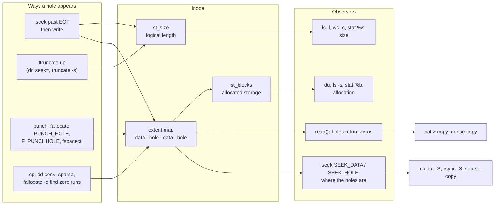

# Sparse Files and Holes

> [!summary] Claim
> A hole is a range of a regular file that reads back as zero bytes but has no storage behind it, so a file's size (`st_size`) and its allocation (`st_blocks`) are independent numbers, and every tool that copies, archives, measures, or reads the file either preserves that independence on purpose or silently destroys it.

Part of [Files, Filesystems, and Permissions](README.md) in [Shell and Unix Engineering](../README.md).

## TL;DR

- Mechanism: seeking past end-of-file and writing, or growing a file with `ftruncate`, leaves a gap that `read` returns as zeros; the filesystem may record that gap as a hole with no blocks, and `lseek` with `SEEK_DATA` and `SEEK_HOLE` (POSIX.1-2024) reports where the holes are.
- Rule: judge disk use by allocation (`du`, `st_blocks`) and logical content by size (`ls -l`, `wc -c`), and pick copy and archive tools that preserve holes (`cp`, `tar --sparse`, `rsync --sparse`, `dd conv=sparse`) whenever a file is sparse.
- Trap: `cat file >copy`, BusyBox `cp`, and a plain `tar` write every zero of every hole, so copying a 1 PiB sparse file with 0 bytes allocated (made in the lab) can fill any disk.
- Portability fact: no shell syntax can seek, so `dd seek=` (which calls `ftruncate`) is the only POSIX way to make a hole from a script; `truncate`, `fallocate`, and hole punching are all outside POSIX and differ between Linux, macOS, FreeBSD, and BusyBox.
- When not to use it: never make correctness depend on a hole existing (the filesystem may store zeros instead, and APFS zero-fills gaps under 16 MiB, measured in the lab), and do not leave a file sparse when running out of space later, in the middle of a write, is unacceptable; preallocate it with `posix_fallocate` instead.

## Mental model



Four operations create holes: an extending write after a seek, an extending `ftruncate`, an explicit punch, and a copy tool that recognises runs of zeros and seeks over them instead of writing them.
All four change only the extent map (and `st_size` for the first two); `st_blocks` follows the map, which is why size and allocation drift apart.
Observers split into two camps: anything that calls `read` sees an ordinary run of zero bytes and cannot tell a hole from stored zeros, while anything that calls `lseek` with `SEEK_DATA` and `SEEK_HOLE` (or the older Linux `FIEMAP` ioctl) sees the map itself.
A copy made through `read` therefore turns every hole into allocated zeros, and only a copy made through the map can reproduce the holes cheaply.

## How it works

### What the specification promises

POSIX.1-2024 defines the term in the `lseek` page: "A hole is a contiguous region of bytes within a file, all having the value of zero" (POSIX.1-2024 XSH `lseek`).
The same page puts the guarantee on reads, not on storage: "If data is later written at this point, subsequent reads of data in the gap shall return bytes with the value 0 until data is actually written into the gap", and "The lseek() function shall not, by itself, extend the size of a file."
`ftruncate` makes the same promise for growth: "If the file size is increased, the extended area shall appear as if it were zero-filled" (POSIX.1-2024 XSH `ftruncate`).
"Appear as if" is the whole contract: POSIX never requires a filesystem to skip allocation, and the `du` rationale says only that "A file system need not allocate all the intervening zero-filled blocks to such a file" (POSIX.1-2024 XCU `du`, RATIONALE).
`write` itself says nothing about gaps; it only sets the new length to the position of the last byte written plus one (POSIX.1-2024 XSH `write`).

### Size versus allocation

`st_size` is the logical length; `st_blocks` is "Number of blocks allocated for this object" (POSIX.1-2024 XBD `<sys/stat.h>`).
POSIX deliberately leaves the unit of `st_blocks` undefined: "The unit for the st_blocks member of the stat structure is not defined within POSIX.1-2024", adding that in some implementations "it is 512 bytes" and that "It may differ on a file system basis" (same page, RATIONALE).
Linux fixes the unit at 512 bytes and states the consequence directly: "This may be smaller than st_size/512 when the file has holes" (`inode(7)`).
macOS also reports 512-byte units; the lab's `stat` mode prints `st_blocks * 512` and agrees with `du -k` on APFS (16 KiB allocated, `du_k=16`, in the worked example).
Allocation can also exceed the size: filesystems round up to whole blocks and may preallocate past end-of-file, which is why GNU `cp` punches the destination range after seeking over a hole (`create_hole` comment: "Some file systems (like XFS) preallocate when write extending a file") (coreutils master `src/copy-file-data.c`, `create_hole`, as of 2026-11).

From the shell, the two numbers come from different utilities:

| Question | POSIX tool | Unit | Non-POSIX shortcuts |
|---|---|---|---|
| Logical size | `ls -l` (size field is `st_size`), `wc -c <file` | bytes | GNU `stat -c %s`, macOS `stat -f %z`, GNU `du -A` (`--apparent-size`) |
| Allocation | `du file` | 512-byte units, `-k` for 1024 | GNU `stat -c '%b %B'`, macOS `stat -f %b`, `ls -s` (unit implementation-defined unless `-k`) |

POSIX specifies the `du` default as "512-byte units, rounded up to the next 512-byte unit" and the `ls -s` unit as implementation-defined unless `-k` is given (POSIX.1-2024 XCU `du`, `ls`).
GNU `du -A` is documented as reporting "apparent sizes, rather than file system usage", and the coreutils manual uses `dd bs=1 seek=2GiB if=/dev/null of=big` as its example of a file whose apparent size is 2 GiB that "uses almost no space" (coreutils manual, `du` invocation).

### Making holes from a script

No POSIX shell redirection seeks: `>` truncates, `>>` appends, and `<>` opens at offset 0, so a script cannot position a write past end-of-file by itself.
The portable tool is `dd`.
POSIX says that with `seek=` and without `conv=notrunc`, "the effect of the copy shall be to preserve the blocks in the output file over which dd seeks, but no other portion of the output file shall be preserved", and "If the size of the seek plus the size of the input file is less than the previous size of the output file, the output file shall be shortened by the copy" (POSIX.1-2024 XCU `dd`).
Every implementation the lab touches realises that with one `ftruncate` to the seek point before copying:

- FreeBSD and macOS `dd`: `if ((ddflags & (C_OF | C_SEEK | C_NOTRUNC)) == (C_OF | C_SEEK) && out.flags & ISTRUNC) if (ftruncate(out.fd, out.offset * out.dbsz) == -1)` (Apple `file_cmds` `dd/dd.c`, `setup`).
- BusyBox `dd`: `if (seek && !(G.flags & FLAG_NOTRUNC))` then `ftruncate(ofd, seek * blocksz)` (BusyBox `coreutils/dd.c`).

So `dd if=/dev/null of=FILE bs=1 seek=N` with empty input sets the size to exactly `N` by `ftruncate` and writes nothing, which is the lab's `extend` mode; it produced `size=1048576 alloc=0` on APFS.
The same command is destructive on a longer file: it cuts the file at `N` (the lab truncates a 100-byte file to 10 bytes), and with `conv=notrunc` and empty input it neither cuts nor extends (the lab's 100-byte file stays 100 bytes after `seek=200`).

`truncate -s SIZE` is the direct tool, but it is not a POSIX utility (it is absent from the POSIX.1-2024 XCU utility index).
GNU coreutils, FreeBSD, macOS (`/usr/bin/truncate`, built from the FreeBSD source with the deallocation options compiled out under `#ifdef __APPLE__`), and BusyBox (`[-c] -s SIZE FILE...`) all ship one.
The macOS manual page states the asymmetry plainly: "while truncating a file causes space on disk to be freed, extending a file does not cause space to be allocated."

### Finding holes: SEEK_DATA and SEEK_HOLE

POSIX.1-2024 added the two `whence` values (Austin Group Defect 415, POSIX.1-2024 XSH `lseek` CHANGE HISTORY); Linux `lseek(2)` traces them to Solaris 10, FreeBSD 7.0, and DragonFly BSD 2.3.1.
`SEEK_HOLE` moves to "the smallest location of a byte within a hole and not less than offset", `SEEK_DATA` to "the smallest location of a byte not within a hole and not less than offset", and both fail with `ENXIO` when the offset is at or past the size, and `SEEK_DATA` also when only hole remains (POSIX.1-2024 XSH `lseek`, ERRORS).
The key design choice is the virtual hole: "all seekable files shall have a virtual hole starting at the current size of the file, whether or not the file is sparse."
That makes the trivial implementation conforming (the RATIONALE gives it: `SEEK_HOLE` returns the size, `SEEK_DATA` returns the offset), so a caller that walks data and hole alternately works unchanged on a filesystem that knows nothing about holes, which then reports one data region.
Linux implements exactly that fallback in the VFS: "In the generic case the entire file is data, so as long as offset isn't at the end of the file then the offset is data", and for `SEEK_HOLE` "There is a virtual hole at the end of the file, so as long as offset isn't i_size or larger, return i_size" (Linux master `fs/read_write.c`, `must_set_pos`).
Filesystems with real support override it; the iomap code that XFS and ext4 use treats an `IOMAP_HOLE` extent as a hole and an `IOMAP_UNWRITTEN` extent (preallocated, never written) as a hole too unless the page cache holds data for it (`mapping_seek_hole_data`) (Linux master `fs/iomap/seek.c`, `iomap_seek_hole_iter`, `iomap_seek_data_iter`).
Linux `lseek(2)` dates real support per filesystem: Btrfs 3.1, OCFS 3.2, XFS 3.5, ext4 and tmpfs 3.8, NFS 3.18, FUSE 4.5, GFS2 4.15.

The answers are advisory in both directions.
"Not all bytes with the value zero need belong to a hole" (POSIX), and macOS says applications "must not depend on it to find all such ranges in a file" (Apple `lseek(2)`).
The returned boundaries are rounded to the filesystem's granularity: the lab wrote 4096 bytes into a hole on APFS and `SEEK_HOLE` reported a 16 KiB data region (`data 33554432 33570816`).
macOS and Solaris expose that granularity as `pathconf(path, _PC_MIN_HOLE_SIZE)`, which the lab reads as 4096 on APFS; FreeBSD defines the name too (`<sys/unistd.h>`, value 21), POSIX.1-2024 `fpathconf` does not list it, and neither glibc `bits/confname.h` nor musl `include/unistd.h` defines it (checked in both source trees, as of 2026-11).
The constants differ across kernels: Linux and FreeBSD define `SEEK_DATA` as 3 and `SEEK_HOLE` as 4 (`include/uapi/linux/fs.h`, `sys/sys/unistd.h`), while macOS defines `SEEK_HOLE` as 3 and `SEEK_DATA` as 4 (`<sys/_types/_seek_set.h>` in the macOS SDK).
glibc exposes the names only with `_GNU_SOURCE` (`lseek(2)`).

Before `SEEK_HOLE` existed on Linux, GNU `cp` used the `FS_IOC_FIEMAP` ioctl, from coreutils 8.10 (2011) until 9.0 (2021), when it switched to "lseek+SEEK_HOLE rather than ioctl+FS_IOC_FIEMAP on sparse files, as lseek is simpler and more portable" (coreutils `NEWS`, 9.0).
The FIEMAP years are a list of corruption fixes: 8.11 "avoids FIEMAP issues with BTRFS before Linux 2.6.38, which could result in corrupt copies of sparse files", 8.12 forced `FIEMAP_FLAG_SYNC` on every extent copy, and 8.20 fixed reads from freed memory "with a very fragmented and sparse input file" (coreutils `NEWS`).

### Punching holes into existing data

POSIX has no call that deallocates a range; `posix_fallocate` is its opposite (it reserves storage so that "subsequent writes to the specified file data shall not fail due to the lack of free space") and is part of the Advisory Information option (POSIX.1-2024 XSH `posix_fallocate`).
Each kernel has its own punch:

- Linux `fallocate(fd, FALLOC_FL_PUNCH_HOLE | FALLOC_FL_KEEP_SIZE, off, len)`: the punch flag "must be ORed with FALLOC_FL_KEEP_SIZE"; "Within the specified range, partial filesystem blocks are zeroed, and whole filesystem blocks are removed from the file"; supported on XFS 2.6.38, ext4 3.0, tmpfs 3.5, Btrfs 3.7, gfs2 4.16, otherwise `EOPNOTSUPP` (`fallocate(2)`).
- macOS `fcntl(fd, F_PUNCHHOLE, &fpunchhole_t)`: "Holes must be aligned to file system block boundaries" and the file size does not change (Apple `fcntl(2)`); the lab's unaligned punch of bytes 100 to 299 fails with `EINVAL`.
- FreeBSD `fspacectl(fd, SPACECTL_DEALLOC, ...)`, which "appeared in FreeBSD 14.0" and zeroes the range, deallocating it where the filesystem can; FreeBSD `truncate -d -o OFFSET -l LENGTH` wraps it (FreeBSD `fspacectl(2)`; the non-Apple branch of `truncate.c` calls `fspacectl(fd, SPACECTL_DEALLOC, ...)`).

From a Linux shell, util-linux `fallocate -p -o OFFSET -l LENGTH FILE` punches, and `fallocate -d FILE` (documented as "Detect and dig holes", making "the file sparse in-place, without using extra disk space") re-sparsifies a file that a dense copy inflated (`fallocate(1)`, util-linux 2.43 development page as of 2026-11).
Neighbouring Linux modes are easy to confuse with punching: `FALLOC_FL_ZERO_RANGE` zeroes a range, preferably by converting it to unwritten extents that read as zeros but stay allocated, `FALLOC_FL_COLLAPSE_RANGE` removes a range and shifts later data down, and `FALLOC_FL_INSERT_RANGE` inserts a hole and shifts data up (`fallocate(2)`, `include/uapi/linux/falloc.h`).

### Copying: who keeps holes and how

GNU `cp` decides per file in `infer_scantype` (coreutils master `src/copy-file-data.c`, as of 2026-11):

1. If `st_blocks` is not smaller than `st_size / ST_NBLOCKSIZE`, the file is assumed dense (`PLAIN_SCANTYPE`) and copied with `copy_file_range` or `read`/`write`; this is the "crude heuristic" of `cp(1)`.
2. Otherwise it calls `lseek(fd, pos, SEEK_DATA)` and `SEEK_HOLE`; if the first hole is before end-of-file it uses `LSEEK_SCANTYPE`, and `lseek_copy` walks the map, calling `create_hole` (an `lseek` past the gap plus a punch) for each hole and copying only data extents.
3. If `SEEK_HOLE` finds no hole although the block count says sparse ("squashfs in Linux kernel 6.17 and earlier", or transparent compression), it falls back to a plain copy.
4. `--sparse=always` additionally reads data in `ST_NBLOCKSIZE` chunks and turns each all-zero chunk (`is_nul`) into a hole; `--sparse=never` writes zeros for every hole, which the manual recommends for a `mkswap` file "since such a file must not have any holes".

The result: a copy is sparse where the source is sparse by default, and zero runs in a dense source become holes only with `--sparse=always`.
macOS `cp` calls `fcopyfile` with `COPYFILE_DATA_SPARSE` unless `-S` is given ("Do not attempt to preserve holes in sparse files"), on the source comment "which has the ability to preserve holes if the source is sparse" (Apple `file_cmds` `cp/utils.c`); the lab's 64 MiB file with 16 KiB allocated copies to 16 KiB.
BusyBox `cp` lists `--sparse=WHEN` under "NOT SUPPORTED IN BBOX" (`coreutils/cp.c`) and copies through `bb_copyfd_eof`, which uses `sendfile` or `read`/`write` with no hole detection (`libbb/copyfd.c`), so its copies are dense; the lab asserts that on BusyBox images.
`cat SRC >DST`, or any pipe, reads zeros and writes zeros: the lab's 64 MiB sparse file becomes 64 MiB allocated.

`dd conv=sparse` is the stream-level variant: GNU documents it as "Try to seek rather than write NUL output blocks" and "a GNU extension to POSIX" (coreutils manual), FreeBSD and macOS `dd` implement it with `BISZERO` per output block and finish with an `ftruncate` when the output ends in a hole (`dd/dd.c`, `dd_out`, `dd_close`), and BusyBox `dd` has no `sparse` conversion.
GNU tar archives holes only with `--sparse` (`-S`), detects them with `--hole-detection=seek` (the default where `SEEK_HOLE` exists) or `raw` (reading every byte), and warns that without `SEEK_HOLE` "the file may be read twice" (GNU tar 1.35 manual, `sparse_scan_file_seek` in `src/sparse.c`).
rsync preserves holes only with `--sparse` (`-S`), which "relies on the destination filesystem supporting sparse files", and its manual warns that combined with `--inplace` the result "may not end up with sparse blocks" (rsync manual).
For reflinks and `copy_file_range`, which can share extents instead of copying them, see [[Reflinks-and-copy_file_range]].

### Reading a hole into a shell

A hole is NUL bytes to every reader, and shells disagree on NUL bytes in command substitution (POSIX.1-2024 XCU 2.6.3 leaves a null byte in the output unspecified).
The lab reads a 10-byte file (8 bytes of hole, then `aa`) with `v=$(cat FILE)` and prints `${#v}`:

- bash drops each NUL in `read_comsub`; bash-4.3 has the warning compiled out (`#if 0`), bash-4.4 warns for every NUL byte, and bash-5.0 warns once per substitution (`nullbyte` flag), always with "command substitution: ignored null byte in input" (bash 4.3, 4.4, and 5.0 `subst.c`, `read_comsub`).
- dash, BusyBox ash (`memtodest` skips `c == 0` unless `EXP_KEEPNUL`), mksh (skips `C_NUL` in the `XCOM` case of `eval.c`), and posh (`while ((c = shf_getc(x.u.shf)) == 0 || c == '\n')`) drop NULs silently.
- zsh keeps them: `${#v}` is 10.
- ksh93 and yash store the value as a C string, so it ends at the first NUL: `${#v}` is 0 for a file that starts with a hole (measured for ksh93u+ 2012 on the host; ksh93u+m and yash per the shell matrix).

## Numbers and limits

| Quantity | Value | Source |
|---|---|---|
| `st_blocks` unit | unspecified by POSIX; 512 bytes on Linux | POSIX.1-2024 XBD `<sys/stat.h>` RATIONALE; `inode(7)` |
| `du` default unit | 512 bytes, rounded up; 1024 with `-k` | POSIX.1-2024 XCU `du` |
| Minimum hole on APFS | 4096 bytes (`_PC_MIN_HOLE_SIZE`) | lab, macOS 27.3 APFS (as of 2026-11) |
| Data region after a 4096-byte write into a hole on APFS | 16384 bytes | lab (`map`), macOS 27.3 |
| APFS gap that an extending write zero-fills instead of leaving as a hole | under 16 MiB (16773120-byte gap filled, 16777216-byte gap left as a hole) | lab bisection, macOS 27.3, Apple M3 Pro (as of 2026-11) |
| Largest sparse file APFS accepts | 36028797018963967 bytes (2^55 - 1); `getconf FILESIZEBITS` prints 56 | lab (`truncate -s`), macOS 27.3 |
| Sparse files with 0 bytes allocated | 1 TiB and 1 PiB, `alloc=0` | lab (`truncate -s` then `stat`), macOS 27.3 |
| ext4 maximum file size, 4 KiB blocks | 16 TiB with extents, 4 TiB with block maps | Linux `Documentation/filesystems/ext4/blocks.rst` |
| Reading a 4 GiB hole with `cat >/dev/null` | 0.38 to 0.63 s over 6 runs (about 6 to 10 GiB/s of zeros) | lab-style run on the host, Apple M3 Pro, APFS (as of 2026-11) |
| Mapping the same 4 GiB hole with `SEEK_DATA` | under 0.01 s (`time -p` prints 0.00) | same run |
| Linux `SEEK_DATA`/`SEEK_HOLE` real support | Btrfs 3.1, OCFS 3.2, XFS 3.5, ext4 and tmpfs 3.8, NFS 3.18, FUSE 4.5, GFS2 4.15 | `lseek(2)` |
| Linux `FALLOC_FL_PUNCH_HOLE` | XFS 2.6.38, ext4 3.0, tmpfs 3.5, Btrfs 3.7, gfs2 4.16 | `fallocate(2)` |
| FreeBSD `fspacectl` | FreeBSD 14.0 | `fspacectl(2)` |
| GNU cp hole detection | FIEMAP from 8.10 (2011-02-04); `SEEK_HOLE` from 9.0 (2021-09-24) | coreutils `NEWS` |

The 4 GiB timing is the cost every dense reader pays: `read` must fill the buffer with zeros at memory bandwidth, while `SEEK_DATA` answers from the extent map in one system call, which is why `cp`, `tar`, and backup tools probe the map first.

## Portability

Shell behavior (the only shell-dependent part of the topic is what happens to the zero bytes a hole returns):

| Shell | Create a hole without `dd` or `truncate` | `v=$(cat FILE)` on 8 NUL bytes then `aa` | Diagnostic |
|---|---|---|---|
| POSIX sh (spec) | no seeking redirection | unspecified (XCU 2.6.3) | unspecified |
| macOS bash 3.2 (`/bin/bash`, `/bin/sh`) | no | `len=2` | none (lab) |
| bash 4.4 to 5.3 | no | `len=2` | "ignored null byte in input" on stderr (lab, bash 5.3; per byte in 4.4, once in 5.0+ per source) |
| zsh native and `zsh --emulate sh` | no | `len=10` | none (lab) |
| dash | no | `len=2` | none (lab, dash 0.5.13 on the host) |
| ksh93u+ 2012 (macOS `/bin/ksh`) | no | `len=0` | none (lab) |
| ksh93u+m 1.0.10 | no | `len=0` | none (shell matrix, `comsubst` in `sh/macro.c`) |
| mksh R59 | no | `len=2` | none (`eval.c` `XCOM`; lab asserts) |
| yash 2.58.1 | no | `len=0` | none (`exec_command_substitution` reads wide chars; shell matrix) |
| posh 0.14.1 | no | `len=2` | none (`eval.c` `XCOM`; lab asserts) |
| BusyBox ash 1.37.0 | no | `len=2` | none (`memtodest` in `shell/ash.c`; lab asserts) |

Utility and kernel behavior:

| Feature | GNU coreutils and Linux | macOS | FreeBSD | BusyBox | POSIX |
|---|---|---|---|---|---|
| `dd seek=N` with empty input sets size by `ftruncate` | yes | yes (lab) | yes (`dd.c`) | yes (`dd.c`) | required effect |
| `dd conv=sparse` | yes, GNU extension | yes (lab) | yes | no (lab asserts failure) | not listed |
| `truncate -s` | yes | yes, no `-d` | yes, plus `-d -o -l` | yes, `-c -s` only | no such utility |
| `cp` keeps holes by default | yes, via `SEEK_HOLE` (lab asserts) | yes, `fcopyfile` `COPYFILE_DATA_SPARSE` (lab) | yes on the generic kernel path (not run): `cp` calls `copy_file_range` (`bin/cp/utils.c`), and `vn_generic_copy_file_range` skips input holes with `FIOSEEKDATA`/`FIOSEEKHOLE` (`sys/kern/vfs_vnops.c`); a filesystem's own `VOP_COPY_FILE_RANGE` may differ | no, dense (lab asserts) | unspecified |
| `cat >` copy | dense (lab asserts) | dense (lab) | dense | dense | dense by definition of `read` |
| `SEEK_DATA` / `SEEK_HOLE` values | 3 / 4 | 4 / 3 | 3 / 4 | (Linux) 3 / 4 | names only |
| Punch a hole | `fallocate` `PUNCH_HOLE`, unaligned edges zeroed | `F_PUNCHHOLE`, aligned only, `EINVAL` otherwise (lab) | `fspacectl` 14.0+ | (Linux) `fallocate` | none |
| `_PC_MIN_HOLE_SIZE` | not defined (lab) | 4096 on APFS (lab) | defined (21) | not defined | not listed |
| Extending write leaves a hole | yes where the filesystem supports holes (lab asserts a 1 MiB gap on the matrix Linux filesystems) | only for gaps of 16 MiB or more on APFS (lab) | filesystem-dependent | (Linux) | allowed, not required |

uutils coreutils was not tested; the lab's implementation probe reports `uutils` and its tests then fail loudly rather than guess.

## Worked example

The [lab](../labs/10-sparse-files-and-holes/) builds a C probe (`holes.c`) for the system calls, drives `dd`, `cp`, `cat`, `wc`, and `du` from a shell script (`holes.sh`) under the shell under test, and asserts each behavior in `holes.bats`.

Excerpt from `holes.c` (verbatim): the map walk that `cp` and `tar` perform, alternating `SEEK_DATA` and `SEEK_HOLE` until end-of-file.

```c
static int do_map(const char *path) {
  struct stat st;
  off_t pos = 0;
  int fd = open(path, O_RDONLY);
  if (fd < 0)
    return fail("open", path);
  if (fstat(fd, &st) != 0)
    return fail("fstat", path);
  while (pos < st.st_size) {
    off_t data = lseek(fd, pos, SEEK_DATA);
    off_t hole;
    if (data < 0) {
      if (errno != ENXIO)
        return fail("lseek SEEK_DATA", path);
      /* ENXIO: no data at or after pos, so the rest of the file is one hole. */
      printf("hole %lld %lld\n", (long long)pos, (long long)st.st_size);
      break;
    }
    if (data > pos)
      printf("hole %lld %lld\n", (long long)pos, (long long)data);
    hole = lseek(fd, data, SEEK_HOLE);
    if (hole < 0)
      return fail("lseek SEEK_HOLE", path);
    printf("data %lld %lld\n", (long long)data, (long long)hole);
    pos = hole;
  }
  printf("end %lld\n", (long long)st.st_size);
  close(fd);
  return 0;
}
```

Excerpt from `holes.sh` (verbatim): the only POSIX way for a script to make a hole, and the portable size-versus-allocation check.

```sh
  extend)
    # Empty input, so dd only opens, truncates at the seek point, and seeks: no data is written.
    dd if=/dev/null of="$1" bs=1 seek="$2" 2>/dev/null
    ;;
```

```sh
  sizes)
    # BSD wc pads the count with blanks; du prints "KIB<tab>NAME".
    apparent=$(wc -c <"$1" | tr -d ' ') || exit 1
    du_line=$(du -k "$1") || exit 1
    printf 'apparent=%s du_k=%s\n' "$apparent" "${du_line%%[!0-9]*}"
    ;;
```

Excerpt from `holes.bats` (verbatim): the map test.

```sh
@test "SEEK_DATA and SEEK_HOLE map a file as hole, data, hole" {
  run_lab "$TOOL" extend "$F" 67108864
  [ "$status" -eq 0 ]
  run "$PROBE" fill "$F" 33554432 4096 x
  [ "$status" -eq 0 ]
  run "$PROBE" map "$F"
  [ "$status" -eq 0 ]
  [ "${#lines[@]}" -eq 4 ]
  [ "${lines[0]}" = "hole 0 33554432" ]
  case ${lines[1]} in
    "data 33554432 "*) ;;
    *) false ;;
  esac
  end=${lines[1]##* }
  [ "$end" -ge 33558528 ]
  [ "$end" -lt 67108864 ]
  [ "${lines[2]}" = "hole $end 67108864" ]
  [ "${lines[3]}" = "end 67108864" ]
}
```

Captured on the host (macOS 27.3, APFS, `/bin/sh` is bash 3.2) by running the lab's tools by hand in this order; the lab asserts the same shapes, with exact byte counts only where they do not depend on the filesystem:

```text
+ sh holes.sh extend f 67108864
+ ./holes fill f 33554432 4096 x
+ ./holes stat f
size=67108864 alloc=16384
+ ./holes map f
hole 0 33554432
data 33554432 33570816
hole 33570816 67108864
end 67108864
+ sh holes.sh sizes f
apparent=67108864 du_k=16
+ sh holes.sh copy cp f bycp
+ ./holes stat bycp
size=67108864 alloc=16384
+ sh holes.sh copy cat f bycat
+ ./holes stat bycat
size=67108864 alloc=67108864
+ ./holes punch f 33554432 16384
punch=ok
+ ./holes stat f
size=67108864 alloc=0
+ ./holes edges f
hole_from_0=0 hole_at_eof=ENXIO data_at_eof=ENXIO
```

Read it top to bottom: `dd` made a 64 MiB file with nothing allocated, one 4 KiB write allocated a 16 KiB region in the middle, `cp` kept the copy at 16 KiB, `cat` inflated it 4096-fold to 64 MiB, and punching the 16 KiB region returned the file to zero allocation with its size intact.
The last line shows the virtual hole: on a file that is all hole, `SEEK_HOLE` from 0 returns 0, and both whence values fail with `ENXIO` at end-of-file.
The full lab run on the host printed `ok` for all 12 tests; the integrator's shell matrix covers the Linux and BusyBox arms.

## Pitfalls

> [!warning] Dense copies of sparse files
> Trigger: copying a sparse file through `read`: `cat f >g`, any pipe, BusyBox `cp`, `tar` without `-S`, `rsync` without `-S`.
> Symptom: the copy allocates every zero; the lab's 16 KiB file becomes 64 MiB, and a 1 PiB sparse file (made in the lab with 0 bytes allocated) cannot be copied at all.
> The shadow-utils manual warns about the classic case: `/var/log/lastlog` "is a sparse file, so its size on the disk is usually much smaller than the one shown by" `ls -l`, which "can indicate a really big file if you have in passwd users with a high UID", and "Having high UIDs can create problems when handling the /var/log/lastlog with external tools" (`lastlog(8)`).
> Fix: use `cp` (GNU or macOS), `tar --sparse`, `rsync --sparse`, or `dd conv=sparse`; after the fact, `fallocate -d` on Linux digs the holes back out.

> [!warning] `dd seek=` truncates what it seeks over to
> Trigger: `dd if=/dev/null of=data.img bs=1 seek=N` to "make sure the file is at least `N` bytes", on a file that is already longer.
> Symptom: everything after byte `N` is gone; POSIX requires the file to be "shortened by the copy", and the lab cuts a 100-byte file to 10 bytes.
> Fix: use `truncate -s '>N'` (GNU) only where available, or compare `wc -c` first; `conv=notrunc` stops the cut but, with empty input, also stops the extension (the lab's file stays at 100 bytes).

> [!warning] GNU `dd seek=NB` punched the head of the file
> Trigger: GNU `dd` with the seek measured in bytes (`seek=NB` or `oflag=seek_bytes`) and `N` smaller than the output block size, in coreutils 8.16 through 9.12.
> Symptom: coreutils `NEWS` records that `dd` "replaces the first N bytes of the file with a hole", that is, overwrites existing data with zeros.
> Fix: the fix is in coreutils after 9.12 (unreleased as of 2026-11, listed under the next release in `NEWS`); until then keep `bs=1` with a block-count `seek=` as in the lab.

> [!warning] Trusting `SEEK_HOLE` as a statement about content
> Trigger: a copier or scanner that treats a reported hole as "known zeros" while the file is being written.
> Symptom: CVE-2023-49298: "OpenZFS through 2.1.13 and 2.2.x through 2.2.1, in certain scenarios involving applications that try to rely on efficient copying of file data, can replace file contents with zero-valued bytes", with GNU `cp` from recent coreutils as the example (NVD).
> The OpenZFS report (issue 15526, opened 2023-11-14) shows Go toolchain binaries with "most of the files replaced by zeros" while `zpool scrub` saw nothing, and downgrading coreutils from 9.3 to 8.32 hid it; OpenZFS 2.2.2 shipped the fix, "an incorrect dirty dnode check", and recommends upgrading to 2.2.2 or 2.1.14 (zfs-2.2.2 release notes).
> Fix: upgrade the filesystem; in your own tools, never read a range as zeros from map data alone when the file may be changing, and verify copies by content (`cmp`, a checksum), which sees holes and zeros identically.

> [!warning] A file that shrinks under a sparse reader
> Trigger: archiving with GNU tar `--sparse` while another user truncates the file.
> Symptom: CVE-2018-20482: "GNU Tar through 1.30, when --sparse is used, mishandles file shrinkage during read access, which allows local users to cause a denial of service (infinite read loop in sparse_dump_region in sparse.c)", for example against "a system backup running as root" (NVD).
> GNU `cp` had the same class of bug: coreutils 9.10 fixed an infinite loop "copying sparse files with SEEK_HOLE ... with extents that are being actively updated", a bug introduced in 9.9 (coreutils `NEWS`, 9.10 released 2026-02-04).
> Fix: upgrade tar (1.31 or later); snapshot before backing up (filesystem or LVM snapshot) so the map cannot change mid-read.

> [!warning] Assuming a write past EOF always leaves a hole
> Trigger: a test or capacity plan that writes past end-of-file and expects no allocation.
> Symptom: on APFS the lab measured that an extending write zero-fills (allocates) any gap under 16 MiB; a 1 MiB gap allocated 1052672 bytes, while a 16 MiB gap allocated 4096.
> Fix: create holes with `ftruncate` (`dd seek=` or `truncate -s`) first and write into the middle, which the lab shows leaves holes on APFS; or measure with `du` instead of assuming.

> [!warning] Hard-coded `whence` numbers
> Trigger: an FFI binding, a Perl `sysseek`, or a script-generated C file that writes `3` for `SEEK_DATA`.
> Symptom: on macOS 3 is `SEEK_HOLE`, so the walk returns holes where it expects data and copies nothing or loops.
> Fix: always use the symbolic names from the platform's headers.

> [!warning] Shell variables swallow, keep, or stop at the zeros
> Trigger: `v=$(cat image)` or `v=$(dd if=disk skip=...)` on data that may contain a hole.
> Symptom: bash, dash, mksh, posh, and BusyBox drop the NULs (a length change), zsh keeps them, ksh93 and yash end the value at the first NUL; bash 4.4 and later also print a warning on stderr (lab).
> Fix: never pass binary data through a shell variable; write it to a file and use `cmp`, `od`, or a checksum on the file.

> [!warning] Delayed `ENOSPC`
> Trigger: a sparse VM image, database file, or pre-sized log on a filesystem that later fills.
> Symptom: the failure comes not when the file is created but when a later write lands in a hole and the filesystem has no block to give it; only preallocation guarantees that "subsequent writes ... shall not fail due to the lack of free space" (POSIX.1-2024 XSH `posix_fallocate`).
> Fix: `posix_fallocate` (or `fallocate` without `KEEP_SIZE`) where mid-write `ENOSPC` is unacceptable; on Linux filesystems without `fallocate`, glibc emulates it, and its manual warns "There is a race condition where concurrent writes from another thread or process could be overwritten with null bytes" (`posix_fallocate(3)`).

## Security and robustness

- Disk exhaustion: a user can create a file whose size is petabytes with no allocation (the lab made 1 PiB with `alloc=0`); quota and `du` see nothing, but any privileged job that copies or archives it densely (a backup, an indexer, a log shipper) can fill the target filesystem.
  Run backups with hole-preserving tools and cap their output size.
- Time-of-check races: a hole map is a snapshot, so a root process reading another user's file can be driven into loops (CVE-2018-20482) or into copying stale zeros (CVE-2023-49298); copy from a snapshot or, for untrusted files, copy densely and accept the cost.
- Archive parsing: sparse maps are attacker-controlled input on extraction; GNU tar's `pax_decode_header` in `sparse.c` "had a NULL pointer dereference when parsing certain archives that have malformed extended headers" before 1.32 (CVE-2019-9923, NVD); keep archivers current and extract untrusted archives unprivileged.
- No stale data: a hole reads as zeros by specification, and punching a range makes it read as zeros (`fallocate(2)`, Apple `fcntl(2)`), so holes do not leak old disk contents; whether the freed physical blocks are erased is a device and filesystem question outside these guarantees.
- Integrity checks are hole-blind by design: `cmp`, `sha256sum`, and every `read`-based checksum treat a hole and stored zeros as identical, which is exactly what you want for verifying a copy and exactly why they cannot verify that a copy kept its holes (use `du` or `stat` for that).
- Accounting surprises: `du` and `df` report allocation, `ls -l` reports size, so monitoring that alerts on `ls` sizes will page for harmless sparse files and miss dense growth.

## The principal's view

The decision is whether sparseness is a contract or an optimisation in your system.
Treat it as an optimisation: the specification only promises that unwritten ranges read as zeros, the filesystem may store zeros anyway (APFS does for gaps under 16 MiB), and any link in a copy chain that uses `read` silently densifies, so plan capacity for the apparent size of everything that might be copied, and the allocated size only for data at rest that never moves.

When sparseness is a deliberate cost lever (VM disk images, pre-sized indexes, core dumps, `lastlog`-style tables indexed by ID), make it explicit in the operational surface: name the hole-preserving copy and backup tools in the runbook, alert on `du`-versus-size ratios rather than sizes, and verify copies by content and by allocation separately.
When writing must never fail halfway (databases, journals), reverse the choice and preallocate with `posix_fallocate`, accepting the up-front space cost.

The trade-off is space and copy speed against predictability: holes make a 64 MiB file cost 16 KiB, and a `SEEK_DATA` walk maps a 4 GiB hole in under 0.01 s where reading it took about 0.4 s, but they defer allocation failures to later writes and make every copy tool a capacity risk.
Shell is the wrong layer for anything beyond creating and measuring holes: a script cannot seek, cannot query the map, and mangles NUL bytes; use `dd`, `cp`, `truncate`, and `fallocate` from the shell, and write the map walk in C or another language with direct `lseek` bindings when the logic depends on where the data is.
If you need sparse semantics independent of the filesystem, use a format that encodes them (a sparse archive format, a compressed image with its own block map) rather than relying on a filesystem's holes surviving every hop.

## Interview questions

> [!question] L5: What is the difference between a file's size and its disk usage, and which commands show each?
>
> > [!success]- Answer
> > The size is `st_size`, the logical length that `read` sees; disk usage is `st_blocks`, the storage actually allocated.
> > `ls -l` and `wc -c` report size; `du` reports allocation in 512-byte units by default (`-k` for 1024).
> > They differ when the file has holes (usage smaller) or when the filesystem rounds up or preallocates (usage larger).
> > POSIX leaves the unit of `st_blocks` unspecified; Linux and macOS use 512 bytes.
> >
> > Follow-up: Why can a 64 MiB file show `du -k` of 16 on APFS?

> [!question] L5: Predict the output: on Linux ext4, `dd if=/dev/null of=f bs=1 seek=1048576 2>/dev/null; wc -c <f; du -k f`.
>
> > [!success]- Answer
> > `wc -c` prints 1048576 and `du -k` prints 0 followed by the name.
> > With empty input and no `conv=notrunc`, `dd` calls `ftruncate` to the seek point and writes nothing, so the file has size 1 MiB and no blocks.
> > The lab measured the same on APFS (`size=1048576 alloc=0`, `du_k=0`).
> >
> > Follow-up: What happens if `f` was already 2 MiB long?

> [!question] L6: Debug this script: a nightly job runs `cat /srv/vm/disk.img >/backup/disk.img`; the source shows 2 GB in `du` but the backup disk fills up every night.
>
> > [!success]- Answer
> > `disk.img` is sparse: its apparent size is far larger than its 2 GB allocation.
> > `cat` reads the holes as zeros and the redirection writes every zero, so the backup is fully allocated at the apparent size.
> > Use `cp` (GNU `cp` detects the sparse source and recreates holes with `SEEK_HOLE`), `rsync --sparse`, or `tar --sparse`, or run `fallocate -d` on the copy.
> > Also snapshot the image first, because it may be written during the copy.
> >
> > Follow-up: How would you prove the fixed backup is both correct and sparse?

> [!question] L6: How does GNU `cp` decide whether to look for holes, and what does it do with them?
>
> > [!success]- Answer
> > `infer_scantype` first applies a heuristic: if `st_blocks` is not smaller than `st_size / ST_NBLOCKSIZE`, the file is treated as dense and copied plainly.
> > Otherwise it probes with `SEEK_DATA` and `SEEK_HOLE`; if a hole exists before end-of-file, `lseek_copy` copies only data extents and calls `create_hole`, which seeks past each gap and punches it to discard filesystem preallocation.
> > If the probe finds no hole (squashfs in Linux 6.17 and earlier, transparent compression) it falls back to a plain copy.
> > `--sparse=always` also turns all-zero chunks in data into holes, and `--sparse=never` writes zeros for every hole.
> >
> > Follow-up: Before coreutils 9.0, what did `cp` use instead of `SEEK_HOLE`, and why was it replaced?

> [!question] L6: Why does POSIX require a "virtual hole" at end-of-file?
>
> > [!success]- Answer
> > So that a filesystem with no hole support can implement `SEEK_HOLE` by returning the file size and `SEEK_DATA` by returning the offset, and still conform.
> > A caller that alternates `SEEK_DATA` and `SEEK_HOLE` then works everywhere: on a non-sparse filesystem it sees one data region ending at the size.
> > Linux's generic VFS code does exactly this in `must_set_pos`.
> >
> > Follow-up: What errno does each whence return at offset equal to the size, and why does that matter for the loop's termination?

> [!question] L6: A colleague's script runs `v=$(dd if=disk.img bs=512 count=1 2>/dev/null); printf '%s' "$v" | sha256sum` to fingerprint a boot sector; the hash differs between bash and zsh. Why?
>
> > [!success]- Answer
> > A boot sector usually contains NUL bytes, and command substitution with NULs is unspecified.
> > bash (and dash, mksh, posh, BusyBox) drops them, with a warning from bash 4.4 on; zsh keeps them; ksh93 and yash end the value at the first NUL.
> > Hash the bytes directly: `dd if=disk.img bs=512 count=1 2>/dev/null | sha256sum`.
> >
> > Follow-up: Why does a hole make this worse than ordinary binary data?

> [!question] L7+: Your fleet stores VM images as sparse raw files; design the copy, backup, and capacity policy.
>
> > [!success]- Answer
> > Plan capacity for apparent size on any tier a dense copy can reach, and for allocated size only on tiers where every tool is known to preserve holes.
> > Name the allowed tools (`cp`, `rsync --sparse`, `tar --sparse`, reflinks within one filesystem) and ban `cat` and streaming copies in runbooks.
> > Copy from snapshots so the hole map cannot change mid-copy (the CVE-2018-20482 and CVE-2023-49298 classes).
> > Verify by content (checksum) and separately by allocation (`du`), and alert on allocation growth rather than size.
> > Decide per image whether mid-write `ENOSPC` is tolerable; if not, preallocate.
> >
> > Follow-up: When would you switch to an image format with its own block map instead of filesystem holes?

> [!question] L7+: An extent-copy bug replaced data with zeros, yet the filesystem's scrub reported no errors; explain how that can happen and what defence works.
>
> > [!success]- Answer
> > The scrub verifies that stored blocks match their checksums; the bug was in the answer to a map query, not in stored blocks: with pending (dirty) writes, the map reported a hole where data was being written, so the copier wrote a hole and every block on both sides was self-consistent.
> > That was OpenZFS issue 15526 (CVE-2023-49298), fixed in 2.2.2 and 2.1.14 by correcting the dirty dnode check.
> > The defence is end-to-end verification by content: compare source and destination with `cmp` or a checksum after the copy, ideally from a quiesced or snapshotted source.
> >
> > Follow-up: Why did downgrading coreutils from 9.3 to 8.32 hide the bug?

> [!question] L7+: Why is punching a hole on macOS different from Linux, and how would you write a portable "free this range" helper?
>
> > [!success]- Answer
> > Linux `fallocate(PUNCH_HOLE | KEEP_SIZE)` accepts any range, zeroes partial blocks, and frees whole blocks; macOS `F_PUNCHHOLE` requires block-aligned ranges and fails with `EINVAL` otherwise (measured in the lab); FreeBSD 14 uses `fspacectl(SPACECTL_DEALLOC)`.
> > A portable helper rounds the start up and the end down to the minimum hole size (`_PC_MIN_HOLE_SIZE` where it exists, else the filesystem block size), punches the aligned middle, and overwrites the unaligned edges with zeros using `pwrite`.
> > It must treat "unsupported" as a successful no-op only if the caller needs zeros, not freed space.
> >
> > Follow-up: How do you test that the helper actually freed space and did not just zero it?

## Related

Prerequisites: [[Atomic-Rename-and-fsync]]

Next: [[Mounts-and-Mount-Namespaces]]

See also: [[Inodes-and-Links]], [[dd-and-Block-IO]], [[Reflinks-and-copy_file_range]], [[tar-and-Archives]], [[rsync-Algorithm-and-Usage]], [[Command-Substitution]], [[Checksums-and-Integrity]], [[Resource-Limits-and-ulimit]]

## Further reading

- POSIX.1-2024 XSH `lseek`: the definition of a hole, the virtual hole at end-of-file, `SEEK_DATA` and `SEEK_HOLE`, and the trivial implementation in the RATIONALE.
- POSIX.1-2024 XCU `dd` and `du`: the truncation rule behind `dd seek=` and the rationale on sparse-file accounting.
- POSIX.1-2024 XBD `<sys/stat.h>`: why the unit of `st_blocks` is unspecified.
- Linux `lseek(2)` and `fallocate(2)`: per-filesystem support versions, punch, zero, collapse, and insert modes.
- Linux `fs/read_write.c` and `fs/iomap/seek.c`: the generic virtual-hole fallback and how unwritten extents are reported.
- GNU coreutils `src/copy-file-data.c`: `infer_scantype`, `lseek_copy`, `sparse_copy`, and `create_hole`, the reference implementation of a hole-preserving copy.
- GNU coreutils `NEWS`: fifteen years of sparse-copy bugs and fixes, from FIEMAP to `SEEK_HOLE`.
- Apple `lseek(2)` and `fcntl(2)`: `_PC_MIN_HOLE_SIZE`, `F_PUNCHHOLE` alignment, and the Solaris compatibility note.
- GNU tar manual, sparse files section, and `src/sparse.c`: `--sparse`, `--hole-detection`, and the sparse archive formats.
- OpenZFS issue 15526 and the zfs-2.2.2 release notes: a real data-loss incident where hole detection raced with writes.
- NVD CVE-2018-20482 and CVE-2023-49298: the two failure classes of map-based copying, shrinkage and stale maps.
