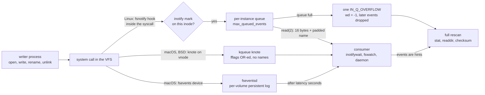

# inotify and fswatch

> [!summary] Claim
> A file-change notification is a lossy, coalesced hint queued by the kernel inside the system call that changed the file, so a correct watcher treats every event as "go look again" and keeps a full rescan for the moment the hint stream overflows, dies, or was never delivered.

Part of [Files, Filesystems, and Permissions](README.md) in [Shell and Unix Engineering](../README.md).

## TL;DR

- Mechanism: Linux `inotify` hangs a mark on an inode and queues a 16-byte-plus-name record per event; macOS and the BSDs offer `kqueue` (one descriptor per watched file, flags OR-ed into one pending event) and, on macOS, FSEvents (a per-volume, persistent, path-level log); `fswatch` is one CLI over all of them plus a `stat` poller.
- Rule: establish the watch, then scan, then process events as "something under this path changed"; react to `IN_CLOSE_WRITE` and `IN_MOVED_TO` (or a quiet period), never to each `IN_MODIFY`.
- Trap: an editor's atomic save renames a new inode over the old one, so a watch on the file dies with `IN_DELETE_SELF` and `IN_IGNORED` and every later write goes unseen; watch the directory instead.
- Portability fact: POSIX.1-2024 defines no notification interface at all, so the only portable watcher is a poll loop, and even the CLIs differ (`inotifywait` exists only on Linux; `fswatch` picks a different backend per OS).
- When not to use it: on NFS, SMB, FUSE, `/proc`, `/sys`, or files changed through `mmap`, no events arrive; for those, and for anything that must not miss a change, poll and compare content.

## Mental model



A process that changes a file enters the kernel, and the notification is produced inside that same system call: on Linux an fsnotify hook looks for marks on the affected inode (and its parent directory) and appends a record to every interested inotify instance's queue, so by the time `write` or `rename` returns the event is already queued.
The consumer drains the queue with `read`; when the queue is full the kernel queues exactly one overflow record and silently drops the rest, which is why the arrow to the rescan box is not optional.
On macOS and the BSDs, `kqueue` keeps one pending "knote" per watched descriptor and ORs new flags into it, and macOS additionally feeds every change into `fseventsd`, which batches events by a latency timer and stores them in a per-volume log that can be replayed from an event ID.
Every path ends in the same place: the consumer re-reads the filesystem, because the event told it where to look, not what is there.

## How it works

### POSIX gives you nothing, so the baseline is polling

The POSIX.1-2024 function index has no `inotify`, `kqueue`, `kevent`, or `fanotify` entry (searched in the XSH function index); the standard offers only `stat`, `fstatat`, `poll`, `select`, and timestamps.
At the shell level the most POSIX gives is a comparison: POSIX.1-2024 added `pathname1 -nt pathname2` and `-ot` to `test` ("Austin Group Defect 375 is applied", POSIX.1-2024 XCU `test`, CHANGE HISTORY Issue 8), comparing "last data modification timestamps".
A modification time is a weak change detector for two reasons.
First, a rewrite that keeps the same size inside one timestamp tick is invisible to a poller that compares size and whole-second mtime; `fswatch`'s own poll monitor compares whole seconds, because its `FSW_MTIME` macro expands to `st_mtime`, or to `st_mtimespec.tv_sec` where only that member exists (fswatch `poll_monitor.cpp`), so two saves in one second look like one.
Second, any process can set mtime back with `touch -d` or `utimensat`.
The lab's `snapdiff.sh` therefore polls with `find` and `cksum`, which costs a full read of every file per round but cannot be fooled by timestamps.

### inotify: instance, watch, queue

An inotify instance is a file descriptor returned by `inotify_init1(IN_NONBLOCK | IN_CLOEXEC)`; the kernel creates it with `anon_inode_getfd("inotify", ...)` and allocates an fsnotify group whose `max_events` is read from `/proc/sys/fs/inotify/max_queued_events` at creation time (`inotify_new_group()` in `fs/notify/inotify/inotify_user.c`, Linux master 7.4-rc2 as of 2026-11).
The instance counts against a per-user, per-user-namespace limit (`inc_ucount(..., UCOUNT_INOTIFY_INSTANCES)`); exceeding it fails `inotify_init` with `EMFILE` (inotify_init(2) ERRORS).

`inotify_add_watch(fd, path, mask)` resolves the path, demands read permission on the target (`path_permission(path, MAY_READ)` in `inotify_find_inode()`), and attaches a mark to the inode.
The watch descriptor comes from `idr_alloc_cyclic(idr, i_mark, 1, 0, ...)` in `inotify_add_to_idr()`, so descriptors start at 1 and cycle upward through `INT_MAX` before wrapping, which is why the man page's BUGS section can only call descriptor reuse with stale queued events "extremely low" likelihood rather than impossible.
Because the mark is on the inode, adding a watch for a second hard link to an already watched file returns the existing descriptor and, without a flag, replaces its mask (inotify_add_watch(2)); `IN_MASK_ADD` ORs into it and `IN_MASK_CREATE` (since Linux 4.18) refuses with `EEXIST` instead (inotify(7)).
`IN_ONLYDIR` (since 2.6.15) makes "this is a directory" part of the same atomic call, and `IN_DONT_FOLLOW` declines to follow a final symlink.
Exceeding the per-user watch count fails with `ENOSPC`, an error name that sends people looking for a full disk (inotify_add_watch(2) ERRORS).

Events are generated by hooks in the VFS, not by polling.
A rename calls `fsnotify_move()` (`include/linux/fsnotify.h`), which queues `FS_MOVED_FROM` for the old directory and `FS_MOVED_TO` for the new one with the same `fsnotify_get_cookie()` value, then, if the rename replaced an existing file, `fsnotify_link_count(target)`, which is an `FS_ATTRIB` on the victim inode, then `FS_MOVE_SELF` on the moved inode.
When the last dentry of an inode with zero links goes away, `dentry_unlink_inode()` in `fs/dcache.c` checks `inode_notify_dead()` (`!inode->i_nlink && hlist_empty(&inode->i_dentry)`) and calls `fsnotify_inoderemove()`, which queues `FS_DELETE_SELF` and then destroys every mark on the inode; destroying an inotify mark queues `IN_IGNORED` for its descriptor.
That sequence is exactly what the lab sees when an editor-style save renames a temporary file over a watched file: `ATTRIB DELETE_SELF IGNORED`, then silence.

A `read` returns whole records:

```c
struct inotify_event {
    int      wd;       /* Watch descriptor */
    uint32_t mask;     /* Mask describing event */
    uint32_t cookie;   /* Unique cookie associating related events (for rename(2)) */
    uint32_t len;      /* Size of name field */
    char     name[];   /* Optional null-terminated name */
};
```

The header is 16 bytes, and the name is padded with NULs to a multiple of `sizeof(struct inotify_event)`: `round_event_name_len()` returns `roundup(name_len + 1, sizeof(struct inotify_event))`, so a 5-byte name such as `a.txt` makes a 32-byte record.
If the buffer cannot hold the next record, `get_one_event()` returns `-EINVAL` (before Linux 2.6.21 `read` returned 0 instead); `sizeof(struct inotify_event) + NAME_MAX + 1`, 272 bytes, always holds one record (inotify(7)).
The `FIONREAD` ioctl reports how many bytes are queued, and `/proc/PID/fdinfo/FD` lists every watch as `inotify wd:%x ino:%llx sdev:%x mask:%x ...` (`fs/notify/fdinfo.c`), which is how you find the process that ate a user's watch budget.

### Merging and overflow, from the source

`fsnotify_insert_event()` in `fs/notify/notification.c` decides each event's fate under the group's notification lock:

1. If `q_len >= max_events`, the event is dropped and the group's preallocated overflow event is queued instead, but only if it is not already queued, so a flood produces exactly one `IN_Q_OVERFLOW` (with `wd = -1`, set in `inotify_new_group()`).
2. Otherwise the group's merge callback runs; for inotify that is `inotify_merge()`, which compares the new event only with the last queued event, and `event_compare()` returns true when mask, watch descriptor, and name are equal, except that it never merges `IN_IGNORED` or move events.
3. Otherwise the event is appended and readers are woken.

So the queue holds at most `max_queued_events` real events plus one overflow marker, and the lab's overflow mode asserts exactly `limit + 1` records with the overflow last.
Merging is why five unread appends produce one `IN_MODIFY`, and why inotify(7) warns that "an application can't use inotify to reliably count file events."
Memory pressure joins the same path: if allocating the event fails, `inotify_handle_inode_event()` calls `fsnotify_queue_overflow(group)` ("Treat lost event due to ENOMEM the same way as queue overflow"), and the allocation is charged to the watcher's memory cgroup (`set_active_memcg(group->memcg)`), not to the process doing the writes.

### What inotify cannot see

inotify(7) lists the holes, and each one is a design consequence of "hooks in the local VFS":
changes made on another NFS client never pass through this kernel's VFS, so no event; `/proc`, `/sys`, and `/dev/pts` are not monitorable; writes through `mmap` and `msync` produce nothing; and a filesystem mounted over a watched directory hides it without an event.
A directory watch reports children only for names changed through that directory: an event on a hard link elsewhere fires on a watched file but not on a watched parent of a different link (inotify(7)).
Watches are not recursive; a tree needs one watch per directory, and a directory created inside the tree can receive files before the watcher adds a watch for it, so the watcher must scan each new directory right after watching it.
`IN_MOVED_FROM` and `IN_MOVED_TO` share a cookie but are "not guaranteed" to be adjacent or atomically inserted, and a move out of the watched tree has no `IN_MOVED_TO` at all, so pairing them needs a short timeout and a fallback of "treat as delete plus create" (inotify(7), "Dealing with rename() events").

### fanotify: the mount and filesystem view

fanotify (introduced in 2.6.36, enabled in 2.6.37) marks an inode, a mount (`FAN_MARK_MOUNT`), or a whole filesystem (`FAN_MARK_FILESYSTEM`, since Linux 4.20), which removes the per-directory watch cost and the new-subdirectory race.
Directory-entry events (`FAN_CREATE`, `FAN_DELETE`, `FAN_MOVED_FROM`, `FAN_MOVED_TO`) arrived in Linux 5.1 with `FAN_REPORT_FID`, and names in 5.9 with `FAN_REPORT_DIR_FID` and `FAN_REPORT_NAME` (fanotify_init(2), fanotify_mark(2)).
Since Linux 5.13 an unprivileged user may create a group, but only with file-handle reporting and only inode marks; mount and filesystem marks still require `CAP_SYS_ADMIN` (fanotify_init(2) VERSIONS).
`fsnotifywait` in inotify-tools uses fanotify by default, and its `-S` and `-M` options watch a whole filesystem or mount (inotifywait(1)).

### kqueue EVFILT_VNODE: a descriptor per file, flags not records

On macOS and the BSDs, a watcher opens each file or directory (on macOS with `O_EVTONLY`, "descriptor requested for event notifications only", `sys/fcntl.h`), registers `EVFILT_VNODE` with flags such as `NOTE_WRITE`, `NOTE_DELETE`, `NOTE_RENAME`, `NOTE_ATTRIB`, `NOTE_LINK`, and `NOTE_EXTEND`, and gets back at most one pending event per descriptor whose `fflags` accumulate until it is read (XNU `kqueue.2`).
There is no queue to overflow and no name: a directory's `NOTE_WRITE` says only that an entry changed, and `NOTE_LINK` that a subdirectory came or went (FreeBSD `kqueue.2`: "the NOTE_LINK event is reported if a subdirectory was created or deleted").
The lab measured this on macOS 27.3: creating, writing, renaming, `mkdir`, `unlink`, and `rmdir` inside a watched directory yields one event with `WRITE|LINK`, and 20000 create-and-unlink operations also yield one event.
FreeBSD has added `NOTE_OPEN`, `NOTE_CLOSE`, `NOTE_CLOSE_WRITE`, and `NOTE_READ` (FreeBSD `kqueue.2`); XNU's `kqueue.2` lists none of them, so `fswatch`'s kqueue monitor guards `NOTE_CLOSE_WRITE` with `#ifdef` (`kqueue_monitor.cpp`).
The cost is descriptors: one per watched object, against a per-process limit that `launchctl limit maxfiles` reported as a soft 256 on this Mac (measured 2026-11-15), which is why the fswatch README says the kqueue monitor "scales badly with the number of files being observed."

### FSEvents: a persistent, path-level log (macOS)

FSEvents is a service, not a system call: `fseventsd` receives changes from the kernel and delivers them to `FSEventStreamCreate()` clients after `latency` seconds, "the number of seconds the service should wait after hearing about an event from the kernel before passing it along" (`FSEvents.h`, MacOSX27.2 SDK).
Without flags it reports directories, not files; `kFSEventStreamCreateFlagFileEvents` (macOS 10.7) asks for file-level events, and `kFSEventStreamCreateFlagNoDefer` delivers the first event of a burst at once instead of after the latency.
Event IDs are 64-bit, "monotonically increasing per system, even across reboots", and the service "stores events in a persistent, per-volume database", so a client can pass a stored ID as `sinceWhen` and replay what it missed while it was not running; no other API in this note can do that.
When buffering fails, events coalesce upward into one event with `kFSEventStreamEventFlagMustScanSubDirs`, optionally with `UserDropped` or `KernelDropped` to say where; the header's instruction is that "the client must do a full scan" of the subtree.
`kFSEventStreamCreateFlagIgnoreSelf` (10.6) and `MarkSelf` (10.9) handle the feedback loop that inotify cannot, because inotify provides "no information about the user or process that triggered the inotify event" (inotify(7)).
`FSEventStreamSetExclusionPaths()` accepts "a maximum of 8 directories".

### fswatch: one front end, seven monitors

`fswatch` 1.22.0 (released 2026-07-22, latest GitHub release as of 2026-11) wraps `libfswatch`, which implements FSEvents, kqueue, Solaris File Events Notification, inotify, fanotify, Windows `ReadDirectoryChangesW`, and a `stat` poller; the default is FSEvents on macOS and inotify on Linux (fswatch README).
Its record stream is paths, one per line, unless you ask for more: `-x` adds event flags (`Created`, `Updated`, `Removed`, `Renamed`, `OwnerModified`, `IsFile`, ...), `-n` prints them as a numeric mask, `-0` separates records with NUL, `-o` prints one count per batch, `-1` exits after the first batch, and `--batch-marker` prints `NoOp` between batches (fswatch.texi).
The default latency is one second (`static double lvalue = 1.0;` in `fswatch.cpp`) and a latency of zero is rejected (`validate_latency()`).
Its Linux monitor watches `IN_ALL_EVENTS` minus `IN_ACCESS`, `IN_CLOSE_NOWRITE`, and `IN_OPEN` unless access events are requested, from an epoll loop whose timeout is the latency (`inotify_monitor.cpp`).
On overflow it does not quietly continue: `monitor::notify_overflow()` throws "Event queue overflow." unless `--allow-overflow` was given, in which case it emits an `Overflow` event (`monitor.cpp`).
Exit statuses are documented: 0 success, 1 unknown option, 3 invalid latency, 6 a file could not be opened, 8 unknown monitor name (fswatch.texi).

### inotifywait and BusyBox inotifyd

`inotifywait` (inotify-tools, latest release tag 4.26.277, published 2026-11-14, as of 2026-11) prints `watched_filename EVENT_NAMES event_filename` with no escaping by default; `--format` takes `%w`, `%f`, `%e`, `%T`, `%0` (NUL) and `%n`, and `--no-newline` drops the trailing newline so `%0` can be the only separator.
`-m` keeps running, `-r` adds a watch per subdirectory, `-t SECONDS` exits with status 2 on timeout, and status 1 also means "an event occurred which was not being listened for", typically a watch forcibly removed by deletion or unmount.
It prints "Setting up watches." then "Watches established." on standard error (the man page's examples), and nothing that happens before the second message is reported.
BusyBox has an `inotifyd PROG FILE[:MASK]...` applet that runs `PROG ACTUAL_EVENTS FILEn [SUBFILE]` per event, or writes to stdout when `PROG` is `-`, with one-letter masks (`c` modified, `w` writable file closed, `n` created, `d` deleted, `y` moved in, `m` moved out, `o` overflow, `x` watch gone); its config entry says `default n`, so whether a given BusyBox build has it depends on the distribution (`miscutils/inotifyd.c`): measured in the shell matrix on 2026-11-15, Alpine 3.22's BusyBox 1.37.0 lists `inotifyd` and Debian 13's `busybox` package does not.

### tail -f is a watcher too

GNU `tail -f` uses inotify for local files and falls back to polling when `fremote()` cannot prove the file is local: "Treat unrecognized file systems as "remote", so caller polls" (`fremote()` in `src/tail.c`); a hidden `---disable-inotify` option forces polling.
FreeBSD and macOS `tail -f` register `EVFILT_VNODE` with `NOTE_DELETE | NOTE_RENAME` plus `EVFILT_READ` on each file (`usr.bin/tail/forward.c`, `text_cmds/tail/forward.c`), and BusyBox `tail -f` simply calls `sleep(sleep_period)` with a default of one second (`coreutils/tail.c`).

### Consuming events from the shell

The robust shell consumer establishes the watch before anything it cares about can happen, reads NUL-separated records, and acts on "a file was finished" rather than "a byte was written":

```sh
inotifywait -m -q -e close_write -e moved_to --format '%w%f%0' --no-newline -- "$dir" |
  while IFS= read -r -d '' path; do
    process -- "$path"
  done
```

`read -d ''` is now standard: POSIX.1-2024 `read` takes `-d delim`, and "if delim is the null string, the logical line delimiter shall be the null byte" (POSIX.1-2024 XCU `read`).
The lab and the shell matrix show which shells implement it (Portability below): bash, zsh, mksh, BusyBox ash, and ksh93u+m 1.0.10 do; dash (0.5.12 and 0.5.13), posh 0.14.1, and yash 2.58.1 reject `-d` (yash added it in 2.59); and ksh93u+ 2012 loses the record boundary.
POSIX `read` has no timeout option, so debouncing belongs in the producer (`fswatch -o -l 2`, `fswatch --batch-marker`, or `watchexec --debounce`), not in a `while read` loop.

## Numbers and limits

| Quantity | Value | Source |
| --- | --- | --- |
| inotify `max_queued_events` default | 16384 events per instance | `inotify_user_setup()`, Linux master 7.4-rc2 (as of 2026-11) |
| Records readable after a flood | `max_queued_events` + 1 (the last is `IN_Q_OVERFLOW`, `wd=-1`) | `fsnotify_insert_event()`; lab, measured on Linux 7.2 (Debian 13 container, 2026-11-15) |
| inotify `max_user_instances` default | 128 per user | `inotify_user_setup()` |
| inotify `max_user_watches` default, Linux 5.11 and later | 1% of low memory divided by `INOTIFY_WATCH_COST`, clamped to [8192, 1048576] | `inotify_user_setup()`; commit 9289012 (in v5.11, not v5.10: `inotify_user.c` at tag v5.10 sets only the fixed 8192, tag v5.11 has the `clamp(watches_max, 8192UL, 1048576UL)`) |
| inotify `max_user_watches` default before 5.11 | 8192 | commit 9289012 message |
| `INOTIFY_WATCH_COST` | `sizeof(struct inotify_inode_mark) + 2 * sizeof(struct inode)` | `inotify_user.c` |
| Host memory at which the 1048576 cap is reached | "128GB or more" on 64-bit | commit 9289012 message |
| Watch limit VS Code tells users to set | 524288 | VS Code Linux setup docs |
| `struct inotify_event` header | 16 bytes; name padded to a multiple of 16 | `round_event_name_len()` |
| Smallest buffer that always reads one record | 16 + `NAME_MAX` (255) + 1 = 272 bytes; smaller gives `EINVAL` since 2.6.21 | inotify(7) |
| Watch descriptor range | 1 to `INT_MAX`, allocated cyclically | `idr_alloc_cyclic(idr, i_mark, 1, 0, ...)` |
| inotify event bits | 22 (`HWEIGHT32(ALL_INOTIFY_BITS) != 22` is a build failure) | `inotify_user_setup()` |
| fanotify limits before 5.13 | 16384 queued events, 128 groups per user, 8192 marks per group | fanotify(7) |
| 5 unread appends to one file | 1 event (`MODIFY` on Linux, `WRITE|EXTEND` on macOS) | lab (macOS 27.3 and Linux 7.2, both captured 2026-11-15) |
| 20000 directory changes left unread on macOS kqueue | 1 event, `WRITE` | lab, macOS 27.3, 2026-11-15 |
| macOS launchd default open-file soft limit | 256 | `launchctl limit maxfiles` on this Mac, 2026-11-15 |
| FSEvents exclusion paths per stream | 8 | `FSEvents.h` |
| FSEvents event ID width | 64 bits, persistent across reboots | `FSEvents.h` |
| fswatch default latency | 1.0 s; 0 is rejected | `fswatch.cpp` |
| fswatch poll monitor memory | about 150 MB for 500000 files with a minimum path length of 32 characters | fswatch README (authors' experience) |
| BusyBox `tail -f` poll interval | 1 s | `coreutils/tail.c` |

## Portability

The facilities first; every cell is cited or measured by the lab.

| Facility | Linux (glibc, musl) | macOS | FreeBSD | BusyBox userland |
| --- | --- | --- | --- | --- |
| Kernel API | inotify (2.6.13), fanotify (2.6.37) | kqueue `EVFILT_VNODE`, FSEvents (10.5) | kqueue `EVFILT_VNODE` | uses the Linux kernel's |
| Directory event names the child | yes (lab) | kqueue: no, one `WRITE|LINK` (lab); FSEvents: yes, path per event | kqueue: no | - |
| Unread events | merged only with the identical tail event; overflow after 16384 | kqueue: flags OR-ed into one event (lab); FSEvents: `MustScanSubDirs` on drop | kqueue: OR-ed | - |
| Watch on a file survives rename-over | no: `ATTRIB DELETE_SELF IGNORED` (lab, Linux 7.2) | no: `DELETE`, then silence (lab) | not measured | - |
| `tail -f` | GNU: inotify, polls remote files | kqueue | kqueue (re-stat every 1 s under `-F`: "we re-stat the file at least once every second", `follow()` in `forward.c`), `usleep(250000)` when kqueue is unusable | `sleep(1)` loop |
| CLI watcher | `inotifywait`, `fsnotifywait`, `fswatch` | `fswatch` (FSEvents by default) | `fswatch` with its kqueue monitor | `inotifyd` when built in (`default n`; present in Alpine 3.22, absent in Debian 13, matrix) |
| POSIX | no interface (XSH function index) | - | - | - |

Then the shell side of a watcher: reading a NUL-separated stream, as `fswatch -0` and `inotifywait --format '%w%f%0' --no-newline` write it.
"Lab" means the lab's `read -d ''` test passed on this Mac; "matrix" means the same pipeline was run in the shell matrix's Debian 13 or Alpine 3.22 image on 2026-11-15.

| Shell | `while IFS= read -r -d '' f` on `a b\0c\nd\0` | Evidence |
| --- | --- | --- |
| POSIX sh (POSIX.1-2024) | two records, `a b` and `c<newline>d` | XCU `read`, `-d` with null string |
| macOS `/bin/sh` and `/bin/bash` (bash 3.2) | two records | lab |
| bash 5.3 | two records | lab |
| zsh 5.9 native and `--emulate sh` | two records | lab |
| dash 0.5.13 and 0.5.12 | `read: Illegal option -d`, zero records | lab (Homebrew dash 0.5.13); matrix (Debian dash 0.5.12) |
| ksh93u+ 2012 (macOS `/bin/ksh`) | one mangled record, `a bc` | lab |
| ksh93u+m 1.0.10 | two records: unlike 2012, it keeps the NUL boundary | matrix (Debian, `93u+m/1.0.10 2024-08-01`) |
| mksh R59 | two records: `delim = ord(builtin_opt.optarg[0])` | mksh `funcs.c`; matrix (Debian and Alpine) |
| yash 2.58.1 | ``read: `-d' is not a valid option``, zero records | matrix (Alpine) |
| yash 2.59 and later | two records expected: `-d` takes a one-character delimiter, empty gives NUL | yash NEWS ("The `read` built-in now supports the `-d` option", 2.59, 2025-05-13); `variable.c` `read_builtin`; not run |
| BusyBox ash 1.37.0 | two records: `delim = params->opt_d ? params->opt_d[0] : '\n'` | BusyBox `shell/shell_common.c`; matrix (Alpine `sh`, Debian `busybox sh`) |
| posh 0.14.1 | `read: invalid option -- 'd'`, zero records | matrix (Debian) |

The polling fallback `snapdiff.sh` uses only POSIX `find -exec ... {} +`, `cksum`, `sort`, and `awk`, and the lab runs it under the shell under test; a snapshot, change, snapshot, diff round on the macOS host reported `D a`, `M b`, `A c` under `/bin/sh` (bash 3.2.57), bash 5.3.15, Homebrew dash, zsh 5.9.2, `zsh --emulate sh`, and ksh93u+ 2012-08-01 (as of 2026-11).

## Worked example

The [lab](../labs/10-inotify-and-fswatch/) compiles `notify_probe.c`, which performs a fixed script of filesystem operations itself and prints what the kernel queued, and runs the portable poller `snapdiff.sh` under the shell under test.

Simplified excerpt of `notify_probe.c` (the `replace` mode, Linux branch; the file also has the kqueue branch and the `dir`, `coalesce`, and `overflow` modes):

```c
make_file(target, "v1\n");
watch(target, IN_MODIFY | IN_ATTRIB | IN_CLOSE_WRITE | IN_DELETE_SELF | IN_MOVE_SELF);
make_file(tmp, "v2\n");              /* the editor writes a temporary file */
if (rename(tmp, target) != 0) die("rename");   /* and renames it over the original */
drain(&s, 0);
printf("after rename over target: %s\n", s.count ? s.masks : "none");
make_file(target, "v3\n");           /* a later save rewrites the new inode */
drain(&s, 0);
printf("after rewriting the new target: %s\n", s.count ? s.masks : "none");
```

Output captured on macOS 27.3 (kqueue backend), 2026-11-15:

```text
$ notify_probe dir d
WRITE|LINK -
events: 1
$ notify_probe coalesce f
5 writes, read once: 1 event(s) [WRITE|EXTEND]
2 writes, read after each: 2 event(s)
$ notify_probe overflow d
generated: 20000
read: 1
last: WRITE
$ notify_probe replace d
after rename over target: DELETE
after rewriting the new target: none
```

Output captured on Linux 7.2.12 (inotify backend, the shell matrix's Debian 13 image under OrbStack, `/tmp` on overlayfs), 2026-11-15; that kernel sets `max_queued_events` to 1048576 rather than the stock 16384, and the lab's assertions are written relative to whatever limit it reads:

```text
$ notify_probe dir d
CREATE a.txt
MODIFY a.txt
CLOSE_WRITE a.txt
MOVED_FROM a.txt
MOVED_TO b.txt
CREATE|ISDIR sub
DELETE b.txt
DELETE|ISDIR sub
events: 8
rename cookies: equal
$ notify_probe coalesce f
5 writes, read once: 1 event(s) [MODIFY]
2 writes, read after each: 2 event(s)
$ notify_probe overflow d
max_queued_events: 1048576
generated: limit + 200
read: limit + 1
last: Q_OVERFLOW wd=-1
$ notify_probe replace d
after rename over target: ATTRIB DELETE_SELF IGNORED
after rewriting the new target: none
```

The portable fallback, `snapdiff.sh`, verbatim:

```sh
#!/bin/sh
# snapdiff.sh - the portable fallback when no notification API is usable (NFS, SMB,
# FUSE, a container bind mount from another kernel, or a shell with no watcher):
# snapshot a tree with POSIX find and cksum, then diff two snapshots.
#
#   snapdiff.sh snap DIR        print one "CRC SIZE PATH" line per regular file, sorted
#   snapdiff.sh diff OLD NEW    print "A PATH", "D PATH", or "M PATH" per change, sorted
#
# The checksum, not the timestamp, decides "modified", so a same-size rewrite inside one
# timestamp tick is still caught. Exit status: 0 success, 2 usage, 3 a file name contains
# a newline (the line-oriented snapshot cannot represent it, so refuse instead of lying).
set -eu

nl='
'

usage() {
  printf 'usage: snapdiff.sh snap DIR | diff OLD NEW\n' >&2
  exit 2
}

snap() {
  dir=$1
  [ -d "$dir" ] || usage
  bad=$(find "$dir" -name "*$nl*" -exec printf x \;)
  if [ -n "$bad" ]; then
    printf 'snapdiff: a file name under %s contains a newline\n' "$dir" >&2
    exit 3
  fi
  find "$dir" -type f -exec cksum {} + | LC_ALL=C sort -k 3
}

diff_snaps() {
  # Key = everything after the second field (the path, spaces included).
  # FILENAME, not FNR == NR, picks the old snapshot: FNR == NR is true for every line of
  # NEW when OLD is empty (an empty directory), which would lose every addition.
  LC_ALL=C awk '
    function key(line) {
      sub(/^[^ ]+ [^ ]+ /, "", line)
      return line
    }
    function sig(line) {
      split(line, f, " ")
      return f[1] " " f[2]
    }
    FILENAME == ARGV[1] { old[key($0)] = sig($0); next }
    {
      k = key($0)
      if (!(k in old)) print "A " k
      else if (old[k] != sig($0)) print "M " k
      seen[k] = 1
    }
    END { for (k in old) if (!(k in seen)) print "D " k }
  ' "$1" "$2" | LC_ALL=C sort -k 2
}

[ "$#" -ge 1 ] || usage
case $1 in
  snap)
    [ "$#" -eq 2 ] || usage
    snap "$2"
    ;;
  diff)
    [ "$#" -eq 3 ] || usage
    diff_snaps "$2" "$3"
    ;;
  *) usage ;;
esac
```

With `d/keep`, `d/gone`, and `d/edit`, then `rm d/gone`, a rewrite of `d/edit`, and a new `d/added`, the lab asserts this output in every shell:

```text
A d/added
M d/edit
D d/gone
```

## Pitfalls

> [!warning] The atomic save that kills your watch
> Trigger: watching a single file (`inotifywait -m config.yaml`, `fswatch config.yaml` with the kqueue monitor) while editors, `sed -i`, or deploy tools save by writing a temporary file and renaming it over the original.
> Symptom: the first save produces `ATTRIB DELETE_SELF IGNORED` (Linux) or `DELETE` (kqueue), and every later save is silent; `inotifywait` without `-m` exits 1 because "an event occurred which was not being listened for".
> Fix: watch the parent directory, filter on the file name, and react to `IN_CLOSE_WRITE` and `IN_MOVED_TO`; the lab's `replace` mode shows both kernels losing the watch.

> [!warning] Reacting to IN_MODIFY reads half-written files
> Trigger: `-e modify` in a pipeline that compiles, uploads, or parses the file.
> Symptom: the action runs once per `write` call (unless merged) while the writer is still mid-file, and sees a truncated file.
> Fix: react to `close_write` and `moved_to`, or debounce in the producer (`fswatch -l`, `--batch-marker`, `watchexec --debounce`); note that `close_write` "does not necessarily imply the file was written to" (inotifywait(1)).

> [!warning] Silent loss on queue overflow
> Trigger: a burst larger than `max_queued_events` (16384 by default) while the consumer is busy, for example `git checkout` of a large tree or a `rm -rf` under a recursive watch.
> Symptom: one `IN_Q_OVERFLOW` with `wd = -1`, after which the consumer's model of the tree is wrong; `fswatch` on Linux instead aborts with "Event queue overflow." unless run with `--allow-overflow`.
> Fix: on overflow (and on FSEvents `MustScanSubDirs`), discard state and rescan; size the queue only after you have the rescan, because inotify(7) says robust applications "should handle the possibility of lost events gracefully."

> [!warning] ENOSPC that is not a full disk
> Trigger: a recursive watcher (IDE, `inotifywait -r`, `git fsmonitor`, a dev server) on a tree with more directories than `fs.inotify.max_user_watches`.
> Symptom: `inotify_add_watch` fails with `ENOSPC`; VS Code reports it as "unable to watch for file changes in this large workspace" (error ENOSPC), per its Linux setup docs.
> Fix: exclude dependency trees from the watcher first, then raise `fs.inotify.max_user_watches` (VS Code suggests 524288); note that on Linux 5.11 and later the default is already scaled to RAM, while the inotifywait man page and Git's `git-fsmonitor--daemon` documentation still say the default is 8192.

> [!warning] The startup window
> Trigger: starting `inotifywait` in the background and immediately doing the work it should observe, or scanning a directory before watching it.
> Symptom: changes between the scan and the watch, or before "Watches established." appears on standard error, are never reported.
> Fix: watch first, then scan, then process events, and accept duplicates; with `-r`, also scan each new subdirectory right after its watch is added, because files can appear in it first (inotify(7)).

> [!warning] Newlines and spaces in event output
> Trigger: parsing default `inotifywait` output ("any special characters in filenames are not escaped in any way") or `fswatch` output with `read` or `awk`.
> Symptom: a file named `a<newline>b` becomes two events, and with `-x` a name containing spaces cannot be separated from the flags (fswatch.texi, "Parseability Issues").
> Fix: `--format '%w%f%0' --no-newline` or `fswatch -0`, read with `read -r -d ''` in a shell that implements it (see Portability) or `xargs -0`.

> [!warning] kqueue descriptor exhaustion
> Trigger: `fswatch -m kqueue_monitor -r` on a large tree, or any kqueue tool that opens one descriptor per file.
> Symptom: `fswatch` "dumps one error on standard error for every file that cannot be opened" once the process runs out of descriptors (README); on this Mac the launchd soft limit was 256.
> Fix: use FSEvents on macOS (fswatch's default), or raise `ulimit -n` for the watcher.

> [!warning] Feedback loops
> Trigger: a watcher whose action writes into the watched tree (a formatter, a build into a subdirectory).
> Symptom: the action triggers itself forever; inotify cannot tell you who caused an event.
> Fix: exclude the output paths (`--exclude`, `fswatch -e`), or on macOS use FSEvents `IgnoreSelf` or `MarkSelf`; make the action idempotent so one extra run is harmless.

> [!warning] Kernel bugs in the notification path
> Trigger: CVE-2017-7533, a race between `inotify_handle_event` and `vfs_rename` in Linux through 4.12.4, let a local user "gain privileges or cause a denial of service (memory corruption)" (NVD); CVE-2010-4250, a memory leak in `inotify_init1` before 2.6.37, let local users exhaust memory "via vectors involving failed attempts to create files" (NVD).
> Symptom: a watcher on an unpatched kernel is an attack surface, not just a convenience.
> Fix: patched kernels; where untrusted users share a host, keep the per-user `max_user_instances` and `max_user_watches` limits rather than raising them to "unlimited".

## Security and robustness

- A watch requires read permission on the target (`inotify_find_inode()` checks `MAY_READ`), and a directory watch then reveals every name created in it, including short-lived names of other users' temporary files; that is a disclosure channel, not a bug.
- The name in an event is untrusted input from whoever can write to the directory: pass it as a quoted argument after `--`, never through `eval`, `sh -c "$name"`, or an unquoted expansion, and expect it to have vanished or to name something else by the time you open it (inotify(7): "by the time an application processes an inotify event, the filename may already have been deleted or renamed").
- Open the file the event names with `O_NOFOLLOW` or check it with `lstat`, because an attacker can swap a symlink in after the event; [[Path-Resolution-and-Symlink-Races]] covers the race in depth.
- Treat event delivery as best effort: overflow, `ENOMEM` (treated as overflow by `inotify_handle_inode_event()`), unmount (`IN_UNMOUNT` then `IN_IGNORED`), and watch removal all end the stream's completeness, so a security monitor built on inotify alone has gaps; enforcement needs fanotify permission events, which require `CAP_SYS_ADMIN` (fanotify_init(2)).
- inotify memory is charged to the watcher's memory cgroup, so a container that watches a busy host path pays for the host's write rate.
- Bound everything a watcher starts: run actions with a timeout, serialize them (one at a time, coalescing triggers that arrive meanwhile), and make them idempotent, because merging and batching mean you cannot know how many changes one trigger stands for.
- For reload-on-change of security-relevant config, prefer an explicit signal or a versioned symlink swap you control (see [[Atomic-Rename-and-fsync]]) over trusting that an event arrives.

## The principal's view

The decision is not "inotify or fswatch"; it is whether your system is edge-triggered or level-triggered.
An event stream is an edge-triggered optimization over a level-triggered truth (the filesystem's current state), and every API here loses edges under load, across mounts, or across restarts.
A design that survives production keeps a reconciler (scan, hash, compare) as the source of correctness and uses notifications only to decide when to run it soon; FSEvents' `sinceWhen` replay is the same idea built into an API: ask what changed since a stored point, and rescan when the answer is "unknown".
The trade-off is cost: a full rescan is O(files) reads per round, so the event stream earns its complexity only when the tree is large and changes are sparse, and a poller with content hashes is the right answer for small trees, network filesystems, and any compliance path that must not miss a change.
Choose the tool by where it runs: on Linux use `inotifywait` in scripts and fanotify filesystem marks for whole-host monitoring; on macOS use FSEvents (via `fswatch`) and never per-file kqueue for trees; across platforms use `fswatch` or `watchexec` rather than writing three backends in shell.
When the watcher has to track renames across directories, map watch descriptors to paths, debounce, and recover from overflow, the shell is the wrong language: write it in a language with a maintained notification library and a real event loop, and keep the shell for the action it triggers.

## Interview questions

> [!question] L5: Why does `inotifywait -m app.conf` stop reporting after the first time you save the file in vim?
>
> > [!success]- Answer
> > vim (like most editors and `sed -i`) writes a new file and renames it over the old name.
> > inotify watches the inode, not the name, so the old inode gets `IN_ATTRIB` (link count), `IN_DELETE_SELF`, and `IN_IGNORED`, and the watch is gone.
> > The new inode under the same name has no watch, so later saves are silent.
> > Watch the directory and filter on `close_write` and `moved_to` for that name.
> >
> > Follow-up: What does the kqueue backend report for the same save, and why can it not tell you the new file exists?

> [!question] L5: What is the difference between `IN_MODIFY` and `IN_CLOSE_WRITE`, and which should a build trigger use?
>
> > [!success]- Answer
> > `IN_MODIFY` fires on each `write` or `truncate`; consecutive identical unread ones merge into one.
> > `IN_CLOSE_WRITE` fires when a descriptor opened for writing is closed, which is the earliest point the writer says it is done.
> > A build trigger should use `IN_CLOSE_WRITE` plus `IN_MOVED_TO` (for atomic saves), with a debounce, because `IN_MODIFY` can arrive mid-write.
> > `IN_CLOSE_WRITE` does not prove data was written, only that a writable descriptor closed.
> >
> > Follow-up: Which of the two would an `mmap`-based writer produce?

> [!question] L6: Predict the output: a watcher holds an inotify watch on directory `d` with `IN_MODIFY`, nothing reads the queue, and a process appends one byte to `d/f` five times with five `write` calls, then the watcher reads. How many events, and what changes if a `chmod d/f` happens between the second and third write and `IN_ATTRIB` is also watched?
>
> > [!success]- Answer
> > One `IN_MODIFY f` event: `inotify_merge()` compares each new event with the last queued one and drops it when mask, watch descriptor, and name match.
> > With the `chmod` in the middle, the queue becomes `MODIFY f`, `ATTRIB f`, `MODIFY f`: the third write cannot merge with the first because the tail is now the `ATTRIB` event.
> > So three events, and neither count equals the number of writes.
> > The lab's `coalesce` mode shows the five-writes case on Linux and on macOS kqueue.
> >
> > Follow-up: Which event types does `event_compare()` refuse to merge, and why those?

> [!question] L6: Debug this script: it is meant to upload every finished file once, but it misses files, uploads some twice, and breaks on one file name.
> ```sh
> inotifywait -m -r -e modify /data/in &
> sleep 1
> cp -r /staging/. /data/in/
> wait | while read dir ev file; do upload "$dir$file"; done
> ```
>
> > [!success]- Answer
> > The watcher's output is not even connected to the loop: it runs in the background with its stdout on the terminal, and `wait | while ...` pipes `wait`'s empty output.
> > `sleep 1` is a guess at "Watches established."; with `-r` on a big tree, setup can take longer, so early copies are missed.
> > `-e modify` fires per write chunk, so a large file is uploaded several times and possibly half-written; use `close_write,moved_to`.
> > `read dir ev file` without `IFS=` and `-r` strips spaces and backslashes, and default output splits names with spaces and newlines; use `--format '%w%f%0' --no-newline` and `IFS= read -r -d ''`.
> > Fixed: `inotifywait -m -q -r -e close_write -e moved_to --format '%w%f%0' --no-newline -- /data/in | while IFS= read -r -d '' p; do upload -- "$p"; done`, started before the copy, followed by a reconciling scan for anything that arrived before the watch.
> >
> > Follow-up: How would you detect and recover from `IN_Q_OVERFLOW` in that pipeline?

> [!question] L6: A developer on Linux gets "ENOSPC" from their IDE file watcher with 400 GB free. What is happening and what do you change?
>
> > [!success]- Answer
> > `inotify_add_watch` returns `ENOSPC` when the per-user `max_user_watches` limit is reached; it has nothing to do with disk space.
> > A recursive watcher needs one watch per directory, and `node_modules` or virtualenv trees can hold hundreds of thousands.
> > First exclude those trees from the watcher, then raise `fs.inotify.max_user_watches` via `/etc/sysctl.d`.
> > Since Linux 5.11 the default is 1% of low memory divided by the watch cost, clamped to [8192, 1048576], so a small VM still gets a small default.
> > `/proc/PID/fdinfo` shows each process's watches as `inotify wd:...` lines to find the consumer.
> >
> > Follow-up: What does each watch pin in kernel memory, according to the commit that changed the default?

> [!question] L7+: Design a file-sync agent that must never miss a change in a 2-million-file tree on Linux and macOS. Where do notifications fit?
>
> > [!success]- Answer
> > Correctness comes from a reconciler: a content-hash index and a full or incremental scan that can always rebuild state.
> > Notifications are a scheduler hint that narrows what the reconciler rescans: on Linux a fanotify filesystem mark (no per-directory watches, no new-subdirectory race) if the agent can have `CAP_SYS_ADMIN`, otherwise inotify with a watch budget; on macOS FSEvents with a persisted event ID per volume UUID so restarts replay instead of rescanning.
> > Overflow, `MustScanSubDirs`, unmount, `ENOSPC`, and agent restarts all route to "rescan this subtree".
> > Network and FUSE mounts get a polling schedule because they deliver no events.
> > The agent debounces, batches, and processes changes idempotently, because merging means one event can stand for many writes.
> >
> > Follow-up: How do you prove the reconciler and the event path agree, and how often do you run a full verification scan?

> [!question] L7+: Why is `IN_MOVED_FROM`/`IN_MOVED_TO` pairing inherently racy, and how do you build rename tracking on top of it?
>
> > [!success]- Answer
> > The two events share a cookie from `fsnotify_get_cookie()` but are queued by separate `fsnotify_name()` calls, so other events can interleave and a reader can see the first before the second exists.
> > A move to outside the watched tree has no `IN_MOVED_TO`, and a move in from outside has no `IN_MOVED_FROM`.
> > So: on `IN_MOVED_FROM`, hold the record keyed by cookie for a short timeout; if the matching `IN_MOVED_TO` arrives, apply a rename (and, for a directory, rewrite every cached path under it); if not, treat it as a delete.
> > An unmatched `IN_MOVED_TO` is a create that must be scanned, recursively for a directory.
> > The man page suggests rebuilding the cache when descriptors become inconsistent.
> >
> > Follow-up: How does fanotify's `FAN_RENAME` (5.17) change this design?

> [!question] L5: A colleague wants a pure POSIX `sh` script that runs `make` when any `.c` file changes, on Linux, macOS, and a NAS mount. What do you tell them?
>
> > [!success]- Answer
> > POSIX.1-2024 has no notification interface, and a NAS mount delivers no events to inotify or kqueue anyway, so the only portable design is a poll loop.
> > Compare content, not just mtime: `find . -name '*.c' -exec cksum {} +` snapshots, diffed each round, catch same-size rewrites within one timestamp tick that `test -nt` and whole-second mtime miss.
> > Sleep between rounds and serialize the `make`, so a slow build does not overlap the next poll.
> > If they can install tools, `fswatch` or `watchexec --poll` give the same loop with native backends where available.
> >
> > Follow-up: What does the poll cost grow with, and when does it beat the event approach?

> [!question] L6: Why can macOS `fswatch` watch a whole home directory cheaply while `fswatch -m kqueue_monitor` cannot?
>
> > [!success]- Answer
> > The default FSEvents monitor subscribes to a path in `fseventsd`, which already sees every change on the volume and filters by path, so there is no per-file cost.
> > kqueue needs an open descriptor per file or directory, `O_EVTONLY` on macOS, against a per-process limit that launchd sets to a soft 256 by default.
> > kqueue also gives no names for directory changes, so the monitor must rescan the directory to learn what changed.
> > FSEvents' costs are latency (one second by default in `fswatch`) and coarser events, with `MustScanSubDirs` when it drops.
> >
> > Follow-up: What does FSEvents' `sinceWhen` give you that inotify cannot?

## Related

Prerequisites: [[Filesystem-Hierarchy-Standard]]

Next: [[File-Locking-Semantics]]

See also: [[Git-Index-Stat-Cache-and-Fsmonitor]], [[Atomic-Rename-and-fsync]], [[Inodes-and-Links]], [[Path-Resolution-and-Symlink-Races]], [[Mounts-and-Mount-Namespaces]]

## Further reading

- [inotify(7)](https://man7.org/linux/man-pages/man7/inotify.7.html) - the event list, the limitations section, and the rename-pairing caveats in one page.
- [fs/notify/inotify/inotify_user.c](https://raw.githubusercontent.com/torvalds/linux/master/fs/notify/inotify/inotify_user.c) - limits, record format, watch-descriptor allocation, and the default-sizing formula.
- [fs/notify/notification.c](https://raw.githubusercontent.com/torvalds/linux/master/fs/notify/notification.c) - `fsnotify_insert_event()`, the overflow and merge decisions in 50 lines.
- [Commit 9289012](https://github.com/torvalds/linux/commit/92890123749bafc317bbfacbe0a62ce08d78efb7) - why the 8192 watch default became RAM-scaled in Linux 5.11, with the values real projects were setting.
- [fanotify(7)](https://man7.org/linux/man-pages/man7/fanotify.7.html) - the mount and filesystem-wide alternative and its privilege model.
- [XNU kqueue(2)](https://raw.githubusercontent.com/apple-oss-distributions/xnu/main/bsd/man/man2/kqueue.2) and [FreeBSD kqueue(2)](https://raw.githubusercontent.com/freebsd/freebsd-src/main/lib/libsys/kqueue.2) - `EVFILT_VNODE` semantics and where the two kernels differ.
- [fswatch manual (Texinfo)](https://raw.githubusercontent.com/emcrisostomo/fswatch/master/fswatch/doc/fswatch.texi) - the authoritative reference for batch mode, NUL output, latency, and exit codes.
- [fswatch README](https://raw.githubusercontent.com/emcrisostomo/fswatch/master/README.md) - per-monitor limitations and the authors' backend recommendations.
- [inotifywait(1) source](https://raw.githubusercontent.com/inotify-tools/inotify-tools/master/man/inotifywait.1.in) - output format, `%0`, exit statuses, and the recursive-watch warning.
- [POSIX.1-2024 read](https://pubs.opengroup.org/onlinepubs/9799919799/utilities/read.html) - the new `-d` option that makes NUL-separated event streams readable in standard sh.
- [GNU coreutils tail.c](https://raw.githubusercontent.com/coreutils/coreutils/master/src/tail.c) - a production inotify consumer with a polling fallback for remote filesystems.
