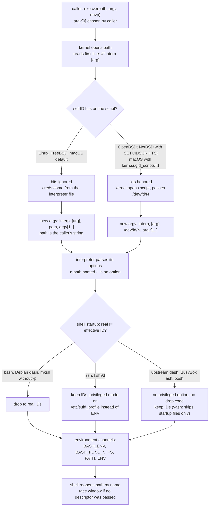

# setuid and Interpreted Scripts

> [!summary] Claim
> A set-user-ID bit on a `#!` script is ignored by Linux, FreeBSD, and default macOS, and where a kernel does honor it the script is only safe if the kernel passes an already-open descriptor, the shell refuses to trust its environment, and no caller-controlled name, variable, or path reaches the interpreter, so the robust design is a fixed compiled entry point (`sudo`, a service manager, or a tiny wrapper) that sets all three IDs and a clean environment before it runs the script.

Part of [Files, Filesystems, and Permissions](README.md) in [Shell and Unix Engineering](../README.md).

## TL;DR

- Mechanism: `execve()` on a script makes the kernel read the `#!` line, then exec the interpreter with the script's *pathname*; the interpreter reopens that path, and the credential change is computed from whichever file the kernel decides is the program.
- Rule: never rely on the set-user-ID bit of a script; grant privilege through `sudo` with `env_reset` and `secure_path`, a service manager, or a compiled wrapper that sets real, effective, and saved IDs and passes a fixed environment.
- Trap: a privileged script is attacked through what it does not own: the gap between the kernel's open and the interpreter's reopen, a link named `-i`, and environment channels such as `BASH_ENV`, exported bash functions, `SHELLOPTS`, `PS4`, `IFS`, and `PATH`.
- Portability fact: Linux, FreeBSD, and default macOS (`kern.sugid_scripts=0`) ignore set-ID bits on scripts; OpenBSD honors them and hands the shell `/dev/fd/N`; NetBSD does only with `options SETUIDSCRIPTS`; bash, Debian dash, and mksh drop privileges by default while zsh and ksh93 keep them.
- When not to use it: any time the privileged logic is more than a few fixed commands, or an untrusted user controls any input, write the privileged part in a compiled language or move it behind a service with a narrow API instead of a shell script.

## Mental model



The caller controls everything on the left edge: the path string, the argument vector, and the environment.
The kernel reads the `#!` line from the file it resolved, decides whether the script's set-ID bits count, and builds a new argument vector in which the caller's path string, not the inode it checked, names the script.
If the kernel honors the bits it must also pin the file, which the BSD lineage does by opening it and substituting `/dev/fd/N`; Linux and FreeBSD instead refuse to honor the bits at all.
The interpreter then parses that argument vector with its normal option parser, so a script whose path begins with `-` becomes an option unless the `#!` line ends options with `-`.
Next the shell decides, from the real and effective IDs it was started with, whether to drop privileges, and the families split here.
Finally, before the first line of the script runs, the shell imports variables and functions from the environment the caller supplied and reopens the script by name, which is where every historical exploit lives.

## How it works

### The kernel's `#!` handler, step by step

POSIX does not standardize `#!`: "If the first line of a file of shell commands starts with the characters "#!", the results are unspecified" (POSIX.1-2024 XCU 2.1), and XSH `exec` RATIONALE describes `#!` only as one of two historical ways systems run scripts.
Every real kernel implements it as an image activator that runs when the first two bytes of the file are `#!`.

On Linux, `load_script()` in `fs/binfmt_script.c` checks `bprm->buf[0] == '#'` and `bprm->buf[1] == '!'`, where `bprm->buf` holds the first `BINPRM_BUF_SIZE` (256) bytes of the file (`include/uapi/linux/binfmts.h`).
It returns `ENOEXEC` if the interpreter *name* would be truncated, but silently truncates the optional argument, with the comment "Truncating the arguments is fine: the interpreter can re-read the script to parse them on its own" (Linux v7.4-rc2 `fs/binfmt_script.c`, `load_script`).
Everything after the first space or tab following the interpreter name, with trailing blanks trimmed, becomes one argument, internal spaces included.
`load_script()` then calls `remove_arg_zero()`, pushes the script's `bprm->interp` (the filename the caller passed to `execve()`), the optional argument, and the interpreter name, and opens the interpreter with `open_exec(i_name)`.
`exec_binprm()` in `fs/exec.c` loops back through the handlers with the interpreter as the new file, and its comment says "This allows 5 levels of binfmt rewrites before failing hard" (`depth > 5` returns `ELOOP`); execve(2) describes the same limit as "up to a limit of four recursions" for scripts whose interpreter is itself a script, permitted since Linux 2.6.28.

XNU (macOS) does the same work in `exec_shell_imgact()` in `bsd/kern/kern_exec.c`, but with three differences visible in its source and in the lab.
First, it splits the text after `#!` on whitespace into separate arguments (the loop that calls `exec_add_user_string()` once per token in `exec_extract_strings()`), so `#!/x -a -b` yields two arguments where Linux yields one.
Second, the line must fit in `IMG_SHSIZE` (512) bytes (`bsd/sys/imgact.h`) or the exec fails with `ENOEXEC`.
Third, it refuses to treat an interpreter as a script once `IMGPF_INTERPRET` is set, so a script cannot be another script's interpreter; on this host `execve()` of such a script failed with "Exec format error".
FreeBSD's `exec_shell_imgact()` in `sys/kern/imgact_shell.c` likewise returns `ENOEXEC` for a nested script ("Don't allow a shell script to be the shell for a shell script"), caps the line at `MAXSHELLCMDLEN` (`PAGE_SIZE`, `sys/sys/imgact.h`), and returns `ENAMETOOLONG` for an interpreter name of `MAXINTERP` (`PATH_MAX`) bytes or more.

In every implementation the caller's `argv[0]` disappears: "there is no way to get the argv[0] that was passed to the execve() call" (Linux execve(2)).
The XNU execve(2) page says the zeroth argument "is left unchanged", but the XNU source replaces it with the interpreter path, and the lab measured `argv[0]` equal to the interpreter path on macOS 27.3; trust the code, not that sentence.

### Where the credentials come from

The script's own mode bits matter only if the kernel computes credentials from the script.
Linux computes them once, at the point of no return in `begin_new_exec()`, by calling `bprm_creds_from_file()`, which selects `bprm->execfd_creds ? bprm->executable : bprm->file` and passes it to `bprm_fill_uid()` (Linux v7.4-rc2 `fs/exec.c`, `bprm_creds_from_file`).
After `exec_binprm()` has swapped `bprm->file` for each interpreter in turn, `bprm->file` is the final ELF interpreter, so the script's `S_ISUID` bit is never read; file capabilities follow the same file through `security_bprm_creds_from_file()`.
That is why the man page can say "Linux (like most other modern UNIX systems) ignores the set-user-ID and set-group-ID bits on scripts" (Linux execve(2)).
`bprm_fill_uid()` also returns early, ignoring the bits even on real binaries, when `mnt_may_suid()` fails (a `nosuid` mount) or `task_no_new_privs()` is set, and it re-checks `MAY_EXEC` under the inode lock with the comment "Did the exec bit vanish out from under us? Give up."
The only Linux path that honors set-ID bits on an interpreted file is `binfmt_misc` with the `C` flag, which sets `execfd_creds`: "When this flag is included, these attributes are calculated according to the binary. It also implies the ``O`` flag", and `O` passes an open descriptor through `AT_EXECFD` instead of a path (Linux `Documentation/admin-guide/binfmt-misc.rst`).
That design is the safe one, because the interpreter receives the very file the kernel checked, but it is a root-only, system-wide registration for one file format, not a per-script switch.

FreeBSD states the rule directly: "The set-ID bits are not honored if the respective file system has the nosuid option enabled or if the new process file is an interpreter file" (FreeBSD 15.1 execve(2)).
XNU clears `VSUID | VSGID` from the script's attributes in `exec_shell_imgact()` when the `kern.sugid_scripts` sysctl is 0, its compiled-in default (`static int sugid_scripts = 0;` in `kern_exec.c`); `sysctl kern.sugid_scripts` printed `0` on the macOS 27.3 host used for the lab.
If an administrator sets it to 1, XNU keeps the bits and, under `CONFIG_SETUID`, opens the script as a descriptor and passes `"/dev/fd/%d"` instead of the path "so that the script does not get opened twice" (XNU `kern_exec.c`, `exec_shell_imgact`).
OpenBSD always honors set-ID scripts and uses the same trick: "if the script isn't readable, or it's set-id, then we've gotta supply a "/dev/fd/..." for the shell to read" (OpenBSD `sys/kern/exec_script.c`, `exec_script_makecmds`).
NetBSD compiles that code only under `options SETUIDSCRIPTS`, which "Allows scripts with the setuid bit set to execute as the effective user rather than the real user" and also enables `FDSCRIPTS` (NetBSD options(4)); the amd64 `GENERIC` kernel configuration does not set it (as of 2026-11).
The same comment in both BSD sources warns that "stupid shells (csh) do the wrong thing, and close all open fd's when they start", which defeats the descriptor method.

### Why the kernel refuses: the shebang race

Without a descriptor, the kernel opens the file once to read `#!`, and the interpreter opens the *name* again later.
perlsec describes the result: "Between the time the kernel opens the file to see which interpreter to run and when the (now-set-id) interpreter turns around and reopens the file to interpret it, the file in question may have changed, especially if you have symbolic links on your system" (perlsec, Shebang Race Condition).
An attacker makes a symbolic link to a set-ID script, executes the link, and repoints it at their own file in that window; the interpreter, already running with the script owner's effective ID, executes the attacker's file.
The lab's first test shows the precondition on macOS and asserts the same for Linux (the Linux arm follows `load_script()` but has not yet been run in the shell matrix): executing `./link` makes the interpreter's argument the string `./link`, not the target and not a descriptor.
The race is the general check-then-use problem of [[Path-Resolution-and-Symlink-Races]]; the kernel-level fixes are either to stop honoring the bits (Linux, FreeBSD, macOS default) or to pass the checked file as `/dev/fd/N` (OpenBSD, NetBSD option, macOS sysctl, and per perlsec "Most modern releases of SysVr4 and BSD 4.4").
`sudo` meets the same race when it verifies a command's digest and then executes it; its `fdexec` setting executes "by file descriptor" to avoid "a time of check versus time of use race condition", and the sudoers manual warns that this changes `$0` of scripts to `/dev/fd/4` on Solaris or `/proc/self/fd/4` on Linux (sudoers(5), `fdexec`).

### The `-i` trapdoor

Because the kernel inserts the caller's path string as an argument, a set-ID script reachable under the name `-i` is run as `sh -i`, an interactive shell with the script owner's privileges reading the attacker's terminal.
The POSIX rationale records this: "On systems that support set-user-ID scripts, a historical trapdoor has been to link a script to the name -i", which is why the standard "allows the single `<hyphen-minus>` to mark the end of the options, in addition to the use of the regular "--" argument" (POSIX.1-2024 XCU `sh`, RATIONALE).
The same paragraph says the KornShell alternative, requiring real and effective IDs to match for an interactive shell, "is specifically allowed".
The attack needs a relative path with no `./` prefix to reach `execve()`, which `execvp()` and shells produce only from an empty or `.` `PATH` element, or a program that calls `execve()` directly as the lab's `execprobe` does.
The lab runs a script named `-i` both ways: with a bare `#!/path/to/sh` every tested shell became interactive and never ran the script, and with `#!/path/to/sh -` every tested shell ran it.
Ending the `#!` line with ` -` costs nothing, works with Linux's single-argument rule, and is the one portable hardening step the script itself can take.

### What the shell does when started with real != effective IDs

The kernel's decision is only the first gate; a setuid C program that calls `system()` or `popen()`, or a wrapper that executes a script, starts the shell with mismatched IDs, and each shell reacts differently.

bash calls `uidget()` early in `main()`, which records real, effective, and saved IDs with `getresuid()` and returns true if real and effective user or group IDs differ, and then runs `if (running_setuid && privileged_mode == 0) disable_priv_mode ();` (bash-5.3 `shell.c`, `main`).
`disable_priv_mode()` calls `setresuid(uid, uid, uid)` when the effective or saved ID differs from the real one, and the same for groups (bash-5.3 `shell.c`, `disable_priv_mode`).
The man page states the user-visible contract: without `-p`, "no startup files are read, shell functions are not inherited from the environment, the SHELLOPTS, BASHOPTS, CDPATH, and GLOBIGNORE variables, if they appear in the environment, are ignored, and the effective user id is set to the real user id" (bash-5.3 `doc/bash.1`, INVOCATION).
`initialize_shell_variables()` receives `privileged_mode||running_setuid` and skips `BASH_FUNC_name%%` imports when it is set (bash-5.3 `variables.c`), and `run_startup_files()` reads `BASH_ENV` only for a non-interactive shell with `posixly_correct == 0 && act_like_sh == 0 && privileged_mode == 0` (bash-5.3 `shell.c`).
Before the fix for CVE-2019-18276, bash "through 5.0 patch 11" dropped only the effective ID, so "the saved UID is not dropped" and an attacker with command execution could load a builtin with `enable -f` that calls `setuid()` to regain privileges; "binaries running with an effective UID of 0 are unaffected" because a root `setuid()` changes all three IDs (NVD CVE-2019-18276; POSIX.1-2024 XSH `setuid`).

Upstream dash has no privileged option at all: its option table runs from `errexit` to `debug` with no `privileged` entry (dash `src/options.c`), and it reads `ENV` only when interactive, with an extra `getuid() == geteuid() && getgid() == getegid()` test compiled only `#ifndef linux` (dash `src/main.c`, `main`).
Debian and Ubuntu add `9001-Add-privmode.diff`, Tavis Ormandy's 2013 patch, whose `setprivileged()` calls `setuid(uid)` and `setgid(gid)` when `-p` is off and the IDs differ, "To limit bogus system(3) or popen(3) calls in setuid binaries" (Debian dash 0.5.13.5-1); Debian first shipped it in dash 0.5.8-2.6 ("Closes: #734869, LP: #1215660", Debian dash `debian/changelog`), and Launchpad bug 1215660 cites vmware-mount calling `popen()` on a relative `lsb-release` name (CVE-2013-1662).
That patch calls `setuid()` and then `setgid()`; for a non-root effective ID, POSIX `setuid()` changes only the effective ID and leaves the saved set-user-ID, the same shape as CVE-2019-18276 (inference from the patch and POSIX.1-2024 XSH `setuid`, not a published advisory).

zsh does the opposite: `PRIVILEGED` "is enabled automatically on startup if the effective user (group) ID is not equal to the real user (group) ID", and only "turning the option off causes the effective user and group IDs to be set to the real user and group IDs"; the documentation recommends `unsetopt privileged || exit` because the drop can fail (zsh `Doc/Zsh/options.yo`, `PRIVILEGED`).
In privileged mode zsh skips user startup files, and as `sh` or `ksh` it sources `/etc/suid_profile` and ignores `ENV`.
ksh93 behaves the same way: `-p` "is on whenever the effective UID (GID) is not equal to the real UID (GID)", uses `/etc/suid_profile` instead of `ENV`, and turning it off resets the IDs (ksh93u+m `sh.1`); its `applyopts()` also turns the flag straight back off when someone sets it while the IDs already match (ksh93u+m `src/cmd/ksh93/sh/args.c`).
mksh starts privileged, processes only the suid profile, "and finally drops privileges if the -p (-o privileged) shell flag was neither given on the command line nor set during execution of the startup files" (mksh(1), Startup files); `change_flag()` refuses to turn `-p` on later with the comment "no getting back dropped privs" (mksh `misc.c`).
BusyBox ash has no `p` in its option table and copies dash's `#ifndef linux` guard around `ENV` (BusyBox 1.37 `shell/ash.c`, `ash_main`); yash's `set` documentation lists no privileged option, and its `main()` only skips the login profile and the rcfile (the `ENV` file in POSIX mode) when real and effective IDs differ, with no ID-changing call in `yash.c` (yash trunk `yash.c`); posh 0.14.1's man page still describes pdksh's privileged mode, but its option table in `misc.c` has no `p` entry, and neither `main.c` nor `misc.c` calls `setuid()`.

### The environment is the attack surface

Even with the kernel race closed, the caller still writes the privileged shell's environment, and shells read code from it.
`BASH_ENV` names a file that a non-interactive bash sources before the script; the lab shows a payload running before `victim.sh` in bash outside POSIX mode and nowhere else, because bash invoked as `sh` (macOS `/bin/sh`) and all other shells read `ENV` only when interactive.
Exported functions travel as `BASH_FUNC_name%%=() { ...; }` (`BASHFUNC_PREFIX` and `BASHFUNC_SUFFIX` in bash-5.3 `variables.c`); the lab shows `BASH_FUNC_cat%%` replacing the external `cat` inside a script in every bash mode, including macOS bash 3.2 as `/bin/sh`.
The parser that imported those functions was Shellshock: bash "through 4.3 processes trailing strings after function definitions in the values of environment variables", exploitable wherever "setting the environment occurs across a privilege boundary from Bash execution" (NVD CVE-2014-6271).
`SHELLOPTS=xtrace` plus `PS4='$(cmd)'` executed commands "with root privileges" in bash before 4.4 (NVD CVE-2016-7543), which is why privileged mode ignores `SHELLOPTS`.
`IFS` was the original setuid-script killer, covered in [[Field-Splitting-and-IFS]]; POSIX.1-2024 now says "The shell shall set IFS to `<space><tab><newline>` when it is invoked" (XCU 2.5.3), every modern shell in the lab does, and posh 0.14.1 is the exception the lab asserts: it splits `a/b` on an `IFS=/` inherited from the environment.
`PATH`, locale variables, `TMPDIR`, `CDPATH`, and the inherited umask, resource limits, signal dispositions, and open descriptors are equally caller-controlled ([[Environment-Variables-and-Inheritance]], [[Close-on-Exec-and-Descriptor-Inheritance]]).
glibc's `AT_SECURE` scrubbing of `LD_PRELOAD` and friends protects the interpreter binary's own startup, not the script's variables, and it applies only when the exec itself changed credentials, which for a script means the interpreter binary was set-ID or carried file capabilities ([[Program-Startup-argv-envp-and-ARG_MAX]]).

### Interpreters other than the shell

Perl enables taint mode "when it detects its program running with differing real and effective user or group IDs" (perlsec), and it used to ship `suidperl`, which "used to provide a mechanism to emulate setuid permission bits on systems that don't support it properly" and "is no longer part of Perl" as of 5.12 (perl5120delta, Deprecations).
perlsec's prescribed fix for kernels without safe set-ID scripts is a compiled wrapper with a hard-coded `REAL_PATH`, made set-ID instead of the script, and it notes that the wrapper "isn't doing anything to sanitise the execution environment other than ensuring that a safe path to the script is used".
Linux now gives interpreters a kernel hook for the related question of whether a script may run at all: `execveat()` with `AT_EXECVE_CHECK`, ideally with `AT_EMPTY_PATH` "to check against a file descriptor instead of a path", plus the `SECBIT_EXEC_RESTRICT_FILE` and `SECBIT_EXEC_DENY_INTERACTIVE` securebits (Linux `Documentation/userspace-api/check_exec.rst`, as of 2026-11); it governs execution policy, not credentials.

## Numbers and limits

| Quantity | Value | Source |
|---|---|---|
| Linux `#!` buffer `BINPRM_BUF_SIZE` | 256 bytes | `include/uapi/linux/binfmts.h`, Linux v7.4-rc2 (as of 2026-11) |
| Linux text after `#!` honored | 255 characters since Linux 5.1, 127 before | Linux execve(2), man-pages 6.19 (2026-02-08) |
| Linux binfmt rewrites before `ELOOP` | loop allows `depth` 0 to 5 ("5 levels of binfmt rewrites"); man page says four script recursions | `fs/exec.c` `exec_binprm`, v7.4-rc2; execve(2) |
| Linux arguments from the `#!` line | at most 1, internal spaces kept | `fs/binfmt_script.c` `load_script`; lab test 1 |
| XNU `#!` line limit `IMG_SHSIZE` | 512 bytes | `bsd/sys/imgact.h` (xnu main, as of 2026-11) |
| XNU arguments from the `#!` line | one per whitespace-separated word | `kern_exec.c` `exec_extract_strings`; lab test 1 |
| XNU `kern.sugid_scripts` default | 0 (set-ID scripts ignored) | `kern_exec.c`; `sysctl` on macOS 27.3, measured 2026-11-15 |
| FreeBSD `#!` line limit `MAXSHELLCMDLEN` | `PAGE_SIZE` | `sys/sys/imgact.h` (main, as of 2026-11) |
| FreeBSD and NetBSD interpreter name `MAXINTERP` | `PATH_MAX` | `sys/sys/param.h` in each tree (as of 2026-11) |
| OpenBSD interpreter line `MAXINTERP` | 128 bytes | OpenBSD `sys/sys/param.h` (as of 2026-11) |
| Nested script as interpreter | Linux yes (since 2.6.28); macOS and FreeBSD `ENOEXEC` | execve(2); XNU and FreeBSD sources; macOS measured by hand on this host |
| Shell families that keep privileges when real != effective ID | 2 (zsh, ksh93); bash, mksh, Debian dash drop | zsh options.yo, ksh93u+m `sh.1`, bash.1, mksh(1), dash patch 9001 |
| bash releases with the saved-UID bug | through 5.0 patch 11 | NVD CVE-2019-18276 (published 2019-11-28) |
| bash releases with the Shellshock parser | through 4.3 | NVD CVE-2014-6271 (published 2014-09-24) |
| Perl release that removed `suidperl` | 5.12.0 | perl5120delta |

## Portability

Kernel behavior for a script with the set-user-ID bit:

| Kernel | Honors set-ID on `#!` scripts | Script handed to interpreter as | Source |
|---|---|---|---|
| Linux | No (creds from the interpreter file) | the caller's path string | execve(2); `fs/exec.c` `bprm_creds_from_file`; lab test 1 |
| Linux `binfmt_misc` with `C` | Yes, for the registered format | descriptor via `AT_EXECFD` (`O` implied) | `binfmt-misc.rst` |
| macOS (XNU) default | No (`kern.sugid_scripts=0`) | the caller's path string | `kern_exec.c`; lab test 1 |
| macOS with `kern.sugid_scripts=1` | Yes | `/dev/fd/N` | `kern_exec.c` `exec_shell_imgact` |
| FreeBSD | No | the caller's path string | FreeBSD 15.1 execve(2) |
| OpenBSD | Yes | `/dev/fd/N` when set-ID or unreadable | `exec_script.c` |
| NetBSD | Only with `options SETUIDSCRIPTS` | `/dev/fd/N` (`FDSCRIPTS` implied) | `exec_script.c`; options(4) |

Shell behavior; "lab" means the lab asserts the cell for that family:

| Shell | `#!` with trailing ` -` runs a script named `-i` | `set -p` / `set -o privileged` | Started with real != effective ID | `BASH_ENV` before a script | `BASH_FUNC_x%%` imported | `IFS` from environment |
|---|---|---|---|---|---|---|
| POSIX sh | required: a single `-` is "treated as the first operand and then ignored" (XCU `sh` OPERANDS) | not specified | unspecified; may refuse an interactive shell (XCU `sh` RATIONALE) | not specified | not specified | "shall set IFS to `<space><tab><newline>` when it is invoked" (XCU 2.5.3) |
| macOS bash 3.2 as `/bin/sh` | yes (lab) | `p` on, long name ok (lab) | drops euid unless `-p` (bash.1); saved ID kept (CVE-2019-18276) | no, POSIX mode (lab) | yes (lab) | reset (lab) |
| bash 5.3 (5.3.15 in the lab) | yes (lab) | `p` on, long name ok (lab) | drops real, effective, saved via `setresuid` unless `-p` (bash-5.3 `shell.c`) | yes (lab) | yes, unless privileged (lab, `variables.c`) | reset (lab) |
| zsh native | yes (lab) | `p` on, long name ok (lab) | keeps IDs, `PRIVILEGED` on; `unsetopt privileged` drops (options.yo) | no (lab) | no (lab) | reset (lab) |
| zsh `--emulate sh` | yes, via a link named `sh` (lab) | `p` on, long name ok (lab) | as native, plus `/etc/suid_profile`, `ENV` ignored (options.yo) | no (lab) | no (lab) | reset (lab) |
| dash upstream | yes (lab) | rejected (lab, `options.c`) | no privileged mode; `ENV` gated on IDs only `#ifndef linux` (`main.c`) | no (lab) | no (lab) | reset (lab) |
| dash Debian/Ubuntu | yes (lab) | `p` on, long name ok (lab accepts either dash build) | drops unless `-p` (patch 9001) | no (lab) | no (lab) | reset (lab) |
| ksh93 (u+ 2012 and u+m) | yes (lab, u+ 2012) | accepted, stays off when IDs match (lab, `args.c`) | keeps IDs, `-p` on, `/etc/suid_profile` (`sh.1`) | no (lab) | no (lab) | reset (lab) |
| mksh | matrix | accepted, stays off (lab assertion, `misc.c`) | suid profile, then drops unless `-p` (mksh(1)) | no (lab assertion) | no (lab assertion) | reset (lab assertion) |
| yash | matrix | rejected (lab assertion, `_set.txt`) | keeps IDs; skips profile and rcfile (`ENV` in POSIX mode) when IDs differ (`yash.c` `main`) | no (lab assertion) | no (lab assertion) | reset (lab assertion) |
| posh 0.14.1 | matrix | rejected (lab assertion, `misc.c`) | no option and no `setuid()` call in `main.c` or `misc.c`, despite its man page | no (lab assertion) | no (lab assertion) | inherited, contrary to XCU 2.5.3 (lab assertion; matrix-confirmed divergence) |
| BusyBox ash 1.37 | matrix | rejected (lab assertion, `ash.c`) | no privileged mode; `ENV` gated on IDs only `#ifndef linux` (`ash_main`) | no (lab assertion) | no (lab assertion) | reset (lab assertion) |

Cells marked "lab" were run on the macOS host on 2026-11-15 (bash 3.2.57 as `sh`, bash 5.3.15, dash, zsh 5.9.2 native and `--emulate sh`, ksh93u+ 2012-08-01); cells marked "lab assertion" are what the lab asserts for shells only the integration matrix runs, and "matrix" means the lab asserts the universal result for that shell.
Related utilities: `sudo` resets the environment by default (`env_reset`), can replace `PATH` with `secure_path` "To help protect scripts and programs that execute other commands without first setting PATH to a safe value", and executes digest-checked commands by descriptor (`fdexec`, default `digest_only`) (sudoers(5) on sudo.ws, as of 2026-11).

## Worked example

The [lab](../labs/10-setuid-and-interpreted-scripts/) needs no privileges: it proves each link in the chain separately, using two tiny C programs compiled with `"${CC:-cc}"`.
`showargv` is used as a `#!` interpreter to print the argument vector the kernel built, and `execprobe` calls `execve()` with a path exactly as given, so a relative name such as `-i` reaches the kernel unchanged.

`execprobe.c`:

```c
/* execprobe.c - call execve(PATH, [PATH, ARG...], environ) exactly once.
 * Unlike a shell or execvp(), it performs no PATH search and does not prefix "./",
 * so a relative PATH such as "-i" reaches the kernel, and therefore the #!
 * interpreter, byte for byte.
 * Usage: execprobe PATH [ARG...]
 * Exit status: 127 with a diagnostic on stderr if execve() fails.
 */
#include <errno.h>
#include <stdio.h>
#include <string.h>
#include <unistd.h>

extern char **environ;

int main(int argc, char **argv)
{
  if (argc < 2) {
    fprintf(stderr, "usage: execprobe PATH [ARG...]\n");
    return 2;
  }
  execve(argv[1], argv + 1, environ);
  fprintf(stderr, "execprobe: execve %s: %s\n", argv[1], strerror(errno));
  return 127;
}
```

`showargv.c`, the `#!` interpreter that prints the argument vector the kernel built:

```c
/* showargv.c - print every argv element as "argv[N]=<VALUE>", one per line.
 * Used as the #! interpreter of a script, it shows exactly the argument vector the
 * kernel built: the interpreter path, the #! argument(s), the script pathname, and
 * the caller's arguments; argv[0] passed to execve() is gone.
 */
#include <stdio.h>

int main(int argc, char **argv)
{
  for (int i = 0; i < argc; i++) {
    printf("argv[%d]=<%s>\n", i, argv[i]);
  }
  return 0;
}
```

`payload.sh`, the file an attacker points `BASH_ENV` or `ENV` at:

```sh
# shellcheck shell=sh
# payload.sh - the file an attacker points BASH_ENV or ENV at.
# A shell that sources it before running a script prints the marker below first.
echo payload-ran
```

`victim.sh`, the stand-in for a privileged script:

```sh
#!/bin/sh
# victim.sh - stands in for a privileged script: it runs one external command by name.
# Usage: victim.sh FILE
# Prints "victim:" followed by the first line of FILE as read by whatever "cat" resolves to.
# An environment that defines a bash function named cat, or a BASH_ENV file, changes what runs.
content=$(cat "$1")
printf 'victim:%s\n' "$content"
```

`setuid_scripts.bats`:

```bash
#!/usr/bin/env bats
# What a set-ID interpreted script is exposed to, shown without privileges:
# how the kernel builds the interpreter's argv from a #! line, the "-i" trapdoor and its "-" fix,
# which shells have a privileged mode, and the environment channels (BASH_ENV, exported
# functions, IFS) that let a caller run code inside someone else's script.

setup() {
  load ../lib/lab
  T=$BATS_TEST_TMPDIR
  VICTIM="$BATS_TEST_DIRNAME/victim.sh"
  PAYLOAD="$BATS_TEST_DIRNAME/payload.sh"
  EXECPROBE="$T/execprobe"
  SHOWARGV="$T/showargv"
  # A missing compiler must fail the test, never skip it.
  "${CC:-cc}" -o "$EXECPROBE" "$BATS_TEST_DIRNAME/execprobe.c"
  "${CC:-cc}" -o "$SHOWARGV" "$BATS_TEST_DIRNAME/showargv.c"
  printf 'data\n' >"$T/data.txt"
}

# shebang_interp: print an absolute interpreter path that starts the shell under test from a #! line.
# A #! line carries at most one argument on Linux, so a multi-word LAB_SHELL becomes a symlink whose
# name selects the mode: "busybox ash" -> a link named ash (BusyBox picks the applet from argv[0]),
# "zsh --emulate sh" -> a link named sh (zsh emulates sh when invoked as sh).
shebang_interp() {
  local first
  lab_shell_words
  first=$(command -v "${LAB_SHELL_WORDS[0]}") || return 1
  case "${LAB_SHELL_WORDS[*]}" in
    "${LAB_SHELL_WORDS[0]}") printf '%s\n' "$first" ;;
    *" ash")
      ln -s "$first" "$T/ash"
      printf '%s\n' "$T/ash"
      ;;
    *" --emulate sh")
      ln -s "$first" "$T/sh"
      printf '%s\n' "$T/sh"
      ;;
    *) return 1 ;;
  esac
}

# make_dash_i_script SUFFIX: create $T/d/-i whose #! line is the shell under test plus SUFFIX,
# and $T/stdin.txt, the commands an interactive shell would read instead of the script.
make_dash_i_script() {
  local interp
  interp=$(shebang_interp)
  mkdir "$T/d"
  printf '#!%s%s\necho script-ran\n' "$interp" "$1" >"$T/d/-i"
  chmod +x "$T/d/-i"
  # shellcheck disable=SC2016 # $- belongs to the shell that reads this file
  printf 'case $- in *i*) echo mode=interactive ;; *) echo mode=other ;; esac\nexit 0\n' >"$T/stdin.txt"
}

@test "the kernel hands the #! interpreter the pathname as passed, not the link target or a descriptor" {
  printf '#!%s -x  -y\n' "$SHOWARGV" >"$T/target.sh"
  chmod +x "$T/target.sh"
  ln -s target.sh "$T/link"
  # shellcheck disable=SC2016 # expansions belong to the shell under test
  run_lab_c 'cd "$1" && "$2" ./link one' inline "$T" "$EXECPROBE"
  [ "$status" -eq 0 ]
  case $(uname -s) in
    Linux)
      # binfmt_script.c: everything after the interpreter name is one argument, spaces included.
      [ "${#lines[@]}" -eq 4 ]
      [ "${lines[0]}" = "argv[0]=<$SHOWARGV>" ]
      [ "${lines[1]}" = "argv[1]=<-x  -y>" ]
      [ "${lines[2]}" = "argv[2]=<./link>" ]
      [ "${lines[3]}" = "argv[3]=<one>" ]
      ;;
    Darwin)
      # XNU exec_shell_imgact: the #! text is split on whitespace into separate arguments.
      [ "${#lines[@]}" -eq 5 ]
      [ "${lines[0]}" = "argv[0]=<$SHOWARGV>" ]
      [ "${lines[1]}" = "argv[1]=<-x>" ]
      [ "${lines[2]}" = "argv[2]=<-y>" ]
      [ "${lines[3]}" = "argv[3]=<./link>" ]
      [ "${lines[4]}" = "argv[4]=<one>" ]
      ;;
    *) false ;;
  esac
}

@test "a script named -i behind a bare #! line starts an interactive shell instead of running" {
  make_dash_i_script ''
  # execprobe passes "-i" to execve unchanged; the kernel then runs: INTERP -i
  # shellcheck disable=SC2016 # expansions belong to the shell under test
  run_lab_c 'cd "$1/d" && HOME=$1 ZDOTDIR=$1 ENV= "$2" -i <"$1/stdin.txt" 2>/dev/null' inline "$T" "$EXECPROBE"
  [ "$status" -eq 0 ]
  # System rc files of an interactive shell may print escape sequences, so look for the marker line.
  [[ "$output" == *mode=interactive* ]]
  [[ "$output" != *script-ran* ]]
}

@test "a lone - after the interpreter on the #! line closes the -i trapdoor in every shell" {
  make_dash_i_script ' -'
  # shellcheck disable=SC2016 # expansions belong to the shell under test
  run_lab_c 'cd "$1/d" && HOME=$1 ZDOTDIR=$1 ENV= "$2" -i <"$1/stdin.txt" 2>/dev/null' inline "$T" "$EXECPROBE"
  [ "$status" -eq 0 ]
  [ "$output" = script-ran ]
}

@test "set -p sticks in bash and zsh, is refused while IDs match in ksh93 and mksh, and is absent in posh, yash and BusyBox" {
  # shellcheck disable=SC2016 # expansions belong to the shell under test
  run_lab_c '
    if (set -p) 2>/dev/null; then
      set -p
      case $- in *p*) short=accepted-p-on ;; *) short=accepted-p-off ;; esac
    else
      short=rejected
    fi
    if (set -o privileged) 2>/dev/null; then long=long-ok; else long=long-rejected; fi
    echo "$short $long"'
  [ "$status" -eq 0 ]
  case $(lab_shell_family) in
    bash | zsh | zsh-sh) [ "$output" = "accepted-p-on long-ok" ] ;;
    # ksh93 and mksh refuse to turn privileged mode on when the real and effective IDs already match.
    ksh93 | mksh) [ "$output" = "accepted-p-off long-ok" ] ;;
    # Upstream dash has no -p; Debian's dash adds it (patch 9001-Add-privmode.diff), so either build passes.
    dash) [ "$output" = "accepted-p-on long-ok" ] || [ "$output" = "rejected long-rejected" ] ;;
    posh | yash | busybox) [ "$output" = "rejected long-rejected" ] ;;
    *) false ;;
  esac
}

@test "BASH_ENV runs caller-chosen code before a non-interactive script only in bash outside POSIX mode" {
  local mode
  # shellcheck disable=SC2016 # expansions belong to the shell under test
  run_lab_c 'case :${SHELLOPTS-}: in *:posix:*) echo posix ;; *) echo native ;; esac'
  mode=$output
  lab_shell_words
  # The launcher exports both variables, then starts the shell under test on the victim script.
  # shellcheck disable=SC2016 # expansions belong to the shell under test
  run_lab_c 'BASH_ENV=$1 ENV=$1; export BASH_ENV ENV; shift; exec "$@"' inline \
    "$PAYLOAD" "${LAB_SHELL_WORDS[@]}" "$VICTIM" "$T/data.txt"
  [ "$status" -eq 0 ]
  case "$(lab_shell_family):$mode" in
    bash:native)
      [ "${#lines[@]}" -eq 2 ]
      [ "${lines[0]}" = payload-ran ]
      [ "${lines[1]}" = victim:data ]
      ;;
    # bash invoked as sh (macOS /bin/sh) and every other shell read ENV only when interactive.
    bash:posix | dash:* | zsh:* | zsh-sh:* | ksh93:* | mksh:* | yash:* | posh:* | busybox:*)
      [ "$output" = victim:data ]
      ;;
    *) false ;;
  esac
}

@test "an exported BASH_FUNC_cat%% variable replaces the external cat inside a bash script" {
  lab_shell_words
  # shellcheck disable=SC2016 # expansions belong to the shell under test
  run_lab_c 'exec env "BASH_FUNC_cat%%=() { echo hijacked; }" "$@"' inline \
    "${LAB_SHELL_WORDS[@]}" "$VICTIM" "$T/data.txt"
  [ "$status" -eq 0 ]
  case $(lab_shell_family) in
    # bash imports exported functions in every mode, including as sh; only privileged mode stops it.
    bash) [ "$output" = victim:hijacked ] ;;
    dash | zsh | zsh-sh | ksh93 | mksh | yash | posh | busybox) [ "$output" = victim:data ] ;;
    *) false ;;
  esac
}

@test "an IFS from the environment reaches the script in posh and is reset by every other shell" {
  lab_shell_words
  # shellcheck disable=SC2016 # expansions belong to the shell under test
  run_lab_c 'IFS=/; export IFS; exec "$@"' inline "${LAB_SHELL_WORDS[@]}" -c \
    'printf "a/b\n" | { read -r f1 f2; printf "%s\n" "$f1"; }'
  [ "$status" -eq 0 ]
  case $(lab_shell_family) in
    posh) [ "$output" = a ] ;;
    bash | dash | zsh | zsh-sh | ksh93 | mksh | yash | busybox) [ "$output" = a/b ] ;;
    *) false ;;
  esac
}
```

Captured output (identical under each of the six local shells listed in Portability, macOS 27.3, 2026-11-15):

```
1..7
ok 1 the kernel hands the #! interpreter the pathname as passed, not the link target or a descriptor
ok 2 a script named -i behind a bare #! line starts an interactive shell instead of running
ok 3 a lone - after the interpreter on the #! line closes the -i trapdoor in every shell
ok 4 set -p sticks in bash and zsh, is refused while IDs match in ksh93 and mksh, and is absent in posh, yash and BusyBox
ok 5 BASH_ENV runs caller-chosen code before a non-interactive script only in bash outside POSIX mode
ok 6 an exported BASH_FUNC_cat%% variable replaces the external cat inside a bash script
ok 7 an IFS from the environment reaches the script in posh and is reset by every other shell
```

On macOS, test 1 asserts these `showargv` lines for `#!SHOWARGV -x  -y` executed as `./link one` (the first line carries the absolute path of the compiled probe):

```
argv[0]=<SHOWARGV>
argv[1]=<-x>
argv[2]=<-y>
argv[3]=<./link>
argv[4]=<one>
```

On Linux it asserts `argv[1]=<-x  -y>` as one argument, followed by `argv[2]=<./link>` and `argv[3]=<one>`.

## Pitfalls

> [!warning] The shebang race on a kernel that honors set-ID scripts without a descriptor
> Trigger: a set-ID script on a system that honors the bit but passes the interpreter a pathname, executed through a symbolic link the attacker owns.
> Symptom: the interpreter, already running with the owner's effective ID, opens whatever the link points to by then and runs the attacker's code.
> Incident: perlsec documents the race and the `/dev/fd/3` remedy; the XNU and BSD sources carry the `/dev/fd/%d` substitution for exactly this case.
> Fix: on Linux, FreeBSD, and default macOS the bit is simply ignored; elsewhere, never set it on a script, and put a compiled wrapper with a fixed absolute script path in front instead.

> [!warning] A link named `-i`
> Trigger: a privileged script whose `#!` line is a bare `#!/bin/sh`, reachable as a relative path beginning with `-`.
> Symptom: the shell parses the path as the `-i` option and starts an interactive shell with the script's privileges; the lab shows every tested shell doing this.
> Incident: recorded as "a historical trapdoor" in POSIX.1-2024 XCU `sh` RATIONALE.
> Fix: end the line with ` -` (`#!/bin/sh -`), which the lab shows closes it in every tested shell.

> [!warning] The wrapper that bash silently undoes
> Trigger: a set-user-ID C wrapper that execs `/bin/bash script` (or a script whose `#!` names bash) without first making the real ID equal to the effective ID.
> Symptom: bash sees real != effective, calls `disable_priv_mode()`, and the script runs as the caller, so privileged steps fail with `Permission denied`; the same wrapper in front of zsh or ksh93 keeps full privileges and reads `/etc/suid_profile`.
> Incident: the behavior is the documented contract in bash.1 INVOCATION and zsh `PRIVILEGED`; it is the classic reason "my setuid wrapper does not work".
> Fix: in the wrapper call `setgroups()`, `setgid()`, and `setuid()` as root (or `setresgid()` and `setresuid()` with all three IDs) before `execve()`, check every return value, and pass a fixed `envp`; use `#!/bin/bash -p` only if you have already sanitized everything bash would otherwise ignore.

> [!warning] A privilege drop that leaves the saved ID
> Trigger: a shell or helper that resets only the effective user ID while running set-user-ID to a non-root user.
> Symptom: code running in the shell calls `setuid(saved_uid)` and is privileged again.
> Incident: CVE-2019-18276, bash through 5.0 patch 11, regained privileges through `enable -f` loading a builtin that calls `setuid()` (NVD); bash-5.3 `disable_priv_mode()` now uses `setresuid()` on all three IDs.
> Fix: drop with `setresuid(r, r, r)` and `setresgid(g, g, g)` (or root-only `setuid()`), then verify with `getresuid()` that no ID kept the old value.

> [!warning] `system()` and `popen()` from a set-ID binary
> Trigger: a set-ID program runs `popen("lsb_release ...")` or `system()` with a relative command name, which starts `/bin/sh -c` with the caller's `PATH`.
> Symptom: a planted `lsb_release` earlier in `PATH` runs with the program's privileges.
> Incident: CVE-2013-1662, vmware-mount on Debian-based systems "allows host OS users to gain host OS privileges via a crafted lsb_release binary in a directory in the PATH, related to use of the popen library function" (NVD); Launchpad bug 1215660 led Debian and Ubuntu to add privilege dropping to dash.
> Fix: never call the shell from a set-ID program; use `posix_spawn()` or `execve()` with an absolute path and a fixed environment ([[Command-Injection]]).

> [!warning] Environment-borne code in a privileged bash
> Trigger: a privilege boundary (CGI, `sshd` `ForceCommand`, DHCP client hooks, a misconfigured `sudo` with `env_reset` off) passes caller variables into bash.
> Symptom: `BASH_ENV`, `BASH_FUNC_name%%`, or `SHELLOPTS` plus `PS4` run caller code before or during the script; the lab reproduces the first two.
> Incident: CVE-2014-6271 (Shellshock) and CVE-2016-7543 (`SHELLOPTS` and `PS4`, bash before 4.4), both from NVD.
> Fix: keep `env_reset` on in sudoers, start privileged scripts with `env -i` and an explicit allowlist, and run current bash.

> [!warning] Assuming the bit protects or works on every mount
> Trigger: relying on set-ID binaries (or wrappers) that live on a `nosuid` mount, inside a container with `no_new_privs`, or under a debugger.
> Symptom: the bits are ignored and the program runs as the caller, or on some Linux versions `execve()` fails with `EPERM` on a `nosuid` mount.
> Incident: Linux execve(2) lists `no_new_privs`, `nosuid`, and being ptraced as conditions that ignore set-ID bits and file capabilities, and notes that `nosuid` behavior "varies across Linux kernel versions".
> Fix: test privilege paths in the real deployment environment and fail closed: have the wrapper verify `geteuid()` before doing work ([[Mounts-and-Mount-Namespaces]]).

## Security and robustness

Treat a set-ID bit on a script as a configuration error, and have audits look for it with `find / -xdev -type f -perm -4000` or `-perm -2000` followed by a check of the first two bytes for `#!`.
On kernels that ignore the bit it is dead weight that misleads reviewers, and on kernels that honor it the script inherits every problem above.
On Linux, a write to a set-user-ID regular file by a process without `CAP_FSETID` clears the bit ("suid always must be killed" in `setattr_should_drop_suidgid()`, `fs/attr.c`), so an in-place edit silently changes the mode; [[Permissions-umask-and-Special-Bits]] owns the details.

If a script really must run with another identity, build the boundary in this order:
1. A fixed, compiled entry point: `sudo` with a narrow sudoers rule, a systemd unit or launchd job triggered over a socket, or a wrapper like the sketch below.
2. Full identity change before the interpreter starts: supplementary groups, then group ID, then user ID, all three of real, effective, and saved, with every return value checked.
3. A constructed environment, not a filtered one: `PATH=/usr/bin:/bin`, a fixed locale, and nothing else unless allowlisted.
4. Descriptor hygiene: descriptors 0, 1, and 2 open, everything above 2 closed (`closefrom()`, `close_range()`), as covered in [[Close-on-Exec-and-Descriptor-Inheritance]].
5. A script path whose file and every parent directory are owned by root and not writable by anyone else, so no rename or symlink can replace it ([[Path-Resolution-and-Symlink-Races]], [[Atomic-Rename-and-fsync]]).
6. A `#!` line ending in ` -`, `set -eu` at the top, absolute command paths, and quoting of every expansion ([[Command-Search-and-PATH]]).

Illustrative sketch, not part of the lab (syntax-checked with `cc -fsyntax-only` only): a root-owned set-user-ID wrapper for one fixed script that ignores the caller's arguments and environment.

```c
/* Illustrative sketch, not part of the lab: a root-owned set-user-ID wrapper for one fixed script. */
#include <grp.h>
#include <stdio.h>
#include <unistd.h>

int main(void)
{
  static char *const argv[] = {"/bin/sh", "--", "/usr/local/libexec/rotate-logs.sh", NULL};
  static char *const envp[] = {"PATH=/usr/bin:/bin", "LC_ALL=C", NULL};

  /* As root, setgid() and setuid() set the real, effective, and saved IDs together. */
  if (setgroups(0, NULL) != 0 || setgid(0) != 0 || setuid(0) != 0) {
    perror("rotate-logs: cannot set ids");
    return 126;
  }
  execve(argv[0], argv, envp);
  perror("rotate-logs: execve");
  return 127;
}
```

It does not close inherited descriptors above 2 or reset the umask, resource limits, signal mask, or dispositions, all of which the caller still controls; a production version adds those, and that list is the argument for `sudo` or a service manager over a hand-written wrapper.
Because the real ID becomes root before `execve()`, bash, dash, and mksh see matching IDs and do not drop, and zsh and ksh93 do not enter privileged mode.

## The principal's view

The decision is not "how do I make a setuid script safe" but "where does the privilege boundary live, and what language owns the code on the privileged side".
Unix offers three answers: a set-ID executable that the caller starts in an environment the caller controls, a broker such as `sudo` or polkit that re-validates the request and builds a clean context, and a long-running service that never shares a process with the caller.
Set-ID interpreted scripts are the worst version of the first answer, because the privileged program is a general-purpose interpreter whose behavior is driven by files, variables, and names the attacker supplies, and because the kernels that matter most (Linux and macOS) decline to honor the bit at all.
The trade-off is operational: `sudo` rules and service units need packaging, review, and logging, whereas `chmod u+s` needs one command, but that command buys a boundary that does not hold on Linux and leaks on systems where it does.
Choose `sudo` with `env_reset`, `secure_path`, and a full command path for operator actions; choose a service with a socket and a narrow request format for anything a program triggers; and move logic that parses untrusted input into a compiled language or a memory-safe one where arguments are arrays and no implicit shell exists.
Keep the shell for the unprivileged orchestration around that boundary, where its weaknesses cost nothing.

## Interview questions

> [!question] L5: Why does `chmod u+s myscript.sh` not make the script run as its owner on Linux?
>
> > [!success]- Answer
> > On `execve()` the `#!` handler swaps the file being executed for the interpreter, and Linux computes the new credentials in `bprm_creds_from_file()` from that final file.
> > The script's set-user-ID bit is never consulted, so the interpreter runs with the caller's IDs unless the interpreter binary itself is set-ID.
> > Linux execve(2) states the rule directly: "Linux (like most other modern UNIX systems) ignores the set-user-ID and set-group-ID bits on scripts."
> >
> > Follow-up: Which Linux mechanism can compute credentials from a non-ELF file, and what does it pass to the interpreter instead of a path?

> [!question] L5: Predict the output: in an empty directory you create a file named `-i` containing `#!/bin/sh` and `echo script-ran`, make it executable, and run a C program that calls `execve("-i", ...)` with stdin holding `case $- in *i*) echo interactive ;; esac`.
>
> > [!success]- Answer
> > It prints `interactive` and never prints `script-ran`.
> > The kernel builds `/bin/sh -i`, the shell parses `-i` as the interactive option, and it reads commands from stdin instead of the script.
> > With `#!/bin/sh -` it prints `script-ran`, because `-` ends option processing (POSIX.1-2024 XCU `sh` RATIONALE).
> >
> > Follow-up: Why does `./-i` typed at a prompt not trigger the trapdoor?

> [!question] L6: What is the shebang race, and how do OpenBSD and opt-in macOS make set-ID scripts immune to it?
>
> > [!success]- Answer
> > The kernel opens the script to read `#!`, starts the now-privileged interpreter, and the interpreter opens the script again by name.
> > Between those opens an attacker can repoint a symbolic link from the set-ID script to their own file.
> > OpenBSD, NetBSD with `SETUIDSCRIPTS`, and XNU with `kern.sugid_scripts=1` open the checked vnode as a descriptor and pass `/dev/fd/N`, so the interpreter reads the same file the kernel checked.
> > Shells that close all descriptors at startup break this, which the BSD source comments blame on csh.
> >
> > Follow-up: Why does `sudo`'s `fdexec` change `$0` in scripts, and what does the sudoers manual suggest instead?

> [!question] L6: A setuid-root C wrapper does `execl("/bin/bash", "bash", "/opt/tool.sh", NULL)` and the script's writes to `/var/lib/tool` fail with `Permission denied`, yet the same wrapper pointing at `/bin/zsh` works; explain why.
>
> > [!success]- Answer
> > The wrapper ran with real ID = caller and effective ID = 0.
> > bash sees real != effective, and without `-p` it calls `disable_priv_mode()`, which resets the effective (and in bash-5.3 also the saved) ID to the real ID, so the script runs as the caller.
> > zsh instead turns on `PRIVILEGED` automatically and keeps the IDs.
> > The fix is for the wrapper to set real, effective, and saved IDs to 0 (as root, `setgid(0)` and `setuid(0)` after `setgroups()`) and pass a fixed environment, not to add `-p`.
> >
> > Follow-up: What does bash ignore from the environment in privileged mode that it would otherwise import?

> [!question] L6: Debug this script: it is run by a root cron job as `/usr/local/bin/backup` with `#!/bin/bash` and begins `cd "$BACKUP_DIR" && tar czf /backups/x.tgz .`; a security review says any user who can influence the cron environment can run code as root before `cd` executes. How?
>
> > [!success]- Answer
> > A non-interactive bash outside POSIX mode sources `$BASH_ENV` before the first line of the script, and it imports any `BASH_FUNC_name%%` variable as a function that can shadow `cd` or `tar`.
> > The lab shows both: a payload runs before `victim.sh`, and `BASH_FUNC_cat%%` replaces `cat`.
> > Because cron runs it as root with real = effective ID, privileged mode is off and nothing is filtered.
> > Fix: start the job through `env -i PATH=/usr/bin:/bin /usr/local/bin/backup` (or set the cron environment explicitly), use absolute paths, and validate `BACKUP_DIR`.
> >
> > Follow-up: Would `#!/bin/sh` on Debian change the answer, and why?

> [!question] L7+: Why does Linux refuse to honor set-ID scripts while OpenBSD honors them safely, and what would it take to make Linux safe without `binfmt_misc`?
>
> > [!success]- Answer
> > Linux's `binfmt_script` passes the interpreter a pathname (`bprm->interp`), so honoring the bit would reopen the shebang race; computing credentials from the interpreter file avoids it by construction.
> > OpenBSD passes `/dev/fd/N` for set-ID scripts, so the interpreter reads the checked file.
> > A safe Linux design would need the `#!` handler to install a descriptor for the script (as `binfmt_misc` `O` does with `AT_EXECFD`), every interpreter to read from it, and the interpreter to refuse caller-controlled names, options, and environment, which is most of what `sudo` and service managers already do.
> > The kernel also re-checks `MAY_EXEC` under the inode lock in `bprm_fill_uid()`, showing how narrowly it treats even binary set-ID handling.
> >
> > Follow-up: What else, besides the file, does a set-ID process inherit from its caller that a descriptor-passing design does not fix?

> [!question] L7+: You find a fleet of hosts where `/usr/local/sbin/rotate` is a set-user-ID root shell script on hosts running Linux and OpenBSD; what is the actual risk on each, and what do you replace it with?
>
> > [!success]- Answer
> > On Linux the bit is ignored, so the script runs as the caller; the risk is broken functionality and false confidence, and whoever "fixed" it may have made the interpreter itself set-ID.
> > On OpenBSD the bit is honored with `/dev/fd/N`, so there is no race, but the script still runs privileged with the caller's environment, argument vector, umask, limits, and descriptors, and whatever shell the `#!` line names decides whether anything is filtered.
> > Replace it with a sudoers rule naming the absolute path, `env_reset` on, `secure_path` set, and the script owned by root in root-owned directories, or a service triggered over a socket.
> > Then remove the bit and add a fleet audit for `-perm -4000` files beginning with `#!`.
> >
> > Follow-up: How would you prove the audit catches set-group-ID scripts too?

> [!question] L5: Which shells drop privileges by default when started with real != effective IDs, and which keep them?
>
> > [!success]- Answer
> > bash drops unless `-p` (bash.1 INVOCATION), mksh drops after its suid profile unless `-p` was set (mksh(1)), and Debian's dash drops through its privmode patch.
> > zsh and ksh93 keep the IDs and turn privileged mode on automatically.
> > Upstream dash, BusyBox ash, and posh 0.14.1 have no privileged option and no code that drops IDs, so they neither drop nor filter.
> > yash also lists no privileged option; its `main()` keeps mismatched IDs and only skips its profile and rcfile (`ENV` in POSIX mode).
> >
> > Follow-up: Which of these shells read `/etc/suid_profile`, and when?

> [!question] L6: Why is a privilege drop that only calls `setuid(getuid())` insufficient in a set-user-ID-to-non-root program, and what CVE showed it in bash?
>
> > [!success]- Answer
> > For a process without appropriate privileges, POSIX `setuid()` changes only the effective ID; the saved set-user-ID keeps the old effective ID (POSIX.1-2024 XSH `setuid`).
> > Any later code can call `setuid(saved)` and regain the privilege.
> > CVE-2019-18276 was this bug in bash through 5.0 patch 11, exploitable by loading a builtin with `enable -f`; root-owned set-ID programs were unaffected because a root `setuid()` changes all three IDs.
> > Use `setresuid()` with all three IDs and verify with `getresuid()`.
> >
> > Follow-up: Does the same reasoning apply to groups, and in which order must group and user IDs be dropped?

## Related

Prerequisites: [[ACLs-and-Extended-Attributes]]

Next: [[Atomic-Rename-and-fsync]]

See also: [[Permissions-umask-and-Special-Bits]], [[Path-Resolution-and-Symlink-Races]], [[Mounts-and-Mount-Namespaces]], [[Program-Startup-argv-envp-and-ARG_MAX]], [[Environment-Variables-and-Inheritance]], [[Close-on-Exec-and-Descriptor-Inheritance]], [[dev-fd-and-dev-stdin]], [[Field-Splitting-and-IFS]], [[The-set-Builtin-and-Shell-Options]], [[Command-Search-and-PATH]], [[Command-Injection]], [[Dropping-Privileges]], [[sudo-and-sudoers]], [[Sandboxing-Scripts]], [[env-and-Shebang-Tricks]]

## Further reading

- POSIX.1-2024 XCU `sh` RATIONALE: the `-i` trapdoor, the single `-` end-of-options rule, and permission for the KornShell's matching-ID rule.
- POSIX.1-2024 XSH `exec` and `setuid`: how set-ID bits, `ST_NOSUID`, and saved IDs behave, and why `#!` is outside the standard.
- Linux `fs/binfmt_script.c` and `fs/exec.c` (`load_script`, `exec_binprm`, `bprm_creds_from_file`, `bprm_fill_uid`): the exact code that ignores set-ID scripts.
- Linux execve(2): the `#!` length limits, single-argument rule, recursion limit, and conditions that ignore set-ID bits.
- Linux `Documentation/admin-guide/binfmt-misc.rst`: the `C` and `O` flags, the only Linux route to set-ID interpreted programs.
- XNU `bsd/kern/kern_exec.c` (`exec_shell_imgact`): `kern.sugid_scripts`, whitespace splitting, and `/dev/fd/N` substitution.
- OpenBSD and NetBSD `sys/kern/exec_script.c`: the descriptor-passing implementation of safe set-ID scripts and the csh caveat.
- FreeBSD execve(2) and `sys/kern/imgact_shell.c`: the explicit "not honored ... if the new process file is an interpreter file" rule.
- bash-5.3 `shell.c` (`uidget`, `disable_priv_mode`, `run_startup_files`) and `doc/bash.1` INVOCATION: what privileged mode filters.
- zsh `options.yo` `PRIVILEGED`, ksh93u+m `sh.1` `-p`, and mksh(1) Startup files: the shells that keep or conditionally drop privileges.
- Debian dash `9001-Add-privmode.diff` and Launchpad bug 1215660: why `/bin/sh` on Debian and Ubuntu drops privileges.
- perlsec, Shebang Race Condition: the clearest prose account of the race and the C wrapper remedy.
- sudoers(5) `env_reset`, `secure_path`, and `fdexec`: the broker most systems should use instead.
- NVD CVE-2014-6271, CVE-2016-7543, CVE-2019-18276, and CVE-2013-1662: environment injection, option injection, incomplete drop, and `popen()` from a set-ID binary.
