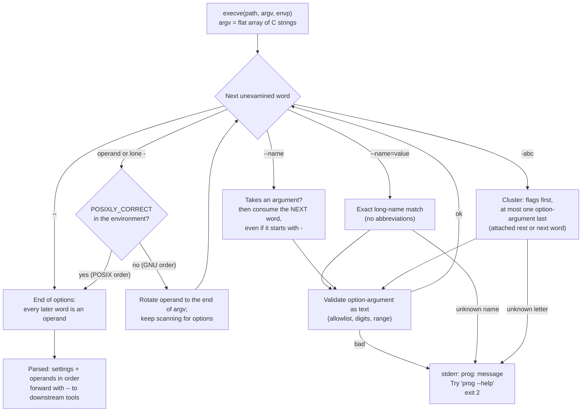

# Argument Parsing and CLI Design

> [!summary] Claim
> A command line is an API whose wire format is a flat array of NUL-terminated strings, so a robust CLI fixes its grammar (POSIX Utility Syntax Guidelines plus a deliberate, tested set of GNU extensions), classifies every word exactly once without `eval`, validates option-arguments as text before using them, and reports misuse on stderr with a distinct exit status.

Part of [Robust Scripting](README.md) in [Shell and Unix Engineering](../README.md).

## TL;DR

- Mechanism: `execve` hands the program an `argv` array with no types and no structure; the parser alone decides which words are options, option-arguments, and operands, by the rules of XBD 12.2 and, in GNU tools, by `getopt_long` permutation.
- Rule: accept `--` as the end of options, pass `--` (or a `./` prefix) to every downstream tool that receives untrusted operands, send `--help` to stdout with status 0, and send usage errors to stderr with a distinct nonzero status (2 by bash and GNU `ls` convention).
- Trap: option-arguments are taken unconditionally (`-o -v` sets the output to `-v`), optional arguments bind only when attached (`--color never` makes `never` an operand), and a file named `-n` becomes an option to `cat *`.
- Portability fact: glibc `getopt` permutes options ahead of operands while musl and Apple libc do not; `POSIXLY_CORRECT` stops `getopt_long` permutation in glibc and Apple libc but not in musl; bash in POSIX mode defines an unexported `POSIXLY_CORRECT=y` by itself.
- When not to use it: when the interface needs subcommands, typed values, generated completion, or more than a handful of long options, write the tool in a language with a real parser library and keep the shell to `getopts` and short options.

## Mental model



The kernel delivers words, not options: `execve` copies an array of strings onto the new stack and nothing else, so every distinction in the diagram is made by the parser.
Each word is examined once; `--` and, in POSIX order, the first operand both send every remaining word straight to the operand list.
A long option either carries its argument after `=` or takes the next word whatever it looks like, and a short-option cluster contributes flags until it reaches a letter that takes an argument, which swallows the rest of the cluster or the next word.
In GNU order an operand is rotated to the end and scanning continues, which is how `sort -r passwd -t :` works in GNU `sort`; every option-argument is validated as text before it is used, and any failure ends at one place that writes the diagnostic to stderr and exits 2.
The parser's output is a set of settings plus an ordered operand list, which the script must forward to other tools behind `--` so that the operands stay operands.

## How it works

### The wire format: `argv` is an untyped array

A command line reaches a program through `execve(path, argv, envp)`: an array of NUL-terminated byte strings, with no type, no quoting, and no record of which shell words were quoted.
On Linux each string, including its NUL, is limited to `MAX_ARG_STRLEN`, defined as `(PAGE_SIZE * 32)`, and the count to `MAX_ARG_STRINGS`, `0x7FFFFFFF` `(linux include/uapi/linux/binfmts.h)`; the aggregate limit `ARG_MAX` and its derivation from the stack limit are covered in [[Program-Startup-argv-envp-and-ARG_MAX]].
Because a word may contain any byte except NUL, every standard utility must process arguments with eight-bit transparency `(POSIX.1-2024 XCU 1.4, OPTIONS)`, and a parser that splits, globs, or `eval`s a word has changed the data it was given.
The shell's job ends at building `argv` (see [[Special-Parameters]] for `"$@"`); everything below happens inside the program, or inside the script's own loop when the program is a shell script.

### The grammar POSIX standardizes: XBD 12

POSIX defines the vocabulary: options are a hyphen plus a single letter or digit, an option may take an option-argument, and the arguments after the last option and option-argument are operands `(POSIX.1-2024 XBD 12.1)`.
The synopsis notation is normative: `[-c option_argument]` means a mandatory option-argument that a conforming application passes as a separate word, but a conforming implementation must also accept it attached (`-carg`) `(POSIX.1-2024 XBD 12.1)`.
An optional option-argument, written `[-f[option_argument]]`, must be attached; given `-f` alone, the utility "shall not treat the next argument (if any) as the option-argument" `(POSIX.1-2024 XBD 12.1)`.
Repeating an option that takes no argument has undefined results unless the utility says otherwise, `|` and multiple synopsis lines mark mutually exclusive arguments, and conflicting mutually exclusive arguments produce undefined results `(POSIX.1-2024 XBD 12.1)`.
Numeric operands and option-arguments are decimal; `0` to `2147483647` must be recognized, and a value that is syntactically a number but out of the supported range must be reported as out of range, "not that it is syntactically incorrect" `(POSIX.1-2024 XBD 12.1)`.

The fourteen Utility Syntax Guidelines are the design rules for new utilities `(POSIX.1-2024 XBD 12.2)`:
- Guidelines 1 and 2: utility names of two to nine characters, lowercase letters and digits only.
- Guideline 3: each option is one alphanumeric character from the portable character set; `-W` is reserved for vendor options.
- Guidelines 4 to 6: options start with `-`; several flags may be grouped behind one `-`, followed by at most one option that takes an option-argument; each option and option-argument is a separate argument.
- Guideline 7: option-arguments should not be optional.
- Guideline 8: several values for one option go in one argument, separated by commas or blanks.
- Guideline 9: all options precede operands.
- Guideline 10: the first `--` that is not an option-argument ends the options, and everything after it is an operand even if it starts with `-`.
- Guideline 11: the relative order of different options does not matter unless documented; a repeated option with an argument is interpreted in command-line order.
- Guidelines 12 and 13: operand order may matter; `-` as a file operand means standard input (or output).
- Guideline 14: an argument that can be identified by Guidelines 3 to 10 as an option, or as a group of options without option-arguments behind one `-`, should be treated as such.

XCU 1.4 adds the error contract: unless a utility says otherwise, an unrecognized option or a missing required option-argument makes a standard utility write a diagnostic to stderr and exit with a status that indicates an error, and a utility with no options must still discard a leading `--`, so that `foo -- -myfile` is safe against implementation extensions `(POSIX.1-2024 XCU 1.4, OPTIONS)`.
POSIX does not fix the number: an EXIT STATUS of `>0` means a strictly conforming application "shall not rely on any specific value in the range" `(POSIX.1-2024 XCU 1.4, EXIT STATUS)`; the conventions are in [[Exit-Code-Contracts]].

### getopt(3): the reference state machine

`getopt()` follows Guidelines 3, 4, 5, 6, 7, 9, and 10 `(POSIX.1-2024 XSH getopt)`.
`optind` starts at 1; an option whose argument is the next word advances `optind` by 2, and "if the resulting value of `optind` is greater than `argc`, this indicates a missing option-argument" `(POSIX.1-2024 XSH getopt)`.
`getopt()` returns -1 without changing `optind` when `argv[optind]` is null, does not start with `-`, or is exactly `-`, and returns -1 after incrementing `optind` when it is `--` `(POSIX.1-2024 XSH getopt)`.
A leading `:` in `optstring` selects silent mode, in which a missing argument returns `:` rather than `?`, and POSIX.1-2024 allows a leading `+` that "shall have no effect on behavior in a conforming environment"; the rationale says it exists because in "some non-conforming environments" it forces conforming behavior, which is exactly what it does in glibc `(POSIX.1-2024 XSH getopt, RATIONALE)`.
The shell's own `getopts` is the same machine with shell variables (`OPTIND`, `OPTARG`) and is covered in depth in [[The-getopts-Builtin]].

The option-argument rule is unconditional: if `-n` takes an argument, `prog -n -1` gives `-n` the argument `-1` and `-1` is never parsed as an option (Linux man-pages getopt(3), NOTES).
The lab's `getopt_probe.c` shows this in every C library: `short o: -o -x` returns `opt=o arg=-x` with `optind=3`.
A lone `-` is where the libraries part: with `short x - -x`, Apple libc and musl stop with `optind=1` as the POSIX text says, while glibc treats `-` as an ordinary operand, permutes past it, and returns `-x` (measured on the host and in the Debian and Alpine matrix images `(as of 2026-11)`).

### Three C libraries, three orderings

glibc's `getopt.c` has three modes, chosen in `_getopt_initialize`: `RETURN_IN_ORDER` when `optstring` starts with `-`, `REQUIRE_ORDER` when it starts with `+` or when `POSIXLY_CORRECT` is set in the environment, and `PERMUTE` otherwise `(glibc posix/getopt.c, _getopt_initialize)`.
Its header comment states that `getopt_long` permutes by default and that plain `getopt`, when used as part of GNU libc, "also permutes the argument list" `(glibc posix/getopt.c)`.
Permutation is done in place by `exchange()`, which swaps the block of skipped operands `[first_nonopt, last_nonopt)` with the block of options just processed `[last_nonopt, optind)`, so when `getopt` returns -1 all options precede all operands and `optind` names the first operand `(glibc posix/getopt.c, exchange)`.
Because glibc reads `POSIXLY_CORRECT` only during initialization, a program that rescans must reset `optind` to 0, not 1, to make it look again (Linux man-pages getopt(3), NOTES).

musl takes a different position in each function.
Its `getopt()` never permutes: it returns -1 at the first word that does not start with `-` (unless `optstring` starts with `-`), and it decodes option characters with `mbtowc`, so a multibyte option letter is one option `(musl src/misc/getopt.c, getopt)`.
Its `getopt_long()` permutes unless `optstring` starts with `+` or `-`, by scanning ahead to the next option, parsing it, and rotating it back with `permute()`; it never reads `POSIXLY_CORRECT` `(musl src/misc/getopt_long.c, __getopt_long)`.
The FreeBSD `getopt_long`, which carries OpenBSD and NetBSD revision tags, permutes unless `POSIXLY_CORRECT` is set or `optstring` starts with `+` `(FreeBSD lib/libc/stdlib/getopt_long.c, getopt_internal)`; Apple's libc behaved the same way in the lab on macOS 27.3, and its `getopt()` did not permute.
The lab asserts each of these per library: `getopt(3) permutes options ahead of operands only in glibc`, `getopt_long(3) permutes in every libc, and a leading + stops at the first operand in every libc`, and `POSIXLY_CORRECT stops getopt_long(3) at the first operand in glibc and Apple libc, not in musl`.

The libraries also disagree on `optind` after a missing option-argument.
glibc increments `optind` when it starts on the last character of a word and then, if `optind == argc`, reports the error without the second increment, leaving `optind` equal to `argc` `(glibc posix/getopt.c, _getopt_internal_r)`; musl and Apple libc leave it at `argc + 1`, as the POSIX text describes.
The lab test `a missing option-argument leaves optind at argc+1 in Apple libc and musl, at argc in glibc` asserts both values.

### Long options and abbreviations

A long option starts with `--`; its argument follows `=` in the same word or, if the argument is required, is the next word (util-linux getopt(1), PARSING).
glibc first looks for an exact match and then for abbreviations, accepting a prefix that is unique or whose candidates share `has_arg`, `flag`, and `val`, and otherwise reporting "option ... is ambiguous" `(glibc posix/getopt.c, process_long_option)`.
musl accepts a prefix only when exactly one name matches it `(musl src/misc/getopt_long.c, __getopt_long_core)`.
With `--verbose` and `--version` defined, all three libraries in the lab accept `--verb` as `--verbose` and reject `--ver` with `optopt` 0.
GNU documents the consequence for users: `rmdir --ignore-fail-on-non-empty` may be typed `rmdir --i`, and `ls --h` is ambiguous (GNU coreutils manual, Common options).
glibc also implements the POSIX vendor escape: with `W;` in `optstring`, `-W foo` is treated as `--foo` `(glibc posix/getopt.c, _getopt_internal_r)`.

### The GNU contract on top of the grammar

The GNU Coding Standards ask for a long option for every short option, and for `--help` and `--version` in every program; both print on standard output and exit successfully, and "other options and arguments should be ignored once this is seen" (GNU Coding Standards, Command-Line Interfaces, `--help` and `--version`).
The first line of `--version` is meant to be machine parsed, with the version after the last space, and the program name in it "should be a constant string; don't compute it from `argv[0]`" (GNU Coding Standards, `--version`).
Noninteractive error messages take the form `program: message`, and the message does not start with a capital letter (GNU Coding Standards, Formatting Error Messages).
The GNU manual notes that options may appear anywhere among the arguments in GNU programs, a GNU extension that `POSIXLY_CORRECT` turns off, and that some programs, such as `env`, require options first because their operands contain options for another command (GNU coreutils manual, Common options).

### Exit status for misuse

Bash returns 2 from every builtin for incorrect usage (Bash Reference Manual, Exit Status); internally a builtin returns `EX_USAGE` (258) and the executor maps it to `EX_BADUSAGE` (2) `(bash-5.3 shell.h; execute_cmd.c, builtin_status)`.
GNU `ls` exits 2 for "serious trouble", which includes an invalid option, and 1 for minor problems (GNU coreutils manual, ls invocation).
BSD `sysexits.h` reserves `EX_USAGE` 64 for "command line usage error" `(FreeBSD include/sysexits.h)`.
util-linux `getopt(1)` exits 0 on success, 1 when `getopt(3)` reports errors, 2 when it does not understand its own parameters, 3 on an internal error, and 4 for `-T` (util-linux getopt(1), RETURN CODES).
The lab's `pack.sh` uses 2, so a caller can tell "you called me wrong" from "I tried and failed".

### Parsing long options in portable sh without eval

POSIX `getopts` has no long options, and the external `getopt(1)` needs `eval` (see Security below), so a portable script that wants `--output=FILE` writes its own loop.
The lab's `pack.sh` does it with three ideas.

1. A counted loop over the original words.
`remaining=$#` counts the words still to examine; each iteration takes `$1`, does `shift`, and decrements the count, so each original word is examined at most once.
2. Rotation instead of arrays.
POSIX sh has one array, `"$@"`; unexamined words sit at its front, and each operand is appended at the back with `set -- "$@" "$arg"`, so when the count reaches 0 `"$@"` holds exactly the operands, in order, with blanks, globs, and empty words intact.
A function cannot do this, because a function call gets its own positional parameters, so the loop is inline.
3. One classifier per word.
A `case` statement sends `--` to the operand path, `--name=value` and `--name` to the long-option table, `-?*` to a cluster loop that peels one character at a time with `opt=${cluster%"${cluster#?}"}`, and everything else, including a lone `-`, to the operand path.

Rotation has a measured cost: each `set -- "$@" "$arg"` copies the whole list, so n permuted operands cost O(n^2).
On the macOS host, 16,000 operands took 23.7 to 27.0 s under dash and 63.5 to 76.3 s under bash (two runs), against 49 to 53 ms and 63 to 71 ms when the operands followed `--`, because `pack.sh` breaks out of the loop at `--` (or at the first operand in POSIX order) when nothing has been rotated yet and `"$@"` is already exactly the operands.

`POSIXLY_CORRECT` must be read from the environment, not from the shell variable.
Bash defines `POSIXLY_CORRECT=y` as an ordinary, unexported shell variable whenever it enters POSIX mode, both when invoked as `sh` and on `set -o posix` `(bash-5.3 shell.c, main; builtins/set.def, set_posix_mode)`.
A script that tests `${POSIXLY_CORRECT+set}` therefore switches to POSIX order under macOS `/bin/sh` (bash 3.2 in POSIX mode) and to GNU order under Debian's dash, for the same command line; the lab's `bash in POSIX mode defines POSIXLY_CORRECT=y without exporting it; the other shells define nothing` test pins that difference.
`pack.sh` instead runs `env | grep '^POSIXLY_CORRECT='`, which sees only exported variables, as `getenv()` in `getopt` does, and runs it lazily, only when an operand has more words after it, because the check costs two forks (about 3 ms on the host).

Zsh has a native long-option parser, `zparseopts` in the `zsh/zutil` module, which copies matched options into arrays, stops at the first word that no spec describes unless `-E` is given, and stops at `--` even with `-E` (zsh manual, The zsh/zutil Module); it is not available in any other shell in the matrix.

### getopts with `-:` as a long-option carrier

A common bash idiom puts `-` in the `getopts` option string with an argument (`getopts "v-:" o`), so that `--verbose=3` arrives as option `-` with `OPTARG` set to `verbose=3`.
POSIX does not bless it, because Guideline 3 limits option characters to alphanumerics, and yash enforces that only in POSIXly-correct mode `(yash-2.58.1 variable.c, check_options)`; mksh rejects only `?`, `:`, `#`, `;`, and `,` as option letters `(mksh misc.c, ksh_getopt)`, posh rejects `?`, `:`, and `;` `(posh misc.c, ksh_getopt)`, and BusyBox ash matches any character `(busybox-1.37.0 shell/ash.c, getopts)`.
Measured on the host, bash 3.2, bash 5.3, dash, zsh, `zsh --emulate sh`, and ksh93u+ 2012 all accept it, and so do ksh93u+m 1.0.10, mksh, posh, yash 2.58.1, and BusyBox ash 1.37.0 in the Debian and Alpine matrix images `(as of 2026-11)`; the lab test `getopts accepts - as an option letter, so -: carries long options; OPTARG for a flag differs` asserts the result per family.
The idiom still gives no `--name value` form, no abbreviation control, and no clustering of long names, and the script must split `OPTARG` at `=` itself.

## Numbers and limits

| Quantity | Value | Source |
| :--- | :--- | :--- |
| Numeric option-argument range every utility must recognize | 0 to 2147483647 (negative: -2147483647 to 2147483647) | `(POSIX.1-2024 XBD 12.1)` |
| Recommended utility name length | 2 to 9 characters | `(POSIX.1-2024 XBD 12.2, Guideline 1)` |
| Option name | One alphanumeric character; `-W` reserved for vendors | `(POSIX.1-2024 XBD 12.2, Guideline 3)` |
| Exit status visible to the parent | 8 bits (0 to 255); an error count of 256 reads as success | GNU Coding Standards, Semantics |
| Bash builtin usage-error status | 2 (`EX_BADUSAGE`) | Bash Reference Manual, Exit Status; `(bash-5.3 shell.h)` |
| `sysexits.h` usage error | 64 (`EX_USAGE`) | `(FreeBSD include/sysexits.h)` |
| util-linux `getopt -T` status | 4 (other versions print `--` and exit 0) | util-linux getopt(1), RETURN CODES and `-T`; man7.org page for util-linux 2.43.devel dated 2026-05-24 `(as of 2026-11)` |
| Linux single argument limit | `PAGE_SIZE * 32`: 131,072 bytes with 4 KiB pages, including the NUL | `(linux include/uapi/linux/binfmts.h)` |
| Linux argument count limit | `MAX_ARG_STRINGS` = 0x7FFFFFFF | `(linux include/uapi/linux/binfmts.h)` |
| macOS `ARG_MAX` | 1,048,576 bytes | `getconf ARG_MAX`, measured on the host, macOS 27.3 arm64 `(as of 2026-11)` |
| `pack.sh` run, operands last (no environment check) | 3.4 to 4.2 ms per run, against 3.1 to 4.5 ms for `dash -c :` | Measured on the host: 200 runs x 3, Homebrew dash 0.5.13.5, macOS 27.3 arm64 `(as of 2026-11)`; not part of the lab |
| `pack.sh` run with the `env \| grep` check | 6.7 to 7.2 ms per run | Same measurement |
| Permuted operands, n = 1,000 / 4,000 / 16,000 | dash 105 to 109 ms / 1.37 to 1.64 s / 23.7 to 27.0 s; bash 259 to 351 ms / 4.14 to 4.40 s / 63.5 to 76.3 s | Same host, range of two runs `(as of 2026-11)`; O(n^2) from `set -- "$@" "$arg"` |
| Same operands after `--` | dash 14 to 15 / 25 to 32 / 49 to 53 ms; bash 22 / 31 to 32 / 63 to 71 ms | Same host, range of two runs `(as of 2026-11)` |

## Portability

Shells (the parser and the getopts idiom):

| Behavior | POSIX sh | bash 3.2 (macOS `/bin/sh`) | bash 5.3 | zsh 5.9 | `zsh --emulate sh` | dash | ksh93 | mksh | yash | posh | BusyBox ash |
| :--- | :--- | :--- | :--- | :--- | :--- | :--- | :--- | :--- | :--- | :--- | :--- |
| `pack.sh` parses identically (all `pack.sh` tests) | Uses only `case`, `shift`, `set --`, and XCU 2.6.2 expansions | Yes (lab, host) | Yes (lab, host) | Yes (lab, host) | Yes (lab, host) | Yes (lab, host, 0.5.13) | Yes (lab, host, 93u+ 2012) | Worked example identical (matrix image); rest asserted by lab | Worked example identical (matrix image); rest asserted by lab | Worked example identical (matrix image); rest asserted by lab | Worked example identical (matrix image); rest asserted by lab |
| `getopts "v-:"` accepts `--verbose=3` as option `-` | Unspecified (Guideline 3) | Yes (lab) | Yes (lab) | Yes (lab) | Yes (lab) | Yes (lab) | Yes (lab) | Yes (`ksh_getopt` source; lab) | Yes outside POSIX mode (`check_options`; lab) | Yes (`ksh_getopt` source; lab) | Yes (`getopts` source; lab) |
| `OPTARG` after a flag in that loop | Unset | Unset (lab) | Unset (lab) | Empty (lab) | Empty (lab) | Empty (lab) | Unset (lab) | Unset (lab) | Unset (lab) | Unset (lab) | Empty (lab) |
| Shell defines `POSIXLY_CORRECT` itself | Not mentioned in XBD 12, XCU 1, or XCU 2 | `y`, unexported (lab) | `y` after `set -o posix`, unexported (lab) | No (lab) | No (lab) | No (lab) | No (lab) | No (lab) | No (lab) | No (lab) | No (lab) |
| `shift 2` with one word left | May exit; if not, nonzero status and a warning (XCU 2.15 `shift`) | Status 1, no message, loop never ends (lab) | Same (lab) | Message `shift count must be <= $#`, loops (lab) | Same as zsh (lab) | Exits 2: `can't shift that many` (lab) | Exits 1 with `bad number` (host 93u+ 2012 and matrix 93u+m 1.0.10; lab asserts the exit) | Exits 1: `shift: nothing to shift` (matrix image; lab asserts the exit) | Status 1 with message `cannot shift so many`, loops (`shift_builtin` source; matrix image; lab) | Exits 1: `shift: nothing to shift` (matrix image; lab asserts the exit) | Status 1, no message, loops (`shiftcmd` source; matrix image; lab) |

Rows marked "lab" are lab assertions; on the host they passed under bash 3.2, `/bin/sh`, bash 5.3, zsh 5.9.2, `zsh --emulate sh`, dash 0.5.13.5, and ksh93u+ 2012; the mksh, yash, posh, and BusyBox arms come from their source and were confirmed by running the same commands by hand in the Debian and Alpine matrix images `(as of 2026-11)`, where every cell in the last four columns matched.

C libraries (what every compiled utility inherits):

| Behavior | glibc | musl | Apple libc (macOS 27.3) |
| :--- | :--- | :--- | :--- |
| `getopt` permutes options ahead of operands | Yes (source; lab) | No (source; lab) | No (lab, host) |
| `getopt_long` permutes | Yes (source; lab) | Yes (source; lab) | Yes (lab, host) |
| `POSIXLY_CORRECT` stops permutation | Yes (source; lab) | No, never read (source; lab) | Yes (lab, host) |
| Leading `+` in `optstring` stops at the first operand | Yes (source; lab) | Yes (source; lab) | Yes (lab, host) |
| Unique prefix `--verb` accepted; ambiguous `--ver` rejected | Yes, yes (source; lab) | Yes, yes (source; lab) | Yes, yes (lab, host) |
| `optind` after a missing option-argument | `argc` (source; lab) | `argc + 1` (source; lab) | `argc + 1` (lab, host) |
| Diagnostic for an unknown short option | `invalid option -- 'c'` (source; Debian image) | `unrecognized option: c` (source; Alpine image) | Not captured (`opterr = 0` in the probe) |

For utilities this means GNU coreutils and anything linked against glibc accept `ls dir -l`, while macOS `ls` treats `-l` there as a file name and prints `ls: -l: No such file or directory` (measured on the host); BusyBox and uutils were not measured here.
Every glibc and musl cell above was also measured by hand with `getopt_probe.c` in the Debian (glibc) and Alpine (musl) matrix images `(as of 2026-11)`.
External `getopt(1)` is the other utility-level split: util-linux quotes its output only in the second and third synopsis forms, which start with an option such as `-o`, and only while `GETOPT_COMPATIBLE` is unset (util-linux getopt(1), DESCRIPTION), and BSD and macOS `getopt` cannot carry blanks or empty words; [[The-getopts-Builtin]] measures both.

## Worked example

The [lab](../labs/13-argument-parsing-and-cli-design/) has a demonstration CLI, `pack.sh`, that parses short options, clusters, attached and separate option-arguments, long options with `=` or a separate word, an optional-argument long option, `--`, `-`, and GNU or POSIX ordering, and prints what it parsed.
Simplified excerpt of `pack.sh` (the lab file adds `--help`, `--version`, `-h`, `-V`, the `=VALUE`-on-a-flag error, and the comments):

```sh
remaining=$#
while [ "$remaining" -gt 0 ]; do
  arg=$1
  shift
  remaining=$((remaining - 1))
  if [ "$operands_only" -eq 1 ]; then
    set -- "$@" "$arg"
    continue
  fi
  case $arg in
    --)
      if [ "$collected" -eq 0 ]; then
        break # nothing rotated yet: "$@" already holds exactly the operands, in order
      fi
      operands_only=1
      ;;
    --verbose) verbose=$((verbose + 1)) ;;
    --color) color=always ;;
    --color=*) set_value color "${arg#*=}" ;;
    --output=* | --jobs=* | --exclude=*)
      name=${arg%%=*}
      set_value "${name#--}" "${arg#*=}"
      ;;
    --output | --jobs | --exclude)
      if [ "$remaining" -eq 0 ]; then
        die_usage "option '$arg' requires an argument"
      fi
      value=$1
      shift
      remaining=$((remaining - 1))
      set_value "${arg#--}" "$value"
      ;;
    --*) die_usage "unrecognized option '$arg'" ;;
    -?*)
      cluster=${arg#-}
      while [ -n "$cluster" ]; do
        opt=${cluster%"${cluster#?}"}
        cluster=${cluster#?}
        case $opt in
          v) verbose=$((verbose + 1)) ;;
          n) dry_run=1 ;;
          o | j | x)
            if [ -n "$cluster" ]; then
              value=$cluster
              cluster=
            elif [ "$remaining" -gt 0 ]; then
              value=$1
              shift
              remaining=$((remaining - 1))
            else
              die_usage "option requires an argument -- '$opt'"
            fi
            case $opt in
              o) set_value output "$value" ;;
              j) set_value jobs "$value" ;;
              *) set_value exclude "$value" ;;
            esac
            ;;
          *) die_usage "invalid option -- '$opt'" ;;
        esac
      done
      ;;
    *)
      if [ "$remaining" -gt 0 ] && [ -z "$posix_order" ]; then
        posix_order=0
        if env | grep '^POSIXLY_CORRECT=' >/dev/null; then
          posix_order=1
        fi
      fi
      if [ "$posix_order" = 1 ]; then
        set -- "$arg" "$@"
        break
      fi
      set -- "$@" "$arg"
      collected=$((collected + 1))
      ;;
  esac
done
```

The numeric validator never lets an unchecked string reach arithmetic (verbatim from `pack.sh`):

```sh
parse_jobs() {
  case $1 in
    '' | *[!0-9]*) die_usage "invalid number of jobs: '$1'" ;;
    *) ;;
  esac
  digits=$1
  while :; do
    case $digits in
      0?*) digits=${digits#0} ;;
      *) break ;;
    esac
  done
  # Compare the length first, so a 30-digit value never reaches test(1) or $((...)).
  if [ "${#digits}" -gt 2 ] || [ "$digits" -lt 1 ] || [ "$digits" -gt 64 ]; then
    die_usage "number of jobs out of range (1 to 64): '$1'"
  fi
  jobs=$digits
}
```

Run with a cluster, attached arguments, options after operands, and `--`:

```sh
./pack.sh -vvn -j4 -oout.tar a -x '*.o' b --exclude='*.tmp' -- -c -
```

Output captured on the host (dash, bash 3.2 and 5.3, zsh, and ksh93 print the same; lab test `worked example: clusters, attached arguments, options after operands, and -- parse as documented`):

```text
verbose=2
dry_run=1
jobs=4
output=out.tar
color=auto
exclude=<*.o>
exclude=<*.tmp>
operands=4
operand=<a>
operand=<b>
operand=<-c>
operand=<->
```

Misuse goes to stderr with status 2, and stdout stays empty (lab test `usage errors go to stderr only, name the program, and exit 2`):

```text
$ ./pack.sh a --frobnicate
pack: unrecognized option '--frobnicate'
Try 'pack --help' for more information.
$ echo $?
2
$ ./pack.sh -j 65
pack: number of jobs out of range (1 to 64): '65'
Try 'pack --help' for more information.
```

The lab also asserts that `-j 08` gives 8, that `0x10` and an empty value are invalid while `65` and a 30-digit value are out of range (the XBD 12.1 distinction), that `-o -v` sets the output to `-v`, that a repeated `-o` keeps the last value while repeated `-x` values stay in order, that `--color never` makes `never` an operand, that `'a b' '' '*' '$(touch pwned)'` come back verbatim with no file created, and that `--verb` is refused.

## Pitfalls

> [!warning] Option injection through an operand
> Trigger: an untrusted word that starts with `-` reaches a command as an operand, for example a file named `-n` expanded by `cat *`, or a host name handed to `ssh`.
> Symptom: the word is parsed as an option; in the lab `cat *` numbers the lines of `x` and never reads the file `-n`, and in Git before 2.7.6 an `ssh://` URL could produce "a hostname that begins with a dash", which `ssh` would "(mis)treat ... as an option" (Git 2.7.6 release notes), recorded as CVE-2017-1000117, which NVD describes as running "any program that exists on the victim's machine" via a crafted URL in `.gitmodules`.
> Fix: put `--` before untrusted operands or prefix relative names with `./` (lab test `option injection: cat * reads a file named -n as an option; cat -- * and cat ./* read it`), and reject values that must not be options; Git now refuses such hosts and paths with `looks_like_command_line_option()`, which tests `str[0] == '-'` `(git path.c, looks_like_command_line_option)`, and `connect.c` dies with "strange hostname '%s' blocked" when it matches `(git connect.c)`.
> The class is CWE-88, Improper Neutralization of Argument Delimiters in a Command; ShellCheck reports the glob form as SC2035, "Use ./*glob* or -- *glob* so names with dashes won't become options" (checked with ShellCheck 0.11.0); [[Argument-Injection-and-Double-Dash]] covers the attack catalog.

> [!warning] `shift 2` past the end in a hand-rolled loop
> Trigger: `case $1 in -j) jobs=$2; shift 2 ;; esac` inside `while [ "$#" -gt 0 ]`, called with `-j` as the last word.
> Symptom: POSIX lets `shift` either exit or return nonzero with a warning `(POSIX.1-2024 XCU 2.15, shift, EXIT STATUS)`; bash (including macOS `/bin/sh`) returns 1 without a message and without shifting, so the loop never ends, as do zsh, yash, and BusyBox ash, while dash exits 2, ksh93 exits 1, and mksh and posh exit 1 with `shift: nothing to shift` (measured in the shell matrix; lab test `hand-rolled loop bug: shift 2 with one word left loops in bash, zsh, yash, busybox; dash and ksh93 exit`).
> Fix: check the count before consuming an option-argument (`[ "$remaining" -gt 0 ] || die_usage ...`), as `pack.sh` does, or use `getopts`, which reports a missing argument itself.

> [!warning] Validating a number with arithmetic
> Trigger: `[ "$n" -gt 0 ]` or `$((n))` on a user value such as `08`, `0x10`, or 30 digits.
> Symptom: measured in the shell matrix, `m=010; $((m + 1))` is 9 in bash and dash and 11 in zsh and ksh93, and `08` aborts bash and dash; a value such as `$((x))` with `x=1+2` is evaluated recursively in most shells, so arithmetic on unvalidated input is code evaluation (see [[Arithmetic-Expansion]]).
> Fix: validate as text first (`case $1 in '' | *[!0-9]*) ...`), strip leading zeros textually, bound the length, then compare; report a well-formed but too-large number as out of range, not as a syntax error `(POSIX.1-2024 XBD 12.1)`.

> [!warning] `POSIXLY_CORRECT` leaking from the interpreter
> Trigger: a script decides its argument order with `[ -n "${POSIXLY_CORRECT+set}" ]`.
> Symptom: under macOS `/bin/sh`, or any bash after `set -o posix`, bash has defined `POSIXLY_CORRECT=y` itself `(bash-5.3 builtins/set.def, set_posix_mode)`, so the script stops parsing at the first operand while the same command line works under dash.
> Fix: read the environment (`env | grep '^POSIXLY_CORRECT='`), which is what `getenv()` in `getopt` sees (lab test `bash in POSIX mode defines POSIXLY_CORRECT=y without exporting it; the other shells define nothing`).

> [!warning] Optional option-arguments that look separate
> Trigger: a user types `--color never`, `-f value`, or `--level 3` for an option whose argument is optional.
> Symptom: the option takes its default and the value becomes an operand: `pack.sh --color never` prints `color=always` and `operand=<never>`, because an optional argument must be attached `(POSIX.1-2024 XBD 12.1)`; util-linux `getopt(1)` also treats an empty optional argument as absent (util-linux getopt(1), BUGS).
> Fix: avoid optional option-arguments, as Guideline 7 says; if compatibility needs one, document the `=` form and test the separate form.

> [!warning] Abbreviations freeze the option namespace
> Trigger: a parser accepts unique prefixes (glibc, musl, Apple `getopt_long`; Python `argparse` with `allow_abbrev`, whose default is `True`), and scripts in the wild call `tool --verb`.
> Symptom: adding `--verbatim` later makes `--verb` ambiguous, and every caller that abbreviated breaks; the lab shows `--ver` rejected the moment `--verbose` and `--version` coexist.
> Fix: refuse abbreviations in new tools (`pack.sh` does; lab test `long-option abbreviations are refused, so a later option cannot change their meaning`), or pass `allow_abbrev=False` in Python.

> [!warning] Quadratic operand rotation
> Trigger: a sh parser that supports options after operands receives thousands of operands, for example from `xargs` or a large glob.
> Symptom: 16,000 permuted operands took 23.7 to 27.0 s in dash and 63.5 to 76.3 s in bash on the host, against under 75 ms after `--`.
> Fix: stop at `--` without rotating (as `pack.sh` does), document that large operand lists belong after `--` or on stdin with `-0`-style NUL separation, or use a language with arrays.

## Security and robustness

Argument injection and command injection are different bugs with the same root.
Command injection (`eval`, `sh -c`) turns data into code, and is covered by [[Command-Injection]] and [[eval-and-sh-c]]; argument injection keeps the program fixed but lets data choose its options.
A parser defends against both by never re-parsing a word: `pack.sh` has no `eval`, no unquoted expansion, and no `set -- $var`, and the lab proves that `'$(touch pwned)'` comes back as text and creates no file.
The external `getopt(1)` is the classic violation: its output must go through `eval set --`, util-linux quotes it only in the second and third synopsis forms (`getopt -o ... -- "$@"`), and "traditional implementations ... are unable to cope with whitespace and other (shell-specific) special characters" (util-linux getopt(1), DESCRIPTION); detect the enhanced version with `getopt -T`, which exits 4.

Every option-argument is untrusted input.
Validate by allowlist (`case $2 in always | never | auto)`), check numbers as text, bound their length, reject empty values where they make no sense (`--output=`), and remember that an option-argument may itself start with `-`.
Put `--` before forwarded operands (`rm -- "$f"`, `grep -e "$pattern" -- "$file"`), and use `-e` or the documented equivalent when a pattern is the operand that may start with `-`.
POSIX requires even option-less standard utilities to discard a leading `--` for this reason `(POSIX.1-2024 XCU 1.4, OPTIONS)`.

Arguments are not private.
`ps` displays them, and on Linux `/proc/PID/cmdline` "holds the complete command line for the process" (Linux man-pages proc_pid_cmdline(5)), so secrets belong in files or file descriptors, never in `argv` (see [[Secrets-in-argv-env-and-History]]).

Robustness rules for the contract:
- Fail loudly on unknown options; silently ignoring them produces plausible wrong output, which is worse than an error for both humans and agents (see [[13-Agentic-AI/Agentic-Harness/components/axi|AXI principles]]).
- Keep stdout for data and stderr for diagnostics, so `tool --help | less` and `tool >out` both behave, and so a caller can parse stdout without filtering messages (see [[Logging-from-Scripts]]).
- Never prompt when the input is not a terminal; take every decision from flags, the environment, or configuration in a documented order (see [[Configuration-Precedence]]).
- Make destructive options explicit and pair them with a dry run (see [[Dry-Run-and-Apply]] and [[Safe-rm-and-Destructive-Operations]]).
- Respect the limits of the channel: a single Linux argument is capped at 128 KiB on 4 KiB pages, so large data goes through a file or stdin, not a flag value.

## The principal's view

The decision is not which parsing idiom to copy, but what interface contract the tool commits to, because a CLI that ships in scripts, CI, and agent tool calls is a public API that cannot change without breaking callers.
Decide the grammar once for the whole organization: POSIX guidelines plus a named set of GNU extensions (long options, `--help`, `--version`, permutation or not), no abbreviations, no optional option-arguments, exit 2 for misuse, and stdout reserved for data.
Then pick the implementation by the size of the interface, not by habit.
For a script with a few short flags, `getopts` is in-process, portable, and well understood ([[The-getopts-Builtin]]).
When the script must stay POSIX sh but needs long options, a counted, rotation-based loop like `pack.sh` is about 200 lines and has to be tested under every shell that will run it, which is the real cost.
When the interface needs subcommands, typed and repeated values, mutually exclusive groups, generated help and completion, or will grow, move it to a language with a parser library; the trade-off is a runtime dependency and a build, in exchange for a parser that is not reimplemented per script.
Know the library's defaults before adopting it: Python `argparse` accepts abbreviations unless `allow_abbrev=False`, and Go's `flag` package treats `-flag` and `--flag` alike, does no clustering, stops at the first non-flag argument, and forbids `-flag x` for booleans because `cmd -x *` would change meaning "if there is a file called 0, false, etc." (Go `src/flag/flag.go`, package documentation).
That Go rule is the general lesson: any grammar in which a glob result can be read as a flag value turns file names into configuration.

## Interview questions

> [!question] L5: Why should `--help` print to stdout and exit 0, while an unknown option prints to stderr and exits nonzero?
>
> > [!success]- Answer
> > Help was requested, so it is the program's normal output: the GNU Coding Standards put it on standard output with a successful exit, which lets `tool --help | less` and `tool --help | grep` work.
> > An unknown option is misuse, and POSIX XCU 1.4 requires standard utilities to write a diagnostic to stderr and exit with an error status in that case.
> > Keeping them apart lets a caller distinguish "I asked for documentation" from "my invocation is wrong", and keeps stdout clean for data.
> > Using a distinct value such as 2 for misuse, as bash builtins and GNU `ls` do, also separates "called wrong" from "tried and failed".
> >
> > Follow-up: What does POSIX say about relying on a specific nonzero value?

> [!question] L5: What does `--` do, and why should a script pass it to the commands it calls?
>
> > [!success]- Answer
> > By Guideline 10 the first `--` that is not an option-argument ends option parsing, and every later argument is an operand even if it starts with `-`.
> > A script that forwards user-supplied names must pass `--` (or prefix relative names with `./`), or a name such as `-n` or `-rf` is parsed as an option by the downstream command.
> > The lab shows `cat *` silently treating a file named `-n` as the option `-n`, while `cat -- *` and `cat ./*` read it.
> >
> > Follow-up: Why is `./` safer than `--` for a command that does not follow the guidelines, and when is it wrong?

> [!question] L6: Predict the output of `./pack.sh --color never -o -v a` with the lab's `pack.sh`.
>
> > [!success]- Answer
> > `--color` takes an optional argument, which binds only when attached, so `color=always` and `never` becomes the first operand.
> > `-o` takes a required argument and consumes the next word whatever it looks like, so `output=-v` and `verbose` stays 0.
> > `a` is the second operand.
> > The output is `verbose=0`, `dry_run=0`, `jobs=1`, `output=-v`, `color=always`, `operands=2`, `operand=<never>`, `operand=<a>`, one per line (measured on the host; the lab asserts both halves separately).
> >
> > Follow-up: Which XBD 12.2 guidelines does this command line violate, and how would you redesign `--color` to remove the trap?

> [!question] L6: Debug this script: it hangs when called as `./run.sh -j` under bash but exits under dash. Why?
>
> ```sh
> #!/bin/sh
> while [ "$#" -gt 0 ]; do
>   case $1 in
>     -j) jobs=$2; shift 2 ;;
>     *) shift ;;
>   esac
> done
> echo "jobs=$jobs"
> ```
>
> > [!success]- Answer
> > With one word left, `shift 2` asks for more than `$#`; POSIX lets the shell exit or return nonzero with a warning.
> > Bash returns 1 silently and leaves `$1` as `-j`, so the loop runs forever; zsh, yash, and BusyBox ash also keep looping, while dash exits 2 with `can't shift that many`, and ksh93, mksh, and posh exit 1.
> > The fix is to check `$#` before consuming the option-argument and report a usage error, and to validate `jobs` as text before any arithmetic, because `08` aborts bash and dash arithmetic.
> > On macOS the shebang's `/bin/sh` is bash 3.2, so the hang appears there too.
> >
> > Follow-up: How would `getopts` report the same mistake, and what status would the loop see?

> [!question] L6: Why does `ls dir -l` list in long format on Linux but fail on macOS?
>
> > [!success]- Answer
> > GNU `ls` uses glibc's `getopt_long`, which permutes by default: it skips the operand `dir`, parses `-l`, and moves options ahead of operands in `argv`.
> > macOS `ls` uses a BSD `getopt` that stops at the first operand, as POSIX Guideline 9 expects, so `-l` is an operand and `ls` reports `ls: -l: No such file or directory`.
> > Setting `POSIXLY_CORRECT` in the environment makes the GNU tool behave like the BSD one.
> >
> > Follow-up: musl's `getopt_long` permutes too; does `POSIXLY_CORRECT` stop it?

> [!question] L6: A colleague validates `--jobs` with `[ "$jobs" -ge 1 ] && [ "$jobs" -le 64 ]`. What can go wrong, and what is the robust version?
>
> > [!success]- Answer
> > Non-numeric input makes `test` fail with a diagnostic and a status that looks like "false", so `abc` may be reported as out of range or slip through depending on how the status is used.
> > If the value later reaches `$((...))`, `08` is an octal error in bash and dash, `010` means 8 there and 10 in zsh and ksh93, and an expression such as `1+2` is evaluated.
> > The robust version checks the text first with `case $1 in '' | *[!0-9]*)`, strips leading zeros textually, bounds the length so huge values never reach `test`, then compares, and reports out-of-range values as such, as XBD 12.1 asks.
> >
> > Follow-up: Which range must every POSIX utility recognize as numeric?

> [!question] L7: Explain how glibc's `getopt` permutes `argv`, and what observable differences that creates for programs and scripts.
>
> > [!success]- Answer
> > `_getopt_initialize` chooses `PERMUTE` unless `optstring` starts with `+` or `-` or `POSIXLY_CORRECT` is set.
> > While scanning, it remembers the block of skipped operands `[first_nonopt, last_nonopt)`, and `exchange()` swaps it with the block of options just processed, so when `getopt` returns -1 all options precede all operands and `optind` points at the first operand.
> > Observable effects: `argv` is rewritten in place (the prototype's `const` is a fiction the source admits), the same binary parses `a -x` differently on glibc and musl, `POSIXLY_CORRECT` is read only at initialization so rescanning needs `optind = 0`, and after a missing option-argument glibc leaves `optind` at `argc` where musl and Apple leave `argc + 1`.
> >
> > Follow-up: Why does POSIX.1-2024 allow a leading `+` in `optstring` that has "no effect" in a conforming environment?

> [!question] L7: You own a CLI used by scripts, CI, and LLM agents. Which interface rules do you enforce, and which do you refuse?
>
> > [!success]- Answer
> > Enforce: a fixed grammar (POSIX guidelines plus named GNU extensions), `--` support, `--help` on stdout with status 0, misuse on stderr with status 2, constant program name in messages, stdout reserved for data, and no prompts when stdin is not a terminal.
> > Enforce failure on unknown options and invalid values, because silent acceptance produces plausible wrong results that neither scripts nor agents can detect.
> > Refuse long-option abbreviations and optional option-arguments, because both make later additions or natural typing change meaning.
> > Version the interface: adding options is compatible, renaming or changing defaults is a breaking change with a deprecation window.
> >
> > Follow-up: How do the AXI principles change the output side of this contract compared with a human-first CLI?

> [!question] L7: Why did Go's `flag` package forbid `-flag x` for boolean flags, and what general design rule does that illustrate?
>
> > [!success]- Answer
> > The package documentation says `cmd -x *` would change meaning "if there is a file called 0, false, etc.", because the first glob result would be read as the flag's value.
> > The rule: a value that can be supplied as a separate word must not be optional, because the shell fills that word with data the user did not intend as configuration.
> > It is the same reason XBD 12.1 requires optional option-arguments to be attached and Guideline 7 discourages them.
> >
> > Follow-up: How does the same hazard appear with `getopt` options that take a required argument?

## Related

Prerequisites: [[Timeouts-in-Scripts]], [[The-getopts-Builtin]], [[Special-Parameters]]

Next: [[Exit-Code-Contracts]]

See also: [[13-Agentic-AI/Agentic-Harness/components/axi|AXI principles]], [[Argument-Injection-and-Double-Dash]], [[Hostile-Filenames]], [[Program-Startup-argv-envp-and-ARG_MAX]], [[Configuration-Precedence]], [[Dry-Run-and-Apply]], [[Logging-from-Scripts]], [[Secrets-in-argv-env-and-History]], [[Arithmetic-Expansion]], [[Command-Injection]], [[Designing-Commands-for-Agents]]

## Further reading

- [POSIX.1-2024 XBD 12, Utility Conventions](https://pubs.opengroup.org/onlinepubs/9799919799/basedefs/V1_chap12.html) - the synopsis notation, the numeric ranges, and the fourteen Utility Syntax Guidelines.
- [POSIX.1-2024 XCU 1.4, Utility Description Defaults](https://pubs.opengroup.org/onlinepubs/9799919799/utilities/V3_chap01.html) - the error and `--` requirements every standard utility inherits.
- [POSIX.1-2024 XSH getopt](https://pubs.opengroup.org/onlinepubs/9799919799/functions/getopt.html) - the reference state machine and the rationale for the leading `+`.
- [glibc posix/getopt.c](https://sourceware.org/git/?p=glibc.git;a=blob_plain;f=posix/getopt.c;hb=HEAD) - permutation by `exchange()`, ordering modes, and long-option abbreviation in one file.
- [musl getopt_long.c](https://git.musl-libc.org/cgit/musl/plain/src/misc/getopt_long.c) - a compact permuting parser that ignores `POSIXLY_CORRECT`.
- [FreeBSD getopt_long.c](https://raw.githubusercontent.com/freebsd/freebsd-src/main/lib/libc/stdlib/getopt_long.c) - the BSD lineage of the macOS behavior.
- [GNU Coding Standards](https://raw.githubusercontent.com/coreutils/gnulib/master/doc/standards.texi) - the `--help`, `--version`, and error-message conventions.
- [util-linux getopt(1)](https://man7.org/linux/man-pages/man1/getopt.1.html) - why external `getopt` needs `eval`, which forms quote, and `-T`.
- [Git 2.7.6 release notes](https://raw.githubusercontent.com/git/git/master/Documentation/RelNotes/2.7.6.adoc) - the primary account of the dash-prefixed host name fix behind CVE-2017-1000117.
- [Go flag package documentation](https://raw.githubusercontent.com/golang/go/master/src/flag/flag.go) - a modern parser whose rules are argued from shell globbing hazards.
