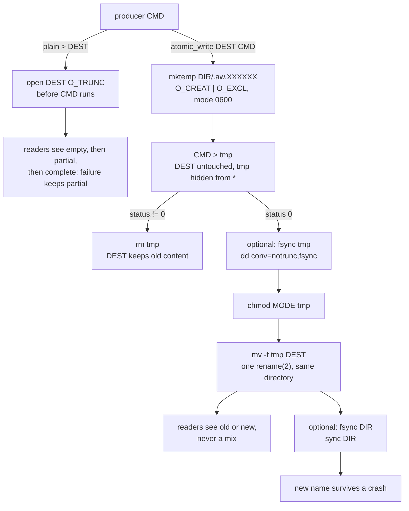

# Atomic Writes

> [!summary] Claim
> A shell redirection opens its target with `O_TRUNC` before the command runs, so every reader, crash, and failed producer can observe an empty or partial file, while writing to a temporary file in the same directory, checking the producer, setting the mode, and `rename(2)`ing it over the target gives every reader the complete old or the complete new file, and adding two `fsync` calls makes that outcome survive a power cut.

Part of [Robust Scripting](README.md) in [Shell and Unix Engineering](../README.md).

## TL;DR

- Mechanism: `cmd > file` is `open(file, O_WRONLY|O_CREAT|O_TRUNC)` before `cmd` starts (`(POSIX.1-2024 XCU 2.7.2)`, `(POSIX.1-2024 XCU 2.9.1.1)`); the atomic pattern is `mktemp DIR/.aw.XXXXXX`, `cmd > tmp`, check the status, `chmod`, `mv -f tmp file`, where the final `mv` is one `rename(2)` that "shall remain visible ... and refer either to the file referred to by new or old" (`(POSIX.1-2024 XSH rename)`).
- Rule: stage the temporary file in the destination's own directory, run the producer as a command whose exit status you can see (not as the left side of a pipeline), refuse to rename on any failure, and set the mode explicitly because `mktemp` creates 0600 and the rename installs the temporary file's inode, mode and all (lab tests 3 to 5).
- Trap: atomic is not durable; without `fsync` of the file before the rename and of the directory after it, a crash can leave the new name pointing at a zero-length file, the 2009 ext4 incident (LWN 322823), and the rename also replaces identity: hard links, open descriptors, symlinks, owner, ACLs, and bind mounts keep or point at the old inode (lab tests 6 and 7).
- Portability: the redirection and `rename` semantics are POSIX; `mktemp`, `sync FILE`, and `dd conv=fsync` are not, and they differ: GNU and BusyBox `sync DIR` call `fsync`, macOS `sync` ignores its operands and calls `sync(2)`, which "may return before the buffers are completely flushed", and `dd if=/dev/null of=F conv=notrunc,fsync` is the one file-level `fsync` that GNU, BSD and macOS, and BusyBox all accept.
- When not to use it: appends and logs (use `O_APPEND`, see [[PIPE_BUF-and-Write-Atomicity]]), files whose identity matters more than their readers (hard-linked files, `crontab -e` style descriptor watchers, single-file bind mounts), directories you cannot write, concurrent read-modify-write (that needs a lock, [[Locking-and-Stale-Locks]]), and anything needing transactions over several files, where a database or a language with `renameat2` and `fsync` is the right tool.

## Mental model



The left branch is what every redirection does: the shell truncates the destination when it opens it, before the producer has written a byte, so the file passes through empty and partial states that any reader, crash, or producer failure can freeze.
The right branch moves all of those states into a file nobody else looks for: `mktemp` creates a fresh name exclusively, the producer writes there, and the destination is not touched until the producer has exited 0.
Only then is the content optionally flushed, the mode set, and the name switched with one `rename(2)` inside one directory, which is the single step other processes can observe.
The last arrow is the part people forget: the rename is atomic for processes that are running, but it is a directory update that has to reach the disk too, so durability needs an `fsync` of the directory after the rename.

## How it works

### What a redirection does to the old file

POSIX specifies that `>` opens the file "as if the open() function was called with the O_TRUNC flag set", creating it empty if it is missing (`(POSIX.1-2024 XCU 2.7.2)`).
Redirections are step 3 of processing a simple command, before the command is searched for and executed (`(POSIX.1-2024 XCU 2.9.1.1)`), so the truncation has happened before the producer reads anything.
BusyBox ash makes this literal: `openredirect()` in `shell/ash.c` handles `NTO` and `NCLOBBER` with `open(fname, O_WRONLY|O_CREAT|O_TRUNC, 0666)`.
That gives four failure windows, and the lab shows each one under every shell:

- Self-truncation: `sort f > f` empties `f` before `sort` opens it, so the result is 0 bytes (lab test 1); POSIX `sort -o f f` is the specified way out ("This file can be the same as one of the input files", `(POSIX.1-2024 XCU sort, -o)`), and GNU's manual adds that it is still "safer to output to an otherwise-unused file, as data may be lost if the system crashes" (`coreutils.texi`, sort invocation).
- Concurrent readers: a reader that opens the file while the producer runs sees the partial output; the lab's producer reads its own destination halfway through and sees `new-1` after `>`, and `OLD` under `atomic_write` (lab test 2).
- Producer failure: a producer that prints `partial` and returns 3 leaves `partial` in the destination after `>` (lab test 3).
- Resource exhaustion: a write that exceeds the file size limit fails with `EFBIG` ("the process's file size limit", `(write(2), ERRORS)`) after a short write, so `>` leaves the first 512 or 1024 bytes of an 18890-byte payload (lab test 4); `ENOSPC` and `EDQUOT` behave the same way, and on NFS they may surface only at `close` ("Failing to check the return value when closing a file may lead to silent loss of data", `(close(2), CAVEATS)`).

### The protocol, step by step

1. Pick the directory: the temporary file must be in the destination's directory, because `rename` works only within one file system and Linux also refuses different mount points of one file system (`EXDEV`, `(rename(2), ERRORS)`); `mv` then silently falls back to copy-and-delete, which is not atomic ([[cp-mv-and-Rename-Semantics]]).
2. Create the temporary name exclusively: `mktemp "$dir/.aw.XXXXXX"` creates it with `O_CREAT|O_EXCL` and mode 0600 ([[mktemp]]), so no other process can own or pre-plant that name.
   A leading `.` keeps it out of `*` globs, because a leading period "shall be explicitly matched" (`(POSIX.1-2024 XCU 2.14.3)`); lab test 2 shows `*` matching only `dest` while the temporary file exists, which matters when a consumer loads `conf.d/*`.
3. Run the producer with standard output on the temporary file, as a simple command or function, so its exit status is the status of `"$@" > "$tmp"`; in a pipeline `a | b > tmp` the status is `b`'s unless `pipefail` is available ([[pipefail-and-PIPESTATUS]]).
4. On a nonzero status, remove the temporary file and return that status; the destination never changed (lab tests 3 and 4).
5. Optionally flush the data with `fsync` ([Durability](#durability-the-two-fsync-calls) below).
6. Set the mode on the temporary file: the rename installs this inode, so its mode, owner, group, ACLs, and extended attributes are what readers get (lab test 5).
7. `mv -f -- "$tmp" "$dest"`: one `rename(2)`; if it fails for any reason other than `EIO`, "any file named by new shall be unaffected" (`(POSIX.1-2024 XSH rename)`).
8. Optionally flush the directory, so that the new directory entry itself is on disk.

The rename's guarantee is specified twice over: POSIX requires that the name "remain visible to other threads throughout the renaming operation and refer either to the file referred to by new or old before the operation began" (`(POSIX.1-2024 XSH rename, DESCRIPTION)`), and Linux states "there is no point at which another process attempting to access newpath will find it missing", with the caveat that "there will probably be a window in which both oldpath and newpath refer to the file being renamed" (`(rename(2), DESCRIPTION)`).
No data moves: the directory entry is repointed, so the cost does not depend on file size, and the replaced inode lives until its last open descriptor closes, which is why descriptor 3 in lab test 6 still reads `OLD`.

### Why the lab's helper looks the way it does

The helper `atomic_write [-m MODE] DEST CMD [ARG...]` in the lab is POSIX `sh` plus `mktemp`, and each design choice answers a measured failure:

- It takes the producer as a command, not standard input, so it can see the producer's exit status in every shell; reading standard input (`producer | atomic_write dest`) would hide a failed producer without `pipefail`.
- It refuses a symbolic link: `rename` "shall operate on the symbolic link itself" and the link "shall be removed" when it is the new name (`(POSIX.1-2024 XSH rename, DESCRIPTION)`), so a bare temp-and-`mv` turns `link -> target` into a regular file and leaves `target` stale (lab test 7: `raw_link=no raw_target=OLD`); the caller must pass the target explicitly.
- It refuses anything that is not a regular file, because replacing a device, FIFO, or directory by rename is never what a config writer means.
- It copies the existing file's permission bits by parsing the `ls -ld` mode column, whose format POSIX fixes as an entry type, three permission triples, and an optional alternate-access character (`(POSIX.1-2024 XCU ls, STDOUT)`), and it deliberately drops set-user-ID, set-group-ID, and sticky bits.
- For a new file it uses `"$(umask -S),a-x"`, which reproduces what a plain `>` would create: `umask -S` prints `u=...,g=...,o=...` with the bits the mask leaves clear (`(POSIX.1-2024 XCU umask, STDOUT)`), `chmod` applies comma-separated clauses "in the order in which the clauses are specified" (`(POSIX.1-2024 XCU chmod)`), and `a-x` removes execute, matching the 0666 creation mode a redirection asks for (BusyBox ash `openredirect()` passes `0666` to `open`) once the umask applies (lab test 5: `fresh=-rw-rw-r--` under `umask 002`).
- It uses a fixed template `.aw.XXXXXX` (10 bytes) instead of `.$name.XXXXXX`, because a derived name adds 8 bytes and overflows `NAME_MAX` (255 on Linux, `include/uapi/linux/limits.h`; 255 from `getconf NAME_MAX /` on macOS 27.3) for any name of 248 bytes or more (lab test 8: `derived=fail`).
- It does not set traps: traps are global in the shell, so a library that installs them clobbers the caller's; it leaves the temporary name in `aw_tmp` for the caller's handler to remove, and the leftover is harmless because it is hidden and never becomes the destination (lab test 10).
- Its variables have an `aw_` prefix because POSIX `sh` has no `local`.

### Failure atomicity without traps

The pattern does not depend on cleanup running.
Lab test 10 kills the shell with `SIGKILL` while the producer is halfway through: the shell dies with status 137, the destination still reads `OLD`, and one hidden `.aw.*` file holds `partial`.
That is the property that matters: an uncatchable signal, an out-of-memory kill, or a power cut can leave garbage beside the file, never in it.
Cleanup traps ([[Cleanup-Traps-and-Re-Raising-Signals]]) only decide whether that garbage accumulates, and an `EXIT` trap alone does not run on `SIGTERM` in dash and zsh (measured 2026-11-15; bash does run it, [[mktemp]]), so long-lived directories also need a sweeper for `.aw.*` files older than the longest plausible write.

### Durability: the two fsync calls

`rename` is atomic with respect to running processes; POSIX says nothing about what is on disk after a crash, and the `fsync` rationale explicitly allows "a null implementation" (`(POSIX.1-2024 XSH fsync, RATIONALE)`).
Linux documents the part scripts miss: "Calling fsync() does not necessarily ensure that the entry in the directory containing the file has also reached disk", which needs an explicit `fsync` on a descriptor for the directory (`(fsync(2), DESCRIPTION)`).
The durable replace is therefore: write the temporary file, `fsync` it, `rename` it, `fsync` the directory; the per-file-system ordering detail lives in [[Atomic-Rename-and-fsync]].

The incident that made this famous: Launchpad bug 317781 reported that after a crash "pretty much any file written to by any application (during the previous boot) was 0 bytes" on ext4, whose delayed allocation could hold data for "a minute or so" where ext3 flushed in about five seconds, while the rename committed (Corbet, LWN, 2009-03-11).
ext4's answer was a heuristic, queued for 2.6.30: force block allocation when a file is renamed over another or truncated; its documentation still calls the affected programs "broken applications [that] don't use fsync() when replacing existing files" and names the option `auto_da_alloc` (`Documentation/admin-guide/ext4.rst`).
That heuristic is ext4-only and can be turned off with `noauto_da_alloc`, so it is not a protocol.
Pillai et al. found 60 crash vulnerabilities in 11 widely used applications, reported that for 7 of the 11 "durability guarantees users likely expect are not met, often due to directory operations not being flushed", and showed Git's append-then-rename protocol vulnerable on ext4 in its default ordered mode, btrfs, and xfs (OSDI 2014, sections 1 and Figure 1).

What a script can call:

- GNU `sync FILE` calls `fsync` on each operand, `sync -d FILE` calls `fdatasync`, and `sync -f FILE` calls `syncfs` (`src/sync.c`, `sync_arg()`; operands accepted since coreutils 8.24, 2015-07-03, NEWS); a directory operand opens read-only and is `fsync`ed, which is exactly the directory step.
- BusyBox `sync [-df] [FILE]...` does the same when built with `FEATURE_SYNC_FANCY` (default yes); without it, `sync_main()` calls `bb_warn_ignoring_args()` on its operands and then a global `sync()` (`coreutils/sync.c`).
- macOS `sync` takes no operands (`sync(8)` SYNOPSIS) and calls `sync(2)`, whose man page says it "may return before the buffers are completely flushed"; `/bin/sync f` exits 0 on macOS 27.3 (measured here), so the exit status cannot detect the difference.
- `dd if=/dev/null of=FILE conv=notrunc,fsync` opens `FILE` without truncating it, copies nothing, and calls `fsync` before closing: GNU (`conv=fsync`, "Synchronize output data and metadata just before finishing", `coreutils.texi`), FreeBSD and macOS ("Perform an fsync(2) on the output file before closing it", `dd.1`), and BusyBox (`if (G.flags & FLAG_FSYNC) { if (fsync(ofd) < 0)` in `coreutils/dd.c`, gated by `FEATURE_DD_IBS_OBS`) all accept it; BusyBox has no `conv=fdatasync`.
  `fsync` flushes the file, not just what that descriptor wrote, which is why a zero-byte `dd` works; the lab's `aw_flush` uses it, and lab test 12 shows every userland on the host accepting it and leaving the content intact.
- `fsync` itself may not reach the platter: macOS `fsync(2)` warns that the drive "may not physically write the data ... for quite some time" and points to `F_FULLFSYNC`, which no shell utility here exposes.
- After an `fsync` error on Linux, file systems usually discard the failed pages and mark them clean, so a retried `fsync` can succeed without the data (Corbet, "PostgreSQL's fsync() surprise", LWN, 2018-04-18); a script must treat a failed flush as "the new content may be lost", never retry and carry on.

### Atomic create: publish once

`atomic_write` replaces; sometimes the requirement is "create if absent", for example a result file that only the first of several workers may publish.
`mv` cannot express that portably (only GNU's `RENAME_NOREPLACE` path, [[cp-mv-and-Rename-Semantics]]), and `set -C` makes `>` exclusive (`O_CREAT|O_EXCL` semantics, `(POSIX.1-2024 XCU 2.7.2)`) but still exposes the partial content.
`link(2)` combines both: it fails with `EEXIST` when the new name exists (`(POSIX.1-2024 XSH link, ERRORS)`), and POSIX `ln` without `-f` writes a diagnostic and does nothing when the destination exists (`(POSIX.1-2024 XCU ln)`).
The lab's `atomic_create` writes a temporary file, then `ln tmp dest` and `rm tmp`: the second publisher gets status 1 and the content stays `FIRST` (lab test 11); file systems without hard links (FAT, some FUSE and object-store mounts) cannot do this.
Using such a file as a mutual-exclusion lock is the next note's subject ([[Locking-and-Stale-Locks]]).

### How the standard tools do it

- GNU `sed -i` (`sed/execute.c`): `open_next_file()` creates the output with `ck_mkstemp(..., tmpdir, "sed", ...)` in the input file's directory, `closedown()` copies owner and group with `fchown` and the mode and ACLs with `copy_acl`, then `ck_rename()`s it over the input; without `--follow-symlinks` it replaces a symlink with a regular file, the same trade as lab test 7 ([[sed-In-Place-Editing-Portability]]).
- moreutils `sponge` 0.70 (`sponge.c`, `open_tmpfile()` and `main()`): the temporary file is `$TMPDIR/sponge.XXXXXX` (default `/tmp`), not the destination's directory; it `chmod`s it to the old file's mode and tries `rename`, and when that fails (for example `EXDEV` because `/tmp` is tmpfs) it "Fall[s] back to slow copy": `fopen(outname, "w")`, which truncates and rewrites in place, so `sponge` is atomic only when `TMPDIR` is on the destination's file system, and a symlinked or non-regular destination is always written in place.
- Kubernetes ConfigMap volumes (`pkg/volume/util/atomic_writer.go`, `AtomicWriter.Write`): files live in a hidden timestamped directory, a `..data_tmp` symlink to it is created and renamed over `..data` ("rename is atomic"), so a whole directory of keys switches at once; a container that mounts one key with `subPath` binds the old inode and "will not receive ConfigMap updates" (Kubernetes ConfigMap documentation).
- Vim's `'backupcopy'` option documents the same trade from the editor side: `yes` copies and overwrites the original, preserving links and attributes, while `no` renames, is fast, but "Sometimes not all attributes of the file can be copied" and breaks programs that watch the open descriptor, naming `crontab -e` and inotify watchers (`runtime/doc/options.txt`).
- `install` and release switching by symlink rename are in [[install-and-Atomic-Deployment]].

## Numbers and limits

| Quantity | Value | Source |
|---|---|---|
| Bytes a same-directory `mv` moves | 0, only the directory entry changes | POSIX XSH rename; lab test 6 shows a new inode and an old descriptor reading `OLD` |
| Size after `sort f > f` | 0 bytes | lab test 1 (macOS 27.3, 2026-11-15) |
| `ulimit -f 1` partial write after `EFBIG` | 512 bytes (dash, zsh, `zsh --emulate sh`, ksh93u+ 2012, bash 5.3 `--posix`); 1024 bytes (bash 5.3, bash 3.2 even as `/bin/sh`) | measured on macOS 27.3, 2026-11-15; lab test 4 asserts per family; bash manual: 1024-byte units except `-f` in POSIX mode |
| BusyBox `ulimit -f` unit | 512 bytes (`factor_shift` 9) | `shell/shell_common.c` (as of 2026-11) |
| `mktemp` file mode | 0600 (`-rw-------`) | lab test 5 (`mktemp_mv=-rw-------`) |
| `NAME_MAX` | 255 (Linux header, macOS `getconf NAME_MAX /`) | `include/uapi/linux/limits.h`; measured 2026-11-15 |
| Template overhead | `.aw.XXXXXX` 10 bytes; `.NAME.XXXXXX` adds 8 bytes to the name | lab test 8 (250-byte name: derived template fails) |
| Exit status of the killed shell in lab test 10 | 137 (128 + 9, as reported by the bats harness's bash) | lab test 10 |
| ext4 journal commit interval | 5 seconds by default (`commit=nrsec`) | `Documentation/admin-guide/ext4.rst` (as of 2026-11) |
| ext4 delayed-allocation window in 2009 | "a minute or so", against about 5 s on ext3 | LWN 322823 (2009-03-11) |
| ext4 replace-via-rename heuristic | queued for Linux 2.6.30, `auto_da_alloc` default on | LWN 322823; `ext4.rst` |
| Crash vulnerabilities found by ALICE | 60 in 11 applications; durability unmet in 7 of 11 | Pillai et al., OSDI 2014 |
| `O_TMPFILE` | Linux 3.11; ext2/3/4, UDF, Minix, tmpfs first, XFS 3.15, Btrfs and F2FS 3.16, ubifs 4.9 | open(2) (as of 2026-11) |
| GNU `sync FILE` | since coreutils 8.24 (2015-07-03); write-only operands fixed in 8.31 (2019-03-10) | GNU NEWS |
| GNU `dd conv=fsync` after a write error | syncs anyway since 9.1 (2022-04-15) | GNU NEWS |
| Lab | 12 tests, 12/12 under `LAB_SHELL=sh` (bash 3.2) and `LAB_SHELL=dash` | run 2026-11-15 on macOS 27.3 |

## Portability

The protocol itself is shell-independent: every shell must truncate on `>` and every kernel must make `rename` atomic, and the lab asserts the same output for every family except the `ulimit -f` unit used to provoke `EFBIG`.
"Lab, run here" means the suite ran under that shell on macOS 27.3; "probe run here" and "measured" mean the probe or a one-line check ran there.
Shells that were not run (mksh, yash, posh, ksh93u+m, and BusyBox ash beyond what its source shows) are not tabulated; the lab test accepts a 512-byte unit for them because POSIX `ulimit -f` counts 512-byte units (`(POSIX.1-2024 XCU ulimit)`), which is a specification reading, not a measurement (as of 2026-11).

| Shell | `>` truncates before the command (tests 1 to 3) | `atomic_write` tests 2 to 12 | `ulimit -f 1` partial write (test 4) |
|---|---|---|---|
| POSIX sh | required, `(POSIX.1-2024 XCU 2.7.2)` | specified behavior except `mktemp` | 512-byte blocks per POSIX `ulimit` |
| macOS bash 3.2 (`/bin/sh`) | yes (lab, run here) | pass (lab, run here) | 1024 (lab, run here) |
| bash 5.3 | yes (probe run here) | pass (probe run here) | 1024; 512 with `--posix` (measured) |
| zsh 5.9 native | yes (probe run here) | pass (probe run here) | 512 (measured) |
| `zsh --emulate sh` | yes (probe run here) | pass (probe run here) | 512 (measured) |
| dash | yes (lab, run here) | pass (lab, run here) | 512 (lab, run here) |
| ksh93 | yes (probe run here, ksh93u+ 2012) | pass (probe run here) | 512 (measured, ksh93u+ 2012) |
| BusyBox ash | yes, `openredirect()` uses `O_TRUNC` (`ash.c`) | not run | 512-byte unit (`shell_common.c`, `factor_shift` 9) |

| Utility behavior | GNU coreutils 9.12 | BSD and macOS | BusyBox 1.37 |
|---|---|---|---|
| `mktemp DIR/.aw.XXXXXX` (no POSIX utility exists) | creates it, 0600 ([[mktemp]]) | creates it, 0600 (lab test 5) | creates it via libc `mkstemp` ([[mktemp]]) |
| `sync FILE` / `sync DIR` | `fsync` of each operand (`sync.c`) | operands ignored, `sync(2)`, exit 0 (FreeBSD `sync.c` and `sync.8`; macOS measured) | `fsync` with `FEATURE_SYNC_FANCY`, else warning and `sync()` (`sync.c`) |
| `dd if=/dev/null of=F conv=notrunc,fsync` | `fsync` (`coreutils.texi`) | `fsync` (`dd.1`; lab test 12 on macOS) | `fsync` with `FEATURE_DD_IBS_OBS` (`dd.c`) |
| `dd conv=fdatasync` | yes | FreeBSD `dd.1` yes; macOS `dd.1` lists only `fsync` | no (listed under "Unimplemented conv" in `dd.c`) |
| `sed -i` temporary file | input's directory, `fchown`, ACLs, rename (`execute.c`) | see [[sed-In-Place-Editing-Portability]] | see [[sed-In-Place-Editing-Portability]] |
| `sort -o F F` | safe by reading all input first, not crash safe (`coreutils.texi`) | allowed by POSIX | allowed by POSIX |
| Force rename of a name that may be a directory | `mv -T` | `mv -h` (symlink only) | `mv -T` |

## Worked example

The [lab](../labs/13-atomic-writes/) has three files: `atomic_write.sh`, the library; `awprobe.sh`, one probe mode per failure window; and `awprobe.bats`, 12 tests that run the probe under the shell under test.
The function, verbatim from `atomic_write.sh` (the helpers `aw_mode_of` and `aw_flush` and the companion `atomic_create` are in the same file):

```sh
atomic_write() {
  aw_mode=
  if [ "${1-}" = -m ]; then
    [ "$#" -ge 2 ] || return 2
    aw_mode=$2
    shift 2
  fi
  if [ "$#" -lt 2 ]; then
    echo "usage: atomic_write [-m MODE] DEST CMD [ARG...]" >&2
    return 2
  fi
  aw_dest=$1
  shift
  case $aw_dest in
    */)
      echo "atomic_write: $aw_dest: trailing slash" >&2
      return 2
      ;;
    */*) aw_dir=${aw_dest%/*} ;;
    *) aw_dir=. ;;
  esac
  aw_dir=${aw_dir:-/} # "/name" has an empty directory part
  if [ -L "$aw_dest" ]; then
    echo "atomic_write: $aw_dest is a symlink; pass the file it points to" >&2
    return 2
  fi
  if [ -e "$aw_dest" ] && [ ! -f "$aw_dest" ]; then
    echo "atomic_write: $aw_dest is not a regular file" >&2
    return 2
  fi
  if [ -z "$aw_mode" ]; then
    if [ -e "$aw_dest" ]; then
      aw_mode_of "$aw_dest" || return 2
    else
      aw_umask=$(umask -S) || return 2
      aw_mode=$aw_umask,a-x # what a plain "> DEST" would have created
    fi
  fi
  # A short fixed template: ".aw." keeps the name out of "*" globs and adds only
  # 10 bytes, so it never overflows NAME_MAX the way ".$basename.XXXXXX" can.
  aw_tmp=$(mktemp "$aw_dir/.aw.XXXXXX") || return 2
  if "$@" >"$aw_tmp"; then
    :
  else
    aw_rc=$?
    rm -f -- "$aw_tmp"
    return "$aw_rc"
  fi
  if [ "${AW_SYNC-}" = 1 ]; then
    aw_flush "$aw_tmp" || {
      aw_rc=$?
      rm -f -- "$aw_tmp"
      return "$aw_rc"
    }
  fi
  chmod -- "$aw_mode" "$aw_tmp" || {
    aw_rc=$?
    rm -f -- "$aw_tmp"
    return "$aw_rc"
  }
  mv -f -- "$aw_tmp" "$aw_dest" || {
    aw_rc=$?
    rm -f -- "$aw_tmp"
    return "$aw_rc"
  }
  if [ "${AW_SYNC-}" = 1 ]; then
    # GNU and BusyBox sync fsync a named directory; macOS sync ignores operands and
    # calls sync(2), which "may return before the buffers are completely flushed", so
    # this step is best effort there. DEST is already replaced here, so a failure
    # means "visible but maybe not durable", not "old content".
    sync -- "$aw_dir" || return
  fi
  return 0
}
```

Usage is `atomic_write /etc/app/app.conf render_config --env prod`, or with an explicit mode `atomic_write -m 644 out.json jq . in.json`.
The reader-midwrite probe is the clearest contrast; verbatim from `awprobe.sh`:

```sh
  reader-midwrite)
    # The producer looks at the destination halfway through its own output, as a
    # concurrent reader would, and counts the files that "*" and ".aw.*" match.
    producer() {
      printf 'new-1\n'
      seen=$(cat dest)
      set -- *
      globbed=$*
      hidden=$(count_tmp)
      printf 'new-2\n'
    }
    printf 'OLD\n' >dest
    producer >dest
    naive_seen=$seen
    printf 'OLD\n' >dest
    atomic_write dest producer
    echo "naive_seen=$naive_seen atomic_seen=$seen glob=$globbed hidden=$hidden final=$(joined dest)"
    ;;
```

Captured on 2026-11-15 (macOS 27.3, APFS) by running every probe mode once under `/bin/sh` (bash 3.2); dash, zsh, `zsh --emulate sh`, ksh93u+ 2012, and bash 5.3 printed the same lines except `naive_bytes=512` in `file-size-limit` for dash, both zsh modes, and ksh93, and every line is what the matching lab test asserts (the `sigkill` path is shortened):

```text
truncate-first   rc=0 naive_bytes=0 atomic=a,b,
reader-midwrite  rc=0 naive_seen=new-1 atomic_seen=OLD glob=dest hidden=1 final=new-1,new-2,
producer-fails   rc=0 naive_rc=3 naive=partial atomic_rc=3 atomic=OLD leftovers=none
file-size-limit  rc=0 payload=18890 naive_rc=1 naive_bytes=1024 atomic_rc=1 atomic=OLD leftovers=none
modes            rc=0 kept=-rw-r----- fresh=-rw-rw-r-- explicit=-rw------- mktemp_mv=-rw-------
links            rc=0 name=NEW fd=OLD hardlink=OLD
symlink          rc=0 refuse_rc=2 link=yes target=OLD raw_link=no raw_name=NEW raw_target=OLD
name-max         rc=0 name_bytes=250 derived=fail aw_rc=0 content=NEW
readonly-dir     rc=0 atomic_rc=2 after_atomic=OLD naive_rc=0 after_naive=NAIVE
sigkill          rc=137 work=.../scratch/awprobe.CSOUwK
create-once      rc=0 first_rc=0 second_rc=1 dest=FIRST leftovers=none
durable          rc=0 rc=0 dest=NEW leftovers=none flush_rc=0 other=keep
```

Read it top to bottom: the redirection emptied the input (`naive_bytes=0`), exposed `new-1` to a reader, kept `partial` after a failure, and kept 1024 bytes after `EFBIG`, while `atomic_write` showed `OLD` or the complete new content each time, left no temporary file, and returned the producer's status.
`modes` shows why the mode step exists: a bare `mktemp` and `mv` turned a 644 file into `-rw-------`.
`links` and `symlink` show what the rename replaces: the old descriptor and the hard link still read `OLD`, and a bare rename turned the symlink into a regular file.
`readonly-dir` shows the permission asymmetry: a file you may write in a directory you may not write can be truncated but not replaced.
After `sigkill`, the bats test reads the work directory and finds `dest` still `OLD` and exactly one `.aw.*` file containing `partial`.

## Pitfalls

> [!warning] Truncating the input you are reading
> Trigger: `sort f > f`, `sed 's/a/b/' f > f`, `jq . f > f`, `tr a b < f > f`.
> Symptom: the shell truncates `f` before the command runs, so the result is empty (lab test 1); with a large file and a filter that reads before writing, the result can also be a prefix.
> Fix: `atomic_write f sort f`; or `sort -o f f`, which POSIX allows and GNU documents as safe but not crash safe.

> [!warning] Producer status lost in a pipeline
> Trigger: `generate | atomic_write_from_stdin dest`, or `curl -fsS "$url" | sed ... > "$tmp" && mv "$tmp" dest`.
> Symptom: the pipeline's status is the last stage's, so a failed download produces an empty or truncated file that is then renamed over a good one, atomically.
> Fix: run the producer as the command whose status is checked (`atomic_write dest generate`), or use `set -o pipefail` where the shell has it ([[pipefail-and-PIPESTATUS]]), and validate the content (size, checksum, a parser) before the rename ([[Checksums-and-Integrity]]).

> [!warning] Temporary file on another file system
> Trigger: `tmp=$(mktemp)` (in `TMPDIR`, often tmpfs) followed by `mv "$tmp" /srv/data/file`, or `sponge` with the default `TMPDIR=/tmp`.
> Symptom: `rename` fails with `EXDEV`, `mv` falls back to remove, copy, remove, and `sponge` falls back to `fopen(outname, "w")`; readers see the file missing, empty, or partial, and a crash can leave neither version complete.
> Fix: `mktemp "$(dirname -- "$dest")/.aw.XXXXXX"`; with GNU, `mv --no-copy` (9.2+) turns the silent fallback into an error; with `sponge`, set `TMPDIR` to the destination's directory.

> [!warning] The replacement has the wrong mode or owner
> Trigger: `mktemp` then `mv` with no `chmod`, or a root cron job rewriting a file owned by a service user.
> Symptom: the new file is `-rw-------` (lab test 5) and owned by whoever ran the script, so the service that reads it gets `EACCES`; ACLs, SELinux labels, and extended attributes of the old file are gone.
> Fix: set the mode before the rename (`atomic_write` copies it or takes `-m`); as root, also `chown` the temporary file before the rename, and restore labels or ACLs explicitly ([[ACLs-and-Extended-Attributes]], [[Permissions-umask-and-Special-Bits]]).

> [!warning] Rename replaces identity
> Trigger: rewriting a file that has hard links, that a symlink farm points to, that a process watches by descriptor, or that a container bind-mounts as a single file.
> Symptom: hard links and open descriptors keep the old content (lab test 6); a bare rename onto a symlink replaces the link and leaves the real file stale (lab test 7); `crontab -e`-style watchers see the backup (Vim `'backupcopy'`); a Kubernetes `subPath` mount "will not receive ConfigMap updates".
> Fix: decide which contract the consumer needs: write through the symlink's target, update hard-linked files in place (and accept the torn-read window), make watchers reopen by name, and mount the directory rather than the file.

> [!warning] Atomic but not durable
> Trigger: write-temp-then-rename with no `fsync`, on ext4 with `noauto_da_alloc`, XFS, btrfs, or any file system without ext4's heuristic.
> Symptom: after a crash the destination exists with zero or partial length (Launchpad bug 317781, LWN 322823), or the rename itself is lost because the directory was never flushed (Pillai et al.: 7 of 11 applications).
> Fix: `fsync` the temporary file before the rename and the directory after it (`AW_SYNC=1` in the lab: `dd conv=notrunc,fsync`, then `sync DIR`); on macOS, where `sync DIR` is a global best-effort sync and `fsync` does not flush the drive cache, use a language with `F_FULLFSYNC` when it matters.

> [!warning] Unwritable directory
> Trigger: a script that may write `/etc/app/app.conf` (group-writable) but not `/etc/app`, or a file in a sticky directory owned by someone else.
> Symptom: `mktemp` or `rename` fails, so the atomic path is impossible, while `>` would have worked (lab test 9: `atomic_rc=2 after_atomic=OLD naive_rc=0`).
> Fix: fail loudly rather than fall back to `>` silently; fix the directory permissions, or accept in-place writing explicitly for that file and document the torn-read window.

> [!warning] Lost update between two atomic writers
> Trigger: two runs of `atomic_write state sh -c 'cat state; echo new-line'` at the same time.
> Symptom: both read the same old content, both rename, and the second rename silently discards the first writer's line; each file is complete, but one update is gone.
> Fix: atomicity of each replace does not serialize read-modify-write; hold a lock around read, compute, and rename ([[Locking-and-Stale-Locks]], [[flock]]), or design the update to be idempotent ([[Idempotent-Scripts]]).

> [!warning] Leftover temporary files
> Trigger: `SIGKILL`, a power cut, or an `EXIT`-only trap in a shell that does not run it on `SIGTERM`.
> Symptom: `.aw.*` files accumulate next to the destination (lab test 10); a consumer that globs `.*` or lists with `ls -A` sees them.
> Fix: keep the hidden prefix, remove `"$aw_tmp"` from the caller's signal handlers ([[Cleanup-Traps-and-Re-Raising-Signals]]), and sweep old `.aw.*` files with `find "$dir" -name '.aw.*' -mmin +60 -delete` (GNU and BSD `find`; `-mmin` and `-delete` are not POSIX) where writers can die.

## Security and robustness

- Exclusive creation is the security boundary: `mktemp` creates the name with `O_EXCL`, which on Linux also refuses to follow a planted symlink ("if path is a symbolic link, then open() fails regardless of where the symbolic link points", `(open(2), O_EXCL)`), so an attacker who can write the directory cannot redirect the producer's output; a predictable `"$dest.tmp"` or `"$dest.$$"` has no such protection ([[Temporary-File-Attacks]]).
- `O_EXCL` is only as good as the file system: on NFS it "is supported only when using NFSv3 or later on kernel 2.6 or later", and without it "programs that rely on it ... will contain a race condition" (`(open(2), O_EXCL)`).
- On NFS, a `rename` the server performed can still report failure after a retransmission ("you can not assume that if the operation failed, the file was not renamed", `(rename(2), BUGS)`), so a rerun must accept "temporary missing, destination new".
- Shared directories need more than `mktemp`: in a world-writable directory another user can replace the destination's parent path components between the check and the rename; resolve the directory once and keep scripts that run with privilege out of directories other users can write ([[Path-Resolution-and-Symlink-Races]]).
- Create restrictively, then widen: the temporary file is 0600 until the producer has finished, so a reader cannot open a secret half-written; for secrets, pass `-m 600` explicitly rather than inheriting a looser old mode.
- Do not copy set-user-ID or set-group-ID bits blindly: `atomic_write` drops them on purpose, because new content under an old privilege bit is how a configuration writer becomes a privilege escalation.
- Validate before the rename, not after: a parser check (`nginx -t -c "$tmp"`, `jq -e . "$tmp"`, `visudo -cf "$tmp"`) on the temporary file means a bad render never becomes visible.
- Treat a failed `fsync` as data loss, not as a retryable error: Linux may have already discarded the dirty pages (LWN 752063).
- Quote every path and pass `--` before operands, since a destination named `-f` is otherwise an option to `mv`, `rm`, or `chmod` ([[Argument-Injection-and-Double-Dash]]).

## The principal's view

The decision is which consistency contract each file's consumers need, and whether the layer you are in can deliver it.
Write-temp-then-rename gives one contract cheaply and portably: every reader sees a complete version, every failure leaves the previous version, and the cost is independent of file size.
Its price is explicit: the file's identity changes, so owner, mode, ACLs, labels, hard links, watchers, and bind mounts have to be handled deliberately, and durability needs two `fsync` calls that the shell can only approximate through `dd` and a `sync` whose meaning depends on the userland.

A staff-plus engineer standardizes one reviewed helper (or `install -m MODE -o OWNER` plus `mv` for deployments, [[install-and-Atomic-Deployment]]) and bans the ad hoc variants: `> file` for anything another process reads, `mktemp` without a directory, and `mv` without a status check.
They also draw the line where the shell stops being the right tool: multi-file updates that must commit together, read-modify-write under concurrency, very large files that are cheaper to patch than to rewrite, and anything that needs `renameat2(RENAME_NOREPLACE)`, `O_TMPFILE` with `linkat` (Linux 3.11+, which publishes a file that never had a temporary name), or `F_FULLFSYNC`.
Those belong in Python (`os.replace` plus `os.fsync` on the file and the directory), Go, Rust, or C, or in a store that already implements the protocol and its recovery, such as SQLite, a database, or an object store with conditional writes.
For directory trees, the same idea scales by indirection: build the new tree beside the old one and switch one symlink with a rename, as Kubernetes does with `..data` and as release directories do with `current`.

## Interview questions

> [!question] L5: Why does `sort data.txt > data.txt` leave an empty file, and what are two correct fixes?
>
> > [!success]- Answer
> > The shell performs redirections before it runs the command, and `>` opens the file with `O_TRUNC`, so `data.txt` is empty by the time `sort` opens it.
> > POSIX `sort -o data.txt data.txt` is allowed because `sort` reads all input before opening the output.
> > The general fix is to write to a temporary file in the same directory and rename it over the original only if `sort` succeeded.
> >
> > Follow-up: Which of the two fixes still loses data if the machine crashes halfway, and why?

> [!question] L5: Predict the output: `printf 'OLD\n' > f; ln f g; exec 3< f; t=$(mktemp ./.x.XXXXXX); printf 'NEW\n' > "$t"; mv -f "$t" f; cat f; cat <&3; cat g; ls -l f | cut -c1-10`
>
> > [!success]- Answer
> > It prints `NEW`, then `OLD`, then `OLD`, then `-rw-------`.
> > The rename makes the name `f` point at the temporary file's inode, so a new `cat f` sees `NEW`.
> > Descriptor 3 and the hard link `g` still refer to the old inode, which lives on until both are gone.
> > The mode comes from the temporary file, which `mktemp` created as 0600 (lab tests 5 and 6).
> >
> > Follow-up: What changes if `f` is a symbolic link to another file?

> [!question] L5: Why must the temporary file live in the same directory as the destination rather than in `/tmp`?
>
> > [!success]- Answer
> > `rename` works only within one file system, and on Linux not even across two mounts of the same file system, failing with `EXDEV`.
> > `mv` then falls back to removing the destination, copying, and removing the source, which is neither atomic nor crash safe.
> > The same directory also guarantees the same mount and makes the rename a single directory update.
> >
> > Follow-up: How does moreutils `sponge` behave when `TMPDIR` is on tmpfs?

> [!question] L6: Debug this script, which sometimes leaves `/etc/app/hosts` empty: `curl -fsS "$URL" | grep -v '^#' > /etc/app/hosts.tmp && mv /etc/app/hosts.tmp /etc/app/hosts`
>
> > [!success]- Answer
> > The `&&` tests the status of `grep`, not `curl`, because a pipeline's status is its last stage's.
> > A download that fails after sending part of the body gives `grep` some lines, `grep` exits 0, and the truncated list is renamed over the good one; a download that fails before any byte gives `grep` no lines, it exits 1, and the update is skipped only by luck.
> > `grep`'s status also means "selected something", so a valid file that is all comments is never applied.
> > The fixed name `hosts.tmp` collides when two runs overlap and can be pre-planted as a symlink in a writable directory.
> > Fix: download to its own `mktemp` file and check `curl`'s status, filter into a second `mktemp` file in `/etc/app`, validate it (non-empty, expected format), set mode and owner, then `mv -f`, and hold a lock if runs can overlap.
> >
> > Follow-up: How would `set -o pipefail` change the behavior, and why is it still not enough?

> [!question] L6: A config file is replaced with write-temp-then-rename, yet the service that reads it fails with "permission denied" after every deploy; what happened?
>
> > [!success]- Answer
> > The rename installs the temporary file's inode, with its mode and owner.
> > `mktemp` creates the file 0600 and the deploy runs as root or a deploy user, so the service user can no longer read it.
> > Set the mode (and as root the owner and group) on the temporary file before the rename, or use `install -m 640 -o root -g app` into a staging name and then `mv`.
> >
> > Follow-up: Which other attributes of the old file silently disappear, and how would you detect that in CI?

> [!question] L6: Two cron jobs append a line to `state.txt` using `atomic_write state.txt sh -c 'cat state.txt; echo "$LINE"'`; sometimes a line disappears, although no file is ever corrupt. Why?
>
> > [!success]- Answer
> > Each replacement is atomic, but the read, the modification, and the rename are three steps.
> > Both jobs read the same old content, each renames its own complete version, and the later rename discards the earlier job's line: a lost update.
> > Fix it with a lock held across the whole read-modify-write (`flock` or a `mkdir` lock), or use `O_APPEND` writes for append-only data.
> >
> > Follow-up: Why is `>>` with one `write` per line safe for this case on a local file system but not on NFS?

> [!question] L7+: Your state file is written with write-temp-then-rename; after a power cut it is zero bytes; explain the mechanism and the minimal correct fix in shell and in a systems language.
>
> > [!success]- Answer
> > The rename is atomic for running processes, but POSIX says nothing about the order in which data and directory updates reach the disk.
> > With delayed allocation the temporary file's data can still be in memory when the journal commits the rename, so recovery shows the new name with no data, the 2009 ext4 bug 317781.
> > The protocol is `fsync` the temporary file, `rename`, then `fsync` the directory, because `fsync(2)` says the directory entry is not covered by the file's `fsync`.
> > In shell that is `dd if=/dev/null of="$tmp" conv=notrunc,fsync`, `mv`, and `sync "$dir"` with GNU or BusyBox; in C, Rust, Go, or Python it is `fsync(fd)`, `rename`, `fsync(dirfd)`, plus `F_FULLFSYNC` on macOS.
> > ext4's `auto_da_alloc` masks the bug on default ext4, so it appears first on XFS, btrfs, or with `noauto_da_alloc`.
> >
> > Follow-up: Why must a failed `fsync` not simply be retried on Linux?

> [!question] L7+: Design how a sidecar should publish a set of five configuration files so that a reader never sees files from two different versions.
>
> > [!success]- Answer
> > Renaming five files one by one gives five atomic steps, not one, so a reader can see a mix.
> > Write all five into a new versioned directory, flush them and the directory, then switch one symlink with a rename: create `..data_tmp -> v42` and rename it over `..data`, with the visible names being symlinks through `..data`.
> > That is Kubernetes' `AtomicWriter`; readers must resolve paths through the symlink on every load, and old versions are deleted only after readers have moved on.
> > A container that binds one file with `subPath` defeats it, because it holds the old inode and never sees the switch.
> >
> > Follow-up: What does `renameat2(RENAME_EXCHANGE)` let you do instead, and where is it unavailable?

> [!question] L7+: When would you deliberately not use write-temp-then-rename for a file another process reads?
>
> > [!success]- Answer
> > When the file's identity is the contract: hard-linked files, files with ACLs or labels you cannot reproduce, single-file bind mounts, and programs that watch an open descriptor, such as `crontab -e`, which Vim's `'backupcopy'` documents.
> > When you cannot write the directory, or the file is huge and only a small region changes, so rewriting it costs more than the consistency is worth.
> > For append-only logs, where `O_APPEND` gives per-write atomicity and rename would lose concurrent appends.
> > In those cases make the in-place write safe in another way: locks, a format with checksums and a commit marker, or a real store.
> >
> > Follow-up: How would you make an in-place rewrite detectable as torn by a reader?

## Related

Prerequisites: [[Idempotent-Scripts]]

Next: [[Locking-and-Stale-Locks]]

See also: [[Atomic-Rename-and-fsync]], [[cp-mv-and-Rename-Semantics]], [[install-and-Atomic-Deployment]], [[mktemp]], [[Cleanup-Traps-and-Re-Raising-Signals]], [[PIPE_BUF-and-Write-Atomicity]], [[pipefail-and-PIPESTATUS]], [[sed-In-Place-Editing-Portability]], [[Temporary-File-Attacks]], [[Path-Resolution-and-Symlink-Races]], [[Permissions-umask-and-Special-Bits]], [[ACLs-and-Extended-Attributes]], [[flock]], [[Checksums-and-Integrity]], [[Argument-Injection-and-Double-Dash]], [[Redirection-Order-and-Semantics]]

## Further reading

- POSIX.1-2024 XCU 2.7.2 and 2.9.1.1: https://pubs.opengroup.org/onlinepubs/9799919799/utilities/V3_chap02.html - `>` truncates as if by `O_TRUNC`, before the command runs, and `noclobber` is atomic `O_EXCL`.
- POSIX.1-2024 XSH `rename`: https://pubs.opengroup.org/onlinepubs/9799919799/functions/rename.html - the old-or-new visibility guarantee and the symlink rules.
- POSIX.1-2024 XSH `fsync`: https://pubs.opengroup.org/onlinepubs/9799919799/functions/fsync.html - why the standard cannot promise durability and permits a null implementation.
- Linux fsync(2): https://man7.org/linux/man-pages/man2/fsync.2.html - the directory-entry caveat that makes the second `fsync` necessary.
- Linux open(2): https://man7.org/linux/man-pages/man2/open.2.html - `O_EXCL` symlink and NFS rules, and `O_TMPFILE` with `linkat`.
- ext4 admin guide: https://raw.githubusercontent.com/torvalds/linux/master/Documentation/admin-guide/ext4.rst - `auto_da_alloc`, `commit`, and data ordering modes.
- Corbet, "ext4 and data loss" (LWN, 2009): https://lwn.net/Articles/322823/ - the zero-length-file incident and the kernel's workaround.
- Corbet, "PostgreSQL's fsync() surprise" (LWN, 2018): https://lwn.net/Articles/752063/ - why a failed `fsync` means data loss, not a retry.
- Pillai et al., "All File Systems Are Not Created Equal" (OSDI 2014): https://www.usenix.org/system/files/conference/osdi14/osdi14-paper-pillai.pdf - measured crash vulnerabilities in real update protocols.
- GNU coreutils `src/sync.c`: https://raw.githubusercontent.com/coreutils/coreutils/master/src/sync.c - how `sync FILE` opens and `fsync`s an operand, directories included.
- GNU sed `sed/execute.c`: https://raw.githubusercontent.com/mirror/sed/master/sed/execute.c - a production implementation of temp-in-same-directory, copy ownership, rename.
- Kubernetes `atomic_writer.go`: https://raw.githubusercontent.com/kubernetes/kubernetes/master/pkg/volume/util/atomic_writer.go - atomic publication of a whole directory by symlink rename.
