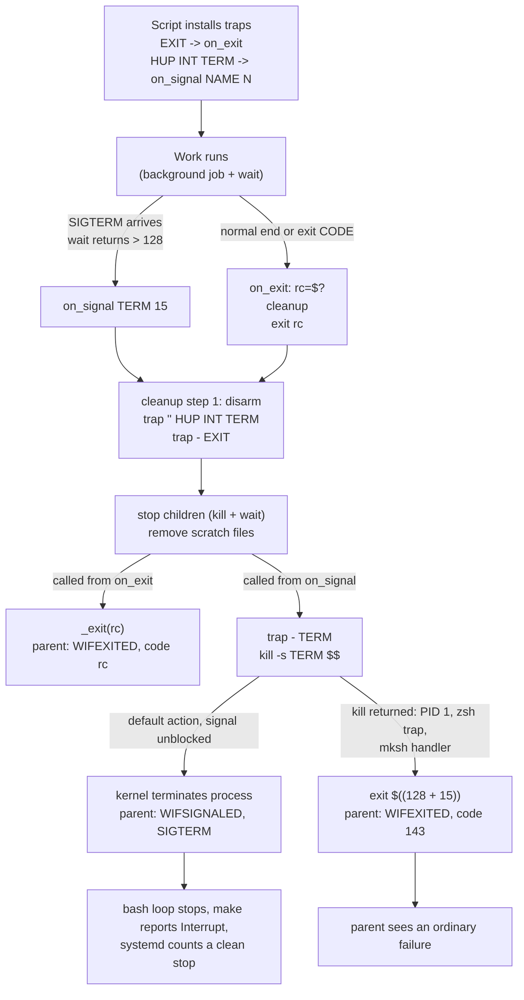

# Cleanup Traps and Re Raising Signals

> [!summary] Claim
> A script that catches a terminating signal to clean up must finish by restoring the default disposition and sending itself the same signal, because only a death by signal lets the parent's `waitpid()` report `WIFSIGNALED`, and every loop, build tool, and supervisor above it decides what to do next from that bit, not from the number 143.

Part of [Robust Scripting](README.md) in [Shell and Unix Engineering](../README.md).

## TL;DR

- Mechanism: one idempotent `cleanup` runs from the `EXIT` trap on normal exit and from a per-signal trap on `HUP`, `INT`, and `TERM`; the signal path then runs `trap - SIG; kill -s SIG "$$"`, so the kernel, not `exit`, ends the process (POSIX.1-2024 XCU 2.15 `trap`, XSH `kill()`).
- Rule: disarm before cleaning (`trap '' HUP INT TERM; trap - EXIT`), so a second signal cannot re-enter and bash, ksh93, and mksh do not run the cleanup a second time when the re-raised signal kills them.
- Trap: `trap 'cleanup; exit 143' TERM` looks equivalent and is not: the parent sees "exited 143", so bash's loop keeps iterating after Ctrl-C, systemd records a failure instead of a clean stop, and the lab's C observer prints `exited 143` where the re-raise prints `signaled TERM`.
- Portability: the template's self-kill really kills in bash, dash, ksh93, BusyBox ash, yash, and (for `TERM` and `INT`) posh, but zsh blocks the signal while its trap runs, mksh keeps its own handler after `trap - TERM`, and PID 1 in a container cannot be killed by its own default-action signals, so the pattern keeps an `exit $((128 + N))` fallback after the `kill` (measured on the host and in the Debian and Alpine shell-matrix images, and read in each shell's source, as of 2026-11).
- When not to use it: when cleanup must order many resources, survive `SIGKILL`, or finish inside a supervisor's grace period, move the work to a language with scoped cleanup and keep the shell as a thin `exec` wrapper.

## Mental model



The script installs every trap before it creates anything, then does its work in a background job it waits for, so a trapped signal interrupts `wait` at once instead of waiting for a foreground command to finish.
A normal end or an explicit `exit` reaches `on_exit`, which saves `$?`, cleans up, and exits with the saved code; a signal reaches `on_signal`, which runs the same cleanup.
Cleanup first disarms every trap, so neither a second signal nor the `EXIT` condition can run it again, then stops children and removes files.
On the signal path the handler restores the default disposition and signals its own PID; the kernel then terminates the process and the parent's wait status carries the signal, which is what the loop, `make`, or systemd above it acts on.
If `kill` returns because the signal could not kill (PID 1, a shell that holds the signal blocked or keeps its own handler), the fallback `exit 128+N` gives the conventional number, which is the best the shell can still do.

## How it works

### Two ways to die, and why the parent cares

A process ends either by calling `_exit()` with a status or by receiving a signal whose action is to terminate.
The parent's `waitpid()` sees the difference: `WIFEXITED(status)` with `WEXITSTATUS()` for the first, `WIFSIGNALED(status)` with `WTERMSIG()` for the second (see [[Exit-Status-and-Wait-Status]]).
A shell flattens both into `$?`: POSIX only requires a signal death to give "an exit status greater than 128" that identifies the signal in an implementation-defined way `(POSIX.1-2024 XCU 2.8.2)`, and most shells use 128 + N, ksh93 256 + N, and yash 384 + N (measured in the shell matrix).
So in bash, `exit 143` and death by `SIGTERM` both read 143, and only a C observer (the lab's `sigobserve.c`) or a ksh93 or yash parent can tell them apart.

The callers that matter do tell them apart:

- A shell that implements Cracauer's "wait and cooperative exit" (WCE) receives the terminal's `SIGINT` too, waits for its foreground child, and then exits itself only if the child died of `SIGINT`; a child that caught `SIGINT` and exited normally is assumed to have handled the interrupt, and the loop continues `(Cracauer, "Proper handling of SIGINT/SIGQUIT")`.
  The lab's `wce-loop.sh` measures this: with a child that runs `trap 'exit 130' INT`, bash and ksh93u+ 2012 start the second iteration after the interrupt; with a child that re-raises, every shell stops (measured on the host, as of 2026-11).
- systemd treats exit code 0 and, for every type except `oneshot`, death by `SIGHUP`, `SIGINT`, `SIGTERM`, or `SIGPIPE` as a clean exit; exit code 143 is a non-zero exit code, so `Restart=on-failure` restarts the unit and its state becomes failed unless `SuccessExitStatus=` lists 143 `(systemd.service(5), Restart= and SuccessExitStatus=)`.
- GNU make deletes a target whose modification time changed when make itself gets a fatal signal `(make-4.4.1 doc/make.texi, node Interrupts)`, and its own handler is the re-raise pattern in C: it sets the signal to `SIG_DFL`, kills its children with `SIGTERM` when the signal was `SIGTERM`, removes intermediate files, and then calls `kill(make_pid(), sig)`, relying on the fact that "the signal will be unblocked when we return and arrive then to kill us" `(make-4.4.1 src/commands.c, fatal_error_signal)`.

Cracauer states the shell rule directly: "if you catch SIGINT, i.e. to do cleanup work, you have to end the program by killing yourself, not by calling exit", and quotes FreeBSD's `mkdep` doing it as `trap 'rm -f $TMP ; trap 2 ; kill -2 $$' 1 2 3 13 15`.
That line is the historical form of this note's pattern, and it also shows two defects the modern form fixes: `$TMP` is unquoted inside the action, and every signal it catches is re-raised as `SIGINT`, so a `SIGTERM` reaches the parent as an interrupt.

### The specification pieces

The pattern is assembled from four POSIX guarantees.

1. The trap action runs "in a manner equivalent to `eval action`", `-` "shall reset each condition to the default value", and the value of `$?` after the action is the value it had before `(POSIX.1-2024 XCU 2.15 trap)`.
   So `trap - TERM` inside the action is legal and takes effect immediately, and `on_exit` can read the script's final status as `$?` on its first line.
2. `kill -s signal_name pid` sends the named signal, names are recognized "without the SIG prefix", and `kill -l exit_status` maps a `$?` value of a process "terminated or stopped by a signal" back to the signal name `(POSIX.1-2024 XCU kill)`.
   `kill -s TERM "$$"` is therefore the portable spelling; `kill -TERM` and `kill -15` are XSI extensions, and only seven signal numbers (1, 2, 3, 6, 9, 14, 15) are XSI-portable as trap conditions `(POSIX.1-2024 XCU 2.15 trap)`.
3. If the signal is generated for the sending process and is not blocked, "either sig or at least one pending unblocked signal shall be delivered to the sending thread before kill() returns" `(POSIX.1-2024 XSH kill)`.
   The rationale records that the standard declined to promise the call never returns, because historical implementations deliver only one signal per kernel entry; that is why a fallback after the `kill` is still required.
4. `exit n` with n from 0 to 255 is an ordinary exit; `exit n` with n above 256 that "corresponds to an exit status the shell assigns to commands terminated by a valid signal" shall make the wait status indicate death by that signal, with no trap actions and no core image (Austin Group Defect 51, `(POSIX.1-2024 XCU 2.15 exit)`).
   In a 128 + N shell the value 143 is below 256, so `exit 143` can never mean "die by `SIGTERM`"; only ksh93 and yash, whose signal statuses exceed 256, can re-raise with `exit`, and in practice only ksh93u+ 2012 and yash 2.59 or later do (ksh93u+m 1.0.10 and yash 2.58.1 mask the operand to 8 bits, measured in the shell matrix).

Two more rules shape the details.
A trap set for a signal received while the shell waits for a foreground command runs only after that command completes, while a trapped signal makes the `wait` utility "return immediately with an exit status >128, immediately after which the trap associated with that signal shall be taken" `(POSIX.1-2024 XCU 2.12)`; the template therefore runs its work as `cmd & wait`.
Signals ignored on entry to a non-interactive shell "cannot be trapped or reset" `(POSIX.1-2024 XCU 2.15 trap)`, and an asynchronous list started without job control inherits `SIGINT` and `SIGQUIT` ignored `(POSIX.1-2024 XCU 2.12)`, so a script launched with `&` from another script can never be interrupted by `SIGINT` at all.

### What each shell does with `trap - SIG; kill -s SIG "$$"`

The kernel half is simple: with the disposition at `SIG_DFL` and the signal unblocked, the default action for `HUP`, `INT`, `PIPE`, and `TERM` is to terminate and for `QUIT` to terminate with a core dump `(signal(7))`.
The shell half differs, because "default" in a shell is not always `SIG_DFL`.

- bash, when a non-interactive script sets an `EXIT` trap, installs `termsig_sighandler` on every entry of its `terminating_signals[]` table (up to 20 signals, `HUP` through `USR2`) so that it can run the `EXIT` trap on a fatal signal `(bash-5.3 sig.c, initialize_terminating_signals; trap.c, set_signal)`.
  It records that handler as the signal's "original" disposition, so `trap - TERM` reinstalls `termsig_sighandler`, not `SIG_DFL` `(bash-5.3 trap.c, restore_default_signal)`.
  The self-kill then lands in that handler, which defers to `termsig_handler()`: it runs `run_exit_trap()` and finally `kill_shell()`, which restores the signal mask, sets `SIG_DFL`, and calls `kill(getpid(), sig)` itself, the same re-raise in C `(bash-5.3 sig.c, termsig_handler, kill_shell)`.
  That indirection is why an `EXIT` trap still set at this point runs again, and why the lab measured bash 3.2 executing one more command after the `kill` before dying while bash 5.3 executed none.
- dash and BusyBox ash leave `TERM` and `HUP` at `SIG_DFL` in a non-interactive shell, so the kernel kills them inside `kill`; they catch `SIGINT` even when untrapped (`if (iflag || minusc || sflag == 0) action = S_CATCH`), and their `onint()` / `raise_interrupt()` performs `signal(SIGINT, SIG_DFL); raise(SIGINT)`, so the result is the same death by `SIGINT` `(dash src/trap.c, setsignal; src/error.c, onint; busybox shell/ash.c, raise_interrupt)`.
- zsh runs a trap from inside its C signal handler: `zhandler()` calls `handletrap()`, which calls `dotrap()`, and `install_handler()` leaves `sa_mask` empty with the comment "only block sig while in handler" `(zsh Src/signals.c, zhandler, handletrap, install_handler)`.
  The delivered signal therefore stays blocked for the whole trap action, so `kill -s TERM "$$"` only makes it pending; the next `exit` in the action ends the process with a normal exit (the lab's `after-kill` probe prints `after-kill` and then `exited 99` in zsh), and if the action instead ends right after the `kill`, the handler returns, the mask is restored, and the pending signal kills the shell (`after-return` probe: `signaled TERM`).
  For `HUP`, `removetrap()` reinstalls zsh's own handler instead of `SIG_DFL`, and an untrapped `SIGHUP` makes zsh call `zexit(SIGHUP, ZEXIT_SIGNAL)`, a normal exit whose status is the signal number itself, 1 `(zsh Src/signals.c, removetrap, zhandler; Src/builtin.c, zexit)`; zsh 5.9.2 running `kill -s HUP $$` reports `exited 1` to the lab's observer (measured on the host), and the template still exits 129 only because its fallback `exit` runs while the signal is blocked.
- mksh and posh (both pdksh descendants) keep their own `trapsig` handler on `INT`, `QUIT`, `TERM`, and `HUP` "so we can clean up any temporary files", and `settrap()` turns a reset to `SIG_DFL` back into `trapsig` for any signal flagged `TF_DFL_INTR` or `TF_FATAL` `(mksh histrap.c, inittraps, settrap; posh trap.c, settrap)`.
  The self-kill is caught, and the next command runs `runtraps()`, which unwinds with status 128 + N `(mksh exec.c, execute; posh trap.c, runtrap)`.
  On that unwind both shells "ham up our death a bit" for `SIGINT` and `SIGTERM`: posh resets the signal to `SIG_DFL` and calls `kill(getpid(), sig)`, while mksh does so only when it leads its own process group (`kshpgrp == kshpid`), and then signals the whole group with `kill(0, sig)` `(posh main.c, quitenv; mksh main.c, quitenv)`.
  A script started by another script is not a group leader, so mksh ends with `exited 143` where posh dies by the signal; `SIGHUP` takes the `TF_FATAL` path in both and exits 129.
- ksh93 re-raises from `sh_done()`: when the exit value carries `SH_EXITSIG` for the signal it last received, it sets `RLIMIT_CORE` to 0, restores `SIG_DFL`, unblocks the signal, and calls `kill(sh.current_pid, sig)` `(ksh93 sh/fault.c, sh_done)`.
  ksh93u+ 2012 also turns `exit 271` into death by `SIGTERM` (measured on macOS `/bin/ksh`), while ksh93u+m masks the `exit` operand to 8 bits (`n &= SH_EXITMASK` in `b_return()`) and so turns `exit 271` into exit status 15 `(ksh93 bltins/cflow.c, b_return)`; the matrix-measured [[Exit-Status-and-Wait-Status]] note reports the same for ksh93u+m 1.0.10.
  ksh93u+m 1.0.10 also differs from 2012 when the re-raise does not come straight from a trapped `wait`: with the `EXIT` trap still set (probe `no-disarm`) it runs the cleanup twice and then reports `exited 1`, and a self-kill inside a trap that an earlier self-kill triggered (probes `after-kill`, `after-return`) stops the trap but reports `exited 0`; the template itself, which disarms `EXIT` and is interrupted inside `wait`, dies by the signal (all measured in the Debian shell-matrix image).
- yash leaves non-interactive signals at `SIG_DFL` and installs special handlers only for interactive use `(yash sig.c, set_signals)`; on exit, any status above 384 (`TERMSIGOFFSET`) goes through `maybe_raise()`, which zeroes `RLIMIT_CORE`, resets the disposition, unblocks the signal, and kills the shell `(yash yash.c, exit_shell_with_status, maybe_raise)`.
  That exit-time re-raise arrived in yash 2.59 (2025-05-13, yash `NEWS`: "the shell now terminates with the same signal"); yash 2.58.1, the Alpine matrix image's version, ends `exit 399` with `exited 143` (measured in the shell matrix), so there only the template's `kill` re-raises.

### The kernel's exception: PID 1

On Linux, `sig_task_ignored()` drops a signal whose handler is `SIG_DFL` when the target has `SIGNAL_UNKILLABLE`, which a PID namespace's init process has, and `get_signal()` repeats the check for signals that were already queued `(linux-6.12 kernel/signal.c, sig_task_ignored, get_signal)`.
A shell script running as PID 1 in a container therefore cannot kill itself with `kill -s TERM "$$"`: `kill` returns 0 and the script continues.
bash knows this: `kill_shell()` ends with `exit(128+sig)` and, as PID 1, first unblocks the terminating signals and deliberately dereferences a null pointer when the signal would have dumped core, "to trick the kernel" into producing one `(bash-5.3 sig.c, kill_shell)`.
A portable script needs the same last line, which is why `on_signal` ends with `exit $((128 + $2))`; see [[PID-1-and-Signal-Forwarding]] for why PID 1 should usually be a real init.

### Building the pattern up

The template in the worked example adds one rule per failure mode.

- Install every trap before the first resource exists, and guard each release with `[ -n "$var" ]`, so a signal at any point removes exactly what exists; set the variable only after the resource exists, and clear it after release.
- Make one `cleanup` function and call it from both `on_exit` and `on_signal`, so the two paths cannot drift apart.
- Disarm inside `cleanup` before doing anything slow: `trap '' HUP INT TERM` discards further deliveries of those signals (an ignored signal is discarded, not queued, `signal(7)`), and `trap - EXIT` prevents the `EXIT` trap from running the cleanup again when the re-raise kills a shell that runs `EXIT` on fatal signals (bash, ksh93, mksh; lab probe `no-disarm`).
- Pass the signal name and number into `on_signal` explicitly (`trap 'on_signal TERM 15' TERM`): inside a signal trap, `$?` is the status of the interrupted command, not the signal, and POSIX offers no portable name-to-number mapping, while the XSI numbers of `HUP`, `INT`, and `TERM` (1, 2, 15) are fixed.
- In `on_exit`, read `$?` on the first line and end with an explicit `exit "$rc"`, so mksh's habit of replacing the status with the last command of an `EXIT` action (see [[Traps-and-EXIT]]) cannot change the result.
- Stop children explicitly: a `SIGTERM` sent to the script's PID reaches only the script, a foreground child keeps running until it ends on its own, and a background child started without job control has `SIGINT` ignored, so neither a supervisor's `TERM` nor a terminal's Ctrl-C reliably reaches it; `kill "$worker"; wait "$worker"` both stops and reaps it (make's handler kills its children for the same reason).
- End `on_signal` with `trap - "$1"; kill -s "$1" "$$"` and then the fallback `exit $((128 + $2))`.

## Numbers and limits

| Quantity | Value | Source |
|---|---|---|
| Exit status POSIX requires for a signal death | greater than 128, identifying the signal | POSIX.1-2024 XCU 2.8.2 |
| Signal status encoding | 128 + N in bash, dash, zsh, mksh, posh, BusyBox ash; 256 + N in ksh93; 384 + N in yash | measured in the shell matrix (as of 2026-11) |
| `exit n` that must kill by signal | n above 256 that equals the shell's status for that signal | POSIX.1-2024 XCU 2.15 `exit` (Austin Group Defect 51) |
| XSI-portable numeric trap conditions | 1, 2, 3, 6, 9, 14, 15 (`HUP`, `INT`, `QUIT`, `ABRT`, `KILL`, `ALRM`, `TERM`) | POSIX.1-2024 XCU 2.15 `trap` |
| Conventional fallback statuses | 129 `HUP`, 130 `INT`, 131 `QUIT`, 141 `PIPE`, 143 `TERM` (128 + the Linux and macOS numbers 1, 2, 3, 13, 15) | signal(7) numbering table |
| Signals bash catches once a non-interactive script sets an `EXIT` trap | up to 20 (`terminating_signals[]`, `HUP` through `USR2`, those the platform defines) | bash-5.3 sig.c |
| Commands bash runs after `kill -s TERM "$$"` inside a trap | 1 in bash 3.2.57, 0 in bash 5.3.15 | lab probe `after-kill`, macOS 27.3 arm64 (2026-11-15) |
| Commands zsh 5.9.2 runs after the same self-kill | every command until the trap action returns | lab probes `after-kill` and `after-return`, same host |
| Core limit before a shell's own re-raise | `RLIMIT_CORE` set to 0 by ksh93 and yash | ksh93 sh/fault.c `sh_done`; yash yash.c `maybe_raise` |
| systemd clean-exit set (non-`oneshot`) | exit code 0, or death by `SIGHUP`, `SIGINT`, `SIGTERM`, `SIGPIPE` | systemd.service(5) (as of 2026-11) |
| systemd stop escalation | `KillSignal=` (default `SIGTERM`), then `SIGKILL` after `TimeoutStopSec=` | systemd.kill(5) (as of 2026-11) |
| Lab observer bounds | ready file polled every 100 ms for up to 10 s, 1 s margin before the signal, 30 s cap on the child | lab `sigobserve.c` |
| Lab run | 14 of 14 tests passed with `LAB_SHELL=sh` (bash 3.2.57 in POSIX mode), macOS 27.3 arm64, on the final lab files | lab, 2026-11-15 |

## Portability

Cells marked "lab" were measured by this note's lab on the macOS host (bash 3.2.57 and 5.3.15, zsh 5.9.2, dash 0.5.13, ksh93u+ 2012-08-01); cells marked "source" follow from the cited source, are asserted by the lab, and were measured once with the lab's scripts and observer in the shell-matrix images (Debian: ksh93u+m 1.0.10, mksh R59 2025/04/26, posh 0.14.1; Alpine: BusyBox ash 1.37.0, mksh R59 2020/10/31, yash 2.58.1; 2026-11-15); "matrix" cells were measured only there; "sibling" cells come from the matrix-measured [[Traps-and-EXIT]] lab and were re-measured the same way.

| Behavior | POSIX sh | macOS bash 3.2 | bash 5.3 | zsh | zsh `--emulate sh` | dash | ksh93 | mksh | yash | posh | BusyBox ash |
|---|---|---|---|---|---|---|---|---|---|---|---|
| Template on `SIGTERM`: parent sees | death by `TERM` (XSH `kill`) | signaled (lab) | signaled (lab) | exited 143 (lab) | exited 143 (lab) | signaled (lab) | signaled (lab, 2012) | exited 143 (source) | signaled (source) | signaled (source) | signaled (source) |
| Template on `SIGINT` | death by `INT` | signaled (lab) | signaled (lab) | exited 130 (lab) | exited 130 (lab) | signaled (lab) | signaled (lab) | exited 130 (source) | signaled (source) | signaled (source) | signaled (source) |
| Template on `SIGHUP` | death by `HUP` | signaled (lab) | signaled (lab) | exited 129 (lab) | exited 129 (lab) | signaled (lab) | signaled (lab) | exited 129 (source) | signaled (source) | exited 129 (source) | signaled (source) |
| `trap - TERM` restores `SIG_DFL` | yes (XCU 2.15) | no: `termsig_sighandler` when an `EXIT` trap is set (source) | same (source) | yes for `TERM` and `INT`, not `HUP` (source) | same (source) | yes; `INT` stays caught and `onint` re-raises (source) | yes: `trap : TERM; trap - TERM; kill -s TERM $$` dies by `TERM` in 2012 and u+m (measured) | no: `trapsig` (source) | yes (source) | no: `trapsig` (source) | as dash (source) |
| Commands run after the self-kill inside the trap | none (if unblocked) | one (lab) | none (lab) | all until the trap returns (lab) | same (lab) | none (lab) | none (lab); u+m: none, but reports `exited 0` (matrix) | none, unwinds 143 (source) | none (source) | none (source) | none (source) |
| Cleanup runs when re-raising with `EXIT` still set | once or twice (XCU 2.15 makes `EXIT` on a signal death optional) | twice (lab) | twice (lab) | once (lab) | once (lab) | once (lab) | twice (lab); u+m: twice, then exits 1 (matrix) | twice, then exits 0 (sibling) | once (sibling) | once (sibling) | once (sibling) |
| Second `TERM` during a disarmed cleanup | discarded (`SIG_IGN`) | discarded (lab) | discarded (lab) | discarded (lab) | discarded (lab) | discarded (lab) | discarded (lab) | discarded (source) | discarded (source) | discarded (source) | discarded (source) |
| `exit "$?"` after a child died of `TERM` | 143 is a plain exit; above 256 must kill | exited 143 (lab) | exited 143 (lab) | exited 143 (lab) | exited 143 (lab) | exited 143 (lab) | 2012: `$?` 271, signaled (lab); u+m: exited 15 (source, sibling) | exited 143 (source) | `$?` 399; 2.58.1: exited 143 (matrix); 2.59 and later: signaled (source, `NEWS`) | exited 143 (source) | exited 143 (source) |
| `SIGINT` ignored on entry can be trapped | no | no (lab) | no (lab) | yes, trap runs (lab) | yes (lab) | no, though `trap` still lists it (lab) | no (lab) | no (sibling) | no (sibling) | no (sibling) | no (sibling) |
| Loop shell continues after a child's `exit 130` on Ctrl-C | not specified | yes, WCE (lab) | yes, WCE (lab) | no (lab) | no (lab) | no (lab) | yes, WCE (lab, 2012) | no (source) | no (source) | no (source) | no (source) |
| `kill -l 143` | `TERM` (XCU `kill`) | `TERM` (measured) | `TERM` (measured) | `TERM` (measured) | `TERM` (measured) | `TERM` (measured) | `TERM` (measured) | `TERM` (measured) | `TERM` (measured) | rejected: `unknown signal name 143` (measured) | `TERM` (measured) |

The `kill -l` row was measured by hand on the host and in the matrix images, not by the lab; ksh93u+ 2012, ksh93u+m 1.0.10, and BusyBox ash also map 271 and 399 to `TERM`, yash 2.58.1 maps 399 but rejects 271, zsh and mksh print 271 and 399 unchanged, bash and dash reject both as invalid, and posh 0.14.1 rejects every exit status, so a `kill -l "$rc"` decoder must tolerate failure.
Utilities: the pattern uses only shell built-ins plus `mktemp -d`, `rm`, and `/bin/sleep`; `mktemp` is not in POSIX.1-2024 (its page does not exist in the 2024 edition) but is present on GNU, BSD and macOS, and BusyBox systems.

## Worked example

The [lab](../labs/13-cleanup-traps-and-re-raising-signals/) holds the template, a probe with one mode per mechanism, a loop driver, the C observer, and `cleanup-traps.bats`.
This is `cleanup-template.sh`, verbatim:

```sh
#!/bin/sh
# cleanup-template: the cleanup-and-re-raise pattern for POSIX sh.
# Usage: cleanup-template.sh BASE_DIR READY_FILE SECONDS [CODE]
# Creates a scratch directory under BASE_DIR, starts a background worker
# (/bin/sleep SECONDS), writes "SCRATCH WORKER_PID" to READY_FILE, waits for
# the worker, and exits with CODE (default 0).
# On EXIT, HUP, INT, or TERM it stops the worker and removes the scratch
# directory exactly once; after a signal it re-raises that signal, so the
# caller's wait status says "killed by SIGTERM", not "exited 143".

base=${1:?base dir}
ready=${2:?ready file}
seconds=${3:?seconds}
code=${4:-0}

scratch=
worker=

# shellcheck disable=SC2329 # invoked from the trap actions below
cleanup() {
  # Disarm first: a second signal must not re-enter, and EXIT must not rerun.
  trap '' HUP INT TERM
  trap - EXIT
  if [ -n "$worker" ]; then
    { kill "$worker" && wait "$worker"; } 2>/dev/null
    worker=
  fi
  if [ -n "$scratch" ]; then
    rm -rf -- "$scratch"
    printf 'cleanup: removed %s\n' "$scratch" >&2
    scratch=
  fi
}

# shellcheck disable=SC2329 # invoked from the trap actions below
on_exit() {
  rc=$?
  cleanup
  exit "$rc"
}

# shellcheck disable=SC2329 # invoked from the trap actions below
on_signal() {
  cleanup
  trap - "$1"
  kill -s "$1" "$$"
  # Reached only if the self-kill did not end the process (PID 1 in a
  # container, or a shell that keeps catching the signal): exit 128+N.
  exit $((128 + $2))
}

trap on_exit EXIT
trap 'on_signal HUP 1' HUP
trap 'on_signal INT 2' INT
trap 'on_signal TERM 15' TERM

scratch=$(mktemp -d "$base/job.XXXXXX") || exit 1
/bin/sleep "$seconds" &
worker=$!
printf '%s %s\n' "$scratch" "$worker" >"$ready"
wait "$worker"
worker=
exit "$code"
```

`sigobserve` starts the command with `HUP`, `INT`, `QUIT`, `TERM`, and `PIPE` at their defaults, an empty signal mask, and no core dumps; with `-k SIG -r FILE` it waits for the ready file, waits one more second so the script is inside `wait`, sends the signal, and prints the kernel's verdict.
Captured on macOS 27.3 arm64 on 2026-11-15, where `sh` is bash 3.2.57 in POSIX mode (the `job.` suffixes are random):

```
$ ./sigobserve -- sh cleanup-template.sh w w/ready 1 3
cleanup: removed w/job.xEAF8E
exited 3
$ ./sigobserve -k TERM -r w/ready -- sh cleanup-template.sh w w/ready 5
cleanup: removed w/job.dveHZ7
signaled TERM
$ ./sigobserve -k INT -r w/ready -- dash cleanup-template.sh w w/ready 5
cleanup: removed w/job.O8zgfa
signaled INT
$ ./sigobserve -k TERM -r w/ready -- zsh cleanup-template.sh w w/ready 5
cleanup: removed w/job.c68fyl
exited 143
$ ./sigobserve -k TERM -r w/ready -- sh reraise-probe.sh naive w/ready
cleanup
exited 143
```

The first run shows the `EXIT` path keeping status 3; the second and third show a re-raise the parent can see; the fourth shows zsh reaching the fallback, because its trap runs with `SIGTERM` blocked; the last shows the naive `trap '...; exit 143' TERM` producing the number without the signal.
The bats suite asserts each of these last lines per shell family, that the scratch directory is gone, that the worker PID no longer exists, and that exactly one `cleanup:` line was printed; it also runs the probe modes `no-disarm`, `double`, `after-kill`, `after-return`, `child-status`, and the two `wce-loop.sh` cases described above.
Run it with `LAB_SHELL=dash bats cleanup-traps.bats` (any shell in the matrix); it compiles `sigobserve.c` with `"${CC:-cc}"` into the test's temporary directory.

## Pitfalls

> [!warning] Exiting with 128 + N instead of dying
> Trigger: `trap 'rm -rf "$tmp"; exit 130' INT` or `exit 143` in a `TERM` trap.
> Symptom: the parent sees a normal exit; a bash or ksh93 loop over such scripts keeps running after Ctrl-C (lab test "an outer loop keeps going"), a systemd unit stopped with `SIGTERM` is recorded as failed and restarted under `Restart=on-failure`, and `make` reports an ordinary recipe failure instead of an interrupt.
> Fix: `trap - INT; kill -s INT "$$"` after cleanup, with `exit 130` only as the fallback after the `kill`.
> Primary source: Cracauer, "Proper handling of SIGINT/SIGQUIT"; systemd.service(5) `SuccessExitStatus=`.

> [!warning] Re-raising with the EXIT trap still armed
> Trigger: `trap cleanup EXIT` plus `trap 'cleanup; trap - TERM; kill -s TERM "$$"' TERM`.
> Symptom: bash and ksh93 run `cleanup` twice (lab probe `no-disarm`), because the re-raised signal goes through bash's `termsig_handler()`, which calls `run_exit_trap()`, and ksh93's `sh_done()`, which runs `trapcom[0]`; mksh also runs it twice and then exits 0, and ksh93u+m 1.0.10 twice and then exits 1, both losing the signal (measured in the shell matrix).
> A non-idempotent cleanup (appending to a log, releasing a counted lock, posting a "job finished" message) does its work twice.
> Fix: `trap - EXIT` as the first act of `cleanup`, and keep every step idempotent anyway.
> Primary source: bash-5.3 sig.c `termsig_handler`; ksh93 sh/fault.c `sh_done`; lab.

> [!warning] A second signal re-enters an armed cleanup
> Trigger: a supervisor or an impatient user sends `TERM` again, or presses Ctrl-C twice, while cleanup is still deleting files.
> Symptom: in bash, dash, mksh, posh, and BusyBox ash an ordinary signal trap can nest inside itself (measured in the [[Traps-and-EXIT]] lab), so the second `on_signal` re-raises and kills the script halfway through the first cleanup.
> Fix: `trap '' HUP INT TERM` at the top of `cleanup`; an ignored signal is discarded, and the lab's `double` probe shows `cleanup-end` printed and the final re-raise still landing.
> Primary source: signal(7) (ignored signals are discarded); lab probe `double`.

> [!warning] zsh holds the signal blocked while the trap runs
> Trigger: running the template, or any `trap - TERM; kill -s TERM "$$"; exit 143` action, under zsh or `zsh --emulate sh`.
> Symptom: the self-kill only marks the signal pending, the following `exit` wins, and the parent sees `exited 143`; code placed after the `kill` keeps running.
> Fix: accept the 128 + N fallback, or in a zsh-only script make the `kill` the last command of the trap action, so the pending signal is delivered when zsh's handler returns (lab probe `after-return` prints `signaled TERM`); that variant has no fallback, so under PID 1 the script would continue past the trap.
> Primary source: zsh Src/signals.c `install_handler`, `zhandler`, `handletrap`.

> [!warning] pdksh shells keep catching after `trap -`
> Trigger: relying on `trap - TERM` to restore `SIG_DFL` in mksh or posh.
> Symptom: `settrap()` substitutes `trapsig` for `SIG_DFL` on `INT`, `QUIT`, `TERM`, and `HUP`, so the shell unwinds with 128 + N; posh then re-raises `INT` and `TERM` itself, mksh only when it is a process-group leader and then with `kill(0, sig)` to its whole group, and both exit 129 on `HUP`.
> Fix: nothing in the script can force a true death here; if the exact wait status matters to the caller, run the script under bash, dash, ksh93, or yash, or have the caller accept 128 + N (systemd `SuccessExitStatus=143`).
> Primary source: mksh histrap.c `settrap` and main.c `quitenv`; posh trap.c `settrap` and main.c `quitenv`.

> [!warning] PID 1 cannot kill itself
> Trigger: the cleanup script is the container's entrypoint (`ENTRYPOINT ["/app/run.sh"]`) and receives `SIGTERM` from `docker stop` or the kubelet.
> Symptom: the kernel ignores a default-action signal sent to a namespace init from inside its namespace, so `kill -s TERM "$$"` returns and, without a fallback, the script continues its main flow after cleanup or exits 0.
> Fix: keep `exit $((128 + N))` after the `kill`, or run a minimal init as PID 1 and the script as its child.
> Primary source: linux-6.12 kernel/signal.c `sig_task_ignored` (`SIGNAL_UNKILLABLE`); bash-5.3 sig.c `kill_shell` ("We are PID 1, and the kill above failed").

> [!warning] Re-raising QUIT writes a core file
> Trigger: including `QUIT` in the re-raise list, as `mkdep`'s `1 2 3 13 15` does.
> Symptom: the default action of `SIGQUIT` is to terminate with a core dump (signal(7)), so the cleanup ends by writing `core` into the working directory when the core limit allows it.
> Fix: leave `QUIT` untrapped (the user asked for a dump), or trap it with an `exit 131` and no re-raise, as GNU make does ("We don't want to send ourselves SIGQUIT, because it will cause a core dump. Just exit instead."); ksh93 and yash zero `RLIMIT_CORE` before their own re-raise for the same reason.
> Primary source: make-4.4.1 src/commands.c `fatal_error_signal`; ksh93 sh/fault.c `sh_done`; yash yash.c `maybe_raise`.

> [!warning] Children outlive the script
> Trigger: `trap cleanup TERM` in a script whose work runs in the foreground (`rsync ...`), or in the background without being killed in `cleanup`.
> Symptom: a `SIGTERM` sent to the script's PID does not reach its children; a foreground child keeps the trap waiting until it finishes (POSIX.1-2024 XCU 2.12), and a background child keeps running after the script is gone, holding locks, ports, and files.
> Fix: run long work as `cmd & worker=$!; wait "$worker"`, and in `cleanup` run `kill "$worker"; wait "$worker"`; for whole process trees, see [[Signal-Propagation-to-Children]].
> Primary source: POSIX.1-2024 XCU 2.12; make-4.4.1 src/commands.c ("A termination signal won't be sent to the entire process group, but it means we want to kill the children").

> [!warning] INT ignored on entry makes the trap a no-op
> Trigger: the script is started as `./job.sh &` by another non-interactive script, so it inherits `SIGINT` ignored.
> Symptom: `trap 'on_signal INT 2' INT` silently does nothing in every measured shell except zsh, so the only way to stop the job early is `TERM`; dash 0.5.13 even lists the trap in `trap` output although it can never fire (measured on the host).
> Fix: supervise background scripts with `TERM`, never `INT`, and trap `TERM` in every script that owns resources.
> Primary source: POSIX.1-2024 XCU 2.12 and 2.15 `trap`; lab test "SIGINT ignored on entry".

> [!warning] A variable named `status` breaks native zsh
> Trigger: `status=${4:-0}` in a script that is also run as `zsh script.sh`.
> Symptom: native zsh aborts at that line with `read-only variable: status` (measured with zsh 5.9.2 on the first draft of this lab), before any trap is installed.
> Fix: name it `code` or `rc`; in native zsh `status` is a read-only special parameter.
> Primary source: lab measurement, zsh 5.9.2 (2026-11-15).

## Security and robustness

Create scratch space with `mktemp -d` under a directory you control, never a predictable `/tmp/name.$$`, and register its removal before creating anything inside it (see [[Traps-and-EXIT]] for CWE-379 and the double-quoted trap string that becomes `rm -rf /*`).
Guard every destructive release with a non-empty check and `--`: `[ -n "$scratch" ] && rm -rf -- "$scratch"`, so a signal that arrives before assignment removes nothing; see [[Safe-rm-and-Destructive-Operations]].
Clear a PID variable as soon as the process is reaped (`worker=` after `wait`), because a stale PID can be reused by an unrelated process, and `kill "$worker"` would then signal it.
Release only what this process acquired: a cleanup that deletes a lock file must first confirm it holds that lock, or a late cleanup removes a lock that a newer run now owns ([[Locking-and-Stale-Locks]]).
On the atomic-write path, cleanup removes the temporary file and never the destination, so an interrupted run leaves the last good version in place ([[Atomic-Writes]]).

Cleanup has a time budget it does not control: systemd sends `KillSignal=`, waits `TimeoutStopSec=`, and then sends `SIGKILL` to every remaining process of the unit's control group `(systemd.kill(5))`, and container runtimes do the same with their own grace period.
`SIGKILL` cannot be trapped and `SIGSTOP` cannot be caught (setting a trap for them "produces undefined results", `(POSIX.1-2024 XCU 2.15 trap)`), so no trap can make cleanup certain; design the next run to detect and repair what a killed run left ([[Idempotent-Scripts]]).
Keep network calls, uploads, and unbounded `wait`s out of the signal path, or bound them ([[Timeouts-in-Scripts]]).
A trap action runs as if by `eval action` `(POSIX.1-2024 XCU 2.15 trap)`, so a script's `set -e` governs its commands like any others, and one failing `rm` can abort the rest of the cleanup; write cleanup steps as `cmd || true` or test each step explicitly ([[Unofficial-Strict-Mode-Critique]]).
`exec cmd` replaces the shell, and `execve(2)` resets every caught signal to its default (signal(7)), so no trap of the script runs after an `exec`; use `exec` only when the script has nothing left to clean up.

## The principal's view

The decision is whether this script owns anything that outlives it.
If it does not, the best cleanup trap is none: let default dispositions kill it and `exec` the final command so signals go straight to the real process.
If it does, the organization should have exactly one blessed snippet (this template: `cleanup`, `on_exit`, `on_signal` with an explicit fallback) and lint for the shapes that break it: `exit 1xx` inside a signal trap, a cleanup without `trap - EXIT`, double-quoted trap strings (ShellCheck SC2064), and background jobs that `cleanup` does not stop.

The trade-off is honesty about the guarantee.
The pattern gives a correct wait status in bash, dash, ksh93, yash, and BusyBox ash, and the right number but not the right kind of exit in zsh, mksh, and under PID 1; a caller that must distinguish "interrupted" from "failed" across that whole set has to accept 128 + N as a signal too, which is exactly what systemd's `SuccessExitStatus=` and `kill -l "$rc"` exist for.
The pattern also cannot order cleanup across many resources, cannot survive `SIGKILL`, and spends its grace period serially.

Move to a language with scoped cleanup when cleanup has more than a couple of independent steps, must run concurrently, must not depend on which shell `/bin/sh` is, or must bound itself against a supervisor's deadline: Go (`defer` plus a cancellation context fed by `os/signal`), Python (`try`/`finally` with an explicit re-raise via `os.kill(os.getpid(), sig)` after restoring `SIG_DFL`), or Rust (RAII guards).
Those runtimes still have to re-raise the signal at the end, exactly as make's `fatal_error_signal()` does in C; the protocol is the same, only the bookkeeping moves.

## Interview questions

> [!question] L5: Why does a cleanup trap end with `trap - INT; kill -s INT "$$"` instead of `exit 130`?
>
> > [!success]- Answer
> > Both give `$?` 130 in a bash parent, but the kernel wait status differs: `exit 130` is `WIFEXITED` with code 130, the self-kill is `WIFSIGNALED` with `SIGINT`.
> > Shells that implement wait-and-cooperative-exit, `make`, and systemd act on that bit: bash keeps looping after a child's `exit 130`, and systemd counts a `SIGTERM` death as a clean stop but exit 143 as a failure.
> > `trap - INT` is needed first, or the `kill` just runs the trap again.
> >
> > Follow-up: Why does the pattern still keep `exit 130` after the `kill`?

> [!question] L5: Which signals should a cleanup trap cover, and why not `KILL`, `STOP`, or usually `QUIT`?
>
> > [!success]- Answer
> > `EXIT` for normal ends, plus `HUP` (terminal or session gone), `INT` (Ctrl-C), and `TERM` (supervisors and `kill`); `PIPE` when the script writes into a pipeline that may close early.
> > `KILL` and `STOP` cannot be caught, and POSIX says trapping them produces undefined results.
> > `QUIT` asks for a core dump, so re-raising it writes a core file; leave it alone or exit 131 without re-raising, as GNU make does.
> >
> > Follow-up: Why is `INT` useless for stopping a script that was started with `&` from another script?

> [!question] L5: Predict the output: this script is sent `SIGTERM` while it waits, under bash and then under dash.
> ```sh
> cleanup() { printf 'cleanup\n' >&2; }
> trap cleanup EXIT
> trap 'cleanup; trap - TERM; kill -s TERM "$$"' TERM
> /bin/sleep 5 & wait "$!"
> ```
>
> > [!success]- Answer
> > bash prints `cleanup` twice and dies by `SIGTERM`; dash prints it once and dies by `SIGTERM` (lab probe `no-disarm`).
> > bash's `EXIT` trap is still set, and bash handles the re-raised signal in `termsig_handler()`, which runs the `EXIT` trap before `kill_shell()` re-raises in C; dash leaves `TERM` at `SIG_DFL` and dies inside `kill`.
> > The fix is `trap - EXIT` at the start of the cleanup.
> >
> > Follow-up: What does mksh print, and what exit status does its parent see?

> [!question] L6: Debug this: a systemd service wrapper is marked failed and restarted every time the unit is stopped.
> ```sh
> #!/bin/sh
> lock=/run/app/lock
> trap 'rm -f "$lock"; exit 143' TERM
> touch "$lock"
> /usr/bin/app-worker & wait "$!"
> ```
>
> > [!success]- Answer
> > systemd counts death by `SIGTERM` as a clean exit but exit code 143 as a failure, so `Restart=on-failure` fires and the unit shows failed.
> > The trap also never stops `app-worker`, which keeps running until systemd's `SIGKILL` after `TimeoutStopSec=` reaches the control group.
> > Fix: in the trap, `kill "$pid"; wait "$pid"; rm -f "$lock"; trap - TERM; kill -s TERM "$$"; exit 143`, with `pid=$!` saved after the `&`.
> > If the script must stay as is, `SuccessExitStatus=143` tells systemd the number means a clean stop.
> >
> > Follow-up: What changes if the script is PID 1 in a container instead of a systemd service?

> [!question] L6: Why must `cleanup` disarm the traps before it does any work?
>
> > [!success]- Answer
> > A second `TERM` or Ctrl-C during cleanup would otherwise run `on_signal` again, nested inside the first in bash, dash, mksh, posh, and BusyBox ash, and its re-raise kills the script halfway through the first cleanup.
> > `trap '' HUP INT TERM` makes further deliveries be discarded, and `trap - EXIT` stops bash, ksh93, and mksh from running the cleanup again when the re-raise kills them.
> > The lab's `double` probe shows cleanup finishing and the final re-raise still landing.
> >
> > Follow-up: Why is it still worth making each cleanup step idempotent?

> [!question] L6: The same script dies by `SIGTERM` on your laptop but exits 0 and keeps going in its container. Why?
>
> > [!success]- Answer
> > In the container the script is PID 1, and Linux ignores a signal whose action is `SIG_DFL` when the target is the namespace init (`SIGNAL_UNKILLABLE` in `sig_task_ignored()`), so `kill -s TERM "$$"` returns 0.
> > Without a fallback the trap action ends and the script continues after the interrupted `wait`.
> > Keep `exit $((128 + 15))` after the `kill`, or run a minimal init as PID 1; bash's own `kill_shell()` has the same fallback.
> >
> > Follow-up: Why does `docker stop` then take the full grace period with a script that sets no traps at all?

> [!question] L7: Why does `kill -s TERM "$$"` inside a `TERM` trap not kill zsh, while the same line as the last command of the trap does?
>
> > [!success]- Answer
> > zsh runs the trap from inside its C signal handler (`zhandler()` -> `handletrap()` -> `dotrap()`), and the handler was installed with an empty `sa_mask`, so the kernel blocks the delivered signal until the handler returns.
> > The self-kill only makes `SIGTERM` pending; a following `exit` ends the process normally, while ending the action lets the handler return, the mask be restored, and the pending signal (now `SIG_DFL`) kill the shell.
> > GNU make's `fatal_error_signal()` uses the same property on purpose: it resets to `SIG_DFL`, calls `kill()` on itself, and returns.
> >
> > Follow-up: Why is the "end the action with the kill" variant unsafe as PID 1?

> [!question] L7: A wrapper must pass on its child's fate exactly: exit codes as exit codes, signal deaths as signal deaths. How do you write that portably?
>
> > [!success]- Answer
> > `exit "$?"` is not enough: in bash and dash the status 143 of a `SIGTERM` death becomes a plain exit 143; ksh93u+ 2012 does die from `exit 271`, ksh93u+m masks it to 15, and yash re-raises statuses above 384 only from 2.59 on (2.58.1 exits 143).
> > Decode instead: `rc=$?; if [ "$rc" -gt 128 ] && sig=$(kill -l "$rc" 2>/dev/null); then trap - "$sig"; kill -s "$sig" "$$"; fi; exit "$rc"`.
> > posh 0.14.1 rejects `kill -l 143`, so there the decoder falls through to the plain `exit "$rc"`, which is the safe failure.
> > The remaining ambiguity is a child that deliberately exited 143; only the wait status, which a shell does not expose, can settle it, so a wrapper that needs certainty is written in C, Go, or Python.
> >
> > Follow-up: Which signals should the wrapper refuse to re-raise, and why?

> [!question] L7: Design the cleanup for a deploy script that takes a lock, opens an SSH tunnel in the background, writes a temporary manifest, and must stop within a 10 second grace period.
>
> > [!success]- Answer
> > Install `EXIT`, `HUP`, `INT`, and `TERM` traps first, acquire resources in order, and record each in its own variable only once it exists.
> > Cleanup disarms, then releases in reverse order: kill and reap the tunnel, remove the temporary manifest (never the published one), and release the lock only after checking it is still ours.
> > Each step is idempotent and bounded, with no network call on the signal path, so it fits the grace period before `SIGKILL`.
> > The signal path re-raises with a 128 + N fallback, and the next run must detect a lock or tunnel left by a run that `SIGKILL` ended.
> >
> > Follow-up: At what point would you move this script to Go, and what would `defer` and `os/signal` replace?

## Related

Prerequisites: [[Error-Handling-Patterns]]

Next: [[Idempotent-Scripts]]

See also: [[Traps-and-EXIT]], [[Exit-Status-and-Wait-Status]], [[Signals-Dispositions-Masks-and-Delivery]], [[Async-Signal-Safety]], [[Deferred-Traps-and-Signal-Safety]], [[Signal-Propagation-to-Children]], [[PID-1-and-Signal-Forwarding]], [[Background-Jobs-and-wait]], [[Job-Control-Signals]], [[Atomic-Writes]], [[Locking-and-Stale-Locks]], [[Timeouts-in-Scripts]], [[Exit-Code-Contracts]], [[Safe-rm-and-Destructive-Operations]], [[Unofficial-Strict-Mode-Critique]], [[Signals-Exit-Codes-and-Limits]]

## Further reading

- [POSIX.1-2024 XCU 2.12, 2.15 `trap` and `exit`](https://pubs.opengroup.org/onlinepubs/9799919799/utilities/V3_chap02.html): the deferral rule for foreground commands and `wait`, the reset and ignore semantics of `trap`, and Defect 51's death-by-`exit` rule.
- [POSIX.1-2024 XCU `kill`](https://pubs.opengroup.org/onlinepubs/9799919799/utilities/kill.html): `-s signal_name` without the prefix, and `kill -l exit_status` for decoding `$?`.
- [POSIX.1-2024 XSH `kill()`](https://pubs.opengroup.org/onlinepubs/9799919799/functions/kill.html): the delivery-before-return guarantee for an unblocked self-signal, and the rationale for why it is no stronger.
- [Martin Cracauer, "Proper handling of SIGINT/SIGQUIT"](https://www.cons.org/cracauer/sigint.html): the IUE, WUE, and WCE models and the rule that a program that catches `SIGINT` must kill itself.
- [GNU bash 5.3 source, `sig.c` and `trap.c`](https://ftpmirror.gnu.org/bash/bash-5.3.tar.gz): `termsig_handler()` and `kill_shell()`, the re-raise inside the shell, including the PID 1 fallback.
- [zsh `Src/signals.c`](https://raw.githubusercontent.com/zsh-users/zsh/master/Src/signals.c): traps run inside `zhandler()`, the reason the self-kill is deferred.
- [mksh `histrap.c`](https://raw.githubusercontent.com/MirBSD/mksh/master/histrap.c) and [`main.c`](https://raw.githubusercontent.com/MirBSD/mksh/master/main.c): `settrap()` keeping `trapsig` and the group-leader-only fake signal death.
- [ksh93 `sh/fault.c`](https://raw.githubusercontent.com/ksh93/ksh/dev/src/cmd/ksh93/sh/fault.c): `sh_done()`, which re-raises after zeroing the core limit.
- [Linux `kernel/signal.c` (v6.12)](https://raw.githubusercontent.com/torvalds/linux/v6.12/kernel/signal.c): `sig_task_ignored()` and the `SIGNAL_UNKILLABLE` rule for namespace init.
- [GNU make 4.4.1 `src/commands.c`](https://ftpmirror.gnu.org/make/make-4.4.1.tar.gz): `fatal_error_signal()`, a production C implementation of clean up, kill the children, reset, and re-raise.
- [systemd.service(5)](https://www.freedesktop.org/software/systemd/man/latest/systemd.service.html): which exits and signals count as clean, and `SuccessExitStatus=`.
