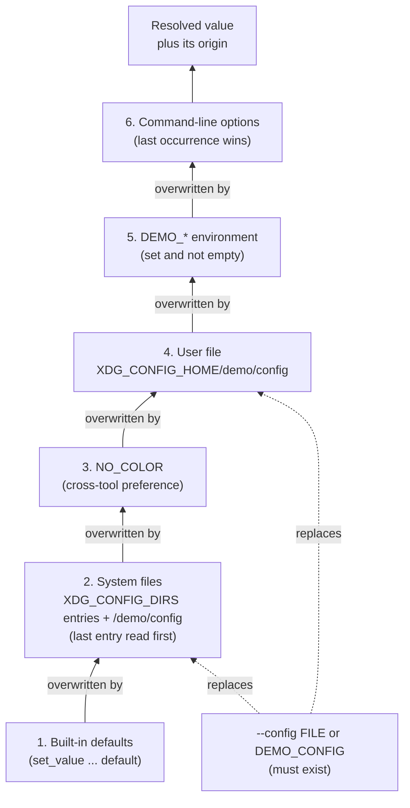

# Configuration Precedence

> [!summary] Claim
> A script's effective configuration is a merge of layers ordered from least to most specific (defaults, system files, user files, environment, command line), and it stays correct only if every layer is read as data, every internal variable is initialized before the merge, and every final value can name the layer that set it.

Part of [Robust Scripting](README.md) in [Shell and Unix Engineering](../README.md).

## TL;DR

Mechanism: read the layers from lowest to highest precedence and let each later write overwrite the earlier one, recording the origin of every value; the shell's only native tools are `${VAR:-word}`, `${VAR:=word}`, the environment import of XCU 2.5.3, and the `.` special built-in.
Rule: built-in defaults < system files (`$XDG_CONFIG_DIRS`) < user file (`$XDG_CONFIG_HOME`) < tool-specific environment variables < command-line options, with `--config FILE` replacing the file layers and an empty environment variable treated as unset.
Trap: `. ./app.conf` turns the config file into code, lets a plain `port=9000` in it silently beat the caller's environment, aborts a POSIX shell when the file is missing, and searches `PATH` (and in bash, the current directory) when the name has no slash.
Portability: a missing `.` file aborts dash, ksh93, `zsh --emulate sh`, and bash in POSIX mode but not default bash or native zsh; only default-mode bash, bash 3.2 even in POSIX mode, yash outside POSIX mode, and Alpine's BusyBox ash fall back to the current directory; only bash reads `BASH_ENV` and imports `SHELLOPTS` (lab; measured in the shell matrix).
When not to use it: once you need nested sections, typed lists, or merges deeper than "last scalar wins", parse configuration in a language with a real parser (TOML or JSON in Python or Go) and keep the shell as a thin caller.

## Mental model



Read the diagram bottom-up: each box is one layer of the lab's `resolve.sh`, and each solid arrow means "a value written here is overwritten by any value the next layer supplies".
The built-in defaults are written first so that every internal variable has a known value and origin before anything external is consulted.
The system files come next, one per `$XDG_CONFIG_DIRS` entry, read in reverse so that the first entry, which the XDG specification calls the most important, writes last and wins.
`NO_COLOR` sits between the system files and the user file because its own specification says a tool's user-level configuration should override it.
The user file, then the tool's own `DEMO_*` variables, then the command line each overwrite what came before, so the layer closest to this one invocation always wins.
The dashed arrows show the escape hatch: an explicit `--config FILE` (or `DEMO_CONFIG`) replaces both file layers instead of adding a third, and unlike an implicit file it must exist.

## How it works

### Why the ladder has this order

Each layer is ordered by how specific it is to the current invocation: a default speaks for every user forever, a system file for every user of one host, a user file for one person on every run, the environment for one session or process tree, and an option for exactly one run.
The more specific a layer is, the more it knows about the caller's intent, so it wins.
POSIX writes this ladder into individual utilities: `fc` uses the editor named by `-e`, then `FCEDIT`, and "If FCEDIT is null or unset, ed shall be used as the editor" (POSIX.1-2024 XCU fc).
It does the same for the terminal size, where `COLUMNS` and `LINES` override the window size and anything implied by `TERM` (POSIX.1-2024 XBD 8.3).
The clearest standardized ladder is the locale: for each category the first condition met wins, in the order `LC_ALL`, the matching `LC_*` variable, `LANG`, then the implementation default, and each variable counts only if it "is defined and is not null" (POSIX.1-2024 XBD 8.2).
That last clause is a design decision worth copying: an empty variable falls through as if it were unset, which is also what the XDG specification ("either not set or empty") and `NO_COLOR` ("present and not an empty string") do.

Real tools agree on the ladder but differ in how they implement it.
git reads the system file, then `$XDG_CONFIG_HOME/git/config` and `~/.gitconfig`, then `$GIT_DIR/config`, then `$GIT_DIR/config.worktree`, "with last value found taking precedence over values read earlier"; the `GIT_CONFIG_COUNT`, `GIT_CONFIG_KEY_<n>`, and `GIT_CONFIG_VALUE_<n>` environment pairs override every file and are themselves overridden by `git -c` (git-config, FILES and ENVIRONMENT, docs as of git 2.56.1).
git also shows that a project-scoped file (`local`) is more specific than a user-scoped one (`global`), so the repository wins over the person.
OpenSSH reads the same ladder in the opposite direction: command-line options, then `~/.ssh/config`, then `/etc/ssh/ssh_config`, and "for each configuration directive, the first specified value will be used", which is why its manual tells you to put host-specific blocks first and general defaults last (OpenBSD ssh_config(5)).
`NO_COLOR` is the instructive exception to "environment beats files": "User-level configuration files and per-instance command-line arguments should override the `NO_COLOR` environment variable" (no-color.org), because a variable every tool reads is less specific than one tool's own configuration.
The general rule is therefore not "environment beats files" but "specific beats generic"; the lab places `NO_COLOR` below the user file and `DEMO_COLOR` above it, and its tests prove both orderings.

### Last write wins versus first match wins

There are two ways to implement one ladder.
Last write wins reads the lowest layer first and lets every later layer overwrite (git, `resolve.sh`); it is simple to reason about and naturally records the origin of the final write.
First match wins reads the highest layer first and keeps the first value found (ssh, the locale rules, a chain of `${A:-${B:-default}}`); it can stop early and never reads a lower layer it does not need.
For scalars both give the same answer.
They differ for lists: git keeps every value of a multivalued key from every file, and to discard values inherited from a lower file you add an entry with an empty value, as `safe.directory` documents (git-config, `safe.directory`).
They also differ for a list stored in one variable, such as `XDG_CONFIG_DIRS`: its first entry is the most important, so a last-write-wins reader must walk it backwards, which is exactly the reversal `resolve.sh` performs with `set -- "$dir/demo/config" "$@"`.

### The shell primitives

`${parameter:-word}` substitutes `word` when the parameter "is unset or null", and dropping the colon tests "only unset" (POSIX.1-2024 XCU 2.6.2).
That one character decides whether `DEMO_PORT=` means "use the next layer" (`${DEMO_PORT:-}`) or "the caller explicitly asked for an empty value" (`${DEMO_PORT-}`); `resolve.sh` takes the locale rule and treats empty as unset, and its tests prove that an empty `DEMO_PORT` leaves the file value in place.
`${parameter:=word}` assigns only when the parameter is unset or null, which is first-match-wins in one expansion: a sourced file that writes `: "${port:=9000}"` defers to any value already present, where `port=9000` overwrites it (the lab's `naive-source` and `guarded-source` probes).
See [[Null-versus-Unset]] for the full table of the eight operators.

The environment is already merged into the shell before the first line of a script runs.
"Shell variables shall be initialized only from environment variables that have valid names", and each such variable is "marked for export immediately" (POSIX.1-2024 XCU 2.5.3).
So a script that reads `$port` before assigning it inherits whatever an ancestor exported under that name, and a script that assigns `port=8080` unconditionally throws the environment away.
POSIX reserves the namespace of environment names that contain lowercase letters for applications and uses uppercase names for the standard utilities (POSIX.1-2024 XBD 8.1), so give external knobs a tool prefix in uppercase (`DEMO_PORT`) and keep internal state in lowercase names that the script initializes itself before reading anything external; `resolve.sh` does this by writing every default through `set_value` first.

The command line is parsed in two passes.
Pass 1 only records what the user typed (`cli_port`, `cli_config`), because `--config FILE` must be known before any file is read even if it appears last on the line.
Pass 2 merges the layers and applies the recorded options last.
For a repeated option that takes an argument, POSIX asks that the "option and option-argument combinations should be interpreted in the order specified on the command line" (POSIX.1-2024 XBD 12.2, Guideline 11), which makes the last occurrence win; for a repeated option without an argument "the results are undefined, unless otherwise stated" (XBD 12.1), so document it.
Option parsing itself belongs to [[Argument-Parsing-and-CLI-Design]] and [[The-getopts-Builtin]].

### The dot built-in: configuration as code

`. file` is a special built-in that tokenizes, parses, and executes the file "in the current environment"; "If file does not contain a <slash>, the shell shall use the search path specified by PATH", the file "need not be executable", and "If no readable file is found, a non-interactive shell shall abort" (POSIX.1-2024 XCU 2.15, dot).
Its rationale says the current directory was deliberately left out of the search because of "the susceptibility to trojan horses that the user might be trying to avoid by leaving dot out of PATH".
POSIX also leaves it "unspecified whether the commands are parsed and executed as a program (as for a shell script) or are parsed as a single compound_list that is executed after the entire file has been parsed".

The implementations follow those words with telling differences.
dash's `find_dot_file()` walks `PATH` with `padvance()`, accepts only regular files, and otherwise calls `sh_error("%s: not found")`, which aborts a non-interactive shell; `dotcmd()` then runs `cmdloop(0)`, so it parses and executes one command at a time (dash src/main.c, `find_dot_file`, `dotcmd`).
bash's `source_builtin()` searches `PATH` with `find_path_file()` and, when nothing is found and `source_searches_cwd` is set, uses the name as given, which means the current directory (bash-5.3 builtins/source.def, `source_builtin`).
`posix_initialize()` clears `source_searches_cwd` when POSIX mode is turned on in bash-4.0 and later; bash-3.2's `posix_initialize()` never clears it, so macOS `/bin/sh` still loads a slash-free name from the current directory (bash-5.3 and bash-4.0 general.c versus bash-3.2 general.c, `posix_initialize`; lab).
In bash POSIX mode a missing file makes a non-interactive shell exit unless the call came through `command` (`executing_command_builtin`), while default bash returns status 1 and continues; the `command` exemption arrived in bash-4.2 (bash-5.3 builtins/source.def; bash CHANGES, bash-4.2-alpha item ss; lab).
bash 5.3 added `. -p PATH file` to search an explicit list instead of `$PATH`, and that form never falls back to the current directory (bash-5.3 NEWS, item kk; bash-5.3 builtins/source.def).
BusyBox ash aborts too ("This aborts if file isn't found, which is POSIXly correct"), and searches the current directory only when built with `ASH_BASH_SOURCE_CURDIR`, whose Kconfig default is `n` (BusyBox shell/ash.c, `find_dot_file`, `dotcmd`); Alpine's package sets `CONFIG_ASH_BASH_SOURCE_CURDIR=y` (aports `main/busybox/busyboxconfig`, as of 2026-11), so on Alpine a slash-free name does load from the current directory, while Debian's BusyBox 1.37.0 aborts (measured in the shell matrix).
yash's `dot_builtin()` falls back to the bare name when not in POSIX mode, and exits a non-interactive shell when the file cannot be opened (yash exec.c, `dot_builtin`).
mksh's `c_dot()` gives the current-directory fallback only to `source`, not to `.` (it tests whether the command name starts with `s`) (mksh funcs.c, `c_dot`).

A dotted file is code, so every expansion in it runs with the script's privileges.
The lab writes one line, `greeting=$(echo ran >.../ran.marker)hi`, and shows that `.` creates the marker while `resolve.sh` stores the text verbatim and creates nothing.
A syntax error deep in a dotted file is worse than a missing file: shells that execute command by command (bash, zsh, dash, BusyBox ash, yash, posh, and mksh) have already run every line before the error, so the script continues (bash, zsh, posh 0.14.1, Alpine's mksh R59 2020/10/31) or dies (dash, BusyBox ash, yash, Debian's mksh R59 2025/04/26) with half of its configuration applied, while ksh93, both u+ 2012 and u+m 1.0.10, parses the whole file first, runs none of it, and continues with status 3 (lab, `dot-late-error`; measured in the shell matrix).
bash abandons the rest of the file at the error and returns status 2 to the caller (1 in bash 3.2), so lines after the error are silently skipped while the script goes on; with a `)` on line 3 and an `echo` on line 4, line 1 ran and line 4 did not (measured on the macOS host with bash 5.3 and 3.2, as of 2026-11).
The bash manual's POSIX-mode list says non-interactive shells exit on "a syntax error in a script read with the `.` or `source` builtins" (bash-5.3 doc/bashref.texi), yet bash 5.3 started with `--posix`, `-o posix`, or `POSIXLY_CORRECT=1` continued in every one of those host runs, so do not rely on bash to stop.

### Reading configuration as data

The alternative to `.` is a small parser built from `read`.
`while IFS= read -r line || [ -n "$line" ]` reads one line at a time with no backslash processing and no field splitting.
The `||` clause is required: "If end-of-file is detected before a terminating logical line delimiter is encountered, the variables specified by the var operands shall be set as described above and the exit status shall be 1" (POSIX.1-2024 XCU read), so a plain `while read` loop silently drops a last line that has no newline; the lab counts 1 line with the naive loop and 2 with the fixed one.
Each line then gets a trailing carriage return removed (`${line%"$cr"}`), surrounding spaces and tabs trimmed, comments and blank lines skipped, and is split at the first `=` with `${line%%=*}` and `${line#*=}`, so values may contain `=` and `#`.
Every key goes through one `case` statement that is both the allowlist and the validator, and an unknown key or a bad value stops the script with the file name and line number, exit status 2.
Nothing in the file is expanded, so `$HOME`, quotes, and `$(...)` stay literal; if you need `~` or variable references in values, expand them deliberately for the specific keys that need it.

### Configuration of the interpreter itself

The script is not the only consumer of the environment: the shell that runs it reads configuration from it first.
A non-interactive bash that was not started as `sh`, is not in POSIX mode, and is not in privileged mode (`-p`) reads and executes the file named by `$BASH_ENV` before the script (bash-5.3 shell.c, `run_startup_files`, `execute_env_file`), so an exported `BASH_ENV` runs arbitrary code before line 1 of every bash script in the process tree (lab).
If `SHELLOPTS` "is in the environment when Bash starts up, the shell enables each option in the list before reading any startup files" (bash-5.3 doc/bashref.texi), implemented by `initialize_shell_options()` parsing an imported `SHELLOPTS` (bash-5.3 builtins/set.def); the lab exports `SHELLOPTS=noglob` and a child bash prints `star-*` instead of the matching file name.
`POSIXLY_CORRECT` in the environment puts bash into POSIX mode "before reading the startup files" (bash-5.3 doc/bashref.texi), which changes, among other things, whether `.` searches the current directory.
POSIX `ENV` is read "when and only when an interactive shell is invoked" and "shall be ignored if the user's real and effective user IDs or real and effective group IDs are different" (POSIX.1-2024 XCU 2.5.3); bash likewise ignores `SHELLOPTS`, `BASHOPTS`, `CDPATH`, and `GLOBIGNORE` and reads no startup files when its effective and real IDs differ (bash-5.3 doc/bashref.texi).
Below the shell, glibc's dynamic linker runs a binary in secure-execution mode when `AT_SECURE` is nonzero, voiding and stripping variables such as `LD_PRELOAD` and `LD_LIBRARY_PATH` (ld.so(8)).
The lesson generalizes: every layer that can change behavior also needs a trust rule saying who may set it.

## Numbers and limits

| Quantity | Value | Source |
|---|---|---|
| Layers in the lab's ladder | 6 (defaults, system files, `NO_COLOR`, user file, `DEMO_*`, options) plus the `--config` replacement | lab `resolve.sh` |
| Locale precedence levels | 4: `LC_ALL`, `LC_*`, `LANG`, implementation default | POSIX.1-2024 XBD 8.2 |
| `fc` editor ladder | 3: `-e`, `FCEDIT`, `ed` | POSIX.1-2024 XCU fc |
| git configuration scopes | 5: system, global, local, worktree, command | git-config docs, git 2.56.1 (as of 2026-11) |
| OpenSSH configuration sources | 3, first value wins | OpenBSD ssh_config(5) (as of 2026-11) |
| `XDG_CONFIG_HOME` default | `$HOME/.config` when unset or empty | XDG Base Directory Specification 0.8, 2021-05-08 |
| `XDG_CONFIG_DIRS` default | `/etc/xdg` when unset or empty; first entry most important | XDG Base Directory Specification 0.8 |
| Mode for a created XDG directory | `0700` | XDG Base Directory Specification 0.8 |
| `read` status at end of file without newline | 1, with the variables still set | POSIX.1-2024 XCU read; lab counts naive=1, fixed=2 |
| Exit status of `resolve.sh` on a usage or config error | 2 | lab |
| Status after a syntax error on line 3 of a dotted file | bash 3.2 as `sh`: 1; bash 5.3: 2; zsh 5.9: 126; ksh93u+ 2012: 3; dash: aborts with 2 | `probe.sh dot-late-error` on the macOS host (as of 2026-11), and the same in the shell matrix for bash 5.2, zsh, ksh93u+m 1.0.10, and dash; there posh 0.14.1 continues with 1; the lab asserts only nonzero |
| Status of `. ./missing.conf` where the shell continues | default bash: 1; native zsh: 127 | lab |
| bash releases where POSIX mode stops the current-directory fallback | 4.0 and later; 3.2 still falls back | bash general.c in 3.2, 4.0, 4.2, 4.3, 4.4, 5.0, 5.1, 5.2, 5.3 tarballs; lab |
| CVE-2022-24765 (git reads config from an untrusted parent `.git`) | CVSS 3.1 base 6.0 (GitHub CNA, per the CVE.org record, as of 2026-11) | CVE.org |
| CVE-2014-6271 (Shellshock, environment as code) | CVSS 3.1 base 9.8, `AV:N/AC:L/PR:N/UI:N` (the same score is in the CVE.org record's CISA ADP entry) | NVD; CVE.org |

## Portability

Cells marked "lab" are asserted by the lab and passed on the macOS host for that shell; cells marked "lab, matrix" are asserted by the lab and were measured by running the lab's `probe.sh` under that shell in the Debian 13 and Alpine 3.22 shell-matrix images (as of 2026-11).

| Shell | `. ./missing.conf`, non-interactive | `. name` found only in the current directory | Syntax error on line 3 of a dotted file | Exported `BASH_ENV` | Exported `SHELLOPTS=noglob` |
|---|---|---|---|---|---|
| POSIX sh | shall abort (XCU 2.15 dot) | not found, so shall abort (XCU 2.15 dot) | parse order unspecified (XCU 2.15 dot); a syntax error shall exit (XCU 2.8.1) | not specified; only `ENV`, interactive only (XCU 2.5.3) | not specified |
| macOS bash 3.2 as `/bin/sh` | aborts (lab) | loads it (lab) | line 1 runs, script continues (lab) | ignored (lab) | imported, glob off (lab) |
| bash 3.2 to 5.3, default mode | continues, status 1 (lab) | loads it (lab) | line 1 runs, script continues (lab) | runs before the script (lab) | imported, glob off (lab) |
| bash 5.3 in POSIX mode | aborts (source.def `source_builtin`; host probe) | aborts; 4.0 and later stop the fallback (general.c `posix_initialize`; host probe) | line 1 runs, rest of file skipped, script continues, contrary to bashref.texi (host probe) | ignored (shell.c `run_startup_files`) | imported before startup files (bashref.texi) |
| zsh 5.9 native | continues, status 127 (lab) | not loaded, continues with 127 (lab) | line 1 runs, script continues (lab) | ignored (lab) | ignored (lab) |
| `zsh --emulate sh` | aborts (lab) | aborts (lab) | line 1 runs, script continues (lab) | ignored (lab) | ignored (lab) |
| dash | aborts (lab; main.c `find_dot_file`) | aborts (lab) | line 1 runs, then aborts (lab; main.c `cmdloop`) | ignored (lab) | ignored (lab) |
| ksh93u+ 2012 | aborts (lab) | aborts (lab) | nothing runs, script continues (lab) | ignored (lab) | ignored (lab) |
| ksh93u+m 1.0.10 | aborts (lab, matrix) | aborts (lab, matrix) | nothing runs, script continues with status 3 (lab, matrix) | ignored (lab, matrix) | ignored (lab, matrix) |
| mksh R59 | aborts (lab, matrix) | `.` aborts; `source` loads it (funcs.c `c_dot`; lab, matrix) | line 1 runs, then aborts in Debian's 2025/04/26; line 1 runs, script continues with status 1 in Alpine's 2020/10/31 (lab, matrix) | ignored (lab, matrix) | ignored (lab, matrix) |
| yash 2.58.1 | aborts (exec.c `dot_builtin`; lab, matrix) | loads it outside POSIX mode (exec.c `dot_builtin`; lab, matrix) | line 1 runs, then aborts (lab, matrix) | ignored (lab, matrix) | ignored (lab, matrix) |
| posh 0.14.1 | aborts (lab, matrix) | aborts (lab, matrix) | line 1 runs, script continues with status 1 (lab, matrix) | ignored (lab, matrix) | ignored (lab, matrix) |
| BusyBox ash 1.37.0 | aborts (ash.c `dotcmd`; lab, matrix) | Debian aborts (Kconfig default `n`); Alpine loads it, built with `ASH_BASH_SOURCE_CURDIR=y` (ash.c; aports busyboxconfig; lab, matrix) | line 1 runs, then aborts (lab, matrix) | ignored (lab, matrix) | ignored (lab, matrix) |

`resolve.sh` itself uses only POSIX parameter expansion, `case`, `read -r`, and `[`, so its precedence and parsing tests pass unchanged in every shell above (lab on the macOS host; the worked example's exact output was also measured in every container shell of the shell matrix).
It avoids two measured divergences: it never field-splits a variable (native zsh does not split unquoted parameters, measured in the shell matrix) and it rejects ports with a leading zero, because `$((010))` is octal in bash and dash but decimal in zsh and ksh93 (measured in the shell matrix).
No utility beyond the shell matters here; the only external commands the lab runs are `env`, `mktemp`, and `mkdir`, and it uses only their POSIX options.

## Worked example

The [lab](../labs/13-configuration-precedence/) has three files: `resolve.sh` (the resolver), `probe.sh` (what `.` does in each shell), and `configuration-precedence.bats` (22 tests).
These two excerpts are verbatim from `resolve.sh`: the parser and the merge.

```sh
# read_file FILE: apply every KEY = VALUE line of FILE, in order, as data.
read_file() {
  lineno=0
  # The || clause keeps a last line that has no trailing newline (read returns 1 at EOF).
  while IFS= read -r line || [ -n "$line" ]; do
    lineno=$((lineno + 1))
    line=${line%"$cr"}
    trim "$line"
    line=$trimmed
    case $line in
      '' | '#'*) continue ;;
      *=*) ;;
      *) die "$1:$lineno: expected KEY = VALUE" ;;
    esac
    trim "${line%%=*}"
    key=$trimmed
    trim "${line#*=}"
    set_value "$key" "$trimmed" "$1:$lineno"
  done <"$1"
}
```

```sh
# Pass 2: merge, lowest precedence first; each later set_value overwrites an earlier one.
set_value port 8080 default
set_value log_level info default
set_value color auto default
set_value greeting hello default

if [ -z "$no_config" ] && [ -z "$explicit" ]; then
  for f in "$@"; do
    if [ -f "$f" ] && [ -r "$f" ]; then
      read_file "$f"
    fi
  done
fi
if [ -n "${NO_COLOR:-}" ]; then
  set_value color never "env NO_COLOR"
fi
if [ -n "$explicit" ]; then
  read_file "$explicit"
elif [ -z "$no_config" ] && [ -n "$user_file" ] && [ -f "$user_file" ] && [ -r "$user_file" ]; then
  read_file "$user_file"
fi

if [ -n "${DEMO_PORT:-}" ]; then set_value port "$DEMO_PORT" "env DEMO_PORT"; fi
if [ -n "${DEMO_LOG_LEVEL:-}" ]; then set_value log_level "$DEMO_LOG_LEVEL" "env DEMO_LOG_LEVEL"; fi
if [ -n "${DEMO_COLOR:-}" ]; then set_value color "$DEMO_COLOR" "env DEMO_COLOR"; fi
if [ -n "${DEMO_GREETING:-}" ]; then set_value greeting "$DEMO_GREETING" "env DEMO_GREETING"; fi

if [ -n "$cli_port_set" ]; then set_value port "$cli_port" "option --port"; fi
if [ -n "$cli_log_level_set" ]; then set_value log_level "$cli_log_level" "option --log-level"; fi
if [ -n "$cli_color_set" ]; then set_value color "$cli_color" "option --color"; fi
if [ -n "$cli_greeting_set" ]; then set_value greeting "$cli_greeting" "option --greeting"; fi
```

The test "each layer overrides the one below it" writes a system file and a user file under the test's scratch directory `$T`, then runs the resolver with two environment variables and one option (simplified excerpt from `configuration-precedence.bats`: the same lines with their indentation removed).

```sh
printf 'port = 1001\nlog_level = debug\ncolor = always\ngreeting = sys\n' >"$T/sys1/demo/config"
printf 'log_level = warn\ncolor = never\ngreeting = user\n' >"$T/user/demo/config"
DEMO_COLOR=always DEMO_GREETING=env run_lab "$RESOLVE" --greeting cli
```

The lab asserts this exact output (with `$T` expanded), and every key shows the layer that set it.

```text
port=1001 ($T/sys1/demo/config:1)
log_level=warn ($T/user/demo/config:1)
color=always (env DEMO_COLOR)
greeting=cli (option --greeting)
```

The contrast with sourcing is the `naive-source` and `guarded-source` probes, run with `DEMO_PORT=1` in the environment (simplified excerpt from `probe.sh`: the same lines with one indentation level removed).

```sh
naive-source)
  port=${DEMO_PORT:-8080}
  # shellcheck source=/dev/null # the file is created by the test
  . ./naive.conf
  printf 'naive port=%s\n' "$port"
  ;;
guarded-source)
  port=${DEMO_PORT-}
  # shellcheck source=/dev/null # the file is created by the test
  . ./guarded.conf
  : "${port:=8080}"
  printf 'guarded port=%s\n' "$port"
  ;;
```

With `naive.conf` containing `port=9000` and `guarded.conf` containing `: "${port:=9000}"`, the lab asserts:

```text
naive port=9000
guarded port=1
```

The naive file silently beat the environment; the guarded file deferred to it, and without `DEMO_PORT` the lab asserts `guarded port=9000`.
Note what the guarded form costs: with `:=` the first writer wins, so several sourced files must be loaded from most to least important, the opposite of the order a last-write-wins reader uses.

## Pitfalls

> [!warning] A sourced config file overwrites the environment
> Trigger: `port=${PORT:-8080}` followed by `. ./app.conf`, where the file says `port=9000`.
> Symptom: `PORT=1 ./script` still runs on 9000; the override documented in the README does nothing (lab `naive-source`).
> Fix: parse the file as data and apply the environment after it, or, if you must source, write the file as `: "${port:=9000}"` and load it after reading the environment (lab `guarded-source`).

> [!warning] A config file is code
> Trigger: `. "$config"` where the file is writable by someone other than the script's owner, or comes from a repository, an upload, or a shared directory.
> Symptom: any `$(...)`, backquote, or command in it runs with the script's privileges; the lab's one-line file creates a marker file the moment it is sourced.
> Fix: read it with the `read` loop and an allowlist of keys; if it must be sourced, first check that the file and its directory are owned by you or root and not writable by group or others.
> Real incident: CVE-2022-24765 (CVSS 6.0, GitHub CNA, per CVE.org) was git on shared machines picking up a `.git` directory an untrusted user created above the working directory, after which "Git would then respect any config in said Git directory"; git now refuses to parse the configuration of a repository owned by someone else unless it is listed in `safe.directory`, a setting it honors only from protected (system, global, command) scopes (git-config).

> [!warning] `.` with a slash-free name searches `PATH`, and bash also the current directory
> Trigger: `. app.conf` instead of `. ./app.conf`.
> Symptom: dash, ksh93, and bash 4.0+ in POSIX mode abort with "not found" even though the file is right there; default bash, bash 3.2, yash, and Alpine's BusyBox ash load it from the current directory, but only after a file with that name anywhere in `PATH`, which may be someone else's (lab `dot-cwd`; POSIX.1-2024 XCU 2.15 dot rationale on trojan horses).
> Fix: always give `.` a path with a slash, built from the script's own directory or an absolute path; in bash 5.3, `. -p DIRS file` restricts the search.

> [!warning] A missing config file kills or does not kill the script, depending on the shell
> Trigger: `. ./optional.conf` where the file is optional.
> Symptom: a non-interactive POSIX shell aborts at that line; default bash and native zsh print an error and continue with status 1 and 127 (lab `dot-missing`).
> Fix: decide per file whether it is required; guard an optional one with `[ -r "$f" ]` (as `resolve.sh` does for implicit files) and make an explicit one fail with a clear message.

> [!warning] The last line of the file is ignored
> Trigger: a config file saved without a trailing newline, read with `while read -r line; do ...; done`.
> Symptom: the last key is silently missing, because `read` returns 1 at end of file even though it set the variable.
> Fix: `while IFS= read -r line || [ -n "$line" ]` (lab "a naive read loop drops a last line").

> [!warning] Windows line endings and stray whitespace
> Trigger: a file edited on Windows, or `port = 7001` with spaces.
> Symptom: the value is `7001` followed by a carriage return, so `[ "$port" -gt 0 ]` fails with an "integer expression expected" style error or a string compare never matches.
> Fix: strip one trailing `\r` and trim spaces and tabs around the key and the value, as `read_file` does; the lab's parsing test feeds CRLF lines.

> [!warning] An empty variable is treated as a value
> Trigger: `${DEMO_PORT-8080}` when a wrapper exports `DEMO_PORT=` because its own variable was empty.
> Symptom: an empty port reaches the program, or an empty `LOG_LEVEL` disables logging.
> Fix: use `${VAR:-}` and treat empty as unset, as POSIX does for locale variables (XBD 8.2) and XDG does for its directories; give users an explicit value such as `none` if they need to switch something off.

> [!warning] `XDG_CONFIG_DIRS` read in the wrong direction
> Trigger: `for d in $(echo "$XDG_CONFIG_DIRS" | tr : ' ')` with last-write-wins merging.
> Symptom: the least important directory wins, the opposite of the specification ("the first directory listed is the most important"); the loop also splits paths that contain spaces.
> Fix: walk the list with `${rest%%:*}` and `${rest#*:}`, skip empty and relative entries ("consider the path invalid and ignore it"), and read the result in reverse (lab `--print-files` tests).

> [!warning] An inherited variable reconfigures the interpreter
> Trigger: `BASH_ENV`, `SHELLOPTS`, or `POSIXLY_CORRECT` exported by a parent, a CI system, or a user's profile.
> Symptom: code runs before line 1 of every bash script (`BASH_ENV`), globbing or `errexit` change underneath the script (`SHELLOPTS`), or `.` and other built-ins switch to POSIX behavior (`POSIXLY_CORRECT`); the lab shows the first two.
> Fix: start privileged or cross-boundary scripts with a scrubbed environment (`env -i PATH=/usr/bin:/bin HOME="$HOME" ...`) or with `bash -p`, which skips `BASH_ENV` and the `SHELLOPTS` import (bash-5.3 shell.c and set.def); the extreme case of environment-as-code is Shellshock, CVE-2014-6271 (CVSS 9.8, NVD), where bash executed text trailing a function definition in any environment variable.

> [!warning] A half-applied configuration after a syntax error
> Trigger: a dotted file with a typo near the end.
> Symptom: bash, zsh, posh, and Alpine's older mksh run the lines before the error and then continue the script with a mix of new and default values; dash, BusyBox ash, yash, and Debian's mksh run them and then die (lab `dot-late-error`; measured in the shell matrix).
> Fix: parse as data so nothing is applied until the whole file validates, or check sourced files with `sh -n file` before loading them.

> [!warning] Tests that read the developer's environment
> Trigger: a test runs the script with whatever `NO_COLOR`, `XDG_CONFIG_HOME`, or `DEMO_*` the developer has exported, and with the real `/etc/xdg`.
> Symptom: tests pass on one laptop and fail in CI.
> Fix: unset every variable the script reads and point `HOME` and the XDG variables at a scratch directory in `setup`, as the lab does.

## Security and robustness

Treat each layer as a trust boundary and write down who can change it: the script's author controls defaults, root controls `/etc/xdg`, the user controls `$XDG_CONFIG_HOME` and the environment, and whoever runs the command controls its options.
A setting that executes something (a hook, a pager, an editor command, a path to a helper) should be honored only from layers that the person running the script already trusts; git calls this protected configuration and refuses, for example, `safe.directory` from a repository's own file (git-config, SCOPES).
Across a privilege boundary, assume the environment is hostile: POSIX shells ignore `ENV` when real and effective IDs differ (XCU 2.5.3), bash ignores `SHELLOPTS`, `BASHOPTS`, `CDPATH`, and `GLOBIGNORE` in the same case (bashref.texi), and glibc strips `LD_PRELOAD` and its relatives in secure-execution mode (ld.so(8)); a script that sudo or a daemon runs should rebuild its environment rather than trust it.
Never rely on a `PATH`-searched `.`; a slash in the operand is the whole defense.
Keep secrets out of the environment layer where you can: an exported variable is copied into every child process, which is the main cost of the Twelve-Factor App's advice that an app "stores config in environment variables", credentials included by its own open-source litmus test (12factor.net); see [[Environment-Variables-and-Inheritance]] for how the environment propagates.
Validate every value where it enters, with the layer in the error message, and fail with a distinct exit status (`resolve.sh` uses 2) so a caller can tell "bad configuration" from "the job failed" ([[Exit-Code-Contracts]]).
Print provenance on request, as `git config --show-origin --show-scope` does, and redact secrets in that output.
Apply the configuration all at once after validation, never line by line, so a broken file cannot leave the process half-configured; the same idea, applied to files on disk, is [[Atomic-Writes]].

## The principal's view

The decision is not which syntax to parse but which ladder to promise, because users will build automation on it and every later change is breaking.
Pick the order once (defaults, system, user, tool environment, options), document it in `--help`, add a `--print-files` or `--show-config` switch that prints each value with its origin, and make every layer optional except an explicitly named file.
The main trade-off is strict versus forgiving validation: `resolve.sh` rejects a bad value in any layer, even one a higher layer overrides, which catches a broken system file early but means a user cannot work around an administrator's typo with a flag; git instead validates lazily, when a key is used.
Choose strict for tools that run unattended and forgiving for interactive tools used across many hosts you do not control.
The second trade-off is environment-only configuration (Twelve-Factor) versus files: the environment is flat, inherited by every child, and easy to inject in containers, while files can be reviewed, versioned, and permission-checked but need a discovery rule like XDG.
A shell script is the right home for a flat key-value ladder with a handful of keys.
Move to Python, Go, or Rust with a real TOML or JSON parser when you need nested sections, lists with merge rules, typed values, includes, or per-host conditional blocks; at that point the shell's lack of data structures turns each feature into a source of quoting bugs, and the configuration loader becomes worth a unit-tested library.

## Interview questions

> [!question] L5: Why do command-line options usually beat environment variables, and environment variables beat config files?
>
> > [!success]- Answer
> > Precedence follows specificity: an option describes this one run, an environment variable one session or process tree, a user file every run by one person, and a system file every user of the host.
> > The more specific source knows more about the caller's intent, so it wins.
> > POSIX encodes the same order in `fc` (`-e`, then `FCEDIT`, then `ed`) and in the locale rules.
> >
> > Follow-up: Name a well-known variable where a tool's config file should beat the environment, and explain why.

> [!question] L5: Predict the output: `app.conf` contains `PORT=9000`, and the script `PORT=${PORT:-8080}; . ./app.conf; echo "$PORT"` is run as `PORT=1 ./script`; what does it print?
>
> > [!success]- Answer
> > It prints 9000.
> > The environment value 1 is assigned first, and then the sourced file overwrites it, because sourcing is just more assignments in the same shell.
> > To let the environment win, apply it after the file, or write the file as `: "${PORT:=9000}"`.
> >
> > Follow-up: With the `:=` form, in which order must a system file and a user file be sourced?

> [!question] L5: What is the difference between `${DEMO_PORT:-8080}` and `${DEMO_PORT-8080}` when a wrapper exports `DEMO_PORT=`?
>
> > [!success]- Answer
> > With the colon the empty value counts as unset and the result is 8080; without it the result is the empty string.
> > POSIX locale variables and the XDG directories both treat empty as unset, which is the safer convention for configuration.
> >
> > Follow-up: How would you let a user deliberately clear a setting if empty means unset?

> [!question] L6: Debug this script: it "sometimes ignores the last setting", and a security review flagged it; what is wrong?
> ```sh
> while IFS='=' read -r key value; do eval "$key=\$value"; done < app.conf
> ```
>
> > [!success]- Answer
> > `read` returns 1 at end of file without a newline, so the last line is dropped when the file has no trailing newline; add `|| [ -n "$key" ]`.
> > A Windows-edited file leaves a carriage return at the end of every value.
> > The `eval` runs the key as code, so a line like `x;touch /tmp/pwned=1` executes a command; replace it with a `case` allowlist of known keys.
> > Whitespace around `=` becomes part of the key and value because `IFS` is only `=`.
> >
> > Follow-up: Why is `read -r` alone not enough to make the value safe?

> [!question] L6: Why does a script that runs `. lib.conf` work in bash on a laptop but abort under `sh` in CI?
>
> > [!success]- Answer
> > A slash-free operand makes `.` search `PATH`, not the current directory (POSIX.1-2024 XCU 2.15 dot).
> > Default bash falls back to the current directory when the `PATH` search fails; dash, ksh93, and bash 4.0+ in POSIX mode do not, and a non-interactive POSIX shell aborts when `.` finds nothing.
> > The CI image matters too: Alpine's BusyBox ash is built with `ASH_BASH_SOURCE_CURDIR=y` and loads the file, while Debian's `sh` (dash) aborts.
> > Write `. ./lib.conf`, or better, a path built from the script's own directory.
> >
> > Follow-up: Why did POSIX deliberately not search the current directory?

> [!question] L6: With `XDG_CONFIG_DIRS=/opt/site/xdg:/etc/xdg` and a loader where the last write wins, which file's value should win, and in what order do you read the files?
>
> > [!success]- Answer
> > The specification says the first directory listed is the most important, so `/opt/site/xdg` must win.
> > A last-write-wins loader must therefore read `/etc/xdg` first and `/opt/site/xdg` last, and then the user's `XDG_CONFIG_HOME` file after both.
> > Empty or relative entries are invalid and should be skipped.
> >
> > Follow-up: How would the loop change if the loader used first-match-wins?

> [!question] L6: How do you override a value from git's system config for exactly one command, and what wins if both your method and `git -c` are used?
>
> > [!success]- Answer
> > Use `git -c key=value` or the `GIT_CONFIG_COUNT`, `GIT_CONFIG_KEY_0`, `GIT_CONFIG_VALUE_0` environment pairs, both in the command scope above every file.
> > The environment pairs override the files and are themselves overridden by `-c`.
> > `git config --show-origin --show-scope` shows which source set the final value.
> >
> > Follow-up: Why does git ignore `safe.directory` when it appears in a repository's own config file?

> [!question] L7+: An unchanged bash deploy script behaves differently on one CI runner, with globbing off and an extra command running before line 1; what do you suspect, and how do you harden it?
>
> > [!success]- Answer
> > The runner exports `SHELLOPTS` (which bash imports at startup, turning on `noglob`) and `BASH_ENV` (which a non-interactive non-POSIX bash sources before the script).
> > Confirm with `env | grep -E '^(BASH_ENV|SHELLOPTS|BASHOPTS|POSIXLY_CORRECT)='` in the job.
> > Harden by starting the script with a scrubbed environment (`env -i` with an explicit `PATH` and `HOME`), or with `bash -p`, which skips `BASH_ENV` and the `SHELLOPTS` import, and by asserting the options you rely on at the top of the script.
> > Treat interpreter-level variables as part of the configuration surface in reviews.
> >
> > Follow-up: What does the dynamic linker do with `LD_PRELOAD` in a set-user-ID program, and why is that the same idea?

> [!question] L7+: What do you specify when designing the configuration system for an internal CLI used by 2,000 engineers and by unattended jobs?
>
> > [!success]- Answer
> > A documented ladder: defaults, system file, user file, tool-prefixed environment variables, options, plus an explicit `--config` that replaces the file layers and must exist.
> > A data format parsed with an allowlist, never sourced, validated at load with the file and line in every error, and applied only after the whole configuration validates.
> > A provenance command that prints each value with its origin and redacts secrets.
> > A trust rule: settings that execute programs or point at credentials are honored only from system, user, or command scopes, never from a repository or the working directory.
> > Strict validation for unattended jobs and a distinct exit status for configuration errors.
> > Secrets through files with mode 0600 or a secret manager, not the environment, because every child inherits the environment.
> >
> > Follow-up: When would you stop doing this in shell and move the loader into a compiled language?

> [!question] L7+: How do last-write-wins and first-match-wins configuration loading compare, and when do they give different answers?
>
> > [!success]- Answer
> > For a scalar key they agree; last-write-wins reads every layer and keeps the final write, first-match-wins reads from the top and stops at the first value.
> > They diverge for lists: git accumulates a multivalued key across all files and needs an empty entry to reset it, while OpenSSH keeps only the first value of most directives.
> > They also diverge in cost and side effects, since first-match-wins never reads, and so never validates or fails on, a lower layer.
> >
> > Follow-up: Which of the two makes it easier to report the origin of every value, and why?

## Related

Prerequisites: [[Exit-Code-Contracts]]

Next: [[Logging-from-Scripts]]

See also: [[Null-versus-Unset]], [[Parameter-Expansion]], [[Environment-Variables-and-Inheritance]], [[The-read-Builtin]], [[Argument-Parsing-and-CLI-Design]], [[The-getopts-Builtin]], [[Special-Built-ins-versus-Utilities]], [[Command-Search-and-PATH]], [[Bash-POSIX-Mode]], [[Bash-Startup-Files-and-Modes]], [[Locale-and-LC_ALL]], [[Command-Injection]], [[Atomic-Writes]], [[Dry-Run-and-Apply]]

## Further reading

- [POSIX.1-2024 XCU 2, Shell Command Language](https://pubs.opengroup.org/onlinepubs/9799919799/utilities/V3_chap02.html): 2.5.3 on environment import and `ENV`, 2.6.2 on `:-` and `:=`, 2.8.1 on which errors abort, and 2.15 `dot` with its trojan-horse rationale.
- [POSIX.1-2024 XBD 8, Environment Variables](https://pubs.opengroup.org/onlinepubs/9799919799/basedefs/V1_chap08.html): the namespace rule for lowercase names and the locale precedence ladder.
- [POSIX.1-2024 XBD 12, Utility Conventions](https://pubs.opengroup.org/onlinepubs/9799919799/basedefs/V1_chap12.html): Guideline 11 on repeated and overriding options.
- [XDG Base Directory Specification 0.8](https://specifications.freedesktop.org/basedir-spec/latest/): the defaults, the order of importance, and the rule to ignore relative paths.
- [git-config(1)](https://git-scm.com/docs/git-config): a production last-write-wins ladder with scopes, environment overrides, multivalued keys, and protected configuration.
- [ssh_config(5)](https://man.openbsd.org/ssh_config): the same ladder implemented as first value wins.
- [NO_COLOR](https://no-color.org/): a small cross-tool convention that places a generic variable below tool-specific configuration.
- [bash 5.3 source](https://ftpmirror.gnu.org/bash/bash-5.3.tar.gz): `shell.c` `run_startup_files`, `builtins/source.def`, `general.c` `posix_initialize`, and `builtins/set.def` `initialize_shell_options` show exactly what the environment can change in bash.
- [dash src/main.c](https://git.kernel.org/pub/scm/utils/dash/dash.git/plain/src/main.c): a minimal, strictly POSIX `.` in under 50 lines.
- [ld.so(8)](https://man7.org/linux/man-pages/man8/ld.so.8.html): secure-execution mode, the dynamic linker's rule for distrusting the environment.
- [CVE-2022-24765](https://nvd.nist.gov/vuln/detail/CVE-2022-24765): configuration discovered from an untrusted location.
- [CVE-2014-6271](https://nvd.nist.gov/vuln/detail/CVE-2014-6271): Shellshock, the environment interpreted as code.
- [The Twelve-Factor App, Config](https://12factor.net/config): the case for environment-only configuration, to weigh against its leakage costs.
