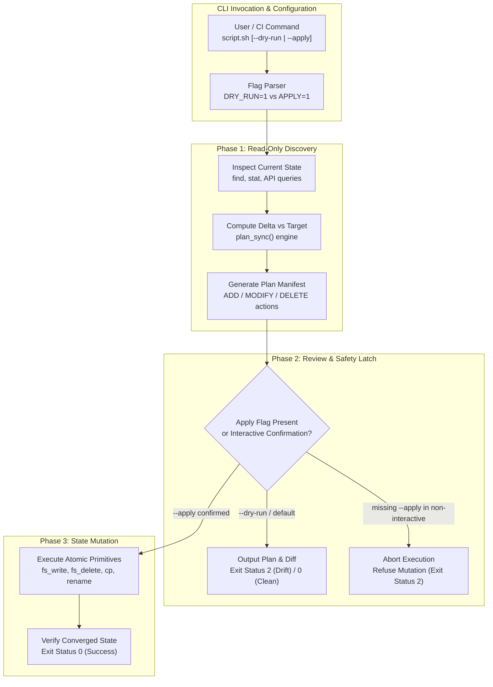

# Dry Run and Apply

> [!summary] Claim
> A script is safe to preview and execute only when read-only inspection is strictly decoupled from state mutation, so that a dry run inspects the system, computes a declarative changeset, and validates safety invariants without executing destructive commands or leaking side-effecting redirections.

Part of [Robust Scripting](README.md) in [Shell and Unix Engineering](../README.md).

## TL;DR

- Mechanism: dry-run mode intercepts mutating side effects via an execution abstraction layer or generates a declarative action manifest from read-only discovery, comparing current state to desired state while suppressing execution in `execute_command_internal()` or function wrappers without touching persistent storage (POSIX.1-2024 XCU 2.9.1, POSIX.1-2024 XCU `make`).
- Rule: default destructive operations to dry-run preview, require explicit `--apply` to authorize mutations, separate inspection from execution to prevent simulation divergence, and encapsulate file redirections inside functions so the shell does not truncate targets during dry run.
- Trap: `maybe_exec cmd > target.txt` truncates `target.txt` to 0 bytes even in dry-run mode because POSIX shells process redirection `open(..., O_WRONLY|O_CREAT|O_TRUNC)` before the wrapper function runs (POSIX.1-2024 XCU 2.7.2, XCU 2.9.1.1).
- Portability fact: `set -n` (`noexec`) is a POSIX one-way latch in a non-interactive shell that parses commands without executing them and cannot be turned off by a later `set +n` (interactive shells may ignore it); bash 4.4+ and mksh support `${*@Q}`, bash 2.02+, zsh, and ksh93 support `printf '%q'`, while portable POSIX sh requires manual single-quote escaping; exit status 2 for drift is the `terraform plan -detailed-exitcode` convention, whereas POSIX `diff` and `kubectl diff` report differences with 1.
- When not to use it: when mutations involve distributed external APIs with non-idempotent side effects where local state simulation cannot predict remote validation, or in microsecond-latency batch loops where function wrapping adds overhead; use compiled languages with formal schema validation and transactional database rollbacks instead.

## Mental model



The script execution separates operational preview from state modification across three distinct phases.
In Phase 1, the script performs strictly read-only discovery against the filesystem or remote endpoints, comparing current system state against the desired target state to produce a declarative action manifest.
In Phase 2, the engine checks safety latches: if running in preview mode or in a non-interactive pipeline without authorization, it prints the formatted diff, emits structured plan records, and terminates with exit status 2 without mutating disk or network state.
In Phase 3, when explicitly authorized by `--apply`, the execution engine consumes the validated manifest and invokes strongly typed atomic primitives to converge the system to the target state.

## How it works

### Lexical syntax checking vs operational simulation: `set -n` and the one-way latch

Every Unix shell provides a native mechanism to read commands without executing them: the `-n` or `noexec` option (POSIX.1-2024 XCU 2.15, POSIX.1-2024 XCU `sh`).
POSIX words it as "The shell shall read commands but does not execute them", and allows interactive shells and their subshells to ignore the option.
When invoked as `sh -n script.sh` or through `set -n`, the shell initializes its lexical analyzer and parser to validate the script grammar, but skips execution.
In GNU bash, this behavior is controlled by the internal global flag `read_but_dont_execute`, defined in `flags.c` and bound to the `n` letter in its option table; `shell.c` sets it for `bash -n` at startup.
Inside `execute_cmd.c`, the primary execution engine checks this flag at the top of `execute_command_internal()` (bash 5.3 source):

```c
if (read_but_dont_execute)
  return (last_command_exit_value);
if (command == 0)
  return (EXECUTION_SUCCESS);
```

In dash, `evaltree()` in `src/eval.c` begins with `if (nflag) goto out;`, so every parse tree is skipped once the `-n` option is on.
While `sh -n` is essential for static syntax analysis and linter pre-flight checks, it cannot function as a dynamic dry-run engine inside an operational script.
Once a script executes `set -n`, the shell enters read-only parsing mode for all remaining lines in the input stream (POSIX.1-2024 XCU 2.15).
Because subsequent commands are parsed but never executed, a later statement such as `set +n` is read as inert text and never executed by the shell engine.
The latch takes effect at the next command the shell parses, not the next command on the same line.
In a script with one command per line, every shell in the matrix (bash, dash, zsh, ksh93, mksh, yash, posh, BusyBox ash) prints only the lines before `set -n`; but mksh, yash, and posh parse a whole `-c` line before running it, so `sh -c 'echo start; set -n; echo invisible'` still prints `invisible` there, and posh runs a multi-line `-c` string to the end (measured in the shell matrix, Debian 13 and Alpine 3.22, 2026-11).
The shell parses to the end of the file and exits with the status of the last command it executed, or with a nonzero status if the parser finds a syntax error later in the file (2 in bash, dash, yash, and BusyBox ash; 1 in zsh, mksh, and posh; 3 in ksh93u+m; measured in the shell matrix).
`set -n` is an irreversible one-way latch inside a running script process.
Dynamic dry-run capabilities must therefore be implemented at the application layer through execution hooks, dispatch wrappers, or declarative manifest generation.

### The redirection leakage trap: why naive wrappers destroy files

The most prevalent antipattern in shell automation is wrapping command invocations in a naive conditional dispatcher:

```sh
# Antipattern: Naive execution wrapper
maybe_exec() {
  if [ "$DRY_RUN" -eq 1 ]; then
    printf '[DRY-RUN] Would execute: %s\n' "$*" >&2
    return 0
  fi
  "$@"
}

# Fatal mistake: Redirection executes regardless of DRY_RUN
maybe_exec echo "database_url=postgres://prod" > /etc/app.conf
```

When an engineer executes this script with `DRY_RUN=1`, they expect `/etc/app.conf` to remain untouched.
Instead, the file is immediately truncated to 0 bytes, destroying production configuration.

This catastrophic failure stems from the fundamental evaluation order of simple commands defined in POSIX.1-2024 XCU 2.9.1.1 (Order of Processing).
When the shell evaluates a simple command, it executes the following steps in strict chronological order:
1. Words recognized as variable assignments and redirections are saved for steps 3 and 4.
2. The remaining words (command name and arguments) undergo expansion (parameter, command, arithmetic, and pathname expansion).
3. Redirections are performed in lexical order from left to right.
4. Variable assignments are expanded.

Only then does command search and execution (XCU 2.9.1.4) resolve the command name and invoke it.
In Step 3, the shell encounters `> /etc/app.conf`.
The shell process invokes the `open(2)` system call with flags `O_WRONLY | O_CREAT | O_TRUNC` (and mode `0666`, filtered by the umask, when it creates the file); XCU 2.7.2 requires an existing file to be truncated to empty after it is opened, unless `set -C` (`noclobber`) makes the redirection fail instead.
The kernel virtual file system (VFS) immediately truncates `/etc/app.conf` on disk.
Only after Step 4, in command search and execution, does the shell look up `maybe_exec` and branch into the function body.
Inside `maybe_exec`, the function detects `DRY_RUN=1` and prints its warning, but the truncation has already taken place in the kernel.
If the wrapper prints to standard output rather than standard error, it writes the diagnostic message into the truncated file.

To prevent redirection leakage during dry-run execution, scripts must never place raw shell redirection operators on wrapped commands.
All filesystem mutations involving input and output streams must be encapsulated inside dedicated wrapper primitives:

```sh
# Robust: Encapsulated I/O primitive
fs_write() {
  dry_run="$1"
  content="$2"
  target="$3"

  if [ "$dry_run" -eq 1 ]; then
    # wc -c counts bytes; ${#content} would count characters in a UTF-8 locale
    len=$(printf '%s\n' "$content" | wc -c | tr -d ' \t')
    printf '[DRY-RUN] write %s bytes to %s\n' "$len" "$target" >&2
    return 0
  fi
  printf '%s\n' "$content" > "$target"
}
```

Because the redirection operator `> "$target"` is located inside the body of `fs_write`, the `open(2)` system call is only reached when `dry_run` is 0.

### The Simulation Fallacy and State Divergence: why sequential dry runs fail

The second critical failure mode of dry-run implementations is the Simulation Fallacy: the assumption that a state-mutating script can be previewed simply by skipping mutating commands in a sequential loop.

Consider an operational deployment script:

```sh
# Antipattern: Sequential dry-run with state coupling
maybe_exec mkdir -p /opt/app/releases/v2
maybe_exec tar -xzf bundle.tar.gz -C /opt/app/releases/v2
maybe_exec /opt/app/releases/v2/bin/validate-schema --check
maybe_exec ln -sfn /opt/app/releases/v2 /opt/app/current
```

When run in dry-run mode, the wrapper skips `mkdir` and `tar`.
When the script reaches line 3, it attempts to execute `/opt/app/releases/v2/bin/validate-schema`.
Because line 1 and line 2 were skipped, `/opt/app/releases/v2` does not exist on the filesystem.
The shell fails with `no such file or directory`.
Under standard strict error handling (`set -e`), the dry-run crashes halfway through execution.
If the developer suppresses the error, line 3 is skipped, meaning the schema validation check is never performed during the dry run.

Similarly, scripts that use command substitutions to capture the state of preceding mutations fail during simulation:

```sh
# Antipattern: Inspecting simulated output
maybe_exec generate_migration_plan > /tmp/plan.sql
record_count=$(wc -l < /tmp/plan.sql)
if [ "$record_count" -gt 100 ]; then
  maybe_exec alert_dba_team
fi
```

In dry-run mode, `/tmp/plan.sql` is never generated, causing `wc -l` to crash or evaluate to 0, which takes the incorrect conditional branch.
Ansible's check-mode documentation states the same limitation from the module side: modules that do not support check mode "report nothing and do nothing" under `--check`, so a variable registered from such a task carries no real output into later `when` conditionals, and the documented escape hatch is `check_mode: false` on read-only tasks that must run even in check mode.

To eliminate state divergence, distinguished engineers structure automation around a two-phase architecture:
1. Phase 1 evaluates current state against target state using pure read-only inspection, generating an in-memory or on-disk action manifest.
2. Phase 2 executes the manifest only when `--apply` is specified.

### Command representation, argument serialization, and the `eval` antipattern

When a dry-run engine logs planned commands, it must format the argument vector (`argv`) faithfully without losing argument boundaries or introducing security vulnerabilities.

A common antipattern converts arguments to a space-separated string and re-executes them via `eval`:

```sh
# Antipattern: String concatenation and eval
run_cmd() {
  cmd="$*"
  if [ "$DRY_RUN" -eq 1 ]; then
    printf '[DRY-RUN] %s\n' "$cmd" >&2
  else
    eval "$cmd"
  fi
}

# Catastrophic vulnerability: Command injection (CWE-78)
filename="report; rm -rf /; .csv"
run_cmd rm -f "$filename"
```

Concatenating arguments with `"$*"` destroys argument boundaries (POSIX.1-2024 XCU 2.5.2).
When `eval "$cmd"` parses the string, the semicolon terminates the `rm` command and executes `rm -rf /` with full shell privileges.
Even without malicious input, filenames containing whitespace, tabs, asterisks, or quotes break `eval` execution.

Planned commands must always be executed by passing the positional array directly as `"$@"` without intermediate string evaluation.
For logging and preview displays, arguments must be serialized using unambiguous shell quoting.
In GNU bash, `${*@Q}` (bash 4.4+) and `printf '%q ' "$@"` (bash 2.02+) produce properly quoted and escaped tokens (`sh_quote_reusable()`, `sh_single_quote()`, and `sh_backslash_quote()` in `lib/sh/shquote.c`).
mksh also accepts `${v@Q}`, zsh spells it `${(q)v}`, and zsh and ksh93 have `printf '%q'`; dash, yash, and BusyBox ash reject `%q`, and mksh and posh have no `printf` builtin, so their `%q` support is whatever the external `printf` offers (GNU coreutils on Debian accepts it, BusyBox on Alpine does not; measured in the shell matrix).
In portable POSIX `sh`, a dedicated quoting routine wraps strings containing special characters in single quotes and replaces internal single quotes with `'\''`:

```sh
# Portable POSIX argument quoting
quote_arg() {
  case "$1" in
    '') printf "''" ;;
    *[!A-Za-z0-9_.,:/-]*)
      escaped=$(
        printf '%s\n' "$1" | sed "s/'/'\\\\''/g"
        printf 'x'
      )
      escaped=${escaped%?x}
      printf "'%s'" "$escaped"
      ;;
    *) printf '%s' "$1" ;;
  esac
}
```

This guarantees that `rm -f "path with spaces.txt"` displays as `rm -f 'path with spaces.txt'` while executing faithfully as separate pointers in `execve(2)`.
Two details matter: `~` is deliberately absent from the safe set, because an unquoted `~root` pasted back into a shell tilde-expands (to `/var/root` on macOS), and the trailing `x` stops command substitution from stripping trailing newlines from the argument.

### The Two-Phase Plan-and-Apply Pattern: declarative manifests and drift detection

The gold standard for systems automation is the two-phase plan-and-apply pattern, exemplified by industry tools such as HashiCorp Terraform (`terraform plan` and `terraform apply`), Kubernetes (`kubectl diff` and `kubectl apply --dry-run=server`), and `make -n` (POSIX.1-2024 XCU `make`).
`make -n` is not hermetic, though: POSIX still executes lines with a `+` prefix, lines that expand the `MAKE` macro, and lines that create or update an include file, so a recursive `$(MAKE)` call runs for real during the preview.

In this pattern, the script never alternates between checking and mutating.
Instead, it splits cleanly into two decoupled engines:

```sh
# Phase 1: Planner (Pure read-only query)
plan_sync() {
  src="$1"
  dst="$2"

  # Discover files in source missing or modified in destination
  ( cd "$src" && find . -type f | LC_ALL=C sort ) | while IFS= read -r rel; do
    rel_clean=${rel#./}
    if [ ! -f "$dst/$rel_clean" ]; then
      printf 'ADD\t%s\n' "$rel_clean"
    elif ! cmp -s "$src/$rel_clean" "$dst/$rel_clean"; then
      printf 'MODIFY\t%s\n' "$rel_clean"
    fi
  done

  # Discover obsolete files in destination missing from source
  if [ -d "$dst" ]; then
    ( cd "$dst" && find . -type f | LC_ALL=C sort ) | while IFS= read -r rel; do
      rel_clean=${rel#./}
      if [ ! -f "$src/$rel_clean" ]; then
        printf 'DELETE\t%s\n' "$rel_clean"
      fi
    done
  fi
}
```

The planner emits a deterministic, tabular changeset:
`ADD    conf/app.conf`
`MODIFY bin/worker`
`DELETE obsolete.log`

In dry-run mode, the script renders this manifest to the operator or exports it to a file (`--plan-out=plan.tsv`).
In apply mode, the script reads the validated manifest (`--plan-in=plan.tsv`) and loops over the records, calling atomic primitives (`fs_copy`, `fs_delete`) for each action.
Because Phase 1 executes zero mutations, the script never encounters intermediate missing files or divergent state.
Furthermore, storing the manifest artifact allows CI/CD systems to perform independent security scans, cost estimations, and change approvals before committing changes to production.

### CLI ergonomics, safety precedence, and interactive confirmation latches

Command-line interfaces for operational scripts must follow POSIX Utility Syntax Guidelines (POSIX.1-2024 XBD 12.2) and implement strict safety precedence:

1. Flag conventions:
   - `-n` and `--dry-run`: standard flags to request simulated preview without mutation, matching `make -n`, `patch --dry-run`, and `rsync -n`.
   - `--apply` or `--execute`: explicit authorization flag required to perform state mutations.
   - `--plan-out=FILE` and `--plan-in=FILE`: decoupled artifact generation and execution.
2. Safety precedence:
   - For destructive operations (e.g. data pruning, resource deletion, database migrations), scripts must default to dry-run mode!
   - A script invoked with `./prune-backups.sh` must preview the deletions and refuse to delete anything unless `--apply` is explicitly passed.
3. Interactive safety latches:
   - When running on an interactive terminal (`[ -t 0 ]`), the script can display the planned changeset and prompt the human operator:
     `read -r -p "Apply these 14 changes? [y/N] " reply`
   - When running in non-interactive environments (cron, CI/CD runners, Kubernetes Jobs where `! [ -t 0 ]`), the interactive prompt cannot be answered.
   - In non-interactive environments without `--apply`, the script must immediately abort with an explicit error and exit status 2:
     `Error: Refusing to mutate in non-interactive environment without --apply`

### Exit code contracts: distinguishing clean state, drift, and errors

A robust dry-run engine must communicate three distinct outcomes to calling shells and CI pipelines (Terraform `-detailed-exitcode`; compare POSIX.1-2024 XCU `diff`):
- `0`: Clean state, where preview mode indicates zero pending changes and apply mode indicates successful convergence.
- `2`: Drift detected or changes pending, signaling to callers that the system has drifted and actions are required.
- `1`: Operational error caused by unhandled failures, missing dependencies, syntax errors, or permission denials.

This contract has three values like POSIX `diff(1)`, but it assigns the codes the other way round: `diff` exits 0 for identical files, 1 for differences, and >1 for an error, and `kubectl diff` follows `diff` (0, 1, >1).
A caller written for the `diff` convention therefore reads a drift status of 2 as a failure, so the script must document which convention it uses.
In modern infrastructure tooling, HashiCorp Terraform adopts this exact pattern with `terraform plan -detailed-exitcode`:
- Exit 0: Plan succeeded, no changes pending.
- Exit 1: Error during planning.
- Exit 2: Plan succeeded, differences or drift detected.

By returning exit status 2 on pending drift, automated monitoring pipelines can run `script.sh --dry-run` every hour to alert on configuration drift without performing unapproved modifications.

### OS-level hermetic dry runs: mount namespaces and overlayfs sandboxing

When maintaining complex legacy scripts where refactoring into a two-phase plan-and-apply architecture is impractical, staff-plus engineers employ operating system sandboxing primitives for true hermetic simulation.

Under Linux, mount namespaces (`CLONE_NEWNS`, Linux 2.4.19+) and overlay filesystems (`fs/overlayfs/super.c`, Linux 3.18+) allow executing an entire unmodified script while discarding its filesystem mutations under the target directory upon termination.
An unprivileged user may mount overlayfs inside its own user namespace only from Linux 5.11 (commit 459c7c565ac3, "ovl: unprivieged mounts", which set `FS_USERNS_MOUNT`); older kernels need real root:

```sh
# Execute hermetic dry run via unshare and overlayfs (Linux 5.11+)
run_hermetic_dry_run() {
  target_root="$1"
  shift

  unshare --mount --user --map-root-user /bin/sh -c '
    target_root=$1
    shift
    scratch=$(mktemp -d)
    # Keep the copy-on-write layer in RAM, private to this namespace
    mount -t tmpfs tmpfs "$scratch"
    mkdir -p "$scratch/upper" "$scratch/work"

    # Mount the overlay on top of the real directory, so absolute paths hit it too
    mount -t overlay overlay \
      -o lowerdir="$target_root",upperdir="$scratch/upper",workdir="$scratch/work" \
      "$target_root"

    # Execute the legacy script against the overlaid view
    ( cd "$target_root" && "$@" )

    # Inspect the exact filesystem mutations in the upper directory
    printf "=== Speculative Filesystem Mutations ===\n"
    find "$scratch/upper" -mindepth 1

    # Exit namespace: the tmpfs and the overlay vanish with it
  ' _ "$target_root" "$@"
}
```

This snippet was not run for this note: it needs a Linux 5.11+ host with unprivileged user namespaces enabled, which macOS does not provide, so treat it as a design sketch to test on your own kernel.
The 5.11 requirement itself is checked: the commit that added `FS_USERNS_MOUNT` is dated 2020-12-14 and is contained in v5.11 but not in v5.10, and the flag is still set in `fs/overlayfs/super.c` (as of 2026-11).
The script executes real commands, creates real directories, writes temporary files, and inspects intermediate outputs.
Every write under `target_root` is captured in the `upperdir` on the namespace-private `tmpfs`; deletions appear there as whiteouts (character devices with device number 0/0), which is why the listing uses `-mindepth 1` rather than `-type f`.
When the namespace exits, the overlay and the `tmpfs` unmount, nothing under `target_root` has changed, and only the empty `mktemp` directory remains on the host.
The fidelity has hard edges: writes to paths outside `target_root` still reach the real filesystem, and network calls, database writes, and signals to other processes escape the sandbox entirely.
On systems supporting copy-on-write snapshots (ZFS, Btrfs, or LVM thin pools), taking an ephemeral snapshot prior to execution and computing a diff (`btrfs subvolume find-new` or `zfs diff`) provides identical speculative isolation.

## Numbers and limits

| Quantity | Value | Source / Measurement |
|---|---|---|
| `set -n` (`noexec`) specification | POSIX standard | POSIX.1-2024 XCU 2.15 (Special Built-in Utilities `set`) |
| `make -n` No-operation mode | POSIX standard | POSIX.1-2024 XCU `make` Option `-n` |
| `diff` exit status contract | 0 (no diff), 1 (diff), >1 (error) | POSIX.1-2024 XCU `diff` Exit Status |
| Terraform drift exit status | 0 (clean), 1 (error), 2 (drift) | HashiCorp Terraform CLI `-detailed-exitcode` (as of 2026-11) |
| In-process shell function wrapper latency | about 1.6 microseconds per call (5.2 us per loop iteration with the call, 3.6 us without) | Measured macOS 27.3 arm64 `/bin/sh` (bash 3.2), 10,000 iterations, 2026-11-15 |
| External fork-exec latency | 2.07 ms per call | Measured macOS 27.3 arm64 `/bin/sh` running `/usr/bin/true`, 500 runs, 2026-11-15 |
| Script execution via external process | 4.26 ms per invocation | Measured macOS 27.3 arm64 `/bin/sh dry-run-engine.sh safety_latch --apply`, 500 runs, 2026-11-15 |
| Linux overlayfs max lower layers | 500 layers | Linux kernel `fs/overlayfs/params.h` (`OVL_MAX_STACK`, as of 2026-11) |
| Linux mount namespace flag | `CLONE_NEWNS` (0x00020000) | Linux kernel `include/uapi/linux/sched.h` (Linux 2.4.19+) |
| `{_POSIX_ARG_MAX}` minimal limit | 4096 bytes | POSIX.1-2024 XBD 13 `limits.h` |
| Linux `ARG_MAX` | 2097152 bytes (2 MiB) from glibc `getconf ARG_MAX` with the default 8 MiB stack limit; musl `getconf` on Alpine 3.22 prints 131072 | Measured in the shell matrix (Debian 13, `ulimit -s` 8192); the legacy `ARG_MAX` constant in `include/uapi/linux/limits.h` is 131072 |
| Bash `${var@Q}` parameter transformation | Bash 4.4+ (2016) | GNU bash `NEWS` (bash-4.4 item o); `sh_quote_reusable()` called from `subst.c` |
| Bash `printf '%q'` support | Bash 2.02+ (1998) | GNU bash `CHANGES` (bash-2.02-alpha1 adds the `printf` builtin); `case 'q'` in bash-2.02 `builtins/printf.def` |

## Portability

Every cell below represents behavior measured in the shell matrix (macOS host, Debian 13, Alpine 3.22) on 2026-11-15 or documented in primary specification standards (as of 2026-11).

| Behavior | POSIX.1-2024 | macOS bash 3.2 | bash 5.3 | zsh (native) | zsh `--emulate sh` | dash | ksh93 | mksh | yash | posh 0.14.1 | BusyBox ash |
|---|---|---|---|---|---|---|---|---|---|---|---|
| `set -n` irreversible one-way latch | yes (XCU 2.15; interactive shells may ignore it) | supported (latch) | supported (latch) | supported (latch) | supported (latch) | supported (latch) | supported (latch) | latch from the next line (rest of a `-c` line runs) | latch from the next line (rest of a `-c` line runs) | latch in a script file (a whole `-c` string runs) | supported (latch) |
| Redirection truncation before function execution | yes (XCU 2.9.1.1) | truncates target | truncates target | truncates target | truncates target | truncates target | truncates target | truncates target | truncates target | truncates target | truncates target |
| Parameter quote transformation `${v@Q}` | no | bad substitution | supported | bad substitution (use `${(q)v}`) | bad substitution | Bad substitution (exit 2) | bad substitution | supported | syntax error (exit 2) | bad substitution | bad substitution (exit 2) |
| `printf '%q'` escaping | no | supported | supported | supported | supported | invalid directive (exit 2) | supported | no builtin: GNU `printf` on Debian supports it, BusyBox `printf` on Alpine fails (exit 1) | invalid specifier (exit 1) | no builtin: GNU `/usr/bin/printf` on Debian supports it | invalid format (exit 1) |
| Portable single-quote escaping `sed` helper | yes | supported | supported | supported | supported | supported | supported | supported | supported | supported | supported |
| Exit status 2 for drift / pending changes | no (script convention from Terraform; `diff` uses 1 for differences) | supported | supported | supported | supported | supported | supported | supported | supported | supported | supported |
| Direct array execution `"$@"` without `eval` | yes (XCU 2.5.2) | supported | supported | supported | supported | supported | supported | supported | supported | supported | supported |
| Command execution hook / function wrapper | yes (XCU 2.9.5) | supported | supported | supported | supported | supported | supported | supported | supported | supported | supported |
| Mount namespace sandboxing `unshare -m` | no (Linux only) | unsupported (no namespaces) | supported (Linux) | supported (Linux) | supported (Linux) | supported (Linux) | supported (Linux) | supported (Linux) | supported (Linux) | supported (Linux) | supported (Linux) |

## Worked example

The [lab](../labs/13-dry-run-and-apply/) tests `set -n` latching, redirection leakage, argument quoting serialization, simulation fallacy state divergence, two-phase plan-and-apply drift contracts, and safety latches.
The following is an excerpt from `labs/13-dry-run-and-apply/dry-run-engine.sh`:

```sh
#!/bin/sh
# dry-run-engine.sh: core probe and execution engine for dry-run and apply patterns.
# Demonstrates syntax limits (set -n), redirection leakage, argument serialization,
# state simulation divergence, two-phase plan-and-apply, and safety latches.

set -eu

# quote_arg STRING: emit a safely quoted representation of STRING for POSIX sh.
quote_arg() {
  case "$1" in
    '')
      printf "''"
      ;;
    *[!A-Za-z0-9_.,:/-]*)
      # Replace every single quote with single quote, backslash, single quote, single quote.
      # The trailing x keeps command substitution from stripping trailing newlines.
      escaped=$(
        printf '%s\n' "$1" | sed "s/'/'\\\\''/g"
        printf 'x'
      )
      escaped=${escaped%?x}
      printf "'%s'" "$escaped"
      ;;
    *)
      printf '%s' "$1"
      ;;
  esac
}

# quote_cmd ARG...: emit all arguments quoted and space-separated.
quote_cmd() {
  first=1
  for arg in "$@"; do
    if [ "$first" -eq 1 ]; then
      first=0
    else
      printf ' '
    fi
    quote_arg "$arg"
  done
  printf '\n'
}

# plan_sync SOURCE_DIR TARGET_DIR: computes declarative diff between two directories.
# Emits tab-separated action records: ACTION <relpath>
plan_sync() {
  src="$1"
  dst="$2"

  # Find all files in source
  (
    cd "$src" 2>/dev/null || exit 1
    find . -type f 2>/dev/null | LC_ALL=C sort
  ) | while IFS= read -r rel; do
    rel_clean=${rel#./}
    if [ ! -f "$dst/$rel_clean" ]; then
      printf 'ADD\t%s\n' "$rel_clean"
    else
      # Compare content
      if ! cmp -s "$src/$rel_clean" "$dst/$rel_clean"; then
        printf 'MODIFY\t%s\n' "$rel_clean"
      fi
    fi
  done

  # Find deleted files (present in dst but missing in src)
  if [ -d "$dst" ]; then
    (
      cd "$dst" 2>/dev/null || exit 1
      find . -type f 2>/dev/null | LC_ALL=C sort
    ) | while IFS= read -r rel; do
      rel_clean=${rel#./}
      if [ ! -f "$src/$rel_clean" ]; then
        printf 'DELETE\t%s\n' "$rel_clean"
      fi
    done
  fi
}
```

The `set -n` test writes its probe as a script file with one command per line and runs it in the shell under test, because mksh, yash, and posh would run the rest of a one-line `-c` probe; the quoting test includes `~root` so that it fails if `~` ever returns to the unquoted safe set.
The simulation-divergence test is the weakest of the seven: it proves only that writing into a skipped directory fails and that the plan file holds two records, not that a wrapper-based script diverges.
Running the lab test suite via `bats labs/13-dry-run-and-apply/dry-run.bats` on the macOS host (`/bin/sh`, bash 3.2) on 2026-11-15 printed:

```text
1..7
ok 1 set -n is an irreversible one-way syntax latch in every shell
ok 2 naive redirection truncates target file during dry run while safe write preserves state
ok 3 argument quoting serialization preserves spaces and escapes quotes without eval
ok 4 simulation divergence fails on naive intermediate state while plan manifest succeeds
ok 5 two-phase sync dry run emits pending actions and exits 2 on drift
ok 6 two-phase sync apply executes mutations and subsequent dry run exits 0
ok 7 safety latch blocks mutations without explicit apply flag
```

## Pitfalls

> [!warning] Redirection truncation during dry run
> Trigger: passing a redirection operator to a wrapped command, such as `maybe_exec echo "data" > /etc/config`.
> Symptom: `/etc/config` is truncated to 0 bytes in the kernel virtual file system before the wrapper function body executes, destroying configuration during a simulated dry run.
> Fix: encapsulate file mutations inside helper primitives (`fs_write "data" "/etc/config"`) where the redirection `>` is executed conditionally inside the function body only when `--apply` is active (POSIX.1-2024 XCU 2.7.2, XCU 2.9.1.1).

> [!warning] The Simulation Fallacy crash under `errexit`
> Trigger: a sequential script skips a command during dry run, and a subsequent command reads or enters the skipped directory (`maybe_exec mkdir /opt/app && cd /opt/app`).
> Symptom: the script aborts with `No such file or directory` under `set -e`, terminating the dry run and preventing verification of downstream commands.
> Fix: decouple state inspection from state mutation using the two-phase plan-and-apply pattern; perform read-only discovery to compute an action manifest without relying on intermediate mutation side effects.

> [!warning] Command injection via `eval` execution wrappers
> Trigger: serializing command arguments into a space-separated string and invoking `eval "$cmd_string"` to support redirections or pipelines in apply mode.
> Symptom: arbitrary shell command execution (CWE-78) and argument injection (CWE-88) whenever an argument contains spaces, semicolons, backticks, or shell meta-characters.
> Fix: never use `eval` for command execution; pass positional argument vectors directly to `"$@"` and manage redirections through dedicated helper functions.

> [!warning] Irreversible `set -n` latch
> Trigger: executing `set -n` inside a running script to suppress execution during a dry-run section, intending to re-enable execution later with `set +n`.
> Symptom: the shell ignores `set +n` and parses the remainder of the script without executing any further statements, terminating at EOF; in mksh, yash, and posh the commands after `set -n` on the same line still run, so the cutoff point even differs between shells.
> Fix: use an application-level boolean variable (`DRY_RUN=1`) and function dispatch hooks; reserve `set -n` exclusively for command-line syntax verification (`sh -n script.sh`).

> [!warning] Unprotected production defaults without safety latch
> Trigger: designing destructive scripts (e.g. data decommissioning, server retirement, database purge) that default to apply mode unless `--dry-run` is specified.
> Symptom: typos in command arguments or accidental execution by operators result in catastrophic, unrecoverable data loss (e.g. GitLab 2017, where a data directory was deleted on the primary `db1` instead of the secondary; AWS S3 February 2017, where "one of the inputs to the command was entered incorrectly and a larger set of servers was removed than intended"; and, as a manual deployment error rather than a typo, Knight Capital 2012, where a technician did not copy the new code to one of the eight SMARS servers, no second technician reviewed the deployment, and orders hitting that server triggered old "Power Peg" code, per SEC Release 34-70694 paragraphs 15-16).
> Fix: default all destructive operations to dry-run preview mode; require explicit `--apply` flags to perform mutations, and enforce interactive confirmation (`[ -t 0 ]`) when running in a terminal.

> [!warning] Time-of-Check to Time-of-Use (TOCTOU) divergence between plan and apply
> Trigger: generating a dry-run plan artifact and applying it minutes or hours later without validating that underlying system state has not changed (CWE-367).
> Symptom: files modified by concurrent processes are overwritten, deleted, or corrupted because the apply phase operated on stale assumptions.
> Fix: record cryptographic checksums or state generation tokens in the plan manifest; in the apply phase, re-verify that target files match the expected pre-state before committing mutations, or hold exclusive locks during the plan-and-apply cycle.

## Security and robustness

A robust dry-run and apply implementation must guard against execution hijacking, argument injection, and authorization bypasses.

First, argument serialization must avoid `eval`.
When formatting planned commands for operator display, scripts must never use `echo "$*"` or re-parse strings through `eval`.
Strings passed to `eval` evaluate parameter expansions, command substitutions (`$(cmd)`), and arithmetic evaluations, enabling unprivileged inputs to execute arbitrary commands (CWE-78).
In GNU bash 4.4+ and mksh, `${*@Q}` safely escapes tokens for display.
In portable POSIX `sh`, scripts must wrap arguments in single quotes and replace existing single quotes with `'\''`.

Second, authorization of mutations must be cryptographically or structurally verified.
In high-security infrastructure pipelines, the dry-run phase should generate a signed or checksummed plan artifact:
`sha256sum plan.tsv > plan.tsv.sha256`
The apply phase must verify the checksum before execution.
This prevents man-in-the-middle tampering with the planned changeset between review and application, provided the checksum (or signature) travels through a channel the attacker cannot also rewrite; a checksum stored next to the plan only catches accidental corruption.

Third, state inspection must avoid command substitution injection.
When discovering state via `find`, `ls`, or external APIs, filenames containing newlines, carriage returns, or leading hyphens can hijack downstream commands (CWE-88).
Always pass `--` to delimit options from operands in commands like `rm -- "$file"` or `touch -- "$file"`.
When reading manifest records, use `IFS="$(printf '\t')"` or NUL-delimited streams (`read -r -d ''`) to preserve whitespace and special characters.

Fourth, enforce strict permission boundaries.
A dry run must execute with the minimum privileges necessary to read system state.
Never require `sudo` to run a dry run if read-only queries can be performed as an unprivileged user.
If privilege elevation is necessary to inspect state, ensure that the execution wrapper strips elevated privileges when printing preview statements.

## The principal's view

Staff-plus engineers view the dry-run and apply contract as an architectural boundary between intent and execution.
A naive script interweaves state queries, conditional business logic, and irreversible disk mutations into a single procedural thread.
This tightly coupled design makes safe simulation impossible: skipping a step starves subsequent steps of required state, while executing a step risks production outages.

The architectural decision is to treat infrastructure mutation like a database transaction:
1. Pure Functional Planning: the script operates as a pure function from current and desired state to a changeset, performing zero disk or network mutations during planning.
2. Independent Verification: the changeset persists as an inspectable, serializable data artifact formatted as a diff for human review, linters, or policy-as-code engines.
3. Deterministic Execution: the apply engine acts as a simple executor that consumes the validated changeset and invokes atomic primitives such as `rename(2)`, `link(2)`, or `unlink(2)`.

When a task exceeds this boundary, the principal engineer transitions away from shell scripting entirely.
If mutations involve complex multi-service rollbacks, two-phase commits across relational databases, distributed consensus, or complex dependency graphs, shell scripts are the wrong tool.
At that threshold, engineers mandate compiled, type-safe tooling: Terraform for cloud infrastructure, Kubernetes controllers for container orchestration, or Go/Rust binaries with transactional sqlite state engines.

## Interview questions

> [!question] L5: Why should destructive operational scripts default to dry-run mode rather than apply mode, and how should automated CI/CD pipelines override this?
>
> > [!success]- Answer
> > Destructive scripts should default to dry-run mode so that human operators running the script without flags or with missing arguments receive a safe preview of proposed mutations rather than executing irreversible deletions.
> > When an operator runs `./cleanup-storage.sh`, the tool prints a formatted plan and exits cleanly with zero side effects.
> > To perform real mutations, the CLI must require an explicit authorization flag such as `--apply` or `--confirm`.
> > In automated CI/CD pipelines where no interactive terminal is present, the script detects non-interactive execution (`! [ -t 0 ]`) and requires both `--apply` and explicit configuration flags, aborting immediately if an interactive prompt is attempted.
> >
> > Follow-up: What exit status should the script return when dry-run mode detects that files need deletion versus when the system is already clean?

> [!question] L5: What exit code contract should a dry-run or drift-detection script implement to distinguish clean state, pending changes, and runtime errors?
>
> > [!success]- Answer
> > A dry-run engine should implement a three-valued exit code contract modeled after Terraform's `-detailed-exitcode` (POSIX `diff` and `kubectl diff` are also three-valued but use 1 for differences and >1 for errors, so the script must document which convention it follows).
> > Exit code 0 indicates that current state matches desired state and zero actions are required.
> > Exit code 2 indicates that drift or pending changes were detected, signaling to monitoring systems or CI gates that mutations are necessary.
> > Exit code 1 indicates an operational failure, syntax error, missing dependency, or permission denial.
> > This contract allows automated cron jobs to trigger alerts when drift occurs (`status 2`) while treating clean runs (`status 0`) as silent successes.
> >
> > Follow-up: Why is exit status 1 avoided for indicating drift in automated pipelines?

> [!question] L6: Predict the output and filesystem state when executing `DRY_RUN=1 maybe_exec echo "data" > /etc/app.conf` where `maybe_exec` prints the command if `$DRY_RUN=1` and runs `"$@"` otherwise.
>
> > [!success]- Answer
> > The file `/etc/app.conf` will be immediately truncated to 0 bytes on disk before `maybe_exec` executes.
> > Under POSIX simple command evaluation (XCU 2.9.1.1), the shell performs redirections in Step 3, before command search and execution (XCU 2.9.1.4) resolves and calls the command name.
> > The shell invokes `open("/etc/app.conf", O_WRONLY|O_CREAT|O_TRUNC)`, truncating the file in the kernel VFS.
> > The function `maybe_exec` then executes, sees `DRY_RUN=1`, and prints its diagnostic message to standard error, leaving the truncated file empty.
> > If `maybe_exec` printed to stdout rather than stderr, `/etc/app.conf` would contain the diagnostic text `[DRY-RUN] Would execute: echo data`.
> >
> > Follow-up: How do you refactor the code so that the file is not modified during dry-run mode?

> [!question] L6: Explain the Simulation Fallacy in sequential dry-run scripts and describe how the two-phase plan-and-apply pattern solves it.
>
> > [!success]- Answer
> > The Simulation Fallacy is the incorrect assumption that skipping mutating commands in a sequential script produces a valid preview of execution.
> > In sequential scripts, later commands frequently depend on side effects created by earlier commands, such as reading files generated by previous steps or changing into newly created directories.
> > In dry-run mode, skipping the earlier creation causes downstream commands to fail with `No such file or directory`, crashing the script under `set -e`.
> > The two-phase plan-and-apply pattern solves this by decoupling state inspection from state mutation.
> > Phase 1 performs read-only discovery to compute an action manifest without creating intermediate files, and Phase 2 executes the manifest only when `--apply` is specified.
> >
> > Follow-up: How does Ansible handle this issue in its check-mode (`--check`) architecture?

> [!question] L6: Debug this script wrapper: `run_cmd() { if [ "$DRY" = 1 ]; then echo "$*"; else eval "$*"; fi; }`. Identify the security vulnerabilities and refactor it safely.
>
> > [!success]- Answer
> > The wrapper contains two critical vulnerabilities: command injection (CWE-78) and argument boundary flattening.
> > Using `"$*"` concatenates all arguments into a single space-separated string, losing argument boundaries and filename spaces.
> > Passing that string to `eval` causes the shell to re-parse and execute any shell metacharacters (such as `;`, `|`, `&`, or `$(...)`) contained inside filenames or arguments, enabling arbitrary command execution.
> > To fix this, the script must pass `"$@"` directly to the command dispatcher without `eval`.
> > For logging, arguments should be serialized using safe single-quote escaping or `printf '%q ' "$@"`.
> >
> > Follow-up: Why does `eval` fail even on benign filenames containing single quotes or semicolons?

> [!question] L6: What happens internally when a script runs `set -n` followed later by `set +n`, and why does it fail to toggle dry-run mode?
>
> > [!success]- Answer
> > `set -n` activates the shell's noexec mode, setting an internal flag such as `read_but_dont_execute` in GNU bash or `nflag` in dash.
> > Once active, the shell parses all incoming commands for syntax errors but short-circuits execution inside `execute_command_internal()` or `evaltree()`.
> > Because subsequent lines are parsed but never executed, the command `set +n` is read as inert text and is never executed by the shell engine.
> > The shell continues parsing to the end of the script file and exits with the status of the last command it executed (0 after a successful `echo`), or nonzero if a later line has a syntax error.
> > The latch starts at the next command the shell parses: mksh, yash, and posh still run the rest of a one-line `sh -c 'set -n; ...'` string, so probe it with one command per line.
> > `set -n` is therefore an irreversible one-way execution latch that cannot be used as a dynamic dry-run toggle inside a script.
> >
> > Follow-up: Where is `sh -n` legitimately used in engineering workflows?

> [!question] L7: How can an engineer implement a 100% faithful dry run for an arbitrary legacy shell script that performs complex filesystem mutations, without modifying the script?
>
> > [!success]- Answer
> > An engineer can implement a hermetic dry run using Linux mount namespaces (`CLONE_NEWNS`) and overlayfs copy-on-write sandboxing.
> > Using `unshare --mount --user --map-root-user` (unprivileged overlay mounts need Linux 5.11+), the runner mounts an `overlayfs` on top of the target directory itself, using a memory-backed `tmpfs` as the `upperdir` and the real directory as the `lowerdir`, so that absolute paths inside the target also land in the overlay.
> > The legacy script executes inside the namespace against the merged mount point, performing real mutations, reading intermediate state, and creating temporary files.
> > All file modifications are directed by the kernel to the volatile `upperdir` in RAM.
> > Upon completion, the runner inspects `upperdir` to report the exact filesystem mutations, and exiting the namespace destroys the sandbox without touching the host filesystem.
> >
> > Follow-up: What limitations does mount namespace sandboxing have when the script interacts with external networks or databases?

> [!question] L7: What is the Time-of-Check to Time-of-Use (TOCTOU) problem between plan generation and apply execution, and how do robust systems mitigate it?
>
> > [!success]- Answer
> > The TOCTOU problem occurs when system state changes between the moment the dry-run plan is generated and the moment the apply phase executes the mutations.
> > If files are modified, deleted, or locked by concurrent processes during this window, the apply phase executes based on stale assumptions, causing corrupted or invalid state transitions.
> > Robust systems mitigate this by recording state generation tokens or cryptographic hashes (e.g. SHA-256) of target files inside the plan manifest.
> > During the apply phase, the engine verifies that each target file still matches its pre-state hash before executing the mutation, aborting if drift occurred.
> > Alternatively, the script acquires an exclusive lock (`flock`) on the target resource during Phase 1 and holds it continuously until Phase 2 completes.
> >
> > Follow-up: How does Terraform detect state drift when applying an existing plan file?

## Related

Prerequisites: [[Logging-from-Scripts]]

Next: [[Safe-rm-and-Destructive-Operations]]

See also:
- [[Idempotent-Scripts]]
- [[Argument-Parsing-and-CLI-Design]]
- [[Exit-Code-Contracts]]
- [[Atomic-Writes]]
- [[Locking-and-Stale-Locks]]

## Further reading

- [POSIX.1-2024 Shell Command Language (XCU 2)](https://pubs.opengroup.org/onlinepubs/9799919799/utilities/V3_chap02.html): Official specification of simple command evaluation order, redirection semantics, and special built-ins.
- [POSIX.1-2024 make Utility Specification](https://pubs.opengroup.org/onlinepubs/9799919799/utilities/make.html): Defines the standard `-n` no-operation preview mode for dependency graphs.
- [GNU Bash Source Code: execute_cmd.c](https://git.savannah.gnu.org/cgit/bash.git/tree/execute_cmd.c?h=bash-5.3): Primary implementation of command execution and the `read_but_dont_execute` short-circuit logic.
- [HashiCorp Terraform Plan Documentation](https://developer.hashicorp.com/terraform/cli/commands/plan): Reference implementation of decoupled plan manifests and `-detailed-exitcode` drift contracts.
- [Kubernetes Dry Run Documentation](https://kubernetes.io/docs/reference/kubectl/generated/kubectl_apply/): Deep breakdown of client-side schema validation versus server-side admission controller dry-run simulation.
- [AWS S3 Service Disruption Postmortem (February 28, 2017)](https://aws.amazon.com/message/41926/): Landmark postmortem illustrating how operational command argument errors without dry-run validation triggered cascading cloud outages.
- [GitLab 2017 Database Outage Postmortem](https://about.gitlab.com/blog/2017/02/10/postmortem-of-database-outage-of-january-31/): Analysis of catastrophic production directory deletion executed without pre-flight validation or dry-run checks.
