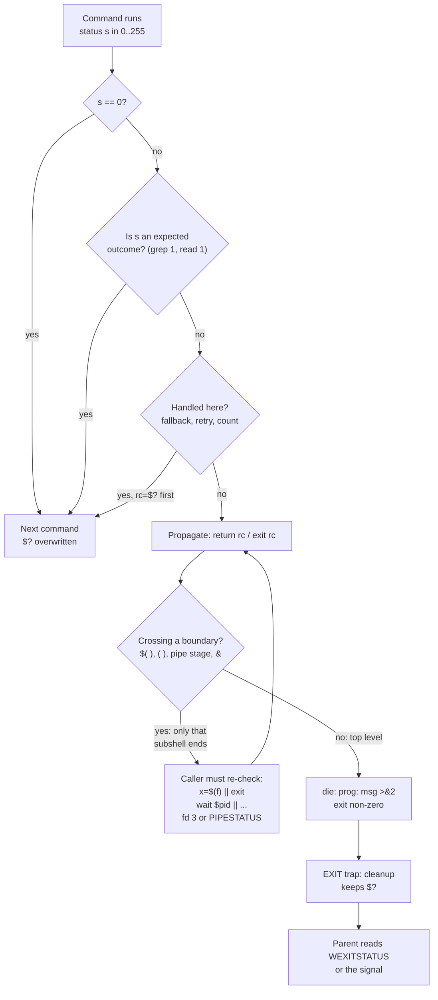

# Error Handling Patterns

> [!summary] Claim
> A shell script has exactly one error channel, an 8-bit exit status plus free text on stderr, so robust error handling is the discipline of reading that status at every call site, carrying it unchanged across each subshell, pipeline, and declaration boundary that would otherwise discard it, and turning it into one loud diagnostic and a non-zero exit.

Part of [Robust Scripting](README.md) in [Shell and Unix Engineering](../README.md).

## TL;DR

- Mechanism: every command yields a status (0 success, 1-125 failure, 126 not executable, 127 not found, >128 killed by a signal), and `$?` holds only the most recent pipeline's status in the current environment, so the next command overwrites it (POSIX.1-2024 XCU 2.5.2, 2.8.2).
- Rule: check at the call site with `cmd || die "..."` or `if ! cmd; then`, capture `rc=$?` as the very first statement when you need the number, and make `die` print `prog: message` to stderr and `exit` non-zero.
- Trap: five constructs silently drop a failure: `die` or `exit` inside `$(...)`, `( )` or a pipeline stage; `export`/`local x=$(cmd)`; a non-final pipeline stage; bare `wait`; and `find -exec ... ;`.
- Portability fact: `pipefail` is POSIX only since POSIX.1-2024 and `ERR` traps are not POSIX at all (dash, posh, and yash reject `ERR`), while native zsh reports `$0` as the function name inside `die` and reports success for `printf` to a closed stdout (lab).
- When not to use it: when the script needs typed errors, partial-failure accounting across parallel workers, or retries with state, write it in Python, Go, or Rust, because shell has no exception object to carry context across a boundary.

## Mental model



A command finishes with a status, and the shell keeps only the latest one in `$?`, so every arrow out of the "Next command" box destroys the previous value.
A non-zero status is first classified: some utilities use non-zero for an ordinary answer (`grep` 1 means "no line selected"), and only the rest are failures.
A failure is either handled locally (a fallback, a retry, a failure counter), which requires capturing `rc=$?` before any other command runs, or propagated with `return` or `exit`.
Propagation is where scripts go wrong: `exit` inside a command substitution, a parenthesized subshell, a pipeline stage, or a background job ends only that subshell, so the caller must re-read the status at the boundary or the failure stops there.
At the top level, `die` writes one diagnostic line to stderr and exits non-zero, the `EXIT` trap cleans up without changing `$?`, and the parent process finally reads the status through `wait`.

## How it works

### The error channel is one byte and a text stream

A utility reports failure in exactly two ways: the status it passes to `_exit()`, and whatever it writes to stderr.
POSIX defines the status the shell assigns: 127 if the command is not found, 126 if it is found but not executable, a value greater than 128 that identifies the signal if a signal killed it, and otherwise the `WEXITSTATUS` of the `wait()` status, which for a C program is the value passed to `exit()` modulo 256 (POSIX.1-2024 XCU 2.8.2).
The `exit` page reserves 126, 127, 128 (an unrecoverable read error while reading commands), and values above 128 (killed by a signal) for those uses (POSIX.1-2024 XCU 2.15 exit, APPLICATION USAGE; 128 was added by Austin Group Defect 1629).
So a script that wants its own error codes has 1 to 125 to work with; the contract for choosing them is [[Exit-Code-Contracts]].
`exit 256` is unspecified by POSIX and reports success (0) in every shell measured here, which is why `die` must never compute its status from arithmetic that can reach 256 (measured on this host, as of 2026-11).
POSIX.1-2024 also gave `exit` with a value above 256 a new meaning: if the value is one the shell assigns to a signal death, the shell must terminate itself by that signal (Austin Group Defect 51, applied in Issue 8; XCU 2.15 exit).
ksh93, which reports signal deaths as 256 + N, does exactly that: `ksh -c 'exit 257'` kills the shell with `SIGHUP` (signal 1), while bash, dash, and zsh report 1 (measured on this host with ksh93u+ 2012-08-01).

`$?` "expands to the shortest representation of the decimal exit status ... of the pipeline ... executed from the current shell execution environment (not a subshell environment) that most recently ... terminated" (POSIX.1-2024 XCU 2.5.2).
Two consequences follow.
First, `$?` is overwritten by every pipeline, including `[`, `echo`, a `printf` that logs the failure, and the `local` that declares the variable meant to hold it.
Second, a status produced inside a subshell is visible to the parent only through the subshell's own exit status, because the subshell's `$?` is a copy that dies with it.

### What ends the shell without any option

Before any pattern applies, the shell itself aborts on some errors.
In a non-interactive shell, a syntax error, an error in a special built-in (such as `.` on a missing file, or `export` of an invalid name), a redirection error on a special built-in, a variable assignment error (for example assigning to a readonly variable), and an expansion error all "shall exit"; an ordinary utility's failure, and a redirection error on a utility, a compound command, or a function call, "shall not exit" (POSIX.1-2024 XCU 2.8.1).
If such an error happens in a subshell, only the subshell exits, with a non-zero status (POSIX.1-2024 XCU 2.8.1).
The `${parameter:?word}` expansion is the one such error a script raises on purpose: if `parameter` is unset or null, the shell writes `word` (or a default message) to stderr and "exits with a non-zero exit status" (POSIX.1-2024 XCU 2.6.2).
`set -u` turns every expansion of an unset parameter other than `@` and `*` into the same kind of expansion error (POSIX.1-2024 XCU 2.15 set).
Which built-ins are special, and why `command` strips the "shall exit" property from them, is in [[Special-Built-ins-versus-Utilities]].

### Pattern 1: one `die` for every fatal path

```sh
prog=${0##*/}

die() {
  printf '%s: %s\n' "$prog" "$*" >&2
  exit 1
}
```

The function has four properties, each of which a common variant gets wrong.
It writes to stderr, so a caller that captures stdout (`out=$(script)`) neither swallows the message nor parses it as data.
It names the program first, the `prog: message` convention, so a message from a script four layers deep in a pipeline says where it came from.
It uses `printf '%s'`, never `printf "$*"`, so a `%` in a filename cannot become a format directive.
It computes the program name once at top level, because native zsh sets `$0` to the function name while a function runs (`FUNCTION_ARGZERO`, which the zsh Options manual marks as on by default in zsh and csh emulation but not in sh or ksh emulation), so `${0##*/}` evaluated inside `die` prints `die:` there (lab test `inside a function, native zsh names the function in $0`).
`warn` is the same function without the `exit`; the line format, timestamps, and log levels belong to [[Logging-from-Scripts]].

`exit` "shall cause the shell to exit from its current execution environment", and if that environment is a subshell, the shell exits the subshell and continues in the environment that invoked it (POSIX.1-2024 XCU 2.15 exit).
That one sentence is the most important rule in this note: `die` called inside `$(...)`, inside `( )`, inside any pipeline stage the shell runs in a subshell, or inside a background job does not stop the script.
The standard's own example for `exit` shows the fix, which is to re-raise at the boundary:

```sh
(
  command1 || exit 1
  command2 || exit 1
  exec command3
) > outputfile || exit 1
echo "outputfile created successfully"
```

For command substitution the boundary check is free, because an assignment with no command word takes the status of its last command substitution (POSIX.1-2024 XCU 2.9.1.3): `v=$(die boom)` leaves `$?` at 1, and `v=$(lookup "$k") || exit` re-raises it (lab test `die inside a command substitution ends only the subshell`).

### Pattern 2: check at the call site

`cmd || die "cannot X"` and `if ! cmd; then ...; fi` are the two primitive checks.
An OR list runs `command2` only if `command1` returned non-zero, and the list's status is that of the last command executed (POSIX.1-2024 XCU 2.9.3.4); an AND list is the mirror image (XCU 2.9.3.3).
Both forms are also the places where `set -e` is ignored for the left operand (POSIX.1-2024 XCU 2.15 set), so an explicit check and `set -e` never fight; the full exception list is in [[errexit-Semantics-and-Exceptions]].
`cd` is the canonical command to check, because a failed `cd` is an ordinary utility failure that does not stop the script, and every later relative path then names a file in the wrong directory; ShellCheck reports an unchecked `cd` as SC2164 and recommends `cd foo || exit`.

### Pattern 3: capture the status before anything else runs

When the number matters (to choose a message, to retry only on some codes, or to pass it upward), store it in the first statement after the command:

```sh
if cmd; then
  : success
else
  rc=$?          # still cmd's status here
fi

rc=0
cmd || rc=$?     # also survives set -e
```

The `else` branch is the safe place, because "the exit status of the `if` or `elif` compound-list ... is available through the special parameter `?` during execution of the next `then`, `elif`, or `else` compound-list" (POSIX.1-2024 XCU 2.9.4.4).
`if ! cmd; then echo "$?"` prints 0, because `!` makes the pipeline's status the logical NOT of the command's (POSIX.1-2024 XCU 2.9.2), so the original code is gone before the branch runs.
`cmd; [ "$?" -ne 0 ]` works until someone inserts a log line between the two; ShellCheck flags the indirect form as SC2181 ("Check exit code directly with e.g. `if mycmd;`, not indirectly with `$?`") and ShellCheck 0.11.0 flags a `$?` read after `echo` or `printf` as SC2320 (seen running ShellCheck 0.11.0 on the lab).
The lab's `capture` mode prints `else=7 not=0 or=7 late=0` in every shell measured: the `else` and `||` forms keep 7, the `!` form and the intervening `echo` lose it.

### Pattern 4: never declare and substitute in one command

A bare assignment `x=$(cmd)` has no command word, so its status is the command substitution's (POSIX.1-2024 XCU 2.9.1.3 and the note under XCU 2.5.2).
`export x=$(cmd)` has the command word `export`, so its status is `export`'s, which is 0; the standard says so in the `export` page: "the value of `"$?"` after `export X=$(false)` will be 0 ... and ... execution continues, even if `set -e` is in effect", and it prescribes `X=$(false)` followed by `export X` (POSIX.1-2024 XCU 2.15 export, APPLICATION USAGE).
`local`, `readonly`, `typeset`, and `declare` behave the same way; ShellCheck reports the pattern as SC2155 and notes that it does not warn for `local -r foo=$(cmd)` unless `check-extra-masked-returns` (SC2312) is enabled.
The lab measures `bare=3 export=0 local=0` in bash 3.2 and 5.3, dash, and zsh on the macOS host and in mksh, yash, posh, and BusyBox ash in the shell matrix, and `local=unsupported` in ksh93 (both ksh93u+ 2012 and ksh93u+m 1.0.10), which has no `local` built-in (lab test `export x=$(cmd) reports export's status`).
When there are several substitutions in one bare assignment, the status is that of "the command substitution whose exit status was the last to be obtained" (POSIX.1-2024 XCU 2.9.1.3), so `x=$(a)$(b)` hides a failure of `a`.

### Pattern 5: pipelines report one stage unless told otherwise

Without `pipefail`, a pipeline's status is the status of its last command; with `pipefail` it is 0 only if every command returned 0, else the status of the rightmost command that failed; a leading `!` inverts either result (POSIX.1-2024 XCU 2.9.2, Exit Status table).
The shell reads the `pipefail` setting when it starts the pipeline, so `command1 | set -o pipefail` does not apply to itself (POSIX.1-2024 XCU 2.9.2).
`pipefail` entered POSIX only in Issue 8 (Austin Group Defect 789), and the shell matrix finds it missing in posh 0.14.1, in Alpine's dash 0.5.12, and in macOS `/bin/dash`, while Debian's dash 0.5.12 carries a backport (measured in the shell matrix, as of 2026-11) and Homebrew's dash 0.5.13.5 accepts it (measured on this host); detect it with `(set -o pipefail) 2>/dev/null` rather than by platform.
Where per-stage numbers are needed, bash and mksh provide the `PIPESTATUS` array and native zsh the `pipestatus` array (zsh Parameters manual: "An array containing the exit statuses returned by all commands in the last pipeline"); no other shell in the matrix sets either (measured in the shell matrix).
The portable alternative sends the upstream status out on a spare descriptor, so it needs no shell extension:

```sh
exec 4>&1
up=$(
  {
    {
      producer
      printf '%s\n' "$?" >&3
    } | consumer >&4
  } 3>&1
)
exec 4>&-
```

Descriptor 3 is the command substitution's pipe, descriptor 4 is the original stdout, so `consumer`'s data still reaches the terminal and `up` receives only `producer`'s status (lab test `descriptor 3 carries the upstream status`).
`pipefail` has a cost: a producer killed by `SIGPIPE` because the consumer stopped reading early (`yes | head -n 1`) is a non-zero stage, typically 141, so a pipeline that succeeded by design now fails; handling that case is in [[SIGPIPE-and-EPIPE]] and [[pipefail-and-PIPESTATUS]].

POSIX says "each command of a multi-command pipeline is in a subshell environment; as an extension, however, any or all commands in a pipeline may be executed in the current environment" (POSIX.1-2024 XCU 2.13), so a portable script cannot assume either.
The practical consequence for error handling is the failure flag that vanishes: `failed=0; producer | while read -r x; do ... failed=1; done` leaves `failed=0` in bash, dash, `zsh --emulate sh`, mksh, yash, posh, and BusyBox ash, and sets it in native zsh and ksh93 (ksh93u+ 2012 and ksh93u+m 1.0.10), which run the last stage in the current shell (lab test `a failure flag set inside a piped while loop survives only where the last stage runs in the current shell`).
Feed the loop from a redirection (`while ...; done <file`) or a here-document of `$(producer)` and check `producer` separately.

### Pattern 6: utilities whose non-zero status is an answer

`grep` returns 0 when a line was selected and the output was written, 1 when no line was selected, and >1 on an error (POSIX.1-2024 XCU grep, EXIT STATUS); `diff` and `cmp` use the same 0/1/>1 split for "same", "different", and "error" (XCU diff, XCU cmp), and `read` returns 1 at end-of-file and >1 on an error (XCU read).
`if grep -q pat file` therefore treats "file unreadable" as "pattern absent", which is how a configuration check passes on a typo in the path.
Classify instead:

```sh
grep -q "$pat" "$file"
case $? in
  0) found ;;
  1) absent ;;
  *) die "grep failed on $file" ;;
esac
```

The lab prints `match nomatch error(2)` with macOS grep (lab test `grep's three outcomes stay distinct`).

### Pattern 7: commands that run other commands

A utility that runs children reports their failures according to its own rules, and three common ones discard them.
`find ... -exec cmd {} \;` evaluates the primary as true or false per file but does not change `find`'s exit status, while `find ... -exec cmd {} +` must make `find` exit non-zero if any invocation failed (POSIX.1-2024 XCU find, `-exec` and EXIT STATUS); the lab measures `semicolon=0 plus=1` with macOS find.
`xargs` returns 1 to 125 if any invocation failed, 126 if the utility could not be invoked, and 127 if it was not found; an invocation that exits 255 makes `xargs` stop reading input (POSIX.1-2024 XCU xargs).
GNU xargs encodes those as 123 (some invocation exited non-zero), 124 (an invocation exited 255), and 125 (an invocation was killed or stopped by a signal) in the `enum` near the top of `xargs/xargs.c` and sets them in `wait_for_proc()` (GNU findutils 4.10.0 release tarball, `xargs/xargs.c`); macOS xargs reports 1 (lab test `xargs reports a failing invocation`), and GNU findutils 4.10.0 and BusyBox 1.37.0 xargs report 123 (measured in the shell matrix).
`wait` with no operands returns 0 once every known job has terminated, regardless of their statuses; `wait pid` returns that process's status, and 127 if the PID is unknown (POSIX.1-2024 XCU wait, EXIT STATUS).
So parallel work must record every `$!` and wait for each one:

```sh
pids=
for host in $hosts; do
  deploy "$host" &
  pids="$pids $!"
done
failed=0
for p in $pids; do
  wait "$p" || failed=$((failed + 1))
done
[ "$failed" -eq 0 ] || die "$failed deploys failed"
```

The lab measures `bare=0 p1=4 p2=0` for a bare `wait` after a job that exited 4, followed by two waited PIDs (lab test `bare wait returns 0 although the job failed`).
A trapped signal interrupts `wait`, which then returns >128 before the trap runs (POSIX.1-2024 XCU 2.12); ksh93 returns 1 there instead (measured in the shell matrix for ksh93u+ 2012 and ksh93u+m 1.0.10), so a `wait` loop under a `TERM` trap must not count that status as a job failure; signal-safe cleanup is the next note, [[Cleanup-Traps-and-Re-Raising-Signals]].

### Pattern 8: fail before the first side effect

Validate everything that can be validated before the script changes anything: arguments, required variables, required tools, and writable destinations.
`: "${DEST:?DEST must be set}"` aborts with a message naming the variable (POSIX.1-2024 XCU 2.6.2); `command -v jq >/dev/null || die "jq not found"` relies on `command -v` returning >0 when the name is not found (POSIX.1-2024 XCU command, EXIT STATUS).
The guard matters most right before a destructive operation that joins a variable to a path.
Valve's Linux Steam client contained `STEAMROOT="$(cd "${0%/*}" && echo $PWD)"` and later `rm -rf "$STEAMROOT/"*`; a user who had moved the Steam directory reported on 2015-01-14 that running Steam "deleted everything on system owned by user", and the thread traced it to that line evaluating as `rm -rf "/"*` when `STEAMROOT` was empty (GitHub `valvesoftware/steam-for-linux` issue 3671).
The lab reproduces the shape: a failed `cd` inside `$(...)` leaves `root` empty, `"$root/*"` prints `[/*]`, and `: "${root:?root is empty}"` stops the subshell with status 1 in bash, zsh, ksh93, mksh, and posh and 2 in dash, yash, and BusyBox ash (lab test `${var:?} aborts the subshell`; mksh, yash, posh, and BusyBox ash measured in the shell matrix).
The other guards for destructive commands are in [[Safe-rm-and-Destructive-Operations]].

### Pattern 9: output can fail too

`printf` must return >0 if an error occurred (POSIX.1-2024 XCU printf, EXIT STATUS), and a write to a full disk, a closed descriptor, or a pipe whose reader has gone is an error.
Shells disagree in practice.
For `printf` to a closed stdout (`EBADF`), bash 3.2 and 5.3, dash, and ksh93u+ 2012 return 1 (as do ksh93u+m 1.0.10, mksh, yash, posh, and BusyBox ash in the shell matrix), and native zsh and `zsh --emulate sh` return 0 with no message (lab test `printf to a closed stdout fails, except in zsh`).
For a write to a pipe with no reader while `SIGPIPE` is ignored (`EPIPE`), bash, dash, and zsh return 1 with a "write error" or "I/O error" message, while ksh93u+ 2012 returns 0 (measured on this host; not in the lab).
A script whose output is its product, such as a generator writing a configuration file, should therefore check the write itself and not only the commands that computed the data: `printf '%s\n' "$data" >"$tmp" || die "cannot write $tmp"`.
A redirection on a compound command does not help, because the compound's status is that of its last command, so `{ printf a; printf b; } >file` hides a failure of the first `printf`.
Writing to a temporary file and renaming it into place only after every write succeeded is [[Atomic-Writes]].

### Pattern 10: fail fast or keep going, on purpose

Fail fast is the default: the first unexpected status ends the run, because later steps usually depend on earlier ones.
Batch work over independent items (files, hosts, packages) is better served by keeping going and failing at the end, so one bad item does not hide the state of the rest:

```sh
failures=0
for f in "$@"; do
  process "$f" || { warn "failed: $f"; failures=$((failures + 1)); }
done
[ "$failures" -eq 0 ] || die "$failures of $# items failed"
```

The lab's `accumulate` mode visits all four items, prints `failures=2`, and exits 1 (lab test `accumulating failures visits every item`).
Exiting with the count itself is tempting and wrong, because 256 failures would exit 0 (see "The error channel" above).
Whether a failed item should be retried, and how, is [[Retries-Backoff-and-Jitter]]; whether rerunning the whole batch is safe is [[Idempotent-Scripts]].

### Pattern 11: the `ERR` trap, where it exists

The `ERR` pseudo-signal comes from the KornShell, where, in the words of the POSIX `trap` rationale, it "is triggered whenever `set -e` would cause an exit" (POSIX.1-2024 XCU 2.15 trap, RATIONALE).
The same rationale calls it "allowable as an extension, but ... not mandated, as other shells have not used it" (POSIX.1-2024 XCU 2.15 trap, RATIONALE).
The ksh93 manual describes the trap as executed "whenever a command has a non-zero exit status" and `set -e` as "execute the ERR trap, if set, and exit" (ksh93 `sh.1`).
In bash 5.3, `execute_command_internal()` in `execute_cmd.c` calls `run_error_trap()` for a failed simple command under the same conditions that gate `errexit` (`ignore_return == 0 && invert == 0 && pipe_in == NO_PIPE && pipe_out == NO_PIPE`), immediately before the `errexit` check, so the trap runs first and then the shell exits; `run_error_trap()` in `trap.c` skips the trap while it is already in progress (`SIG_INPROGRESS`), so a failure inside the handler does not recurse (bash-5.3 `execute_cmd.c`, `execute_command_internal`; bash-5.3 `trap.c`, `run_error_trap`).
The bash manual lists the same exemptions as `errexit` (the condition of `if`, `while`, `until`; non-final operands of `&&` and `||`; non-final pipeline stages subject to `pipefail`; `!` pipelines) and says the trap is not inherited by functions, command substitutions, or subshells unless `set -E` (`errtrace`) is on (bash-5.3 `doc/bashref.texi`).
Measured: `trap 'echo trap' ERR; f() { false; echo in-f; }; f` never fires the trap in bash 3.2 or 5.3, because the `false` inside `f` is not trapped and `f` itself returns 0; with `set -E` the trap fires for the `false` (measured on this host).
zsh calls the trap `ZERR` (function `TRAPZERR`, with `TRAPERR` as an alias on systems without `SIGERR`) and adds `ERR_RETURN`, which makes a failing command return from the enclosing function instead of exiting the shell (zsh Functions and Options manuals).
The shell matrix finds `trap ... ERR` firing in bash, zsh (both modes), ksh93, mksh, and BusyBox ash, and rejected by dash, posh, and yash (measured in the shell matrix, as of 2026-11), so an `ERR` trap is a bash, ksh, or zsh debugging aid, not a portable error-handling mechanism.
Its best use is diagnostics: in bash, `FUNCNAME`, `BASH_LINENO`, and the `caller` built-in give a stack trace for the failing command (bash-5.3 `doc/bashref.texi`), and the details are in [[ERR-and-DEBUG-Traps]] and [[inherit_errexit-and-errtrace]].

### Where `set -e` fits

`set -e` makes the shell exit "as if by executing the `exit` special built-in utility with no arguments" when a command fails, except in the conditions of `if`, `while`, and `until`, in non-final AND-OR operands, after `!`, and in non-final pipeline stages (POSIX.1-2024 XCU 2.15 set).
Every exemption is a place where a function's body also runs with `-e` ignored, so a function written to rely on `set -e` silently continues when someone calls it as `if f; then` or `f || fallback`; Greg Wooledge's BashFAQ/105 catalogs these cases.
The patterns in this note are the primary mechanism and `set -e` is at most a backstop for the call sites nobody checked; the case against making it the primary mechanism is [[Unofficial-Strict-Mode-Critique]], and the exact semantics are [[errexit-Semantics-and-Exceptions]].

## Numbers and limits

| Quantity | Value | Source |
|---|---|---|
| Status range a script can pass to `exit` portably | 0 to 255; 256 and non-numeric values unspecified | POSIX.1-2024 XCU 2.15 exit |
| Reserved statuses | 126 not executable, 127 not found, 128 read error, >128 signal | POSIX.1-2024 XCU 2.15 exit, APPLICATION USAGE |
| Statuses free for script-defined errors | 1 to 125 | Derived from the reserved list above |
| `exit 256` | 0 in bash 3.2, bash 5.3, dash, zsh 5.9.2, ksh93u+ 2012 | Measured on this host, 2026-11-15 |
| `exit 300` | 44 (300 mod 256) in the same five shells | Measured on this host, 2026-11-15 |
| `exit 257` | ksh93u+ 2012 kills itself with `SIGHUP`; the other four report 1 | Measured on this host, 2026-11-15 |
| `f() { return 300; }; f; echo $?` | 44 in bash and ksh93u+ 2012; 300 in dash and zsh | Measured on this host, 2026-11-15; POSIX leaves >255 unspecified (XCU 2.15 return) |
| `${unset:?}` status in a subshell | 1 in bash, zsh, ksh93, mksh, posh; 2 in dash, yash, BusyBox ash | Lab (`param_guard`); shell matrix for mksh, posh, yash, BusyBox ash |
| GNU xargs codes | 123 child non-zero, 124 child exited 255, 125 child killed or stopped, 126 cannot run, 127 not found | GNU findutils 4.10.0 `xargs/xargs.c` |
| macOS xargs when a child fails | 1 | Lab (`xargs_status`) |
| `find -exec false {} \;` and `-exec false {} +` on macOS | 0 and 1 | Lab (`find_exec`) |
| `grep -q` on a missing file, macOS grep | 2 | Lab (`tristate`) |
| `wait` with no operands after a job exited 4 | 0 | Lab (`wait_status`); POSIX.1-2024 XCU wait |
| `printf` to a closed stdout | 1 in bash, dash, ksh93, mksh, yash, posh, BusyBox ash; 0 in zsh | Lab (`write_error`); shell matrix for ksh93u+m, mksh, yash, posh, BusyBox ash |

## Portability

| Behavior | POSIX sh | macOS bash 3.2 | bash 5.3 | zsh native | `zsh --emulate sh` | dash | ksh93 | mksh | yash | posh | BusyBox ash |
|---|---|---|---|---|---|---|---|---|---|---|---|
| `$0` inside a function | Script name | Script name | Script name | Function name | Script name | Script name | Script name | Script name | Script name | Script name | Script name |
| `exit` in `$(...)` stops the script | No | No | No | No | No | No | No | No | No | No | No |
| `export y="$(exit 3)"` status | 0 | 0 | 0 | 0 | 0 | 0 | 0 | 0 | 0 | 0 | 0 |
| `local z="$(exit 3)"` status | No `local` | 0 | 0 | 0 | 0 | 0 | No `local` | 0 | 0 | 0 | 0 |
| Flag set in last stage of a pipeline survives | Unspecified | No | No | Yes | No | No | Yes | No | No | No | No |
| `set -o pipefail` | Yes (Issue 8) | Yes | Yes | Yes | Yes | Homebrew 0.5.13.5 and Debian 0.5.12 only | Yes | Yes | Yes | No | Yes |
| Per-stage status array | None | `PIPESTATUS` | `PIPESTATUS` | `pipestatus` | None | None | None | `PIPESTATUS` | None | None | None |
| `${x:?}` status | >0 | 1 | 1 | 1 | 1 | 2 | 1 | 1 | 2 | 1 | 2 |
| `printf` to closed stdout | >0 | 1 | 1 | 0 | 0 | 1 | 1 | 1 | 1 | 1 | 1 |
| `trap ... ERR` | Extension | Fires | Fires | Fires | Fires | Rejected | Fires | Fires | Rejected | Rejected | Fires |

In the first five rows and the `${x:?}` and `printf` rows, the macOS bash 3.2, bash 5.3, zsh, `zsh --emulate sh`, dash (Homebrew 0.5.13.5), and ksh93 (ksh93u+ 2012-08-01) cells were measured by this lab on the macOS host; the mksh, yash, posh, and BusyBox ash cells in the same rows were measured by running the lab's probe in the shell matrix (Debian 13 mksh, posh, and BusyBox 1.37.0; Alpine 3.22 yash, mksh, and BusyBox 1.37.0), where ksh93u+m 1.0.10 also matched the ksh93 column (as of 2026-11).
The `pipefail`, per-stage array, and `ERR` rows are measured in the shell matrix by the labs of [[errexit-Semantics-and-Exceptions]], [[Pipelines-and-And-Or-Lists]], and [[Traps-and-EXIT]] (as of 2026-11); the `pipefail` cell for ksh93 hides one defect: ksh93u+ 2012 ignores a failing upstream stage under `set -e` even with `pipefail`, fixed in ksh93u+m (measured in the shell matrix).
The dash `pipefail` cell means dash 0.5.13.5 as packaged by Homebrew and Debian's 0.5.12 with its backport; Alpine's dash 0.5.12 and macOS `/bin/dash` reject the option (`/bin/dash` exits 2 with "Illegal option -o pipefail" on this host).

Utilities differ by implementation, not by shell:

| Utility behavior | POSIX | GNU | BSD and macOS | BusyBox |
|---|---|---|---|---|
| `xargs` when one invocation fails | 1 to 125 | 123 (`xargs.c`; shell matrix) | 1 (lab) | 123 (shell matrix) |
| `find -exec cmd {} \;` when `cmd` fails | 0 | 0 (shell matrix) | 0 (lab) | 0 (shell matrix) |
| `find -exec cmd {} +` when `cmd` fails | >0 | 1 (shell matrix) | 1 (lab) | 1 (shell matrix) |
| `grep -q` on a missing file | >1 | 2 (shell matrix) | 2 (lab) | 2 (shell matrix) |

GNU means findutils 4.10.0 and GNU grep on Debian 13, and BusyBox means BusyBox 1.37.0 on Alpine 3.22 (shell matrix, as of 2026-11).
uutils was not measured.

## Worked example

The [lab](../labs/13-error-handling-patterns/) is one probe script with a mode per pattern and a bats file that asserts each mode's output per shell family.
Verbatim excerpt, lines 19 to 69 of `errors-probe.sh`:

```sh
mode=${1:?usage: errors-probe.sh MODE [SCRATCH_DIR]}

# Capture the program name at top level: native zsh sets $0 to the function
# name inside a function (FUNCTION_ARGZERO), so "${0##*/}" in die would say "die".
prog=${0##*/}

# die: the one-line diagnostic and exit used by every pattern below.
die() {
  printf '%s: %s\n' "$prog" "$*" >&2
  exit 1
}

case $mode in
  argzero)
    # What $0 names inside a function, next to the name captured at top level.
    inner() { printf '%s' "${0##*/}"; }
    fn=$(inner)
    printf 'top=%s in_function=%s\n' "$prog" "$fn"
    ;;

  die_subshell)
    # exit inside $(...) leaves only the subshell (POSIX.1-2024 XCU 2.15 exit);
    # the assignment then carries the substitution's status (XCU 2.9.1.3).
    v=$(die 'boom' 2>/dev/null)
    st=$?
    printf 'after_die=reached st=%d value=[%s]\n' "$st" "$v"
    ;;

  capture)
    # 1. In the else branch, $? is still the condition's status (XCU 2.9.4.4 note).
    if sh -c 'exit 7'; then
      else_rc=none
    else
      else_rc=$?
    fi
    # 2. After "if ! cmd", $? is the inverted status: 0, not 7.
    if ! sh -c 'exit 7'; then
      not_rc=$?
    else
      not_rc=none
    fi
    # 3. cmd || rc=$? keeps the status without stopping a set -e script.
    or_rc=0
    sh -c 'exit 7' || or_rc=$?
    # 4. Any command in between overwrites $?.
    sh -c 'exit 7'
    echo 'logging the failure' >/dev/null
    # shellcheck disable=SC2320 # reading the overwritten status is the point
    late_rc=$?
    printf 'else=%s not=%s or=%s late=%s\n' "$else_rc" "$not_rc" "$or_rc" "$late_rc"
    ;;
```

Verbatim excerpt, lines 146 to 163 of `errors-probe.sh`:

```sh
  param_guard)
    # The Steam bug shape: a failed cd leaves the variable empty, and "$root/" becomes "/".
    root=$(cd /nonexistent-dir-for-probe 2>/dev/null && pwd)
    printf 'unguarded=[%s/*]\n' "$root"
    # ${root:?} aborts a non-interactive (sub)shell with a non-zero status (XCU 2.6.2).
    (
      : "${root:?root is empty}"
      echo unreached
    )
    printf 'guard_st=%d\n' "$?"
    ;;

  write_error)
    # Writing to a closed descriptor fails with EBADF; the builtin must report it.
    # The subshell keeps stdout closed until it exits, so no buffered byte escapes later.
    (printf 'x\n') >&- 2>/dev/null
    printf 'closed_st=%d\n' "$?"
    ;;
```

Output captured on the macOS host with Homebrew bash 5.3.20 on 2026-11-15 (`bash labs/13-error-handling-patterns/errors-probe.sh MODE`, run from the job directory, so the diagnostic shows the relative path; the prompts below abbreviate the path to `errors-probe.sh`):

```text
$ bash errors-probe.sh argzero
top=errors-probe.sh in_function=errors-probe.sh
$ bash errors-probe.sh die_subshell
after_die=reached st=1 value=[]
$ bash errors-probe.sh capture
else=7 not=0 or=7 late=0
$ bash errors-probe.sh declare_mask
bare=3 export=0 local=0 x=[] y=[]
$ bash errors-probe.sh pipe_status
data
upstream=3
$ bash errors-probe.sh pipe_loop
failed=0
$ bash errors-probe.sh wait_status
bare=0 p1=4 p2=0
$ bash errors-probe.sh param_guard
unguarded=[/*]
labs/13-error-handling-patterns/errors-probe.sh: line 152: root: root is empty
guard_st=1
$ bash errors-probe.sh write_error
closed_st=1
$ bash errors-probe.sh tristate
match nomatch error(2)
$ bash errors-probe.sh accumulate
failures=2
[exit 1]
$ bash errors-probe.sh no-such-mode
errors-probe.sh: unknown mode: no-such-mode
[exit 1]
```

The same modes under native zsh 5.9.2 differ in three result lines, and zsh also formats the `param_guard` diagnostic as `errors-probe.sh:152:` where bash writes `errors-probe.sh: line 152:`:

```text
$ zsh errors-probe.sh argzero
top=errors-probe.sh in_function=inner
$ zsh errors-probe.sh pipe_loop
failed=1
$ zsh errors-probe.sh write_error
closed_st=0
```

The bats suite (14 tests) passed under `sh` (macOS bash 3.2 in POSIX mode), `/bin/bash` 3.2.57, bash 5.3.15, dash 0.5.13.5 (Homebrew), zsh 5.9.2, `zsh --emulate sh`, and ksh93u+ 2012-08-01 on the macOS host on 2026-11-15.

## Pitfalls

> [!warning] `die` in a subshell stops nothing
> Trigger: `die` or `exit` inside `$(...)`, `( ... )`, a pipeline stage such as `producer | while read -r x; do ... || die; done`, or a background job.
> Symptom: the message appears on stderr and the script keeps running with an empty value or a half-processed stream.
> Fix: re-check at the boundary (`v=$(f) || exit`, `( ... ) || exit`, `wait "$pid" || ...`), and feed loops by redirection instead of a pipe; POSIX's own `exit` example does this (XCU 2.15 exit).

> [!warning] `$?` read one command too late
> Trigger: `cmd; log "cmd failed"; exit $?`, or `if ! cmd; then echo "status $?"`.
> Symptom: the script exits 0 after a failure, or reports status 0 for a failed command.
> Fix: `rc=$?` as the first statement, or read it in the `else` branch (XCU 2.9.4.4); ShellCheck reports the patterns as SC2181 and SC2320.

> [!warning] Declaration masks the substitution
> Trigger: `local v=$(cmd)`, `export v=$(cmd)`, `readonly v=$(cmd)`.
> Symptom: `cmd` fails, the status is 0, `set -e` and the `ERR` trap do not fire, and `v` is empty.
> Fix: declare and assign separately (`local v; v=$(cmd) || return`), as the `export` APPLICATION USAGE and ShellCheck SC2155 prescribe.

> [!warning] The upstream stage failed and the pipeline succeeded
> Trigger: `pg_dump db | gzip >backup.gz` without `pipefail`.
> Symptom: an empty or truncated `backup.gz` and exit status 0, because `gzip` succeeded.
> Fix: `set -o pipefail` where supported (detected, not assumed), `PIPESTATUS` in bash and mksh, or the descriptor-3 status capture; then decide explicitly whether 141 from `SIGPIPE` is acceptable.

> [!warning] The failure report nobody received
> Trigger: a job whose failure is reported only through a channel nobody checks, or whose wrapper swallows the status.
> Symptom: GitLab's 2017-01-31 database outage postmortem reports that the `pg_dump` backups were absent because `pg_dump` 9.2 was run against PostgreSQL 9.6 and terminated with an error, and that the cron failure notifications were rejected by the receiving mail server because they were not DMARC-signed, so "we were never aware of the backups failing, until it was too late" (GitLab postmortem, 2017-02-10).
> Fix: make the script exit non-zero and make the scheduler's failure path something that is itself monitored (a dashboard of last-success timestamps, or an alert on absence of success), and test the failure path, not just the success path.

> [!warning] An empty variable becomes a root path
> Trigger: `dir=$(cd "$x" && pwd)` fails, then `rm -rf "$dir/"*`.
> Symptom: the command operates on `/`; the Steam for Linux bug reported on 2015-01-14 deleted user files this way (GitHub `valvesoftware/steam-for-linux` issue 3671).
> Fix: check the assignment (`dir=$(cd "$x" && pwd) || die ...`) and guard the use with `"${dir:?}"`; see [[Safe-rm-and-Destructive-Operations]].

> [!warning] `if grep` cannot tell "absent" from "broken"
> Trigger: `if grep -q "$key" "$conf"` with a mistyped or unreadable `$conf`.
> Symptom: the script concludes the key is absent and proceeds, for example by appending a duplicate.
> Fix: `case $?` over 0, 1, and anything else (XCU grep, diff, cmp, read all use the split).

> [!warning] Bare `wait` and `find -exec ;` return success
> Trigger: `job1 & job2 & wait`, or `find . -name '*.sql' -exec psql -f {} \;`.
> Symptom: status 0 although a job or an invocation failed.
> Fix: `wait "$pid"` per recorded PID; `-exec ... {} +` (non-zero `find` status on failure) or `find ... -print0 | xargs -0` and check `xargs`.

> [!warning] `die` names the wrong program in zsh
> Trigger: `die() { echo "${0##*/}: $*" >&2; exit 1; }` run by native zsh.
> Symptom: messages start with `die:` instead of the script name (lab).
> Fix: `prog=${0##*/}` at top level, or `setopt POSIX_ARGZERO` in zsh-only code.

> [!warning] An exit status above 255 wraps
> Trigger: `exit "$failures"` or `exit $((base + code))`.
> Symptom: 256 failures exit 0; 300 exits 44 (measured).
> Fix: exit 1 for "some items failed" and print the count; reserve specific codes for distinct, documented meanings ([[Exit-Code-Contracts]]).

> [!warning] Blanket suppression
> Trigger: `cmd 2>/dev/null || true` added to silence one expected message.
> Symptom: every other failure of `cmd`, including the unexpected ones, is now invisible.
> Fix: suppress the one expected status (`cmd || [ "$?" -eq 1 ] || die ...`) or the one expected condition (`rm -f` instead of `rm 2>/dev/null`), and leave a comment saying why.

## Security and robustness

- Fail closed: if a validation command fails for any reason other than "invalid", treat the input as invalid; a status classifier with a `*) die` branch does this by construction.
- Never pass data as the `printf` format: `printf "$msg"` turns a `%s` or `%d` in a filename into a format directive, and `printf '%s\n' "$msg"` does not.
- Error messages are output an attacker may control; a filename echoed to a terminal can carry escape sequences, so print untrusted names with `printf '%s'` and consider quoting them (`printf %q` in bash) when the audience is a terminal.
- Diagnostics leak: a message that echoes a command line, an environment dump, or `set -x` output can print tokens and passwords into CI logs; print what failed, not the secret it used.
- An exit status is an authorization signal when a CI gate, `sudo` wrapper, or deploy step trusts it; a wrapper that returns 0 after a failed check (masking, `|| true`, a bare `wait`) lets an unverified artifact through, which is why the masking patterns above are security bugs and not only reliability bugs.
- Validate before the first side effect, and re-check immediately before destructive operations; a check done minutes earlier can be invalidated by the time the operation runs.
- Keep cleanup independent of the error path: an `EXIT` trap that runs on every exit, and keeps `$?`, is safer than cleanup code repeated before each `die`; that is [[Cleanup-Traps-and-Re-Raising-Signals]].

## The principal's view

The decision is what the error contract of a script is, and the answer has three parts that a reviewer can check: every command whose failure matters is checked at its call site or on purpose not checked with a comment, every boundary that drops a status (substitution, subshell, pipeline, background job, declaration) re-raises it, and the script exits non-zero with one diagnostic line on stderr.
The trade-off against `set -e` is verbosity versus predictability: explicit checks add `|| die` to many lines, but their behavior does not change when a function is later called from an `if`, which is exactly when `set -e` silently stops applying.
A team standard that pairs explicit checks with `set -e` as a backstop and ShellCheck (with `check-extra-masked-returns` enabled) in CI catches most of the masking patterns mechanically.
Move to another language when the error handling itself becomes the program: when failures need structured context (which host, which item, which retry), when partial results must be reported per item from parallel workers, when a failure must be retried with state, or when the script parses a structured format to decide what failed.
Python's exceptions, Go's explicit `error` values, and Rust's `Result` carry that context across function boundaries; shell carries one byte.

## Interview questions

> [!question] L5: Why does `out=$(fetch) ; echo "got $out"` continue after `fetch` calls `die`, and how do you fix it?
>
> > [!success]- Answer
> > `fetch` runs in the command substitution's subshell, and `exit` inside a subshell ends only that subshell (XCU 2.15 exit).
> > The assignment takes the substitution's status (XCU 2.9.1.3), so the failure is visible in `$?` but nothing reads it.
> > Write `out=$(fetch) || exit`, which re-raises the same status in the parent.
> >
> > Follow-up: Does the same fix work for `local out=$(fetch) || exit`?

> [!question] L5: Predict the output: `f() { local v=$(false); echo "a=$?"; v=$(false); echo "b=$?"; }; f`
>
> > [!success]- Answer
> > It prints `a=0` and then `b=1`.
> > `local` is the command word in the first line, so `$?` is `local`'s status, which is 0 (ShellCheck SC2155).
> > The second line is a bare assignment, whose status is the command substitution's (XCU 2.9.1.3).
> > In ksh93, which has no `local`, the first line fails with "not found" instead.
> >
> > Follow-up: What does `export v=$(false)` report, and where does POSIX say so?

> [!question] L5: How do you get the exit status of a failed command in the `else` branch, and why does `if ! cmd; then echo $?` print 0?
>
> > [!success]- Answer
> > In the `else` branch, `$?` is still the status of the `if` condition (XCU 2.9.4.4 note).
> > `!` makes the pipeline's status the logical NOT of the command's (XCU 2.9.2), so after `! cmd` with `cmd` failing, `$?` is 0.
> > Use `if cmd; then ...; else rc=$?; fi` or `rc=0; cmd || rc=$?`.
> >
> > Follow-up: Which of these two forms is safe under `set -e`, and why are both?

> [!question] L6: Debug this script: it reports success but the backup is empty. `#!/bin/sh` / `set -e` / `pg_dump "$DB" | gzip > "$OUT"` / `echo done`
>
> > [!success]- Answer
> > Without `pipefail` the pipeline's status is `gzip`'s (XCU 2.9.2), and `gzip` succeeds on empty input, so `set -e` never fires.
> > Fix with `set -o pipefail` after detecting it (`(set -o pipefail) 2>/dev/null`), or capture `pg_dump`'s status on descriptor 3, or dump to a file and compress in a second step.
> > `DB` and `OUT` should also be guarded with `${DB:?}` and `${OUT:?}`, and the output written to a temporary file and renamed only on success.
> > Finally, check that the failure reaches a human: GitLab's 2017 postmortem shows a backup whose failure email was rejected.
> >
> > Follow-up: With `pipefail` on, `producer | head -n1` now fails intermittently; why, and what do you do?

> [!question] L6: A deploy script starts ten background jobs and ends with `wait`; why does it exit 0 when one job fails, and how do you fix it?
>
> > [!success]- Answer
> > `wait` with no operands returns 0 once all known jobs have terminated, whatever their statuses (XCU wait, EXIT STATUS).
> > Record each `$!` and run `wait "$pid"` per PID, counting non-zero results.
> > Bash and yash also forget all jobs after a bare `wait`, so a later `wait "$pid"` returns 127 there (measured in the shell matrix).
> > If a `TERM` trap is set, an interrupted `wait` returns >128 before the trap runs (XCU 2.12), or 1 in ksh93 (measured in the shell matrix), which must not be counted as a job failure.
> >
> > Follow-up: How would you also bound the total run time of the ten jobs?

> [!question] L6: Why is `find . -name '*.sql' -exec psql -f {} \;` a bad step in CI, and what are the alternatives?
>
> > [!success]- Answer
> > With `;` the primary's result only filters, and `find` still exits 0 when `psql` fails (XCU find).
> > With `{} +`, `find` must exit non-zero if any invocation failed, but you lose which file failed and the ordering of one-file-per-invocation.
> > `xargs` reports 1 to 125 for a failing invocation (GNU: 123) and stops on an invocation that exits 255.
> > For per-file accounting, loop over the files with `find -print0` read safely, check each `psql`, and count failures.
> >
> > Follow-up: How do you make a utility run by `xargs` stop the whole batch on a fatal error?

> [!question] L7+: Design the error-handling contract for a shell library sourced by thirty scripts across bash 3.2 on macOS and dash on Debian.
>
> > [!success]- Answer
> > Library functions `return` a status and never `exit`, because the caller may be inside a subshell or may want to recover.
> > A single `die` and `warn` pair lives in the entry script, with `prog` captured at top level (zsh reports the function name in `$0`).
> > Status codes come from a documented table in 1 to 125, with 1 for generic failure and nothing above 125.
> > Functions that produce values print them on stdout and diagnostics on stderr, so `v=$(lib_get k) || die` composes.
> > The library does not rely on `set -e`, `pipefail`, `local`, or `ERR` traps for correctness, because dash builds vary on `pipefail` and dash rejects `ERR`; it may use them when detected.
> > ShellCheck with `check-extra-masked-returns` and a bats suite run under both shells gate every change.
> >
> > Follow-up: What do you do about callers that run library functions in pipelines?

> [!question] L7+: In bash, which runs first when a command fails under `set -e` with an `ERR` trap set, and what are the trap's blind spots?
>
> > [!success]- Answer
> > In bash 5.3, `execute_command_internal()` calls `run_error_trap()` before the `errexit` check, under the same conditions, so the trap runs and then the shell exits (bash-5.3 `execute_cmd.c`).
> > The trap does not fire in the exempt contexts of `set -e` (conditions, non-final AND-OR operands, `!`, non-final pipeline stages), so it cannot see a failure that `set -e` cannot see.
> > It is not inherited by functions, substitutions, or subshells without `set -E` (bash manual), and a failing command inside a function whose last command succeeds never triggers it at the call site (measured).
> > It is not POSIX, and dash, posh, and yash reject it (measured in the shell matrix).
> >
> > Follow-up: How would you print a stack trace from the trap?

> [!question] L7+: A configuration generator writes `{ header; body; footer; } >"$conf"` and exits 0 on a full disk; why, and how do you make output failures fatal?
>
> > [!success]- Answer
> > The compound command's status is that of its last command (XCU 2.9), so a failed write in `header` or `body` is masked when `footer` succeeds.
> > Check each write (`printf ... || die`) or the status of every command in the group, write to a temporary file in the same directory, and rename it into place only after every write succeeded.
> > Shell `printf` must return >0 on a write error (XCU printf), but native zsh returns 0 for a write to a closed stdout and ksh93u+ 2012 returns 0 for `EPIPE` with `SIGPIPE` ignored (measured), so the rename-on-success design is the robust layer.
> >
> > Follow-up: What does `close()` reporting `EIO` on NFS mean for this design?

## Related

Prerequisites: [[Unofficial-Strict-Mode-Critique]]

Next: [[Cleanup-Traps-and-Re-Raising-Signals]]

See also: [[errexit-Semantics-and-Exceptions]], [[Exit-Code-Contracts]], [[Exit-Status-and-Wait-Status]], [[Pipelines-and-And-Or-Lists]], [[pipefail-and-PIPESTATUS]], [[SIGPIPE-and-EPIPE]], [[Traps-and-EXIT]], [[ERR-and-DEBUG-Traps]], [[inherit_errexit-and-errtrace]], [[Command-Substitution]], [[Special-Built-ins-versus-Utilities]], [[Logging-from-Scripts]], [[Retries-Backoff-and-Jitter]], [[Idempotent-Scripts]], [[Atomic-Writes]], [[Safe-rm-and-Destructive-Operations]]

## Further reading

- [POSIX.1-2024 XCU chapter 2](https://pubs.opengroup.org/onlinepubs/9799919799/utilities/V3_chap02.html): sections 2.5.2 (`$?`), 2.8.1 and 2.8.2 (errors and statuses), 2.9.1.3, 2.9.2 (pipeline status and `pipefail`), 2.9.4.4 (`if`), and the `exit`, `return`, `set`, `export`, and `trap` pages define every rule this note relies on.
- [POSIX.1-2024 wait](https://pubs.opengroup.org/onlinepubs/9799919799/utilities/wait.html): the exit status of bare `wait` versus `wait pid`.
- [POSIX.1-2024 xargs](https://pubs.opengroup.org/onlinepubs/9799919799/utilities/xargs.html) and [find](https://pubs.opengroup.org/onlinepubs/9799919799/utilities/find.html): how utilities that run children report (or ignore) their failures.
- [POSIX.1-2024 grep](https://pubs.opengroup.org/onlinepubs/9799919799/utilities/grep.html): the 0, 1, >1 split that `diff`, `cmp`, and `read` share.
- [GNU bash 5.3 source](https://ftpmirror.gnu.org/bash/bash-5.3.tar.gz): `execute_cmd.c` (`execute_command_internal`), `trap.c` (`run_error_trap`), and `doc/bashref.texi` for `ERR`, `errtrace`, and `PIPESTATUS`.
- [zsh Options manual](https://zsh.sourceforge.io/Doc/Release/Options.html): `ERR_EXIT`, `ERR_RETURN`, and `FUNCTION_ARGZERO`.
- [GNU findutils 4.10.0 source](https://ftpmirror.gnu.org/findutils/findutils-4.10.0.tar.xz): `xargs/xargs.c`, the 123, 124, 125 status mapping in `wait_for_proc()`.
- [BashFAQ/105](https://mywiki.wooledge.org/BashFAQ/105): the catalog of `set -e` surprises that motivates explicit checks.
- [ShellCheck SC2155](https://www.shellcheck.net/wiki/SC2155), [SC2164](https://www.shellcheck.net/wiki/SC2164), [SC2181](https://www.shellcheck.net/wiki/SC2181), [SC2320](https://www.shellcheck.net/wiki/SC2320), [SC2312](https://www.shellcheck.net/wiki/SC2312): the lint rules that find masked and unchecked statuses mechanically.
- [Steam for Linux issue 3671](https://github.com/valvesoftware/steam-for-linux/issues/3671): an unchecked `cd` and an unguarded variable deleting user data.
- [GitLab postmortem of the 2017-01-31 database outage](https://about.gitlab.com/blog/2017/02/10/postmortem-of-database-outage-of-january-31/): a backup failure that was reported, but to a channel that rejected the report.
