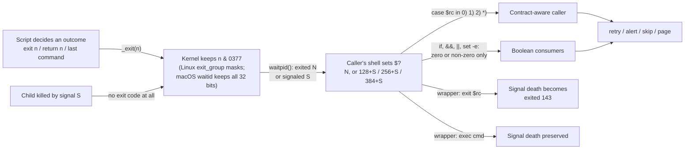

# Exit Code Contracts

> [!summary] Claim
> An exit status is an 8-bit API whose only universal meaning is zero versus non-zero, so a script that callers branch on must document each non-zero value it returns, keep those values inside 1-125 and away from the codes the shell and kernel already own, and pass its children's outcomes through without collapsing them.

Part of [Robust Scripting](README.md) in [Shell and Unix Engineering](../README.md).

## TL;DR

- Mechanism: a caller learns a script's outcome only from `waitpid()`, as "exited N" with N reduced to 8 bits or "killed by signal S", and the shell folds both into `$?`, which is all that `if`, `&&`, `set -e`, cron, systemd, and CI ever see.
- Rule: write the contract down (0 success, 1 a definite "no" or generic failure, 2 usage, then one distinct small code per failure a caller must handle differently), keep every value in 1-125, and test that each outcome really produces its code.
- Trap: `if grep -q ...` turns grep's "error" into "no", `! cmd` turns every failure into 0, and `cmd; exit $?` turns a death by `SIGTERM` into a plain 143 that systemd and the calling shell treat as a failure instead of an interrupt.
- Portability fact: POSIX fixes only 0, 126, 127, 128 (read error), and "greater than 128 means a signal"; the shell's own failures use 1, 2, 3, or even 127 depending on the shell, signal statuses are 128 + N, 256 + N (ksh93), or 384 + N (yash), and FreeBSD now marks the `sysexits.h` codes 64-78 deprecated.
- When not to use it: when the caller needs more than a verdict and a few classes (which item failed, how many, when to retry), write a structured report to stdout or a file and keep the status as the summary.

## Mental model



A script ends either by calling `exit` (explicitly, or implicitly with the status of its last command) or by being killed, and the kernel reduces the first case to 8 bits for `waitpid()` while the second case carries no exit code at all.
The calling shell turns that wait status into `$?`, inventing a number above 128 for a signal death.
From there the status reaches two kinds of consumer: boolean consumers (`if`, `&&`, `||`, `set -e`, `docker run --restart on-failure`) that see only zero versus non-zero, and contract-aware callers that dispatch on the exact value with `case`.
Every wrapper in between is a place where the contract can be preserved (`exec`) or rewritten (`exit "$rc"`), and every `if` or `!` in the path is a place where a three-way answer can collapse into two.

## How it works

### What a caller can observe

A process reports its outcome once, when it terminates, and the parent reads it with `waitpid()` or `waitid()`; the bit layout of that status is covered in [[Exit-Status-and-Wait-Status]].
For a normal exit only the low 8 bits reach `waitpid()`: POSIX says "only the least significant 8 bits (that is, status & 0377) shall be available from wait() and waitpid(); the full value shall be available from waitid()" `(POSIX.1-2024 XSH exit)`.
Linux does not deliver the full value even through `waitid()`: `SYSCALL_DEFINE1(exit_group)` calls `do_group_exit((error_code & 0xff) << 8)`, and `wait_task_zombie()` reports `infop->status = status >> 8` for `CLD_EXITED` `(Linux kernel/exit.c, master 7.4-rc2, as of 2026-11)`.
macOS does: in the lab, a child that calls `_exit(300)` is reported as 44 by `waitpid()` and as 300 by `waitid()` (measured on Darwin 27.3.0).
POSIX itself warns that "a value larger than 255 might be truncated by the shell, and be unavailable even to a parent process that uses waitid()" `(POSIX.1-2024 XCU 2.15 exit, RATIONALE)`, so a contract must live in 0-255, and in practice in 0-125.

The shell computes `$?` from that wait status by the rules of `(POSIX.1-2024 XCU 2.8.2)`: 127 when the command is not found, 126 when it is found but not executable, a value "greater than 128" that identifies the signal when the command was killed, and otherwise `WEXITSTATUS`.
POSIX lets the signal value exceed 255, and ksh93 (256 + N) and yash (384 + N) use that freedom, so `$?` after a `SIGTERM` death is 143, 271, or 399 depending on the shell (measured in the shell matrix, see [[Exit-Status-and-Wait-Status]]).
A caller that only has `$?` cannot tell "exited 143" from "killed by `SIGTERM`" in a 128 + N shell; the lab's C observer can, and that difference matters to systemd, to `timeout`, and to the calling shell's own interrupt handling.

### Who owns which values

The code space is shared between your script, the shell that runs it, the shell that runs its caller, and every wrapper on the path, so a contract starts by knowing which values are already taken.

- 0: success.
  POSIX defines "Successful completion" as "all of the actions the utility is required to perform were completed successfully", and tells applications to test for zero "rather than relying upon the single specific error value listed" `(POSIX.1-2024 XCU 1.4, EXIT STATUS)`.
- 1-125: the application range.
  POSIX caps `EXIT_FAILURE` at "between 1 and 125 inclusive" and gives the reasons: statuses of 126 and greater "are ambiguous in certain circumstances because they have special meanings in the shell", and `xargs` "quits when a command execution exits with status 255" `(POSIX.1-2024 XBD <stdlib.h>, RATIONALE)`.
  `exec` with a failed redirection must also return "a value in the range 1-125" `(POSIX.1-2024 XCU 2.15 exec)`.
- 126 and 127: found but not executable, and not found.
  POSIX chose them for `command`, `env`, `nice`, `nohup`, `time`, `timeout`, and `xargs` "so that applications can distinguish 'failure to find a utility' from 'invoked utility exited with an error indication'", following "KornShell practice that uses 127 when all attempts to exec the utility fail with [ENOENT], and uses 126 when any attempt to exec the utility fails for any other reason" `(POSIX.1-2024 XCU xargs and command, RATIONALE)`.
  The same rationale admits that `command` and `nohup` "also use exit code 127 when an error occurs in those utilities, which means exit code 127 is not universally a 'not found' indicator".
- 128: "An unrecoverable read error was detected by the shell while reading commands" `(POSIX.1-2024 XCU 2.15 exit, APPLICATION USAGE)`.
- Greater than 128: "A command was interrupted by a signal" (same section).
- 255: what `exit -1` produces in the shells that accept it, what `ssh` returns for its own errors ("ssh exits with the exit status of the remote command or with 255 if an error occurred", OpenBSD `ssh(1)`), and the value that makes `xargs` stop reading input `(POSIX.1-2024 XCU xargs, CONSEQUENCES OF ERRORS)`.

So 1-125 is yours, but even there 1 and 2 are crowded, as the next section shows.

### Codes the shell generates on its own behalf

A script's contract covers what the script decides; the shell running it can end the script first and choose the code itself.
POSIX requires a non-interactive shell to exit on a syntax error, a special built-in error, a variable assignment error, or an expansion error `(POSIX.1-2024 XCU 2.8.1)`, and under `set -e` on any failing command "as if by executing the exit special built-in utility with no arguments" `(POSIX.1-2024 XCU 2.15 set)`, but it does not say with which status for most of them.

- A syntax error (`sh -c 'if'`) exits 2 in bash and dash, 1 in zsh, and 3 in ksh93u+ 2012 (lab test 12, measured on the host); BusyBox ash sets `exitstatus = 2` in `ash_msg_and_raise_error()` `(BusyBox shell/ash.c)` and yash defines `Exit_SYNERROR` as `256 + Exit_ERROR`, which `_Exit()` reduces to 2 `(yash exec.h and yash.c, exit_shell_with_status)`.
- An unset variable under `set -u` ends a bash script file with status 1 but ends `bash -c` with 127, because `run_one_command()` maps every `FORCE_EOF` jump to `last_command_exit_value = 127` `(bash-5.3 shell.c, run_one_command)`; dash exits 2, zsh and ksh93 exit 1 (lab test 11, measured on the host for bash 3.2 and 5.3, dash, zsh, and ksh93u+).
  bats itself flags that run with warning `BW01`, "exited with code 127, indicating 'Command not found'", which is exactly the misreading a caller would make (captured in the lab run below).
- bash builtins "return an exit status of 2 to indicate incorrect usage, generally invalid options or missing arguments" `(bash-5.3 doc/bashref.texi, Exit Status)`, which is `EX_BADUSAGE` in `shell.h`, and `test` returns ">1" for "An error occurred" `(POSIX.1-2024 XCU test)`.

The consequence for design: a caller can treat a code as your decision only if nothing else on the path produces it.
Code 1 means "some failure" no matter what you document, and code 2 also arrives from bash and dash syntax errors and builtin misuse; a decision that matters (for example "retryable") deserves its own value from 3 upward, not 1 or 2.

### Contract shapes that already exist

Most well-designed contracts in the wild follow one of a few shapes, and copying a shape a caller already knows beats inventing one.

The predicate shape (0 yes, 1 no, greater than 1 error) is the POSIX shape for `grep` ("1 No lines were selected", ">1 An error occurred"), `diff`, `cmp`, `test`, and `sort -c` `(POSIX.1-2024 XCU grep, diff, cmp, test, sort)`.
Its point is that 1 is a valid answer rather than a failure, so the caller needs three branches, not two.
POSIX bends it once, deliberately: with `grep -q`, "the exit status shall be zero if an input line is selected, even if an error was detected" `(POSIX.1-2024 XCU grep, CONSEQUENCES OF ERRORS)`, because `-q` asks "is there at least one match", which an unreadable file cannot falsify (lab test 3: `q=0` while the same `grep` without `-q` returns 2).
POSIX.1-2024 also tightened the 0 case for `grep`: 0 now requires that "the output specified in STDOUT was successfully written" (Austin Group Defect 1502), so `grep pat file >/dev/full` is no longer a success.

The status-plus-classes shape is used by service managers and monitors.
LSB init scripts return 0-4 for `status` (0 running, 1 dead with a pid file, 2 dead with a lock file, 3 not running, 4 unknown), with 5-99 reserved for future LSB use, 100-149 for distributions, and 150-199 "reserved for application use" `(LSB 4.1 Core, Init Script Actions, as quoted in Ubuntu bug 683640 comment 29)`.
The same section makes idempotency part of the contract: "running start on a service already running" and "running stop on a service already stopped" are successes (see [[Idempotent-Scripts]]).
Nagios plugins return 0 OK, 1 WARNING, 2 CRITICAL, and 3 UNKNOWN, where UNKNOWN covers "Invalid command line arguments" and "low-level failures internal to the plugin" `(Nagios Plugins Development Guidelines, Plugin Return Codes)`, so a plugin's usage error must not be 2, which would page someone as CRITICAL.

The protocol shape assigns codes as instructions to the caller.
`git bisect run` treats 0 as good, "a code between 1 and 127 (inclusive), except 125" as bad, 125 as "cannot be tested" (skip), and "Any other exit code" as abort; 125 "was chosen as the highest sensible value to use for this purpose, because 126 and 127 are used by POSIX shells to signal specific error status" `(git-bisect(1))`.
systemd treats 0 and, "except for Type=oneshot, the signals SIGHUP, SIGINT, SIGTERM, and SIGPIPE" as a clean exit, lets `SuccessExitStatus=` add codes such as `TEMPFAIL`, and reserves 200 and up for its own failures between `fork()` and `execve()` (200 `EXIT_CHDIR` through 245 `EXIT_BPF`) `(systemd.service(5) and systemd.exec(5), systemd 262, as of 2026-11)`.

The wrapper shape reserves a few values for the wrapper and passes everything else through.
`docker run` uses 125 for "the error is with Docker daemon itself", 126 and 127 for a command that "can't be invoked" or "can't be found", and "Any exit code other than 125, 126, and 127" is the container command's own `(Docker docs, Running containers, Exit status)`.
POSIX.1-2024's new `timeout` uses 124 for "the time limit was reached", 125 for its own errors, 126 and 127 for exec failures, and when the utility "was terminated by a signal, timeout shall terminate itself with the same signal" `(POSIX.1-2024 XCU timeout)`; see [[timeout]] and [[Timeouts-in-Scripts]].
The weakness of this shape is visible in each case: a container command that itself exits 125 is indistinguishable from a daemon failure.

The aggregate shape reports many children with one code.
POSIX `xargs` returns "1-125" when "one or more of the invocations of utility returned a non-zero exit status" `(POSIX.1-2024 XCU xargs)`; GNU and BusyBox use 123 for that, 124 when a command exited 255, and 125 when one was killed by a signal, while FreeBSD and macOS return 1 for all three (lab test 16; `(BusyBox findutils/xargs.c)`, `(FreeBSD usr.bin/xargs/xargs.c, waitchildren)`, `(GNU xargs(1))`).
GNU's manual states the consequence: "The shell's (128 + signal) convention for reporting that a process had been killed by a signal is not used by xargs" `(GNU xargs(1), EXIT STATUS)`, and a child's own 3 or 130 both become 123; see [[xargs-and-Argument-Batching]].
`rsync` shows the useful version of aggregation by giving partial success its own codes: 23 "Partial transfer due to error" and 24 "Partial transfer due to vanished source files" `(rsync(1), EXIT VALUES)`.

The BSD `sysexits.h` vocabulary (64 `EX_USAGE` through 78 `EX_CONFIG`) is the one attempt at a shared taxonomy; glibc, musl, and macOS ship identical values (lab test 18), and systemd lists them as "BSD exit codes".
FreeBSD's own page now says "This interface has been deprecated and is retained only for compatibility. Its use is discouraged", and lists as bugs "This interface is not portable" and "The choice of an appropriate exit value is often ambiguous" `(FreeBSD sysexits(3), as of 2026-11)`.
Use the numbers if a consumer already speaks them (sendmail-style mail filters, `SuccessExitStatus=TEMPFAIL`); do not adopt them as a taxonomy for a new tool.

The non-contract shape is the most dangerous: `curl` returns 0 for an HTTP 404 or 500, because "By default, curl does not consider HTTP response codes to indicate failure"; `--fail` makes it return 22, and the page itself notes that it "is not fail-safe" for 401 and 407 `(curl(1), curl 8.23.0, as of 2026-11)`.

### Producing the status in a script

A script's status comes from one of three places, and each has a rule that surprises.

- `exit n` sets it directly; POSIX defines the result for 0-255 and, since Austin Group Defect 51, for a value above 256 that equals the shell's status for a signal death, which must make the shell die of that signal; every other value is unspecified `(POSIX.1-2024 XCU 2.15 exit)`.
  A failure count passed straight to `exit` therefore wraps: 256 failures exit 0 (lab test 9), so clamp first (`[ "$n" -le 125 ] || n=125`).
- With no operand, `exit` and `return` use the current `$?`, "except that if the exit command would cause the end of execution of a trap action", in which case `$?` is "the value it had immediately preceding the trap action" `(POSIX.1-2024 XCU 2.15 exit and return)`.
  zsh does not follow that rule: `trap 'false; exit' EXIT; exit 7` exits 1 in zsh and 7 in bash, dash, and ksh93 (lab test 8, measured); mksh implements it through `trap_exstat` in `c_exitreturn()` `(mksh funcs.c)`, while posh's `posh_builtin_exitreturn()` leaves `exstat` untouched when there is no operand `(posh src/builtins.c)`.
- Without `exit`, the script's status is that of the last command, and a trap action never changes it on its own: "The value of `"$?"` after the trap action completes shall be the value it had before the trap action was executed" `(POSIX.1-2024 XCU 2.15 trap)`, so `trap 'false' EXIT; exit 7` still exits 7 (lab test 7).
  The exception is mksh on a signal path, where the `EXIT` action's last command replaces the status (see [[Traps-and-EXIT]]); end the action with an explicit `exit "$rc"` when the code matters.

Inside the script, the code a caller will see is easy to lose before it is reported:

- `if ! cmd; then echo "failed: $?"; fi` prints 0, because `!` makes the pipeline status "Zero, if the last (rightmost) command in the pipeline returned a non-zero exit status; otherwise, 1" `(POSIX.1-2024 XCU 2.9.2)` (lab test 4).
- `if cmd; then ...; else echo "$?"; fi` does print the real status: POSIX notes that the condition's status "is available through the special parameter '?' ... during execution of the next then, elif, or else compound-list" `(POSIX.1-2024 XCU 2.9.4.4)` (lab test 5).
- An `if` that runs no branch "shall be ... zero", so `if cmd; then ...; fi; echo $?` prints 0 after a failed `cmd` (lab test 5).
- `rc=0; cmd || rc=$?` records the exact status, keeps running under `set -e` (a command before `||` is exempt), and feeds a `case` (lab test 6); see [[Error-Handling-Patterns]] and [[errexit-Semantics-and-Exceptions]].
- `[ "$count" -eq 0 ]` with an empty `count` is an error (2) in bash, dash, and BusyBox, but true (0) in zsh and ksh93, which evaluate the operands arithmetically, so an empty operand counts as 0 (lab test 10, measured on the host for zsh 5.9.2 and ksh93u+ 2012; mksh's `evaluate()` turns an empty expression into the literal `""`, read as 0 `(mksh expr.c)`; BusyBox `getn()` reports "bad number" `(BusyBox coreutils/test.c)`); in the first group an `if` cannot tell the error from "not equal", and in the second an empty count silently passes as zero, so validate numbers before testing them (see [[The-test-Builtin]]).

### Propagating a child's outcome

A wrapper script (a launcher, an environment setter, a retry loop) owes its caller the child's outcome, and there are three ways to end it.

`exec "$@"` replaces the shell with the child, so the caller's `waitpid()` sees the child's own termination: "the exit status of the current shell execution environment shall be the exit status of utility" `(POSIX.1-2024 XCU 2.15 exec)`.
In the lab, a child that kills itself with `SIGTERM` is observed as `signaled 15` through an `exec` wrapper in every shell (lab test 13).
It is the only form that preserves a signal death in every shell, and it costs nothing: no extra process stays alive and no trap can intervene.

`"$@"; rc=$?; exit "$rc"` is the common form, and it launders the signal.
In a 128 + N shell `rc` is 143, `exit 143` is an ordinary exit, and the caller sees `exited 143` (lab test 14, measured in bash 3.2 and 5.3, dash, and zsh).
The two shells with large signal statuses split: yash's `exit_shell_with_status()` kills itself with signal `exitstatus - TERMSIGOFFSET` when the status exceeds 384, so `exit 399` really dies of `SIGTERM` `(yash yash.c)`; ksh93u+ 2012 does the same with `exit 271` (measured on macOS `/bin/ksh`), while ksh93u+m masks the operand with `n &= SH_EXITMASK` in `b_return()` `(ksh93u+m bltins/cflow.c)`, so `exit 271` exits with 15, a value that now looks like an ordinary application failure.
The same wrapper therefore reports `exited 143`, `signaled 15`, or `exited 15` depending only on which shell runs it.

Letting the child be the last command (no `exit` at all) gives the shell's choice: bash, dash, and zsh exit 143 from a script file (lab test 15, measured), ksh93u+ dies of the signal (measured), and ksh93u+m can skip the fork entirely because `exfile()` passes `SH_NOFORK` for the last command of a script read to its end `(ksh93u+m sh/main.c)`; when it does fork, `sh_done()` exits with `savxit & ~SH_EXITSIG | 0200`, "portable 8-bit status (128 + signum) if last child process exits due to signal" `(ksh93u+m sh/fault.c)`.

When a wrapper cannot `exec` (it must clean up afterwards), it should re-raise: map the status back to a signal with `kill -l "$rc"` (POSIX: for "a value of the '?' shell special parameter ... corresponding to a process that was terminated or stopped by a signal, the signal_name corresponding to the signal ... shall be written", `(POSIX.1-2024 XCU kill)`), reset the disposition, and `kill -s "$sig" "$$"`, with an `exit "$rc"` fallback for the shells that survive it.
The details (zsh blocking the signal inside traps, mksh and posh keeping their own handler after `trap - TERM`, PID 1 in containers) belong to [[Cleanup-Traps-and-Re-Raising-Signals]].

Pipelines are the other collapse point: by default a pipeline's status is its last command's, and `set -o pipefail` (standardized in POSIX.1-2024) reports the rightmost failure; see [[Pipelines-and-And-Or-Lists]] and [[Exit-Status-and-Wait-Status]].

### Consuming a contract

The caller's half of the contract is a `case`, not an `if`:

```sh
rc=0
haskey.sh port app.conf || rc=$?
case $rc in
  0) echo "port is set" ;;
  1) echo "port is not set" ;;
  2) echo "bug in this caller: bad usage" >&2; exit 70 ;;
  *) echo "cannot answer (status $rc)" >&2; exit "$rc" ;;
esac
```

The default branch is what makes the contract safe to extend: a new code, a 126 or 127 from a missing interpreter, or a 143 from a kill all land in "cannot answer" instead of in "no".
`kill -l "$rc"` distinguishes signals when the caller must ("is this 130 an interrupt?"), and `set -e` alone is not a consumer, because it reduces every contract to "non-zero".
The consumer also has to be listening: GitLab's January 2017 outage found that `pg_dump` had been "terminating with an error" because it was version 9.2 against a 9.6 server, and "While notifications are enabled for any cronjobs that error", the emails were rejected for lack of DMARC, so "we were never aware of the backups failing, until it was too late" `(GitLab postmortem of the 2017-01-31 database outage)`.
The non-zero status existed; the contract had no reliable consumer, which is why critical jobs also need positive confirmation (a heartbeat or an artifact check), not just a failure alarm (see [[Logging-from-Scripts]]).

## Numbers and limits

| Quantity | Value | Source |
|---|---|---|
| Exit status bits visible to `waitpid()` | 8 (`status & 0377`) | POSIX.1-2024 XSH exit |
| Exit status bits visible to `waitid()` on Linux | 8 (`(error_code & 0xff) << 8` at exit) | Linux kernel/exit.c, master 7.4-rc2 (as of 2026-11) |
| `_exit(300)` seen by `waitpid()` / `waitid()` on macOS | 44 / 300 | lab test 17, measured on Darwin 27.3.0 (2026-11) |
| Application range recommended by POSIX | 1-125 (`EXIT_FAILURE` must be in it) | POSIX.1-2024 XBD stdlib.h |
| Not executable / not found | 126 / 127 | POSIX.1-2024 XCU 2.8.2 |
| Unrecoverable read error while reading commands | 128 | POSIX.1-2024 XCU 2.15 exit |
| Signal death | greater than 128: 128 + N (most shells), 256 + N (ksh93), 384 + N (yash) | POSIX.1-2024 XCU 2.8.2; shell matrix (as of 2026-11) |
| `SIGTERM` death in `$?` | 143 / 271 / 399 | shell matrix (as of 2026-11) |
| Syntax error status | 2 (bash, dash), 1 (zsh), 3 (ksh93u+) | lab test 12, measured on the host (2026-11) |
| `set -u` failure in `bash -c` vs a bash script file | 127 vs 1 | lab test 11 and host measurement (2026-11); bash-5.3 shell.c `run_one_command` |
| `sysexits.h` range | 64 (`EX_USAGE`) to 78 (`EX_CONFIG`), 15 codes | glibc misc/sysexits.h; lab test 18 on macOS (2026-11) |
| GNU / BusyBox `xargs` aggregate codes | 123 child failed, 124 child exited 255, 125 child killed | GNU xargs(1); BusyBox xargs.c; lab test 16 (GNU findutils 4.11.0 on the host) |
| BSD `xargs` aggregate code | 1 for all three cases | FreeBSD xargs.c; lab test 16 (macOS `xargs`) |
| `timeout` codes | 124 timed out, 125 own error, 126, 127 | POSIX.1-2024 XCU timeout |
| `git bisect run` codes | 0 good, 1-127 except 125 bad, 125 skip, other abort | git-bisect(1) |
| LSB application-reserved range | 150-199 | LSB 4.1 Core, Init Script Actions (as quoted in Ubuntu bug 683640 comment 29) |
| systemd reserved range | 200-245 (as of systemd 262) | systemd.exec(5) |
| Nagios codes | 0 OK, 1 WARNING, 2 CRITICAL, 3 UNKNOWN | Nagios Plugins Development Guidelines |
| `curl --fail` on HTTP 400 or above | 22 (0 without `--fail`) | curl(1), curl 8.23.0 (as of 2026-11) |

## Portability

Shell behaviors; "lab" cells are assertions of `exit-code-contracts.bats`, measured on the host for bash 3.2, bash 5.3 (also as host `sh`), dash 0.5.13, zsh 5.9.2, and ksh93u+ 2012; "source" cells come from the cited source and await the integrator's matrix run.

| Behavior | POSIX sh | macOS bash 3.2 | bash 5.3 | zsh | zsh `--emulate sh` | dash | ksh93 | mksh | yash | posh | BusyBox ash |
|---|---|---|---|---|---|---|---|---|---|---|---|
| `exit "$rc"` after a `SIGTERM` death (lab 14) | unspecified for 143; signal death required for a value above 256 that the shell uses for signals | exited 143 (lab) | exited 143 (lab) | exited 143 (lab) | exited 143 (lab) | exited 143 (lab) | u+ 2012: signaled 15 (lab); u+m: exited 15 (source: `b_return`) | exited 143 (source: `n & 0xFF`) | signaled 15 (source: `exit_shell_with_status`) | exited 143 (source: `posh_builtin_exitreturn()` stores the number in `exstat`, no signal logic) | exited 143 (source: `exitcmd()` sets `savestatus`, `exitshell()` calls `_exit()`) |
| `exec` wrapper, child killed (lab 13) | child's status (XCU exec) | signaled 15 (lab) | signaled 15 (lab) | signaled 15 (lab) | signaled 15 (lab) | signaled 15 (lab) | signaled 15 (lab, u+) | signaled 15 (lab expectation) | signaled 15 (lab expectation) | signaled 15 (lab expectation) | signaled 15 (lab expectation) |
| `trap 'false; exit' EXIT; exit 7` (lab 8) | 7 (XCU exit) | 7 (lab) | 7 (lab) | 1 (lab) | 1 (lab) | 7 (lab) | 7 (lab, u+) | 7 (source: `trap_exstat`) | 7 (yash manual, exit) | 1 (source: no trap status) | 7 (source: `savestatus`) |
| `trap 'false' EXIT; exit 7` (lab 7) | 7 (XCU trap) | 7 (lab) | 7 (lab) | 7 (lab) | 7 (lab) | 7 (lab) | 7 (lab, u+) | 7 (matrix, [[Traps-and-EXIT\|Traps-and-EXIT]] lab) | 7 (matrix, same) | 7 (matrix, same) | 7 (matrix, same) |
| `[ "" -eq 0 ]` status (lab 10) | greater than 1 for an error (XCU test) | 2 (lab) | 2 (lab) | 0 (lab) | 0 (lab) | 2 (lab) | 0 (lab, u+) | 0 (source: expr.c empty expression is `""`, read as 0) | 2 (source: `compare_integers()` rejects an empty operand and `test_builtin()` returns `Exit_TESTERROR`) | 2 (source: c_test.c; posh disables the empty-expression-is-0 rule in expr.c, so `evaluate()` fails and `T_ERR_EXIT` is 2) | 2 (source: test.c `getn`) |
| `sh -c 'set -u; echo "$x"'` (lab 11) | non-zero, shell exits (XCU 2.8.1) | 127 (lab) | 127 (lab) | 1 (lab) | 1 (lab) | 2 (lab) | 1 (lab, u+) | 1 (source: `KWF_ERR(1)` in eval.c) | 2 (source: `Exit_EXPERROR`) | 1 (source: `errorf()` sets `exstat = 1`) | 2 (source: ash.c) |
| `sh -c 'if'` syntax error (lab 12) | non-zero, shell exits (XCU 2.8.1) | 2 (lab) | 2 (lab) | 1 (lab) | 1 (lab) | 2 (lab) | 3 (lab, u+) | 1 (source: `yyerror()` uses `KWF_ERR(1)`) | 2 (source: `Exit_SYNERROR`) | 1 (source: `yyerror()` calls `errorf()`) | 2 (source: ash.c) |
| `if ! cmd; then echo $?` (lab 4) | 0 (XCU 2.9.2) | 0 (lab) | 0 (lab) | 0 (lab) | 0 (lab) | 0 (lab) | 0 (lab) | 0 (spec) | 0 (spec) | 0 (spec) | 0 (spec) |

Utility behaviors; the shell under test does not change which utility runs.

| Behavior | POSIX | GNU | BSD and macOS | BusyBox |
|---|---|---|---|---|
| `xargs`, a child exits 3 | 1-125 | 123 (lab, findutils 4.11.0) | 1 (lab, macOS) | 123 (source: xargs.c) |
| `xargs`, a child exits 255 | 1-125, stop reading input | 124, stops (lab) | 1, stops (lab) | 124, stops (source) |
| `xargs`, a child killed by a signal | 1-125, stop reading input | 125 (lab) | 1 (lab) | 125 (source) |
| `grep -q pat missing hit` | 0 (CONSEQUENCES OF ERRORS) | 0 (GNU grep(1)) | 0 (lab, BSD grep 2.6.0) | 0 (source: grep.c exits on first match) |
| `grep pat missing hit` | greater than 1 | 2 (GNU grep(1)) | 2 (lab) | 2 (source: grep.c) |
| `<sysexits.h>` values | not in POSIX | glibc 64-78 (source) | macOS 64-78 (lab); FreeBSD deprecates it | Alpine builds against musl, whose header has the same 64-78 (source: musl include/sysexits.h) |
| `waitid()` after `_exit(300)` | 300 (XSH exit) | Linux reports 44 (source: kernel/exit.c) | macOS reports 300 (lab) | n/a |

uutils is not in the matrix; no cell is claimed for it.

## Worked example

The [lab](../labs/13-exit-code-contracts/) has a small tool with a written contract, the naive version of the same tool, a wrapper with three propagation modes, a probe for the shell rules above, and a C observer that reports how a child really ended.
This is `haskey.sh`, verbatim:

```sh
#!/bin/sh
# haskey.sh: report whether KEY is defined in a KEY=VALUE file.
# Exit status contract (documented here, tested by the lab, never reused):
#   0  KEY is defined
#   1  KEY is not defined (a definite "no", not a failure)
#   2  usage error: wrong argument count, or KEY is not a valid name
#   3  FILE could not be read, so the question has no answer
# Usage: haskey.sh KEY FILE
usage() {
  printf 'usage: haskey.sh KEY FILE\n' >&2
  exit 2
}
[ "$#" -eq 2 ] || usage
key=$1
file=$2
case $key in
  '' | [0-9]* | *[!A-Za-z0-9_]*) usage ;;
  *) ;;
esac
# grep has three outcomes (0 match, 1 no match, >1 error); keep all three.
rc=0
grep -q -e "^$key=" -- "$file" 2>/dev/null || rc=$?
case $rc in
  0) exit 0 ;;
  1) exit 1 ;;
  *)
    printf 'haskey.sh: cannot read %s (grep status %s)\n' "$file" "$rc" >&2
    exit 3
    ;;
esac
```

The naive `haskey-naive.sh` is `if grep -q -e "^$1=" -- "$2" 2>/dev/null; then exit 0; else exit 1; fi` (simplified excerpt; the file spells the `if` over five lines), and test 2 shows it answering "not defined" (1) for a file that does not exist, where `haskey.sh` answers 3.

This is `passthrough.sh`, verbatim:

```sh
#!/bin/sh
# passthrough.sh MODE CMD [ARG...]: run CMD the three ways wrappers usually do.
#   exec    replace this shell with CMD, so the caller sees exactly how CMD ended
#   status  run CMD, then exit "$rc"; a signal death becomes a number
#   last    run CMD as the final command and let the shell exit on its own
mode=$1
shift
case $mode in
  exec) exec "$@" ;;
  status)
    "$@"
    rc=$?
    exit "$rc"
    ;;
  last) "$@" ;;
  *)
    printf 'usage: passthrough.sh exec|status|last CMD [ARG...]\n' >&2
    exit 2
    ;;
esac
```

The tests run it under the shell under test, with `/bin/sh -c 'kill -TERM $$'` as the child, from `observe.c`, which forks, waits, and prints `exited N` or `signaled N`.
This is test 14, verbatim:

```sh
@test "exit \"\$rc\" after a signal death launders it into an ordinary exit" {
  build_observer
  lab_shell_words
  # shellcheck disable=SC2016 # $$ belongs to the innermost sh
  observe run "${LAB_SHELL_WORDS[@]}" "$PASS" status /bin/sh -c 'kill -TERM $$'
  [ "$status" -eq 0 ]
  case $(lab_shell_family) in
    bash | dash | zsh | zsh-sh | mksh | posh | busybox) [ "$output" = "exited 143" ] ;;
    yash) [ "$output" = "signaled 15" ] ;; # exit 399 = 384 + 15 makes yash kill itself
    ksh93)
      case $(lab_shell_version) in
        *93u+m*) [ "$output" = "exited 15" ] ;; # exit masks 271 to 271 & 0377
        *) [ "$output" = "signaled 15" ] ;;     # ksh93u+ 2012 re-raises 256 + 15
      esac
      ;;
    *) false ;;
  esac
}
```

What a C observer printed for the three modes on the host, measured while designing the lab with a wrapper equivalent to `passthrough.sh` (stderr not discarded, otherwise the same commands); tests 13 to 15 assert these values:

| Shell running `passthrough.sh` | `exec` | `status` | `last` |
|---|---|---|---|
| bash 5.3, bash 3.2, macOS `/bin/sh` | signaled 15 | exited 143 | exited 143 |
| dash 0.5.13 | signaled 15 | exited 143 | exited 143 |
| zsh 5.9.2, native and `--emulate sh` | signaled 15 | exited 143 | exited 143 |
| ksh93u+ 2012 (`/bin/ksh`) | signaled 15 | signaled 15 | signaled 15 |

The captured run of the whole suite on the host (`LAB_SHELL` unset, so `sh`, which is bash 5.3 in POSIX mode there, with `CC=/usr/bin/cc`; bats 1.14.0 also prints a three-line call trace after the warning, omitted here):

```
1..19
ok 1 haskey keeps the four outcomes of its contract distinct
ok 2 the naive if-grep shape reports an unreadable file as an absent key
ok 3 grep -q exits 0 on a match even after an unreadable operand
ok 4 ! maps a failure to 0, so $? inside then is 0, not the failure
ok 5 else sees the condition's status; an if that runs no branch is 0
ok 6 || rc=$? under set -e records the exact status and continues
ok 7 an EXIT action's last command does not replace the status given to exit
ok 8 a bare exit ending an EXIT action uses $? from before the action
ok 9 a failure count passed to exit wraps modulo 256 unless clamped
ok 10 an integer test on an empty value is an error in some shells and true in others
ok 11 an unbound variable under set -u in sh -c exits 127 in bash, the not-found code
ok 12 a syntax error exits with a code the shell chooses, not the script
ok 13 exec hands the caller the child's signal death unchanged
ok 14 exit "$rc" after a signal death launders it into an ordinary exit
ok 15 a wrapper whose last command dies reports whatever its shell decides
ok 16 xargs replaces its children's statuses with its own codes
ok 17 waitid sees the full exit value on macOS but only the low 8 bits on Linux
ok 18 sysexits.h and stdlib.h give the same values on every platform
ok 19 every probe rejects an unknown mode with usage status 2

The following warnings were encountered during tests:
BW01: `run`'s command `sh -c set -u; echo "$nosuch_var"; echo after` exited with code 127, indicating 'Command not found'. Use run's return code checks, e.g. `run -127`, to fix this message.
```

The `BW01` warning is not noise to suppress: it is bats making the same inference a CI system would, reading a `set -u` failure as a missing command.

## Pitfalls

> [!warning] The if-grep collapse
> Trigger: `if grep -q "$pat" "$file"; then present; else absent; fi`, or any `if` around a predicate-shaped command (`grep`, `diff`, `cmp`, `test`).
> Symptom: an unreadable or missing file, a bad regular expression, or an I/O error takes the `else` branch and is reported as a confident "no" (lab test 2).
> Fix: capture and dispatch, `rc=0; grep -q -e "$pat" -- "$file" || rc=$?; case $rc in 0) ... ;; 1) ... ;; *) error ;; esac`, as `haskey.sh` does.

> [!warning] `!` erases the status it negates
> Trigger: `if ! deploy; then log "deploy failed with $?"; fi`.
> Symptom: the log always says 0, because `$?` inside `then` is the status of `! deploy` (lab test 4, `(POSIX.1-2024 XCU 2.9.2)`).
> Fix: `deploy || { rc=$?; log "deploy failed with $rc"; }`, or read `$?` in the `else` branch of a positive `if`.

> [!warning] Laundering a signal into a number
> Trigger: a wrapper ending in `"$@"; exit $?`, or a trap ending in `exit 143`.
> Symptom: the caller sees "exited 143"; systemd counts it as a failure instead of a clean stop (only signals such as `SIGTERM` are clean by default, `(systemd.service(5), SuccessExitStatus=)`), `timeout` cannot re-raise it, and when the signal was a Ctrl-C (`SIGINT`, exit 130) a calling bash loop keeps iterating; under ksh93u+m the same wrapper exits 15, which looks like an application error (lab test 14).
> Fix: end wrappers with `exec "$@"`; when cleanup must run afterwards, re-raise as in [[Cleanup-Traps-and-Re-Raising-Signals]], or add `SuccessExitStatus=143` when a service legitimately exits that way.

> [!warning] Reusing 126, 127, or 128 and above
> Trigger: a script that uses `exit 127` for "dependency missing" or `exit 130` for "cancelled".
> Symptom: the caller cannot tell your 127 from a missing interpreter on the `#!` line, and `git bisect run` classifies any 1-127 except 125 as "bad", so a test script whose interpreter is missing marks every commit bad and blames the wrong one `(git-bisect(1))`.
> Fix: keep codes in 1-125, reserve 125 only if your caller (bisect) defines it, and check for dependencies up front with `command -v` so a missing tool gets your own documented code.

> [!warning] Exit codes the shell writes for you
> Trigger: a contract that defines 2 as "usage error" or 1 as "not found", called through `bash -c` or under `set -u`.
> Symptom: a bash or dash syntax error also exits 2, every unclassified failure exits 1, and `bash -c` with an unset variable under `set -u` exits 127 (lab tests 11 and 12, `(bash-5.3 shell.c, run_one_command)`).
> Fix: put decisions a caller automates on (retry, skip, page) on distinct codes of 3 or more, run `sh -n` on scripts in CI, and treat 1 and 2 as "failed, read the log".

> [!warning] Exit codes that wrap
> Trigger: `exit "$failures"` or `exit $((rc1 + rc2))`.
> Symptom: 256 failures exit 0, and a sum of two codes can land on 126, 127, or a signal value (lab test 9).
> Fix: clamp (`[ "$n" -le 125 ] || n=125`) or report "any failure" as 1 and put the count in the output.

> [!warning] A wrapper that hides its child's contract
> Trigger: `xargs`, `find -exec {} +`, `parallel`, or a retry helper between the caller and a predicate-shaped command.
> Symptom: GNU and BusyBox `xargs` turn the child's 1 ("no match") and 2 ("error") into the same 123, and BSD `xargs` returns 1 for a failure, a 255, and a signal alike (lab test 16).
> Fix: have the child write its result to stdout, or run it in a loop that keeps each status, when the caller needs the per-item answer.

> [!warning] HTTP and other protocol errors that exit 0
> Trigger: `curl -s "$url" > out.json && deploy out.json`.
> Symptom: a 404 or 500 page is saved and deployed, because curl returns 0 for HTTP errors unless `--fail` is given, and even `--fail` "is not fail-safe" for 401 and 407 `(curl(1))`.
> Fix: `curl --fail-with-body` (or `--fail`) and validate the payload before use; treat a 0 status as necessary, not sufficient.

> [!warning] A security gate keyed on an exit status that lies
> Trigger: a deploy pipeline that runs a verifier and checks only its status.
> Symptom: CVE-2025-25204: from 2.49.0 until 2.67.0, `gh attestation verify` "under certain conditions ... return[ed] a zero exit status when no attestations are present", so "An attacker can abuse this flaw to ... deploy malicious artifacts in any system that uses `gh attestation verify`'s exit codes to gatekeep deployments" `(NVD CVE-2025-25204, published 2025-02-14)`.
> Fix: pin fixed versions, and for gates also check a positive artifact (the verification output, a signature file) rather than only the absence of a failure code.

> [!warning] Nobody consumes the failure
> Trigger: a cron job whose non-zero status is reported only by email.
> Symptom: GitLab's `pg_dump` backups failed for an unknown period; DMARC was not enabled for the cron error emails, "resulting in them being rejected by the receiver", so "we were never aware of the backups failing, until it was too late" `(GitLab postmortem, 2017-01-31 outage)`.
> Fix: route failures to a monitored channel and alert on the absence of success (a heartbeat or "last good backup" age), not only on reported failure.

## Security and robustness

- Fail closed on unknown codes: the default branch of every `case $rc` must be an error, so a new code, a 126 or 127 from a broken install, or a signal can never be read as success or as a benign "no".
- A status is unauthenticated: any process that can run where your tool is expected (a `PATH` entry, a replaced binary, a stub created by a test) controls it, so gates should verify an artifact as well as a code (see [[Untrusted-Input-in-CI]]).
- Do not let attacker-influenced numbers reach `exit`: a computed status can wrap to 0 (lab test 9), and in ksh93u+ 2012 and yash a value above 256 that matches a signal status makes the shell kill itself with that signal instead of exiting.
- Keep the predicate shape honest under `set -e`: a command whose 1 is a valid answer must be called as `cmd || rc=$?` or inside a condition, or `set -e` will abort on a legitimate "no" (see [[Unofficial-Strict-Mode-Critique]]).
- Preserve signal deaths through every wrapper (`exec`, or re-raise), because supervisors use the difference: systemd treats `SIGTERM` as a clean stop, and a shell running a loop stops on a child's `SIGINT` death but not on its `exit 130` (see [[Cleanup-Traps-and-Re-Raising-Signals]]).
- Document the contract where callers read it: the usage text and the man page or README list every code, and a test like lab test 1 proves each one, so a refactor cannot silently renumber them.

## The principal's view

The decision is how much meaning to put in the status at all.
An exit status is the one channel every caller is guaranteed to read and the narrowest one available: about 125 safe values, no payload, rewritten by wrappers, and shared with the shell's own failures.
The staff-plus answer is to make the status a small, stable classification that drives automation (success, definite negative, usage error, retryable failure, permanent failure) and to put everything else (which item, how many, why, how long to wait) in structured output on stdout or in a result file that the same contract documents.

The trade-off is between machine readability and evolvability.
Every code you publish is an API that callers hard-code in `case` statements, in systemd `SuccessExitStatus=`, in CI conditions, and in `git bisect run` scripts, so codes can be added but never renumbered or repurposed; a contract with five codes and a default "unknown means failure" branch ages better than one with thirty.
Copy an existing shape when the caller already speaks it: the predicate shape for queries, LSB or Nagios codes for service and monitoring scripts, `sysexits.h` names only for consumers that understand them, and the `timeout`/`docker run` wrapper shape for launchers.

Use a different tool when the outcome is genuinely structured: a deployment that partially succeeds across a fleet, a batch job that must report per-item results, or an RPC boundary.
There the process status should only say "the report is trustworthy" or "the run itself broke", and the report itself (JSON lines, a JUnit XML file, a database row) carries the outcome.
Languages with typed process APIs make the propagation half easier too: Go's `ProcessState.ExitCode()` "returns the exit code of the exited process, or -1 if the process hasn't exited or was terminated by a signal" `(pkg.go.dev/os)`, and Rust's `ExitStatus::code()` "will return None if the process was terminated by a signal" on Unix `(doc.rust-lang.org std::process::ExitStatus)`, so a wrapper written in them has to handle the signal case explicitly instead of laundering it by accident, which is a reason to move complex supervisors out of shell.

## Interview questions

> [!question] L5: What does POSIX guarantee about exit statuses, and which values should a script avoid?
>
> > [!success]- Answer
> > POSIX guarantees that 0 means success and that a conforming caller should test for 0 rather than for a specific error value.
> > It reserves 126 (found but not executable), 127 (not found), 128 (the shell's unrecoverable read error), and values above 128 (killed by a signal).
> > It caps `EXIT_FAILURE` at 1-125 for exactly that reason, and `xargs` stops on a child's 255.
> > So a script should use 1-125, with 1 and 2 understood as also being produced by the shell itself.
> >
> > Follow-up: Why did `git bisect run` pick 125 for "skip" rather than 126 or 255?

> [!question] L5: Predict the output: `if ! grep -q x /nonexistent; then echo "status $?"; fi`
>
> > [!success]- Answer
> > It prints `status 0`.
> > `grep` returns 2 for the missing file, `!` turns any non-zero status into 0, and `$?` inside `then` is the status of the whole `! grep ...` pipeline.
> > The `then` branch runs, so the script also treats the error as "no match".
> > To see 2, write `rc=0; grep -q x /nonexistent || rc=$?` or read `$?` in the `else` of a positive `if`.
> >
> > Follow-up: What does `if grep -q x /nonexistent; then :; fi; echo $?` print, and why?

> [!question] L5: A script defines 0 found, 1 not found, and 2 usage error; name three ways a caller can see 2 that the author never wrote.
>
> > [!success]- Answer
> > A syntax error in the script exits 2 in bash and dash.
> > A bash builtin called with an invalid option returns 2, and under `set -e` that ends the script with 2.
> > In dash, an unset variable under `set -u` or a failed `${x?}` exits 2.
> > So 2 means "usage error or the script broke", and an automated caller must not act on it as if it proved the caller's own mistake.
> >
> > Follow-up: How would you change the contract so a caller can tell "your arguments were wrong" from "my script crashed"?

> [!question] L6: Debug this script: a nightly job reports success although some files were never processed.
> ```sh
> #!/bin/sh
> set -e
> find /data -name '*.csv' -print0 | xargs -0 -n 1 ./import.sh
> echo "import complete"
> ```
>
> > [!success]- Answer
> > Without `pipefail`, the pipeline's status is `xargs`'s, so a failing `find` (an unreadable directory) is ignored entirely.
> > If `import.sh` exits 255 for one file, `xargs` stops reading and the remaining files are skipped; GNU returns 124 and BSD returns 1, so `set -e` should abort here, which points at a status lost elsewhere.
> > The likely culprit is `import.sh` itself, for example ending in `if ...; then ...; fi` with no branch taken or an `if ! step; then log $?; fi`, both of which exit 0 after a failure.
> > Fix: give `import.sh` a tested contract, enable `pipefail` where supported, and have the job verify the output (row counts, a manifest) rather than trusting 0.
> >
> > Follow-up: Why does GNU `xargs` turn a child's 1 and a child's 2 into the same 123, and how would you keep the per-file status?

> [!question] L6: Why does `"$@"; exit $?` in a wrapper break Ctrl-C handling and systemd stops, and what should the wrapper do instead?
>
> > [!success]- Answer
> > If the child dies of `SIGINT` or `SIGTERM`, the wrapper's `$?` is 130 or 143, and `exit 143` is an ordinary exit with code 143.
> > The caller's `waitpid()` now reports "exited", not "signaled", so a bash loop around the wrapper does not stop on Ctrl-C, systemd records a failure instead of a clean `SIGTERM` stop, and `timeout` cannot re-raise the signal.
> > `exec "$@"` avoids the problem because the wrapper process becomes the child.
> > If the wrapper must run code afterwards, it should map the status back with `kill -l "$rc"`, reset the trap, and kill itself with that signal, falling back to `exit "$rc"`.
> >
> > Follow-up: Why does the same wrapper die of `SIGTERM` in yash but exit 15 in ksh93u+m?

> [!question] L6: Predict the exit status of `sh -c 'trap "false; exit" EXIT; exit 7'` in dash, bash, and zsh.
>
> > [!success]- Answer
> > dash and bash exit 7.
> > POSIX.1-2024 says a bare `exit` that ends a trap action uses the value `$?` had immediately before the trap action, which is the 7 passed to the first `exit`.
> > zsh exits 1, the status of `false`, so it does not follow that rule (measured in the lab).
> > Ending the action with an explicit `exit "$rc"` makes the result the same everywhere.
> >
> > Follow-up: What does `trap "false" EXIT; exit 7` return, and which shell has a signal-path exception?

> [!question] L7: How do you design and evolve the exit code contract of a CLI that hundreds of internal pipelines call?
>
> > [!success]- Answer
> > Keep the status to a few classes that drive automation: 0 success, 1 generic failure, 2 usage, then distinct codes from 3 up for decisions such as "retryable" or "nothing to do", all within 1-125.
> > Put details (which item, counts, retry-after) in structured output with its own versioned schema.
> > Document the table in `--help` and the manual, and add a test per code so a refactor cannot renumber them.
> > Treat published codes as a public API: add codes only with a default branch in callers in mind, never reuse or renumber, and deprecate by keeping the old meaning.
> > Preserve child outcomes in wrappers with `exec` or re-raise, so signals are never turned into codes.
> >
> > Follow-up: When would you adopt `sysexits.h` names, and why does FreeBSD now discourage them?

> [!question] L7: A deploy gate runs a signature verifier and proceeds on status 0; what can go wrong, and how do you harden it?
>
> > [!success]- Answer
> > The verifier can return 0 without verifying, as `gh attestation verify` did from 2.49.0 until 2.67.0 when no attestations were present (CVE-2025-25204).
> > A wrapper or retry helper can turn a crash into 0, a missing binary can be shadowed on `PATH`, and an `if !` in the gate can discard the code.
> > Harden it by pinning and checking the verifier version, requiring a positive artifact (parsed verification output naming the digest and signer), dispatching on the exact code with an error default, and alerting when the gate stops reporting successes.
> >
> > Follow-up: How would you test the gate so that each of those failure modes is shown to block a deploy?

> [!question] L7: Why can't a 128 + N shell re-raise a signal with `exit`, while ksh93u+ 2012 and yash can?
>
> > [!success]- Answer
> > In a 128 + N shell a signal status is at most 255, which is also a valid ordinary exit code, so `exit 143` must mean "exited 143".
> > POSIX.1-2024 (Austin Group Defect 51) requires that `exit n` with n above 256 equal to the shell's own signal status terminate the shell by that signal, which only shells whose signal statuses exceed 256 can use.
> > yash implements it in `exit_shell_with_status()` for values above 384, and ksh93u+ 2012 for 256 + N.
> > ksh93u+m instead masks the operand to 8 bits in `b_return()`, so `exit 271` exits 15 there.
> >
> > Follow-up: What does `kill -l 271` print in ksh93, and how would a portable wrapper use it?

## Related

Prerequisites: [[Argument-Parsing-and-CLI-Design]]

Next: [[Configuration-Precedence]]

See also:
- [[Exit-Status-and-Wait-Status]]
- [[Error-Handling-Patterns]]
- [[Cleanup-Traps-and-Re-Raising-Signals]]
- [[Unofficial-Strict-Mode-Critique]]
- [[errexit-Semantics-and-Exceptions]]
- [[Traps-and-EXIT]]
- [[Pipelines-and-And-Or-Lists]]
- [[The-test-Builtin]]
- [[xargs-and-Argument-Batching]]
- [[timeout]]
- [[Timeouts-in-Scripts]]
- [[Retries-Backoff-and-Jitter]]
- [[Idempotent-Scripts]]
- [[Logging-from-Scripts]]
- [[Untrusted-Input-in-CI]]

## Further reading

- [POSIX.1-2024 XCU 2.8 Exit Status and Errors](https://pubs.opengroup.org/onlinepubs/9799919799/utilities/V3_chap02.html): which errors end a shell, how `$?` is computed, and the `exit`, `return`, and `trap` status rules.
- [POSIX.1-2024 XCU 1.4 Utility Description Defaults](https://pubs.opengroup.org/onlinepubs/9799919799/utilities/V3_chap01.html): the default meaning of an EXIT STATUS section and why callers should test for zero.
- [POSIX.1-2024 xargs](https://pubs.opengroup.org/onlinepubs/9799919799/utilities/xargs.html): the rationale for 126 and 127 and the 255 stop rule.
- [POSIX.1-2024 stdlib.h](https://pubs.opengroup.org/onlinepubs/9799919799/basedefs/stdlib.h.html): why `EXIT_FAILURE` must be in 1-125.
- [POSIX.1-2024 timeout](https://pubs.opengroup.org/onlinepubs/9799919799/utilities/timeout.html): a modern wrapper contract that reserves 124-127 and re-raises signals.
- [git-bisect(1)](https://git-scm.com/docs/git-bisect): a protocol-shaped contract and the reasoning behind 125.
- [systemd.exec(5) Process Exit Codes](https://www.freedesktop.org/software/systemd/man/latest/systemd.exec.html): the C, LSB, systemd, and BSD code tables a service manager actually interprets.
- [LSB Init Script Actions](https://refspecs.linuxbase.org/LSB_5.0.0/LSB-Core-generic/LSB-Core-generic/iniscrptact.html): a complete status-plus-classes contract with reserved ranges and idempotent success rules.
- [FreeBSD sysexits(3)](https://raw.githubusercontent.com/freebsd/freebsd-src/main/share/man/man3/sysexits.3): the `EX_*` codes and why their origin now discourages them.
- [GitLab postmortem of the 2017-01-31 database outage](https://about.gitlab.com/blog/2017/02/10/postmortem-of-database-outage-of-january-31/): a failing backup whose non-zero status never reached a human.
