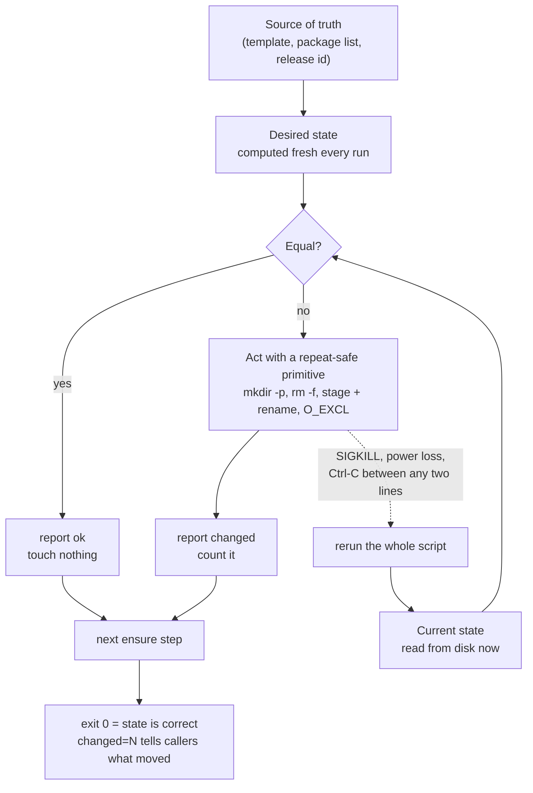

# Idempotent Scripts

> [!summary] Claim
> A script is safe to rerun only when every step compares the current state with a desired state derived from a source of truth and acts through a repeat-safe primitive, so that one run, ten runs, or a rerun after a `SIGKILL` at any line all end in the same state.

Part of [Robust Scripting](README.md) in [Shell and Unix Engineering](../README.md).

## TL;DR

- Mechanism: write each step as a convergent `ensure_*` function that reads the current state, compares it with the desired state, and acts only on a difference through a primitive that is itself safe to repeat (`mkdir -p`, `rm -f`, a staged file renamed with `rename(2)`, an `O_EXCL` create).
- Rule: derive the desired state from the source of truth, never from the step's own previous output, and make the exit status mean "the state is now correct" (0 for both changed and unchanged), not "every command ran".
- Trap: the most common one-shot commands exit 0 on a second run and quietly do something else: `cp -R src dst` copies into `dst/src`, `ln -s` and even `ln -sf` over a link to a directory create a new link inside that directory, `sed 's/80/8080/'` on its own output yields `808080`, and `>>` duplicates lines.
- Portability fact: POSIX.1-2024 makes `mkdir -p`, `rm -f`, and the `set -C` (`noclobber`) redirection repeat-safe everywhere, but has no option that stops `ln`, `cp`, or `mv` from treating a symlink to a directory as a target directory; GNU (`ln -n`, `-T`), BSD and macOS (`ln -h`/`-n`, `mv -h`), and BusyBox (`ln -n`, `-T`, `mv -T`) each add one, and of these four only GNU `ln -f` (coreutils 8.27 and later) replaces a link atomically.
- When not to use it: when the side effect lives outside the machine (a payment, an e-mail, a remote `POST`), local state checks cannot make a retry safe; you need an idempotency key or a transaction on the remote side, usually from a real programming language.

## Mental model



Every run starts from the source of truth and computes the desired state again, so the script never trusts a memory of what it did last time.
For each step it reads the current state from the system, and the comparison, not the step's position in the script, decides whether anything happens.
Equal state produces `ok` and leaves the object untouched (same inode, same mtime), which is what lets a caller reload a service only when something changed.
Unequal state is repaired through a primitive whose own repetition is harmless, so a crash between the primitive and the report line is repaired by the next run's comparison.
The dotted edge is the property that matters most: a crash at any point leaves a state that the same script, run again from the top, recognizes and finishes.

## How it works

### Three properties that are often confused

RFC 9110 defines a request method as idempotent "if the intended effect on the server of multiple identical requests" is the same as that of a single one, and it explicitly allows side effects such as logging each request separately (RFC 9110 9.2.2).
The point of the definition is retry: such a request "can be repeated automatically if a communication failure occurs" before the client reads the response (RFC 9110 9.2.2).
A script needs three related but different properties:

- Idempotent from the start: running it twice on a fresh machine equals running it once.
- Convergent: from any state the script itself can leave behind (including a crash between two lines), one more run reaches the desired state.
- Drift-repairing: from a state someone else changed (a hand-edited config file), one more run restores the desired state and says so.

The naive one-shot script in the lab has none of them; the converging script in the lab has all three, and the lab proves convergence by killing it with `SIGKILL` at each of seven crash points.
Convergence is the property operators actually rely on, because retries, cron reruns, and "just run it again" after a failure all start from an intermediate state, not a fresh one.
Retries in particular are only safe on top of it: see [[Retries-Backoff-and-Jitter]].

### Three ways to make one step repeat-safe

1. Use a primitive whose specification already says repetition is harmless.
   `mkdir -p` ignores "each dir operand that names an existing directory" without error, and exits 0 when "all the specified directories either already existed or were created successfully" (POSIX.1-2024 XCU `mkdir`).
   `rm -f` does not "write diagnostic messages or modify the exit status in the case of no file operands, or in the case of operands that do not exist" (POSIX.1-2024 XCU `rm`).
2. Guard the act with a test of the current state (check, then act).
   `grep -qxF -e LINE FILE || printf '%s\n' LINE >>FILE`, or `[ "$(readlink link)" = target ]` before touching a link.
   The guard and the act are two system calls, so two concurrent runs can both see "absent" and both act; serialize runs with a lock ([[Locking-and-Stale-Locks]]) rather than pretending the guard is atomic.
3. Act with an operation that atomically fails if the result already exists, then decide what "already exists" means.
   `open()` with `O_CREAT|O_EXCL` "shall fail if the file exists", and the existence check and creation "shall be atomic" with respect to other such opens; it also fails with `EEXIST` when the path is a symbolic link, "regardless of the contents of the symbolic link" (POSIX.1-2024 XSH `open`).
   `mkdir()` fails with `EEXIST` when the path exists, including when it names a symbolic link (POSIX.1-2024 XSH `mkdir`), and `symlink()` fails with `EEXIST` when the new path names one (POSIX.1-2024 XSH `symlink`).
   An `EEXIST` proves only that something is there; treat it as "done" only after you check that the thing is the one you would have created.

### The system calls behind the shell primitives

`mkdir -p a/b/c` walks the path and calls `mkdir()` for each missing component, treating an existing directory as success; when a component exists as a regular file, the call fails and so does the utility (lab test "mkdir -p accepts an existing directory and rejects an existing file").
POSIX notes in the `mkdir` rationale that because no error is produced for an existing component, `-p` "is also useful to ensure that a particular directory exists", which is the ensure idiom in one flag.
`rm -f` maps to `unlink()` and turns `ENOENT` into silent success; the rationale is careful that `-f` must not suppress other failures: historical versions also hid errors for "files that cannot be unlinked", but the standard "does not permit the -f option to suppress such messages", so a permission error still fails (POSIX.1-2024 XCU `rm`, RATIONALE).

`rename(old, new)` is the commit point of every staged write: POSIX requires that when `new` already exists, "a directory entry named new shall remain visible to other threads throughout the renaming operation" (POSIX.1-2024 XSH `rename`).
That is why the lab's `ensure_file` renders into `conf/.app.conf.new` in the same directory and then runs `mv -f` (a `rename()` on one file system): a reader sees the old bytes or the new bytes, never a truncated file.
Durability (`fsync` of the file and the directory) and the full temporary-file protocol belong to [[Atomic-Writes]]; this note needs only the visibility guarantee.

The shell's `noclobber` option (`set -C`) is the only repeat-safe create-or-fail primitive built into the language.
POSIX.1-2024 XCU 2.7.2 requires that `>` fail under `noclobber` when the file "exists and is either a regular file or a symbolic link that resolves to a regular file", that the existence check, creation, and open "be performed atomically as is done by the open() function ... when the O_CREAT and O_EXCL flags are set", and that `>|` override it for one redirection.
Earlier editions did not require atomicity; XRAT C.2.7.2 records that historical shells "just called stat() to check if a regular file existed and then called creat()", a race which "meant that it could not be used for reliable creation of lock files", and it describes the "stat first" and "exclusive create first" sequences shells may use until an `O_NOCLOBBER` open flag exists (that flag is only sketched in the FUTURE DIRECTIONS of XSH `open`, as of POSIX.1-2024).
bash implements the stat-first sequence in `noclobber_open()`: it calls `stat()`, fails at once for an existing regular file, otherwise clears `O_TRUNC`, and adds `O_EXCL` only when `stat()` failed, so an existing non-regular file such as `/dev/null` is opened normally and then rechecked with `fstat()` and `same_file()` to detect a swap (bash-5.3 redir.c, `noclobber_open`).
dash does the same inside `openredirect()`: when `Cflag` is set and `stat64()` fails it opens with `O_WRONLY|O_CREAT|O_EXCL`, an existing regular file goes to `ecreate`, and any other existing file is opened without `O_CREAT` and rechecked with `fstat64()` (dash src/redir.c, `openredirect`).

### Why the obvious commands are not repeat-safe: target-directory forms

`ln`, `cp`, and `mv` each have a second synopsis form that puts the sources inside an existing directory.
For `ln`, "the second synopsis form shall be assumed when the final operand names an existing directory" (POSIX.1-2024 XCU `ln`), and a symbolic link that resolves to a directory names an existing directory.
So the first `ln -s releases/v1 current` creates `current`, and the second finds that `current` resolves to the directory `releases/v1` and creates `releases/v1/v1` instead, with exit status 0 (lab test "naive script: the second run exits 0 and corrupts the tree").
Adding `-f` does not help: `-f` removes an existing destination, but the destination is now `releases/v1/v2`, so `ln -sf releases/v2 current` leaves `current` pointing at `releases/v1` and adds a stray link inside it (lab test "ln -s and ln -sf over a link to a directory nest the new link").
For `cp -R`, the third synopsis form applies when the target "exists and names an existing directory", and the destination of each source is the target, a slash, and the source's last component (POSIX.1-2024 XCU `cp`), so a rerun of `cp -R skel conf` writes `conf/skel/...` and leaves the stale `conf/app.conf` in place (lab test "cp -R into an existing directory copies the source inside it").

The fix is either a guard (the lab compares `readlink` output and removes the old link first) or an implementation-specific flag that stops the dereference:

- GNU coreutils `ln -n` treats the link name "as a normal file if it is a symbolic link to a directory" and `-T` treats it "as a normal file always"; `mv -T` treats the destination "as a normal file" (coreutils 9.11 man pages).
- FreeBSD and macOS `ln -h` does not follow a target that is a symbolic link and "is most useful with the -f option, to replace a symlink which may point to a directory"; `-n` is the same as `-h`; `mv -h` renames onto a symlink to a directory "rather than moving source into the directory referenced by target" (FreeBSD `ln(1)`, `mv(1)`).
- BusyBox `ln` lists `-n` ("Don't dereference symlinks - treat like normal file") and `-T`, and calls `is_directory()` with link following turned off when either is given (BusyBox coreutils/ln.c); BusyBox 1.37.0 `mv -T` also renames onto a link to a directory (measured in the shell matrix's Alpine image).

`readlink` itself became standard only in POSIX.1-2024 ("First released in Issue 8"), and it exits non-zero with a diagnostic when its operand is not a symbolic link (POSIX.1-2024 XCU `readlink`); GNU coreutils, macOS, and BusyBox all provide one, but a system that conforms only to POSIX.1-2017 need not.

### Replacing a link: two steps or one

POSIX `ln -f` removes the destination with actions "equivalent to the unlink() function" before creating the link (POSIX.1-2024 XCU `ln`), so between the two system calls the name does not exist.
FreeBSD `linkit()` does exactly that: `unlink(target)` (or `rmdir()` under `-F`), then `symlink()` or `linkat()` (FreeBSD bin/ln/ln.c, `linkit`), and macOS ships the same `linkit()` sequence (Apple file_cmds ln/ln.c); BusyBox `ln` also calls `unlink()` before creating the link (BusyBox coreutils/ln.c).
GNU coreutils changed this in 8.27 (2017-03-08): "commands like 'ln -f A B' and 'cp -fl A B' no longer remove B before creating the new link", so "there is no longer a brief moment when B does not exist" (coreutils NEWS).
The mechanism is `force_symlinkat()` and `force_linkat()`: on `EEXIST` they create the link under a random temporary name in the destination's directory and `renameat()` it over the destination (coreutils src/force-link.c).
The lab's `ensure_symlink` uses the portable two-step form (`rm -f`, then `ln -s`) and therefore has a crash point, `link-removed`, where the link is missing; the rerun recreates it, which is convergence, but a reader racing the script can see the gap.
When readers must never see the gap, build the new link under a temporary name and rename it with `mv -T` (GNU) or `mv -h` (BSD and macOS); [[install-and-Atomic-Deployment]] covers the release-directory switch built on that.

### Desired state comes from the source of truth

A step that edits its own previous output is a function applied to its result, and `f(f(x))` equals `f(x)` only if the edit is a fixed point.
`sed 's/80/8080/'` is not: the second run turns `8080` into `808080` (lab test "naive script").
The lab's `ensure_file` renders from `skel/app.conf` every time with an anchored pattern (`s/^port=80$/port=8080/`), so the output depends only on the template and is identical on every run.
The rendered bytes are compared with `cmp -s` before the rename; equal bytes mean the staged copy is deleted and the installed file keeps its inode and mtime (lab test "an unchanged file keeps its inode"), so file watchers, `make`, and "restart only if changed" handlers do not fire on a no-op run.
The same rule applies to `>>`: an append is idempotent only behind a guard (`grep -qxF`), and the guard must also handle a file whose last byte is not a newline, or the appended line is glued onto the previous one (`127.0.0.1 localhost10.0.0.1 db` in the lab).

### Every line is a restart point

A `SIGKILL`, an OOM kill, or a power cut ends the script without running any `EXIT` trap ([[Cleanup-Traps-and-Re-Raising-Signals]] explains why no trap can catch `SIGKILL`), so cleanup by trap is an optimization and the next run must tolerate whatever was left.
The lab's design follows from that:

- The staging name is deterministic (`conf/.app.conf.new`), so a leftover from a crash is overwritten by the next run's `>` instead of accumulating as one orphan per crash; the cost is that two concurrent runs would share it, which the lock in [[Locking-and-Stale-Locks]] prevents.
- The render writes to the staging file, never to the destination, so a failing render (the template is missing) exits 1 and leaves the installed file intact (lab test "a failing render leaves the installed file intact").
- Each `ensure_*` re-derives its decision from the disk, so the step order matters only for dependencies (the directory before the file), never for bookkeeping.

The crash test kills the script at `after-dir`, `line-newline`, `after-line`, `file-staged`, `after-file`, `link-removed`, and `after-link`, checks that each crash left a tree different from the clean-run tree, reruns, and requires the result to equal the clean-run tree byte for byte and a third run to report `changed=0`.

### Stamp files versus state checks

When the current state is cheap to observe (a directory, a link target, a file's bytes), check it directly.
When it is expensive or invisible (a schema migration, a one-time data import), record completion in a stamp file, and write the stamp last and atomically: `step && : >"$stamp.tmp" && mv -f "$stamp.tmp" "$stamp"`.
A stamp proves the step once finished, not that its result still holds, so a stamp cannot repair drift; prefer a stamp that records what was applied (a version or checksum) so a changed source invalidates it.
Ansible's `command` module exposes the same trade-off as `creates` ("If a matching file already exists, this step will not be run") and `removes` (Ansible `ansible.builtin.command` documentation).

### Reporting: what the exit status promises

An idempotent script's exit status is a contract about the end state: 0 means "the system is now in the desired state", whether or not anything changed, and non-zero means "it may not be" ([[Exit-Code-Contracts]]).
A separate `changed` signal (the lab prints `changed=N`) lets a caller do follow-up work only when needed.
Do not encode "nothing to do" as a non-zero status; callers under `set -e` or a CI step would then treat a healthy no-op as a failure, and they learn to ignore the status, which hides real failures.
The naive script shows the opposite failure: its status is that of its last command (`ln`), so the corrupting rerun exits 0 even though `rm` failed earlier.

### Operations the shell cannot make idempotent

Some effects have no local state to compare: sending a message, charging a card, posting to an API, incrementing a remote counter.
The remote side must deduplicate, which is what idempotency keys do: for API v1, Stripe saves "the status code and body of the first request made with a given idempotency key" once endpoint execution begins, replays it for retries "including 500 errors", and lets keys be pruned once "at least 24 hours old"; keys are "up to 255 characters long", and a reused key whose parameters differ is rejected (Stripe API reference, Idempotent requests, as of 2026-11).
With API v2 the contract differs: retries do not repeat successful operations, and Stripe retries failed or partially failed work to completion when possible instead of replaying the saved error (same page, as of 2026-11).
Generate the key once per logical operation, persist it locally before the first attempt, and reuse it on every retry; a key generated per attempt defeats the mechanism.
Local commands that refuse to repeat need the same care: `useradd` exits 9 for "username or group name already in use" (shadow-utils 4.19.0 `useradd(8)`), so a rerun must either guard with a lookup or accept exit 9 only after checking that the existing account has the wanted attributes.

## Numbers and limits

| Quantity | Value | Source |
|---|---|---|
| Crash points the lab kills `converge.sh` at | 7 | lab, run 2026-11-15 |
| Steps reported `changed` on first run, second run | 5, 0 | lab, run 2026-11-15 |
| Status the parent sees for the `SIGKILL`ed script | 137 (128 + 9) | lab, bats parent is bash |
| Status of a failed `>` under `set -C` | bash 5.3.15 (normal and `--posix`): 1; bash 3.2.57 as `sh`: 1; dash 0.5.13.5: 2; zsh 5.9.2 native and `--emulate sh`: 1; ksh93u+ 2012-08-01: 1 | measured on the macOS host, 2026-11-15 |
| Status of a failed `>` under `set -C`, Linux images | dash 0.5.12: 2; yash 2.58.1: 2; ksh93u+m 1.0.10, mksh R59, posh 0.14.1, BusyBox ash 1.37.0: 1 | measured in the shell matrix images (Debian 13, Alpine 3.22), 2026-11-15 |
| `useradd` exit status when the name exists | 9 | shadow-utils 4.19.0 `useradd(8)` |
| First GNU coreutils release where `ln -f` never removes the destination first | 8.27 (2017-03-08) | coreutils NEWS |
| `cp` and `mv` `--update=none` (skip existing, status unaffected) | coreutils 9.3 | coreutils NEWS |
| `cp` and `mv` `--update=none-fail` (skip existing, diagnose, fail) | coreutils 9.5 | coreutils NEWS |
| `install -C` stops updating metadata on an unchanged destination | coreutils 9.12 | coreutils NEWS (as of 2026-11) |
| Idempotency key length, minimum age before pruning | 255 characters, 24 hours | Stripe API reference (as of 2026-11) |
| Knight Capital, 2012-08-01: servers missed by a manual deploy | 1 of 8 | SEC Release 34-70694, para. 15 |
| Knight Capital: duration, loss | about 45 minutes, more than 460 million USD | SEC Release 34-70694, paras. 1, 17 |

## Portability

Shell behavior under `set -C` (the create-or-fail primitive):

| Shell | Second `>` to a regular file | `: >existing` (special built-in) | `>\|` and `>/dev/null` under `-C` |
|---|---|---|---|
| POSIX sh | must fail (XCU 2.7.2) | must exit a non-interactive shell (XCU 2.8.1, redirection error with a special built-in) | must succeed (XCU 2.7.2) |
| macOS bash 3.2.57 as `/bin/sh` (POSIX mode) | fails, status 1 (measured) | exits (lab, measured) | succeed (lab, measured) |
| bash 5.3.15, normal mode | fails, status 1 (measured) | survives (lab branch `bash-normal`, measured by hand) | succeed (measured) |
| bash 5.3.15 `--posix` | fails, status 1 (measured) | exits, status 1 (measured) | succeed (measured) |
| zsh 5.9.2 native | fails, status 1 (measured) | survives (measured; lab branch `zsh`) | succeed (measured) |
| zsh 5.9.2 `--emulate sh` | fails, status 1 (measured) | exits (measured; lab branch `zsh-sh`) | succeed (measured) |
| dash 0.5.13.5 (macOS), 0.5.12 (Debian) | fails, status 2 (measured) | exits (measured) | succeed (measured) |
| ksh93u+ 2012-08-01 (macOS) | fails, status 1 (measured) | exits (measured) | succeed (measured) |
| ksh93u+m 1.0.10 (Debian) | fails, status 1 (measured) | exits (measured) | succeed (measured) |
| mksh R59 (Debian and Alpine) | fails, status 1 (measured) | exits (measured) | succeed (measured) |
| posh 0.14.1 (Debian) | fails, status 1 (measured) | exits (measured) | succeed (measured) |
| BusyBox ash 1.37.0 (Alpine `sh`, Debian `busybox sh`) | fails, status 1 (measured) | exits (measured) | succeed (measured) |
| yash 2.58.1 (Alpine) | fails, status 2 (measured) | survives by default; exits, status 2, with `-o posixlycorrect` (measured; lab branches `yash-normal`, `yash-posix`) | succeed (measured) |

Utilities (the shell under test never changes which `ln`, `cp`, `mv`, `rm`, or `mkdir` runs):

| Behavior | POSIX.1-2024 | GNU coreutils | FreeBSD and macOS | BusyBox |
|---|---|---|---|---|
| `mkdir -p` on an existing directory | exit 0 | exit 0 (measured, coreutils 9.7) | exit 0 (lab, macOS) | exit 0 (measured, 1.37.0) |
| `rm -f` missing operand or no operand | silent, exit 0 | exit 0 (measured) | exit 0 (lab, macOS) | exit 0 (measured) |
| `ln -s`/`ln -sf` onto a link to a directory | second synopsis form: link created inside | nests (measured) | nests (lab, macOS) | nests unless `-n`/`-T` (measured and source) |
| Do not dereference the link name | no option | `ln -n`, `ln -T`, `mv -T` (`ln -sfn` and `mv -T` measured) | `ln -h`/`-n`, `mv -h` (`ln -sfh`, `ln -sfn`, `mv -h` measured on macOS; macOS `mv -T` is rejected) | `ln -n`, `ln -T`, `mv -T` (`ln -sfn` and `mv -T` measured) |
| `ln -f` replacement | `unlink()` then link | atomic `renameat()` of a temporary since 8.27 | `unlink()` then `symlink()` (FreeBSD bin/ln/ln.c and Apple file_cmds ln/ln.c) | `unlink()` then link |
| `readlink` utility | new in Issue 8 (2024) | yes (measured) | yes (macOS host) | yes (measured) |
| Compare before install | none | `install -C` (content, ownership, permissions; measured, 9.7) | `install -C` compares content and then keeps the target mtime (FreeBSD `install(1)`; measured on macOS) | no `-C`: "unrecognized option" (measured, 1.37.0) |

The GNU and BusyBox cells marked measured were run in the shell matrix's Debian 13 (GNU coreutils 9.7) and Alpine 3.22 (BusyBox 1.37.0) images on 2026-11-15.

## Worked example

The [lab](../labs/13-idempotent-scripts/) runs one desired state two ways: `naive-provision.sh` as one-shot commands and `converge.sh` as `ensure_*` steps.
Both start from the same seeded tree: `skel/app.conf` (`name=app`, `port=80`), an empty `releases/v1/`, `run/stale.pid`, and a `hosts` file whose last line `127.0.0.1 localhost` has no final newline.

The naive script (verbatim):

```sh
#!/bin/sh
# naive-provision.sh ROOT: the desired state of converge.sh, written as one-shot commands.
# Every line assumes it runs exactly once against a fresh ROOT.
# A second run exits 0 and corrupts ROOT: cp -R nests, sed compounds, >> duplicates, ln nests.
# Usage: naive-provision.sh ROOT
cd "$1" || exit 1
cp -R skel conf
sed 's/80/8080/' conf/app.conf >conf/app.conf.tmp
mv conf/app.conf.tmp conf/app.conf
echo '10.0.0.1 db' >>hosts
rm run/stale.pid
ln -s releases/v1 current
```

Output captured on the macOS host (`sh` is bash 3.2.57), with the root path shortened to `ROOT`:

```text
$ sh naive-provision.sh ROOT; echo "status=$?"
status=0
$ sh naive-provision.sh ROOT; echo "status=$?"
rm: run/stale.pid: No such file or directory
status=0
$ cat ROOT/hosts
127.0.0.1 localhost10.0.0.1 db
10.0.0.1 db
$ cat ROOT/conf/app.conf
name=app
port=808080
$ find ROOT/conf
ROOT/conf
ROOT/conf/skel
ROOT/conf/skel/app.conf
ROOT/conf/app.conf
$ readlink ROOT/releases/v1/v1
releases/v1
```

Five defects, one exit status of 0: the glued `hosts` line (first run), the duplicate line, the compounded port, the nested `skel`, and the stray link inside the release directory.
The `rm` message wording is the macOS one; GNU and BusyBox word it differently, so the lab matches only `stale.pid`.

The converging script (verbatim):

```sh
#!/bin/sh
# converge.sh ROOT: bring ROOT to one desired state from any starting state, any number of times.
# Each ensure_* step reads the current state, acts only when it differs from the desired state,
# and prints "ok WHAT" or "changed WHAT"; the last line is "changed=N".
# A rerun after a crash at any point converges to the same final state.
# CONVERGE_CRASH=NAME kills this shell with SIGKILL at crash point NAME, so no trap can run.
# Exit status: 0 when ROOT ends in the desired state (changed or not), 1 on any failure.
# Usage: converge.sh ROOT
set -u

die() {
  printf 'converge: %s\n' "$*" >&2
  exit 1
}

changed=0

# report STATE WHAT: print one result line and count the changes.
report() {
  printf '%s %s\n' "$1" "$2"
  if [ "$1" = changed ]; then
    changed=$((changed + 1))
  fi
}

# crashpoint NAME: die by SIGKILL here when CONVERGE_CRASH names this point.
crashpoint() {
  if [ "${CONVERGE_CRASH-}" = "$1" ]; then
    kill -s KILL "$$"
  fi
}

# ensure_dir DIR: DIR exists as a directory.
ensure_dir() {
  if [ -d "$1" ]; then
    report ok "dir $1"
    return 0
  fi
  mkdir -p "$1" || die "cannot create directory $1"
  report changed "dir $1"
}

# ensure_line FILE LINE: FILE contains LINE as a whole line, exactly once if we added it.
ensure_line() {
  if [ -f "$1" ]; then
    grep -qxF -e "$2" "$1"
    st=$?
    case $st in
      0)
        report ok "line $1"
        return 0
        ;;
      1) ;; # absent: append below
      *) die "cannot read $1 (grep status $st)" ;;
    esac
    # A last byte that is not a newline would glue LINE onto the last line.
    last=$(tail -c 1 "$1") || die "cannot read $1"
    if [ -n "$last" ]; then
      printf '\n' >>"$1" || die "cannot append to $1"
      crashpoint line-newline
    fi
  fi
  printf '%s\n' "$2" >>"$1" || die "cannot append to $1"
  report changed "line $1"
}

# ensure_file DEST CMD [ARG...]: DEST holds exactly the bytes CMD prints.
# The output is staged next to DEST and renamed over it only when the bytes differ,
# so an unchanged file keeps its inode and mtime, and a failing CMD never truncates DEST.
ensure_file() {
  dest=$1
  shift
  if [ -d "$dest" ]; then
    die "$dest is a directory"
  fi
  case $dest in
    */*) stage="${dest%/*}/.${dest##*/}.new" ;;
    *) stage=".$dest.new" ;;
  esac
  "$@" >"$stage" || die "cannot render $dest"
  crashpoint file-staged
  if [ -f "$dest" ] && cmp -s "$stage" "$dest"; then
    rm -f "$stage"
    report ok "file $dest"
    return 0
  fi
  mv -f "$stage" "$dest" || die "cannot install $dest"
  report changed "file $dest"
}

# ensure_symlink TARGET LINK: LINK is a symbolic link whose contents are TARGET.
# Never "ln -s" over an existing link: if LINK resolves to a directory, ln creates the new
# link inside that directory and exits 0.
ensure_symlink() {
  if [ -L "$2" ]; then
    cur=$(readlink "$2") || die "cannot read link $2"
    if [ "$cur" = "$1" ]; then
      report ok "link $2"
      return 0
    fi
    rm -f "$2" || die "cannot remove link $2"
  elif [ -e "$2" ]; then
    die "$2 exists and is not a symbolic link"
  fi
  crashpoint link-removed
  ln -s "$1" "$2" || die "cannot create link $2"
  report changed "link $2"
}

# ensure_absent PATH: nothing exists at PATH (a directory is refused, not removed).
ensure_absent() {
  if [ ! -e "$1" ] && [ ! -L "$1" ]; then
    report ok "absent $1"
    return 0
  fi
  rm -f "$1" || die "cannot remove $1"
  report changed "absent $1"
}

[ "$#" -eq 1 ] || die "usage: converge.sh ROOT"
cd "$1" || die "cannot enter $1"

ensure_dir conf
crashpoint after-dir
ensure_line hosts '10.0.0.1 db'
crashpoint after-line
ensure_file conf/app.conf sed 's/^port=80$/port=8080/' skel/app.conf
crashpoint after-file
ensure_symlink releases/v1 current
crashpoint after-link
ensure_absent run/stale.pid
printf 'changed=%d\n' "$changed"
```

Output captured on the same host; the first two runs are exactly what the lab's second test asserts:

```text
$ sh converge.sh ROOT; echo "status=$?"
changed dir conf
changed line hosts
changed file conf/app.conf
changed link current
changed absent run/stale.pid
changed=5
status=0
$ sh converge.sh ROOT; echo "status=$?"
ok dir conf
ok line hosts
ok file conf/app.conf
ok link current
ok absent run/stale.pid
changed=0
status=0
```

A crash at `file-staged` on a fresh tree, then a rerun (the lab asserts the 137, the leftover staging file, the third output line, and that the staging file is gone afterwards):

```text
$ CONVERGE_CRASH=file-staged sh converge.sh ROOT; echo "status=$?"
changed dir conf
changed line hosts
status=137
$ ls -A ROOT/conf
.app.conf.new
$ sh converge.sh ROOT; echo "status=$?"
ok dir conf
ok line hosts
changed file conf/app.conf
changed link current
changed absent run/stale.pid
changed=3
status=0
$ ls -A ROOT/conf
app.conf
```

The bats suite runs these and the utility probes through `run_lab`, so the matrix repeats them under every shell; on the macOS host all 13 tests passed under `LAB_SHELL=sh` on 2026-11-15.

## Pitfalls

> [!warning] Target-directory nesting
> Trigger: rerunning `cp -R src dst`, `ln -s target link`, `ln -sf target link`, or `mv new dst` when `dst` or `link` already is, or resolves to, a directory.
> Symptom: exit 0, the real destination unchanged, and a new `dst/src`, `releases/v1/v1`, or moved file inside the directory; deploys silently keep running the old code.
> Fix: guard on the current state (`[ -L link ]` plus `readlink`), copy into a fresh staging directory and rename it, or use the no-dereference flags (`ln -sfn`, GNU `mv -T`, BSD `mv -h`).

> [!warning] Compounding edits
> Trigger: an in-place edit whose output still matches its own input pattern, such as `sed 's/80/8080/'` or `sed 's/$/ --verbose/'`.
> Symptom: `808080`, or a flag repeated once per run.
> Fix: render from a template every run, or anchor the pattern so the result no longer matches (`s/^port=80$/port=8080/`), and test the edit by applying it twice.

> [!warning] Unguarded or newline-blind append
> Trigger: `echo line >>file` on every run, or a guarded append to a file whose last byte is not a newline.
> Symptom: duplicate lines, or `127.0.0.1 localhost10.0.0.1 db`.
> Fix: `grep -qxF -e "$line" "$file"` first, distinguish its status 1 (absent) from 2 or more (error), and add a newline when `tail -c 1` returns a non-empty byte.

> [!warning] Truncating the destination before the render succeeds
> Trigger: `generate >/etc/app.conf` where `generate` fails.
> Symptom: an empty or partial file that the next run, or the service, reads as valid input.
> Fix: render to a staging file next to the destination and rename only after the render exits 0 (lab test "a failing render leaves the installed file intact"); see [[Atomic-Writes]].

> [!warning] `:` redirection under `set -C` exits the script
> Trigger: `set -C; : >"$lock"` used as a create-or-fail test.
> Symptom: in a POSIX shell (dash, ksh93, mksh, posh, BusyBox ash, bash as `sh` or with `--posix`, `zsh --emulate sh`, `yash -o posixlycorrect`) the whole script exits on the first `EEXIST`, because a redirection error on a special built-in is fatal (POSIX.1-2024 XCU 2.8.1); bash in normal mode, native zsh, and yash in its default mode continue, so the bug hides on a developer's laptop (lab test "set -C: a failed redirection on the special built-in : exits a POSIX shell").
> Fix: redirect a regular built-in or a group and test it: `if { true >"$lock"; } 2>/dev/null; then ...`; see [[Special-Built-ins-versus-Utilities]].

> [!warning] Check-then-act across concurrent runs
> Trigger: two cron or CI invocations of the same script at once.
> Symptom: both see "absent", both append, both rename onto the same staging name, or one removes a link the other just created.
> Fix: idempotence is not mutual exclusion; take a lock for the whole run ([[Locking-and-Stale-Locks]]), and keep the create-or-fail primitives (`O_EXCL`, `mkdir`) for the lock itself.

> [!warning] Equal bytes are not equal state
> Trigger: comparing only file content while the desired state also fixes mode, owner, or SELinux label; the staged file is created with the process umask.
> Symptom: a run reports `ok` while the file is world-readable, or a rename silently resets the mode the operator set.
> Fix: include every attribute in the comparison, or use GNU `install -C`, which skips the destination only when "content, ownership, and permissions" are unchanged (coreutils 9.11 `install(1)`).

> [!warning] Partial convergence across a fleet: Knight Capital, 2012-08-01
> Trigger: a manual deployment "in stages" to eight servers in which a technician "did not copy the new code to one of the eight SMARS computer servers", with no second-technician review and "no written procedures that required such a review" (SEC Release 34-70694, para. 15).
> Symptom: orders carrying a repurposed flag reached old Power Peg code on the eighth server, which sent millions of child orders in about 45 minutes and cost more than 460 million USD; the incident response then uninstalled the new code from the seven correct servers, which "worsened the problem" (paras. 13, 16, 17, 27).
> Fix: deploy with a convergent tool that compares and reports actual state on every host, refuse to proceed until every host reports the desired version, and never repurpose a flag while dead code that reads it can still run.

## Security and robustness

- State checks follow symbolic links: `[ -d x ]`, `[ -f x ]`, and `mkdir -p` all resolve them, so in a directory another user can write, an attacker can plant a link that makes "already present" true or redirects your write; run the ensure steps only in directories writable solely by the script's user, and test `-L` before trusting `-d` or `-f` (as `ensure_symlink` does).
- A deterministic staging name such as `.app.conf.new` is safe only under the same condition; in a shared directory, create staging files with `mktemp` ([[mktemp]]).
- `set -C` is a weaker substitute: bash and dash open a missing name with `O_EXCL`, which fails on any symbolic link (POSIX.1-2024 XSH `open`), but both open an existing non-regular file (a link to a device or FIFO) without `O_EXCL`, and XCU 2.7.2 lets a shell open through a link that does not resolve to a regular file.
- Refuse, do not repair, a state you did not expect: `ensure_symlink` fails when a real directory sits where the link belongs, and `ensure_absent` never removes a directory, because a "convergent" `rm -rf` on an unexpected path is how idempotent scripts delete data ([[Safe-rm-and-Destructive-Operations]]).
- Never let a guard's error look like "absent": `grep` status 2 (unreadable file) must stop the run, not trigger an append; a script that turns every error into "not there yet" converges onto garbage ([[Error-Handling-Patterns]]).
- Print what changed, not the content: the `changed WHAT` lines name objects, so the log stays free of rendered secrets; [[Logging-from-Scripts]] covers the rest.
- A preview mode is only trustworthy if it runs the same comparisons with the actions disabled; build `--dry-run` on the `ensure_*` functions, as in [[Dry-Run-and-Apply]].

## The principal's view

The decision is not "should this script be idempotent" but where convergence logic should live, and the answer depends on the shape of the state.
For a handful of local objects (directories, links, a few rendered files, a line in a config file) a POSIX `sh` script of `ensure_*` functions is the cheapest correct tool: no runtime to install, every step visible, and the lab shows the whole pattern fits in about 130 lines.
Once the state includes packages, services, users, and many hosts, the comparison logic grows faster than the actions, and a declarative tool earns its weight because it already ships a tested "compare, act, report changed" for each resource type; Ansible's `command` module still needs `creates` or `removes` to stop it from running every time, which shows that declarative tools only move the problem for raw commands.
Once the state is remote and transactional (money, messages, API objects), the shell is the wrong layer: you need idempotency keys persisted before the first attempt, typed error handling, and retries with backoff, which belong in a real programming language.
The trade-off to name explicitly is cost of observation against cost of trust: checking real state on every run costs time and code, while trusting stamp files or "it ran last time" is cheap until drift, a partial deploy, or a crash makes the record false, which is exactly the failure the SEC order describes.
A staff-plus reviewer asks three questions of any operational script: what does a second run do, what does a run after a `kill -9` on each line do, and does the exit status mean "state correct" or "commands ran"; the lab's crash-point loop is a cheap way to make the answers testable in CI.

## Interview questions

> [!question] L5: What is the difference between an idempotent script and a convergent one, and which do operators actually need?
>
> > [!success]- Answer
> > Idempotent means running it twice from the same start equals running it once.
> > Convergent means that from any state the script can leave behind, including a crash between two lines, one more run reaches the desired state.
> > Operators need convergence, because reruns happen after failures, so they start from intermediate states, not fresh ones.
> >
> > Follow-up: How would you test convergence automatically?

> [!question] L5: Why does `mkdir -p dir` make a good ensure step while `mkdir dir` does not, and when does `mkdir -p` still fail?
>
> > [!success]- Answer
> > POSIX says `mkdir -p` ignores an operand that names an existing directory and exits 0 when everything already existed or was created.
> > Plain `mkdir` fails with `EEXIST` on the second run.
> > `mkdir -p` still fails when a path component exists as a non-directory, such as a regular file, which is correct: the desired state cannot be reached without destroying something.
> >
> > Follow-up: Why is `mkdir` without `-p` useful as a lock while `mkdir -p` is not?

> [!question] L5: Predict the output.
>
> ```sh
> mkdir -p r/v1 r/v2
> ln -s r/v1 cur
> ln -sf r/v2 cur
> readlink cur
> readlink r/v1/v2
> ```
>
> > [!success]- Answer
> > It prints `r/v1` and then `r/v2`.
> > The second `ln` sees that `cur` resolves to the directory `r/v1`, so the POSIX second synopsis form applies and the link is created as `r/v1/v2`.
> > `-f` only removes an existing destination, and the destination `r/v1/v2` did not exist, so `cur` is untouched and `ln` exits 0.
> > `ln -sfn` (GNU, BSD, BusyBox) or `ln -sfh` (BSD) replaces `cur` instead; the lab asserts both behaviors.
> >
> > Follow-up: Which of those implementations replaces the link without a moment where `cur` is missing?

> [!question] L6: Debug this deploy script; a second run exits 0 but production still runs the old build.
>
> ```sh
> #!/bin/sh
> set -e
> cp -R build /srv/app
> sed 's/workers=4/workers=8/' /srv/app/app.ini >/srv/app/app.ini.new
> mv /srv/app/app.ini.new /srv/app/app.ini
> echo 'PATH=/srv/app/bin:$PATH' >>/etc/profile.d/app.sh
> ```
>
> > [!success]- Answer
> > On the second run `/srv/app` exists, so `cp -R build /srv/app` copies into `/srv/app/build` and the served files never change; that is the stale build.
> > The `sed` edit happens to be safe to repeat because `workers=8` no longer matches `workers=4`, but it edits the installed file instead of rendering from the source of truth.
> > The `>>` line appends a duplicate `PATH` entry on every run.
> > Fix: copy into a fresh release directory and switch a link with a no-dereference rename, render `app.ini` from a template, and guard the append with `grep -qxF`.
> >
> > Follow-up: How would the exit status have to change so that a caller could tell "deployed" from "already deployed"?

> [!question] L6: Why does the lab's `ensure_file` compare bytes before renaming instead of always renaming the freshly rendered file?
>
> > [!success]- Answer
> > Always renaming would be idempotent in content but not in identity: each run would give the file a new inode and mtime.
> > Watchers, `make`, and "reload if changed" handlers react to that, so a no-op run would restart services.
> > Comparing with `cmp -s` keeps the inode on an unchanged file, which the lab asserts, and lets the script report `ok` honestly.
> >
> > Follow-up: What else besides bytes must be compared for the `ok` to be true?

> [!question] L6: A script uses `set -C; : >"$lockfile" || exit 0` to skip work already done; it works in bash on your laptop and kills the job in production's `/bin/sh`; why?
>
> > [!success]- Answer
> > `:` is a special built-in, and POSIX.1-2024 XCU 2.8.1 says a redirection error with a special built-in shall exit a non-interactive shell.
> > dash, ksh93, mksh, posh, BusyBox ash, bash as `sh`, and `zsh --emulate sh` exit before `|| exit 0` runs; bash in normal mode, native zsh, and yash outside `posixlycorrect` mode do not (measured in the shell matrix).
> > Use `{ true >"$lockfile"; } 2>/dev/null` or another regular command, whose redirection error only sets a non-zero status.
> >
> > Follow-up: Is a noclobber lock file safe on every file system and against stale locks?

> [!question] L7+: Your fleet configuration script must survive `kill -9` at any line: what design rules do you impose, and how do you prove them in CI?
>
> > [!success]- Answer
> > Every step derives its decision from current state, not from a log of earlier runs, so restarting at the top is always correct.
> > Every write is staged next to its destination and committed with `rename()`, so no crash leaves a truncated file.
> > Leftovers from a crash use deterministic names that the next run overwrites, and a lock serializes runs so that those names cannot collide.
> > The exit status means "state correct", with a separate changed count.
> > CI injects a `SIGKILL` at every named crash point, reruns, and compares the resulting tree with a clean run, as the lab does with seven points.
> >
> > Follow-up: Which steps cannot be proven this way, and what do you do about them?

> [!question] L7+: When do you stop writing idempotent shell and move the logic elsewhere?
>
> > [!success]- Answer
> > When observation of state costs more code than the actions, such as packages, services, and users across many hosts, a declarative tool already implements compare-act-report per resource type.
> > When the effect is remote and not naturally idempotent, such as payments or messages, the deduplication must happen on the remote side with an idempotency key that the client persists before the first attempt and reuses on every retry.
> > When the error handling needs types, structured retries, or transactions, a real language is cheaper to get right than shell.
> >
> > Follow-up: For API v1, Stripe saves the first response for a key, including a 500; what does that imply for a client that retries with the same key after a 500?

> [!question] L6: `useradd deploy` fails on the second run; how do you make the step convergent without hiding real errors?
>
> > [!success]- Answer
> > shadow-utils `useradd` exits 9 when the user or group name is already in use.
> > Guard with a lookup such as `getent passwd deploy`, and if the account exists, compare the attributes you care about (UID, shell, groups) and fix them with `usermod`.
> > Accepting exit 9 blindly would report success for an account with the wrong UID or shell, and accepting every non-zero status would hide a full disk or a locked password file.
> >
> > Follow-up: How would you report "changed" versus "ok" for this step?

## Related

Prerequisites: [[Cleanup-Traps-and-Re-Raising-Signals]]

Next: [[Atomic-Writes]]

See also: [[Locking-and-Stale-Locks]], [[Retries-Backoff-and-Jitter]], [[Dry-Run-and-Apply]], [[Exit-Code-Contracts]], [[Error-Handling-Patterns]], [[Safe-rm-and-Destructive-Operations]], [[Logging-from-Scripts]], [[mktemp]], [[install-and-Atomic-Deployment]], [[cp-mv-and-Rename-Semantics]], [[Special-Built-ins-versus-Utilities]], [[Redirection-Order-and-Semantics]]

## Further reading

- POSIX.1-2024 XCU 2.7.2 and 2.8.1 (https://pubs.opengroup.org/onlinepubs/9799919799/utilities/V3_chap02.html): the atomic `noclobber` requirement and which redirection errors are fatal.
- POSIX.1-2024 XRAT C.2.7.2 (https://pubs.opengroup.org/onlinepubs/9799919799/xrat/V4_xcu_chap01.html): why `noclobber` was racy for decades and the two sequences shells use instead.
- POSIX.1-2024 `mkdir`, `rm`, `ln`, `cp` utilities (https://pubs.opengroup.org/onlinepubs/9799919799/utilities/ln.html): the repeat-safe options and the target-directory forms that break reruns.
- POSIX.1-2024 `open()` and `rename()` (https://pubs.opengroup.org/onlinepubs/9799919799/functions/rename.html): the `O_EXCL` and visibility guarantees every primitive here rests on.
- GNU coreutils src/force-link.c (https://raw.githubusercontent.com/coreutils/coreutils/master/src/force-link.c): how `ln -f` replaces a link atomically with a temporary name and `renameat()`.
- FreeBSD bin/ln/ln.c (https://cgit.freebsd.org/src/tree/bin/ln/ln.c): the `unlink()` then `symlink()` sequence that FreeBSD and macOS `ln -f` still use.
- RFC 9110 section 9.2.2 (https://www.rfc-editor.org/rfc/rfc9110.html#section-9.2.2): the canonical definition of idempotence for retries.
- Stripe API reference, Idempotent requests (https://docs.stripe.com/api/idempotent_requests): a production idempotency-key design with its retention and mismatch rules.
- SEC Release 34-70694, In the Matter of Knight Capital Americas LLC (https://www.sec.gov/litigation/admin/2013/34-70694.pdf): a primary record of what a non-convergent deployment with no state verification costs.
