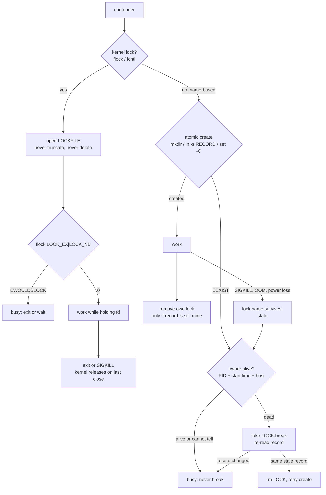

# Locking and Stale Locks

> [!summary] Claim
> A shell lock is exactly as strong as the one system call that creates it (`mkdir`, `symlink`, `open` with `O_CREAT|O_EXCL`, or a kernel `flock`/`fcntl` lock), and every lock that is a name in the file system outlives a killed holder, so the real design problem is not taking the lock but deciding who may declare it dead and removing it without deleting a live successor's lock.

Part of [Robust Scripting](README.md) in [Shell and Unix Engineering](../README.md).

## TL;DR

- Mechanism: a name-based lock is one atomic create that fails when the name exists (`mkdir`, `ln -s`, or `set -C` with `>`, which POSIX.1-2024 now requires to behave like `open` with `O_CREAT|O_EXCL`, `(POSIX.1-2024 XCU 2.7.2)`); a kernel lock (`flock(2)`, `fcntl(2)`) is state attached to an open file, and the kernel drops it when the holder's descriptors close, including on `SIGKILL` (lab tests 10 and 11).
- Rule: prefer a kernel lock on a file you never delete, in a directory only its users can write (`exec 9>>"$dir/job.lock"; flock -n 9`); when you must use a name-based lock, store an owner record that identifies the process uniquely (PID plus start time plus host), never break a lock whose owner might be alive, and re-check under a second lock before removing a stale one (lab tests 5 to 9).
- Trap: name-based locks go stale on every crash, `kill -0` cannot tell a dead PID from a reused one or another user's process, and the obvious "check it is stale, then `rm` it" lets two processes hold the lock at once (lab test 8: `naive: holders=2`).
- Portability: `mkdir` and `ln -s` are POSIX everywhere; `set -C` locks are unsafe against non-regular files and abort a POSIX shell when the special built-in `:` fails (lab tests 3 and 4); `flock(1)` is util-linux or BusyBox only, macOS ships FreeBSD's `lockf(1)` instead, and neither `flock(2)` nor `flock(1)` is in POSIX.
- When not to use it: when an atomic rename already gives readers old-or-new ([[Atomic-Writes]]), when the protected resource is on another machine (a file lock does not fence a remote write; use a lease with fencing tokens), and when the "lock" is really scheduling that a scheduler can serialize for you ([[systemd-Timers]], [[cron]]).

## Mental model



A contender first chooses a family.
On the kernel side, the lock is a property of an open file description, so it needs no owner record and cannot go stale: when the last descriptor closes, voluntarily or because the process was killed, the kernel releases it, which is why the file must never be truncated or deleted while anyone might hold it.
On the name side, existence of the name is the lock, so the create must be a single atomic system call, and the name survives every death that skips cleanup.
A contender that finds the name must decide whether its owner is alive, and that test is only as good as the record: a bare PID can be reused, can belong to another user, or can come from another host.
Only an owner proven dead may be broken, and the breaker re-reads the record under a second lock so that two breakers cannot both act on the same stale observation.

## How it works

### Two families, two failure models

A lock in a shell script is one of two different objects.
A name-based lock is a directory entry whose existence means "held": `mkdir lockdir`, `ln -s RECORD lock`, or `set -C; : > lockfile`.
A kernel lock is a record in the kernel's lock table attached to an open file: `flock(2)` locks belong to the open file description, and POSIX `fcntl(2)` record locks belong to the process (`(POSIX.1-2024 XSH fcntl)`).
The failure models are opposite.
A name-based lock is never released by the kernel, so it fails toward "held forever" (stale) when the holder dies without cleanup.
A kernel lock is released whenever the descriptors close, so it fails toward "released too early" when the holder closes the wrong descriptor, deletes the file, or hands the descriptor to a child it did not mean to.

### Name-based locks: the one atomic create

Every correct name-based lock reduces to a system call that both checks and creates, so that exactly one of N concurrent callers succeeds.

`mkdir`: POSIX requires `mkdir()` to fail with `[EEXIST]` when the path exists, including when "path names a symbolic link" (`(POSIX.1-2024 XSH mkdir)`).
On Linux the check and the create happen under the parent directory's inode lock: `filename_mkdirat()` calls `filename_create()`, which calls `start_dirop()`, whose helper `__start_dirop()` takes `inode_lock_nested(dir, I_MUTEX_PARENT)` and then calls `lookup_one_qstr_excl()`, which "Will return -EEXIST if name is found and LOOKUP_EXCL was passed" (`fs/namei.c`, as of 2026-11).
A second `mkdir` of the same name therefore cannot slip between another caller's lookup and create.

`ln -s RECORD lock`: `symlink(2)` also fails when the name exists, and the POSIX `ln` utility without `-f` "shall write a diagnostic message to standard error, do nothing more with the current source_file" when the destination exists (`(POSIX.1-2024 XCU ln)`).
The `ln` rationale names this use directly: "The ln utility has historically been used to provide locking for shell applications, a usage that is incompatible with ln unlinking the destination path by default" (`(POSIX.1-2024 XCU ln, RATIONALE)`).
The advantage over `mkdir` is that the owner record is the link's content, created in the same system call as the name, so no reader can ever observe a lock without an owner; with `mkdir` plus an owner file there is a window in which the directory exists and the record does not, and a holder killed in that window leaves a lock nobody can attribute.
GNU Emacs uses exactly this design: "to lock a file FN, create a symlink .#FN in FN's directory, with link data USER@HOST.PID:BOOT", chosen because "all the info about the lock can be read in a single system call (readlink)" (`src/filelock.c`, header comment).
POSIX.1-2024 added the `readlink` utility ("First released in Issue 8", `(POSIX.1-2024 XCU readlink)`), so a script can read the record without parsing `ls -l`.
One trap: if the lock path names an existing directory, `ln` switches to its second synopsis form and creates `lock/RECORD` inside it (`(POSIX.1-2024 XCU ln)`, "The second synopsis form shall be assumed when the final operand names an existing directory"), so `lock.sh` re-reads the link after `ln` succeeds and refuses when it does not hold its own record.

`set -C` (noclobber): POSIX.1-2024 rewrote the rule.
`>` with `noclobber` set "shall fail if ... the file named by the expansion of word exists and is either a regular file or a symbolic link that resolves to a regular file", and "The check for existence, file creation, and open operations shall be performed atomically as is done by the open() function ... when the O_CREAT and O_EXCL flags are set", which "ensures that the creation of lock files and unique (often temporary) files is reliable, with important caveats" (`(POSIX.1-2024 XCU 2.7.2)`, from Austin Group Defects 1016 and 1364).
The rationale records why this changed: "Historical shells just called stat() to check if a regular file existed and then called creat()", a race that "meant that it could not be used for reliable creation of lock files" (`(POSIX.1-2024 XRAT C.2.7.2)`).
The caveats are real and the lab shows both:

- Non-regular files are exempt: "If a directory such as /tmp is used for lock files, then another process could accidentally or maliciously create a FIFO (or a special file, given sufficient privilege) with the same name, causing multiple processes to simultaneously open the same lock file instead of one succeeding and the others failing" (`(POSIX.1-2024 XRAT C.2.7.2)`).
  Lab test 3 plants `lock -> /dev/null`: two `set -C` acquisitions both succeed, while `ln -s` refuses the name (`devnull_first=ok devnull_second=ok regular_second=fail ln_on_devnull=fail`, in every shell run here).
  A FIFO is worse than `/dev/null`: opening it for writing blocks until a reader appears.
- A failed redirection on a special built-in ends a non-interactive POSIX shell: the table in `(POSIX.1-2024 XCU 2.8.1)` says "Redirection error with special built-in utilities: shall exit", and `:` is a special built-in ([[Special-Built-ins-versus-Utilities]]).
  So the idiom `set -C; : > "$lock" || exit 1` never reaches `|| exit 1` in dash, ksh93, `zsh --emulate sh`, or bash in POSIX mode: the script dies at the redirection, without running the rest of its error path (lab test 4).
  Bash in its default mode and native zsh continue with status 1, and yash 2.58.1 in its default mode continues with status 2 (it exits like the others under `yash -o posix`; measured in the shell matrix, Alpine).
  Run the attempt in a subshell, `( set -C; : > "$lock" ) 2>/dev/null`, or use the XRAT example's command with no command name at all (`until 2> /dev/null > lockfile`, `(POSIX.1-2024 XRAT C.2.7)`), which every shell measured survived (dash, bash, mksh, posh, ksh93u+m, BusyBox ash, yash in both modes, and zsh in both modes, in the shell matrix).

`open(O_CREAT|O_EXCL)` from a program: POSIX requires that "The check for the existence of the file and the creation of the file if it does not exist shall be atomic with respect to other threads executing open() naming the same filename in the same directory with O_EXCL and O_CREAT set", and that a symbolic link makes it fail "regardless of the contents of the symbolic link" (`(POSIX.1-2024 XSH open, O_EXCL)`).
Git's lock files are this: "We create the `<filename>.lock` file with `O_CREAT|O_EXCL` so that we can notice and fail if somebody else has already locked the file, then atomically rename the lockfile to its final destination to commit the changes and unlock the file" (`lockfile.h`).
That design merges the lock with the atomic write of [[Atomic-Writes]]: the lock file is the temporary file, and committing is the rename.

NFS: Linux's `open(2)` warns that "On NFS, O_EXCL is supported only when using NFSv3 or later on kernel 2.6 or later", and gives the portable alternative: create a unique file on the same file system "(e.g., incorporating hostname and PID), and use link(2) to make a link to the lockfile. If link(2) returns 0, the lock is successful. Otherwise, use stat(2) on the unique file to check if its link count has increased to 2, in which case the lock is also successful" (`(open(2), O_EXCL)`).
macOS's `shlock(1)` is the shell-utility form of this "dot locking": it "uses the link(2) system call to make the final target lock file" and checks validity "by using kill(2) with a zero signal" (`shlock(1)`, macOS 27.3, which also marks it deprecated in favor of `lockf(1)`).

What is not atomic, and is still common: `[ -e lock ] || touch lock`, `[ -d lock ] || mkdir -p lock` (`-p` succeeds when the directory exists, so it never reports contention), `echo $$ > lock` without `set -C`, and `test -f pidfile && kill -0 "$(cat pidfile)"` as the acquisition step.
Each has a window between check and create in which a second process passes the same check.

### Kernel locks: flock and fcntl

`flock(2)` is BSD, not POSIX (`STANDARDS: BSD`, `flock(2)`).
Its lock belongs to the open file description: "duplicate file descriptors (created by, for example, fork(2) or dup(2)) refer to the same lock", and "the lock is released either by an explicit LOCK_UN operation on any of these duplicate file descriptors, or when all such file descriptors have been closed"; "Locks created by flock() are preserved across an execve(2)" (`flock(2)`).
Two consequences follow, and the lab shows both with a small C probe, `lkc`:

- Death releases it: lab test 10 holds a `flock` lock in a process that execs `/bin/sleep 30`, kills it with `SIGKILL`, and the lock is free immediately (`while_held=busy after_kill=free`); there is no stale state to clean up.
- Children inherit it: lab test 12 forks a child that sleeps and lets the parent exit; the lock stays held by the child (`after_parent_exit=busy`).
  In a script, `flock -n 9 || exit; long_job & exit 0` leaves `long_job` holding the lock after the script is gone, which is correct if intended and a mystery outage if not.

POSIX `fcntl(2)` record locks (`F_SETLK`, `F_SETLKW`) are owned by the process.
POSIX: "All process-owned locks associated with a file for a given process shall be removed when any file descriptor for that file is closed by that process (even if via a different open file description) or the process holding that file descriptor terminates. Process-owned locks shall not be inherited by a child process" (`(POSIX.1-2024 XSH fcntl)`).
Linux calls the first rule what it is: "This is bad: it means that a process can lose its locks on a file such as /etc/passwd or /etc/mtab when for some reason a library function decides to open, read, and close the same file" (`fcntl_locking(2)`).
Lab test 13 shows it: the process locks through one descriptor, opens and closes a second descriptor for the same file, and another process then finds the `fcntl` lock free (`before_close=busy after_close=free`), while a `flock` lock survives the same sequence (`before_close=busy after_close=busy`).
Lab test 12's second half shows the other rule: the forked child does not inherit an `fcntl` lock (`after_parent_exit=free`).
`lockf(3)` is the same lock with a smaller interface: "Process-owned file locks shall be released on first close by the locking process of any file descriptor for the file", and "The interaction between fcntl() and lockf() locks is unspecified" (`(POSIX.1-2024 XSH lockf)`).

Open file description locks (`F_OFD_SETLK`, `F_OFD_SETLKW`, `F_OFD_GETLK`) combine byte ranges with `flock` ownership: "OFD-owned locks shall be shared across all file descriptors that are associated with the owning open file description, regardless of which process holds the file descriptor", and they are removed only "when all file descriptors associated with that open file description have been closed" (`(POSIX.1-2024 XSH fcntl)`, added by Austin Group Defects 768 and 1671).
Linux has had them since 3.15 (`fcntl_locking(2)`), and util-linux `flock --fcntl` uses them.

All of these are advisory: "Advisory locks are not enforced and are useful only between cooperating processes" (`fcntl_locking(2)`).
Linux mandatory locking became optional in 4.5 (`CONFIG_MANDATORY_FILE_LOCKING`) and "is no longer supported at all in Linux 5.15 and above" (`fcntl_locking(2)`), so a process that does not take the lock can always write the file.

How the kernel lock interacts with the network: "Since Linux 2.6.12, NFS clients support flock() locks by emulating them as fcntl(2) byte-range locks on the entire file", so the two kinds interact over NFS and "in order to place an exclusive lock, the file must be opened for writing" (`flock(2)`); since 2.6.37 the `local_lock=` mount option can make either kind local-only (`nfs(5)`), which silently removes exclusion between clients.
An NFS lock can also be lost: after a long enough partition the server may drop it, and "future read(2) or write(2) requests may fail with the error EIO", for NFSv4 since Linux 3.12; "Linux does not define this signal [SIGLOST], and does not provide any asynchronous notification of lost locks" (`fcntl_locking(2)`).
On SMB, since Linux 5.5, `flock` is emulated with byte-range locks and "the locks are not advisory anymore" (`flock(2)`).

### flock(1), lockf(1), and their siblings

util-linux `flock(1)` is the standard shell interface on Linux, and its source explains its behavior:

- It opens the lock file with `O_RDONLY | O_NOCTTY | O_CREAT` and mode 0666, retrying `O_RDONLY` alone for a directory (`open_file()` in `sys-utils/flock.c`), so it never truncates and never deletes the file.
- On `EIO` or `EBADF` it assumes "Probably NFSv4 where flock() is emulated by fcntl()" and reopens read-write before retrying (`flock.c`, main lock loop).
- `-w SECONDS` arms an interval timer; an `EINTR` with the timeout flag set exits with the conflict code (`flock.c`).
- With a command, it forks; the child runs the command and the parent waits, so both hold the open file description, and `-o` (`--close`) closes the child's copy "before executing command", "useful if command spawns a child process which should not be holding the lock" (`flock.1.adoc`).
- `-n` and `-w` report a conflict with exit status 1 unless `-E` sets another value in 0 to 255 (`flock.1.adoc`, EXIT STATUS), so `flock -n lock cmd` cannot distinguish "busy" from `cmd` exiting 1; use `-E 75` or similar.
- The documented in-script forms are `( flock -n 9 || exit 1; ... ) 9>/var/lock/mylockfile` and `exec 4<>/var/lock/mylockfile; flock -n 4`, and the self-locking boilerplate ``[ "${FLOCKER}" != "$0" ] && exec env FLOCKER="$0" flock -en "$0" "$0" "$@" || :`` (`flock.1.adoc`, EXAMPLES).

BusyBox `flock` accepts only `-s`, `-x`, `-u`, `-n` and `-c`: no `-w`, `-E`, or `-o` (`util-linux/flock.c`, usage); it opens with `O_RDONLY|O_NOCTTY|O_CREAT, 0666`, returns `EXIT_FAILURE` on `EWOULDBLOCK`, and leaves a `//TODO? close_on_exec_on(fd);`, so the command inherits the descriptor.

macOS has no `flock(1)` in the base system (`command -v flock` fails on macOS 27.3, measured), but ships FreeBSD's `lockf(1)`, which "acquires an exclusive lock on a file, creating it if necessary, and removing the file on exit unless explicitly told not to" (`lockf(1)`, macOS 27.3).
Removing the file is dangerous for kernel locks (next section), and FreeBSD's source explains how `lockf` survives it: without `-k`, "we must not block when acquiring the lock. If we did, then the lock holder would unlink the file upon releasing the lock, and we would acquire a lock on a file with no directory entry", so it waits, then reopens by name and retries non-blocking, at the price that "a released lock isn't necessarily granted to the process that has been waiting the longest" and "a thundering herd situation each time the lock is released"; with `-k` it blocks directly, which "yields fairness and improved performance" (`usr.bin/lockf/lockf.c`).
Its conflict exit status is `EX_TEMPFAIL` (75 in `sysexits.h`), which does not collide with a command's usual 1 (`lockf(1)`, EXIT STATUS).

moreutils `lckdo` uses `fcntl` locks unless built with `-DUSE_FLOCK` (`lckdo.c`), and its manual says it "is deprecated, and will be removed from some future version of moreutils" now that util-linux has `flock` (`lckdo(1)`).
procmail's `lockfile(1)` is a name-based lock with a built-in staleness rule, covered below.

### Never delete a kernel lock file

A kernel lock is attached to an inode, while contenders find it by name.
If the holder or a tidy-minded cleanup job removes the name while the lock is held, the next contender's `open(O_CREAT)` creates a new inode with the same name and locks it without conflict: two processes now hold "the" lock.
Lab test 14 holds a `flock` lock, removes the file, and a second process acquires immediately (`after_unlink=acquired`).
The rule: create the lock file once, never truncate it, never delete it, and keep it out of directories that `tmpreaper` or `systemd-tmpfiles` age out.
`lockf(1)` without `-k` deletes on purpose and pays for it with the non-blocking dance above.

### Stale locks: deciding that an owner is dead

A name-based lock survives every holder death that skips cleanup: `SIGKILL`, the out-of-memory killer, a kernel panic, a power cut, or an `EXIT` trap that never runs because the shell died on a signal it does not trap ([[Cleanup-Traps-and-Re-Raising-Signals]]).
Lab test 5 kills a holder with `SIGKILL`; the lock remains (`after_kill=present`).
Something must then decide the owner is dead, and every heuristic has a failure mode:

- Process existence by `kill -0 PID`: in C, `kill(pid, 0)` failing with `EPERM` means the process exists but belongs to someone else, and only `ESRCH` means it is gone; Emacs treats `EPERM` as alive (`! (kill (pid, 0) < 0 && errno != EPERM)`, `src/filelock.c`) and so does Git (`kill((pid_t)pid, 0) == 0 || errno == EPERM`, `lockfile.c`).
  The shell's `kill -0` returns nonzero for both, so a script that reads nonzero as "dead" breaks other users' live locks.
  `lock.sh` instead asks `/proc/PID` on Linux and `ps -p PID` elsewhere ([[The-proc-Filesystem]]).
- PID reuse: Linux allocates PIDs up to `pid_max`, default 32768, and on 64-bit systems "up to 2^22 (PID_MAX_LIMIT, approximately 4 million)" (`proc_sys_kernel(5)`; `PID_MAX_DEFAULT` 0x8000 and `PID_MAX_LIMIT` `4 * 1024 * 1024` in `include/linux/threads.h`); systemd raises it to 4194304 precisely to "make PID collisions less likely" (`sysctl.d/50-pid-max.conf`); XNU caps PIDs at `PID_MAX 99999` (`bsd/sys/proc_internal.h`).
  A record holding only a PID therefore eventually names an unrelated live process, and the lock is never broken.
  Lab test 7 points a record at a live `/bin/sleep`: `kill -0` says alive (`kill0=0`), while `lock.sh`'s check with the wrong start time says stale (`wrong_token=1`) and with the right one says alive (`right_token=0`).
  The start time comes from field 22 of `/proc/PID/stat`, "The time the process started after system boot", in clock ticks (`proc_pid_stat(5)`), or from `ps -o lstart=` on macOS, which has one-second resolution (`Sun Nov 15 02:19:52 2026`, measured).
  Emacs adds the boot time instead (`USER@HOST.PID:BOOT`), which catches a PID reused after a reboot.
- Host: a PID from another machine (an NFS-shared lock directory) means nothing locally, and Emacs's comment admits that checking remote owners "is unimplemented"; `lock.sh` returns "cannot tell" (status 2) for a foreign host and never breaks such a lock automatically (lab test 7, `foreign_host=2`).
  Containers sharing a volume need the same care: a PID is only meaningful inside one PID namespace ("processes in different PID namespaces can have the same PID", `pid_namespaces(7)`), so the host field must name the namespace's machine, not just the physical host.
- Age: procmail's `lockfile -l locktimeout` removes a lock "by force after locktimeout seconds have passed since the lockfile was last modified/created", then waits `suspend` seconds (default 16) "to prevent the inadvertent immediate removal of any newly created lockfile by another program"; its default sleep between retries is 8 seconds (`lockfile.man`; `DEFsuspend 16`, `DEFlocksleep 8`, `DEFlocktimeout 1024` in `config.h`).
  An age rule is a lease: it is correct only if every holder finishes, or refreshes the timestamp, well inside the timeout.
- Reboot: lock files under `/run` are removed at boot, because "Files under this directory must be cleared (removed or truncated as appropriate) at the beginning of the boot process" (FHS 3.0, section 3.15), which disposes of every lock left by a crash; `/var/lock` is FHS's home for shared device locks, in the HDB UUCP format: the PID "as a ten byte ASCII decimal number, with a trailing newline" (FHS 3.0, section 5.9).

Git's newest lock code shows the honest version of all this: with `core.lockfilePid` it writes `index~pid.lock` containing `pid <value>`, and on a conflict it reports either "Lock may be held by process N; if no git process is running, the lock file may be stale (PIDs can be reused)" or "Lock was held by process N, which is no longer running; the lock file appears to be stale", and it still leaves the removal to a human (`lockfile.c`, `unable_to_lock_message()`; `Documentation/config/core.adoc`); the option defaults to `false` and first shipped in Git 2.54 ("Allow recording process ID of the process that holds the lock next to a lockfile for diagnosis", Git 2.54.0 release notes).

### Breaking a stale lock without breaking a live one

Deciding "stale" and removing the lock are two steps, and another process can act between them.
The naive breaker:

1. B1 and B2 both read the record `R` and both find its owner dead.
2. B1 removes the lock and creates its own, `R1`.
3. B2, still acting on its observation of `R`, removes the lock (now `R1`, live) and creates `R2`.

Both believe they hold the lock.
Lab test 8 forces the interleaving with a delay between check and act (B1 acts after 1 s, B2 after 3 s) and counts two holders (`naive: holders=2`).
Renaming the lock aside and checking what was renamed does not fix it: if the renamed lock turns out to be live, putting it back races every contender that has since created a new one.
`lock.sh` serializes breakers instead: a breaker must create `LOCK.break` (a `mkdir` lock), re-read the record under it, and remove the lock only if it still holds the same stale record; a fresh lock created by an earlier breaker has a different record, so the late breaker leaves it alone (lab test 9, `safe: holders=1`).
This is safe because only breakers remove a lock that is not their own, and breakers are mutually exclusive.
It costs liveness: a breaker killed between its `mkdir` and `rmdir` leaves `LOCK.break` behind, and no stale lock on that name can be broken until a human removes it; procmail's `suspend` pause and Git's refusal to break at all are the same trade made differently.
Kernel locks need none of this, which is the main argument for them.

### Waiting: blocking, polling, and timeouts

A kernel lock can block in the kernel (`flock` without `-n`, `F_SETLKW`), and waiters wake when it is released; a name-based lock can only be polled.
Polling intervals are a trade between latency and load: `lock.sh` polls once a second, procmail's `lockfile` every 8 seconds, and Git retries with quadratic backoff starting near 1 ms, capped at `BACKOFF_MAX_MULTIPLIER` 1000 times that, with each wait jittered to between 0.75 and 1.25 times the nominal backoff ("back off for between 0.75*backoff_ms and 1.25*backoff_ms", `lockfile.c`, `lock_file_timeout()`).
Jitter matters because synchronized waiters retry in lockstep; the theory is in [[Retries-Backoff-and-Jitter]].
Every wait needs a bound (`flock -w`, `lockf -t`, `lock_acquire LOCK SECS`; lab test 6 shows a 1-second acquire giving up with status 1), and the caller must treat "timed out waiting for the lock" as its own exit status, distinct from the work failing ([[Exit-Code-Contracts]], [[Timeouts-in-Scripts]]).

### Who is the holder: `$$`, subshells, and `$!`

`$$` "Expands to the shortest representation of the decimal process ID of the invoked shell. In a subshell ..., '$' shall expand to the same value as that of the current shell" (`(POSIX.1-2024 XCU 2.5.2)`).
So two subshells of one script write the same PID into a lock record, and a record written from a background subshell names the parent, which may exit while the subshell still works.
The lab hit the mirror image of this while being written: starting a holder through a shell function in the background (`helper holder ... &`) runs the function in a forked subshell (an asynchronous list runs "in a subshell environment", `(POSIX.1-2024 XCU 2.9.3.1)`), so `$!` was that subshell, `kill -9 "$!"` killed it, and the real holder kept running as an orphan with its lock live; test 5 failed until the helper was started as a background simple command, which the shell execs directly in the forked child.
Lock holders that must be signalled should be started as simple commands, or should write their own PID somewhere the controller reads.

### Where the lock lives, and who can touch it

The directory is part of the lock's security.
In a world-writable directory such as `/tmp`, any user can pre-create the lock name: CVS once used "predictable temporary file names for locking, which allows local users to cause a denial of service by creating the lock directory before it is created for use by a legitimate CVS user" (CVE-2000-0338).
Worse, the lock open itself can be turned into a write primitive: in Python's `filelock` before 3.20.1, "filelock checks if a file exists before opening it with O_TRUNC. An attacker can create a symlink pointing to a victim file in the time gap between the check and open, causing os.open() to follow the symlink and truncate the target file", and "Exploitation succeeds within 1-3 attempts when lock file paths are predictable" (CVE-2025-68146).
The shell version of that bug is `exec 9>/tmp/job.lock`: `>` follows a planted symlink and truncates its target with the script's privileges.
Linux's `fs.protected_regular=1` refuses "O_CREAT open on regular files that we don't own in world writable sticky directories, unless they are owned by the owner of the directory" (`Documentation/admin-guide/sysctl/fs.rst`), which blocks the planted-file variant on systems that enable it; `fs.protected_symlinks=1` lets a symlink in a sticky world-writable directory be followed only "when the uid of the symlink and follower match, or when the directory owner matches the symlink's owner" (same file), which blocks the cross-user symlink variant but not a symlink planted by the same user.
The fix is structural: put locks in a directory only the lock's users can write (`/run/lock/APP/` created by the service manager with the right owner, or a per-user runtime directory), open kernel lock files with `>>` or `<>` (never `>`), and never follow symlinks on the lock path ([[Temporary-File-Attacks]], [[Path-Resolution-and-Symlink-Races]]).

## Numbers and limits

| Quantity | Value | Source |
|---|---|---|
| File descriptors every shell must support in redirections | 0 to 9 | `(POSIX.1-2024 XCU 2.7)` |
| Linux default `pid_max` | 32768 (`PID_MAX_DEFAULT` 0x8000) | `proc_sys_kernel(5)`; `include/linux/threads.h` (as of 2026-11) |
| Linux `PID_MAX_LIMIT` on 64-bit | 4194304 (2^22) | `include/linux/threads.h`; `proc_sys_kernel(5)` |
| systemd's `kernel.pid_max` | 4194304 | `sysctl.d/50-pid-max.conf` (as of 2026-11) |
| macOS `PID_MAX` | 99999 | XNU `bsd/sys/proc_internal.h` (as of 2026-11) |
| `ps -o lstart=` resolution on macOS | 1 second | measured, macOS 27.3, 2026-11-15 |
| `/proc/PID/stat` starttime | field 22, clock ticks since boot | `proc_pid_stat(5)` |
| FHS HDB lock-file record | 10-byte right-aligned ASCII PID plus newline (11 bytes) | FHS 3.0 section 5.9 |
| procmail `lockfile` retry sleep / suspend after force-removal / procmail `LOCKTIMEOUT` | 8 s / 16 s / 1024 s | procmail `config.h` (`DEFlocksleep`, `DEFsuspend`, `DEFlocktimeout`) |
| Git lock retry backoff | quadratic from about 1 ms, multiplier capped at 1000, jitter 0.75x to 1.25x | `lockfile.c`, `lock_file_timeout()` (as of 2026-11) |
| util-linux `flock -n`/`-w` conflict status | 1 by default, `-E` 0 to 255 | `flock.1.adoc` |
| FreeBSD/macOS `lockf` conflict status | `EX_TEMPFAIL` = 75 | `lockf(1)`; macOS SDK `sysexits.h` |
| Linux OFD locks | since 3.15 | `fcntl_locking(2)` |
| Linux mandatory locking | optional since 4.5, removed in 5.15 | `fcntl_locking(2)` |
| `flock` over NFS | emulated as whole-file `fcntl` since 2.6.12; `local_lock=` since 2.6.37 | `flock(2)`; `nfs(5)` |
| `O_EXCL` over NFS | NFSv3 or later, kernel 2.6 or later | `open(2)` |
| Lost NFS locks reported as `EIO` | NFSv4, since Linux 3.12 | `fcntl_locking(2)` |
| Lab | 14 tests; 14/14 under `LAB_SHELL=sh` (bash 3.2.57) and `LAB_SHELL=dash` | run 2026-11-15, macOS 27.3 |

## Portability

"Run here" means the lab or its probe ran under that shell on macOS 27.3 on 2026-11-15; "matrix" means the probe mode ran under that shell in the Debian 13 or Alpine shell-matrix image on 2026-11-15; "lab asserts" means the test encodes the expected value but no run has confirmed it yet.

| Shell | `set -C` opens a symlink to `/dev/null` twice (test 3) | failed `set -C; : > f` ends the shell (test 4) | `lock.sh` tests 1, 2, 5 to 9 | kernel-lock tests 10 to 14 (the `lkc` C probe) |
|---|---|---|---|---|
| POSIX sh | allowed: only regular files and links to them must fail (XCU 2.7.2) | required: special built-in redirection error, XCU 2.8.1 | uses only POSIX `mkdir`, `ln`, `readlink`, `ps`, `awk` | shell-independent |
| macOS bash 3.2 (`/bin/sh`) | yes (lab, run here) | yes, POSIX mode (lab, run here) | pass (lab, run here) | pass (lab, run here) |
| bash 5.3 | yes (probe, run here; also matrix) | no (`survived status=1`, also matrix); yes with `--posix` (measured) | stale-kill and pid-reuse pass (probe, run here); pid-reuse pass (matrix) | shell-independent C probe; the `sh` run passes on Linux (matrix) |
| zsh 5.9 native | yes (probe, run here; also matrix) | no (`survived status=1`, probe run here; also matrix) | stale-kill and pid-reuse pass (probe, run here); pid-reuse pass (matrix) | shell-independent C probe; the `sh` run passes on Linux (matrix) |
| `zsh --emulate sh` | yes (probe, run here; also matrix) | yes (probe, run here; also matrix) | stale-kill and pid-reuse pass (probe, run here); pid-reuse pass (matrix) | shell-independent C probe; the `sh` run passes on Linux (matrix) |
| dash | yes (lab, run here; also matrix) | yes (lab, run here; also matrix) | pass (lab, run here; tests 5 to 9 also pass as Debian `sh`, matrix) | pass (lab, run here; also as Debian `sh`, matrix) |
| ksh93 | yes (probe, run here, ksh93u+ 2012; ksh93u+m 1.0.10, matrix) | yes (probe, run here, ksh93u+ 2012; ksh93u+m 1.0.10, matrix) | stale-kill and pid-reuse pass (probe, run here); pid-reuse pass (ksh93u+m, matrix) | shell-independent C probe; the `sh` run passes on Linux (matrix) |
| mksh, posh, BusyBox ash | yes (matrix) | yes, as POSIX requires (matrix) | pid-reuse pass (matrix); tests 5 to 9 pass as Alpine `sh` (BusyBox ash, matrix); other cells lab asserts | shell-independent C probe; passes as Alpine `sh` (matrix) |
| yash 2.58.1 | yes (matrix) | no in its default mode (`survived status=2`); yes under `yash -o posix` (matrix) | pid-reuse pass (matrix); other cells lab asserts | shell-independent C probe; the `sh` run passes on Linux (matrix) |

| Utility | GNU / util-linux | BSD and macOS | BusyBox 1.37 | uutils |
|---|---|---|---|---|
| `flock(1)` | util-linux: `-n -w -E -o -F -s -u --fcntl --fd`, forks and waits (`flock.c`) | absent on macOS 27.3 (measured); FreeBSD and macOS ship `lockf(1)` | `-s -x -u -n -c` only; command inherits the fd (`flock.c`) | none: no `flock` crate under `src/uu` (as of 2026-11) |
| `lockf(1)` | none | removes the file unless `-k`; `-t SECONDS`; conflict 75 (`lockf.c`, `lockf(1)`) | none | none: no `lockf` crate under `src/uu` (as of 2026-11) |
| `shlock(1)` | none | macOS: `link(2)` plus `kill -0`, deprecated (`shlock(1)`) | none | none: no `shlock` crate under `src/uu` (as of 2026-11) |
| `readlink LINK` (POSIX.1-2024) | yes, GNU coreutils 9.7 (matrix, Debian) | yes (lab, run here) | yes (matrix, Alpine) | provided: `src/uu/readlink` exists (as of 2026-11); not run here |
| Start-time token in `lock.sh` | `/proc/PID/stat` field 22 (pid-reuse passes, matrix) | `ps -o lstart= -p PID` (lab, run here) | `/proc/PID/stat` field 22 (pid-reuse passes, matrix) | needs only the kernel's `/proc` on Linux; no coreutils tool involved |
| `flock(2)` and `fcntl(2)` locks interact | no, independent since Linux 2.0 (except NFS, SMB) | yes on "the modern BSDs" (`flock(2)`, VERSIONS) | kernel property | kernel property |

## Worked example

The [lab](../labs/13-locking-and-stale-locks/) has four files: `lock.sh`, the library; `lkprobe.sh`, one probe mode per failure window; `lkc.c`, a C probe for `flock(2)` and `fcntl(2)` that the tests compile with `"${CC:-cc}"`; and `lkprobe.bats`, 14 tests that run the probe under the shell under test.
The library, verbatim from `lock.sh`:

```sh
#!/bin/sh
# lock.sh - a POSIX sh mutual-exclusion lock with an owner record and safe stale-lock breaking.
# Source it: . ./lock.sh
#
# The lock is a symbolic link LOCK -> PID:START:HOST made by `ln -s`, which fails when LOCK
# exists (POSIX ln without -f), so existence and owner record appear in one atomic step and a
# reader never sees a lock without an owner. START is the holder's process start time, so a
# reused PID does not make a dead holder look alive. Pass LOCK as an absolute or ./ path.
#
# lock_try LOCK          0 acquired, 1 busy (or stale but lost the break race), 2 error
# lock_acquire LOCK SECS retry lock_try once a second for up to SECS seconds
# lock_release LOCK      remove LOCK only if this process owns it (1 if it does not)
# lk_alive RECORD        0 owner alive, 1 owner dead or PID reused, 2 cannot tell (other host, bad record)
#
# Variables use the lk_ prefix because POSIX sh has no local variables.

lk_host() {
  uname -n
}

# lk_start PID: print a token for the start time of PID; fail if PID does not exist.
lk_start() {
  if [ -r "/proc/$1/stat" ]; then
    # Field 22 is starttime in clock ticks since boot; comm (field 2) may contain spaces and
    # parentheses, so strip through the last ") " and take field 20 of the rest.
    awk '{ sub(/.*\) /, ""); print $20 }' "/proc/$1/stat" 2>/dev/null
  elif [ -d /proc/1 ]; then
    return 1 # Linux procfs is mounted and has no entry: the process is gone
  else
    lk_t=$(ps -o lstart= -p "$1" 2>/dev/null) || return 1
    [ -n "$lk_t" ] || return 1
    printf '%s\n' "$lk_t" | tr -cd '0-9A-Za-z'
  fi
}

# lk_record PID: print PID:START:HOST for a running PID.
lk_record() {
  lk_s=$(lk_start "$1") || return 1
  [ -n "$lk_s" ] || return 1
  lk_h=$(lk_host) || return 1
  printf '%s:%s:%s\n' "$1" "$lk_s" "$lk_h"
}

# lk_read LOCK: print the owner record stored in LOCK; fail if LOCK is not a symbolic link.
lk_read() {
  readlink "$1" 2>/dev/null
}

lk_alive() {
  lk_pid=${1%%:*}
  lk_rest=${1#*:}
  lk_tok=${lk_rest%%:*}
  lk_rhost=${lk_rest#*:}
  case $lk_pid in
    '' | *[!0-9]*) return 2 ;;
    *) ;;
  esac
  [ "$lk_rest" != "$1" ] || return 2
  [ "$lk_rhost" != "$lk_rest" ] || return 2
  lk_me=$(lk_host) || return 2
  [ "$lk_rhost" = "$lk_me" ] || return 2 # another host's PID means nothing here
  lk_now=$(lk_start "$lk_pid") || return 1
  [ "$lk_now" = "$lk_tok" ] || return 1 # the PID exists but belongs to a newer process
  return 0
}

# lk_break LOCK SEEN: remove LOCK only if it still holds the stale record SEEN.
# The re-check runs under a second lock (LOCK.break, a directory) so that two breakers cannot
# both decide "stale" and then remove each other's fresh lock. LK_BREAK_DELAY (seconds) widens
# the window between the first check and the break, so the lab can show why the re-check matters.
lk_break() {
  if [ -n "${LK_BREAK_DELAY-}" ]; then
    sleep "$LK_BREAK_DELAY"
  fi
  mkdir "$1.break" 2>/dev/null || return 1
  lk_again=$(lk_read "$1")
  if [ "$lk_again" = "$2" ]; then
    rm -f "$1"
  fi
  rmdir "$1.break"
}

lock_try() {
  lk_self=$(lk_record "$$") || return 2
  if ln -s "$lk_self" "$1" 2>/dev/null; then
    lk_got=$(lk_read "$1")
    [ "$lk_got" = "$lk_self" ] && return 0
    # LOCK was (or resolved to) a directory, so ln made LOCK/RECORD inside it: undo, refuse.
    rm -f "$1/$lk_self"
    return 2
  fi
  lk_seen=$(lk_read "$1") || return 1 # vanished or not a symlink: report busy, caller retries
  lk_alive "$lk_seen"
  [ "$?" -eq 1 ] || return 1 # alive, or cannot tell: never break
  lk_break "$1" "$lk_seen" || return 1
  ln -s "$lk_self" "$1" 2>/dev/null
}

lock_acquire() {
  lk_left=$2
  while :; do
    lock_try "$1"
    lk_rc=$?
    [ "$lk_rc" -ne 1 ] && return "$lk_rc"
    [ "$lk_left" -gt 0 ] || return 1
    lk_left=$((lk_left - 1))
    sleep 1
  done
}

lock_release() {
  lk_self=$(lk_record "$$") || return 2
  lk_got=$(lk_read "$1") || return 1
  [ "$lk_got" = "$lk_self" ] || return 1
  rm -f "$1"
}
```

The design choices, each tied to a test:

- The lock is a symlink whose content is the owner record, so creation and ownership are one `symlink(2)` and no reader sees an anonymous lock (tests 5 and 6).
- `lk_alive` returns three answers, not two: alive, dead, and "cannot tell" for another host or a record it cannot parse, and only "dead" may be broken (test 7).
- The owner token is the process start time, which a reused PID does not share (test 7).
- `lk_break` re-reads the record under `LOCK.break` and removes only the record it judged stale (tests 8 and 9).
- `lock_release` removes the lock only if it still holds this process's record, so a holder whose lock was wrongly broken cannot delete its successor's lock (test 6, `release_foreign=1`).
- `lock_acquire` has a bound in seconds; polling once a second is coarse but cheap, and the jittered alternative is in [[Retries-Backoff-and-Jitter]].
- The library sets no traps, because traps are global to the shell; the caller's `EXIT` trap should call `lock_release` ([[Cleanup-Traps-and-Re-Raising-Signals]]).

Captured output of the suite (`bats lkprobe.bats`, macOS 27.3, 2026-11-15; identical under `LAB_SHELL=dash`):

```text
1..14
ok 1 1. without a lock two read-modify-write workers lose an update
ok 2 2. with lock.sh the second worker waits and no update is lost
ok 3 3. set -C lets every contender open a symlink to /dev/null; ln -s refuses the name
ok 4 4. a failed set -C redirection on the special built-in : ends a POSIX shell
ok 5 5. a SIGKILLed holder leaves its lock behind and a contender breaks it
ok 6 6. a live holder is never broken, a timed acquire gives up, a foreign release is refused
ok 7 7. kill -0 calls a reused PID alive; the start-time token does not
ok 8 8. a naive stale-lock breaker removes a fresh lock and two processes hold it
ok 9 9. re-checking under a break lock leaves exactly one holder
ok 10 10. the kernel drops a flock lock when its holder is SIGKILLed
ok 11 11. the kernel drops an fcntl lock when its holder is SIGKILLed
ok 12 12. a forked child keeps a flock lock after its parent exits; an fcntl lock is not inherited
ok 13 13. closing any descriptor for the file drops an fcntl lock but not a flock lock
ok 14 14. removing a held flock lock file lets a second process lock the new inode
```

The probe lines the tests assert, in order (every line below is the exact string a test compares):

```text
count=1
count=2
devnull_first=ok devnull_second=ok regular_second=fail ln_on_devnull=fail
after_kill=present contender=acquired
try=1 acquire_1s=1 release_foreign=1 lock=present after_holder=acquired
kill0=0 wrong_token=1 right_token=0 foreign_host=2
naive: holders=2
safe: holders=1
while_held=busy after_kill=free
after_parent_exit=busy
after_parent_exit=free
before_close=busy after_close=free
before_close=busy after_close=busy
after_unlink=acquired
```

Test 4 prints `survived status=1` in bash's default mode and native zsh, `survived status=2` in yash's default mode, and nothing at all (the shell has exited with a nonzero status) in the POSIX shells.

For a cron job on Linux, the kernel-lock version is shorter and has no stale state:

```sh
#!/bin/sh
# simplified excerpt, not in the lab: one instance at a time, busy is exit 75
exec 9>>/run/lock/nightly-report/lock || exit 1 # directory created for this job, not shared
flock -n 9 || { echo "nightly-report: already running" >&2; exit 75; }
run_report 9>&- # the job does not need the lock descriptor; its children must not inherit it
```

## Pitfalls

> [!warning] Check, then create
> Trigger: `[ -e "$lock" ] && exit 1; touch "$lock"`, `mkdir -p "$lock"`, or `echo $$ > "$lock"` without `set -C`.
> Symptom: two instances start within the same few milliseconds (two cron entries, a retry loop, a double-click) and both pass the check; `mkdir -p` never fails at all.
> Fix: one atomic create whose failure is the "busy" signal: `mkdir "$lock"`, `ln -s "$record" "$lock"`, or `( set -C; : > "$lock" )`, or a kernel lock (lab tests 1 and 2).

> [!warning] `set -C; : > lock` ends the script
> Trigger: the noclobber idiom in a script run by dash, ksh93, BusyBox ash, `zsh --emulate sh`, or bash as `sh`.
> Symptom: the second instance exits at the redirection with the shell's diagnostic and status, skipping its own "already running" message and cleanup, because a redirection error on a special built-in is fatal (`(POSIX.1-2024 XCU 2.8.1)`); in bash's default mode (and yash's) the same script continues, so tests on a developer's machine pass (lab test 4).
> Fix: run the attempt in a subshell, `if ( set -C; : > "$lock" ) 2>/dev/null; then ...`, with `2>/dev/null` outside it: on a single command, `zsh --emulate sh` printed its diagnostic even with `2>/dev/null` written before `> lock` (measured, zsh 5.9).

> [!warning] Noclobber locks against non-regular files
> Trigger: a lock file in a shared directory, where someone creates a FIFO, a device, or a symlink to `/dev/null` with the lock's name.
> Symptom: every `set -C` contender "acquires" the lock (lab test 3), or every contender blocks forever opening a FIFO with no reader.
> Fix: a private lock directory, and `mkdir` or `ln -s` locks, which fail for any existing name.

> [!warning] Deleting or truncating a kernel lock file
> Trigger: `rm -f "$lockfile"` in an `EXIT` trap or a cleanup job, `lockf` without `-k`, or contenders that open the lock with `exec 9> "$lockfile"`.
> Symptom: after a removal, the next contender locks a new inode while the old holder still runs: two holders (lab test 14); with `>`, every contender truncates the file, erasing a PID record the holder wrote into it.
> Fix: create the file once, open it with `9>>` or `9<>`, never remove it, and keep it out of directories that are periodically cleaned.

> [!warning] A background child keeps the lock
> Trigger: `flock -n 9 || exit; start_daemon &`, `flock lock sh -c 'server &'`, or any command started with the lock descriptor open.
> Symptom: after the script exits, the next run reports "already running" until the child dies, because `flock` locks belong to the open file description that the child inherited (lab test 12); BusyBox `flock` and the `exec 9>>` idiom always hand the descriptor down.
> Fix: close it for children that should not hold it (`cmd 9>&-`), use util-linux `flock -o`, or make the daemon's own lock the source of truth ([[Close-on-Exec-and-Descriptor-Inheritance]], [[Daemonization]]).

> [!warning] fcntl locks vanish on an unrelated close
> Trigger: a program that holds a POSIX `fcntl` or `lockf` lock and then opens and closes the same file for any reason (a config reader, a library, `lckdo`'s default backend under a helper that reads the lock file).
> Symptom: the lock is silently released while the program still thinks it holds it (lab test 13, `after_close=free`); a forked worker also does not inherit it (lab test 12).
> Fix: `flock(2)` or OFD locks (`F_OFD_SETLK`, util-linux `flock --fcntl`), which belong to the open file description.

> [!warning] `kill -0` as a liveness test
> Trigger: `kill -0 "$(cat "$pidfile")" 2>/dev/null || rm -f "$lock"`.
> Symptom: the PID was reused by an unrelated process, so the stale lock is never broken (lab test 7, `kill0=0`); or the owner runs as another user, `kill -0` fails with `EPERM`, and the script breaks a live lock.
> Fix: record and compare the start time (and host), check existence through `/proc/PID` or `ps -p`, and treat "cannot tell" as "alive".

> [!warning] Check-then-remove stale-lock breaking
> Trigger: two contenders find the same stale lock at about the same time, and each removes it and creates its own.
> Symptom: the later breaker deletes the earlier breaker's fresh, live lock, and both run the critical section (lab test 8, `naive: holders=2`).
> Fix: re-check under a second lock and remove only the record you judged stale (lab test 9), or use a kernel lock that never needs breaking.

> [!warning] The holder is not who `$$` or `$!` says
> Trigger: taking a lock inside `( ... )`, a pipeline, or a background function, or killing a lock holder by `$!` after starting it through a function.
> Symptom: the record names the parent shell, which may exit first; `kill "$!"` kills a wrapper subshell and orphans the real holder with the lock held (this lab's own first run, test 5).
> Fix: take and release locks in the top-level shell of the process that does the work, and start holders you must signal as background simple commands.

> [!warning] Locks on network file systems
> Trigger: a lock directory on NFS or SMB shared by several hosts.
> Symptom: `O_EXCL` without NFSv3 races; `flock` becomes an `fcntl` lock that needs a writable descriptor; `local_lock=` silently makes it host-local; a partition can drop the lock and later writes fail with `EIO`, with no signal (`fcntl_locking(2)`).
> Fix: `link(2)` plus a link-count check for name-based locks, a host field in the record, and for anything important a coordination service with leases and fencing tokens.

## Security and robustness

- Location is the access-control list of the lock: a lock in a directory writable by others can be pre-created (CVE-2000-0338, denial of service) or turned into a truncation of any file the script can write (CVE-2025-68146's pattern, and `exec 9>/tmp/x.lock` in shell).
  Use a directory owned by the service (`/run/lock/APP/`, created with the right owner and mode by the service manager) and refuse a lock path that is not where you expect.
- Advisory locks only stop cooperating processes; an editor, a backup tool, or an operator with a shell is not cooperating, so a lock protects an invariant only if every writer takes it.
- A lock serializes writers; it does not make readers see consistent data.
  Readers that must never see a half-written file need the rename of [[Atomic-Writes]], which Git combines with its lock file.
- Robust release: release in an `EXIT` trap, but design for the trap not running (`SIGKILL`, power loss): a kernel lock needs nothing, and a name-based lock needs the stale-breaking path above to be correct, not merely present.
- Record only what is needed: a PID, a start time, and a host; never a secret, and never a path that a later `rm -rf` trusts.
- Bound every wait (`flock -w`, `lock_acquire LOCK SECS`) and give "lock busy" its own exit status (75, `EX_TEMPFAIL`, is the convention `lockf` uses), so schedulers and alerts can tell contention from failure.
- Monitor lock age: a lock that has been held for ten times the job's normal duration is either a stuck job or a stale lock, and both need a human.

## The principal's view

The decision is not "which lock command" but "what failure model do I want when the holder dies".
Kernel locks give automatic release and no stale state, and their failure modes (inherited descriptors, deleted files, `fcntl` close semantics) are all local and testable; on Linux, `flock` on a never-deleted file in a directory only the job's users can write is the default for single-host mutual exclusion in shell, and FreeBSD and macOS have `lockf -k`.
Name-based locks are the fallback when no kernel lock tool exists or when the lock must be visible to humans (`ls` shows it, the record says who holds it); they buy portability with a stale-lock protocol that must be designed, reviewed, and tested like any distributed algorithm.
Before either, ask whether the lock is the right tool: a single writer with atomic renames needs no lock, a scheduler that serializes runs removes the problem ([[systemd-Units-for-Scripts]], [[systemd-Timers]]), and a database row lock or a queue already solves exclusion with transactions.
Across machines, a file lock is the wrong abstraction: a holder can pause (`SIGSTOP`, a suspended VM, a long GC) past its lease and then write, and Kleppmann's fix is a fencing token, "a number that increases (e.g. incremented by the lock service) every time a client acquires the lock", checked by the storage that receives the write ("How to do distributed locking", 2016).
At that point the right tool is a coordination service (ZooKeeper, etcd, a database), and the shell script should only call it.

## Interview questions

> [!question] L5: Why is `[ -e "$lock" ] || touch "$lock"` not a lock, and what single command is?
>
> > [!success]- Answer
> > The test and the create are two system calls, so two processes can both see "absent" before either creates the file, and `touch` succeeds on an existing file anyway.
> > A lock needs one call that both checks and creates and fails when the name exists: `mkdir "$lock"` (fails with `EEXIST`), `ln -s "$record" "$lock"`, or `( set -C; : > "$lock" )`, which POSIX.1-2024 requires to be as atomic as `open` with `O_CREAT|O_EXCL`.
> > On Linux, `mkdir`'s check and create happen under the parent directory's inode lock, so concurrent callers are serialized.
> >
> > Follow-up: Why is `mkdir -p "$lock"` not a lock either?

> [!question] L5: Predict the output under dash: `cd "$(mktemp -d)"; : > lock; set -C; : > lock 2>/dev/null; echo "status=$?"`
>
> > [!success]- Answer
> > Nothing is printed by `echo`: dash writes its own diagnostic ("cannot create lock: File exists") and exits nonzero.
> > The redirection fails because `noclobber` refuses an existing regular file, and `:` is a special built-in, so POSIX requires a non-interactive shell to exit on its redirection error.
> > `2>/dev/null` comes after `> lock`, so it was never applied when the error was reported.
> > Bash in its default mode and native zsh print `status=1` instead, and yash in its default mode prints `status=2` (lab test 4).
> >
> > Follow-up: Rewrite it so every POSIX shell survives and reports busy.

> [!question] L5: A cron job run as `flock -n /var/lock/job.lock job` sometimes logs "already running" although `ps` shows no `job` process; what do you look for?
>
> > [!success]- Answer
> > A process that inherited the lock descriptor: `flock` forks and the command's children hold the same open file description, so a daemon or background helper started by `job` keeps the lock after `job` exits.
> > `lsof /var/lock/job.lock` or `fuser` names the holder.
> > Fix with `flock -o` (closes the descriptor in the child before exec) or by closing descriptor 9 for helpers, and make sure nothing deletes and recreates the lock file.
> >
> > Follow-up: Why would deleting the lock file in the job's `EXIT` trap make this worse rather than better?

> [!question] L6: Contrast `flock(2)` and POSIX `fcntl(2)` locks on fork, exec, close, and process death.
>
> > [!success]- Answer
> > `flock` locks belong to the open file description: a `fork` shares them, `execve` preserves them, and they are released only when the last descriptor for that description closes.
> > `fcntl` record locks belong to the process: a child does not inherit them, `execve` preserves them, and closing any descriptor for the file in that process releases all of them.
> > Both are released when the holder dies, including by `SIGKILL`.
> > OFD locks (`F_OFD_SETLK`, in POSIX.1-2024 and Linux 3.15+) give byte ranges with `flock`'s ownership.
> > Lab tests 10 to 13 show each rule.
> >
> > Follow-up: Which of the two do NFS clients on Linux actually send to the server?

> [!question] L6: Debug this stale-lock handler: `if ! mkdir "$L" 2>/dev/null; then pid=$(cat "$L/pid"); if ! kill -0 "$pid" 2>/dev/null; then rm -rf "$L"; mkdir "$L" || exit 1; else exit 1; fi; fi; echo $$ > "$L/pid"`
>
> > [!success]- Answer
> > Between `mkdir` and writing `pid` the lock has no owner, so a contender reads an empty PID, `kill -0 ""` fails, and it removes a live lock.
> > `kill -0` fails with `EPERM` for another user's live process, which this treats as dead, and it succeeds for a reused PID, which leaves a stale lock forever.
> > Two contenders that both judge the lock stale both `rm -rf` and `mkdir`; the second removes the first one's fresh lock, and both run (lab test 8).
> > Fix: make the record part of the atomic create (`ln -s "$pid:$start:$host" "$L"`), compare start time and host, treat "cannot tell" as alive, and break only under a second lock after re-reading the record (lab test 9); or use `flock`.
> >
> > Follow-up: What does your fix do when the breaker itself is killed in the middle?

> [!question] L6: Why does `lockf(1)` on FreeBSD and macOS refuse to block while acquiring unless you pass `-k`?
>
> > [!success]- Answer
> > Without `-k`, `lockf` deletes the lock file when it releases the lock.
> > A waiter blocked on the old inode would then acquire a lock on a file that no longer has a name, while a newcomer creates and locks a new file with the same name, and both would run.
> > So it waits for release, reopens by name, and retries non-blocking, which is correct but unfair and causes a thundering herd; `-k` keeps the file, so it can block directly and waiters are served fairly.
> >
> > Follow-up: What is the util-linux `flock` equivalent of this rule?

> [!question] L6: Your lock record holds only the holder's PID: what are three ways a liveness check on it goes wrong, and the fix for each?
>
> > [!success]- Answer
> > PID reuse: the PID now belongs to another process, so the lock is never broken; store and compare the process start time (`/proc/PID/stat` field 22) or the boot ID.
> > Permissions: `kill -0` fails with `EPERM` for another user's live process, so a shell test reads "dead"; check existence through `/proc/PID` or `ps -p`, and treat `EPERM` as alive.
> > Locality: a PID from another host or PID namespace means nothing here; store the host and refuse to break foreign locks automatically.
> >
> > Follow-up: Why is the default `pid_max` of 32768 a reason to care, and what does systemd change?

> [!question] L7+: What do you tell a team that wants a lock file on a shared NFS volume to ensure only one of three hosts runs a nightly migration?
>
> > [!success]- Answer
> > The lock can be lost without notice: after a partition the server may drop it, and the holder learns only when a later read or write fails with `EIO`.
> > A holder that pauses longer than the lease (GC, suspended VM, `SIGSTOP`) can resume and write after another host has taken over, so mutual exclusion on the lock is not mutual exclusion on the data.
> > If they keep files, use `link(2)` plus a link-count check, a host-qualified record, and an explicit expiry that a human reviews.
> > Better: let the database the migration touches be the lock (an advisory or row lock, or a migrations table with a unique key), or use a coordination service that issues fencing tokens and have the storage reject writes with an older token.
> >
> > Follow-up: How would you make the migration itself safe to run twice?

> [!question] L7+: When would you choose a name-based lock over `flock` in a production script?
>
> > [!success]- Answer
> > When there is no kernel-lock tool on every target (macOS without `flock(1)`, minimal images), when the lock must survive the process deliberately (a maintenance flag that blocks deploys until removed), or when humans must see and attribute it.
> > The cost is a stale-lock protocol: an atomic create that carries an owner record, a liveness check with start time and host, a serialized breaker, a bound on waiting, and an operator procedure for "cannot tell".
> > If none of those reasons apply, `flock` on a never-deleted file in a private directory is simpler and strictly more robust on one host.
> >
> > Follow-up: How do you test that the stale-lock protocol never yields two holders?

## Related

Prerequisites: [[Atomic-Writes]]

Next: [[Retries-Backoff-and-Jitter]]

See also: [[flock]], [[Idempotent-Scripts]], [[Cleanup-Traps-and-Re-Raising-Signals]], [[Timeouts-in-Scripts]], [[Exit-Code-Contracts]], [[File-Descriptors-and-Open-File-Descriptions]], [[Close-on-Exec-and-Descriptor-Inheritance]], [[Descriptor-Duplication-and-Closing]], [[Daemonization]], [[Background-Jobs-and-wait]], [[Special-Parameters]], [[Subshells-and-the-Execution-Environment]], [[Special-Built-ins-versus-Utilities]], [[The-set-Builtin-and-Shell-Options]], [[Redirection-Order-and-Semantics]], [[The-proc-Filesystem]], [[Signals-Dispositions-Masks-and-Delivery]], [[Temporary-File-Attacks]], [[Path-Resolution-and-Symlink-Races]], [[mktemp]], [[cron]], [[systemd-Timers]], [[systemd-Units-for-Scripts]], [[Atomic-Rename-and-fsync]], [[Bash-POSIX-Mode]]

## Further reading

- POSIX.1-2024 XCU 2.7.2 and 2.8.1: https://pubs.opengroup.org/onlinepubs/9799919799/utilities/V3_chap02.html - the new atomic `noclobber` rule and why a failed redirection on `:` ends the shell.
- POSIX.1-2024 XRAT C.2.7.2: https://pubs.opengroup.org/onlinepubs/9799919799/xrat/V4_xcu_chap01.html - the history of `stat`-then-`creat`, the two compliant algorithms, and the FIFO caveat for lock files.
- POSIX.1-2024 XSH `fcntl`: https://pubs.opengroup.org/onlinepubs/9799919799/functions/fcntl.html - process-owned versus OFD-owned locks, in normative text.
- POSIX.1-2024 XCU `ln`: https://pubs.opengroup.org/onlinepubs/9799919799/utilities/ln.html - why `ln` must not replace an existing name: shell locking.
- Linux `flock(2)`: https://man7.org/linux/man-pages/man2/flock.2.html - open-file-description semantics, NFS and SMB emulation, conversion is not atomic.
- Linux `fcntl_locking(2)`: https://man7.org/linux/man-pages/man2/fcntl_locking.2.html - the close trap, OFD locks, mandatory locking's removal, and lost NFS locks.
- Linux `open(2)`: https://man7.org/linux/man-pages/man2/open.2.html - `O_EXCL` on NFS and the `link(2)` plus link-count recipe.
- util-linux `flock.c` and `flock.1.adoc`: https://raw.githubusercontent.com/util-linux/util-linux/master/sys-utils/flock.c - how the standard tool opens, forks, times out, and reports conflicts.
- FreeBSD `lockf.c`: https://raw.githubusercontent.com/freebsd/freebsd-src/main/usr.bin/lockf/lockf.c - the clearest written explanation of the unlink race and its fairness cost.
- Git `lockfile.h` and `lockfile.c`: https://raw.githubusercontent.com/git/git/master/lockfile.c - an `O_CREAT|O_EXCL` lock fused with an atomic rename, jittered backoff, and honest stale-lock diagnostics.
- GNU Emacs `filelock.c`: https://raw.githubusercontent.com/emacs-mirror/emacs/master/src/filelock.c - symlink locks with `USER@HOST.PID:BOOT` records and the reasoning behind them.
- procmail `lockfile(1)`: https://raw.githubusercontent.com/BuGlessRB/procmail/master/man/lockfile.man - age-based stale-lock breaking with a suspension window.
- Kleppmann, "How to do distributed locking" (2016): https://martin.kleppmann.com/2016/02/08/how-to-do-distributed-locking.html - why leases need fencing tokens once the holder can pause.
- CVE-2025-68146: https://www.cve.org/CVERecord?id=CVE-2025-68146 - a lock-file open that follows a planted symlink and truncates a victim file.
