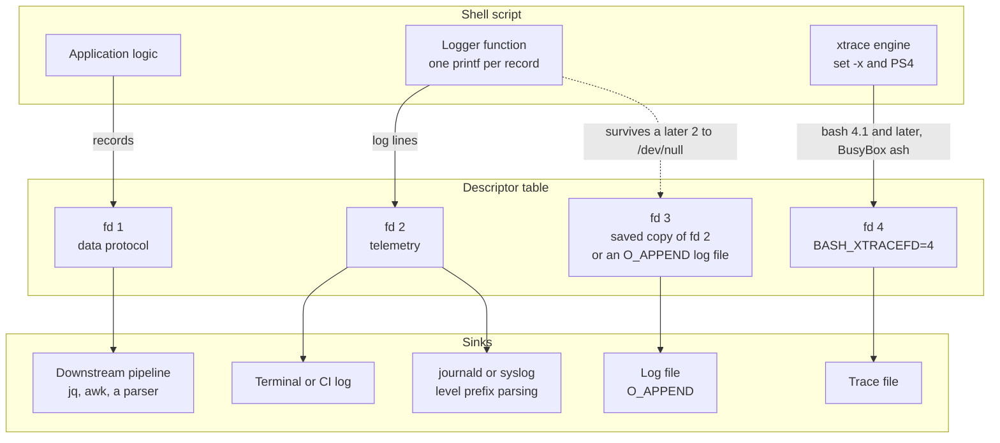

# Logging from Scripts

> [!summary] Claim
> Standard output is a script's data protocol and standard error is its telemetry channel, so robust logging keeps the two descriptors strictly apart, writes each record with one `write(2)` to an append-mode descriptor, neutralizes untrusted text before it reaches a record, and never trusts a shell feature (`%(...)T`, `BASH_XTRACEFD`, process substitution) without checking which shell and version it runs under.

Part of [Robust Scripting](README.md) in [Shell and Unix Engineering](../README.md).

## TL;DR

- Mechanism: data leaves on `fd 1`, log records leave on `fd 2` or a saved copy such as `fd 3`, and each record is one `printf` that ends in a newline (POSIX.1-2024 XCU 2.7.6 for duplication, `write()` for `O_APPEND` and `PIPE_BUF`).
- Rule: format the whole record first (timestamp, level, pid, escaped message), emit it in one `printf`, and neutralize newline, carriage return and ESC in every untrusted value (CWE-117, CWE-150).
- Trap: `exec > >(tee -a "$log") 2>&1` returns control to the script before `tee` has finished, so the shell exits first; measured here, the last lines arrive about two seconds after bash 5.3.15, bash 3.2.57 and zsh 5.9.2 have exited (as of 2026-11).
- Portability: `printf '%(...)T'` is a builtin only in bash 4.2+ and ksh93, it prints local time unless `TZ=UTC0` is set for the call, and the argument `-1` means "now" only in bash (ksh93 parses it as a date and prints January of the current year, measured), so ksh93 needs `now`; `BASH_XTRACEFD` exists only in bash 4.1+ and BusyBox ash (measured, 1.37.0); `wait` on a process substitution is documented from bash 4.4 (NEWS) and measured on 3.2.57 (fails) and 5.3.15 (works); zsh never sets `$!` for it.
- When not to use it: a loop that logs thousands of records a second, anything that needs rotation, back-pressure, sampling or trace propagation; there a compiled service or the platform's logger is the right tool.

## Mental model



Application data goes to descriptor 1 and nothing else does, so a downstream parser sees only records.
Log lines go to descriptor 2, or to a copy of it saved early as descriptor 3, so a later redirection of descriptor 2 cannot silence them.
When a descriptor was opened with `O_APPEND`, concurrent writers each append at the current end of file, so one process cannot overwrite another's records.
Under systemd the lines on descriptor 2 are read by journald, which turns a leading `<N>` into a priority, and a trace requested with `BASH_XTRACEFD` goes to its own file instead of into the log stream.

## How it works

### Descriptors, streams, and pipeline isolation

Standard output is the utility's data and standard error is its diagnostic channel (POSIX.1-2024 XCU 2.7 defines the redirections that connect them).
A downstream stage such as `jq .id` or `awk '{print $1}'` treats everything on its stdin as payload, so one progress line written to standard output breaks it.
Every logging routine therefore writes to `>&2` or to a dedicated descriptor.

`>&2` is `1>&2`: it duplicates descriptor 2 onto descriptor 1 for that one command (POSIX.1-2024 XCU 2.7.6, Duplicating an Output File Descriptor), so `printf '%s\n' "$msg" >&2` sends the text to wherever descriptor 2 points.
In the shell's runtime, this duplication is executed via `dup2(2)` or `fcntl(fd, F_DUPFD)`.
A script that will redirect descriptor 2 later saves it first:

```sh
exec 3>&2
exec 2>/dev/null
printf 'noise\n' >&2     # discarded
printf 'logged\n' >&3    # still reaches the original stderr
```

The lab proves this (`fd3_log`): stdout is exactly `data` and stderr is exactly `logged-on-fd3`, in every shell the matrix runs.
Child processes executed via `fork(2)` and `execve(2)` inherit all open file descriptors unless the `FD_CLOEXEC` flag is set via `fcntl(fd, F_SETFD, FD_CLOEXEC)`.
Scripts opening auxiliary logging descriptors should close them before invoking untrusted long-running children (`exec 3>&-`) or explicitly manage descriptor inheritance.

### The dual logging trap: `tee` pipelines and asynchronous process substitution

Dual logging means the same lines go to the console and to a file.
Two common ways to get it each cost something.

```sh
do_migration | tee -a /var/log/migration.log
```

This pipeline has three problems.
First, each command of a multi-command pipeline is in a subshell environment (POSIX.1-2024 XCU 2.13, Shell Execution Environment); as an extension "any or all commands in a pipeline may be executed in the current environment", which ksh93u+ 2012 and zsh 5.9.2 do for the last command (measured: `echo x | read v` leaves `v=x`) and bash does only with `shopt -s lastpipe` (measured; plain bash and the host dash leave `v` empty), so `do_migration` as the first stage never changes the caller's variables.
Second, the pipeline's exit status is the last command's status unless `pipefail` is set (POSIX.1-2024 XCU 2.9.2); `tee` succeeds, so a failing `do_migration` is reported as success.
The lab measures it (`tee_status`): a producer that exits 7, piped into `tee`, gives `plain=0`, and `pipefail=7` in every shell that accepts `set -o pipefail`.
`pipefail` is a POSIX.1-2024 option (XCU 2.9.2 and `set`), but shells that predate it lack it: the host dash 0.5.13.5 and Debian's dash package 0.5.12-12 both accept `set -o pipefail`, and mksh R59, ksh93u+m 1.0.10 and BusyBox 1.37.0 ash each give `pipefail=7` in the lab's `tee_status` mode (measured in the Debian matrix image, 2026-11-26); yash 2.58.1 (Alpine image) also accepts it, while posh 0.14.1 rejects it (measured, 2026-11-26), so a version number alone does not tell you; detect it with `(set -o pipefail) 2>/dev/null` instead of assuming.
Third, a stdio-based producer switches from line buffering on a terminal to block buffering on a pipe, so output reaches `tee` late; the block size is the libc's choice.

The second form redirects the whole script:

```sh
exec > >(tee -a /var/log/script.log) 2>&1
```

Process substitution `>(cmd)` forks `cmd` with the read end of a pipe (or a `/dev/fd` path) on its stdin and returns immediately.
The parent does not wait for it when the script ends.
The race is measurable.
With a consumer that sleeps two seconds before writing, `bash -c 'exec > >(sleep 2; cat >race.out); echo "last line"'` returns before `race.out` exists in bash 5.3.15, bash 3.2.57 and zsh 5.9.2 (the file is created only after the two-second sleep), and the 10-byte line arrives afterwards (measured on macOS arm64 on 2026-11-15 and again on 2026-11-26, same result in all three shells; this is a manual measurement, not a lab test).
On a terminal the late output lands after the prompt.
In a container or CI job the process tree may be torn down before the consumer flushes, which truncates the tail of the log; that outcome depends on the runner and is not measured here.

Support differs by shell and version.
The lab (`procsub_wait`) prints three facts: whether `exec 3> >(cat >/dev/null)` parses and runs, whether `$!` holds a PID afterwards, and the status of `wait "$!"`.

| Shell | `syntax` | `$!` | `wait "$!"` |
|---|---|---|---|
| bash 5.3.15 | yes | a PID | 0 (measured) |
| bash 3.2.57 (macOS) | yes | a PID | 127, `wait: pid N is not a child of this shell` (measured) |
| bash 5.3 in POSIX mode (`--posix`, or started as `sh`) | yes (measured; bash-5.1 NEWS item u: "Process substitution is now available in posix mode") | a PID | 0 (measured) |
| bash 3.2.57 in POSIX mode (`--posix`, or macOS `/bin/sh`) | no (measured) | n/a | n/a |
| zsh 5.9.2, native and `--emulate sh` | yes | 0 | 127, `wait: pid 0 is not a child of this shell` (measured) |
| ksh93u+m 1.0.10 (Debian) | yes | a PID | 0 (measured) |
| ksh93u+ 2012 (macOS) | no (measured) | n/a | n/a |
| BusyBox 1.37.0 ash (Alpine and Debian) | yes (measured) | empty | 2, from `wait ""` (measured) |
| dash, mksh, yash, posh | no (measured) | n/a | n/a |

bash gained waitable process substitutions in two steps.
The bash-4.4 NEWS item u reads "Bash now allows waiting for the most recent process substitution, since it appears as $!", and `subst.c` in 4.4 introduces `last_procsub_child`, which 4.3 and 3.2 do not have.
The bash-5.0 NEWS item a lists "The `wait' builtin can now wait for the last process substitution created", and bash-5.0 `subst.c` adds `find_procsub_child`, `wait_procsubs` and `reap_procsubs`, which the 4.4 file does not have.
Running the lab's `procsub_wait` mode in the official `bash:4.0` to `bash:4.4` images (2026-11-26) gave `syntax=yes bang=set wait=127` on 4.0, 4.1, 4.2 and 4.3 and `wait=0` on 4.4, which matches the NEWS item and the source; the lab asserts 0 from 4.4 and a non-zero status for 4.0 to 4.3.

The safe pattern restores every duplicate of the pipe's write end before it waits; closing only the named descriptor leaves descriptors 1 and 2 pointing at the pipe, `tee` never sees end of file, and `wait` hangs:

```sh
# bash 4.4+: restore, close every writer, then wait for tee to drain
exec 5>&1 6>&2                     # keep the real stdout and stderr
exec 3> >(tee -a "$log")
log_pid=$!
exec 1>&3 2>&3
# ... the script's work ...
exec 1>&5 2>&6 3>&-                # last copies of the pipe's write end are gone
wait "$log_pid"
```

Where `wait` on a process substitution is unavailable, use a FIFO and a plain background job, which POSIX guarantees `wait` can collect:

```sh
fifo=$dir/log.fifo
mkfifo "$fifo"
tee -a "$log" <"$fifo" &
tee_pid=$!
exec 5>&1 6>&2
exec >"$fifo" 2>&1
# ... the script's work ...
exec 1>&5 2>&6
wait "$tee_pid"
```

Neither pattern is exercised by the lab; the matrix-checked part is the `exec 3> >(...)` and `wait` pair above.

### Kernel atomicity: `O_APPEND`, `PIPE_BUF`, and concurrent writer collisions

`>>` opens the file with `O_APPEND` (POSIX.1-2024 XCU 2.7.3).
POSIX.1-2024 `write()` says that with `O_APPEND` "the file offset shall be set to the end of the file prior to each write and no intervening file modification operation shall occur between changing the file offset and the write operation".
That guarantee is about the offset: two writers that each opened the file themselves never write to the same position.
Without it each open file description keeps its own offset, so writers overwrite each other.
The lab shows both outcomes (`append_race`): four workers each open the file after the fork and write 100 fixed-width lines; with `>>` the file has 400 intact lines, 100 per worker, and with `>` it has at most 100 (measured: exactly 100) because every worker started at offset 0.

POSIX promises no more than the offset step for a regular file.
Whether one write of a whole record is also kept contiguous against other writers is an implementation property of the kernel and filesystem, which holds on a local filesystem in the lab run (bash 5.3.15, macOS APFS) and is not promised for network filesystems: the Linux `open(2)` page warns that "O_APPEND may lead to corrupted files on NFS filesystems if more than one process appends data to a file at once", because the client has to simulate appending and cannot do it without a race.

A record is contiguous only if it reaches the kernel in one `write(2)`.
A logger that builds the line in two `printf` calls issues two writes, and another process can write in between:

```sh
log_broken() {
  printf '[%s] ' "$1" >&2
  printf '%s\n' "$2" >&2
}
```

A single `printf` with the whole record, as in `log_line` in the lab, is one call.
Whether a shell's `printf` builtin turns that into exactly one `write(2)` is an implementation choice, not a POSIX guarantee, and no `strace` was available on the authoring host; the evidence is the `append_race` test, which would fail on a tear.

For pipes and FIFOs POSIX does state a size bound: "Write requests of {PIPE_BUF} bytes or less shall not be interleaved with data from other threads performing write operations on the same pipe or FIFO", while writes of more than `{PIPE_BUF}` bytes "may have data interleaved, on arbitrary boundaries".
The minimum `{_POSIX_PIPE_BUF}` is 512 bytes; Linux's `PIPE_BUF` is 4096 (pipe(7)), and `getconf PIPE_BUF /` printed 512 on macOS and 4096 on Linux in the shell matrix.
`PIPE_BUF` belongs to the operating system, not the shell, so the same script is safe on Linux up to 4096 bytes per record and only up to 512 on macOS.

### Telemetry: timestamps, levels, and structured formats

Timestamps use UTC and the RFC 3339 profile of ISO 8601, for example `2026-11-15T07:45:00Z`; RFC 5424 defines its syslog TIMESTAMP as "derived from [RFC3339]" (section 6.2.3).

`$(date -u +%Y-%m-%dT%H:%M:%SZ)` forks a subshell and execs `date` for every record.
Measured on macOS arm64 with bash 5.3.15 (loop overhead included), 1000 iterations took 2.966 s on 2026-11-15, about 3.0 ms each, and 7.153 s on 2026-11-26 on a busier host, against 0.017 s and 0.025 s for 1000 `printf -v t '%(%Y-%m-%dT%H:%M:%SZ)T' -1`, about 17 to 25 microseconds each.
The fork cost varies with host load by more than a factor of two, while the builtin stays two orders of magnitude cheaper in both runs.
Linux costs differ and were not measured here.

`printf '%(datefmt)T' -1` was added in bash 4.2 (NEWS item m: "The printf builtin has a new %(fmt)T specifier") and is also in ksh93.
The argument is not portable between them: bash reads `-1` as the current time and, from bash 4.3 (NEWS item dd), also uses the current time when no argument is given, while ksh93 parses its argument as a date string, so `-1` printed January of the current year with today's day and time on both ksh93u+ 2012 and ksh93u+m 1.0.10 (measured, 2026-11-26: `2026-01-26T15:33:05Z` for `2026-11-26T15:33:05Z`); ksh93 needs `now` or no argument, and the lab's `timestamp_now` mode passes `-1` to bash and `now` to everything else.
It formats in the local zone, so the literal `Z` is wrong unless the zone is UTC; measured with `TZ=America/New_York` on bash 5.3.15, `printf '%(%H:%M:%SZ)T' -1` printed `04:38:46Z` while `TZ=UTC0 printf ...` printed `09:38:46Z`, the true UTC time.
The lab (`timestamp_now`) forces the local zone to `EST5`, which needs no tzdata, and checks that the printed date and hour equal `date -u`; a builtin that ignored the override would be five hours behind and fail, and so does ksh93 given `-1`, whose month is wrong.
bash 5.0 added `$EPOCHSECONDS` and `$EPOCHREALTIME` (NEWS items b and c).
zsh has neither until `zmodload zsh/datetime`, which then provides `$EPOCHSECONDS`, `$EPOCHREALTIME` and `strftime` (measured: `EPOCHREALTIME` unset before loading and set after, `strftime "%Y" 0` printed 1969 after loading, because epoch 0 is still 1969 in a zone west of UTC).
mksh R59 also sets `$EPOCHREALTIME` (measured in both matrix images), and BusyBox 1.37.0 ash sets both variables in Debian's build, while Alpine's build left `EPOCHREALTIME` empty and printed microseconds in `EPOCHSECONDS` (measured, 2026-11-26); yash 2.58.1 and posh 0.14.1 have neither.
POSIX sh has no builtin, so `date` or the log daemon's timestamp is the fallback.

Levels follow the eight RFC 5424 severities: 0 Emergency, 1 Alert, 2 Critical, 3 Error, 4 Warning, 5 Notice, 6 Informational, 7 Debug (section 6.2.1).
POSIX `logger` names them `emerg`, `alert`, `crit`, `err`, `warning`, `notice`, `info`, `debug`.

Choose `logfmt` or one-line JSON.
`logfmt` is `key=value` pairs; any value that is empty or contains a space, quote or `=` must be double-quoted with inner quotes and backslashes escaped.
The lab (`format_logfmt`) leaves `ok` bare and prints `cache "sync" done` as `msg="cache \"sync\" done"`.
JSON needs backslash and double quote escaped and every control character U+0000 through U+001F removed or escaped (RFC 8259 section 7, "the characters that MUST be escaped").
The lab (`format_json`) escapes `\` and `"`, replaces newline, carriage return and tab with spaces, and deletes the other C0 controls; `say "hi" \ done` becomes `"msg":"say \"hi\" \\ done"`.
One physical line per record is what keeps a record inside one atomic write and one journal entry.

### System integration: `logger(1)` and the systemd journal

POSIX.1-2024 `logger` is `logger [-i] [-f file] [-p priority] [-t tag] [string...]`, with `-f`, `-i`, `-p` and `-t` added by Austin Group Defect 917 in Issue 8.
Only the facilities `user` and `local0` to `local7` are required, with the eight levels above; the default priority is `user.notice`, the default tag is unspecified, and the destination is implementation-defined.
`daemon.err` is therefore not portable; use `user.err` or a `local` facility.
`logger` hands timestamping and forwarding to the system log daemon; macOS `/usr/bin/logger` accepts the POSIX options (usage `[-is] [-f file] [-p pri] [-t tag] [message ...]`), and so does util-linux 2.41.5 `logger` on Debian, but BusyBox 1.37.0 `logger` has no `-i` or `-f` (usage `[-s] [-t TAG] [-p PRIO] [MESSAGE]`, measured on Alpine and Debian), so on Alpine stick to `-p` and `-t`.

When a service's `StandardOutput=` or `StandardError=` is `journal` or `kmsg`, systemd reads each line and, with `SyslogLevelPrefix=` true (the default), strips a leading level prefix and records the priority (systemd.exec).
The prefixes are `<0>` to `<7>` as defined by `SD_EMERG` to `SD_DEBUG` in sd-daemon(3), and "a line that is not prefixed will be logged at the default log level SD_INFO".
This is journald behavior, not shell behavior: the lab proves only that the probe computes and emits the right prefix for each level name (`systemd_prefix`), not that journald parses it.

```sh
printf '<6>Backup process initialized\n' >&2
printf '<4>Storage latency exceeds threshold: %d ms\n' "$latency" >&2
printf '<3>Backup failed: connection reset\n' >&2
```

### Execution trace separation: `BASH_XTRACEFD`

`set -x` writes each expanded command, prefixed by `PS4`, to standard error (POSIX.1-2024 XCU 2.5.3 for `PS4`, `set -x`).
In a script whose standard error carries log records, the trace corrupts them.
bash 4.1 added `BASH_XTRACEFD` (NEWS: "when set to an integer bash will write xtrace output to that file descriptor"):

```sh
exec 4>"$trace_file"
BASH_XTRACEFD=4
set -x
: probe_traced_command
set +x
exec 4>&-
```

The lab (`xtrace_separation`) runs exactly this sequence in every shell and checks where the trace went.
bash 4.1+ writes `+ : probe_traced_command` to the file and nothing to stderr; bash 3.2.57 ignores the variable and writes the trace to stderr and nothing to the file (both measured).
BusyBox 1.37.0 ash honors `BASH_XTRACEFD` as a bash-compatibility feature: the trace went to the file and stderr stayed empty, in both the Alpine and the Debian build (measured, 2026-11-26).
zsh 5.9.2, ksh93u+ 2012, ksh93u+m 1.0.10, mksh R59, yash 2.58.1 and posh 0.14.1 leave the trace on stderr (measured); zsh has no `XTRACEFD` (the variable has no effect, measured).
Assignment to `BASH_XTRACEFD` is a plain assignment, so other shells run the probe unchanged and simply ignore it.

## Numbers and limits

| Quantity | Value | Source |
|---|---|---|
| Minimum `{_POSIX_PIPE_BUF}` | 512 bytes | pipe(7): "POSIX.1 requires PIPE_BUF to be at least 512 bytes" |
| Linux `PIPE_BUF` | 4096 bytes | pipe(7); `getconf PIPE_BUF /` in the shell matrix |
| macOS `PIPE_BUF` | 512 bytes | `getconf PIPE_BUF /` in the shell matrix |
| Linux default pipe capacity | 65536 bytes (16 pages); lower since Linux 4.5 when a user exceeds `pipe-user-pages-soft` | pipe(7) |
| macOS pipe capacity | starts at 16 KiB and grows to 64 KiB (65536 measured) | shell matrix |
| Syslog severities and facilities | 0 to 7 and 0 to 23 (`local7`) | RFC 5424 section 6.2.1 |
| `logger` options in POSIX | `-f`, `-i`, `-p`, `-t`; facilities `user`, `local0` to `local7`; default `user.notice` | POSIX.1-2024 `logger`, Defect 917 |
| `printf '%(fmt)T'` | bash 4.2 and ksh93; no argument means now from bash 4.3 | bash NEWS (4.2 section, item m; 4.3 section, item dd) |
| `BASH_XTRACEFD` | bash 4.1; also BusyBox 1.37.0 ash | bash NEWS (4.1 section, item o); BusyBox measured in the shell matrix images |
| `$EPOCHSECONDS`, `$EPOCHREALTIME` | bash 5.0 | bash-5.0 NEWS items b and c |
| `wait` on the last process substitution | bash 4.4 NEWS item; bash 5.0 NEWS item a | bash NEWS; 3.2.57 and 5.3.15 measured |
| `$(date -u ...)` per record | 2.966 s per 1000 (about 3.0 ms) on 2026-11-15; 7.153 s on 2026-11-26 | measured, macOS arm64, bash 5.3.15, one run each, load-sensitive |
| `printf -v t '%(...)T' -1` per record | 0.017 s per 1000 (about 17 microseconds) on 2026-11-15; 0.025 s on 2026-11-26 | same runs |
| `append_race`, 4 workers x 100 lines | 400 intact lines with `>>`, 100 with `>` | lab, bash 5.3.15 on macOS |
| systemd level prefixes | `<0>` to `<7>`; unprefixed lines are `SD_INFO` | sd-daemon(3) |

## Portability

Cells marked "measured" were produced on the authoring host (macOS arm64: bash 3.2.57, bash 5.3.15, zsh 5.9.2, dash 0.5.13.5, ksh93u+ 2012) or, during fact-checking on 2026-11-26, by running the lab's probe modes in the shell matrix images (Debian 13: dash 0.5.12, bash, zsh, ksh93u+m 1.0.10, mksh R59, posh 0.14.1, BusyBox 1.37.0; Alpine 3.22: BusyBox 1.37.0, bash, zsh, mksh, yash 2.58.1).
Every cell was measured; the shell matrix re-runs the lab's assertions for each column (as of 2026-11).

| Behavior | POSIX.1-2024 | bash 3.2 | bash 5.3 | zsh native | zsh `--emulate sh` | dash | ksh93 | mksh | yash | posh | BusyBox ash |
|---|---|---|---|---|---|---|---|---|---|---|---|
| Builtin `printf '%(...)T'` | no | no, "invalid format character" (measured) | yes (measured) | no, "%(: invalid directive" (measured) | no (measured) | no, "%(: invalid directive", status 2 (measured) | yes on 93u+ 2012 and 93u+m 1.0.10, but `-1` reads as January, use `now` (measured) | no (measured) | no, "not a valid conversion specifier" (measured) | no, "invalid conversion specification" (measured) | no (measured) |
| `TZ=UTC0` honored by that builtin | n/a | n/a | yes (measured) | n/a | n/a | n/a | yes, 93u+m (measured) | n/a | n/a | n/a | n/a |
| `BASH_XTRACEFD` moves the trace | no | ignored (measured) | yes (measured) | no (measured) | no (measured) | no (measured) | no, 93u+ and 93u+m (measured) | no (measured) | no (measured) | no (measured) | yes, 1.37.0 (measured) |
| `$EPOCHREALTIME` | no | unset (measured) | set (measured) | unset until `zmodload zsh/datetime` (measured) | unset (measured) | unset (measured) | unset, 93u+ (measured) | set (measured) | unset (measured) | unset (measured) | set in Debian's 1.37.0; empty in Alpine's (measured) |
| `exec 3> >(cmd)` parses | no | yes; no in POSIX mode (measured) | yes, also in POSIX mode since bash 5.1 (measured) | yes (measured) | yes (measured) | no (measured) | no on macOS 93u+ 2012, where `<(cmd)` works and `>(cmd)` fails (measured); 93u+m yes (measured) | no (measured) | no (measured) | no (measured) | yes, 1.37.0 (measured) |
| `wait "$!"` after it | n/a | 127 (measured) | 0 (measured) | 127, `$!` is 0 (measured) | 127 (measured) | n/a | 0 on 93u+m (measured) | n/a | n/a | n/a | 2, `$!` is empty (measured) |
| `set -o pipefail` | yes | yes (measured) | yes (measured) | yes (measured) | yes (measured) | accepted by the host dash 0.5.13.5 and Debian dash 0.5.12-12 (measured) | yes, 93u+m (measured) | yes (measured) | yes, 2.58.1 (measured) | no, 0.14.1 (measured) | yes (measured) |
| `exec 3>&2` saved copy | yes (XCU 2.7.6) | yes (measured) | yes (measured) | yes (measured) | yes (measured) | yes (measured) | yes, 93u+m (measured) | yes (measured) | yes (measured) | yes (measured) | yes (measured) |
| `>>` keeps concurrent records whole | offset step only | yes (measured) | yes (measured) | yes (measured) | yes (measured) | yes (measured) | yes, 93u+m (measured) | yes (measured) | yes (measured) | yes (measured) | yes (measured) |

Utilities and platforms:

| Behavior | Linux (GNU) | macOS | BusyBox |
|---|---|---|---|
| `PIPE_BUF` | 4096 | 512 | same as the kernel it runs on: 4096 on Linux |
| `logger` POSIX options `-i -f -p -t` | yes, util-linux 2.41.5 `--help` (measured) | yes (`/usr/bin/logger` usage line) | no `-i` or `-f`, 1.37.0 usage `[-s] [-t TAG] [-p PRIO] [MESSAGE]` (measured) |
| `tr -d '\001-\010\013\014\016-\037\177'` | yes, no ESC left by `neutralize` on Debian (measured) | yes (measured, used by `neutralize`) | yes, no ESC left on Alpine (measured) |

The `PIPE_BUF` row follows the operating system, not the shell, so the table above does not repeat it per shell.
Process substitution in yash is process redirection, not substitution: `cat <(echo a) <(echo b)` prints only `b` and yash rejects it in POSIX mode (shell matrix).
BusyBox 1.37.0 ash does run `cat <(echo a)` and `exec 3> >(cat >file)` (both images, measured), but it does not set `$!` for the substitution, so a script cannot wait for it there.

## Worked example

The [lab](../labs/13-logging-from-scripts/) has 13 tests: descriptor separation and contamination, a saved `fd 3`, builtin versus forked timestamps, UTC correctness, process substitution and `wait`, `O_APPEND` under four concurrent writers, pipeline status through `tee`, logfmt and JSON escaping, systemd level prefixes, log injection, and `BASH_XTRACEFD`.
The block below is a simplified excerpt of `logging-probe.sh`: the helper functions and four modes, with usage text and the other modes left out.

```sh
# neutralize TEXT: newline, CR and tab become spaces; other C0 controls (including ESC) and DEL go.
neutralize() {
  printf '%s' "$1" | tr '\n\r\t' '   ' | tr -d '\001-\010\013\014\016-\037\177'
}

json_escape() {
  neutralize "$1" | sed -e 's/\\/\\\\/g' -e 's/"/\\"/g'
}

case $mode in
  procsub_wait)
    if (eval 'exec 3> >(cat >/dev/null)') 2>/dev/null; then
      eval 'exec 3> >(cat >/dev/null)'
      set +u
      sub_pid=$!
      set -u
      exec 3>&-
      case $sub_pid in
        '') bang=empty ;;
        0) bang=zero ;;
        *) bang=set ;;
      esac
      if wait "$sub_pid" 2>/dev/null; then
        wait_st=0
      else
        wait_st=$?
      fi
      printf 'syntax=yes bang=%s wait=%s\n' "$bang" "$wait_st"
    else
      printf 'syntax=no\n'
    fi
    ;;

  append_race)
    file=${1:?usage: logging-probe.sh append_race FILE append|trunc}
    how=${2:?usage: logging-probe.sh append_race FILE append|trunc}
    workers=4
    lines=100
    w=1
    while [ "$w" -le "$workers" ]; do
      (
        case $how in
          append) exec 3>>"$file" ;;
          trunc) exec 3>"$file" ;;
          *) exit 2 ;;
        esac
        i=1
        while [ "$i" -le "$lines" ]; do
          printf 'w=%02d seq=%03d pad=xxxxxxxxxxxxxxxxxxxx\n' "$w" "$i" >&3
          i=$((i + 1))
        done
      ) &
      w=$((w + 1))
    done
    wait
    printf 'workers=%d lines_each=%d\n' "$workers" "$lines"
    ;;

  tee_status)
    /bin/sh -c 'exit 7' | tee /dev/null >/dev/null
    plain=$?
    if (set -o pipefail) 2>/dev/null; then
      pf=$(
        set -o pipefail
        /bin/sh -c 'exit 7' | tee /dev/null >/dev/null
        echo "$?"
      )
    else
      pf=unsupported
    fi
    printf 'plain=%s pipefail=%s\n' "$plain" "$pf"
    ;;

  format_json)
    level=${1:-INFO}
    msg=${2-"job execution finished"}
    escaped=$(json_escape "$msg")
    printf '{"ts":"2026-11-15T00:00:00Z","level":"%s","pid":%s,"msg":"%s"}\n' "$level" "$$" "$escaped"
    ;;
esac
```

The suite ran on bash 5.3.15 (`LAB_SHELL=bash`, macOS arm64, 2026-11-26, after the fact-check corrected the BusyBox, ksh93 and bash POSIX-mode branches):

```
$ LAB_SHELL=bash bats --tap labs/13-logging-from-scripts/logging.bats
1..13
ok 1 data goes to stdout and every log line goes to stderr
ok 2 log lines written to stdout contaminate the data stream a parser reads
ok 3 a saved copy of stderr on fd 3 keeps logging after fd 2 is redirected away
ok 4 printf %(...)T is a builtin in bash 4.2+ and ksh93 only
ok 5 the UTC timestamp is correct under a non-UTC local zone, via builtin or date
ok 6 process substitution: parse, $! and wait differ by shell and bash version
ok 7 O_APPEND keeps every concurrent record whole; a plain > open loses most of them
ok 8 a failing producer piped into tee reports 0 unless pipefail is on
ok 9 logfmt leaves plain tokens bare and quotes anything with a space, quote or equals sign
ok 10 JSON output escapes quote and backslash and stays on one line for control characters
ok 11 the sd-daemon prefix carries the RFC 5424 severity computed from the level name
ok 12 log injection: raw input forges a second record and carries ESC; sanitized does not
ok 13 BASH_XTRACEFD moves the trace off stderr in bash 4.1+ and BusyBox ash only
```

Individual probe runs on the same host:

```
$ bash logging-probe.sh fd_clean >c.data 2>c.log; cat c.data c.log
{"record_id":1001,"status":"active"}
{"record_id":1002,"status":"pending"}
2026-11-15T00:00:00Z [INFO] [pid:84413] starting data generation
2026-11-15T00:00:00Z [INFO] [pid:84413] completed data generation

$ bash logging-probe.sh procsub_wait;       /bin/bash logging-probe.sh procsub_wait;   zsh logging-probe.sh procsub_wait
syntax=yes bang=set wait=0
syntax=yes bang=set wait=127
syntax=yes bang=zero wait=127

$ bash logging-probe.sh timestamp_now;      dash logging-probe.sh timestamp_now
engine=printf ts=2026-11-15T09:42:12Z
engine=date ts=2026-11-15T09:42:12Z

$ bash logging-probe.sh format_json WARN 'say "hi" \ done'
{"ts":"2026-11-15T00:00:00Z","level":"WARN","pid":84461,"msg":"say \"hi\" \\ done"}

$ bash logging-probe.sh append_race a.log append; wc -l < a.log; bash logging-probe.sh append_race t.log trunc; grep -c '^w=' t.log
workers=4 lines_each=100
     400
workers=4 lines_each=100
100
```

## Pitfalls

> [!warning] Asynchronous `tee` process substitution exit race
> Trigger: `exec > >(tee -a "$LOGFILE") 2>&1` with no restore of the descriptors and no `wait`.
> Symptom: the last lines appear after the shell has exited (about two seconds late for a two-second consumer, in bash 5.3.15, bash 3.2.57 and zsh 5.9.2), so they land after the prompt or after the job's own end marker; if the process tree is torn down first they can be lost.
> A second symptom is a hang: closing only the named descriptor (`exec 3>&-`) while descriptors 1 and 2 still point at the pipe means `tee` never gets end of file and `wait` blocks.
> Fix: save the real stdout and stderr first, restore them, close the last copy of the write end, then `wait "$log_pid"` (bash 4.4+), or use a FIFO and a plain background `tee` that `wait` can collect.
> Portability: bash 3.2.57 prints `wait: pid N is not a child of this shell` and returns 127, zsh and BusyBox 1.37.0 ash set no usable `$!` for the substitution, and dash, mksh, yash and posh reject the syntax (measured).

> [!warning] Pipeline exit status masked by `tee`
> Trigger: `command | tee -a "$LOGFILE"` without `pipefail`.
> Symptom: `command` exits non-zero and the pipeline still reports 0, so a deploy script or cron job carries on (measured by the lab: producer exit 7, `plain=0`).
> Fix: `set -o pipefail` where `(set -o pipefail) 2>/dev/null` succeeds (POSIX.1-2024 XCU 2.9.2), or write the log through a descriptor instead of a pipe, or capture the producer's status separately.
> Portability: shells that predate POSIX.1-2024 may reject `pipefail`, so the feature test is required, not optional.

> [!warning] Data stream pollution via stdout logging
> Trigger: `echo "starting"` in a script whose stdout feeds `jq`, `awk` or a parser.
> Symptom: the parser fails on the first non-record line; the lab's `fd_polluted` mode produces four stdout lines where the data has two.
> Fix: every logging function writes to `>&2` or a saved `fd 3`.

> [!warning] Torn log lines from multi-write records
> Trigger: one record built by several `printf` calls, or a record longer than `PIPE_BUF` written to a shared pipe.
> Symptom: concurrent writers interleave fragments, and the log has lines that are halves of two messages.
> Fix: build the whole record, newline included, and emit it with one `printf` to an `O_APPEND` descriptor; keep records under 512 bytes if the sink is a pipe that must also work on macOS.
> Do not rely on this over NFS: Linux `open(2)` warns that `O_APPEND` appends can corrupt a file there.

> [!warning] UTC timestamps that are local time
> Trigger: `printf '%(%Y-%m-%dT%H:%M:%SZ)T' -1` in a zone other than UTC, or the same line under ksh93.
> Symptom: the record says `Z` but carries local time; measured here with `TZ=America/New_York` as `04:38:46Z` when UTC was `09:38:46Z`, so every record is off by the zone's offset and correlation across hosts breaks.
> Under ksh93 the `-1` is parsed as a date and the month becomes January (measured on 93u+ 2012 and 93u+m 1.0.10).
> Fix: `TZ=UTC0 printf ...` (bash 5.3.15 and ksh93u+m 1.0.10 honor it, measured), with `-1` for bash and `now` for ksh93, or `date -u`, and test the date and hour against `date -u` as the lab does.

> [!warning] Secret leakage through `set -x`
> Trigger: `set -x` around a command that carries a token, such as `curl -H "Authorization: Bearer $TOKEN"`.
> Symptom: the expanded command line, token included, goes to standard error and from there to CI logs.
> Fix: turn tracing off around secrets (`set +x`), pass them on stdin or in a file (`curl -K`), and in bash 4.1+ send the trace to `BASH_XTRACEFD` so it never joins the log stream.
> BusyBox ash honors the same variable (measured, 1.37.0); the other shells have no equivalent, so `set -x` there always writes to stderr.

> [!warning] Log injection and escape-sequence poisoning
> Trigger: logging a user-supplied value that contains a newline, carriage return or ESC.
> Symptom: the value forges a second record (CWE-117) or drives the terminal of whoever reads the log (CWE-150).
> The nginx 0.7.64 log writer did not sanitize non-printable characters (CVE-2009-4487, which NVD describes as allowing a window title change or possibly command execution through a terminal escape in an HTTP request), and Linux Audit before 2.4.4 did not sanitize escape characters in filenames (CVE-2015-5186).
> Fix: neutralize before formatting, as the lab's `neutralize` does: map newline, carriage return and tab to spaces and delete the other control characters; test with the exact output, because a test that only counts lines passes with the ESC byte still in place.

> [!warning] `sed` or `tr` escapes that only one userland understands
> Trigger: stripping ESC with `sed 's/\x1b//g'`.
> Symptom: `\x` escapes in `sed` are an extension of some implementations; the macOS `sed` on the authoring host accepted it, but POSIX does not define it, so another userland can leave the byte in place or delete the literal text `x1b`.
> Fix: use `tr -d` with octal escapes, which POSIX defines, as `neutralize` does.

## Security and robustness

Three threats matter: log injection (CWE-117), terminal escape injection (CWE-150), and disclosure of secrets.

Log injection needs only an unescaped newline.
A username of `admin` followed by a newline and `2026-11-15T00:00:00Z [INFO] User admin elevated` produces two records in a raw logger; the lab's `sanitize_cwe117 raw` shows the second line, and `sanitized` keeps one line and no ESC byte, with the exact output `user_action=normal [ERROR] forged [2Jx` for the test payload.
Neutralize every value from a request, an argument, a filename or a database before formatting it.
Deleting the control characters is lossy by design; if the original bytes must be kept, escape them (`\n`, `\x1b`) instead and say so in the format.

An ESC in a log can clear the screen, move the cursor, change a window title, or reach terminal features such as OSC clipboard sequences.
Operators open logs with `cat`, `tail -f` and `less -R`, so strip ESC (`\033`) at write time and do not rely on the reader to cope.

`set -x` expands every variable into the log, so a secret in an argument is a secret in the trace.
Pass secrets on stdin, in a mode-0600 file, or in an environment variable the tool reads itself, and keep traces out of shared logs.

Log files hold IP addresses, user ids and architecture details.
Set `umask 077` (or `027` for a group) before the first write and create the file yourself; do not log to a predictable path in `/tmp`.
Use `mktemp` for scratch files and a directory only the service user can write for logs.

## The principal's view

Logging is the contract between a script and whoever operates it, so treat it as an interface.
Three rules hold up under review.
Standard output carries data and nothing else, and every script that prints progress there cannot be composed.
Records are structured and one line each, so the aggregator can parse them without regular expressions that break on a rewording.
The script writes to standard error and delegates transport, rotation and retention to the platform: journald for a unit, the container runtime for a container, `logger` where neither exists.

The trade-off is portability against convenience.
`printf '%(...)T'` saves a fork per record but exists only in bash 4.2+ and ksh93, takes `-1` in one and `now` in the other, and macOS still ships bash 3.2.57, so a script that must run there needs the `date -u` fallback and the version check the lab uses.
`BASH_XTRACEFD` and process substitution have the same shape: useful on a modern bash, absent or different elsewhere.
Decide by feature test (`(printf '%(%Y)T' -1) 2>/dev/null`, `(set -o pipefail) 2>/dev/null`), never by the shell's name or a platform file.

Leave shell when the script needs asynchronous shipping with back-pressure, sampling, per-request context or trace propagation, log-level changes at runtime, redaction of structured fields, or a sustained rate beyond what a fork or an extra `printf` can pay for.
At that point a compiled service with a real logging library is the cheaper, safer tool; the cost of staying in shell is the races and portability gaps above, which every new feature widens.

## Interview questions

> [!question] L5: Why must diagnostic logging go to file descriptor 2 rather than file descriptor 1?
>
> > [!success]- Answer
> > Standard output is the data a downstream stage reads, and standard error is the channel for operator-facing messages.
> > A progress line on standard output reaches `jq` or `awk` as if it were a record, and the parser fails on it.
> > Writing logs with `>&2` keeps the pipeline composable and the messages visible to the operator.
> >
> > Follow-up: How does a script keep logging to the original stderr after it redirects `fd 2` to `/dev/null` for one command?
> > Answer: save it first with `exec 3>&2` and log with `>&3`, which the lab's `fd3_log` mode shows.

> [!question] L5: What does `O_APPEND` guarantee when several processes append to one log file with `>>`?
>
> > [!success]- Answer
> > POSIX.1-2024 `write()` says the offset is set to the end of the file before each write with no intervening modification, so two writers that each opened the file never write at the same position.
> > Without it each open file description keeps its own offset, and the writers overwrite each other; the lab shows 400 intact lines with `>>` and 100 with `>`.
> > The guarantee covers the offset step, so a record built from two `printf` calls is two writes and can still be split by another writer.
> >
> > Follow-up: What changes if the file is on NFS?
> > Answer: Linux `open(2)` warns that concurrent `O_APPEND` appends can corrupt the file there, because the client simulates appending with a race.

> [!question] L6: Predict the output of this script under macOS `/bin/bash` 3.2.57 and under bash 5.3.
> ```sh
> #!/bin/bash
> exec 3> >(cat >/dev/null)
> log_pid=$!
> exec 3>&-
> wait "$log_pid"
> echo "wait_status=$?"
> ```
>
> > [!success]- Answer
> > bash 3.2.57 prints `wait: pid N is not a child of this shell` on stderr and `wait_status=127`: `$!` holds the process substitution's PID, but the substitution is not in the job table.
> > bash 5.3 prints `wait_status=0`.
> > The NEWS files date the change: bash 4.4 allows waiting for the most recent process substitution because it appears as `$!`, and bash 5.0 lists that `wait` can wait for it.
> > In zsh the same script gives 127 for a different reason: `$!` stays 0, so `wait 0` fails.
> >
> > Follow-up: How do you wait for a log writer portably?
> > Answer: use a FIFO with a plain background `tee`, restore the descriptors, then `wait` its PID.

> [!question] L6: Debug this script: name the operational and security defects.
> ```sh
> #!/bin/bash
> set -x
> LOG_FILE="/tmp/deploy.log"
> exec > "$LOG_FILE" 2>&1
>
> echo "Starting deploy for customer: $1"
> curl -H "Authorization: Bearer $API_SECRET" https://api.internal/deploy
> echo "Deployment finished successfully"
> ```
>
> > [!success]- Answer
> > `set -x` writes the expanded `curl` line, token included, into the log.
> > `/tmp/deploy.log` is a predictable path in a shared directory, so another user can pre-create it as a symlink or read it; use `mktemp` or a private directory and `umask 077`.
> > `$1` goes into the log unescaped, so a newline in it forges a record (CWE-117) and an ESC drives the reader's terminal (CWE-150).
> > Nothing checks `curl`'s status, so the script always prints "finished successfully".
> > Redirecting both descriptors to a file leaves the operator and a container's log collector with nothing.
> >
> > Follow-up: Rewrite it with a saved descriptor, `BASH_XTRACEFD`, `mktemp` and `neutralize`-style escaping.

> [!question] L6: How does `BASH_XTRACEFD` keep traces out of the log, and where does it not work?
>
> > [!success]- Answer
> > bash 4.1 added the variable; when it holds a file descriptor number, `set -x` writes to that descriptor instead of standard error.
> > The lab runs the same sequence in every shell: bash 4.1+ puts `+ : probe_traced_command` in the trace file and leaves stderr empty, and so does BusyBox 1.37.0 ash, while bash 3.2.57, zsh, ksh93, mksh, yash and posh leave the trace on stderr (measured).
> > A script that must stay portable cannot assume the variable and should keep `set -x` off in production or confine it to a subshell whose stderr is redirected.
> >
> > Follow-up: What does `XTRACEFD` do in zsh 5.9.2?
> > Answer: nothing; it was measured to leave the trace on stderr.

> [!question] L6: How does journald get a severity from a shell script, and what controls it?
>
> > [!success]- Answer
> > When `StandardOutput=` or `StandardError=` is `journal` or `kmsg`, systemd reads each line and, with `SyslogLevelPrefix=` true (the default), strips a leading `<N>` and sets the priority (systemd.exec).
> > The prefixes `<0>` to `<7>` are the RFC 5424 severities, defined as `SD_EMERG` to `SD_DEBUG` in sd-daemon(3), and an unprefixed line is `SD_INFO`.
> > It is journald behavior, so the same script prints literal `<3>` on a terminal.
> >
> > Follow-up: What `journalctl` option filters by priority?
> > Answer: `-p`, for example `journalctl -u unit -p warning`, which shows warning and more severe.

> [!question] L7: Diagnose why a batch job's single-`printf` records still tear on a shared pipe.
>
> > [!success]- Answer
> > For a pipe or FIFO POSIX requires atomicity only up to `{PIPE_BUF}` bytes, which is 4096 on Linux and 512 on macOS, and says writes above it "may have data interleaved, on arbitrary boundaries".
> > So a JSON record above the limit can tear however it is printed.
> > Second, an external tool in the chain may use stdio and flush at its own buffer boundary, splitting a record.
> > Third, if the sink is a regular file on NFS, `O_APPEND` offers no such guarantee at all.
> > Also check that the shell's `printf` really emits one write for the record; the lab's `append_race` mode is the test.
> >
> > Follow-up: How do you get zero tearing for large payloads?
> > Answer: one writer per sink (a single process or a logging daemon that serializes), or length-prefixed records over a socket, instead of many writers sharing a pipe.

> [!question] L7: Design a logging standard for scripts that run on macOS laptops (bash 3.2) and Linux containers.
>
> > [!success]- Answer
> > Standard output is reserved for data; every record goes to standard error as one line.
> > Terminals get `logfmt`; containers get single-line JSON, chosen by `[ -t 2 ]` and an explicit environment switch.
> > Timestamps come from `TZ=UTC0 printf '%(...)T' -1` in bash (`now` in ksh93, which misreads `-1`) where `(printf '%(%Y)T' -1) 2>/dev/null` succeeds and from `date -u` otherwise, and a test compares the hour with `date -u` under a non-UTC `TZ`.
> > Every untrusted value passes through one neutralizing function; the standard bans `sed` escapes and uses `tr -d` with octal.
> > Under systemd the logger emits `<N>` prefixes and leaves timestamps to journald.
> > Anything needing rotation, shipping or tracing leaves shell.
> >
> > Follow-up: How is the standard enforced in CI?
> > Answer: run ShellCheck, run the bats suite under the matrix shells the fleet really has, and fail on `echo` to stdout in modules marked as filters.

## Related

Prerequisites: [[Configuration-Precedence]]

Next: [[Dry-Run-and-Apply]]

See also: [[File-Descriptors-and-Open-File-Descriptions]], [[Descriptor-Duplication-and-Closing]], [[stdio-Buffering-and-stdbuf]], [[xtrace-PS4-and-BASH_XTRACEFD]], [[Exit-Code-Contracts]], [[Error-Handling-Patterns]], [[Cleanup-Traps-and-Re-Raising-Signals]], [[dev-fd-and-dev-stdin]]

## Further reading

- [POSIX.1-2024 logger](https://pubs.opengroup.org/onlinepubs/9799919799/utilities/logger.html) - the required options, the `user` and `local0` to `local7` facilities, the eight levels, and the Defect 917 change history.
- [POSIX.1-2024 write](https://pubs.opengroup.org/onlinepubs/9799919799/functions/write.html) - the `O_APPEND` offset rule and the `{PIPE_BUF}` atomicity rule, with the rationale.
- [POSIX.1-2024 Shell Command Language](https://pubs.opengroup.org/onlinepubs/9799919799/utilities/V3_chap02.html) - redirection (2.7), pipelines and `pipefail` (2.9.2), and the shell execution environment (2.13).
- [pipe(7)](https://man7.org/linux/man-pages/man7/pipe.7.html) - Linux `PIPE_BUF`, pipe capacity and the atomic-write rules.
- [open(2)](https://man7.org/linux/man-pages/man2/open.2.html) - the `O_APPEND` caveat on NFS.
- [RFC 5424](https://www.rfc-editor.org/rfc/rfc5424.html) - severities 0 to 7, facilities, and the TIMESTAMP derived from RFC 3339.
- [systemd.exec](https://www.freedesktop.org/software/systemd/man/latest/systemd.exec.html) - `SyslogLevelPrefix=` and when it applies.
- [sd-daemon(3)](https://www.freedesktop.org/software/systemd/man/latest/sd-daemon.html) - the `<N>` prefixes and the default level for unprefixed lines.
- [GNU bash NEWS and source](https://ftp.gnu.org/gnu/bash/) - the 4.1, 4.2, 4.3, 4.4, 5.0 and 5.1 items cited above and `last_procsub_child` in 4.4 `subst.c`.
- [CWE-117](https://cwe.mitre.org/data/definitions/117.html) and [CWE-150](https://cwe.mitre.org/data/definitions/150.html) - the log injection and escape-sequence classes.
- [CVE-2009-4487](https://nvd.nist.gov/vuln/detail/CVE-2009-4487) and [CVE-2015-5186](https://nvd.nist.gov/vuln/detail/CVE-2015-5186) - nginx and Linux Audit logging unsanitized control characters.
