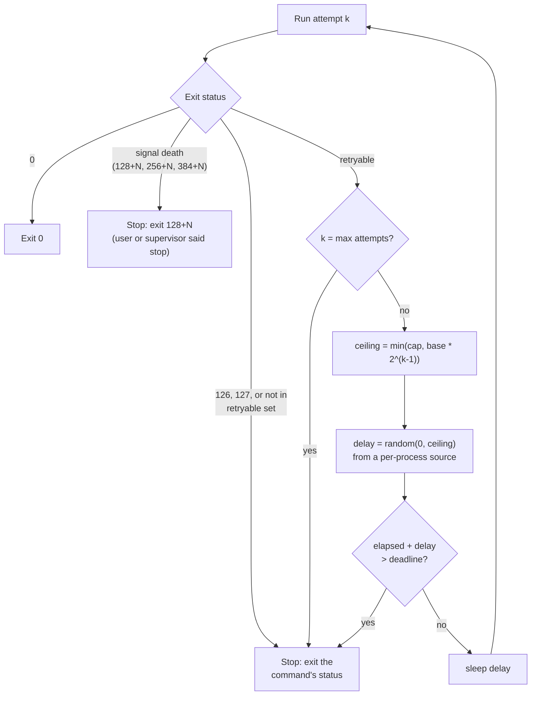

# Retries Backoff and Jitter

> [!summary] Claim
> A retry loop is safe only when it retries just the failures that can heal, waits a capped exponential delay drawn at random from a source that differs in every process, stops at a total deadline, and returns the command's own exit status, because every one of those four omissions has turned a transient fault into an outage.

Part of [Robust Scripting](README.md) in [Shell and Unix Engineering](../README.md).

## TL;DR

- Mechanism: after a retryable failure, sleep `random(0, min(cap, base * 2^(k-1)))` before attempt `k+1` ("full jitter"), then try again until success, a non-retryable status, the attempt limit, or the deadline.
- Rule: classify before you retry; `126`, `127`, signal deaths, usage errors, and HTTP 4xx other than 408 and 429 never heal by waiting, and a command with side effects is retried only when it is idempotent.
- Trap: the randomness must differ per process; zsh's `RANDOM` (and yash's before 2.62) repeats the same value in every forked worker, and awk's `srand()` seeds from the epoch second (mawk's nanosecond seed collapsed to one value too on Debian arm64), so a herd started in the same second "jitters" in lockstep (measured in the shell matrix).
- Portability fact: POSIX `sleep` takes only a non-negative integer and POSIX has no `RANDOM`, so a portable script reads `/dev/urandom` through `od` (itself outside POSIX's required device list) and treats sub-second sleeps as an extension that GNU, BSD, macOS, BusyBox, and the ksh93 builtin provide.
- When not to use it: during long overload from many independent clients, backoff only defers load; shed load with a retry budget, a single retrying layer, or a circuit breaker instead.

## Mental model



Every attempt ends in one of four exits or one sleep.
A zero status ends the loop with success.
A status that encodes a signal ends it at once, because someone (a user pressing Ctrl-C, a supervisor sending `SIGTERM`, the OOM killer) asked the work to stop, and retrying would override that decision.
A permanent status (`127` for a typo, a status outside the retryable list) ends it with the command's own status so the caller's [[Exit-Code-Contracts|exit-code contract]] survives.
A retryable status computes an exponential ceiling, draws a random delay under it, checks that sleeping would not overrun the deadline, sleeps, and loops.

## How it works

### Why retries exist and why they are dangerous

A transient failure is one whose cause goes away on its own: a dropped TCP connection, a leader election, a lock held by another job, a rate limiter that refills, a DNS cache miss during a resolver restart.
Retrying converts such a failure into latency instead of an error.
The same loop is dangerous because it multiplies load exactly when the dependency is weakest.
The AWS Builders' Library article on timeouts and retries (Marc Brooker, 2019-12-05) gives the arithmetic: a five-deep stack of services in which each layer retries three times multiplies load on the database by 243 (`3^5`), "making it unlikely to ever recover".
The Google SRE book chapter "Addressing Cascading Failures" gives the same shape with three layers that each make four attempts: "a single user action may create 64 attempts (4^3) on the database".
Both conclude that retries belong at one layer of the stack, with a budget.

### Classify first: which failures can heal

A retry loop that retries everything retries bugs.
The useful classes, from cheapest to most expensive mistake:

- `127` (command not found) and `126` (found but not executable) are fixed by POSIX for the shell itself `(POSIX.1-2024 XCU 2.8.2)`; neither heals by waiting.
- A signal death is reported as a status "greater than 128" that identifies the signal "in an implementation-defined manner", and POSIX explicitly permits values above 255 `(POSIX.1-2024 XCU 2.8.2)`; the shell matrix measured `128+N` in most shells, `256+N` in ksh93, and `384+N` in yash.
- `255` is not a signal: `ssh` "exits with the exit status of the remote command or with 255 if an error occurred" (OpenBSD `ssh(1)`), which is the classic retryable network failure, so a "status above 128 means signal" test must exclude it.
- `75` is `EX_TEMPFAIL` in `sysexits.h`, "Temporary failure, indicating something that is not really an error", which in sendmail means "the request should be reattempted later"; FreeBSD's `sysexits(3)` now marks the whole interface deprecated, but `75` remains the one widely recognized "please retry" exit code a script can emit.
- For HTTP, `curl --retry` treats as transient "a timeout, an FTP 4xx response code or an HTTP 408, 429, 500, 502, 503, 504, 522 or 524 response code" (curl `docs/cmdline-opts/retry.md`); the code in `retrycheck()` in `src/tool_operate.c` also counts `CURLE_COULDNT_RESOLVE_HOST` and `CURLE_COULDNT_RESOLVE_PROXY` as timeouts.
- `ECONNREFUSED` is permanent by default in both curl and wget, because a refused connection usually means nothing is listening; curl adds it with `--retry-connrefused` (added in 7.52.0) and wget with `--retry-connrefused`.

### Idempotency is the precondition, not an optimization

A retry repeats a request whose first attempt may have succeeded.
RFC 9110 9.2.2 defines a method as idempotent when "the intended effect on the server of multiple identical requests with that method is the same as the effect for a single such request", names PUT, DELETE, and the safe methods, and says idempotent requests "can be repeated automatically if a communication failure occurs before the client is able to read the server's response".
AWS states the operational rule: "APIs with side effects aren't safe to retry unless they provide idempotency."
The gRPC retry design (proposal A6) gives the failure case: a non-idempotent delete that returned `INTERNAL` may already have deleted the user.
In a script the same applies to `mv`, `>>` appends, `git push`, database migrations, and payments; make the step idempotent first ([[Idempotent-Scripts]], [[Atomic-Writes]]), then wrap it.
curl documents the stream version of the problem: before a retry it removes partial data from a file named with `--output`, but "it cannot do that for data written to stdout, a pipe or a shell redirect", so `curl --retry 5 URL > file` can write duplicate bytes.

### Backoff: the schedule

Four schedules appear in real tools:

| Schedule | Delay before retry `k` | Where it appears |
|---|---|---|
| Constant | `d` | `curl --retry-delay N` (disables the doubling) |
| Linear | `min(k, W)` seconds | `wget --waitretry=W`: `sleep_between_retrievals()` in `src/retr.c` sleeps `count - 1` seconds, then `opt.waitretry` |
| Exponential, capped | `min(cap, base * 2^(k-1))` | curl default: 1 s, doubling, capped at 10 minutes (`RETRY_SLEEP_DEFAULT 1000L`, `RETRY_SLEEP_MAX 600000L` in `src/tool_main.h`) |
| Exponential, configured steps | `RestartSec` growing to `RestartMaxDelaySec` over `RestartSteps` | systemd 254+ |

Exponential backoff is chosen because it adapts to an unknown outage length with a logarithmic number of attempts: covering an outage of length `T` with base `b` takes about `log2(T/b)` retries, and the total time asleep after `n` retries is `b * (2^n - 1)` until the cap applies.
The cap exists because without it the 20th retry of a 1 s base would wait 2^19 s, about six days, which turns "retrying" into "hung".
Computing `2^k` in shell arithmetic needs care: `**` is not POSIX arithmetic (dash 0.5.13 rejects `$((2 ** 3))` with "expecting primary", measured here), and a left shift past the integer width is undefined in C, so the lab doubles step by step and stops at the cap, which its test checks at the 70th retry.

### Jitter: why the random part is not optional

Exponential backoff alone spreads retries over time but keeps every client that failed together on the same schedule, so their retries arrive together again.
Marc Brooker's 2015 AWS Architecture Blog post simulated clients contending on one row with optimistic concurrency and found that un-jittered exponential backoff was the worst variant on both total work and completion time; his conclusion was "The solution isn't to remove backoff.
It's to add jitter."
The simulator's source (`aws-samples/aws-arch-backoff-simulator`, `src/backoff_simulator.py`) defines the variants exactly:

- `ExpoBackoff`: `min(cap, base * 2^n)`.
- `ExpoBackoffFullJitter` ("full jitter"): `uniform(0, min(cap, base * 2^n))`.
- `ExpoBackoffEqualJitter` ("equal jitter"): `v/2 + uniform(0, v/2)` with `v = min(cap, base * 2^n)`.
- `ExpoBackoffDecorr` ("decorrelated jitter"): `sleep = min(cap, uniform(base, sleep * 3))`, starting from `sleep = base`.

The simulation used base 5 and cap 2000, a network delay drawn from a normal distribution with mean 10 and standard deviation 2, client counts from 10 to 190, and 100 runs per point.
Brooker reports that with 100 contending clients full jitter cut the call count "by more than half" compared with un-jittered backoff, that equal jitter did slightly more work than full jitter and took much longer, and that full jitter used less work than decorrelated jitter but took slightly more time.
Equal jitter exists to guarantee a minimum wait (never less than half the ceiling); decorrelated jitter exists to make each delay depend on the previous one rather than on the attempt number, which suits loops that do not track `k`.
Decorrelated jitter has a sharp edge the formula hides: with `base = 0` the interval is `uniform(0, 0)` forever, so it never backs off at all; the lab asserts exactly that.
gRPC (proposal A6) uses a fourth form, multiplicative jitter: the `n`-th retry waits `min(initialBackoff * backoffMultiplier^(n-1), maxBackoff) * random(0.8, 1.2)`, so a delay can exceed `maxBackoff` by 20 percent.
curl's built-in schedule has no jitter at all: `retry_sleep()` in `src/tool_operate.c` doubles `per->retry_sleep` deterministically, so a fleet of CI jobs that all hit one mirror outage with `curl --retry` retries in lockstep, separated only by however their start times differed.

### Where the randomness comes from in a shell

This is the part shell scripts get wrong, because every source has a different failure mode.

`RANDOM` is not POSIX: it is absent from the shell variables of `(POSIX.1-2024 XCU 2.5.3)`, and dash and posh do not have it (dash measured; posh compiles `RANDOM` only under `#ifdef KSH` in `var.c`, which its `configure.ac` does not define).
Where it exists it yields 15 bits, 0 to 32767.
bash 5.3 implements it in `lib/sh/random.c`: `brand()` steps the Park-Miller "minimal standard" generator `x(n+1) = 16807 * x(n) mod (2^31 - 1)` and, at compatibility levels above 5.0, returns `(rseed >> 16) ^ (rseed & 65535)` masked to 15 bits; `genseed()` seeds from `tv_sec ^ tv_usec ^ getpid() ^ getppid() ^ uid` and an address.
`get_random_number()` in `variables.c` reseeds when it runs in a subshell whose PID differs from the one that last seeded, and loops `while (rv == last_random_value)`, so bash's `RANDOM` never returns the same value twice in a row, a small but real deviation from uniform.
zsh documents the opposite design in `Doc/Zsh/params.yo`: `RANDOM` forms "an intentionally-repeatable pseudo-random sequence; subshells that reference RANDOM will result in identical pseudo-random values unless the value of RANDOM is referenced or seeded in the parent shell in between subshell invocations".
Most other shells reseed after `fork`: BusyBox ash calls `CLEAR_RANDOM_T(&random_gen)` in the child in `forkshell()` with the comment "or else `$RANDOM` repeats in child", and the next draw reseeds from `getpid()` and the clock; mksh calls `rndset((unsigned long)cldpid)` after every fork ("ensure `$RANDOM` changes between parent and child"), mixing in the time, the PID, and `getrandom()` bytes; ksh93u+m 1.0.10 saves and reseeds per subshell in `sh_save_rand_seed()` in `sh/subshell.c`.
yash is the late exception: its trunk `variable.c` has `request_reseed()` so that "the subshell yields different random numbers than the parent", but yash's `NEWS` lists that change under 2.62 (unreleased as of 2026-11), and yash 2.58.1 gave all 20 forked workers the same `RANDOM` in the shell matrix's Alpine image.
bash 5.1 added `SRANDOM`, a 32-bit value from `getrandom()`, `getentropy()`, `arc4random()`, or `/dev/urandom` that "cannot be seeded" (bash 5.3 `NEWS` and `doc/bash.1`); it is the best in-shell source but exists only in bash 5.1 and later, not in the bash 3.2 that macOS ships as `/bin/bash`.

awk's `rand()` is POSIX, but its seed is the trap.
`srand([expr])` uses "the seconds since the Epoch if expr is omitted", and "the initial seed value is unspecified if rand is called without calling srand first" `(POSIX.1-2024 XCU awk)`.
Measured here, gawk and the one true awk return the same `rand()` value on every run without `srand()` (0.924046 and 0.840188 on this host), and two `srand()` calls in the same second produce identical sequences; BusyBox awk's `F_sr` case seeds with `time(NULL)`.
mawk looks like the exception but is not, at least on Debian arm64: 1.3.4 seeds itself from the clock at startup, and its `initial_seed()` in `bi_funct.c` uses `clock_gettime(CLOCK_REALTIME)` in nanoseconds, yet in the shell matrix's Debian image (mawk 1.3.4 20250131, built with `srandom`/`random`) every process returned the same first `rand()`, 0.118709, unseeded or after `srand()`, and a herd of 20 drew 1 distinct value.
The cause is in `bi_srand()`: with `USE_SYSTEM_SRAND` it computes `seed32 = fmod(cseed.dval, (double) Max_UInt)` and then `mawk_srand((unsigned) seed32)` (1.3.4 20250131 `bi_funct.c`), and in `sizes.h` `Max_UInt` is `UINT64_MAX`, so the `fmod` leaves a nanosecond clock value of about 1.8e18 unchanged.
Converting a double above `UINT_MAX` to `unsigned` is undefined in C, and on aarch64 it saturates: in the Debian arm64 image `srand(4294967294)` and `srand(5)` give different first values, while every seed from `srand(4294967295)` up to `srand(9e18)` gives 0.118709.
The amd64 Debian image does not collapse (mawk 1.3.4 20250131, measured): `srand(1e10)`, `srand(1.78e18)`, and `srand(9e18)` give three different values, three unseeded processes give three different first `rand()` values, and the lab's herd of 20 drew 20 distinct values.
A second, subtler collision comes from seeding with `$$`: POSIX says that in a subshell `$$` "shall expand to the same value as that of the current shell" `(POSIX.1-2024 XCU 2.5.2)`, so every `( ... ) &` worker that seeds awk from `$$` gets the parent's PID and the same seed.

`/dev/urandom` read through `od -An -N4 -tu4` gives 32 independent bits per call in every process and every shell.
`od` with `-A`, `-N`, and `-t` is POSIX `(POSIX.1-2024 XCU od)`, but `/dev/urandom` is not: XBD 10.1 requires only `/dev/null`, `/dev/tty`, and `/dev/console`, so a script needs a fallback, and the lab's falls back to awk seeded with the epoch second plus the PID of a freshly forked `sh`, which is distinct per draw.
Jitter needs decorrelation, not secrecy, so `/dev/urandom` versus a CSPRNG API does not matter here; what matters is that two processes never share a seed.

Reducing 32 random bits to a delay with `rnd % (ceil + 1)` has modulo bias of at most `(ceil + 1) / 2^32`, under 0.02 percent for a 600000 ms ceiling, which is irrelevant for jitter; reducing 15-bit `RANDOM` the same way is not, because any ceiling above 32767 ms is simply never reached.

### Sleeping for the computed delay

POSIX `sleep` takes "a non-negative decimal integer specifying the number of seconds" and must handle up to 2147483647 seconds `(POSIX.1-2024 XCU sleep)`.
Fractional seconds are an extension: GNU coreutils accepts "an integer or floating-point" number, FreeBSD accepts "any form allowed by strtod(3)", BusyBox accepts fractions when `FEATURE_FANCY_SLEEP` is enabled (default `y` in `coreutils/sleep.c`), and ksh93's `sleep` is a builtin (`whence -v sleep` on macOS ksh93u+ 2012 says "sleep is a shell builtin").
The lab feature-detects with `sleep 0.001` and otherwise rounds the delay up to whole seconds, which keeps the backoff correct but coarsens the jitter: with integer sleeps, full jitter over a 1 s ceiling has only two outcomes, 0 or 1.
The deadline check uses `date +%s`, which POSIX.1-2024 finally specifies, because `date` formats "as if by strftime()" and Issue 8 added the `%s` conversion to `strftime()`, marked CX (POSIX extension to ISO C) on its page (Austin Group Defects 169, 1386, and 1612).

### Budgets and deadlines: bounding the whole loop

An attempt limit bounds the number of tries, but not time: ten curl retries with the default schedule sleep `1 + 2 + ... + 512 = 1023` seconds, about 17 minutes, before counting the attempts themselves (derived from `RETRY_SLEEP_DEFAULT` and the doubling in `retry_sleep()`).
curl therefore has `--retry-max-time`, which starts a timer "immediately before the first transfer attempt", includes the sleeps, and stops further retries once it is reached; it does not cut a running attempt short, which is what `--max-time` is for.
curl also stops early when a server's `Retry-After` would push past `--retry-max-time` (the "The Retry-After: time would ..." warning in `retry_sleep()`).
The lab's `-d DEADLINE_S` applies the same rule before every sleep, and per-attempt bounds belong to [[Timeouts-in-Scripts]].
A retry budget bounds the rate of retries across many requests: the SRE book's example is "only allow 60 retries per minute in a process", AWS SDKs have limited retries with a local token bucket since 2016, and gRPC's throttle subtracts 1 token per failure, adds `tokenRatio` per success, and stops retrying while the count is at or below `maxTokens / 2`.
Brooker's 2022 analysis of token buckets and circuit breakers shows the adaptive bucket behaving like "N retries" when failures are rare and like "some percent retries" when they are common, which is the property a fleet of retrying scripts lacks.

### Honoring the server's own backoff signal

HTTP lets the server set the delay: `Retry-After = HTTP-date / delay-seconds` (RFC 9110 10.2.3), sent with 503 to say how long the service is expected to be unavailable, and allowed with 429 Too Many Requests (RFC 6585 section 4).
curl honors it since 7.66.0 and lets it override `--retry-delay`; gRPC's equivalent is the `grpc-retry-pushback-ms` trailer, where a negative or unparsable value means "do not retry at all".
A script that parses `Retry-After` must accept both forms and must still apply its own cap and deadline, because a hostile or broken server can send a delay of days.

### Locks: the prerequisite case

Waiting for a lock is a retry loop: `mkdir "$lockdir"` fails while another run holds it, and the script sleeps and tries again.
The same rules apply: jitter so that two cron jobs that fired at the same minute do not collide on every attempt, and a deadline so that a stale lock ([[Locking-and-Stale-Locks]]) produces a clear failure instead of an infinite wait.

## Numbers and limits

| Quantity | Value | Source |
|---|---|---|
| curl default backoff | 1 s, doubling, capped at 600 s | `src/tool_main.h` `RETRY_SLEEP_DEFAULT 1000L`, `RETRY_SLEEP_MAX 600000L` (as of 2026-11) |
| Sleep before giving up after `curl --retry 10`, instant failures | 1023 s | derived from the two constants above |
| curl retryable HTTP codes | 408, 429, 500, 502, 503, 504, 522, 524 | `retrycheck()` in `src/tool_operate.c` (as of 2026-11) |
| curl `--retry-delay` and `--retry-max-time` fractions | accepted since 8.16.0 | curl `retry-delay.md`, `retry-max-time.md` |
| wget defaults | 20 tries, `--waitretry` 10 s, linear 1, 2, ... 10 s | wget 1.25.0 `src/init.c` (`opt.ntry = 20`, `opt.waitretry = 10`), `src/retr.c` |
| Sleep across wget's 19 default retries | 145 s (1 + ... + 9, then ten waits of 10) | derived from `sleep_between_retrievals()` |
| wget `--random-wait` | 0.5 to 1.5 times `--wait`, not applied between retries | `src/retr.c` (`count > 1` uses the fixed wait) |
| Retry amplification, 5 layers x 3 retries | 243x | AWS Builders' Library (2019) |
| Retry amplification, 3 layers x 4 attempts | 64x | Google SRE book, ch. 22 |
| Example process-wide retry budget | 60 retries per minute | Google SRE book, ch. 22 |
| gRPC jitter, attempt cap | x random(0.8, 1.2); `maxAttempts` above 5 treated as 5 | gRPC proposal A6 |
| Kubernetes container restart backoff | 10 s doubling to 300 s; reset after 10 min of running | kubernetes.io pod lifecycle (as of 2026-11) |
| Kubernetes with `ReduceDefaultCrashLoopBackOffDecay` (alpha) | 1 s doubling to 60 s | kubernetes.io pod lifecycle (as of 2026-11) |
| systemd `RestartSec=` default | 100 ms; `RestartSteps=`, `RestartMaxDelaySec=` since 254 | `systemd.service(5)` (as of 2026-11) |
| `RANDOM` range | 0 to 32767 (15 bits) | bash `doc/bash.1`, zsh `params.yo`, mksh `mksh.1` |
| bash `SRANDOM` | 32 bits, unseedable, bash 5.1+ | bash 5.3 `NEWS`, `doc/bash.1` |
| POSIX `sleep` operand | non-negative integer, up to 2147483647 s | XCU `sleep` |
| POSIX awk `srand()` seed range and default | 0 to 2^31-1; epoch seconds when omitted | XCU `awk` |
| Cost of one `od` draw from `/dev/urandom` | 3.05 ms | lab host: macOS 27.3 arm64, bash 5.3 loop of 200, 2026-11-15 |
| Cost of one awk `srand(); rand()` draw | 2.58 ms | same measurement |
| Cost of one `$SRANDOM` read | 0.055 ms | same measurement (includes loop overhead) |
| Distinct values from 20 forked workers | urandom 20, bash `RANDOM` 20, ksh93 `RANDOM` 20, zsh `RANDOM` 1, one true awk `srand()` 1 | lab `herd.sh` on the macOS host, 2026-11-15 |

## Portability

Shell behavior for the randomness and status rules the loop depends on:

| Behavior | POSIX sh | bash 3.2 (macOS) | bash 5.x | zsh | zsh `--emulate sh` | dash | ksh93 | mksh | yash | posh | BusyBox ash |
|---|---|---|---|---|---|---|---|---|---|---|---|
| `RANDOM` exists | no (XCU 2.5.3) | yes (lab) | yes (lab) | yes (lab) | yes (lab) | no (lab) | yes (lab, macOS ksh93u+; Debian 1.0.10) | yes (`mksh.1`; Debian image) | yes (`variable.c`; Alpine 2.58.1) | no (`var.c`, `#ifdef KSH`; Debian image) | yes when `ASH_RANDOM_SUPPORT` (`ash.c`; Alpine and Debian images) |
| Forked workers draw different `RANDOM` | n/a | yes (lab) | yes (lab; `get_random_number()`) | no, identical (lab; `params.yo`) | no, identical (lab) | n/a | yes (lab 2012, Debian 1.0.10; `sh_save_rand_seed()`) | yes (`rndset(cldpid)` in `jobs.c`; 20 of 20, Debian image) | no, identical in 2.58.1 (1 of 20, Alpine image); yes from 2.62 (`NEWS`, `request_reseed()`) | n/a | yes (`forkshell()` `CLEAR_RANDOM_T`; 20 of 20, Alpine image) |
| `SRANDOM` | no | no (bash 5.1+) | yes, 5.1+ (`NEWS`; set on the 5.3 host) | unset in zsh 5.9.2 (host); master `params.yo` documents an autoloadable `SRANDOM` in the `zsh/random` module | unset (host) | unset (host) | unset on macOS ksh93u+ (host); not in ksh93u+m `sh/init.c` | unset (Alpine image); not in `mksh.1` | unset in 2.58.1 (Alpine image) | not in `var.c` | not in `ash.c` |
| `$?` after a child dies of `SIGINT` | > 128, implementation-defined | 130 | 130 | 130 | 130 | 130 | 258; macOS ksh93u+ 2012 also kills itself with `SIGINT` (lab), ksh93u+m 1.0.10 on Debian does not (measured) | 130 | 386 | 130 | 130 |
| `$((2 ** 3))` | not specified | 8 (host) | 8 (host, 5.3) | 8 (host) | 8 (host) | error, "expecting primary" (host, Debian image) | 8 (host ksh93u+, Debian 1.0.10) | error, "unexpected '*'" (Debian image) | error, "a value is missing" (2.58.1, Alpine image) | error, unexpected `*` (Debian image) | 8 (Alpine image) |

The `$?` row comes from the shell matrix (`128+N` in most shells, `256+N` in ksh93, `384+N` in yash); the ksh93 self-kill is in `job_wait()` in ksh93u+m 1.0.10 `sh/jobs.c` ("propagate keyboard interrupts to parent"), but only inside `if(pw->p_pgrp)`, so it needs the child in its own process group: it was measured on macOS ksh93u+ 2012, where the wrapper died of `SIGINT` before printing its log line, while ksh93u+m 1.0.10 in the Debian image, with no job control, printed the log line and exited 130 like the other shells.
The lab asserts the 130 that the caller sees in every family, the missing log line in ksh93u+ 2012, and the log line in ksh93u+m.
The `**` cells for mksh, yash, posh, and BusyBox were measured by hand in the Debian and Alpine images; the lab never uses `**`.

Utility behavior, which depends on the implementation and not on the shell:

| Behavior | POSIX | GNU | BSD and macOS | BusyBox | mawk | gawk | one true awk |
|---|---|---|---|---|---|---|---|
| `sleep 0.5` | integer only (XCU `sleep`) | yes (`sleep(1)`, man7) | FreeBSD: `strtod(3)` forms; macOS: yes (lab host) | yes with `FEATURE_FANCY_SLEEP` (default `y`; Alpine image) | n/a | n/a | n/a |
| `date +%s` | yes since POSIX.1-2024 (`strftime` `%s`, CX) | used by the lab (Debian image, matrix) | yes (lab host) | used by the lab (Alpine image, matrix) | n/a | n/a | n/a |
| `od -An -N4 -tu4` | yes (XCU `od`) | used by the lab (Debian image, matrix) | yes (lab host) | used by the lab (Alpine image, matrix) | n/a | n/a | n/a |
| awk `srand()` seed | epoch seconds | n/a | n/a | `time(NULL)` (`editors/awk.c`) | `clock_gettime` nanoseconds (1.3.4 `bi_funct.c`), yet the same first `rand()` in every process (Debian arm64 image) | epoch seconds (lab) | epoch seconds (lab) |
| awk `rand()` without `srand()` | initial seed unspecified | n/a | n/a | same value every run (0.783099, Debian image) | clock-seeded at startup (`mawk.1`), yet the same value every run (0.118709, Debian arm64 image) | same value every run (lab) | same value every run (lab) |

## Worked example

The [lab](../labs/13-retries-backoff-and-jitter/) has three scripts: `retry.sh` (the wrapper), `flaky.sh` (a test double that fails its first `FAILS` calls with a chosen status or by killing itself with `SIGINT`), and `herd.sh` (forks `N` workers from one shell and counts distinct jitter draws), plus `retry.bats` with 21 tests.

The core of `retry.sh`, as a simplified excerpt (option parsing, validation, and the awk fallback in `rand32` omitted):

```sh
# ceiling K: set ceil to min(cap, base * 2^(K-1)), doubling stepwise so it never overflows.
ceiling() {
  ceil=$base
  i=1
  while [ "$i" -lt "$1" ] && [ "$ceil" -lt "$cap" ]; do
    ceil=$((ceil * 2))
    i=$((i + 1))
  done
  if [ "$ceil" -gt "$cap" ]; then ceil=$cap; fi
}

# next_delay K: set delay to the sleep in milliseconds before retry K.
next_delay() {
  ceiling "$1"
  case $jitter in
    none) delay=$ceil ;;
    full)
      rand32
      delay=$((rnd % (ceil + 1)))
      ;;
    equal)
      rand32
      half=$((ceil / 2))
      delay=$((half + rnd % (ceil - half + 1)))
      ;;
    decorr)
      # Brooker's decorrelated jitter: min(cap, uniform(base, 3 * previous sleep)).
      rand32
      delay=$((base + rnd % (prev * 3 - base + 1)))
      if [ "$delay" -gt "$cap" ]; then delay=$cap; fi
      prev=$delay
      ;;
    *) usage ;;
  esac
}

while :; do
  "$@"
  st=$?
  if [ "$st" -eq 0 ]; then exit 0; fi
  # 128+N in most shells, 256+N in ksh93, 384+N in yash; 255 is an ordinary status (ssh uses it).
  sig=0
  if [ "$st" -gt 256 ]; then
    sig=$((st % 128))
  elif [ "$st" -gt 128 ] && [ "$st" -lt 255 ]; then
    sig=$((st - 128))
  fi
  if [ "$sig" -ne 0 ]; then
    log "attempt $attempt was killed by signal $sig; not retrying"
    exit $((128 + sig))
  fi
  if ! retryable "$st"; then
    log "attempt $attempt failed with status $st, which is not retryable"
    exit "$st"
  fi
  if [ "$attempt" -ge "$attempts" ]; then
    log "attempt $attempt failed with status $st; giving up after $attempts attempts"
    exit "$st"
  fi
  next_delay "$attempt"
  if [ "$deadline" -gt 0 ]; then
    now=$(date +%s)
    if [ $((now - start + (delay + 999) / 1000)) -gt "$deadline" ]; then
      log "attempt $attempt failed with status $st; a $delay ms sleep would pass the ${deadline}s deadline"
      exit "$st"
    fi
  fi
  log "attempt $attempt failed with status $st; retrying in $delay ms"
  msleep "$delay"
  attempt=$((attempt + 1))
done
```

`rand32` reads `od -An -N4 -tu4 /dev/urandom`, and `retryable` matches the status against `-r` with `case " $codes " in *" $1 "*)`, which avoids field splitting and so behaves the same in native zsh.

The deterministic plan, which the lab asserts byte for byte:

```text
$ sh retry.sh -p -n 6 -b 1000 -c 8000 -j none -- true
retry 1: 1000 ms
retry 2: 2000 ms
retry 3: 4000 ms
retry 4: 8000 ms
retry 5: 8000 ms
```

The same plan with full jitter, captured once on the macOS host (the lab asserts only that every value lies in `[0, ceiling]` and that the values spread):

```text
$ sh retry.sh -p -n 6 -b 1000 -c 8000 -j full -- true
retry 1: 377 ms
retry 2: 1568 ms
retry 3: 1891 ms
retry 4: 3688 ms
retry 5: 478 ms
```

A command that fails three times with `EX_TEMPFAIL` and then succeeds, and one that never succeeds, captured once on the macOS host with a fresh count file each time (the delays are random; the statuses and messages are what the lab asserts):

```text
$ sh retry.sh -n 4 -b 200 -c 1000 -j full -- ./flaky.sh count 3 75; echo "exit=$?"
retry: attempt 1 failed with status 75; retrying in 7 ms
retry: attempt 2 failed with status 75; retrying in 180 ms
retry: attempt 3 failed with status 75; retrying in 509 ms
exit=0
$ sh retry.sh -n 3 -b 200 -c 1000 -- ./flaky.sh count 9 75; echo "exit=$?"
retry: attempt 1 failed with status 75; retrying in 130 ms
retry: attempt 2 failed with status 75; retrying in 165 ms
retry: attempt 3 failed with status 75; giving up after 3 attempts
exit=75
```

The second run returns 75, the command's own status, not a generic 1.

The herd probe, captured once on the macOS host, shows why the source of randomness matters more than the formula:

```text
$ for s in bash zsh dash /bin/ksh; do printf '%s: ' "$s"; $s herd.sh random 20; done
bash: distinct=20 of 20
zsh: distinct=1 of 20
dash: RANDOM is unset
/bin/ksh: distinct=20 of 20
$ bash herd.sh awk 20        # macOS awk is the one true awk 20200816
distinct=1 of 20
$ bash herd.sh urandom 20
distinct=20 of 20
```

The lab's tests assert these per family and per awk flavor: zsh, `zsh --emulate sh`, and yash before 2.62 give exactly one distinct value, bash, ksh93, mksh, yash 2.62 and later, and BusyBox at least 18 of 20, dash and posh "RANDOM is unset"; gawk, the one true awk, BusyBox awk, and mawk at most 2 on aarch64 and at least 18 on x86-64 (a second boundary can split the herd; mawk's nanosecond seed collapses on aarch64, where a herd of 20 drew 1 value in the Debian image, while the amd64 Debian image drew 20 of 20).

## Pitfalls

> [!warning] Synchronized retries (no jitter)
> Trigger: many clients fail at the same moment (a deploy, a network partition, a dependency restart) and back off on the same deterministic schedule, as `curl --retry` does.
> Symptom: load arrives in spikes at 1 s, 2 s, 4 s after the failure, each spike large enough to fail again; Brooker's simulation shows un-jittered backoff doing the most work of all variants.
> Fix: full jitter, `random(0, min(cap, base * 2^(k-1)))`; wrap curl in your own jittered loop or add a random initial delay when many jobs share a schedule.

> [!warning] Jitter from a seed every worker shares
> Trigger: `( retry_worker ) &` in zsh or yash 2.58.1 drawing from `RANDOM`; awk `srand()` with no argument in processes started in the same second; awk seeded from `$$` inside subshells.
> Symptom: the "random" delays are identical across workers, so the herd stays synchronized; the lab measures 1 distinct value out of 20 for zsh `RANDOM` and for the one true awk, and the shell matrix's images measured the same for yash 2.58.1 `RANDOM` and for Debian's mawk.
> Fix: read `/dev/urandom` per draw (`od -An -N4 -tu4 /dev/urandom`), or `SRANDOM` in bash 5.1+; in zsh, reference `RANDOM` in the parent before each fork or seed each worker from `/dev/urandom`.

> [!warning] Retry storm across layers (DynamoDB US-East event)
> Trigger: every layer retries on its own, and retried work keeps the dependency overloaded.
> Symptom: in the DynamoDB US-East event summary (published by AWS, dated Sunday, September 20; the page omits the year), storage servers whose metadata requests timed out "continued to retry requests for membership data, maintaining high load on the metadata service", and capacity could not be added while that load persisted; recovery began when AWS cut the load, which "decreased retry activity".
> Fix: retry at one layer, cap attempts, and add a retry budget so retries fall to a fixed rate when failures dominate.

> [!warning] Clients that do not back off (AWS us-east-1, 2021-12-07)
> Trigger: an automated scaling activity at 7:30 AM PST caused "a large surge of connection activity" between two internal networks.
> Symptom: "even more connection attempts and retries", because "a latent issue prevented these clients from adequately backing off during this event", producing "persistent congestion" on the devices connecting the networks (AWS post-event summary 12721).
> Fix: backoff must be enforced and tested on every client path, including error paths that bypass the normal retry code.

> [!warning] Retrying permanent failures
> Trigger: `until cmd; do sleep 5; done` with no classification, wrapped around a command that fails with `127`, a usage error, an HTTP 404, or an authentication error.
> Symptom: a job that can never succeed burns its whole budget, delays the real error report by minutes, and, for authentication, can lock the account it is retrying against.
> Fix: retry only an allow-list of statuses (`-r` in the lab, `--retry-on-http-error` in wget, `retryableStatusCodes` in gRPC); `126` and `127` are never on it.

> [!warning] Retrying after Ctrl-C
> Trigger: a loop that treats status 130 like any other failure.
> Symptom: the user presses Ctrl-C, the child dies, and the loop sleeps and starts it again, so the script cannot be interrupted short of killing its process group.
> Fix: stop on any signal status (`128+N`, `256+N` in ksh93, `384+N` in yash) and exit `128+N`; for full fidelity re-raise the signal ([[Cleanup-Traps-and-Re-Raising-Signals]]).

> [!warning] The loop masks the final failure
> Trigger: `for i in 1 2 3 4 5; do cmd && break; sleep 2; done`.
> Symptom: after the fifth failure the loop sleeps once more and its status is `sleep`'s 0, because a `for` loop's status is that of "the last compound-list executed" `(POSIX.1-2024 XCU 2.9.4.2)`; the script reports success with nothing done (dash: `for i in 1 2; do false && break; true; done; echo $?` prints 0).
> Fix: save the command's status in a variable and `exit "$st"` explicitly, as the lab's wrapper does.

> [!warning] Duplicate output from retried streams
> Trigger: `curl --retry 5 URL | tar x` or `curl --retry 5 URL >> file`.
> Symptom: a retry after a partial body appends the bytes again; curl documents that it cannot remove data already written "to stdout, a pipe or a shell redirect".
> Fix: download to a file with `--output`, verify it, then consume it ([[Atomic-Writes]]).

> [!warning] Deadline-free retries
> Trigger: an attempt count without a time bound, or a server-supplied `Retry-After` that is accepted unconditionally.
> Symptom: ten curl retries sleep 1023 s before giving up; a `Retry-After: 86400` parks a CI job for a day.
> Fix: bound the loop with a deadline (`curl --retry-max-time`, the lab's `-d`), bound each attempt ([[Timeouts-in-Scripts]]), and clamp server-supplied delays to your cap.

## Security and robustness

- Do not log the command line in retry messages: `"$@"` often contains tokens or URLs with credentials, and a retry loop logs it once per attempt; the lab logs only the attempt number, status, and delay ([[Logging-from-Scripts]]).
- Retrying authentication failures is a lockout and brute-force amplifier; treat 401, 403, and their exit-code equivalents as permanent.
- A retry loop is a load amplifier you ship to every user; cap attempts and total time so that a script run by thousands of machines cannot become a denial of service against your own dependency.
- Jitter needs independence, not secrecy: `RANDOM` is fine for delays when each process seeds differently, but never for tokens, temporary names, or keys.
- Treat `Retry-After` and `grpc-retry-pushback-ms` as advice clamped by your own policy; never let input from the network choose an unbounded sleep.
- Under `set -e`, call the wrapper as an `if` or `until` condition, or errexit fires on the first failure before the loop can retry ([[Unofficial-Strict-Mode-Critique]], [[Error-Handling-Patterns]]).
- Retry only idempotent steps; for non-idempotent ones, make them idempotent first with a request ID, a marker file, or a compare-and-swap ([[Idempotent-Scripts]]).
- A `--dry-run` plan of the delays (the lab's `-p`) makes the schedule reviewable before it runs against production ([[Dry-Run-and-Apply]]).

## The principal's view

The decision is not which jitter formula to use; full jitter is a fine default and the differences between the variants are second-order.
The decision is where retries live and how they are bounded.
A staff-plus engineer insists that exactly one layer retries (usually the one closest to the user, or the one that owns the idempotency key), that it has both an attempt cap and a deadline, that it retries an allow-list of failures, and that a fleet-wide budget limits retries when failures dominate.
The trade-off is latency versus load: more and faster retries hide more transient faults from users but turn a brownout into an outage; fewer retries surface more errors but keep the dependency alive.
Brooker's "What is Backoff For?" draws the boundary: backoff helps with short spikes and with few clients doing serial work, but "The only way to deal with long-term overload is to reduce load, deferring load does not work."
A shell wrapper is the right tool for a CI step, a bootstrap script, a cron job waiting on a lock, or a one-off migration helper.
Move to a library with a token bucket (the AWS SDKs, gRPC's retry throttle) or to a supervisor with built-in backoff (systemd `RestartSteps=`, Kubernetes restarts) once many instances retry against one shared dependency, because a shell script has no view of the fleet and cannot implement a shared budget.
Write the wrapper once, test it like the lab does (plans, statuses, signals, deadlines, and seed independence), and ban ad hoc `until cmd; do sleep 5; done` loops in review.

## Interview questions

> [!question] L5: Why does exponential backoff need jitter, and what is full jitter?
>
> > [!success]- Answer
> > Clients that fail together and back off on the same deterministic schedule retry together, so each retry wave recreates the overload.
> > Full jitter draws each delay uniformly from 0 to `min(cap, base * 2^(k-1))`, which spreads the wave over the whole window.
> > Brooker's 2015 simulation found un-jittered backoff the worst variant on work and time, and full jitter cut calls by more than half at 100 clients.
> >
> > Follow-up: What does equal jitter guarantee that full jitter does not, and what does it cost?

> [!question] L5: Which exit statuses should a generic retry wrapper never retry, and why?
>
> > [!success]- Answer
> > `127` (not found) and `126` (not executable) are fixed by POSIX XCU 2.8.2 and never heal by waiting.
> > Statuses that encode a signal mean someone asked the work to stop, so retrying overrides a user's Ctrl-C or a supervisor's `SIGTERM`.
> > Usage errors and authentication failures are permanent and, for authentication, retrying can lock the account.
> > `255` is the exception that looks like a signal but is `ssh`'s connection error, which is retryable.
> >
> > Follow-up: How do you recognize a signal death portably when ksh93 reports 256+N and yash 384+N?

> [!question] L6: Predict the output: `zsh -c 'for i in 1 2 3; do (echo $RANDOM); done'`, and the same with `bash -c`.
>
> > [!success]- Answer
> > zsh prints the same number three times (16344 three times in one run here), because its `RANDOM` is an intentionally repeatable sequence and the parent never advances it between the subshells.
> > bash prints three different numbers, because `get_random_number()` reseeds when it runs in a subshell whose PID differs from the last seeder.
> > A parallel retry loop in zsh that jitters with `RANDOM` inside `( ... ) &` workers therefore does not jitter at all.
> >
> > Follow-up: Which awk implementations have the same problem across processes, and why does mawk's nanosecond clock seed not save it on Debian arm64?

> [!question] L6: Debug this script, which is meant to retry a download five times.
> ```sh
> #!/bin/sh
> for i in 1 2 3 4 5; do
>   curl -fsS "$URL" -o out && break
>   sleep $((2 ** i))
> done
> echo "done: $?"
> ```
>
> > [!success]- Answer
> > `**` is not POSIX arithmetic; dash aborts with "arithmetic expression: expecting primary", so on Debian's `/bin/sh` the script never sleeps or retries as intended.
> > After the fifth failure it sleeps 32 s for nothing, and the loop's status is `sleep`'s 0, so it reports success with no file (XCU 2.9.4.2).
> > There is no jitter, no cap, no deadline, and no classification, so a 404 is retried like a timeout.
> > Fix: save the status, check `i` before sleeping, compute the ceiling by doubling, draw the delay from `/dev/urandom`, and `exit "$st"`.
> >
> > Follow-up: Why is `curl --retry 5 --retry-max-time 60 -o out` alone still not equivalent to a jittered loop?

> [!question] L6: What does `curl --retry 10` do by default, and what does it not do?
>
> > [!success]- Answer
> > It retries timeouts, DNS resolution failures, and HTTP 408, 429, 500, 502, 503, 504, 522, and 524, sleeping 1 s and doubling up to 600 s, so ten instant failures sleep 1023 s.
> > It honors `Retry-After` since 7.66.0, and `--retry-max-time` bounds the total including sleeps.
> > It does not jitter, does not retry `ECONNREFUSED` without `--retry-connrefused`, does not retry other 4xx unless `--retry-all-errors` with `--fail`, and cannot undo data already written to a pipe.
> >
> > Follow-up: When is `--retry-all-errors` acceptable, and what does curl's own documentation warn about it?

> [!question] L6: Why is awk's `srand()` a poor jitter seed, and how would you fix it in POSIX sh?
>
> > [!success]- Answer
> > POSIX says `srand()` with no argument uses the seconds since the Epoch, so every process started in the same second gets the same sequence; the lab measured one distinct value from 20 workers with the one true awk.
> > Seeding from `$$` in subshells fails too, because POSIX makes `$$` in a subshell equal to the parent's PID.
> > Read `od -An -N4 -tu4 /dev/urandom` per draw, and if that device is missing, mix the epoch second with the PID of a freshly forked process.
> >
> > Follow-up: mawk 1.3.4 seeds from a nanosecond clock; why did 20 mawk processes in Debian's arm64 image still draw one value?

> [!question] L7+: A 50,000-host fleet's bootstrap script fetches from one internal artifact service with a jittered retry loop, and the service browns out for 30 minutes; what happens, and what do you change?
>
> > [!success]- Answer
> > Jitter spreads retries but does not reduce them, so 50,000 independent clients keep the offered load near its peak for the whole brownout; Brooker's point is that deferring load does not fix long overload.
> > Each host should have a cap and deadline, but the fix is a fleet-level budget: retry at one layer, make the service return 429 or 503 with `Retry-After`, and have clients honor it, clamped.
> > Add load shedding and an overload status at the service, stagger the bootstrap schedule, and move the logic into a client library or agent with a token bucket, which a shell script cannot share across hosts.
> >
> > Follow-up: How do you test that every client path, including error paths, actually backs off, given the 2021 AWS event?

> [!question] L7+: Where should retries live in a five-layer call chain, and how do you enforce it?
>
> > [!success]- Answer
> > At one layer, because independent retries multiply: three retries at each of five layers is 243 times the load (AWS), three layers of four attempts is 64 (Google SRE).
> > Put them where the idempotency key and the user's deadline are known, usually the outermost layer, and have inner layers fail fast with a status that says whether retrying is safe.
> > Enforce it with a shared client library, retry budgets per process (60 per minute in the SRE example), and a review rule against ad hoc loops.
> >
> > Follow-up: What should an inner layer return when it is overloaded so that outer layers do not retry?

> [!question] L5: Why does a portable shell retry loop need both an attempt limit and a deadline?
>
> > [!success]- Answer
> > The attempt limit bounds the number of requests but not time, because exponential delays and slow attempts make total time grow fast.
> > The deadline bounds wall-clock time, which is what callers and schedulers care about, and it must include the sleeps, as curl's `--retry-max-time` does.
> > Per-attempt timeouts are a third bound, because one hung attempt can exceed any deadline checked only between attempts.
> >
> > Follow-up: How would you get epoch seconds for the deadline on a system whose `date` predates POSIX.1-2024?

## Related

Prerequisites: [[Locking-and-Stale-Locks]]

Next: [[Timeouts-in-Scripts]]

See also: [[Idempotent-Scripts]], [[Exit-Code-Contracts]], [[Error-Handling-Patterns]], [[Cleanup-Traps-and-Re-Raising-Signals]], [[Atomic-Writes]], [[Logging-from-Scripts]], [[Dry-Run-and-Apply]], [[Unofficial-Strict-Mode-Critique]], [[Subshells-and-the-Execution-Environment]], [[Arithmetic-Expansion]]

## Further reading

- Marc Brooker, "Exponential Backoff And Jitter", AWS Architecture Blog, 2015-03-04: the simulation that made full jitter the default.
- `aws-samples/aws-arch-backoff-simulator`, `src/backoff_simulator.py`: the exact formulas for every variant.
- Marc Brooker, "Timeouts, retries, and backoff with jitter", Amazon Builders' Library, 2019: retry at one layer, token buckets, and the 243x amplification.
- Marc Brooker, "Fixing retries with token buckets and circuit breakers" (2022-02-28) and "What is Backoff For?" (2022-08-11): when backoff helps and when only load reduction does.
- Google SRE book, "Addressing Cascading Failures": retry budgets, randomized exponential backoff, and overload statuses.
- gRPC proposal A6, "Client Retries": a complete production retry policy with multiplicative jitter, throttling, and server pushback.
- RFC 9110 sections 9.2.2 and 10.2.3, and RFC 6585 section 4: idempotency, `Retry-After`, and 429.
- curl `docs/cmdline-opts/retry*.md` and `src/tool_operate.c`: the most-used retry implementation in shell scripts, including what it does not do.
- POSIX.1-2024 XCU 2.8.2, `sleep`, `awk`, and `od`: the exit-status rules and the portable building blocks.
- bash 5.3 `lib/sh/random.c` and `variables.c`, zsh `Doc/Zsh/params.yo`, BusyBox `shell/ash.c` `forkshell()`: how each shell's `RANDOM` behaves after `fork`.
- AWS post-event summaries for DynamoDB (message 5467D2) and us-east-1 on 2021-12-07 (message 12721): retry storms in production.
