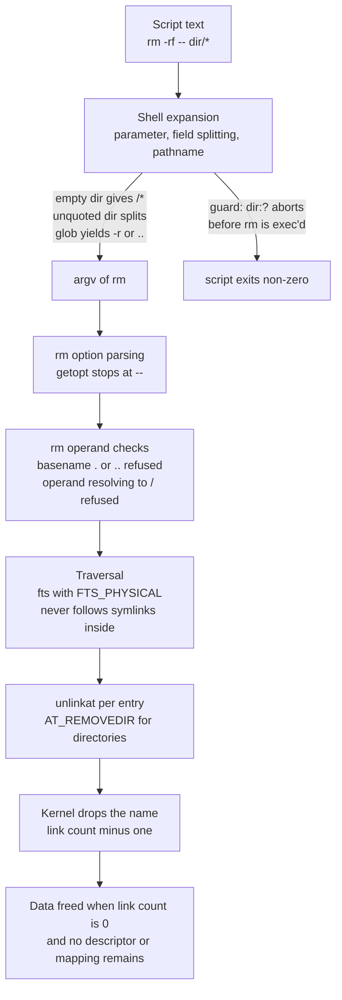

# Safe rm and Destructive Operations

> [!summary] Claim
> Deletion is a sequence of irreversible `unlinkat` calls with no undo, and `rm` itself guards only against `.`, `..`, and (in most implementations) `/`, so a script must prove before it calls `rm` that each operand is non-empty, physically inside the directory it means to clean, and not an artifact of an empty, split, or globbed expansion.

Part of [Robust Scripting](README.md) in [Shell and Unix Engineering](../README.md).

## TL;DR

- Mechanism: the shell builds `rm`'s argument vector by expansion, `rm` walks each operand and calls `unlinkat` (with `AT_REMOVEDIR` for directories), and the kernel drops a name and frees the data only when the last link and the last open descriptor are gone.
- Rule: never let a path reach `rm -rf` unchecked; require it non-empty with `${dir:?}`, quote it, end options with `--`, resolve its parent physically and require it under an expected root, and prefer a dry run or a reversible rename over deletion.
- Trap: an empty variable turns `rm -rf "$dir/"*` into `rm -rf /*`, which no `rm` refuses because the shell has already replaced `/*` with `/bin`, `/etc`, `/home`, and so on (lab test 17).
- Portability fact: POSIX requires `rm` to refuse `.`, `..`, and an operand that resolves to `/`, but BusyBox `rm` has no root check at all and BSD and macOS `rm` compare the operand with the string `/`, while GNU and uutils compare device and inode.
- When not to use it: when the data matters and the operation can be expressed as a rename into a quarantine directory, a snapshot, or a transaction, do that instead; `rm` is the right tool only for data you can regenerate.

## Mental model



Every arrow is a place where a different path than the one the author meant can enter.
The shell, not `rm`, decides what the operands are: an empty variable, an unquoted space, or a file named `-r` changes the argument vector before `rm` exists as a process, and only a guard in the shell (`${dir:?}`) can stop that stage.
`rm` then applies its own small set of refusals, which are about names (`.`, `..`, `/`), not about intent: it has no idea that `/home/alice` was not what you meant.
Traversal is physical, so `rm` does not follow symbolic links found inside the tree, but the operand's own path is resolved by the kernel, symlinks and all, so a symlinked parent or a trailing slash moves the operation somewhere else.
The final arrow is why deletion is not erasure: the name goes immediately, the blocks go only when nothing refers to the file any more.

## How it works

### What deletion is at the system call level

`unlink()` removes a directory entry and decrements the file's link count; when the link count reaches 0 and no process has the file open or mapped, the space is freed, but "if one or more processes have such a reference to the file when the last link is removed, the link shall be removed before unlink() returns, but the removal of the file contents shall be postponed until there are no such references" `(POSIX.1-2024 XSH unlink)`.
`unlinkat(fd, name, AT_REMOVEDIR)` is the same operation as `rmdir()` relative to a directory descriptor `(POSIX.1-2024 XSH unlink)`.
`rmdir()` fails on a non-empty directory with `[EEXIST]` or `[ENOTEMPTY]` (both values are permitted because 4.2 BSD used `[ENOTEMPTY]` while the 1984 /usr/group standard, which System V followed, used `[EEXIST]`), and fails when the final component is `.` or `..` `(POSIX.1-2024 XSH rmdir)`.
So a recursive remove is necessarily depth first: every entry inside a directory must be unlinked before the directory itself can be removed.
Lab test 25 shows the postponed-free rule from the shell: after `exec 3<f; rm -- f`, the name is gone but `cat <&3` still prints the contents.
That is the mechanism behind "disk full after deleting the log": a daemon still holding the descriptor keeps the blocks allocated until it closes or restarts.
Nothing in this path overwrites data; GNU's manual warns that "if you use rm to remove a file, it is usually possible to recover the contents of that file" and points to `shred` for more assurance `(coreutils.texi, rm invocation)`.

### What the shell does before rm runs

The operands `rm` receives are the output of expansion, and every expansion has a failure mode that names the wrong file.

- Empty parameter: with `dir=`, `"$dir/"*` expands to the entries of `/`, and `"$dir/"` to `/` (lab test 17).
  `set -u` does not help, because it rejects only unset parameters, not empty ones (lab test 16).
  `${dir:?msg}` does: "If parameter is unset or null, the expansion of word ... shall be written to standard error and the shell exits with a non-zero exit status" `(POSIX.1-2024 XCU 2.6.2)`, and an expansion error makes a non-interactive shell exit `(POSIX.1-2024 XCU 2.8.1)`, so the command containing it is never executed (lab test 14).
- Field splitting: an unquoted `$dir` holding `a b` becomes two operands, `a` and `b`, in every shell except native zsh, which does not split unquoted parameters (lab test 18).
- Pathname expansion producing options: a file named `-r` in the current directory sorts before most names, so `rm *` becomes `rm -r sub ...` and removes directories recursively; `rm -- *` or `rm ./*` turns it back into an operand (lab test 19).
  GNU `rm` helps only in the opposite case: when an unknown option such as `-foo` names an existing file, `diagnose_leading_hyphen()` prints "Try 'rm ./-foo' to remove the file" `(coreutils rm.c, diagnose_leading_hyphen)`; a valid option such as `-r` is silently accepted.
- Pathname expansion producing `..`: POSIX lets `.*` match `.` and `..` ("if directory entries for dot and dot-dot exist, they may be ignored") and notes that a future version may require ignoring them `(POSIX.1-2024 XCU 2.14.3)`.
  bash before 5.2, dash, BusyBox ash, yash 2.58.1, and ksh93u+ 2012 still return them (yash both by default and with `posixly-correct`, measured in the shell matrix's Alpine image); bash 5.2 added `globskipdots`, on by default (bash-5.3 NEWS, bash-5.2 entry aa), ksh93u+m stopped matching them on 2020-08-09 (ksh93u+m NEWS), and mksh, posh, and zsh skip them in their glob code (lab test 20).
  `rm -rf .*` is then saved only by `rm`'s own `..` refusal; `chmod -R` and `chown -R` have no such refusal and walk into the parent directory.
- Unmatched patterns: POSIX leaves an unmatched pattern unchanged, so `rm -f *.tmp` in an empty directory receives the literal `*.tmp` and exits 0; native zsh instead reports `no matches found` and aborts the command with status 1 (lab test 27).
- An unchecked `cd`: `cd "$dir"; rm -rf ./*` deletes the current directory's contents whenever the `cd` fails, and with `dir` empty some shells do not even fail.
  POSIX.1-2024 says "If directory is an empty string, cd shall write a diagnostic message to standard error and exit with non-zero status" `(POSIX.1-2024 XCU cd)`; measured on the author's host, bash 5.3.15 and ksh93u+ 2012 comply, while bash 3.2.57, dash 0.5.13, and zsh 5.9.2 return 0 without moving, and bash's check sits under `#if 0` in `builtins/cd.def` from 4.4 through 5.2 and is enabled in 5.3 (bash 4.4, 5.2, and 5.3 source tarballs).
  Measured in the shell matrix's Debian 13 and Alpine 3.22 images, ksh93u+m 1.0.10 also fails ("bad directory"), while bash 5.2.37, dash 0.5.12, mksh R59, posh 0.14.1, zsh 5.9, yash 2.58.1, and BusyBox ash 1.37.0 return 0 without moving.
  Write `cd -P -- "${dir:?}" || exit`, or better, never delete relative to the current directory.

### What rm itself checks

POSIX gives `rm` exactly three name-based refusals: "If either of the files dot or dot-dot are specified as the basename portion of an operand ... or if an operand resolves to the root directory", `rm` writes a diagnostic and does nothing more with that operand `(POSIX.1-2024 XCU rm)`.
The application usage explains the first two: `rm` "is forbidden to remove the names dot and dot-dot in order to avoid the consequences of inadvertently doing something like" `rm -r .*` `(POSIX.1-2024 XCU rm, APPLICATION USAGE)`.
It also requires that `rm` "shall not traverse directories by following symbolic links into other parts of the hierarchy" but "shall remove the links themselves", and that `-f` means "do not write diagnostic messages or modify the exit status in the case of no file operands" `(POSIX.1-2024 XCU rm)`; lab tests 21 and 22 confirm both on the host `rm`.
Issue 8 added `-d` (Austin Group Defect 802) and `-v` (Defects 1154, 1365, and 1487) `(POSIX.1-2024 XCU rm, CHANGE HISTORY)`.

The implementations enforce these rules very differently.

- GNU coreutils: `main()` sets `preserve_root = true`, and when `-r` is given looks up the device and inode of `/` with `get_root_dev_ino()` `(coreutils rm.c, main)`.
  `rm_fts()` checks every command-line operand (`FTS_ROOTLEVEL`) twice: `dot_or_dotdot(last_component(...))` gives "refusing to remove '.' or '..' directory: skipping", and `ROOT_DEV_INO_CHECK` compares the operand's `stat` with the root's device and inode, so `/`, `//`, `/.`-style spellings and a symlink to `/` written with a trailing slash are all caught `(coreutils remove.c, rm_fts)`; the check runs on directory entries, so a bare symlink operand is never followed and only the link is unlinked.
  `--preserve-root=all` additionally stats the operand's `..` and skips an operand "on a different device" from its parent, which catches a mount point passed by name `(coreutils remove.c, rm_fts)`.
  `--no-preserve-root` must be spelled out in full: `main()` compares `argv[optind - 1]` with the literal string and fails with "you may not abbreviate the --no-preserve-root option" `(coreutils rm.c, main)`.
- BSD and macOS: `checkdot()` strips trailing slashes and rejects a final `.` or `..`, and `checkslash()` rejects an operand whose text is exactly `/` (`#define ISSLASH(a) ((a)[0] == '/' && (a)[1] == '\0')`) `(apple file_cmds rm.c, checkdot and checkslash; freebsd-src bin/rm/rm.c, checkslash)`.
  It is a string comparison, so by reading the source an operand spelled `//` passes both checks; this note does not test that, for obvious reasons.
- BusyBox: `rm_main()` passes each operand through `bb_get_last_path_component_strip()`, which strips trailing slashes from the operand in place, then rejects a final `.` or `..` with "can't remove '.' or '..'" and has no root check at all; its options are `-f`, `-i`, `-R`, `-r`, and `-v`, with no `-I` and no one-file-system option `(busybox coreutils/rm.c, rm_main)`.
- uutils: `preserve_root` defaults to true, `--preserve-root=all` and `--one-file-system` exist, abbreviating `--no-preserve-root` is rejected, and its messages mirror GNU's ("it is dangerous to operate recursively on '/'", "use --no-preserve-root to override this failsafe") `(uutils src/uu/rm/src/rm.rs and locales/en-US.ftl)`.

GNU's protection is newer than many scripts in production: coreutils 5.1.0 (2003-12-21) introduced `--preserve-root` with `--no-preserve-root` as the default, and 6.2 (2006-09-18) made `rm` reject the root directory by default ("'rm -fr /' now fails without removing anything") (coreutils NEWS).

### Traversal and the race it must survive

GNU `rm()` opens the operands with `fts` using `FTS_CWDFD | FTS_NOSTAT | FTS_PHYSICAL` (plus `FTS_XDEV` under `--one-file-system`), and `excise()` removes each entry with `unlinkat(fts->fts_cwd_fd, ent->fts_accpath, flag)` where `flag` is `AT_REMOVEDIR` for a directory `(coreutils remove.c, rm and excise)`.
`FTS_PHYSICAL` means symbolic links met inside the tree are removed as links, and `FTS_CWDFD` means each entry is named relative to an open descriptor of its parent rather than by a long path that can be re-resolved.
That design is the fix for a real bug: CVE-2002-0435 was a race in recursive deletion in GNU fileutils 4.1 and earlier that let a local user move a low-level directory up while it was being deleted, "which causes fileutils to chdir to a '..' directory that is higher than expected, possibly up to the root file system" (NVD).
The same class came back two decades later as CVE-2022-21658: Rust's `std::fs::remove_dir_all` was "vulnerable a race condition enabling symlink following (CWE-363)" in Rust 1.0.0 through 1.58.0, fixed in 1.58.1, and the advisory adds that "adding checks in your codebase before calling remove_dir_all will not mitigate the vulnerability, as they would also be vulnerable to race conditions like remove_dir_all itself" (NVD).
BusyBox `remove_file()` still recurses by path: it `lstat`s a path, and if it is a directory calls `opendir(path)` and recurses on `path/name` `(busybox libbb/remove_file.c, remove_file)`, so between the `lstat` and the `opendir` a writer of that directory could substitute a symlink; this is read from the source (as of 2026-11), not demonstrated.
The lesson for scripts is the CVE's: a check in the shell followed by `rm` is a time-of-check to time-of-use window, so the check must be about things the attacker cannot change (an operand you constructed, a parent you pinned), and the traversal must be left to an `rm` that does not follow links.

### The trailing slash that follows a symlink

POSIX path resolution stops at a final symlink only if "the pathname has no trailing slash" and the function acts on the link itself; otherwise "the system shall prefix the remaining pathname ... with the contents of the symbolic link" `(POSIX.1-2024 XBD 4.16)`.
So `rm -rf link` removes the link, while `rm -rf link/` names the directory the link points to.
What happens next depends on the kernel and on the `rm`, and lab test 24 asserts all three arms:
- macOS: `rm -rf link/` empties the target and then removes the target directory itself, leaving the dangling link, with status 0 (measured with both BSD `/bin/rm` and GNU `grm` 9.12 on macOS 27.3).
- Linux with GNU `rm`: the traversal empties the target, but the final `rmdir("link/")` fails, because `filename_rmdir()` looks up the parent and the last component `link`, and `may_delete_dentry()` returns `-ENOTDIR` when asked to remove a directory whose victim is not one `(linux fs/namei.c, filename_rmdir and may_delete_dentry, as of 2026-11)`; the target survives empty.
  Under `-f`, `ignorable_missing()` treats `ENOTDIR` as a missing file `(coreutils remove.c, nonexistent_file_errno)`, so `rm -rf link/` prints nothing and exits 0; `rm -r link/` reports "Not a directory" and exits 1 (measured with GNU `rm` 9.7 in the shell matrix's Debian 13 image).
- BusyBox: `rm_main()` strips the trailing slash before removing, so `rm -rf link/` removes only the link and the target's contents survive, with status 0 (measured with BusyBox 1.37.0 on Alpine 3.22 and Debian 13).
With GNU and BSD `rm` the contents of the target are gone, silently under `-f`, which is why `saferm.sh` strips trailing slashes before it does anything else (lab test 8).

### Other operations that destroy data

- Truncating redirection: `>` opens "as if the open() function was called with the O_TRUNC flag set" `(POSIX.1-2024 XCU 2.7.2)`.
  `set -C` makes `>` fail on an existing regular file, with the existence check, creation, and open "performed atomically as is done by the open() function ... when the O_CREAT and O_EXCL flags are set", and `>|` overrides it for one redirection (`(POSIX.1-2024 XCU 2.7.2)`, lab test 26).
- `find -delete`: not in POSIX.1-2024 `find`, but GNU, BSD, and BusyBox (when built with `FEATURE_FIND_DELETE`) have it, and it turns on `-depth` `(busybox findutils/find.c usage text; GNU find(1))`.
  `find` evaluates its expression left to right, so GNU's manual warns that "putting -delete first will make find try to delete everything below the starting points you specified", and lab test 23 shows `find dir -delete -name '*.tmp'` deleting `keep.txt`.
  Because `-depth` disables `-prune`, "the -delete action cannot usefully be combined with -prune" (GNU find(1)); see [[find-Expressions]].
- Recursive `chmod`, `chown`, and `chgrp`: GNU documents that "tradition and POSIX require these commands to operate recursively on /, so they default to --no-preserve-root", although they are "arguably more dangerous when operating recursively on /, since they often work much more quickly" `(coreutils.texi, Treating / specially)`.
- Overwriting by rename or copy: `mv` and `cp` replace a destination silently by default; that is covered in [[cp-mv-and-Rename-Semantics]].

### Guards that do not protect scripts

- `rm -i` prompts per file, and POSIX notes it reads standard input "even if the standard input is not a terminal" `(POSIX.1-2024 XCU rm, APPLICATION USAGE)`, so in a pipeline it consumes data meant for something else.
- `rm -I` prompts once when more than three operands are named or removal is recursive: GNU tests `3 < n_files` `(coreutils rm.c, main)`, BSD's `check2()` tests `dcount + fcount > 3` or any directory under `-r` `(apple file_cmds rm.c, check2)`.
  It protects a human at a terminal; a script has nobody to answer, and `-f` given later cancels it.
- Aliasing `rm` to `rm -i` in an interactive profile trains people to type `rm -f`, and the alias is not active in scripts anyway.
- ShellCheck flags the common shapes: SC2115 ("Use "${var:?}" to ensure this never expands to /* .") on `rm -rf "$dir/"*`, `"$dir/"`, and `"$a/$b"`, and SC2114 ("deletes a system directory") on a literal `/usr` operand; measured with ShellCheck 0.11.0, it does not flag `rm -rf "$d"/sub`, where the quote closes before the slash.

## Numbers and limits

| Quantity | Value | Source |
|---|---|---|
| `rm -I` prompt threshold | more than 3 operands, or any recursive removal | coreutils `rm.c` `main` (`3 < n_files`); Apple `rm.c` `check2` (`dcount + fcount > 3`) (as of 2026-11) |
| GNU `--preserve-root` introduced | 5.1.0, 2003-12-21, default off | coreutils NEWS |
| GNU `rm` refuses `/` by default | since 6.2, 2006-09-18 | coreutils NEWS |
| GNU `--one-file-system` for `rm` | since 6.5, 2006-11-19 | coreutils NEWS |
| GNU `--preserve-root=all` | since 8.30, 2018-07-01 | coreutils NEWS |
| GNU rejects abbreviated `--no-preserve-root` | since 8.26, 2016-11-30 | coreutils NEWS |
| bash `globskipdots` on by default | since 5.2 | bash-5.3 `NEWS` |
| ksh93u+m stops matching `.` and `..` | 2020-08-09 | ksh93u+m `NEWS` |
| `${dir:?}` exit status, script | bash, zsh, ksh93, mksh, posh 1; dash, BusyBox ash, yash 2 | lab test 14 (bash 3.2.57 and 5.3.15, dash 0.5.13, zsh 5.9.2, ksh93u+ 2012 on macOS 27.3); mksh `KWF_ERR(1)` in `eval.c`, yash `Exit_EXPERROR` 2 in `exec.h`, BusyBox `ash_msg_and_raise_error` sets 2; all measured in the shell matrix's Debian 13 and Alpine 3.22 images |
| `${dir:?}` exit status, `bash -c` | 127 | lab test 15 (bash 3.2.57 and 5.3.15) |
| `rm` with no operands and no `-f` | GNU 1, BusyBox 1, macOS 64 | measured on macOS 27.3 (`grm` 9.12, `/bin/rm`) and in the shell matrix's Debian and Alpine images; 64 is `EX_USAGE` from `usage()` in Apple `rm.c` |
| GitLab.com data removed by a mistaken directory wipe | about 300 GB; database changes made between 17:20 and 00:00 UTC on 2017-01-31 lost | GitLab postmortem, 2017-02-10 |
| CVE-2002-0435 affected versions | GNU fileutils 4.1 and earlier; CVSS v2 1.2 | NVD |
| CVE-2022-21658 affected versions | Rust 1.0.0 through 1.58.0; fixed in 1.58.1 | NVD |

## Portability

Shell behavior (lab tests in parentheses; cells for shells not run on the author's machine were measured in the shell matrix's Debian 13 image (bash 5.2.37, dash 0.5.12, ksh93u+m 1.0.10, mksh R59, posh 0.14.1, zsh 5.9) and Alpine 3.22 image (BusyBox ash 1.37.0, yash 2.58.1), and agree with the cited source where one is named):

| Behavior | POSIX sh | bash 3.2 (macOS) | bash 5.2+ | zsh | zsh `--emulate sh` | dash | ksh93 | mksh | yash | posh | BusyBox ash |
|---|---|---|---|---|---|---|---|---|---|---|---|
| `${v:?}` status in a script (14) | non-zero | 1 | 1 | 1 | 1 | 2 | 1 | 1 (`eval.c`) | 2 (`exec.h`) | 1 (measured) | 2 (`ash.c`) |
| `${v:?}` status under `-c` (15) | non-zero | 127 | 127 | 1 | 1 | 2 | 1 | 1 | 2 | 1 | 2 |
| `set -u` rejects empty `$v` (16) | no | no | no | no | no | no | no | no | no | no | no |
| Unquoted `$v` split into operands (18) | yes | yes | yes | no | yes | yes | yes | yes | yes | yes | yes |
| `.*` yields `.` and `..` (20) | may | yes | no | no | no | yes | 93u+ 2012 yes, 93u+m no | no (`eval.c`) | yes (measured, 2.58.1) | no (`eval.c`) | yes (`ash.c`) |
| Unmatched glob (27) | left as is | left as is | left as is | error, status 1 | left as is | left as is | left as is | left as is | left as is | left as is | left as is |
| `set -C` blocks `>`, `>\|` overrides (26) | yes | yes | yes | yes | yes | yes | yes | yes | yes | yes | yes |

Utility behavior (from source, as of 2026-11, except where a lab test is named):

| Behavior | GNU coreutils | BSD and macOS | BusyBox | uutils |
|---|---|---|---|---|
| Refuses final `.` or `..` (21) | yes, `dot_or_dotdot` | yes, `checkdot` | yes, `DOT_OR_DOTDOT` | yes |
| Refuses an operand resolving to `/` | yes, device and inode | only the string `/` | no | yes |
| `--preserve-root=all` | yes, 8.30+ | no | no | yes |
| Stay on one file system | `--one-file-system` | `-x` | no | `--one-file-system` |
| `-I` | yes | yes | no | yes |
| `rm -f` with no operands exits 0 (22) | yes | yes | yes | yes by source reading (`uumain` skips the missing-operand error when `-f` is not cancelled by a later `-i` or `-I`; not run) |
| `find -delete` (23) | yes | yes | if `FEATURE_FIND_DELETE` | not applicable |
| `rm -rf link/` (24) | empties the target; macOS also removes it, Linux leaves it (`ENOTDIR`, ignored under `-f`, status 0) | empties and removes the target (measured on macOS) | strips the slash and removes only the link (measured) | strips the slash and removes only the link, by source reading (`handle_dir` calls `clean_trailing_slashes`, then `remove_dir_recursive` unlinks the symlink; not run) |

## Worked example

The [lab](../labs/13-safe-rm-and-destructive-operations/) has `saferm.sh`, a guarded remover in POSIX `sh`, `guard-demo.sh`, and 27 bats tests across `saferm.bats` (1 to 13) and `traps.bats` (14 to 27).
`saferm.sh` validates each operand in the order that matters: empty, then trailing slashes stripped (so a link is never followed), then `/`, then a final `.` or `..`, then the parent resolved with `cd -P` and `pwd -P` and required to be `ROOT` or under it; it then pins the parent as the working directory, re-checks it, and runs `rm -rf -- "./$base"`.
Tests that would be catastrophic if the guard failed (an operand of `/`, `ROOT` itself, an escape) put a stub `rm` first in `PATH` that only logs its arguments, and test 2 proves the stub really logs.

```sh
#!/bin/sh
# saferm.sh: remove each TARGET only if it names an entry strictly inside ROOT.
# Usage: saferm.sh [-n] ROOT TARGET...
#   -n  dry run: print what would be removed and remove nothing.
# Each TARGET is checked on its own: it must be non-empty, must not be / or end in . or ..,
# and its parent directory, with every symbolic link resolved, must be ROOT or lie under ROOT.
# The final component is never followed, so a symbolic link operand removes only the link.
# Exit status: 0 every target removed (or already absent), 1 a target was refused or
# could not be removed, 2 usage error or unusable ROOT.
set -u
unset CDPATH

usage() {
  printf 'usage: saferm.sh [-n] ROOT TARGET...\n' >&2
  exit 2
}

refuse() {
  printf 'saferm: refusing %s: %s\n' "$1" "$2" >&2
  return 1
}

# physdir DIR: set REPLY to the physical absolute path of directory DIR.
# The sentinel x keeps a trailing newline in a directory name from being stripped
# by the command substitution; ${p%?x} then removes the newline pwd added and the x.
physdir() {
  REPLY=$(cd -P -- "$1" && pwd -P && echo x) || return 1
  REPLY=${REPLY%?x}
}

# remove_one TARGET: validate TARGET against $root and remove it (or report it under -n).
remove_one() {
  t=$1
  [ -n "$t" ] || {
    refuse "''" 'empty operand'
    return
  }
  # Strip trailing slashes: "link/" would make rm follow the link into its target.
  while :; do
    case $t in
      */) t=${t%/} ;;
      *) break ;;
    esac
  done
  [ -n "$t" ] || {
    refuse "$1" 'resolves to /'
    return
  }
  base=${t##*/}
  case $base in
    . | ..)
      refuse "$1" 'ends in . or ..'
      return
      ;;
    *) ;;
  esac
  case $t in
    */*)
      parent=${t%/*}
      [ -n "$parent" ] || parent=/
      ;;
    *) parent=. ;;
  esac
  physdir "$parent" || {
    refuse "$1" 'parent directory is not accessible'
    return
  }
  dir=$REPLY
  case $dir in
    "$root" | "$root"/*) ;;
    *)
      refuse "$1" "outside $root"
      return
      ;;
  esac
  victim=$dir/$base
  if [ ! -e "$victim" ] && [ ! -h "$victim" ]; then
    printf 'saferm: absent: %s\n' "$victim"
    return 0
  fi
  if [ "$dry" -eq 1 ]; then
    printf 'would remove: %s\n' "$victim"
    return 0
  fi
  # Pin the parent as the working directory, re-check where it really is, and remove
  # the entry relative to it, so a parent swapped after the check above is caught.
  (
    cd -P -- "$dir" || exit 1
    physdir . || exit 1
    [ "$REPLY" = "$dir" ] || exit 1
    rm -rf -- "./$base"
  ) || {
    refuse "$1" 'rm failed or the parent moved'
    return
  }
  if [ -e "$victim" ] || [ -h "$victim" ]; then
    refuse "$1" 'still present after rm'
    return
  fi
  printf 'removed: %s\n' "$victim"
}

dry=0
if [ "${1-}" = -n ]; then
  dry=1
  shift
fi
[ "$#" -ge 2 ] || usage
[ -n "$1" ] || {
  printf 'saferm: ROOT is empty\n' >&2
  exit 2
}
physdir "$1" || {
  printf 'saferm: ROOT is not an accessible directory: %s\n' "$1" >&2
  exit 2
}
root=$REPLY
[ "$root" != / ] || {
  printf 'saferm: ROOT must not be /\n' >&2
  exit 2
}
shift

rc=0
for target in "$@"; do
  remove_one "$target" || rc=1
done
exit "$rc"
```

A session in a scratch directory (`root/esc` and `root/link` are symlinks to `../outside`), captured on macOS 27.3 with `sh` (bash 5.3.15), with the absolute prefix shown as `$PWD`:

```console
$ sh saferm.sh -n root root/cache
would remove: $PWD/root/cache
$ sh saferm.sh root '' / root/. root/cache/../../outside root/esc/keep
saferm: refusing '': empty operand
saferm: refusing /: resolves to /
saferm: refusing root/.: ends in . or ..
saferm: refusing root/cache/../../outside: outside $PWD/root
saferm: refusing root/esc/keep: outside $PWD/root
$ echo $?
1
$ sh saferm.sh root root/link/ root/cache
removed: $PWD/root/link
removed: $PWD/root/cache
$ ls outside
keep
```

The full suite, run once under each shell available on the host (`/bin/sh` and `/bin/bash` 3.2.57, bash 5.3.15, dash 0.5.13, zsh 5.9.2, `zsh --emulate sh`, `/bin/ksh` 93u+ 2012-08-01, with BSD `/bin/rm` and `/usr/bin/find`, macOS 27.3), printed `ok` for tests 1 to 26 in every shell; test 27 was added afterwards and run on its own under the same seven shells, printing `ok 1` in each.
Tests 20 (yash) and 24 (the Linux and BusyBox arms) were then corrected against measurements in the shell matrix's Debian 13 and Alpine 3.22 images; those two tests passed there under yash, BusyBox ash, dash, and posh, and the whole suite passed once more on the host under dash.
That last run, abridged:

```console
$ LAB_SHELL=dash bats labs/13-safe-rm-and-destructive-operations
1..27
ok 1 removes a tree inside ROOT and reports its physical path
ok 2 the stub rm really records a call, so an empty log proves rm never ran
ok 3 refuses an empty operand without running rm
ok 4 refuses / and // without running rm
ok 5 refuses ROOT itself in every spelling without running rm
ok 6 refuses a dot-dot escape out of ROOT
ok 7 refuses a path whose symlinked parent leaves ROOT
ok 8 a symlink operand with a trailing slash removes the link, not the target's contents
...
ok 24 rm -rf link/ follows the link: macOS removes the target, GNU on Linux empties it, BusyBox removes only the link
ok 25 an unlinked file stays readable through an open descriptor
ok 26 set -C refuses to truncate an existing file and >| overrides it
ok 27 an unmatched glob is passed to rm literally, except that native zsh aborts the command
```

## Pitfalls

> [!warning] Empty variable in front of a slash
> Trigger: `rm -rf "$STEAMROOT/"*` with `STEAMROOT` empty.
> Symptom: Steam for Linux issue 3671 (opened 2015-01-14) reports that after the user moved the Steam directory, the launcher "deleted everything on system owned by user", including a mounted backup drive; commenters traced it to that line in `steam.sh` and to `STEAMROOT` being set from `cd "${0%/*}" && echo $PWD`, which yields nothing when the `cd` fails.
> Fix: `rm -rf -- "${STEAMROOT:?}/"*` aborts instead (lab test 14), and ShellCheck's SC2115 flags the unguarded form.

> [!warning] A space in a literal path
> Trigger: `rm -rf /usr /lib/nvidia-current/xorg/xorg`, an install line meant to be `/usr/lib/...`.
> Symptom: Bumblebee issue 123 (2011-05-24), "install script does rm -rf /usr for ubuntu"; the maintainer's fixing commit `a047be8` begins "GIANT BUG... causing /usr to be deleted".
> Fix: never write a system path by hand in a delete; build it from a validated root and a relative name, and let ShellCheck's SC2114 catch literal system directories.

> [!warning] The right command on the wrong host
> Trigger: an engineer wiping the PostgreSQL data directory "errantly thinking they were doing so on the secondary", while the shell was on the primary.
> Symptom: GitLab.com, 2017-01-31: "around 300 GB of data had already been removed" before the process was stopped, and the regular backups then proved useless (a `pg_dump` 9.2 against PostgreSQL 9.6, failure mail rejected because DMARC was not enabled for cron email, Azure disk snapshots not enabled for the database servers), so recovery came from an LVM snapshot taken about six hours earlier.
> Fix: make the target identity part of the guard (assert hostname, role, or a marker file before deleting), make hosts visibly different (GitLab's follow-up item was to update `PS1` across hosts), and test restores, not just backups.

> [!warning] One mistyped input to a capacity tool
> Trigger: an S3 operator command in which "one of the inputs to the command was entered incorrectly and a larger set of servers was removed than intended" (AWS, 2017-02-28, US-EAST-1).
> Symptom: the command ran at 9:37 AM PST, S3 GET, LIST, and DELETE requests began to be served again at 12:26 PM, and the placement subsystem finished recovering at 1:54 PM; the S3 console, EC2 new instance launches, EBS volumes needing S3 snapshot data, and AWS Lambda were impacted too, and even the Service Health Dashboard could not be updated until 11:37 AM because it depended on S3.
> Fix: AWS "modified this tool to remove capacity more slowly and added safeguards to prevent capacity from being removed when it will take any subsystem below its minimum required capacity level"; a destructive tool should bound the blast radius itself (rate, minimum remaining, maximum count), not trust its caller.

> [!warning] A trailing slash on a symlink operand
> Trigger: `rm -rf "$cache/"` where `$cache` is a symlink to shared storage, often added by tab completion.
> Symptom: the shared directory's contents are deleted; on macOS the target directory itself goes too, on Linux GNU `rm -rf` leaves it empty and exits 0 without a message (without `-f` it reports "Not a directory"); only BusyBox `rm`, which strips the slash, removes just the link (lab test 24), and uutils does the same by source reading.
> Fix: strip trailing slashes from operands before deleting, as `saferm.sh` does (lab test 8), or test `[ -h "$x" ]` and refuse.

> [!warning] A file named like an option
> Trigger: `rm *` or `rm -f $files` in a directory where someone created `-r` or `-rf`.
> Symptom: subdirectories vanish although no `-r` was written (lab test 19).
> Fix: `rm -- *` or `rm ./*`, everywhere; see [[Argument-Injection-and-Double-Dash]].

> [!warning] `find -delete` in the wrong place
> Trigger: `find "$dir" -delete -name '*.tmp'`, or adding `-delete` to an expression tested with `-print` that contained `-prune`.
> Symptom: everything under `$dir`, and `$dir` itself, is deleted (lab test 23).
> Fix: put `-delete` last, run the same expression with `-print` first, and do not combine it with `-prune`.

> [!warning] A bind mount inside a throwaway tree
> Trigger: `rm -rf` on a build chroot or container root that still has `/home` or a data volume bind-mounted inside it.
> Symptom: GNU's manual describes exactly this: "when you use rm -rf to remove your normally throw-away chroot, that command will remove everything under /home, too" `(coreutils.texi, rm invocation)`.
> Fix: unmount first and verify with the mount table; add `--one-file-system` (GNU, uutils) or `-x` (BSD) as a second line of defense, knowing BusyBox has neither and that it cannot help when the mount is on the same file system; see [[Mounts-and-Mount-Namespaces]].

## Security and robustness

- Treat every operand as attacker-influenced when any directory on its path is writable by someone else: the check-then-delete window in a script is the same race as CVE-2002-0435 and CVE-2022-21658, and a check in the caller cannot close it.
- Pin, then act: `saferm.sh` changes into the physically resolved parent and re-runs `pwd -P` there, so the deletion is relative to the inode it validated, and it never passes a path with a trailing slash, so the last component is never followed.
- Prefer an `rm` whose traversal is descriptor-relative (GNU, uutils) for trees in shared or world-writable locations; BusyBox's path-based recursion is the weakest link in an Alpine image.
- Running as root removes the last guard the kernel provides (permission denied); delete with the least privilege that suffices, and drop privileges before walking a tree owned by another user.
- Scratch space comes from `mktemp -d` and is removed by a trap with a guarded variable (`rm -rf -- "${tmp:?}"`); an argument must never choose a directory the script later removes recursively; see [[mktemp]] and [[Cleanup-Traps-and-Re-Raising-Signals]].
- Make the deletion idempotent and observable: an absent target is success (lab test 11), every removal is logged with its physical path, and a dry-run mode prints the same paths it would remove (lab test 9); see [[Idempotent-Scripts]] and [[Dry-Run-and-Apply]].
- Prefer reversible removal: `mv` into a quarantine directory on the same file system is a single `rename`, so it is atomic and cheap, and a reaper deletes quarantined items after a grace period; see [[Atomic-Writes]].
  The FreeDesktop Trash specification 1.0 standardizes this for desktops (`$XDG_DATA_HOME/Trash` with `files` and `info`, an `info` file created atomically with `O_EXCL` before the move, and `$topdir/.Trash-$uid` on other devices), and macOS ships `/usr/bin/trash`, which "First appeared in macOS 15.0" (trash(8)).
- Deletion is not secure erasure: the blocks stay on disk until reused, and an open descriptor keeps the whole file alive (lab test 25).

## The principal's view

The decision is not "how do we make `rm -rf` safe" but "which of our operations should be able to destroy data at all, and with what blast radius".
For regenerable data (build trees, caches, scratch space) a guarded `rm` like `saferm.sh` is the right tool: one root that the script owns, operands validated against it, `${var:?}` on every path, and ShellCheck in CI.
For data that matters, irreversibility should be designed out: rename into quarantine with a delayed reaper, snapshots before bulk changes, soft deletes in databases, and versioned object storage, so that a mistake becomes a restore, not an incident.
The trade-off is cost: quarantine and snapshots consume space and need their own reaping, and every reaper is itself a destructive job that needs these same guards.
The GitLab and AWS postmortems point at the same organizational lesson: the command was valid and the human was competent; what failed was that the tool accepted any target and any magnitude, and that recovery had never been exercised.
So staff-plus engineers push guards into the tool (minimum remaining capacity, maximum count per run, environment assertions, rate limits) rather than into runbooks, and treat restore drills as part of the delete path.
Shell is a poor language for this once the target set is computed from data (an inventory, a query, a manifest): move to a language with real types for paths, use descriptor-relative APIs (`openat`, `unlinkat`, or a patched `remove_dir_all`), and keep the shell as the thin caller.

## Interview questions

> [!question] L5: Why does `rm -rf "$dir/"*` delete the whole system when `dir` is empty, even though GNU `rm` refuses `/`?
>
> > [!success]- Answer
> > The shell expands `"$dir/"*` to `/*` and then globs it, so `rm` receives `/bin`, `/etc`, `/home`, and every other top-level entry as separate operands.
> > None of those operands is `/`, so `--preserve-root` never fires.
> > The guard has to be in the shell: `"${dir:?}/"*` makes a non-interactive shell exit before `rm` is executed.
> >
> > Follow-up: Why does `set -u` not catch it?

> [!question] L5: What does POSIX require `rm` to refuse, and what does it not protect you from?
>
> > [!success]- Answer
> > It must refuse an operand whose basename is `.` or `..` and an operand that resolves to the root directory.
> > It must not follow symbolic links inside the tree, but removes the links themselves.
> > It does nothing about operands that are valid but wrong: `/home`, `/usr`, a production data directory, or a symlink target named with a trailing slash.
> >
> > Follow-up: Which common implementation does not implement the root rule at all?

> [!question] L5: Predict the output: in a directory containing only `a`, `b`, and `a b`, what does bash print for `dir="a b"; rm -rf $dir; ls`, and what would native zsh print?
>
> > [!success]- Answer
> > bash prints `a b`: the unquoted `$dir` is split into the operands `a` and `b`, which are removed, and the file actually named `a b` survives.
> > Native zsh prints `a` and `b`: it does not field-split unquoted parameter expansions, so it removes `a b`.
> > `zsh --emulate sh` behaves like bash (lab test 18).
> >
> > Follow-up: What single change makes every shell remove only `a b`?

> [!question] L6: Debug this script, which is meant to clear an application's cache but on one laptop emptied the directory the user ran it from.
> ```sh
> #!/bin/sh
> cache=$(readlink "$HOME/.cache/app")
> cd "$cache"
> rm -rf ./*
> ```
>
> > [!success]- Answer
> > `readlink` without `-f` prints the target of a symlink and prints nothing (and fails) when its operand is not a symlink, so on a machine where `~/.cache/app` is an ordinary directory `cache` is empty.
> > POSIX.1-2024 requires `cd ""` to fail, but shells disagree: measured on the author's host, bash 5.3.15 ("null directory") and ksh93u+ 2012 fail, while bash 3.2.57, dash 0.5.13, and zsh 5.9.2 return 0 and stay where they are; bash enabled the check only in 5.3 (it is under `#if 0` in 4.4 to 5.2 `builtins/cd.def`).
> > Either way the unchecked `cd` leaves the script in its starting directory, where `rm -rf ./*` runs; and when the link is relative, `cd` resolves its text against the current directory, not the link's directory.
> > Fix: do not derive a deletion target from `readlink`; compute it from a root the script owns, require it with `"${cache:?}"`, write `cd -P -- "$cache" || exit`, check `pwd -P` against that root, and delete named operands with `--`.
> >
> > Follow-up: Why is `rm -rf ./*` also incomplete even when everything goes right?

> [!question] L6: Why does `rm -rf link/` behave differently from `rm -rf link`, and what differs between macOS and Linux?
>
> > [!success]- Answer
> > POSIX path resolution follows a final symlink when the pathname has a trailing slash, so `link/` names the target directory while `link` names the link.
> > Both kernels let `rm` traverse into and empty the target.
> > macOS then removes the target directory itself; Linux's final `rmdir("link/")` fails with `ENOTDIR` because the last component is a symlink, so the target survives empty, and GNU `rm` exits non-zero unless `-f` is given, which treats `ENOTDIR` like a missing file and exits 0 silently.
> > BusyBox `rm` is the exception: it strips the trailing slash first and removes only the link, and uutils does the same by source reading.
> >
> > Follow-up: How should a deletion helper normalize its operands to avoid this?

> [!question] L6: Why is `find "$d" -delete -name '*.tmp'` catastrophic, and why does `-delete` interact badly with `-prune`?
>
> > [!success]- Answer
> > `find` evaluates the expression left to right for each file, and `-delete` is an action that is true when it succeeds, so it runs on every file before `-name` is ever tested.
> > `-delete` implies `-depth`, and with `-depth` in effect `-prune` has no effect, so a pruned subtree is still visited and deleted.
> > `-delete` is also not in POSIX `find`, so a portable script uses `-exec rm -f -- {} +` with the predicates first.
> >
> > Follow-up: How would you review a `find` deletion before running it?

> [!question] L6: Why does the disk not free up after a script runs `exec 3>"$log"; ...; rm -f "$log"` to clean up?
>
> > [!success]- Answer
> > `unlink` removes the name immediately but postpones freeing the contents until no process has the file open or mapped.
> > Descriptor 3, and any child that inherited it, keeps the inode alive, so the space is released only when the last such descriptor is closed.
> > Close the descriptor first (`exec 3>&-`), or find the holder with a tool that lists open deleted files.
> >
> > Follow-up: Why is this also a reason deletion is not secure erasure?

> [!question] L7+: How do you design a fleet-wide cleanup job that deletes old data selected by a query so that a bad query cannot cause an outage?
>
> > [!success]- Answer
> > Separate selection from execution: the job writes a manifest, a dry run publishes counts and samples, and execution consumes only a reviewed manifest.
> > Bound the blast radius inside the tool: maximum items and bytes per run, a minimum remaining-capacity floor, and a rate limit, as AWS added after the 2017 S3 outage.
> > Make the delete reversible for a grace period (quarantine or soft delete) and make the reaper a separate, equally guarded job.
> > Assert the environment (host, role, account) inside the tool, and test restores on a schedule.
> >
> > Follow-up: Which of these guards would have changed the outcome of the GitLab 2017 incident?

> [!question] L7+: Rust patched `remove_dir_all` for CVE-2022-21658 and said caller-side checks cannot mitigate it; what does that imply for shell scripts that validate a path and then call `rm -rf`?
>
> > [!success]- Answer
> > Any check by path followed by an action by path has a window in which a writer of a directory on that path can substitute a symlink.
> > The fix lives in the traversal: open each directory relative to a pinned descriptor (`openat`, `unlinkat`, `O_NOFOLLOW`), as GNU `rm` does with `FTS_CWDFD` and `FTS_PHYSICAL`.
> > A script can only narrow the window: build operands from a root it controls, pin the parent as its working directory, delete relative names, and never pass a trailing slash; for trees in shared writable locations it should drop privileges or use a descriptor-based tool.
> >
> > Follow-up: Which `rm` implementation in a typical Alpine container is weakest here, and why?

## Related

Prerequisites: [[Dry-Run-and-Apply]]

Next: [[Shell-Style-Guides]]

See also: [[Idempotent-Scripts]], [[Atomic-Writes]], [[Cleanup-Traps-and-Re-Raising-Signals]], [[Error-Handling-Patterns]], [[Unofficial-Strict-Mode-Critique]], [[Argument-Parsing-and-CLI-Design]], [[Parameter-Expansion]], [[Null-versus-Unset]], [[Field-Splitting-and-IFS]], [[Pathname-Expansion]], [[Argument-Injection-and-Double-Dash]], [[Hostile-Filenames]], [[Path-Resolution-and-Symlink-Races]], [[Inodes-and-Links]], [[cp-mv-and-Rename-Semantics]], [[find-Expressions]], [[mktemp]], [[Mounts-and-Mount-Namespaces]], [[Four-Userlands-GNU-BSD-BusyBox-uutils]]

## Further reading

- POSIX.1-2024 `rm` (https://pubs.opengroup.org/onlinepubs/9799919799/utilities/rm.html): the three refusals, `-f` with no operands, and why `rm -r .*` motivated the dot rule.
- POSIX.1-2024 XCU chapter 2 (https://pubs.opengroup.org/onlinepubs/9799919799/utilities/V3_chap02.html): `${parameter:?}` (2.6.2), noclobber (2.7.2), shell errors (2.8.1), and the dot-dot note in pathname expansion (2.14.3).
- POSIX.1-2024 `unlink` and `rmdir` (https://pubs.opengroup.org/onlinepubs/9799919799/functions/unlink.html): the postponed-free rule and `AT_REMOVEDIR`.
- GNU coreutils `src/remove.c` and `src/rm.c` (https://raw.githubusercontent.com/coreutils/coreutils/master/src/remove.c): `rm_fts`, the root device and inode check, and descriptor-relative traversal.
- GNU coreutils manual, "Treating / specially" and "rm invocation" (https://raw.githubusercontent.com/coreutils/coreutils/master/doc/coreutils.texi): the maintainers' rationale for `--preserve-root` and `--one-file-system`.
- Apple file_cmds `rm/rm.c` (https://raw.githubusercontent.com/apple-oss-distributions/file_cmds/main/rm/rm.c): `checkdot`, `checkslash`, and `check2`, the BSD lineage of the same rules.
- BusyBox `libbb/remove_file.c` (https://raw.githubusercontent.com/mirror/busybox/master/libbb/remove_file.c): what a minimal `rm` omits.
- Linux `fs/namei.c` (https://raw.githubusercontent.com/torvalds/linux/master/fs/namei.c): `filename_rmdir` and `may_delete_dentry`, the kernel's own refusals.
- CVE-2022-21658 (https://nvd.nist.gov/vuln/detail/CVE-2022-21658): the modern statement of why recursive delete must be descriptor-relative.
- GitLab database outage postmortem (https://about.gitlab.com/blog/2017/02/10/postmortem-of-database-outage-of-january-31/): a destructive command on the wrong host and a chain of failed recovery paths.
- AWS S3 US-EAST-1 summary (https://aws.amazon.com/message/41926/): putting blast-radius limits inside the tool.
- Steam for Linux issue 3671 (https://github.com/valvesoftware/steam-for-linux/issues/3671): the canonical empty-variable deletion.
- ShellCheck SC2115 (https://www.shellcheck.net/wiki/SC2115): the static check for that bug.
