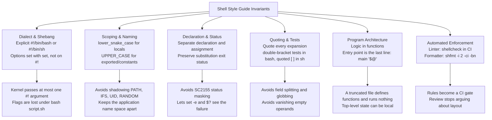

# Shell Style Guides

> [!summary] Claim
> A shell style guide is an executable risk-reduction specification that systematically eliminates latent interpreter traps, variable collisions, silent failure propagation, and partial-execution windows by replacing defensive tribal knowledge with mechanical, parser-level constraints and automated CI gates.

Part of [Robust Scripting](README.md) in [Shell and Unix Engineering](../README.md).

## TL;DR

- Mechanism: each style rule maps to an invariant in the kernel, parser, or expansion pipeline: `execve(2)` passes one argument, declaration builtins return their own status instead of the substitution's (POSIX.1-2024 XCU 2.9.1.3), `[` receives post-expansion words, and bash buffers scripts in chunks of up to 8192 bytes.
- Rule: choose an explicit dialect (`#!/bin/bash` or `#!/bin/sh`), set flags via `set` inside the body, separate declaration from command substitution assignment, quote all parameter expansions, restrict script-private identifiers to lowercase, encapsulate execution in functions terminated by `main "$@"`, and block merges with `shellcheck` and `shfmt`.
- Trap: combined declaration-assignments like `local v=$(cmd)`, `export v=$(cmd)`, and `readonly v=$(cmd)` evaluate to the exit status of the declaration builtin itself, hiding subshell failures from `$?` and `set -e` across bash, dash, zsh, and POSIX shells.
- Portability: standard POSIX defines `fname() { ...; }` exclusively (POSIX.1-2024 XCU 2.9.5); `function`, `[[ ... ]]`, and `local` are non-standard extensions whose parsing and semantics diverge sharply across dash, posh, ksh93, mksh, yash, and BusyBox ash.
- When not to use it: when a program exceeds approximately 100 lines, requires complex data structures, handles nested JSON/YAML, or implements concurrent task graphs, a style guide cannot prevent fragility; rewrite the tool in Go, Python, or Rust.

## Mental model



The six boxes on the left are rules; the boxes on the right are the mechanisms they defend against.
The dialect rule fixes which interpreter parses the file before any shell code runs, because the kernel, not the shell, reads the `#!` line.
The naming rule keeps application state out of the name space that the environment and the shell's special parameters occupy.
The declaration rule exists because a declaration builtin reports its own status, so the exit status of a command substitution on its right-hand side is lost.
The quoting rule exists because expansion happens before the command runs, so the command never sees the original word boundaries.
The architecture rule makes the last line of the file the only line that starts work, which turns a half-written file into a no-op.
The enforcement rule moves all of the above from review comments into a tool that fails the build.

## How it works

### Dialect selection and shebang mechanics

The `#!` line is parsed directly by the operating system kernel inside `execve(2)` before any shell process initializes.
Under Linux (`fs/binfmt_script.c`, function `load_script`), the kernel verifies that `bprm->buf` begins with the bytes `#!`.
The kernel locates the start of the interpreter binary path using `next_non_spacetab` and finds its end using `next_terminator`.
Any remaining characters on that first line (after skipping leading spaces and tabs, and stripping trailing whitespace and newline) are stored as a single optional argument `i_arg`.
Because the Linux kernel provides exactly one argument slot, a shebang such as `#!/bin/bash -e -u` causes `execve(2)` to invoke `/bin/bash` with the single argument `"-e -u"`.
GNU bash reads `"-e -u"` as one option cluster, rejects the embedded space, and aborts before running the script: `bash '-e -u' -c true` prints `bash: - : invalid option` and exits 1 (measured with GNU bash 5.3.15, 2026-11).
The Linux manual page documents this behavior explicitly: on Linux the entire string following the interpreter name is delivered as one argument, while some other systems end the argument at the first white space and some split it into several arguments (`execve(2)`, "Interpreter scripts").
Shebang buffer capacity is strictly bounded by kernel constants: `BINPRM_BUF_SIZE` is defined as 256 bytes in `include/uapi/linux/binfmts.h`.
The effective text limit after `#!` was 127 characters before Linux 5.1 and is 255 characters in Linux 5.1 and newer kernels (`execve(2)`).
When `load_script` finds no newline within `BINPRM_BUF_SIZE` and no space, tab, or NUL after the interpreter path, the kernel assumes the path is truncated and returns `-ENOEXEC`.
If an optional argument is truncated by the buffer boundary, the kernel silently truncates the argument string rather than raising an error.
Furthermore, when a user or automation invokes a script via `bash script.sh`, the kernel executes the `bash` binary directly with `script.sh` as an argument; the kernel never interprets the `#!` line, and any flags written on that line are ignored.
For this reason, the Google Shell Style Guide (heading "Which Shell to Use") mandates starting executables with `#!/bin/bash` with minimal or no flags, using `set` inside the script body to configure execution options so that direct interpreter invocations maintain identical behavior.
The Google guide also establishes a fleet-wide dialect contract: bash is the sole permitted shell for executable scripts, rendering POSIX-only compatibility unnecessary except on platforms where bash is unavailable.
In general engineering practice across heterogeneous environments, the rule requires an explicit binary choice: write pure POSIX shell targeted to `#!/bin/sh`, or write modern bash targeted to `#!/bin/bash`, never using bash extensions in a `/bin/sh` script.

### Function definition syntax and scoping models

POSIX.1-2024 XCU 2.9.5 specifies exactly one portable function definition format:

```sh
fname() compound-command [io-redirect ...]
```

All other variations are non-standard shell extensions.
The historical Korn shell syntax is `function fname { ...; }`, while bash, zsh, mksh, and yash additionally support the hybrid syntax `function fname() { ...; }`.
Parser implementations diverge across shells:
- dash contains no `function` keyword: parsing `function f { :; }` treats `function` as a command name and fails on the brace with a syntax error (`Syntax error: "}" unexpected`).
- posh 0.14.1 keeps its pdksh-derived `FUNCTION` and `DBRACKET` parser tokens inside `#ifdef SILLY_FEATURES` in `syn.c`; because neither `sh.h` nor `config.h.in` defines `SILLY_FEATURES`, those tokens are compiled out, causing posh to reject `function` with a syntax error.
- ksh93 accepts `fname() { ...; }` and `function fname { ...; }`, but strictly rejects the hybrid `function fname()` syntax with ``syntax error at line 1: `(' unexpected`` (measured on ksh93u+ 2012-08-01 and on ksh93u+m 1.0.10 in the shell matrix, 2026-11).
- mksh accepts all three formats: `syn.c` function `function_body` explicitly parses `function foo () { ... }`.
- yash accepts all three formats in default mode, but documentation (`syntax.html`) notes that the `function` keyword forms cannot be used in POSIX-conforming mode (`set -o posixly-correct`); yash 2.58.1 then fails with ``syntax error: `function' cannot be used as a command name`` (measured in the shell matrix, 2026-11).
- BusyBox ash 1.37.0 recognizes the `function` reserved word only when compiled with `CONFIG_ASH_BASH_COMPAT`, which defaults to `y` in the `//config:` block at the top of `shell/ash.c` (`BASH_FUNCTION`, token `TFUNCTION` in `simplecmd` and `parse_command`).

Scoping rules represent a major architectural divergence between shell families.
In bash, dash, zsh, mksh, yash, and BusyBox ash, local variables declared via `local` (or `typeset`) use dynamic scoping rather than lexical scoping.
The variable is placed onto a runtime call stack: any child function invoked while the caller's stack frame is active can read and mutate that variable.
In GNU bash, this stack is tracked by `variable_context` in `variables.c`, and `local_builtin` in `builtins/declare.def` throws an error (`can only be used in a function`) if `variable_context` is zero.
In contrast, ksh93 implements true static (lexical) scoping for functions defined with the `function fname` keyword, creating an isolated local scope per function.
Functions defined with the POSIX `fname()` syntax in ksh93 run within the caller's scope, behaving like sourced blocks.
When an outer function defines a local variable with `typeset` in ksh93, an inner function defined with `function` cannot see that variable (it sees global scope), whereas an inner function defined with POSIX `fname()` sees the caller's `typeset` variable.
POSIX.1-2024 omits `local` entirely: XCU 2.9.1.4 explicitly lists `local`, `typeset`, and `declare` in the table of unspecified utility names whose behavior is implementation-defined.
In ksh93, `local` does not exist (`src/cmd/ksh93/data/builtins.c`), and invoking `local` returns exit status 127 (`local: not found`), flagged by ShellCheck as SC3043.
The defensive style rules that follow:
1. Define all functions using the POSIX standard `fname() { ...; }` syntax across all scripts.
   While Google's guide (heading "Function Names") permits the `function` keyword when used consistently, omitting the keyword provides unconditional portability across all POSIX shells.
   Google also requires the parentheses after the name, so its keyword form is the hybrid `function fname()`, which ksh93, dash, and posh reject.
2. In bash and POSIX-extended shells, declare every variable used inside a function as `local` at the top of the function body to prevent dynamic scope clobbering of caller state.
3. In scripts that must execute under ksh93, do not invoke `local`; use `typeset` within Korn-style `function` declarations, or manage variable prefixes manually.

### The declaration return value masking trap (SC2155)

A frequent source of silent failure in shell scripting is the combined declaration and assignment:

```bash
local my_data="$(fetch_payload)"
```

When the shell evaluates this line, word expansion occurs first: the command substitution runs `fetch_payload` inside a subshell, capturing stdout.
Next, the shell executes the declaration builtin `local` with the expanded argument `my_data=<captured_output>`.
In GNU bash (`builtins/declare.def`, function `declare_internal`), the builtin assigns the variable and terminates with:

```c
return (assign_error ? EX_BADASSIGN : ((any_failed == 0) ? EXECUTION_SUCCESS : EXECUTION_FAILURE));
```

Because the assignment itself succeeded, `local` returns `EXECUTION_SUCCESS` (status 0).
The non-zero exit status of the failed command substitution `fetch_payload` is completely overwritten by the 0 status of `local`.
Consequently, `$?` evaluates to 0, and `set -e` fails to trigger, allowing the script to proceed silently with corrupted or empty data.
The same status-masking failure occurs with `export` and `readonly`, which ShellCheck detects and flags as SC2155 ("Declare and assign separately to avoid masking return values").
The lab verifies this behavior across bash 3.2, bash 5.3, zsh 5.9, dash 0.5.13, and ksh93 on the macOS host, and the same probe gives the same result in the shell matrix for mksh R59, yash 2.58.1, posh 0.14.1, BusyBox ash 1.37.0, and ksh93u+m 1.0.10 (2026-11): all return exit status 0 for `local v=$(exit 42)`, `export v=$(exit 42)`, and `readonly v=$(exit 42)`.
On ksh93, `local` yields status 127 because the command is missing, while `export` and `readonly` mask the failure to 0.
BusyBox ash implements `localcmd` in `shell/ash.c` by calling `mklocal` for each operand and returning 0, reproducing the masking behavior.
Separating declaration from assignment resolves the vulnerability:

```bash
local my_data
my_data="$(fetch_payload)"
```

The first statement declares the identifier in the local scope and returns 0.
The second statement contains a variable assignment without a command name.
Under POSIX.1-2024 XCU 2.9.1.3: "if there is no command name but the command contains a command substitution, the command shall complete with the exit status of the command substitution whose exit status was the last to be obtained."
Because no command name is present, the exit status of the line is the exact status of `fetch_payload`.
If `fetch_payload` fails, `set -e` immediately traps and exits, and `$?` accurately reflects the failure code.
The Google Shell Style Guide (heading "Use Local Variables") mandates this exact separation pattern because `local` does not propagate command substitution exit codes.

### Variable naming and environmental collision prevention

POSIX.1-2024 XBD 8 defines the formal namespace partition for environment and shell variables:
Environment variable names used by standard utilities and the shell language consist exclusively of uppercase letters, digits, and underscores.
XBD 8 explicitly states: "the name space of environment variable names containing lowercase letters is reserved for applications."
When a shell script executes, environment variables are imported directly into the shell variable symbol table.
A script that uses uppercase variable names for internal application state risks clobbering shell control variables and environment parameters:
- `PATH`: redefining `PATH` inside a script alters external utility resolution for all subsequent commands; lookup failure returns exit status 127 (POSIX.1-2024 XCU 2.9.1.4), measured as `path_clobber_status=127` in the lab.
- `IFS`: mutating `IFS` modifies field splitting across all subsequent unquoted expansions within that shell execution environment.
- `UID`: in GNU bash (`variables.c`, `uidset` setting `att_readonly | att_integer`), `UID` is initialized as a readonly integer representing the real user ID.
  In zsh, `UID` is a special parameter rather than a readonly one: assigning to it calls `setuid(2)` (zsh manual, "Parameters Set By The Shell"), so an unprivileged `UID=99999` fails with `failed to change user ID: operation not permitted` and also aborts the script (measured with zsh 5.9.2, native and `--emulate sh`, 2026-11).
  Under POSIX.1-2024 XCU 2.8.1, a variable assignment error on a readonly variable causes a non-interactive shell to abort execution immediately.
  Executing `UID=1000` in a bash script outputs `UID: readonly variable` and terminates the script; in dash, ksh93, mksh, yash, posh, and BusyBox ash, `UID` is an ordinary variable, and the assignment silently succeeds with exit status 0 (measured on the macOS host and in the shell matrix, 2026-11).
- `SECONDS` and `RANDOM`: in GNU bash, assigning `SECONDS=100` resets the internal timer baseline such that subsequent evaluations return 100 plus subsequent elapsed seconds; assigning `RANDOM=42` seeds the internal pseudorandom number generator, causing subsequent invocations to produce deterministic pseudo-random sequences.
- `CDPATH`, `ENV`, and `BASH_ENV`: accidental overwrites divert directory transitions or trigger unintended subshell initialization scripts.

The Google Shell Style Guide (headings "Variable Names" and "Constants, Environment Variables, and readonly Variables") enforces strict casing conventions:
Internal variables and function names must use `lower_snake_case`.
Uppercase names are restricted strictly to constants and exported environment variables, placed at the top of the file and protected with `readonly`.

### Quoting, word splitting, and conditional evaluation

The POSIX expansion pipeline executes in a strict multi-pass sequence defined by POSIX.1-2024 XCU 2.6:
1. Parameter expansion, command substitution, and arithmetic expansion occur first.
2. Field splitting (XCU 2.6.5) divides the expanded text into distinct words based on the characters in `IFS`.
3. Pathname expansion (XCU 2.6.6) scans unquoted fields for `*`, `?`, and `[` wildcard patterns, replacing matching fields with sorted file paths.
4. Quote removal (XCU 2.6.7) discards unquoted backslashes, single quotes, and double quotes.

An unquoted variable expansion undergoes immediate field splitting and pathname expansion.
If a variable contains spaces, tabs, or newlines, the receiving command receives multiple arguments rather than one; if a field matches filenames in the working directory, it expands into an arbitrary list of file paths.
The Google Shell Style Guide (heading "Quoting") mandates quoting all string literals containing variables, command substitutions, whitespace, or shell metacharacters.
Arrays should be used for lists of arguments, expanded exclusively using `"${args[@]}"`.
Unquoted `$*` and `$@` split on whitespace and discard empty string arguments; `"$@"` preserves the exact argument boundaries of all positional parameters.
Double quotes are unnecessary only in contexts where the shell grammar prohibits field splitting: within arithmetic expansions `$(( ... ))`, on the right-hand side of a plain assignment `var=$val`, and within the conditions of `[[ ... ]]`.
Note that curly braces `${var}` do not provide quoting; they only delimit the identifier boundary.

The test constructs `[` and `[[ ... ]]` operate on fundamentally different parser primitives:
`[` is a standard utility (typically a builtin) that receives arguments only after the full expansion pipeline has completed.
POSIX.1-2024 `test` defines its evaluation algorithm based strictly on argument count:
With one argument, `[ string ]` evaluates to true if the string is non-empty.
With two arguments where the first is `!`, it is true when the second is null; where the first is a unary primary such as `-n`, it applies that primary to the second; otherwise, the result is unspecified.
When an unquoted variable is empty, it is completely removed by field splitting prior to command execution.
Consequently, `[ -n $empty ]` evaluates as `[ -n ]`: a single-argument test where the string operand is `"-n"`.
Because `"-n"` is a non-empty string, `[ -n $empty ]` evaluates to true (status 0) across all POSIX shells, exactly inverting the intended logic.
Similarly, `[ $empty = "val" ]` collapses to `[ = "val" ]`, triggering syntax errors across implementations:
- bash: `[: =: unary operator expected` (status 2).
- dash: `[: =: unexpected operator` (status 2).
- ksh93u+: `[: argument expected` (status 2).
- zsh: `parse error: condition expected: =` (status 2).
- mksh and posh: `[: val: unexpected operator/operand` (status 2); BusyBox ash: `val: unknown operand` (status 2).
These messages were measured on the macOS host and in the shell matrix (2026-11).

Conversely, `[[ ... ]]` is a reserved compound keyword parsed directly by the shell syntax analyzer.
Word splitting and pathname expansion are inhibited inside `[[ ... ]]`, ensuring that empty variables do not disappear from the expression.
In bash, zsh, mksh, ksh93, and yash, `[[ -n $empty ]]` accurately evaluates to false (status 1), measured by the lab probe on the macOS host and in the shell matrix (2026-11).
POSIX.1-2024 explicitly rejected the addition of `[[ ... ]]` in Issue 8: the `test` rationale notes that existing implementations varied too widely in behavior and proved error-prone across platforms.
BusyBox ash demonstrates this implementation divergence: `ash.c` defines `[[` as a standard regular builtin (`BUILTIN_REGULAR "[[", testcmd`) mapped to the `test` applet.
Because BusyBox `[[` is an applet rather than a parser keyword, unquoted empty variables still vanish under field splitting, and `[[ -n $empty ]]` evaluates to true (status 0), measured in both the Alpine and Debian matrix images (2026-11).
The `coreutils/test.c` source says so itself: a `TODO` comment notes that `[[ expr ]]` is not yet handled bash-compatibly because word splitting and pathname expansion should not be performed and that needs support from the shell.
In pure POSIX `#!/bin/sh` scripts, engineers must use `[ ... ]` with every operand quoted, combining tests using standard shell control operators: `[ "$a" = "x" ] && [ "$b" = "y" ]`.
The compound binary flags `-a` and `-o` inside `[` are prohibited: POSIX.1-2008 marked them obsolescent, and POSIX.1-2024 officially removed them from the standard specification (Austin Group Defect 1330).
When performing regular expression matching in bash using `=~`, quoting the right-hand pattern triggers literal substring matching rather than regex evaluation (bash 3.2+).
For example, `[[ abc =~ "^a" ]]` evaluates to false, whereas `[[ abc =~ ^a ]]` evaluates to true; store complex regex patterns in a variable and expand the variable unquoted: `re='^[0-9]+$'; [[ $var =~ $re ]]`.

### Script buffering, truncation protection, and the `main "$@"` pattern

When GNU bash executes an on-disk script, it wraps the underlying file descriptor in an internal buffered stream (`input.c`).
In `fd_to_buffered_stream`, the buffer capacity is allocated as `min(st_size, MAX_INPUT_BUFFER_SIZE)` for seekable files, and 1 byte for non-seekable streams (such as pipes and sockets).
The constant `MAX_INPUT_BUFFER_SIZE` is defined as 8192 bytes (or 8172 bytes when compiled with `USING_BASH_MALLOC`, `input.c` lines 129-133 in bash 5.3, checked against the bash-5.3 tarball 2026-11).
Bash fills this buffer via `b_fill_buffer` using `zread` from the current file descriptor offset.
This buffering model introduces two critical runtime hazards:
1. In-place file modification: If a script file exceeding 8192 bytes is modified or overwritten in place during execution (e.g. by `cp` onto the existing file, `cat new >script`, or an editor configured to write in place), the kernel updates the file content while preserving the open file descriptor.
   `git checkout` is not such a writer: `entry.c` unlinks the old file (`unlink_entry`) and creates a new one with `O_CREAT | O_EXCL`, so a running bash keeps reading the old inode.
   When bash drains its current buffer and issues the next `read(2)` syscall, the read resumes at the existing byte offset in the modified file.
   The offset rarely aligns with a command boundary, causing bash to parse and execute corrupted command fragments with arbitrary syntax.
2. Interrupted network streaming: When running scripts via `curl https://example.com/install.sh | bash`, the pipe is read byte-by-byte.
   If the network connection terminates mid-transfer, every complete command received prior to the disconnection has already executed, potentially leaving system configuration half-applied.

The `main "$@"` structural pattern eliminates these execution windows:

```bash
#!/bin/bash
set -euo pipefail

step_one() {
  printf 'Executing step 1\n'
}

step_two() {
  printf 'Executing step 2\n'
}

main() {
  step_one
  step_two
}

main "$@"
```

A shell executes top-level commands sequentially as it parses them.
A function definition is purely declarative: the shell parses the syntax into its in-memory function symbol table and executes no logic.
The entire operational workflow is deferred until the final line `main "$@"` is reached.
If a file transfer terminates or a network connection drops before the final line, the shell exits cleanly having executed zero operational logic.
If truncation occurs inside a function body, the parser encounters an unexpected end-of-file and aborts with a syntax error, executing nothing.
The lab demonstrates this behavior directly: executing a truncated script containing function definitions produces zero output, whereas a truncated linear script immediately executes `step1`.
Appending `main "$@"` to the guarded script runs both `step1` and `step2`.
The Google Shell Style Guide (heading "main") requires `main` for any script long enough to contain at least one other function, placing `main "$@"` as the final line.
Note that `main` does not guard initialization commands executed before function definitions (such as `set` flags and constant definitions); keep the global scope strictly declarative.

### Pipelines, arithmetic, and the smaller Google rules

Four more Google guide rules (as of 2026-11) rest on shell mechanics that differ across implementations, and the lab proves two of them.

Pipes to while (guide heading "Pipes to While"):
POSIX.1-2024 XCU 2.13 states that "each command of a multi-command pipeline is in a subshell environment; as an extension, however, any or all commands in a pipeline may be executed in the current environment."
So `producer | while read -r line; do last=$line; done` may or may not keep `last` after the loop, and the standard permits both.
The lab probe `pipe_while` measured `last_line=NULL` (assignment lost) in bash 3.2 and 5.3, dash, mksh, yash, posh, BusyBox ash, and zsh with `--emulate sh`, and `last_line=b` (assignment kept) in native zsh and in ksh93u+ and ksh93u+m (2026-11).
The guide's fix is process substitution (`done < <(cmd)`, bash) or `readarray -t lines < <(cmd)` (bash 4+); in POSIX `sh`, which has neither, redirect from a temporary file or a here-document instead of piping.
The portable rule is the one the measurement supports: never depend on a variable assigned inside the last element of a pipeline.

Standalone arithmetic (guide heading "Arithmetic"):
the guide says to use `(( ... ))` or `$(( ... ))` and never `let`, `$[ ... ]`, or `expr`, and it warns that a standalone `(( expr ))` returns status 1 when `expr` evaluates to 0, so `set -e; i=0; (( i++ ))` exits the shell.
The lab probe `arith_zero` measured status 1 for `(( i++ ))` with `i=0` in bash, zsh (native and `--emulate sh`), mksh, and ksh93.
In dash, posh, yash, and BusyBox ash the same text has no `(( ))` command: it parses as two nested subshells running the command `i++`, which is not found, so the status is 127 (measured 2026-11).
A script that must run under `#!/bin/sh` therefore uses `i=$((i + 1))`, which is POSIX arithmetic expansion (XCU 2.6.4) and never fails on a zero result.

Command substitution, builtins, and streams:
- Guide heading "Command Substitution": use `$(command)` rather than backticks, because nested backticks need escaping and `$(...)` nests unchanged.
- Guide heading "Builtin Commands vs. External Commands": prefer builtin parameter expansion and arithmetic over `sed`, `expr`, and `echo "$x" | ...`, which fork a process per use.
- Guide heading "STDOUT vs STDERR": all error messages go to standard error, so a caller can separate status output from failures.
- Guide heading "Checking Return Values": test `$?` or `if ! cmd; then` directly; bash `PIPESTATUS` holds each pipeline element's status, but `[` is a command and overwrites it, so copy it immediately with `return_codes=( "${PIPESTATUS[@]}" )`.
- Guide heading "File Extensions": executables use `.sh` or no extension, libraries must use `.sh` and must not be executable.

### Automated style-as-code: ShellCheck and shfmt

Manual code review is fundamentally ineffective at catching subtle quoting omissions, masked exit codes, and cross-shell incompatibilities.
Automating style enforcement via deterministic static analysis tools is mandatory:
1. `shellcheck`: ShellCheck analyzes scripts at the AST level, detecting known failure modes by static rule ID:
   - SC2155: Identifies return code masking in `local`, `export`, and `readonly` declarations.
   - SC2086: Flags unquoted parameter expansions susceptible to field splitting and globbing.
   - SC2115: Detects dangerous destructive paths where empty variables can collapse arguments to `/*`.
   - SC3043: Flags undefined `local` usage in POSIX `#!/bin/sh` scripts.
   ShellCheck exits with status 1 when findings are present (`shellcheck(1)`, "RETURN VALUES", ShellCheck 0.11.0).
   Teams should enforce zero warnings in CI pipelines, requiring documented justification for any suppression: `# shellcheck disable=SC2086 # intentional word splitting of space-separated host list`.
2. `shfmt`: Formats shell scripts to strict structural standards (`mvdan/sh`):
   - `-i 2`: Enforces 2-space indentation with no tabs, matching Google guidelines.
   - `-ci`: Indents the pattern lines of a `case` statement inside `case ... esac`.
   - `-bn`: Formats binary operators (`&&`, `||`, `|`) to begin continued lines.
   CI checks run `shfmt -d -i 2 -ci -bn .` to ensure automated formatting compliance without manual review disputes.

## Numbers and limits

| Metric | Value | Mechanism | Source and date |
|---|---|---|---|
| Linux shebang buffer size | 256 bytes (`BINPRM_BUF_SIZE`) | Kernel reads initial bytes of executable to inspect magic number and parse interpreter path | `include/uapi/linux/binfmts.h` (fetched 2026-11) |
| Linux shebang text limit | 127 chars (pre-5.1), 255 chars (5.1+) | Maximum string length parsed after `#!` prefix | `man2/execve.2.html` (fetched 2026-11) |
| Linux shebang argument count | Exactly 1 optional argument (`i_arg`) | All whitespace-separated tokens following the interpreter path are passed as a single string | `fs/binfmt_script.c` `load_script` (fetched 2026-11) |
| Bash script read buffer | `min(st_size, 8192)` bytes (or 8172 with bash malloc); 1 byte for non-seekable | Internal stream buffer allocated by `fd_to_buffered_stream` and refilled via `b_fill_buffer` | GNU bash 5.3 `input.c` (fetched 2026-11) |
| Google guide indentation | 2 spaces, no tabs | Formatting standard | Google Shell Style Guide, "Indentation" (2026-11) |
| Google guide line length | 80 characters | Readability and terminal formatting constraint | Google Shell Style Guide, "Line Length and Long Strings" (2026-11) |
| Google guide rewrite threshold | > 100 lines or non-linear flow | Boundary condition requiring migration to structured programming languages | Google Shell Style Guide, "When to use Shell" (2026-11) |
| Declaration masking exit status | `local v=$(exit 42)` gives 0; `v=$(exit 42)` gives 42 | Builtin returns its own execution status; assignment without command name returns substitution status | POSIX.1-2024 XCU 2.9.1.3; measured in lab 2026-11 |
| Unquoted `$*` word splitting | 2 fields quoted, 5 fields unquoted (2 in native zsh) | Post-expansion field splitting on `IFS` whitespace delimiters | POSIX.1-2024 XCU 2.6.5; measured in lab 2026-11 |
| `[ -n $empty ]` unquoted evaluation | Exit status 0 (true) | Vanishing empty operand leaves lone `-n` string operand evaluated under 1-argument rule | POSIX.1-2024 `test` 1-argument algorithm; measured in lab 2026-11 |
| `UID=99999` readonly enforcement | Exit status 1 in bash and zsh; 0 in dash, ksh93, mksh, yash, posh, and BusyBox ash | Readonly integer attribute in bash; special parameter whose assignment calls `setuid(2)` in zsh; plain variable elsewhere | GNU bash 5.3 `variables.c` `uidset`; zsh manual "Parameters Set By The Shell"; measured in lab and shell matrix 2026-11 |
| Command lookup failure code | Exit status 127 | External command not found in `PATH` search | POSIX.1-2024 XCU 2.9.1.4; measured in lab 2026-11 |
| ShellCheck lint failure exit code | Exit status 1 | CLI error signaling static analysis violations | ShellCheck 0.11.0 `shellcheck(1)` "RETURN VALUES" (2026-11) |

## Portability

Evidence key: `[M]` measured directly, by running the lab suite on the macOS host on 2026-11-21 or by running the lab probe `style-probe.sh` in the Debian 13 and Alpine 3.22 shell matrix images on 2026-11-27; `[S]` verified against official implementation source code or reference manuals.

| Shell | `fname()` | `function fname` | `function fname()` | `local` | `local x=$(exit 42)` status | `UID=1` | `[[ ... ]]` | Unquoted `$*` of 2 args |
|---|---|---|---|---|---|---|---|---|
| POSIX.1-2024 | defined (XCU 2.9.5) | not defined | not defined | unspecified (XCU 2.9.1.4) | n/a | n/a | not defined (rejected for Issue 8) | splits on `IFS` (XCU 2.6.5) |
| bash 3.2.57 (macOS `/bin/bash`) | ok `[M]` | ok `[M]` | ok `[M]` | builtin `[M]` | 0 `[M]` | readonly, exit 1 `[M]` | keyword `[M]` | 5 fields `[M]` |
| bash 5.3.15 | ok `[M]` | ok `[M]` | ok `[M]` | builtin `[M]` | 0 `[M]` | readonly, exit 1 `[M]` | keyword `[M]` | 5 fields `[M]` |
| zsh 5.9.2 native | ok `[M]` | ok `[M]` | ok `[M]` | builtin `[M]` | 0 `[M]` | special (`setuid` fails), exit 1 `[M]` | keyword `[M]` | 2 fields (no split) `[M]` |
| zsh 5.9.2 `--emulate sh` | ok `[M]` | ok `[M]` | ok `[M]` | builtin `[M]` | 0 `[M]` | special (`setuid` fails), exit 1 `[M]` | keyword `[M]` | 5 fields `[M]` |
| dash 0.5.13.5 | ok `[M]` | syntax error `[M]` | syntax error `[M]` | builtin `[M]` | 0 `[M]` | plain, exit 0 `[M]` | not found, 127 `[M]` (0 on Alpine, which installs BusyBox `/usr/bin/[[`) | 5 fields `[M]` |
| ksh93u+ 2012-08-01 (macOS `/bin/ksh`) | ok `[M]` | ok `[M]` | syntax error `[M]` | not found, 127 `[M]` | 127 `[M]` (`export`/`readonly` give 0) | plain, exit 0 `[M]` | keyword `[M]` | 5 fields `[M]` |
| ksh93u+m 1.0.10 | ok `[M]` | ok `[M]` | syntax error `[M]` | not found, 127 `[M]` | 127 `[M]` (`export`/`readonly` give 0) | plain, exit 0 `[M]` | keyword `[M]` | 5 fields `[M]` |
| mksh R59 (2020/10/31 Alpine, 2025/04/26 Debian) | ok `[M]` | ok `[M]` | ok `[M]` | builtin (alias for typeset) `[M]` `[S]` | 0 `[M]` | plain (no `UID`, only `KSHUID`) `[M]` `[S]` | keyword `[M]` | 5 fields `[M]` |
| yash 2.58.1 | ok `[M]` | ok outside POSIX mode `[M]` | ok outside POSIX mode `[M]` `[S]` | builtin `[M]` | 0 `[M]` | plain, exit 0 `[M]` | keyword `[M]` | 5 fields `[M]` |
| posh 0.14.1 | ok `[M]` | syntax error `[M]` | syntax error `[M]` | builtin `[M]` | 0 `[M]` | plain, exit 0 `[M]` | not found, 127 `[M]` | 5 fields `[M]` |
| BusyBox ash 1.37.0 (default config) | ok `[M]` | ok `[M]` | ok `[M]` | builtin `[M]` | 0 `[M]` | plain (no `UID`) `[M]` | regular builtin, not a keyword, `[[ -n $empty ]]` gives 0 `[M]` | 5 fields `[M]` |

Two further lab probes, measured on the same hosts and images (2026-11):

| Shell | Assignment inside `printf ... \| while read` survives the loop (`pipe_while`) | Standalone `(( i++ ))` with `i=0` (`arith_zero`) |
|---|---|---|
| POSIX.1-2024 | unspecified (XCU 2.13) | not defined |
| bash 3.2.57 and 5.3.15 | lost, `NULL` `[M]` | status 1 `[M]` |
| zsh 5.9.2 native | kept, `b` `[M]` | status 1 `[M]` |
| zsh 5.9.2 `--emulate sh` | lost, `NULL` `[M]` | status 1 `[M]` |
| dash 0.5.13.5 | lost, `NULL` `[M]` | not found, 127 `[M]` |
| ksh93u+ and ksh93u+m 1.0.10 | kept, `b` `[M]` | status 1 `[M]` |
| mksh R59 | lost, `NULL` `[M]` | status 1 `[M]` |
| yash 2.58.1 | lost, `NULL` `[M]` | not found, 127 `[M]` |
| posh 0.14.1 | lost, `NULL` `[M]` | not found, 127 `[M]` |
| BusyBox ash 1.37.0 | lost, `NULL` `[M]` | not found, 127 `[M]` |

Primary source documentation for `[S]` portability cells:
- ksh93u+m 1.0.10: `src/cmd/ksh93/data/builtins.c` defines builtins (no `local` entry; `typeset` has `BLT_DCL`); the matrix image (`${.sh.version}` reports `93u+m/1.0.10 2024-08-01`) rejects `()` after `function fname` with a syntax error, reports `local: not found` (127), and lets `UID=99999` succeed; `[[ ... ]]` is a reserved compound keyword; unquoted `$*` undergoes standard `IFS` splitting.
- mksh R59: `mksh.1` documents dynamic scoping ("uses dynamic scoping (nested scopes of varying locality)"), `local` as a predefined alias for `\builtin typeset`, and double-bracket expressions; `syn.c` function `function_body` accepts `function foo () { ... }`; `var.c` function `c_typeset` returns `rv = 0` on successful declaration; `main.c` defines `KSHUID` and `USER_ID` but no `UID`; `$*` splits on `IFS`.
- yash 2.58.1: `syntax.html` documents `function` keyword support outside POSIX mode and `[[ ... ]]` syntax; `exec.html` lists `export`, `local`, `readonly`, and `typeset` as declaration utilities; `_typeset.html` specifies that the exit status of `typeset` is 0; unquoted `$*` undergoes `IFS` splitting.
- posh 0.14.1: `syn.c` places `FUNCTION` and `DBRACKET` under `#ifdef SILLY_FEATURES`; `sh.h` and `config.h.in` leave `SILLY_FEATURES` undefined; man page restricts function definitions to `fname()`; `local` is a builtin that masks exit codes to 0; `$*` splits on `IFS`.
- BusyBox ash 1.37.0: `shell/ash.c` handles `TFUNCTION` under `BASH_FUNCTION`, registers `[[` as `BUILTIN_REGULAR "[[", testcmd` in `builtintab` under `BASH_TEST2` (`ENABLE_ASH_BASH_COMPAT * ENABLE_ASH_TEST`), and defines `localcmd` returning 0; the `//config:` block at the top of `shell/ash.c` declares `ASH_BASH_COMPAT` with `default y`; `coreutils/test.c` registers `[[` as an alias of the `test` applet and carries a `TODO` saying `[[ expr ]]` is not yet handled bash-compatibly; `$*` splits on `IFS`.

## Worked example

The test suite [lab](../labs/13-shell-style-guides/) consists of a probe utility `style-probe.sh` and a Bats verification suite `style-guide.bats` validating runtime style mechanisms across shell implementations.
The following is a simplified excerpt from `labs/13-shell-style-guides/style-probe.sh`:

```sh
mask_return)
  f_masked() {
    local val=$(exit 42)
    return $?
  }
  masked_status=$(f_masked; printf '%d' "$?")

  f_separate() {
    local val
    val=$(exit 42)
    return $?
  }
  separate_status=$(f_separate; printf '%d' "$?")
  ;;

bracket_test)
  empty=""
  single_unquoted=$([ -n $empty ]; echo $?)
  single_quoted=$([ -n "$empty" ]; echo $?)
  double_unquoted=$(eval '[[ -n $empty ]]' 2>/dev/null; echo $?)
  ;;

case_collision)
  uid_mod_status=0
  (eval 'UID=99999') 2>/dev/null || uid_mod_status=$?
  ;;
```

The corresponding Bats test arm verifies exact status code handling:

```sh
case $family in
  bash | zsh | zsh-sh | yash | mksh | busybox | posh | dash)
    [ "$output" = "masked=0 separate=42 export=0 readonly=0" ]
    ;;
  ksh93)
    # ksh93 lacks local, so the local line fails with status 127
    [ "$output" = "masked=127 separate=42 export=0 readonly=0" ]
    ;;
  *) false ;;
esac
```

Execution trace captured directly across shell environments on macOS (2026-11-21):

```
$ bash style-probe.sh func_syntax
posix=ok korn=ok hybrid=ok
$ bash style-probe.sh mask_return
masked=0 separate=42 export=0 readonly=0
$ bash style-probe.sh case_collision
uid_status=1 lowercase=app_1234 path_clobber_status=127
$ bash style-probe.sh bracket_test
single_unquoted=0 single_quoted=1 double_unquoted=1
$ bash style-probe.sh array_quote
quoted=2 unquoted=5

$ dash style-probe.sh func_syntax
posix=ok korn=error hybrid=error
$ dash style-probe.sh case_collision
uid_status=0 lowercase=app_1234 path_clobber_status=127
$ dash style-probe.sh bracket_test
single_unquoted=0 single_quoted=1 double_unquoted=127

$ zsh style-probe.sh array_quote
quoted=2 unquoted=2

$ /bin/ksh style-probe.sh func_syntax
posix=ok korn=ok hybrid=error
$ /bin/ksh style-probe.sh mask_return
masked=127 separate=42 export=0 readonly=0
$ /bin/ksh style-probe.sh scope_leak
inner_read=initial_outer outer_after=mutated_by_inner global=mutated_by_inner
$ /bin/ksh style-probe.sh pipe_while
last_line=b
$ dash style-probe.sh arith_zero
postinc_status=127
```

The Bats suite has 9 tests, and all 9 passed on 2026-11-27 under every host shell (GNU bash 5.3.15, macOS `/bin/bash` 3.2.57, dash 0.5.13.5, native zsh 5.9.2, `zsh --emulate sh`, and `/bin/ksh` ksh93u+ 2012-08-01) and under bash, dash, mksh, ksh93u+m, posh, and BusyBox ash in the Debian image and bash, dash, mksh, yash, and BusyBox ash in the Alpine image.
The last two tests are `a loop at the end of a pipeline loses its assignments except in native zsh and ksh93, which run the last element in the current shell` and `a standalone (( i++ )) with i=0 returns status 1 where the syntax exists and parses as nested subshells elsewhere`.

## Pitfalls

> [!warning] Command substitution status swallowed by declaration builtins (SC2155)
> **Trigger:** Writing combined declarations such as `local payload="$(curl -fsSL "$url")"`, `export token="$(get_auth_token)"`, or `readonly config=$(parse_cfg)`.
> **Symptom:** The command substitution fails with non-zero exit status, but the declaration builtin returns 0; `set -e` fails to trigger, and execution proceeds silently with uninitialized or empty variables.
> **Fix:** Separate variable declaration from assignment:
> ```bash
> local payload
> payload="$(curl -fsSL "$url")"
> ```
> Under POSIX.1-2024 XCU 2.9.1.3, an assignment command without a command name inherits the exit status of the right-hand command substitution.

> [!warning] In-place script rewrite or aborted stream executes corrupted code
> **Trigger:** Overwriting a running script during deployment (`cp new.sh app.sh`), or piping a script directly from network endpoints (`curl https://example.com/setup.sh | bash`) over a flaky connection.
> **Symptom:** Files exceeding bash's buffer size (8192 bytes in `input.c`) are read in chunks; in-place overwrites shift byte offsets relative to command boundaries, executing corrupted syntax fragments.
> Network streams execute all commands received up to connection loss.
> **Fix:** Enclose all logic in functions and place `main "$@"` as the final line; deploy files via atomic `mv` replacements, and download network scripts to disk before verification and execution.

> [!warning] Destructive file removal with unset or empty path variables (SC2115)
> **Trigger:** Executing destructive commands with unvalidated expansions such as `rm -rf "$TARGET_DIR/"*` when `TARGET_DIR` is empty or unset due to an earlier failure.
> **Symptom:** The path evaluates to `/*`, recursively deleting filesystem root contents.
> Valve Steam for Linux issue #3671 (opened 2015-01-14) was attributed by thread commenters to `rm -rf "$STEAMROOT/"*` evaluating against an empty `STEAMROOT`.
> **Fix:** Enforce variable existence checks at point of expansion using parameter constraints: `rm -rf -- "${target_dir:?}/"*`, flagged by ShellCheck as SC2115.
> Implement comprehensive guardrails described in [[Safe-rm-and-Destructive-Operations]].

> [!warning] Uppercase script variables collide with environment and special parameters
> **Trigger:** Using uppercase identifiers like `UID=1000`, `PATH="$tool/bin"`, `IFS=","`, `SECONDS=0`, or `RANDOM=1` for internal script logic.
> **Symptom:** In GNU bash, `UID` is a readonly integer; assignment triggers an assignment error that terminates non-interactive shells immediately (POSIX.1-2024 XCU 2.8.1).
> In zsh, assigning `UID` attempts `setuid(2)`, which fails for an unprivileged user and also aborts the script.
> In dash and ksh93, assignment silently modifies the variable, creating divergent cross-shell bugs.
> Overwriting `PATH` breaks utility lookups with status 127.
> **Fix:** Enforce `lower_snake_case` for all internal variables and functions; reserve `UPPER_CASE` exclusively for exported environment variables and `readonly` constants.

> [!warning] Non-POSIX function and test keywords under #!/bin/sh
> **Trigger:** Using `function name { ...; }` or `[[ -n $var ]]` inside scripts targeting `#!/bin/sh`.
> **Symptom:** Dash (the default `/bin/sh` on Debian and Ubuntu) aborts with syntax errors (`Syntax error: "}" unexpected`) or command-not-found errors (`[[: not found`, status 127).
> BusyBox ash executes `[[` as a standard builtin without word-splitting protection.
> On Alpine even dash finds a `[[`: BusyBox installs `/usr/bin/[[` as an applet link, so `[[ -n $empty ]]` silently returns 0 there instead of failing (measured in the shell matrix, 2026-11).
> **Fix:** Restrict `#!/bin/sh` scripts to POSIX standard `name() { ...; }` syntax and quoted `[ -n "$var" ]` tests; validate compliance in CI using `dash` and `checkbashisms`.

> [!warning] Variable set inside a piped while loop is lost, and `(( i++ ))` kills a `set -e` script
> **Trigger:** `cmd | while read -r line; do count=$((count + 1)); done; echo "$count"`, or `set -e; i=0; (( i++ ))`.
> **Symptom:** In bash, dash, mksh, yash, posh, and BusyBox ash the loop ran in a subshell, so `count` keeps its old value; native zsh and ksh93 keep it, so the same script behaves differently by shell (measured 2026-11).
> A standalone `(( i++ ))` with `i=0` returns status 1, which `set -e` treats as failure; in dash and BusyBox ash it is a "not found" error instead.
> **Fix:** Read from process substitution or `readarray` in bash, from a temporary file in POSIX `sh`, and write counters as `i=$((i + 1))`.

> [!warning] Callee overwrites caller local variables under dynamic scoping
> **Trigger:** A helper function uses temporary variables like `i`, `file`, or `temp` without declaring them `local`, while an outer caller defines a `local i`.
> **Symptom:** Under dynamic scoping (bash, dash, zsh, mksh, yash, BusyBox ash), the callee mutates the caller's variable in place, corrupting loop counters and causing infinite loops.
> **Fix:** Declare every temporary variable in every function as `local`; never rely on implicit lexical isolation.

> [!warning] Literal regex matching caused by quoting RHS of =~
> **Trigger:** Quoting regular expressions inside bash conditions: `[[ $input =~ "^[0-9]+$" ]]`.
> **Symptom:** In bash 3.2 and newer, quoted characters on the right-hand side of `=~` are parsed as literal strings rather than regex operators; the test tests for literal caret and dollar signs and fails valid inputs.
> **Fix:** Assign the regex pattern to an intermediate variable and expand it unquoted: `re='^[0-9]+$'; [[ $input =~ $re ]]`.

> [!warning] Vanishing empty operands and operator ambiguity in [
> **Trigger:** Evaluating unquoted variables inside `[`: `[ $count = 5 ]` or `[ -n $name ]`, or combining expressions with `-a` and `-o`.
> **Symptom:** Empty operands vanish under field splitting, turning `[ -n $empty ]` into `[ -n ]` which evaluates to true.
> `-a` and `-o` cause parsing ambiguities when operand values resemble operators and were removed in POSIX.1-2024.
> **Fix:** Double-quote every operand inside `[ "$count" = 5 ]`, and combine distinct tests using `&&` and `||`.

## Security and robustness

A shell style guide functions primarily as a defensive security specification, closing vectors where untrusted data is evaluated as executable shell syntax.

### Avoiding eval and code injection

Google's guide (heading "Eval") states "eval should be avoided" because it parses arguments a second time, allowing arbitrary command execution if input contains semicolons, backticks, or `$()`.
In bash, replace dynamic variable access with namerefs (`declare -n target_ref=var_name`) or indirect expansion (`${!var_name}`) rather than `eval "target=\$$var_name"`.
When dynamic evaluations are unavoidable in testing harnesses, restrict `eval` strictly to hardcoded single-quoted strings constructed internally.

### Argument arrays instead of strings

Accumulating command flags in string variables is inherently vulnerable to word splitting and globbing bugs (CWE-78).
In bash, maintain all command argument lists in indexed arrays, expanding them strictly via `"${args[@]}"` (Google guide, heading "Arrays").
In standard POSIX `sh`, where indexed arrays do not exist, use positional parameters (`set -- --flag "$arg1" "$arg2"`) to manage argument lists securely and execute them via `"$@"`.

### Temporary files and cleanup traps

Predictable temporary paths under `/tmp` introduce symlink vulnerabilities (CWE-377), allowing malicious actors to pre-create target symlinks and overwrite sensitive files.
Allocate temporary workspaces exclusively via `mktemp` or `mktemp -d`, registering immediate cleanup traps:

```bash
tmp_dir=$(mktemp -d) || exit 1
trap 'rm -rf -- "$tmp_dir"' EXIT
```

Comprehensive cleanup mechanics and signal re-raising patterns are detailed in [[Cleanup-Traps-and-Re-Raising-Signals]] and [[Safe-rm-and-Destructive-Operations]].

### Option injection and glob prefixes

Executing `rm *` in a directory containing a filename formatted like `-rf` causes `rm` to parse the filename as command-line flags.
Google's guide (heading "Wildcard Expansion of Filenames") recommends prefixing relative globs with `./` (e.g. `./*`).
Always pass the double-dash `--` delimiter prior to positional file operands across all standard utilities to terminate option parsing.
Do not prepend `./` indiscriminately to variables holding absolute paths, as `./` prepended to `/path` yields `./path`, altering the target destination.

### Privilege and SUID execution

Google's guide prohibits assigning SUID or SGID permissions to shell scripts due to fundamental interpreter vulnerabilities that prevent secure execution.
The Linux kernel ignores SUID and SGID permission bits on interpreter scripts during `execve(2)`.
Privileged operations must be executed through audited elevation tools like `sudo`.

## The principal's view

A staff-plus engineer treats a shell style guide as an operational risk management contract that balances developer velocity against system failure modes.
Three architectural decisions govern production shell governance:

1. Setting the boundary where shell terminates.
   Google's style guide establishes an explicit operational limit: if a script exceeds 100 lines, incorporates complex control flow, or demands high computational performance, it must be rewritten in a structured programming language.
   Staff engineers monitor key inflection points: the introduction of multi-dimensional arrays, nested JSON/YAML data manipulation, complex parallel concurrency, or high-consequence infrastructure mutations.
   The primary risk is deferred migration: small operational scripts inevitably grow organically until a major production outage forces an emergency rewrite; enforce language transitions during initial design review.
2. Dialect standardization across the fleet.
   Standardize dialects explicitly by execution environment: mandate `#!/bin/sh` for minimal container entrypoints and bootstrap tools that must execute across Alpine BusyBox and Debian dash environments.
   Mandate `#!/bin/bash` for developer tooling and orchestration scripts, unlocking arrays, `[[ ... ]]`, and local scoping.
   Reject "portable bash": writing hybrid scripts introduces the cognitive overhead of POSIX with the subtle failure traps of bash.
   Note that macOS bundles legacy bash 3.2.57; scripts requiring modern bash 4+ features must explicitly enforce runtime version checks or dependency requirements.
3. Automated policy enforcement as a CI gate.
   Eliminate stylistic debates from human code reviews by deploying automated linting and formatting gates: `shellcheck` with zero permitted warnings and mandatory inline suppression rationale, paired with `shfmt -d -i 2 -ci -bn`.
   Automated tools cannot detect runtime values; combine static analysis with automated test matrices running across actual deployment interpreters.
   For large brownfield repositories, deploy ratcheting allowlists that fail CI on new violations while scheduling technical debt remediation for legacy scripts.

## Interview questions

> [!question] L5: Predict the output and explain why the two functions produce different exit codes.
> ```bash
> f1() { local x=$(exit 42); return $?; }
> f2() { local x; x=$(exit 42); return $?; }
> f1; echo "f1: $?"
> f2; echo "f2: $?"
> ```
>
> > [!success]- Answer
> > The output is `f1: 0` followed by `f2: 42`.
> > In `f1`, `local` is a declaration builtin whose successful variable assignment returns exit status 0, masking the subshell failure.
> > In `f2`, the assignment statement contains no command name, causing the statement to inherit the exit status of the command substitution per POSIX.1-2024 XCU 2.9.1.3.
> > Under ksh93, which lacks the `local` builtin, `f1` fails with status 127 instead.
> >
> > Follow-up: Does this return code masking also occur with `export` and `readonly`?
> > Yes, `export` and `readonly` are declaration builtins that return their own execution status, masking command substitution failures across all POSIX shells.

> [!question] L5: Why do style guides prohibit placing configuration flags like `-e` on the `#!` shebang line?
>
> > [!success]- Answer
> > The Linux kernel parses shebang lines into at most one optional argument `i_arg`, meaning `#!/bin/bash -e -u` passes `"-e -u"` as a single combined argument that bash rejects (`execve(2)`, `fs/binfmt_script.c`).
> > Furthermore, executing a script directly via `bash script.sh` bypasses kernel shebang parsing entirely, causing flags on the `#!` line to be ignored.
> > Setting options explicitly inside the script body using `set -euo pipefail` guarantees identical execution behavior across all invocation methods.
> >
> > Follow-up: What is the maximum character length of a shebang line under modern Linux?
> > The Linux kernel defines `BINPRM_BUF_SIZE` as 256 bytes in `include/uapi/linux/binfmts.h`, allowing up to 255 characters of shebang text in Linux 5.1 and newer.

> [!question] L6: Identify four distinct reliability or portability flaws in this script.
> ```bash
> #!/bin/sh
> function deploy_app() {
>   local TARGET_DIR=$1
>   if [ $TARGET_DIR == "" ]; then
>     echo "No target" >&2
>     exit 1
>   fi
>   local BACKUP=$(mktemp /tmp/backup.XXXXXX)
>   cp -r $TARGET_DIR/* /var/backups/
> }
> deploy_app "$@"
> ```
>
> > [!success]- Answer
> > First, the `function` keyword is non-standard in POSIX `#!/bin/sh` and triggers syntax errors in shells like dash; use `deploy_app() { ...; }`.
> > Second, `[ $TARGET_DIR == "" ]` leaves the operand unquoted (causing syntax errors if empty) and uses `==` which is not defined in POSIX `test`; use `[ -z "$target_dir" ]`.
> > Third, `local BACKUP=$(mktemp ...)` masks `mktemp` failures (SC2155), `local` is undefined in POSIX sh (SC3043), and predictable `/tmp` templates invite symlink attacks without cleanup traps.
> > Fourth, `cp -r $TARGET_DIR/*` leaves the variable unquoted, failing on whitespace and risking option injection; use `cp -R -- "$target_dir"/* /var/backups/`.
> > Additionally, uppercase identifiers violate standard naming conventions, risking collisions with environment variables.
> >
> > Follow-up: How would you structure this function to guarantee execution under both dash and bash?
> > Define the function with `deploy_app()`, use lowercase variables, separate declaration from assignment, quote all expansions, and validate inputs using `[ -z "${target_dir:-}" ]`.

> [!question] L6: Contrast dynamic and lexical variable scoping in shell functions, and identify which shells implement each model.
>
> > [!success]- Answer
> > Under dynamic scoping, a local variable declared in a function remains visible on the call stack to all descendant functions, allowing callees to read and mutate the caller's state.
> > GNU bash, dash, zsh, mksh, yash, and BusyBox ash implement dynamic scoping for local variables.
> > ksh93 implements true static (lexical) scoping for functions defined using the `function name { ...; }` syntax, isolating local variables from callee visibility.
> > Functions defined with POSIX `name()` syntax in ksh93 execute within the caller's dynamic scope.
> >
> > Follow-up: How do you prevent variable corruption bugs in large codebases running under dynamic scoping?
> > Explicitly declare every temporary and loop variable as `local` in every function body, and enforce this rule via automated ShellCheck linting.

> [!question] L6: Why do corporate style guides mandate `[[ ... ]]` in bash, and when is `[ ... ]` required?
>
> > [!success]- Answer
> > `[[ ... ]]` is a shell syntax keyword that inhibits word splitting and pathname expansion, preventing unquoted empty variables from altering argument counts.
> > `[` is a standard utility that evaluates arguments after expansion, causing `[ -n $empty ]` to evaluate to true because the empty variable vanishes and `-n` is evaluated as a non-empty string.
> > `[ ... ]` is required in pure POSIX `#!/bin/sh` scripts because `[[ ... ]]` was rejected by POSIX.1-2024 and is not implemented in dash or posh.
> > When using `[ ... ]`, all operands must be double-quoted, and expressions must be linked using shell operators `&&` and `||` rather than deprecated `-a` and `-o`.
> >
> > Follow-up: Why does `[[ $var =~ "^[0-9]+$" ]]` fail in bash 3.2 and newer?
> > Quoting the right-hand side of `=~` causes bash to treat characters as literal string tokens rather than regular expression operators.

> [!question] L7: Explain how bash input buffering can cause partial script execution during an in-place deployment, and how `main "$@"` mitigates this risk.
>
> > [!success]- Answer
> > For seekable script files, GNU bash allocates a stream buffer sized as `min(st_size, 8192)` bytes and reads file chunks via `read(2)` (`input.c`, `fd_to_buffered_stream`).
> > Scripts larger than 8192 bytes are read incrementally as execution proceeds; overwriting the file in-place alters file content while preserving the descriptor's byte offset, causing subsequent reads to execute arbitrary corrupted syntax fragments.
> > Enclosing logic in functions deferred until a final `main "$@"` call ensures that the parser only registers function symbols during initial reads.
> > If truncation occurs before `main "$@"`, the script exits with status 0 without executing logic; truncation inside a function body triggers a syntax error before any execution starts.
> >
> > Follow-up: Does `main "$@"` protect against in-place overwrites that alter function definitions before those functions are called?
> > No, which is why production deployments must deploy scripts atomically: write the new file beside the old one and `mv` it into place, so `rename(2)` points the directory entry at a new inode while the running bash keeps reading the old one, rather than overwriting the existing file in place.

> [!question] L7: What architectural rule does POSIX define for environment variable namespaces, and what was the root cause of the Steam for Linux deletion incident?
>
> > [!success]- Answer
> > POSIX.1-2024 XBD 8 reserves all environment variable names containing lowercase letters for application use, reserving uppercase names for utilities and the shell language.
> > Using uppercase variables inside scripts risks shadowing or corrupting core shell parameters like `PATH`, `IFS`, `SECONDS`, and readonly `UID`.
> > In Valve Steam for Linux issue #3671, the data loss was caused by `rm -rf "$STEAMROOT/"*` executing when `STEAMROOT` was empty due to an unhandled directory transition failure, expanding the target to `/*`.
> > While using lowercase variables isolates application state, preventing destructive expansion failures requires explicit parameter guards like `"${steam_root:?}"` (ShellCheck SC2115).
> >
> > Follow-up: Why is `${var:?}` superior to a preceding `if [ -z "$var" ]` validation block?
> > It evaluates at the exact point of execution, eliminating race conditions or subsequent code edits that might unset the variable between validation and command invocation.

> [!question] L7+: How would you architect automated shell style and reliability standards across an enterprise fleet of 5,000 microservices?
>
> > [!success]- Answer
> > Standardize on two discrete execution profiles: POSIX `#!/bin/sh` for minimal container entrypoints verified against dash, and `#!/bin/bash` for developer tooling and CI workflows.
> > Establish a mandatory CI quality gate combining `shellcheck` with zero permitted warnings and `shfmt -d -i 2 -ci -bn`, blocking PR merges on formatting or lint failures.
> > Distribute approved enterprise script templates implementing `set -euo pipefail`, separate declaration-assignment, `main "$@"` architecture, and signal-safe cleanup traps.
> > Enforce an architectural threshold requiring scripts exceeding 100 lines or handling structured data to be implemented in Go or Python.
> > For legacy codebases, introduce ratcheting baseline allowlists that block new violations while tracking scheduled remediation of historical debt.
> >
> > Follow-up: How do you manage unavoidable false-positive lint warnings in production CI pipelines?
> > Require explicit inline suppression directives with mandatory documented explanations: `# shellcheck disable=SC2086 # intentional word splitting of space-separated host list`.

> [!question] L5: Predict what `echo "$n"` prints for each script, and say what changes under native zsh and ksh93.
> ```bash
> n=0
> printf 'a\nb\n' | while read -r l; do n=$((n + 1)); done
> echo "$n"
> ```
>
> > [!success]- Answer
> > bash, dash, mksh, yash, posh, BusyBox ash, and zsh with `--emulate sh` print `0`, because the loop is a pipeline element and ran in a subshell.
> > Native zsh and ksh93 print `2`, because they run the last pipeline element in the current shell.
> > POSIX.1-2024 XCU 2.13 allows both, since it says that any or all commands in a pipeline may be executed in the current environment as an extension.
> > The Google guide's fix is `while ...; done < <(cmd)` or `readarray -t lines < <(cmd)` in bash, and a temporary file in POSIX `sh`.
> >
> > Follow-up: Why does `set -e; i=0; (( i++ ))` exit the script in bash but print a `not found` error in dash?
> > bash evaluates `i++` as the old value 0, and a standalone `(( ))` returns status 1 for a zero result, which `set -e` treats as failure; dash has no `(( ))` command and reads two nested subshells that run the command `i++`, which returns 127.

## Related

Prerequisites: [[Safe-rm-and-Destructive-Operations]]
Next: [[Unofficial-Strict-Mode-Critique]]
See also: [[Error-Handling-Patterns]], [[Cleanup-Traps-and-Re-Raising-Signals]], [[Argument-Parsing-and-CLI-Design]], [[Exit-Code-Contracts]], [[Configuration-Precedence]], [[Logging-from-Scripts]]

## Further reading

- Google Shell Style Guide (https://google.github.io/styleguide/shellguide.html): corporate standard establishing baseline rules for dialect selection, function syntax, `main` architecture, and rewrite boundaries.
- POSIX.1-2024 Shell Command Language (https://pubs.opengroup.org/onlinepubs/9799919799/utilities/V3_chap02.html): standard specification governing command substitution exit codes (XCU 2.9.1.3), unspecified builtins (XCU 2.9.1.4), and function definitions (XCU 2.9.5).
- POSIX.1-2024 Environment Variables (https://pubs.opengroup.org/onlinepubs/9799919799/basedefs/V1_chap08.html): formal specification defining uppercase and lowercase environment variable namespace partitioning (XBD 8).
- POSIX.1-2024 `test` (https://pubs.opengroup.org/onlinepubs/9799919799/utilities/test.html): evaluation algorithm for `[` based on argument counts, removal of `-a` and `-o`, and rationale rejecting `[[ ... ]]`.
- Linux `execve(2)` manual page (https://man7.org/linux/man-pages/man2/execve.2.html): documentation of kernel shebang parsing mechanics, single optional argument limitations, and buffer boundaries.
- Linux kernel script loader `binfmt_script.c` (https://git.kernel.org/pub/scm/linux/kernel/git/torvalds/linux.git/plain/fs/binfmt_script.c): kernel implementation of `load_script` parsing `#!` interpreter paths and argument strings.
- Linux binary parameter limits `binfmts.h` (https://git.kernel.org/pub/scm/linux/kernel/git/torvalds/linux.git/plain/include/uapi/linux/binfmts.h): defines `BINPRM_BUF_SIZE` governing maximum shebang buffer size.
- GNU bash source repository (https://ftp.gnu.org/gnu/bash/bash-5.3.tar.gz): primary source for `input.c` buffering mechanics, `declare.def` exit code masking, and `variables.c` readonly `UID`.
- MirBSD mksh manual and source (https://raw.githubusercontent.com/MirBSD/mksh/master/mksh.1): documentation of dynamic scoping mechanics, `local` aliasing `typeset`, and double-bracket expressions.
- yash documentation (https://magicant.github.io/yash/doc/syntax.html): reference manual defining POSIX-compliant mode constraints, declaration utilities, and exit code propagation.
- BusyBox source repository (https://busybox.net/downloads/busybox-1.37.0.tar.bz2): source code for `shell/ash.c` and `coreutils/test.c` demonstrating applet-based `[[` evaluation without AST isolation.
- Valve Steam for Linux issue #3671 (https://github.com/ValveSoftware/steam-for-linux/issues/3671): incident record demonstrating catastrophic deletion vulnerabilities stemming from unvalidated path expansions.
- shfmt repository (https://github.com/mvdan/sh): official reference implementation for automated shell source code formatting and AST manipulation.
