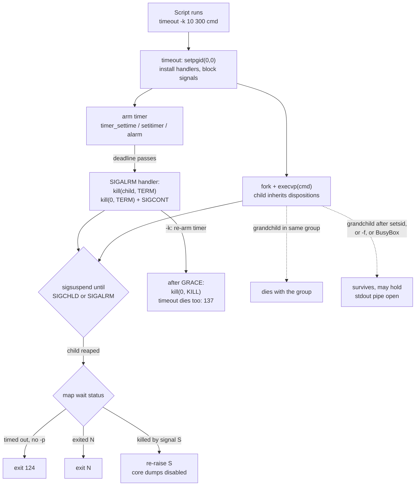

# Timeouts in Scripts

> [!summary] Claim
> A timeout is a deadline enforced by a process that can still act when the work cannot, so in shell the robust form is POSIX.1-2024 `timeout -k GRACE DURATION utility`, run as the parent of the work with a process group or reaper to signal, and every hand-rolled watchdog gives up one of those properties.

Part of [Robust Scripting](README.md) in [Shell and Unix Engineering](../README.md).

## TL;DR

- Mechanism: `timeout(1)` forks the utility, arms a timer (`timer_settime`, `setitimer`, or `alarm`), and on `SIGALRM` signals the child and its process group (GNU, macOS) or every descendant it reaps (FreeBSD), then maps the wait status to 124 (POSIX.1-2024 XCU `timeout`).
- Rule: always give a kill-after (`timeout -k 10 300 cmd`), treat 124 as "timed out" only when `-p` is absent, and put the deadline on every call that touches a network, a lock, or another process.
- Trap: a timeout kills a PID or a process group, not the pipe it shares, so a grandchild that escaped the kill keeps `$(...)` or a pipeline open after the deadline (the lab blocks for the grandchild's full 4 seconds after a 1-second timeout).
- Portability: `timeout` is new in POSIX.1-2024 (Austin Group Defect 1586); GNU, macOS, and FreeBSD exit 124 on a timeout, BusyBox 1.37 lets the program die of the signal (143 in `sh`), GNU `-p` exits 143 where macOS re-raises `SIGTERM`, and `read -t` is not POSIX and differs in status and partial-line handling in every shell.
- When not to use it: do not wrap a tool that has its own deadline (`curl --max-time`, `ssh -o ConnectTimeout`), do not time out a shell function (it is not a utility), and move to a language with cancellation contexts once deadlines must flow through a tree of concurrent calls.

## Mental model



The script hands the utility to `timeout`, which first makes itself a process-group leader so that one `kill(0, sig)` reaches the utility and every descendant that stays in the group.
It installs its signal handlers and blocks them before `fork`, so the PID it will signal is fixed before any handler can run.
The child restores the original signal mask and dispositions and execs the utility; the parent arms a one-shot timer and sleeps in `sigsuspend`.
If the child exits first, the parent reaps it and passes its status through.
If the timer fires first, the handler sends the signal to the child and to the group, adds `SIGCONT` so a stopped job can act on it, and with `-k` re-arms the timer to send `SIGKILL`, which also kills `timeout` itself because it is in the same group.
Dashed arrows show the escape hatches: a descendant that left the group, any descendant under `-f`, and every descendant under BusyBox survives the kill and can keep a pipe open.

## How it works

### Why a timeout needs a third party

A blocked process cannot time itself out: a `read(2)` on a silent socket, a `flock(2)` on a held lock, or a `waitpid(2)` on a hung child only returns when something else happens.
Something must therefore run concurrently, notice the deadline, and act on the blocked process: a timer signal inside the process (`alarm(2)`, the mechanism behind `read -t` in some shells), or another process that sends a signal.
For an external command the second form is the only option, and it raises three questions that this note answers in turn: who holds the timer, who has the right to signal, and how to name the target so that the signal cannot hit the wrong process.

The third question is the subtle one.
A PID names a process only until that process is reaped; afterwards the kernel may hand the number to a new process.
Linux wraps PIDs at `/proc/sys/kernel/pid_max`, which defaults to 32768 and can be raised to 2^22 on 64-bit systems (proc_sys_kernel(5)).
Only the parent decides when a child is reaped, so only the parent can guarantee that the PID it signals still names its child: a zombie keeps its PID reserved until its parent calls `wait`.
`timeout(1)` is the parent of the utility it runs, and GNU's implementation keeps its handler signals blocked across the `waitpid` loop "to ensure we don't cleanup() after waitpid() reaps the child, to avoid sending signals to a possibly different process" (coreutils `src/timeout.c`, `main`).
A shell watchdog is a sibling of the command, not its parent, and that is the root of its residual race (see the worked example).
Austin Group Defect 1585 ("kill - add -j option to avoid PID reuse race", rejected) argued exactly this, and Defect 1586, the request for a `timeout` utility that the same reporter filed alongside it, cites it: a shell "can only hardly kill a child after a timeout without introducing a race, as shown in issue #1585" (Austin Group Defect 1586, Description).
Linux 5.3 added `pidfd_open(2)`, a descriptor that names one process for its whole life, but no shell exposes it.

### The POSIX.1-2024 `timeout` utility

POSIX.1-2024 (Issue 8) added `timeout` as a new utility, from Austin Group Defect 1586 (POSIX.1-2024 XCU `timeout`, CHANGE HISTORY: "First released in Issue 8").
Its synopsis is `timeout [-fp] [-k time] [-s signal_name] duration utility [argument...]`.

- `duration` is "a decimal number with an optional decimal fraction and an optional suffix", one of `s`, `m`, `h`, `d`; the decimal point is a period in every locale; zero means no time limit, but signal propagation still applies.
- `-s signal_name` selects the signal, a `<signal.h>` name without the `SIG` prefix, matched case-insensitively; the default is `SIGTERM`.
- `-k time` sends `SIGKILL` if the child has not terminated `time` after the first signal.
- `-f` signals only the child; without it, the implementation either makes itself a process-group leader and signals the group, or arranges to become the reaper of orphaned descendants and signals all of them; which method is implementation-defined.
- `-p` preserves the child's wait status even when the time limit was reached.
- If the child is stopped when the signal is sent, `SIGCONT` must follow in the same manner; otherwise `SIGCONT` may be sent.

The ASYNCHRONOUS EVENTS section carries the robustness requirements.
`timeout` ignores `SIGTTIN` and `SIGTTOU`, so a utility that touches the terminal from a background group stops but `timeout` itself keeps running and can still time it out.
Any signal whose default action terminates the process, delivered to `timeout`, is propagated immediately to the targets it would signal on a timeout, except `SIGKILL` and `SIGSTOP`; the RATIONALE explains that otherwise a killed `timeout` leaves the utility "running indefinitely".
When signalling its own group, `timeout` briefly ignores that signal so it does not receive it.
Every signal disposition the utility inherits must equal what `timeout` inherited, except the timeout signal, which must be default so that the timeout takes effect; the RATIONALE cites `nohup` scripts whose utilities lost their `SIGHUP` protection under historical implementations.

The EXIT STATUS section defines the contract:

- 124 when the time limit was reached and `-p` is absent; with `-k` and a `SIGKILL` actually sent, it is unspecified whether the status is 124 or as if `-p` were given.
- Otherwise the utility's exit status, and if the utility died of a signal, `timeout` "shall terminate itself with the same signal while ensuring that a core image is not created".
- 125 for any other error in `timeout`, 126 when the utility was found but could not be executed, 127 when it could not be found.

The RATIONALE explains the self-kill: historical implementations exited with `128 + signal_number`, which is misleading in a shell that does not use that encoding, because "the KornShell sets `$?` to 256+signal_number".
The APPLICATION USAGE adds the corollary every caller needs: "A timeout exit status below 124 can only result from passing through the exit status of the executed utility."
If the utility is a special built-in, the result is undefined; a shell function is not a utility at all, because `timeout` reaches the utility through `exec`, which searches `PATH`.

### GNU coreutils: process group, timer, signal mapping

GNU `timeout` has existed since coreutils 7.0 (macOS timeout(1), HISTORY), and its `main` in `src/timeout.c` follows a fixed order.

1. `setpgid(0, 0)` unless `--foreground`: the source comment says it puts itself, not the child, in a new group so that it need not "worry about foreground and background groups and propagating signals between them".
2. `install_cleanup()` installs the `cleanup` handler for every terminating signal in its `term_sig` table and every real-time signal, skipping signals inherited as ignored (since 9.10, so a background `timeout` no longer reacts to the `SIGINT` and `SIGQUIT` that shells ignore in asynchronous lists), then ignores `SIGTTIN` and `SIGTTOU` and installs a `SIGCHLD` handler.
3. `block_cleanup_and_chld()` blocks all of those signals so that `monitored_pid` is set before any handler can run.
4. `fork`; the child (on Linux, since 9.10) calls `prctl(PR_SET_PDEATHSIG, term_signal)` so that it is signalled if `timeout` dies, checks that it was not already reparented, restores the signal mask and the default `SIGTTIN` and `SIGTTOU`, and calls `execvp`; failure exits 127 for `ENOENT` and 126 otherwise.
5. The parent calls `settimeout()`, which uses `timer_create(CLOCK_REALTIME)` plus `timer_settime` (nanosecond resolution), falls back to `setitimer(ITIMER_REAL)` (microsecond resolution, "more portable (to Darwin for example)"), and finally to `alarm()` with whole seconds rounded up.
6. It loops on `waitpid(monitored_pid, &status, WNOHANG)` and `sigsuspend(&orig_set)`, so the cleanup signals are deliverable only while it sleeps.

On `SIGALRM`, `cleanup()` sets `timed_out`, replaces the signal with the `-s` signal, and calls `send_sig(monitored_pid, sig)` first, in case the child made itself a group leader, then `send_sig(0, sig)` for the group, then `SIGCONT` to both unless the signal is `SIGKILL` or `SIGCONT`.
`send_sig()` sets the signal to `SIG_IGN` around `kill(0, sig)` so `timeout` does not deliver it to itself.
With `-k`, the handler switches `term_signal` to `SIGKILL` and re-arms the timer; the later group-wide `SIGKILL` cannot be ignored, so it kills `timeout` too, and the caller sees death by `SIGKILL` (137 in `sh`), as the GNU usage text documents.

The status mapping at the end of `main` has one deliberate deviation from the POSIX text.
If the child exited, its status passes through; if it died of a signal and `timed_out` is false, `timeout` disables core dumps (`prctl(PR_SET_DUMPABLE, 0)` or `RLIMIT_CORE` 0), resets the signal to default, and re-raises it, as POSIX requires.
If the child died of a signal and `timed_out` is true, GNU sets `status = sig + 128`, so `timeout -p 1 sleep 5` exits with status 143 instead of dying of `SIGTERM` (measured with coreutils 9.12: `exit 143`, while macOS `/usr/bin/timeout` reports `signal 15`).
`--foreground` also changes the `-k` result: since coreutils 9.1 a forcibly killed child under `--foreground` makes `timeout` exit 137, "consistent with the behavior when the --foreground option is not specified" (coreutils NEWS 9.1).

The NEWS file is a record of how hard this is to get right even in C:

| Release | Fix (quoted or paraphrased from coreutils NEWS) |
|---|---|
| 8.13 | sends signals to commands that create their own process group; adds `--foreground` and sub-second timeouts |
| 8.21 | no longer inherits a blocked `SIGALRM`, "which would cause timeouts to be ignored" |
| 8.27 | "no longer has a race that may terminate the wrong process" when a signal arrives right after the command finishes and its PID is reused |
| 8.29 | notices the command exiting even when started with `SIGCHLD` blocked, where it "would have then waited for the time limit to expire" |
| 9.5 | closes races where it "might kill arbitrary processes after a failed process fork" or fail to kill a just-forked command |
| 9.6 | accepts the POSIX.1-2024 short options `-f` and `-p` |
| 9.10 | propagates all terminating signals; honors ignored signals; on Linux always terminates the child if `timeout` itself dies |
| 9.11 | "no longer exits abruptly when its parent is the init process, e.g., when started by the entrypoint of a container" (a 9.10 regression); detects a subreaper parent such as `systemd --user` |

### FreeBSD and macOS: reaper or process group

FreeBSD's `bin/timeout/timeout.c` uses the second POSIX method.
Without `-f`, it calls `procctl(P_PID, getpid(), PROC_REAP_ACQUIRE, NULL)`, so orphaned descendants are reparented to it instead of to init, and `send_sig()` uses `PROC_REAP_KILL` to signal every descendant, including one that called `setsid`.
Its loop collects every descendant zombie with `waitid(P_ALL, ...)` and leaves only when `PROC_REAP_STATUS` reports `rs_children == 0`, so it waits for the whole tree, not just the direct child.
The child blocks on a close-on-exec control pipe until the parent has installed its handlers and started the timer, which closes the fork-to-handler race without a signal mask in the child.
It always sends `SIGCONT` after a signal other than `SIGKILL`, `SIGSTOP`, or `SIGCONT`, which POSIX allows, and `kill_self()` disables core dumps with `setrlimit(RLIMIT_CORE)` and re-raises the child's signal.
`parse_duration()` rejects a duration with a unit suffix that reaches 100000000 seconds (about 3.2 years); a bare number returns before that range check.

macOS ships `/usr/bin/timeout` from Apple's `shell_cmds` (the host's `what` string reads `shell_cmds-336.40.1`; present on macOS 27.3, as of 2026-11); its man page credits the FreeBSD 10.3 utility but documents the process-group method: "timeout makes itself the leader of a process group that the command inherits", and "a descendant that puts itself into another process group, for example by calling setsid(2), is not signalled".
The same page states that `-s KILL` and `-k` escalation also kill `timeout`, "which most shells report as 137", and that the macOS utility "is expected to conform to" POSIX.1-2024.

### BusyBox: exec in place, a polling grandchild

BusyBox `coreutils/timeout.c` inverts the design to keep the program a direct child of whoever started `timeout`; the source comment gives `tcpsvd 0.0.0.0 1234 timeout service_prog` as the reason.
`timeout_main` vforks; the child calls `bb_daemonize_or_rexec(0, argv)`, which forks again, and the grandchild calls `setsid()` and points descriptors 0, 1, and 2 at `/dev/null`; the original process waits for the intermediate child and then `exec`s the program, so the program keeps the PID of `timeout`.
The grandchild runs `timeout_wait()`: a loop of `sleep1()` (or one sub-second sleep when less than a second remains, if `FEATURE_FLOAT_DURATION` is built in) that checks `kill(pid, 0)` each second and returns when the process is gone.
At the deadline it calls `kill(parent, signo)`, then, with `-k`, the same loop and `kill(parent, SIGKILL)`.

Three consequences follow from the source and the lab.
There is no 124: the program itself dies of the signal, so `sh` reports 143, as measured in the shell matrix (BusyBox 1.37).
Only the one PID is signalled, never a process group, so grandchildren always survive.
The usage string is `[-s SIG] [-k KILL_SECS] SECS PROG ARGS`; `-p` is accepted only on no-MMU builds, where it carries the parent PID, so on Linux `timeout -p` is a usage error.
A duration of 0 does not disable the limit: `timeout_wait()` decrements first and breaks when the counter reaches zero or below, so the signal is sent at once or after one second (source reading; measured on Alpine's BusyBox 1.37, `timeout 0 /bin/sleep 2` ended at once with status 143).
The watcher also polls a PID it does not own: once the shell that started `timeout` reaps the program, the watcher's next `kill(pid, 0)` can match a recycled PID, which is the race the source comment admits ("kill(parent) may kill wrong process!") and mitigates only by polling each second.

### Shell-native timeouts

POSIX gives the shell three building blocks and no timeout primitive.
`sleep` takes "a non-negative decimal integer", must accept values up to 2147483647, and may exit 0 or die when it receives `SIGALRM` (POSIX.1-2024 XCU `sleep`); fractional seconds are an extension of GNU, BSD, and BusyBox.
`kill` sends a signal to a PID, and `kill -s 0` probes existence.
`wait` interacts with traps by a rule in XCU 2.12: "When the shell is waiting, by means of the wait utility, for asynchronous commands to complete, the reception of a signal for which a trap has been set shall cause the wait utility to return immediately with an exit status >128, immediately after which the trap associated with that signal shall be taken", whereas a trapped signal that arrives during a foreground command waits until the command completes.
That asymmetry is why every shell watchdog runs its sleeps with `&` and `wait`: a foreground `sleep 300` cannot be cancelled by a trap until it finishes.
XCU 2.12 also makes commands in an asynchronous list inherit `SIGINT` and `SIGQUIT` as ignored when job control is off, so the watchdog must use `SIGTERM` or another signal, never `SIGINT`.
And because `set -m` needs a terminal, a non-interactive script cannot portably put the command in its own process group, so a shell watchdog signals one PID.

The worked example below is that pattern done carefully.
Its residual races are inherent to a sibling watchdog:

- After the main shell's `wait` reaps the command and before its `kill` reaches the watchdog, the watchdog's own sleep can end and it can send `SIGTERM` to the command's PID, which may by then name another process.
- If the cancelling `SIGTERM` reaches the watchdog between `/bin/sleep &` and `sleeper=$!`, the trap sees an empty `$sleeper` and the sleep outlives the watchdog for up to its duration; its streams are `/dev/null`, so it cannot hold the caller's pipe.

### `read -t` and `TMOUT`

`read -t` is not in POSIX.1-2024 XCU `read`, whose only options are `-d` and `-r`, and every shell that has it does something different.

bash's `read_builtin` (bash-5.3 `builtins/read.def`) arms an `sh_timer` with `shtimer_set`, using `select` unless line editing or POSIX mode forces `SIGALRM`, longjmps out on expiry, keeps the partial input, and returns `128+SIGALRM`, which is 142 on Linux and macOS.
It disables the timeout when the descriptor is a regular file, and `-t 0` returns immediately, succeeding only if input is available (`input_avail`).
If `TMOUT` is set and `-t` is not given, `TMOUT` is the default timeout (bash-5.3 `read.def`; bash CHANGES lists it under bash-2.05b).
bash CHANGES for bash-4.0-alpha records both the partial-input change and that a timed-out `read` "returns an exit status greater than 128", and the fractional `-t`; macOS `/bin/bash` 3.2.57 therefore returns 1 and discards the partial line (lab).
The current timer framework arrived in bash-5.2-alpha ("a new internal timer framework used for read builtin timeouts").

zsh's `-t` means something else: "Test if input is available before attempting to read", with `num` seconds to wait for input, returning 1 "and do not set any variables" if none arrives (zsh `Doc/Zsh/builtins.yo`).
Once one byte is available, zsh reads the whole line without a deadline, so `{ printf part; sleep 3; echo late; } | { read -t 1 x; ... }` waits the full 3 seconds and sets `x=partlate` with status 0 (lab).

mksh's `-t n` uses `select` against an absolute limit and returns `ksh_sigmask(SIGALRM)`, which is `128 + 14`, "but partial reads may still be returned" (mksh `funcs.c`, `c_read`; mksh(1)).
ksh93's `read -t` applies "when reading from a terminal or pipe"; its timer callback `timedout()` calls `sh_exit(1)` (ksh93 `bltins/read.c`), and ksh93u+ 2012 returned 1 with the partial line discarded (lab).
BusyBox ash's `shell_builtin_read` computes an end time from `monotonic_ms()` and polls one byte at a time; on expiry it returns 1 before assigning, so the variable keeps its old value (BusyBox `shell/shell_common.c`).
dash rejects the option ("Illegal option -t", status 2, lab), and yash's `read` has no `-t` (yash manual, `read` built-in; yash on Alpine reports that `-t` "is not a valid option" and returns 2, measured in the shell matrix images).

`TMOUT` has a second meaning in interactive shells: bash terminates after `TMOUT` seconds without a complete line at the primary prompt, and ksh93's interactive shell warns and allows "an extra 60 second timeout grace period" (ksh93 sh(1)); neither applies to a non-interactive script except through `read`.
In ksh93 the `TMOUT` default for `read` and `select` applies only "when input is from a terminal" (ksh93 sh(1)); `bltins/read.c` sets the default timeout only when `tty_check(0)` is true, so a piped `read` in a script is not bounded by `TMOUT` there.

### Tool-native deadlines

Most network tools time out better than an external kill, because they fail with a specific status, release what they hold, and report what happened.

- curl: `--connect-timeout` bounds "the connection phase", which is complete "when the DNS lookup and requested TCP, TLS or QUIC handshakes are done"; `-m`/`--max-time` bounds "each transfer"; both accept decimals; a timeout exits 28, "Operation timeout"; `--speed-limit` and `--speed-time` abort a transfer that stays below a rate, with a default period of 30 seconds (curl(1)).
- curl with `--retry`: "the maximum time counter is reset each time the transfer is retried", so the overall bound needs `--retry-max-time` (curl(1)); see [[Retries-Backoff-and-Jitter]].
- OpenSSH: `ConnectTimeout` covers both the TCP connection and "the initial SSH protocol handshake and key exchange"; `ServerAliveInterval` defaults to 0 (no probes), and with `ServerAliveInterval 15` and the default `ServerAliveCountMax` of 3, "ssh will disconnect after approximately 45 seconds" (ssh_config(5)).

### Deadlines versus timeouts

A timeout bounds one step; a deadline bounds a whole operation and is split among its steps.
Compute the deadline once and pass the remainder down: `deadline=$(( $(date +%s) + 600 ))`, then before each step `left=$(( deadline - $(date +%s) ))`, fail with 124 if `left` is not positive, and run the step as `timeout -k 5 "$left" step`.
`date +%s` is POSIX.1-2024, because XCU `date` formats "as if by strftime()" and XSH `strftime` defines `%s` as seconds since the Epoch.
That clock is settable: bash's `SECONDS` is computed with `gettimeofday` (bash-5.3 `variables.c`, `get_seconds`), so an NTP step moves both.
Use the wall clock only to budget, and let `timeout(1)`, whose timer is relative, enforce.
Outer layers need their own bound, because they cannot trust inner ones: a GitHub Actions job is cancelled after `timeout-minutes`, which defaults to 360 (GitHub Actions workflow syntax, as of 2026-11).

## Numbers and limits

| Quantity | Value | Source |
|---|---|---|
| `timeout` status when the limit is reached | 124 | POSIX.1-2024 XCU `timeout`; lab (GNU 9.12, macOS) |
| `timeout` internal error, not executable, not found | 125, 126, 127 | POSIX.1-2024 XCU `timeout`; lab |
| GNU `-s KILL` or `-k` escalation | `timeout` dies of `SIGKILL` (137 in `sh`) | coreutils usage text; lab: `signal 9 elapsed=2` |
| GNU `-p` after a timeout by `SIGTERM` | exits 143 | lab, coreutils 9.12 on macOS (2026-11-15) |
| macOS `-p` after a timeout by `SIGTERM` | dies of `SIGTERM` | lab, `shell_cmds-336.40.1` (2026-11-15) |
| BusyBox timed-out program | dies of the signal (143 in `sh`) | BusyBox `timeout.c`; shell matrix (BusyBox 1.37) |
| GNU timer resolution | nanoseconds (`timer_settime`), microseconds (`setitimer`), 1 s (`alarm`) | coreutils `timeout.c`, `settimeout` |
| BusyBox watcher granularity | 1 s polls of `kill(pid, 0)` | BusyBox `timeout.c`, `timeout_wait` |
| FreeBSD maximum suffixed duration | below 100000000 s (bare numbers are not range-checked) | FreeBSD `timeout.c`, `parse_duration` |
| POSIX `sleep` operand | non-negative integer, up to 2147483647 s | POSIX.1-2024 XCU `sleep` |
| bash `read -t` timeout status | 142 (`128+SIGALRM`) | bash-5.3 `read.def`; lab (bash 5.3.15) |
| mksh `read -t` timeout status | 142 (`ksh_sigmask(SIGALRM)`) | mksh `funcs.c`, `sh.h`; measured (mksh R59, Alpine) |
| zsh, ksh93, BusyBox ash, bash 3.2 `read -t` timeout status | 1 | lab (zsh 5.9.2, ksh93u+ 2012, bash 3.2.57); BusyBox `shell_common.c`; measured (BusyBox 1.37 ash, ksh93u+m 1.0.10) |
| Linux PID wrap (`pid_max`) | 32768 default, up to 2^22 on 64-bit | proc_sys_kernel(5) |
| OpenSSH keepalive defaults | `ServerAliveInterval` 0, `ServerAliveCountMax` 3 | ssh_config(5) |
| curl timeout exit status; `--speed-time` default | 28; 30 s | curl(1) (as of 2026-11) |
| GitHub Actions job `timeout-minutes` default | 360 | workflow syntax docs (as of 2026-11) |
| Grandchild holding the pipe after a 1 s timeout | caller blocked >= 3 s (the 4 s grandchild sleep) | lab, `with-timeout.sh`; measured, BusyBox 1.37 (4 s) |
| GNU group kill versus `-f` for `sh -c 'sleep 4; echo late'` | 1 s versus 4 s | lab, coreutils 9.12 and macOS (2026-11-15) |

## Portability

The `timeout` utility, by implementation; the shell under test never changes which `timeout` runs.

| Behavior | POSIX.1-2024 | GNU coreutils 9.12 | macOS `/usr/bin/timeout` | FreeBSD | BusyBox 1.37 |
|---|---|---|---|---|---|
| Status when the limit is reached | 124 | 124 (lab) | 124 (lab) | 124 (source) | program dies of the signal, 143 in `sh` (source; measured, Alpine) |
| `-p` after a timeout | mirror the wait status | exit `128+sig` (lab; also GNU 9.7 on Debian, measured) | re-raise the signal (lab) | re-raise (`kill_self`, source) | usage error, status 1 (source; "unrecognized option: p", measured) |
| Who receives the signal | group or all descendants | child, then its group (source, lab) | its group (man page, lab) | all reaped descendants (`PROC_REAP_KILL`, source) | the one PID (source; grandchild survived, measured) |
| Grandchild after `setsid` | implementation-defined | survives (measured, GNU 9.7 on Debian) | survives (man page) | signalled (source) | survives (source) |
| `-f` | child only | child only (lab) | child only (lab) | child only (source) | not available (source) |
| Duration 0 | no limit | no limit (lab) | no limit (lab) | no limit (`set_interval(0)`, source) | signals at once (source; measured, Alpine) |
| Fractional duration | required | yes since 8.13 (NEWS) | yes (man page) | yes (`strtod`, source) | only with `FEATURE_FLOAT_DURATION` (source; Alpine's build accepts `1.5`, measured) |
| Child killed if `timeout` dies | not required | Linux, since 9.10 (`PR_SET_PDEATHSIG`) | not documented | not documented | the watcher keeps polling the PID (source) |

Shell features, by shell (lab means asserted by `timeouts.bats`; the lab ran locally on bash 5.3.15, bash 3.2.57, macOS `/bin/sh`, dash 0.5.13, zsh 5.9.2, and ksh93u+ 2012; measured means run by hand in the Debian and Alpine shell matrix images).

| Behavior | POSIX sh | macOS bash 3.2 | bash 5.3 | zsh | zsh `--emulate sh` | dash | ksh93 | mksh | yash | posh | BusyBox ash |
|---|---|---|---|---|---|---|---|---|---|---|---|
| `read -t 1` with no input | no `-t` | 1 (lab) | 142 (lab) | 1 (lab) | 1 (lab) | "Illegal option -t", 2 (lab) | 1 (lab; also ksh93u+m 1.0.10, measured) | 142 (source; measured) | no `-t`, 2 (manual; measured) | "invalid option", 1 (measured, posh 0.14.1) | 1 (source; measured) |
| Partial line when the timer fires | n/a | discarded (lab) | kept, 142 (lab) | waits for the line, 0 (lab) | waits for the line, 0 (lab) | n/a | discarded (lab; also ksh93u+m, measured) | kept (man page; measured) | n/a | n/a | discarded (source; measured) |
| Status of a command killed by `SIGTERM` | > 128 | 143 | 143 | 143 | 143 | 143 | 271 | 143 | 399 | 143 | 143 |
| `wait` interrupted by a trapped signal | > 128 | `128+N` | `128+N` | `128+N` | `128+N` | `128+N` | 1 | `128+N` | `384+N` | `128+N` | `128+N` |

The signal-status rows come from the shell matrix (`128+N` in most shells, `256+N` in ksh93, `384+N` in yash, and 1 for an interrupted `wait` in ksh93); they decide what a script sees when it inspects a killed job, and they are why POSIX makes `timeout` mirror the wait status instead of choosing a number.
When `wait` reaps a background job killed by a signal, bash 3.2, dash, and ksh93u+ print a job notice such as `Terminated: 15` on standard error, while bash 5.3 and `zsh --emulate sh` did not (measured); `with-timeout.sh` redirects that `wait`'s standard error.

## Worked example

The [lab](../labs/13-timeouts-in-scripts/) holds `with-timeout.sh`, a pure-POSIX watchdog; `wstat.c`, a C observer that prints the kernel wait status (`exit N` or `signal N`) and elapsed seconds, because `$?` cannot tell an exit with 143 from death by `SIGTERM`; and `timeouts.bats`, which runs the watchdog under every shell and loops over every installed `timeout` implementation.
The script below is the lab file verbatim.

```sh
#!/bin/sh
# with-timeout: run a command under a deadline with only POSIX sh, kill, and sleep.
# Usage: with-timeout.sh [-k GRACE] SECONDS COMMAND [ARG...]
# Exit status: the command's own status if it ends in time; 124 if the deadline
# passed (SIGTERM was sent, then SIGKILL GRACE seconds later if it was still
# running); 125 on a usage error. Durations are whole seconds (POSIX sleep).
# Limits: it signals the command's PID only, never its descendants, and the
# watchdog is a sibling of the command, not its parent (see the note).

grace=2
while getopts k: opt; do
  case $opt in
    k) grace=$OPTARG ;;
    *) exit 125 ;;
  esac
done
shift $((OPTIND - 1))
if [ "$#" -lt 2 ]; then
  printf 'usage: with-timeout.sh [-k GRACE] SECONDS COMMAND [ARG...]\n' >&2
  exit 125
fi
secs=$1
shift
case $secs:$grace in
  *[!0-9:]* | :* | *:)
    printf 'with-timeout: durations must be whole seconds\n' >&2
    exit 125
    ;;
  *) ;;
esac

"$@" &
cmd=$!

# The watchdog. Its exit status reports whether it fired: 124 once it has sent
# SIGTERM, 0 if it was cancelled first. Its standard streams go to /dev/null so
# that its sleep never holds open a pipe the caller is reading, such as $(...).
(
  rc=0
  sleeper=
  # shellcheck disable=SC2317,SC2329 # runs when the main shell cancels the watchdog
  trap 'kill "$sleeper" 2>/dev/null; exit "$rc"' TERM
  /bin/sleep "$secs" &
  sleeper=$!
  wait "$sleeper"
  rc=124
  kill -TERM "$cmd" 2>/dev/null || exit "$rc"
  /bin/sleep "$grace" &
  sleeper=$!
  wait "$sleeper"
  kill -KILL "$cmd" 2>/dev/null
  exit "$rc"
) </dev/null >/dev/null 2>&1 &
watchdog=$!

# Silence the "Terminated" job notice that bash 3.2, dash, and ksh93 print when
# wait reaps a job the watchdog killed. (Not "status": zsh reserves that name.)
wait "$cmd" 2>/dev/null
cmd_rc=$?
kill -TERM "$watchdog" 2>/dev/null
wait "$watchdog"
if [ "$?" -eq 124 ]; then
  exit 124
fi
exit "$cmd_rc"
```

Each design choice answers a failure mode.
The watchdog sleeps with `/bin/sleep &` plus `wait`, because XCU 2.12 lets a trapped `SIGTERM` interrupt `wait` but not a foreground command; that is what lets the main shell cancel it in milliseconds instead of after `secs`.
The trap kills the sleep before leaving, so no orphan lingers, and the watchdog's streams are `/dev/null`, so a sleep that escapes in the race window cannot keep the caller's `$(...)` open.
The watchdog reports through its exit status instead of a variable or a file, because a subshell cannot assign in its parent, and `rc` is set to 124 before the kill so that cancelling it during the grace period still reports the timeout.
The script never names a variable `status`, which native zsh reserves as a read-only special parameter (the first local run failed with `read-only variable: status`).
Durations are whole seconds because POSIX `sleep` takes an integer.

Captured on the macOS host with `dash` (2026-11-15):

```
$ ./with-timeout.sh 10 /bin/sh -c 'echo done; exit 3'; echo "rc=$?"
done
rc=3
$ ./with-timeout.sh 1 /bin/sleep 30; echo "rc=$?"
rc=124
$ ./with-timeout.sh -k 1 1 /bin/sh -c 'trap "" TERM; exec /bin/sleep 30'; echo "rc=$?"
rc=124
$ ./with-timeout.sh 1.5 /bin/true; echo "rc=$?"
with-timeout: durations must be whole seconds
rc=125
```

The first run returned at once with the command's status and output, the second after 1 second, and the third after 2 seconds, because the command ignored `SIGTERM` and needed the `SIGKILL`.
The suite asserts these timings with at least one second of margin, plus the limitation that motivates `timeout(1)`: `with-timeout.sh 1 /bin/sh -c '/bin/sleep 4; echo late'` exits 124 without printing `late`, yet the caller stays blocked for at least 3 seconds, because the orphaned `sleep` still holds standard output.

The same command under the two `timeout` implementations on the host, observed through `wstat`, shows the process-group method at work and the `-p` divergence (2026-11-15):

```
$ wstat gtimeout 1 /bin/sleep 5          # GNU coreutils 9.12
exit 124 elapsed=1
$ wstat gtimeout -p 1 /bin/sleep 5
exit 143 elapsed=1
$ wstat /usr/bin/timeout -p 1 /bin/sleep 5   # macOS shell_cmds-336.40.1
signal 15 elapsed=1
$ wstat gtimeout -k 1 1 /bin/sh -c 'trap "" TERM; exec /bin/sleep 8'
signal 9 elapsed=2
$ wstat gtimeout 0 /bin/sleep 2
exit 0 elapsed=2
```

For `out=$(timeout 1 sh -c '/bin/sleep 4; echo late')` both GNU and macOS returned after 1 second, because the `sleep` died with the group; with `-f` both returned after 4 seconds.

## Pitfalls

> [!warning] No kill-after: a command that handles SIGTERM never dies
> Trigger: `timeout 300 cmd` where `cmd` traps or ignores `SIGTERM`, or a shell script whose foreground child defers the shell's trap until that child finishes (XCU 2.12).
> Symptom: the deadline passes, the signal is delivered, and the command keeps running; with GNU `timeout`, `timeout 1 sh -c 'trap "" TERM; sleep 3; echo done'` prints `done` after 3 seconds and still exits 124 (measured, coreutils 9.12).
> Fix: always pass `-k GRACE`; the lab's `-k 1 1` case ends a `SIGTERM`-ignoring sleep at 2 seconds in GNU, macOS, and BusyBox alike.

> [!warning] Reading 124 as "timed out" without checking the contract
> Trigger: `if [ "$?" -eq 124 ]` after `timeout`, with `-p`, under BusyBox, or around a command that can itself exit 124.
> Symptom: BusyBox never returns 124 (its program dies of the signal, 143 in `sh`); `-p` returns 143 in GNU and death by `SIGTERM` in macOS; and a utility that exits 124 is indistinguishable from a timeout.
> Fix: do not use `-p` when you need to detect the timeout; treat a status of 124 or more as "timed out or killed", and below 124 as the utility's own status, which POSIX guarantees; see [[Exit-Code-Contracts]].
> Primary source: POSIX.1-2024 XCU `timeout`, EXIT STATUS and APPLICATION USAGE.

> [!warning] An escaped descendant keeps the pipe, the lock, or the port
> Trigger: the utility starts a daemon or a worker that calls `setsid`, or you use `-f`, BusyBox `timeout`, or a shell watchdog; then you read its output with `$(...)` or a pipeline.
> Symptom: the timeout fires, yet the caller blocks until the escaped process exits, or a later run fails on a lock or port the survivor still holds; the lab blocks at least 3 seconds after a 1-second timeout, and the shell matrix measured a `setsid` grandchild surviving GNU `timeout`.
> Fix: without `-f`, rely on the process group and keep workers in it; redirect a daemon's standard streams away from your pipe; or use a reaper-based implementation (FreeBSD) or a service manager that kills by cgroup.

> [!warning] Timing out a function, alias, or special built-in
> Trigger: `timeout 5 my_function` or `timeout 5 cd /slow/nfs`.
> Symptom: status 127 and "No such file or directory" (GNU: `failed to run command 'myfunc'`), because `timeout` reaches the utility through `execvp`; for a special built-in POSIX leaves the result undefined.
> Fix: run a new shell, `timeout 5 sh -c 'body' sh "$arg"`, defining the function inside it; the lab asserts both forms.

> [!warning] Interactive commands stop under timeout in a script
> Trigger: a script runs `timeout 60 ssh host` or another command that reads the terminal.
> Symptom: GNU `timeout` puts itself in a new process group, which is not the terminal's foreground group when it runs from a script, so the command's terminal read raises `SIGTTIN` and the command stops until the deadline.
> Fix: use `-f` (`--foreground`) for commands that need the terminal, accepting that descendants are then not timed out; GNU's help text describes `-f` exactly for "when not running timeout directly from a shell prompt".

> [!warning] Assuming `read -t` is a line timeout
> Trigger: a portable script uses `read -t 5 line` to bound a prompt or a pipe read.
> Symptom: dash fails with "Illegal option -t" (status 2) and yash and posh have no `-t`; zsh bounds only the arrival of the first byte and then blocks for the rest of the line; bash 3.2 returns 1 like end-of-file while bash 4.0 and later return 142 and keep the partial input.
> Fix: in bash, test for a status above 128, not non-zero; elsewhere put the producer under `timeout(1)` instead of timing the reader; see [[The-read-Builtin]].

> [!warning] Retries multiply the timeout
> Trigger: `curl --retry 5 --max-time 30 URL`, or a retry loop around `timeout 30 step`.
> Symptom: the operation can take six times the limit plus back-off, because curl resets the `--max-time` counter on each retry (curl(1)), and the loop applies the limit per attempt.
> Fix: set `--retry-max-time`, or compute one deadline and give each attempt only the remainder; see [[Retries-Backoff-and-Jitter]].

> [!warning] Background timeout ignores Ctrl-C
> Trigger: `timeout 600 job &` from a script without job control, then `Ctrl-C` or `kill -INT`.
> Symptom: asynchronous lists inherit `SIGINT` and `SIGQUIT` ignored (XCU 2.12), and since coreutils 9.10 `timeout` "honors ignored signals and will not propagate them", so the job keeps running.
> Fix: stop background work with `SIGTERM` (`kill "$pid"`), and forward it from the parent's trap; see [[Signal-Propagation-to-Children]].

> [!warning] A timeout upgrade broke container entrypoints
> Trigger: GNU coreutils 9.10 with `timeout` started by a process running as PID 1, for example a container entrypoint script.
> Symptom: `timeout` exited abruptly instead of running the command; coreutils 9.11 NEWS records the fix ("no longer exits abruptly when its parent is the init process, e.g., when started by the entrypoint of a container", "[bug introduced in coreutils-9.10]").
> Fix: pin and test the coreutils version in container images, and test `timeout` paths as PID 1; see [[PID-1-and-Signal-Forwarding]].

> [!warning] Hand-rolled watchdogs signal recycled PIDs
> Trigger: `cmd & pid=$!; (sleep 30; kill "$pid") &` with no cancellation, or a watchdog that polls `kill -0`.
> Symptom: when `cmd` finishes early and its parent reaps it, the watchdog later signals whatever process now owns that PID; GNU `timeout` itself carried a version of this race until 8.27 ("may terminate the wrong process"), and the reporter of Austin Group Defect 1585 asked for `timeout(1)` precisely because a shell cannot close it.
> Fix: use `timeout(1)`; if you must stay in shell, cancel the watchdog as soon as the command is reaped, as `with-timeout.sh` does, and accept the small window it documents.

## Security and robustness

A missing timeout is an availability bug that an attacker or a failing dependency can trigger: a peer that accepts a TCP connection and then sends nothing holds a `curl` without `--max-time`, or an `ssh` without `ServerAliveInterval`, forever.
Put a deadline on every operation whose duration depends on something outside the script, and bound CPU separately with `ulimit -t` (see [[Resource-Limits-and-ulimit]]), because a timeout measures wall time and a CPU limit measures work.

Escalate in order and know what each step skips.
`SIGTERM` lets the command run its cleanup traps, remove temporary files, and release locks (see [[Cleanup-Traps-and-Re-Raising-Signals]]); `SIGKILL` runs nothing, so a killed writer can leave a half-written file and a stale lock, which is why [[Atomic-Writes]] and [[Locking-and-Stale-Locks]] assume the process can vanish at any instruction.
Size the grace period to the real cleanup time, not to a round number.

`timeout` preserves inherited signal dispositions by specification, so a `nohup` wrapper's ignored `SIGHUP` survives into the utility (POSIX.1-2024 XCU `timeout`, RATIONALE); the GNU child resets only `SIGTTIN` and `SIGTTOU` and the timeout signal, and it resets `SIGTTIN` and `SIGTTOU` to default even when they were inherited as ignored (coreutils `src/timeout.c`, `main`), which the same RATIONALE lists as a historical defect that can stop processes unexpectedly.
When it mirrors a signal death, GNU disables core dumps first so it does not overwrite the core the utility produced, as POSIX requires.
GNU's `PR_SET_PDEATHSIG` protection is Linux-only and is cleared when the child executes a set-user-ID or set-group-ID binary (PR_SET_PDEATHSIG(2const)), so a privileged utility can still outlive a killed `timeout`.

Never build the command string for `timeout ... sh -c` by interpolating untrusted data; pass data as positional parameters after the script (`sh -c 'grep -- "$1" file' sh "$pattern"`), as for any `sh -c`.

## The principal's view

The decision is not whether to use timeouts but where each deadline lives and who enforces it.
Every boundary that waits on something you do not control gets an explicit bound, and the bounds nest: the CI job's `timeout-minutes`, the script's overall deadline, each step's `timeout -k`, and each tool's own connect and transfer limits, from the outside in, each shorter than the one enclosing it.
Derive the values from measured latency (a high percentile of the step's real duration, times a margin), not from habit, because the costs are asymmetric in a way that teams forget: a bound that is too tight turns a slow day into an outage and multiplies load through retries, while one that is too loose turns a hang into a stuck pipeline that nobody notices until the 6-hour CI default fires.

Prefer, in order, the tool's own deadline, then `timeout -k`, then a shell watchdog only where `timeout` is absent.
Tool-native deadlines fail with a meaningful status and release resources cleanly; `timeout` is a parent with a process group or a reaper and therefore cannot signal the wrong process; a shell watchdog is a sibling with a documented race and a PID-only reach.
Standardize the exit-code contract (124 means "deadline exceeded") across the fleet's scripts, and forbid `-p` where callers branch on it.

Move to a real language when deadlines must propagate through concurrent work: when one request fans out to ten calls that share one budget, when cancellation must reach in-flight children and stop their retries, or when a timeout must release resources in a defined order.
Go's `context.WithDeadline`, Python's `asyncio.timeout`, and structured-concurrency runtimes carry the remaining budget with the call and cancel the whole tree; a shell can only kill processes, and only the ones it can name.

## Interview questions

> [!question] L5: What exit status does `timeout 5 cmd` return when the limit is hit, and how do you tell that apart from `cmd` failing?
>
> > [!success]- Answer
> > POSIX.1-2024 specifies 124 when the time limit was reached and `-p` was not given.
> > 125, 126, and 127 are reserved for `timeout`'s own error, "found but not executable", and "not found".
> > POSIX guarantees that a status below 124 can only come from the utility, so below 124 is the command's verdict and 124 or above is "timed out, killed, or could not start".
> > The scheme breaks under `-p`, under BusyBox (the program dies of the signal and `sh` shows 143), and for a utility that itself exits 124.
> >
> > Follow-up: What status does GNU report when `-k` had to send `SIGKILL`, and why?

> [!question] L5: Predict the output and exit status of `timeout 1 sh -c 'trap "" TERM; sleep 3; echo done'; echo $?` with GNU coreutils.
>
> > [!success]- Answer
> > It prints `done` after 3 seconds and then `124`.
> > At 1 second `timeout` sends `SIGTERM` to the child and its process group, but the shell ignores it and `sleep` inherited the ignored disposition, so both run on.
> > The shell exits 0 after `echo`, but GNU had set `timed_out` when the alarm fired, so it reports 124 regardless (measured, coreutils 9.12).
> > Adding `-k 2` would have ended it at 3 seconds with death by `SIGKILL`.
> >
> > Follow-up: What would `-p` change in the reported status?

> [!question] L6: Why does `timeout 5 my_function` fail with 127, and what is the correct pattern?
>
> > [!success]- Answer
> > `timeout` runs the utility in a child with `execvp`, and `exec` searches `PATH` for a file; shell functions, aliases, and built-ins live only in the shell's memory.
> > POSIX makes the result undefined for special built-ins and the implementations report "not found", status 127.
> > Run a fresh shell under `timeout`: `timeout 5 sh -c 'f() { ...; }; f "$1"' sh "$arg"`, passing data as positional parameters so nothing is interpolated into code.
> > In bash, `export -f` can carry a function through the environment, but only into bash.
> >
> > Follow-up: What does `timeout 5 cd /mnt/nfs` do, and why can it not work even in principle?

> [!question] L6: Debug this: `out=$(timeout 10 ./start-service.sh)` hangs forever, although `start-service.sh` prints one line and exits within a second.
> ```sh
> #!/bin/sh
> ./service --daemon &
> echo started
> ```
>
> > [!success]- Answer
> > The command substitution reads until end-of-file on the pipe, and the daemon inherited the pipe as its standard output, so the write end stays open after the script exits.
> > `timeout` returns as soon as its direct child exits, so it never sends a signal and never kills the process group the daemon is still in.
> > The hang is not a timeout failure at all: no process that `timeout` waits for is alive.
> > Fix the script: start the daemon with `./service --daemon >/dev/null 2>&1 </dev/null &` (or let a service manager start it), so the only writer to the pipe is the script.
> >
> > Follow-up: How would the same bug look in a pipeline `./start-service.sh | head -1`?

> [!question] L6: Your script runs `timeout 60 ssh build-host make`, and the ssh session stops instead of prompting for a password: why, and what are the trade-offs of the fix?
>
> > [!success]- Answer
> > GNU `timeout` calls `setpgid(0, 0)` unless `--foreground`, so from a script the command runs in a process group that is not the terminal's foreground group.
> > A read from the terminal by a background group raises `SIGTTIN`, which stops `ssh`; `timeout` ignores `SIGTTIN` itself, so it still fires at 60 seconds.
> > `timeout -f` keeps the command in the caller's group so it can read the terminal, but then only the direct child is signalled and descendants are not timed out.
> > The better fix is non-interactive authentication (`-o BatchMode=yes` with keys) plus ssh's own `ConnectTimeout`.
> >
> > Follow-up: Why does the same command work when typed at an interactive prompt?

> [!question] L6: Compare `read -t 2 line` across bash 3.2, bash 5, zsh, and dash when the writer sends `part` and then stalls.
>
> > [!success]- Answer
> > bash 5 returns 142 (`128+SIGALRM`) at 2 seconds and assigns `part`, a behavior introduced in bash 4.0.
> > bash 3.2 returns 1, like end-of-file, and discards `part`.
> > zsh's `-t` only waits for input to become available, so once `part` arrives it blocks for the rest of the line with no deadline.
> > dash has no `-t` and fails with "Illegal option -t", status 2.
> >
> > Follow-up: How would you bound the read portably instead?

> [!question] L7: A deploy script has 10 minutes end to end and calls five steps, two of which retry with back-off: how do you design its timeouts?
>
> > [!success]- Answer
> > Compute one deadline at start with `date +%s` (POSIX.1-2024 via `strftime %s`) and keep the CI job's `timeout-minutes` slightly above 10 minutes as an outer backstop.
> > Before each step and each retry, compute the remaining budget, fail fast with 124 if it is not positive, and run the step as `timeout -k G "$left" step`, with G sized to its real cleanup time.
> > Give network tools their own tighter bounds (`curl --connect-timeout` and `--max-time` with `--retry-max-time`, ssh `ConnectTimeout` and `ServerAliveInterval`), so most failures surface as specific statuses, not kills.
> > The wall clock only budgets; enforcement stays with relative timers in `timeout`, because an NTP step moves `date +%s` and bash `SECONDS`.
> >
> > Follow-up: Which steps would you exempt from the budget, and how do you avoid leaving a half-applied deploy when a step is killed?

> [!question] L7: Why can `timeout(1)` signal its child safely when a shell watchdog cannot, and what would close the gap in the kernel?
>
> > [!success]- Answer
> > A PID names a process only until it is reaped, and only the parent reaps; a zombie keeps its PID reserved, so a parent that signals before reaping can never hit a recycled PID.
> > GNU `timeout` keeps its handler signals blocked except inside `sigsuspend`, so its handler cannot run after `waitpid` has reaped the child; coreutils 8.27 and 9.5 fixed races in exactly this area.
> > A shell watchdog is a sibling: the main shell reaps the command, and the watchdog can fire in the window before it is cancelled, signalling whatever now owns the PID; Linux defaults to wrapping PIDs at 32768.
> > Linux 5.3's `pidfd_open(2)` returns a descriptor bound to one process, so signals sent through it cannot reach a successor, but no shell exposes pidfds.
> >
> > Follow-up: How does FreeBSD's `PROC_REAP_ACQUIRE` change which processes `timeout` can safely signal?

> [!question] L7: POSIX requires `timeout -p` to die of the child's signal, yet GNU exits 143: why did the standard choose self-kill, and what breaks when an implementation does not?
>
> > [!success]- Answer
> > The encoding of a signal death in `$?` is shell-specific: 128+N in most shells, 256+N in ksh93, 384+N in yash, so a numeric 143 means "killed by SIGTERM" in bash but "exited 143" in ksh93.
> > By re-raising the signal with core dumps disabled, `timeout` passes the wait status through unchanged, and every shell then encodes it its own way.
> > GNU 9.12 re-raises when the child died of a signal before the limit, but after a timeout it exits `128+sig` (measured: `exit 143`, against macOS's `signal 15`).
> > A caller that inspects `WIFSIGNALED`, such as `make` or a cooperative-exit parent, therefore sees a normal failure from GNU and an interrupt from macOS.
> >
> > Follow-up: How would you write a wrapper that behaves the same under both?

## Related

Prerequisites: [[Retries-Backoff-and-Jitter]]

Next: [[Argument-Parsing-and-CLI-Design]]

See also: [[Cleanup-Traps-and-Re-Raising-Signals]], [[Exit-Code-Contracts]], [[Error-Handling-Patterns]], [[Locking-and-Stale-Locks]], [[Atomic-Writes]], [[Signals-Dispositions-Masks-and-Delivery]], [[Exit-Status-and-Wait-Status]], [[Sessions-Process-Groups-and-Controlling-Terminals]], [[Zombies-and-Orphans]], [[The-read-Builtin]], [[Traps-and-EXIT]], [[Command-Substitution]], [[Background-Jobs-and-wait]], [[wait-n-and-wait-p]], [[Signal-Propagation-to-Children]], [[PID-1-and-Signal-Forwarding]], [[Waiting-for-Dependencies]], [[Resource-Limits-and-ulimit]], [[POSIX-2024-Changes]]

## Further reading

- [POSIX.1-2024 XCU timeout](https://pubs.opengroup.org/onlinepubs/9799919799/utilities/timeout.html): the normative contract, and its RATIONALE explains the process-group versus reaper methods, signal mirroring, and disposition inheritance.
- [POSIX.1-2024 XCU 2.12 Signals and Error Handling](https://pubs.opengroup.org/onlinepubs/9799919799/utilities/V3_chap02.html): why a trapped signal interrupts `wait` but not a foreground command, the basis of every shell watchdog.
- [Austin Group Defect 1586](https://www.austingroupbugs.net/view.php?id=1586) and [Defect 1585](https://www.austingroupbugs.net/view.php?id=1585): the request that added `timeout`, and the PID-reuse argument against killing children from a shell.
- [GNU coreutils src/timeout.c](https://raw.githubusercontent.com/coreutils/coreutils/master/src/timeout.c): the reference implementation of the process-group method, with comments on each race it avoids.
- [GNU coreutils NEWS](https://raw.githubusercontent.com/coreutils/coreutils/master/NEWS): nearly two decades of `timeout` race and signal fixes, each dated by release.
- [FreeBSD bin/timeout/timeout.c](https://raw.githubusercontent.com/freebsd/freebsd-src/main/bin/timeout/timeout.c): the reaper method with `procctl(PROC_REAP_ACQUIRE)` and `PROC_REAP_KILL`.
- [BusyBox coreutils/timeout.c](https://raw.githubusercontent.com/mirror/busybox/master/coreutils/timeout.c): the exec-in-place design with a polling grandchild, and why it never returns 124.
- [bash-5.3 source tarball](https://ftpmirror.gnu.org/bash/bash-5.3.tar.gz): `builtins/read.def` for `read -t` and `TMOUT`, `variables.c` for `SECONDS`, and `CHANGES` for when each behavior arrived.
- [curl(1)](https://curl.se/docs/manpage.html) and [ssh_config(5)](https://man.openbsd.org/ssh_config.5): the tool-native deadlines that should come before any external kill.
