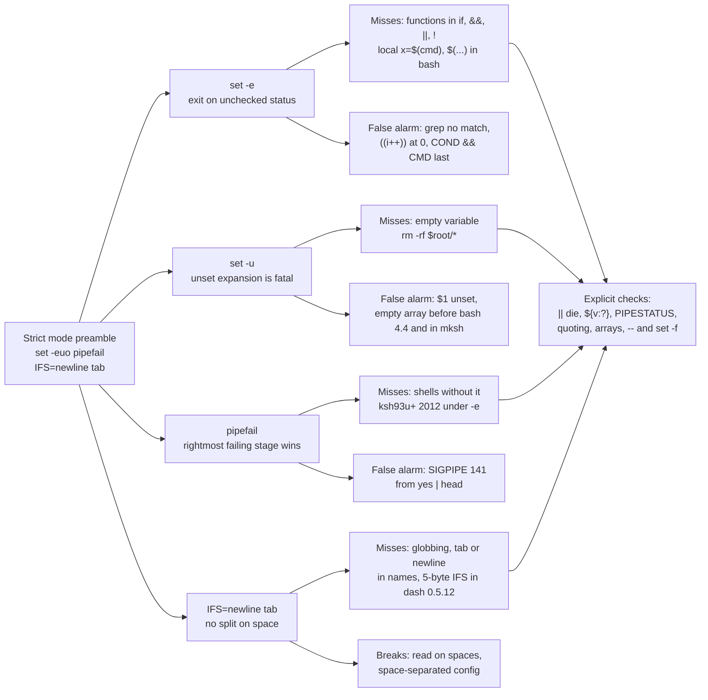

# Unofficial Strict Mode Critique

> [!summary] Claim
> `set -euo pipefail; IFS=$'\n\t'` is four unrelated mechanisms with four different failure models, and each one both misses a class of real failure and turns a class of correct code into a crash, so it is a useful tripwire for short linear scripts and never a substitute for checking the statuses you care about.

Part of [Robust Scripting](README.md) in [Shell and Unix Engineering](../README.md).

## TL;DR

- Mechanism: `-e` exits on an unchecked non-zero status with five syntactic exemptions, `-u` turns an unset-parameter expansion into a fatal expansion error, `pipefail` derives a pipeline's status from its rightmost failing stage, and the `IFS` line changes field splitting only (POSIX.1-2024 XCU 2.15 `set`, 2.8.1, 2.9.2, 2.6.5).
- Rule: keep `set -eu` and `pipefail` as a net under explicit checks, drop the `IFS` line, quote every expansion, and guard every dangerous value with `${var:?}`.
- Trap: `pipefail` makes `producer | head -n 1` fatal (status 141 from `SIGPIPE`), `-u` never catches an empty variable, and `-e` is silently off inside any function called from `if`, `&&`, `||`, or `!`.
- Portability: `pipefail` is POSIX only since 2024, and posh 0.14.1 and dash builds without Debian's 0.5.12-7 backport (including macOS `/bin/dash`) reject it; `$'\n\t'` is a five-byte literal in dash 0.5.12 and posh; BusyBox ash and native bash run past a failure inside `$(...)`; ksh93u+ 2012 ignores `-u` for `$1` and ignores `pipefail` under `-e`.
- When not to use it: in libraries and sourced files (the options leak into the caller), in scripts whose logic is mostly expected non-zero statuses (`grep`, `diff`, `cmp`, `test`), and in anything past about 100 lines, where a language with real exceptions is cheaper.

## Mental model



The preamble fans out into four independent mechanisms, and each has two failure edges: a "misses" edge, where a real failure passes silently, and a "false alarm" edge, where correct code aborts.
The misses edges all converge on the same remedy, explicit checks at the points where a status or a value matters, because no global option can know which non-zero statuses are errors.
The false-alarm edges are why teams that adopt strict mode accumulate `|| true` and `set +e` islands, and each island is a place where a real failure can hide again.
Read the diagram left to right as a cost model: every option you add buys one class of detection and charges one class of breakage.

## How it works

### Where the idiom comes from

Aaron Maxwell's article "Use Bash Strict Mode (Unless You Love Debugging)" names the preamble `set -euo pipefail` plus `IFS=$'\n\t'` "the unofficial bash strict mode" and says it "causes bash to behave in a way that makes many classes of subtle bugs impossible" (redsymbol.net, fetched 2026-11-15; the page shows no publication date).
Greg Wooledge's BashFAQ/105 answers that claim directly, calling such claims "dubious at best", and BashFAQ/112 argues the costs of `set -u` specifically.
The article itself is careful about several workarounds (`${1:-}`, `|| true`, `set +u` around `source`, `trap ... EXIT` cleanup, and the last-line `COND && CMD` trap), so the critique below is about what the four lines actually do, measured, not about a strawman.

`set -euo pipefail` is three options in one `set` call: `-e`, `-u`, and `-o pipefail`, grouped behind one `-` with the option-argument last, which the Utility Syntax Guidelines allow.
The four mechanisms share nothing in the implementation: `-e` is checked after each command completes, `-u` is checked during parameter expansion, `pipefail` is consulted when a pipeline's status is computed, and `IFS` is read during field splitting.

### `set -e`: an exit on unchecked status, with exemptions inherited by everything inside

POSIX.1-2024 says that under `-e`, when any command fails, "the shell immediately shall exit, as if by executing the exit special built-in utility with no arguments", except for a non-final pipeline stage, a command substitution's subshell during word expansion, the compound list after `while`, `until`, `if`, or `elif`, a pipeline beginning with `!`, any command of an AND-OR list other than the last, and a compound command whose status came from a failure while `-e` was ignored (POSIX.1-2024 XCU 2.15 `set`).
The same section gives two examples that fix the semantics of the subshell cases: in `set -e; (false; echo one) | cat; echo two` the subshell exits at `false` but `echo two` runs, because the pipeline's status is zero, and in `set -e; echo $(false; echo one) two` the substitution's subshell exits at `false`, its status is ignored, and the shell runs `echo two` (POSIX.1-2024 XCU 2.15 `set`, fetched 2026-11-21).
So POSIX applies `-e` inside a command substitution and ignores only the substitution's own failure; an assignment such as `v=$(false)` still fails the simple command and exits.
The full exemption mechanics, with bash's `CMD_IGNORE_RETURN`, dash's `EV_TESTED`, and zsh's `noerrexit`, are in [[errexit-Semantics-and-Exceptions]]; this note covers what they do to a strict-mode script.

The exemption that matters most is inherited: the bash manual says that if a compound command or shell function executes where `-e` is being ignored, "none of the commands executed within the compound command or function body will be affected by the -e setting, even if -e is set and a command returns a failure status" (bash-5.3 `doc/bashref.texi`, `set -e`).
So `if deploy; then` or `deploy || rollback` runs all of `deploy` with `-e` off, and ShellCheck's optional check `check-set-e-suppressed` exists to flag exactly this (SC2310, "This function is invoked in an 'if' condition so set -e will be disabled").
ksh93 goes further for functions defined with the `function name { ...; }` syntax: "The errexit option is turned off in the function's scope" (ksh93u+m `sh.1`, Functions), and macOS ksh93u+ 2012 runs `set -e; function f { false; echo inside; }; f` to completion (measured on macOS 26, ksh `Version AJM 93u+ 2012-08-01`).

Command substitution is the second hole.
Bash clears `-e` in every `$(...)` child unless `inherit_errexit` is set: `command_substitute()` calls `change_flag ('e', FLAG_OFF)` when `inherit_errexit == 0` (bash-5.3 `subst.c`, `command_substitute`), and the option, added in bash-4.4-rc1, "is enabled as part of turning on posix mode" (bash-5.3 `CHANGES`).
Strict mode never sets it, so under native bash `set -e; v=$(false; printf leaked)` assigns `leaked` and continues, while dash, zsh, ksh93, and macOS `/bin/sh` (bash 3.2 in POSIX mode) exit with status 1 (lab test `strict mode without inherit_errexit`).
BusyBox ash does the same as native bash on purpose: `evalbackcmd()` sets `eflag = 0` in the substitution's child, under a source comment that says dash deleted that line in a 2010-06-28 commit ("[EVAL] Don't clear eflag in evalbackcmd") and that ash keeps it to preserve bash-like behavior because it "seems to be somewhat more useful" (BusyBox `shell/ash.c`, `evalbackcmd`, master as fetched 2026-11-15).
That is a documented design choice in BusyBox and bash, not a bug, and it is not POSIX behavior: POSIX gives a command substitution a subshell environment that inherits the shell options, and bash restores that only in POSIX mode or with `inherit_errexit`.
ShellCheck SC2311 names this case: "Bash implicitly disabled set -e for this function invocation because it's inside a command substitution."

The third hole is `local`, `declare`, `export`, and `readonly` with a command substitution in the same word.
`local v=$(false)` returns the status of `local`, which is 0, so the failure of the substitution is discarded, while `local v; v=$(false)` exits under `-e`.
Measured on bash 5.3.15 and macOS `/bin/bash` 3.2.57 on 2026-11-21 with `set -e`: `f() { local v=$(false); echo "reached v=<$v>"; }` prints `reached v=<>`, and the split form in a second function exits with status 1 before its `echo`.
The Google Shell Style Guide and ShellCheck SC2155 ("Declare and assign separately to avoid masking return values") name the same trap, so every strict-mode script that uses `local` with a substitution has a hole that no option closes.

The fourth class is false alarms from commands whose non-zero status is an answer, not an error.
`grep` exits 1 when "No lines were selected" and above 1 when "An error occurred" (POSIX.1-2024 XCU `grep`, EXIT STATUS); `expr` exits 1 when the expression evaluates to null or zero (POSIX.1-2024 XCU `expr`, EXIT STATUS).
So `count=$(grep -c pattern file)` aborts a strict script when the honest answer is 0, and Maxwell's fix `count=$(grep -c pattern file || true)` also converts status 2 (file missing) into an empty `count` with status 0 (lab test `grep -c with no match is fatal under set -e, and || true also hides a real grep error`).
The arithmetic command `((i++))` returns status 1 when the expression's value is 0, because `execute_arith_command()` ends with `return (expresult == 0 ? EXECUTION_FAILURE : EXECUTION_SUCCESS)` and the post-increment's value is the old value 0 (bash-5.3 `execute_cmd.c`, `execute_arith_command`).
That only became fatal in bash 4.1: the bash-5.3 `CHANGES` file lists, under bash-4.1-alpha item j, that the `[[` and `((` commands became subject to `set -e` and the `ERR` trap, so the same line survives macOS `/bin/bash` 3.2 and exits bash 5.3 (lab test `((i++)) from zero is fatal`).
The Google Shell Style Guide calls this out: "`set -e; i=0; (( i++ ))` will cause the shell to exit."

The last false alarm is the one Maxwell documents: `COND && CMD` as the final command of a script.
`-e` ignores the failed `COND` because it is not the last command of the AND-OR list, but the list's status is still 1, and a script's exit status is that of its last command, so a correct run exits 1 (lab test `COND && CMD as the last command`).
Maxwell's own remedy is the right one, an `if` statement, and his other observation also holds: in `first && { second; third; }` the `{ }` group is the final operand, so `-e` applies inside it and a failing `second` exits the script (lab test `a failure in a non-final && operand is ignored, but errexit applies inside a final { } group`).

### `set -u`: an expansion error, so the errexit exemptions do not apply

POSIX.1-2024 defines `-u` as: "When the shell tries to expand, in a parameter expansion or an arithmetic expansion, an unset parameter other than the '@' and '*' special parameters, it shall write a message to standard error and the expansion shall fail with the consequences specified in 2.8.1 Consequences of Shell Errors" (POSIX.1-2024 XCU 2.15 `set`; Issue 8 applied Austin Group Defect 559 to this text).
Section 2.8.1 says an expansion error makes a non-interactive shell exit, and "If any of the errors shown as 'shall exit' or 'may exit' occur in a subshell environment, the shell shall (respectively, may) exit from the subshell environment with a non-zero status and continue in the environment from which that subshell environment was invoked" (POSIX.1-2024 XCU 2.8.1).

Two consequences follow, and both surprise people who think of `-u` as part of `-e`.
First, `-u` needs no `-e` and ignores every errexit exemption: `set -u; if [ -n "$undef" ]; then ...` and `f || handle` with an unset reference inside `f` both kill the shell, and the handler never runs (lab tests `set -u aborts inside an if condition` and `set -u aborts inside a function called on the left of ||`).
Second, inside `$(...)` only the subshell dies, so `x=$(printf %s "$undef"; echo inner)` leaves `x` empty and the parent continues with status 1 in bash, zsh, and ksh93 and 2 in dash (lab test `set -u in a command substitution ends only the subshell`); without `-e`, the script carries on with an empty value.

In bash, `err_unboundvar()` prints `%s: unbound variable` (bash-5.3 `error.c`, `err_unboundvar`), and the exit status depends on how the shell was started: a script exits 1, while `bash -c` exits 127 because the fatal expansion longjmps to top level with `FORCE_EOF` and `run_one_command()` maps that to `last_command_exit_value = 127` (bash-5.3 `shell.c`, `run_one_command`; both measured on bash 5.3.15 and 3.2.57).
dash prints `parameter not set` and exits 2; zsh and ksh93 exit 1 (measured on dash 0.5.13.5, zsh, and ksh93u+ 2012).

The more important limit is what `-u` cannot see.
It distinguishes unset from set, never empty from non-empty (see [[Null-versus-Unset]]), so `root=; rm -rf "$root/"*` expands to `rm -rf /*` with `-u` on (lab test `set -u never catches an empty variable`).
That is the shape of the Steam for Linux bug: issue #3671 (opened 2015-01-14) reports that running Steam after moving its directory "deleted everything on system owned by user", and the thread points at `rm -rf "$STEAMROOT/"*` with the hypothesis that `STEAMROOT="$(cd "${0%/*}" && echo $PWD)"` came out empty; the thread does not confirm the root cause, but an empty-not-unset variable is exactly the case `-u` cannot catch and `${STEAMROOT:?}` would have.

`-u` also fires on correct code.
Every optional positional parameter needs `${1-}` or `${1:-default}`, which Maxwell recommends and BashFAQ/112 shows with `while [ "${1-}" ]`.
Empty arrays aborted before bash 4.4: "Using `${a[@]}` or `${a[*]}` with an array without any assigned elements when the nounset option is enabled no longer throws an unbound variable error" (bash-5.3 `CHANGES`, bash-4.4-rc2), so `set -u; a=(); for x in "${a[@]}"` dies on macOS `/bin/bash` 3.2 with `a[@]: unbound variable` and runs zero iterations on bash 5.3 (lab test `set -u on an empty array`).
mksh never gained that exemption: R59 aborts on the same loop with `a[@]: parameter not set` and status 1 (measured in the shell-matrix images on 2026-11-21, mksh 59c on both Alpine 3.22 and Debian 13).
Sourced files written without `-u` in mind (Maxwell's example is an old virtualenv `activate` with `_OLD_VIRTUAL_PYTHONHOME: unbound variable`) force `set +u` brackets around `source`.

### `pipefail`: the rightmost failing stage, including deaths you caused on purpose

POSIX.1-2024 standardized `pipefail` (Austin Group Defect 789, XCU 2.15 `set`): with it enabled, a pipeline's status is "Zero, if all commands in the pipeline returned an exit status of 0; otherwise, the exit status of the last (rightmost) command specified in the pipeline that returned a non-zero exit status" (POSIX.1-2024 XCU 2.9.2, Exit Status table).
The shell uses the setting in force when the pipeline begins, so in `command1 | set -o pipefail` the option has no effect on that pipeline (POSIX.1-2024 XCU 2.9.2).
Bash has had it since bash-3.0-alpha ("New `set -o pipefail' option", bash-5.3 `CHANGES`), so macOS bash 3.2 has it.

The design hazard is that a pipeline whose reader exits early is correct Unix, and `pipefail` reports it as failure.
`yes | head -n 1` is deterministic: `head` exits after one line, the next `write(2)` by `yes` raises `SIGPIPE` (see [[SIGPIPE-and-EPIPE]]), and the shell records 128 + 13 = 141, which `pipefail` makes the pipeline's status and `-e` turns into an exit (lab test `pipefail turns a reader that exits early into a fatal SIGPIPE status under set -e`).
When the producer writes less than a pipe buffer, the producer usually finishes before the reader exits and the pipeline succeeds, so BashFAQ/105 warns that after `set -e -o pipefail; somecmd | head -n1` the next command "will sometimes be executed, depending on how much output somecmd writes": the abort is load-dependent, which is worse than either always or never.
`producer | grep -q pattern` has the same race, because `grep -q` exits at its first match.

`pipefail` is also the option with the most implementation variance.
The status of a signal death is itself shell-specific: 128 + N in most shells, 256 + N in ksh93, and 384 + N in yash (measured in the shell matrix), so the same `yes | head -n 1` is 141 in bash and 397 in yash; yash reports 141 only when it forks an intermediate yash for the stage (for example `yes 2>/dev/null`), which exits 397 & 255.
The 397 lives only inside yash: when `-e` makes yash exit on that pipeline, its parent sees 141, because a process exit status keeps only the low 8 bits (measured on yash 2.58.1, 2026-11-21: `$?` 397 inside, exit status 141 outside).
A check like `[ "$st" -eq 141 ]` is therefore a bash idiom, not a portable one.
ksh93u+m connects pipeline stages with sockets, so a writer whose reader has gone can see `ECONNRESET` instead of `EPIPE` and the status need not be a signal status at all; under `set -o posix` it uses `pipe(2)` and the result becomes deterministic (measured in the shell matrix).
On ksh93u+m 1.0.10, `set -o pipefail; yes | head -n 1` gave `$?` 1 after `yes: standard output: Connection reset by peer` in three runs out of three, and 269 under `set -o posix` (measured in the Debian 13 image, 2026-11-21).
macOS ksh93u+ 2012 reports 13 for it and does not exit under `-e` at all (measured on macOS 26), a bug ksh93u+m fixed: "if both the 'errexit' and 'pipefail' options are active, ksh now correctly exits if any pipeline element returns nonzero" (ksh93u+m `NEWS`, 2020-09-30 entry).
A shell without `pipefail` makes the whole preamble fatal: `set -o pipefail` is a special built-in error, which "shall exit" a non-interactive shell (POSIX.1-2024 XCU 2.8.1), so posh 0.14.1 and dash builds without the Debian backport abort on the first line (lab test `set -o pipefail in a shell that lacks it aborts the script`).
Upstream dash 0.5.12 has no `pipefail`: Debian's changelog for dash 0.5.12-7 (2024-05-17) lists "Upstream patch: Implement pipefail option", so Debian 13's 0.5.12-12 accepts it, Homebrew dash 0.5.13.5 accepts it, and Alpine 3.22's dash 0.5.12-r3 and macOS `/bin/dash` reject it with `set: Illegal option -o pipefail` (measured on macOS 26, 2026-11-15, and in the Alpine and Debian images, 2026-11-21; Debian `dash_0.5.12-12_changelog`, entry dated 2024-05-17).
In bash, `PIPESTATUS` gives every stage's status, which is how to accept 141 from one stage and reject it from another; the details are in [[pipefail-and-PIPESTATUS]].

### `IFS=$'\n\t'`: a splitting change that is not a quoting discipline

The shell "shall set IFS to <space><tab><newline> when it is invoked" (POSIX.1-2024 XCU 2.5.3), and bash does it unconditionally in `initialize_shell_variables()` with `bind_variable ("IFS", " \t\n", 0)` under the comment "Don't allow IFS to be imported from the environment" (bash-5.3 `variables.c`).
Field splitting applies only to the unquoted results of parameter expansion, command substitution, and arithmetic expansion, and uses every byte of `IFS` as a delimiter, with `<space>`, `<tab>`, and `<newline>` treated as IFS white space that collapses (POSIX.1-2024 XCU 2.6.5).
Removing `<space>` therefore keeps `"Aaron Maxwell"` whole in an unquoted `$names`, which is the article's motivation; its footnote 2 says the alternative, `"$@"` in double quotes, has "a high risk of introducing subtle time-bomb bugs" because maintainers forget the quotes.

The critique is that the `IFS` line fixes one symptom of missing quotes and leaves the rest.
Pathname expansion still runs on every unquoted expansion after splitting (POSIX.1-2024 XCU 2.6.6), so `pat='*.txt'; set -- $pat` still yields every matching file name, and a file name containing a tab or newline, both legal bytes in a name, still splits (lab test `strict IFS does not stop pathname expansion, and a tab in a file name still splits it`).
`read` also splits on `IFS`, so `read -r first rest <<< "alpha beta"` now puts the whole line in `first`, and `"$*"` joins with the first byte of `IFS`, now a newline (lab test `strict IFS keeps spaces inside fields`); any space-separated configuration or `set -- $line` parsing in the script changes meaning.
Native zsh does not field-split unquoted parameter expansions at all, so the line is a no-op there, while `zsh --emulate sh` splits like POSIX (lab tests above).

The syntax is not portable to the shells people run `#!/bin/sh` scripts under.
`$'...'` is standardized only in POSIX.1-2024 (XCU 2.2.4), and dash 0.5.12 and posh 0.14.1 do not support it (measured in the shell matrix), so they read `IFS=$'\n\t'` as `$` followed by the single-quoted literal `\n\t`: a five-byte `IFS` of `$`, `\`, `n`, `\`, `t`.
Under that `IFS`, `set -- $word` with `word=internet` produces the four fields `i`, an empty field, `er`, and `e`, because `n` and `t` are now non-white-space delimiters and two adjacent ones delimit an empty field (POSIX.1-2024 XCU 2.6.5; lab test `IFS=$'\n\t' is two bytes where $'...' exists and five literal bytes where it does not`).
dash 0.5.13 supports `$'...'` (measured: Homebrew dash 0.5.13.5 gives a two-byte `IFS`), so the same script behaves differently across dash releases.
If you want the value portably, build it with a sentinel, because command substitution strips trailing newlines: `IFS=$(printf '\n\tx'); IFS=${IFS%x}`.

### What to put instead: strict mode as a net, explicit checks as the code

The replacement is not a longer preamble; it is a short net plus checks at the points where a status has meaning.
This is an ad hoc script, not part of the lab, run once on bash 5.3.15 on 2026-11-21:

```sh
#!/usr/bin/env bash
set -euo pipefail
shopt -s inherit_errexit 2>/dev/null || true
die() { printf '%s: %s\n' "${0##*/}" "$*" >&2; exit 1; }
trap 'printf "%s: line %s: %s exited %s\n" "${0##*/}" "$LINENO" "$BASH_COMMAND" "$?" >&2' ERR
set -E

dir=${1:-}
[ -n "$dir" ] || die "usage: pre.sh DIR"
count=$(grep -c needle "$dir/data" || [ "$?" -eq 1 ]) || die "grep failed on $dir/data"
printf 'count=%s\n' "$count"
first=$(yes | head -n 1; exit 0)
printf 'first=<%s>\n' "$first"
```

With a `data` file holding one line without the word, the run printed:

```
count=0
pre.sh: line 12: head -n 1 exited 141
pre.sh: line 12: first=$(yes | head -n 1; exit 0) exited 141
exit=141
```

With a missing directory the same script printed `grep: nodir/data: No such file or directory`, `pre.sh: grep failed on nodir/data`, and exit status 1.
Three things follow from that run.
`grep -c ... || [ "$?" -eq 1 ]` is the exact-status form of the `|| true` workaround: status 1 passes with `count=0`, and status 2 reaches `die`.
The `exit 0` at the end of the substitution does not save the `yes | head -n 1` line, because `pipefail` fails the pipeline before `exit 0` runs under `-e`; the `ERR` trap with `set -E` is what turned a silent 141 into a line number and a command.
So the net plus the `ERR` trap finds the early-reader bug, but only restructuring (read the first line without a pipe) removes it.

## Numbers and limits

| Quantity | Value | Source |
|---|---|---|
| Default `IFS` | 3 bytes: `<space><tab><newline>` | POSIX.1-2024 XCU 2.5.3; bash-5.3 `variables.c`, `initialize_shell_variables` |
| Strict `IFS` length | 2 bytes; 5 bytes where `$'...'` is missing | Lab `ifs_dollar` mode; 5-byte case measured by assigning the literal under bash, dash, and ksh |
| `yes \| head -n 1` status under `pipefail` | 141 (bash 5.3 and 3.2, dash 0.5.13, zsh); 13 (ksh93u+ 2012); 397 in yash's `$?`, 141 as yash's own exit status | Lab `pipefail_sigpipe`, macOS 26 arm64, 2026-11-15; yash 2.58.1 measured in the shell-matrix Alpine image, 2026-11-21 |
| Signal-death status in `$?` or `PIPESTATUS` | 128 + N in most shells, 256 + N in ksh93, 384 + N in yash (SIGPIPE is 13: 141, 269, 397) | Shell matrix, as of 2026-11; POSIX.1-2024 XCU 2.8.2 allows statuses above 255 for a signal death |
| Debian dash `pipefail` | since dash 0.5.12-7, 2024-05-17 | Debian `dash` changelog |
| BusyBox ash `-e` in `$(...)` | cleared deliberately; dash removed the same line on 2010-06-28 | BusyBox `shell/ash.c`, `evalbackcmd`, fetched 2026-11-15 |
| Unset-variable exit status | bash 1 (script) or 127 (`bash -c`); dash 2; zsh 1; ksh93 1; mksh 1; posh 1; yash 2; BusyBox ash 2 | Measured 2026-11-15 on bash 5.3.15, 3.2.57, dash 0.5.13.5, zsh, ksh93u+ 2012, and 2026-11-21 with `sh -c` in the shell-matrix images (bash 5.2.37, dash 0.5.12, ksh93u+m 1.0.10, mksh 59c, posh 0.14.1, yash 2.58.1, BusyBox 1.37.0); bash-5.3 `shell.c`, `run_one_command` |
| Exit status of `((i++))` at `i=0` | 1 | bash-5.3 `execute_cmd.c`, `execute_arith_command` |
| `grep` statuses | 0 selected, 1 none selected, >1 error | POSIX.1-2024 XCU `grep` |
| `expr` status for a zero result | 1 | POSIX.1-2024 XCU `expr` |
| bash `pipefail` | since bash-3.0-alpha | bash-5.3 `CHANGES` |
| bash `[[` and `((` subject to `-e` | since bash-4.1-alpha | bash-5.3 `CHANGES` item j |
| bash `inherit_errexit` | since bash-4.4-rc1 (bash 4.4 released 2016-09) | bash-5.3 `CHANGES`; release month from the ftp.gnu.org listing cited in [[errexit-Semantics-and-Exceptions]] |
| bash empty array under `-u` allowed | since bash-4.4-rc2 | bash-5.3 `CHANGES` |
| ksh93u+m `-u` on unset `$1` | errors since the 2020-06-08 `NEWS` entry | ksh93u+m `NEWS` |
| ksh93u+m `errexit` with `pipefail` | fixed in the 2020-09-30 `NEWS` entry | ksh93u+m `NEWS` |
| `pipefail` in POSIX | POSIX.1-2024 (Issue 8), Austin Group Defect 789 | POSIX.1-2024 XCU `set` CHANGE HISTORY |
| Google style guide rewrite threshold | "more than 100 lines long" | Google Shell Style Guide (fetched 2026-11-15) |
| Cloudflare `pipefail` incident | 2021-12-16, 20:10 to 20:40 UTC, requests delayed by up to 5 s | Cloudflare blog, published 2022-04-05 |
| `local v=$(false)` under `-e` | continues with `v` empty (status of `local` is 0); `local v; v=$(false)` exits 1 | Measured on bash 5.3.15 and 3.2.57, 2026-11-21 (ad hoc, not in the lab); Google Shell Style Guide; ShellCheck SC2155 |
| Lab result | 18 of 18 tests pass under bash 5.3.15 | `bats strict-mode.bats` with `LAB_SHELL=bash`, run once on 2026-11-21 |
| Steam `rm -rf` report | issue #3671 opened 2015-01-14 | GitHub steam-for-linux |

## Portability

Cells for bash 5.3, macOS bash 3.2 (`/bin/bash` and `/bin/sh`), dash 0.5.13, zsh, `zsh --emulate sh`, and ksh93u+ 2012 were measured by this note's lab on macOS 26 arm64 on 2026-11-15.
Cells for ksh93u+m 1.0.10, mksh 59c, yash 2.58.1, posh 0.14.1, BusyBox ash 1.37.0, and dash 0.5.12 (Debian 0.5.12-12, Alpine 0.5.12-r3) were measured once each with `sh -c` probes in the shell-matrix Debian 13 and Alpine 3.22 images on 2026-11-21; the full lab matrix run for this lab is paused, so these are ad hoc measurements, not lab runs (as of 2026-11).
Also confirmed by the shell matrix on other labs: the `$'...'` gaps in dash 0.5.12 and posh, posh's abort on an empty `"$@"` under `-u`, yash's status 397, and the 256 + N and 384 + N signal statuses of ksh93 and yash.
Confirmed from source: the BusyBox `$(...)` leak (`ash.c`, `evalbackcmd`) and Debian dash's `pipefail` (changelog of 0.5.12-7).
The ad hoc run contradicted one lab assertion, the mksh empty-array cell (fatal, not zero fields), and the lab's mksh arm was corrected to match.

| Behavior | POSIX.1-2024 | macOS bash 3.2 | bash 5.3 | zsh | zsh `--emulate sh` | dash | ksh93 | mksh | yash | posh 0.14.1 | BusyBox ash |
|---|---|---|---|---|---|---|---|---|---|---|---|
| `IFS=$'\n\t'` length | 2 (XCU 2.2.4) | 2 | 2 | 2 | 2 | 0.5.12: 5; 0.5.13: 2 | 2 | 2 | 2 | 5 | 2 |
| Unquoted `$x` splits on strict `IFS` | yes | yes | yes | no split | yes | yes | yes | yes | yes | yes | yes |
| Unquoted `$pat` globs under strict `IFS` | yes | yes | yes | no glob | yes | yes | yes | yes | yes | yes | yes |
| `set -u` fatal inside `if` and left of `\|\|` | yes (XCU 2.8.1) | yes | yes | yes | yes | yes | yes | yes | yes | yes | yes |
| `set -u` on unset `$1` | fatal | fatal | fatal | fatal | fatal | fatal | u+ 2012: expands empty; u+m: fatal | fatal | fatal | fatal | fatal |
| `set -u` on empty `"$@"` | exempt | exempt | exempt | exempt | exempt | exempt | exempt | exempt | exempt | fatal | exempt |
| `set -u; a=(); "${a[@]}"` | no arrays | fatal | zero fields | zero fields | zero fields | no arrays | `a=()` is a compound variable, prints `(` and `)` | fatal (`a[@]: parameter not set`) | zero fields | no arrays | no arrays |
| `set -o pipefail` accepted | yes | yes | yes | yes | yes | 0.5.12-7 and later in Debian, and 0.5.13: yes; upstream 0.5.12 (Alpine 0.5.12-r3) and macOS `/bin/dash`: aborts | yes | yes | yes | aborts | yes |
| `yes \| head -n 1` under `-e` and `pipefail` | exits (status > 128) | exits 141 | exits 141 | exits 141 | exits 141 | exits 141 where supported | u+ 2012: continues, `$?` 13; u+m: exits with a non-zero status (sockets, so not necessarily 269) | exits 141 | exits; `$?` 397, process status 141 | no `pipefail` | exits 141 |
| `((i++))` at 0 under `-e` | not specified | continues | exits 1 | exits 1 | exits 1 | `i++` not found, 127 | continues (u+ 2012 and u+m 1.0.10) | exits 1 | 127 | 127 | 127 |
| `set -e; v=$(false; printf leaked)` | exits 1 | `/bin/bash` leaks; `/bin/sh` exits 1 | leaks unless `inherit_errexit` | exits 1 | exits 1 | exits 1 | exits 1 | exits 1 | exits 1 | exits 1 | leaks (by design, `ash.c` `evalbackcmd`) |
| `shopt -s inherit_errexit` | not specified | no such option | yes (4.4+) | no `shopt` | no `shopt` | no `shopt` | no `shopt` | no `shopt` | no `shopt` | no `shopt` | no `shopt` |
| `true && { false; ...; }` under `-e` | exits | exits | exits | exits | exits | exits | exits | exits | exits | continues (`XERROK`) | exits |
| Signal-death status of a killed stage | greater than 128, implementation-defined which signal (XCU 2.8.2) | 141 | 141 | 141 | 141 | 141 | 256 + N (u+ 2012 measured 13 for this pipeline) | 141 | 397 | n/a (no `pipefail`) | 141 |
| `function f { false; ...; }` under `-e` | not specified | exits | exits | exits | exits | syntax error, status 2 | `-e` off in `f` (`sh.1`; u+ 2012 and u+m 1.0.10) | exits 1 | exits 1 | syntax error, status 1 | exits 1 |

The utilities matter as much as the shells.
`grep -c` with no match prints `0` and exits 1 and a missing file exits above 1 by POSIX, and macOS BSD grep 2.6.0-FreeBSD matched that in the lab; GNU and BusyBox grep are asserted the same by the lab, which does not branch on the grep implementation.
`yes` is not a POSIX utility; GNU coreutils, macOS, and BusyBox all ship one, and all that matters to the lab is that it never stops writing, so it is always the stage that receives `SIGPIPE`.

## Worked example

The [lab](../labs/13-unofficial-strict-mode-critique/) has one probe, `strict-probe.sh`, with one mode per claim, and `strict-mode.bats`, which asserts each mode's output per shell family.
This is a simplified excerpt of four modes; the lab file has the comments, the ShellCheck directives, and the remaining modes.

```sh
#!/bin/sh
mode=${1:?usage: strict-probe.sh MODE}
shift

# strict_ifs: set IFS to <newline><tab> without $'...', so it works in every POSIX shell.
strict_ifs() {
  IFS=$(printf '\n\tx')
  IFS=${IFS%x}
}

case $mode in
  ifs_glob)
    strict_ifs
    pat='*.txt'
    set -- $pat
    printf 'glob '
    show_fields "$@"
    logs=$(find . -name '*.log' -print | LC_ALL=C sort)
    set -- $logs
    printf 'find '
    show_fields "$@"
    ;;
  nounset_null)
    set -u
    root=
    printf 'target=%s\n' "$root/*"
    : "${root:?root is empty}"
    printf 'survived\n'
    ;;
  pipefail_sigpipe)
    control=$(
      set -e
      yes | head -n 1 >/dev/null
      printf 'survived'
    )
    printf 'control=<%s>\n' "$control"
    if (set -o pipefail) 2>/dev/null; then
      pf_status=$(
        set -o pipefail
        yes | head -n 1 >/dev/null
        printf '%s' "$?"
      )
      pf_out=$(
        set -e
        set -o pipefail
        yes | head -n 1 >/dev/null
        printf 'survived'
      )
      printf 'pipefail=on status=%s errexit_out=<%s>\n' "$pf_status" "$pf_out"
    else
      printf 'pipefail=unsupported\n'
    fi
    ;;
  grep_count)
    plain=$(
      set -e
      count=$(grep -c zzz /dev/null)
      printf 'count=%s' "$count"
    )
    plain_st=$?
    ortrue=$(
      set -e
      count=$(grep -c zzz /dev/null || true)
      printf 'count=%s' "$count"
    )
    masked=$(
      set -e
      count=$(grep -c zzz ./no-such-file-strict-lab 2>/dev/null || true)
      printf 'count=%s' "$count"
    )
    printf 'plain_st=%s plain=<%s> ortrue=<%s> masked=<%s>\n' "$plain_st" "$plain" "$ortrue" "$masked"
    ;;
esac
```

Captured on macOS 26 arm64 with GNU bash 5.3.15, in a directory holding `a.txt`, `b.txt`, `a b.log`, and a file named `tab`, a tab, `c.log`:

```
$ bash strict-probe.sh ifs_glob
glob fields=2 <a.txt> <b.txt>
find fields=3 <./a b.log> <./tab> <c.log>
$ bash strict-probe.sh nounset_null; echo "exit=$?"
target=/*
strict-probe.sh: line 123: root: root is empty
exit=1
$ bash strict-probe.sh pipefail_sigpipe
control=<survived>
pipefail=on status=141 errexit_out=<>
$ bash strict-probe.sh grep_count
plain_st=1 plain=<> ortrue=<count=0> masked=<count=>
$ bash strict-probe.sh cmdsub_leak
v=<leaked>
$ dash strict-probe.sh cmdsub_leak; echo "exit=$?"
exit=1
```

Read the lines as a ledger of the four options.
`ifs_glob` shows the `IFS` line keeping `a b.log` whole while globbing `*.txt` and splitting the tab name, so it did not make unquoted expansions safe.
`nounset_null` shows `-u` letting an empty root through to `/*`; only `${root:?}` stopped it.
`pipefail_sigpipe` shows the same correct pipeline surviving without `pipefail` and killing the script with it.
`grep_count` shows `-e` killing a correct zero count, then `|| true` restoring it and also erasing a real error into an empty string.
`cmdsub_leak` shows bash running past `false` inside `$(...)` while dash exits, because strict mode never turns on `inherit_errexit`.
The bats file asserts every one of these lines, per family, for all 15 modes plus four inline cases; it passed 18 of 18 tests under bash 5.3.15 on 2026-11-21, and under bash 5.3, macOS bash 3.2 as `/bin/bash` and `/bin/sh`, dash 0.5.13, zsh, `zsh --emulate sh`, and ksh93u+ 2012 (run once each, 2026-11-15; the 2026-11-21 run covered bash 5.3.15 only).

## Pitfalls

> [!warning] `pipefail` plus an early-exiting reader
> Trigger: `set -eo pipefail` and a pipeline ending in `head`, `grep -q`, `sed q`, or `awk` with `exit`, fed by a producer that can write more than a pipe buffer.
> Symptom: the script exits 141 (yash holds 397 in `$?` but still exits 141) after doing everything right, and only under load or on larger inputs, because the producer finishes first on small inputs (BashFAQ/105).
> The status itself is shell-specific (141 in bash, 397 in yash, a socket error in ksh93u+m), so a test for exactly 141 is a bash idiom.
> Fix: do not pipe into an early-exiting reader under `pipefail`; read the first line in the shell (`IFS= read -r first < file`), capture the producer to a file first, or in bash check `PIPESTATUS` and accept 141 from the producer only.

> [!warning] Missing `pipefail` where it mattered
> Trigger: a pipeline whose producer fails feeding a consumer that accepts empty input and writes state.
> Symptom: Cloudflare's incident of 2021-12-16: a cron job piped the output of `dos-make-addr-conf` into `dosctl`; the producer failed while the Addressing API it queried was flooded with requests, the empty output overwrote the `template_vars` key, `dosd` panicked, and web requests were delayed by up to five seconds from 20:10 to 20:40 UTC (Cloudflare, "PIPEFAIL: How a missing shell option slowed Cloudflare down", published 2022-04-05).
> Fix: `pipefail` is the right default for pipelines that produce state; better still, write the producer's output to a temporary file, check the producer's status, validate non-empty output, and rename into place ([[Atomic-Writes]]).

> [!warning] `-u` does not catch an empty path
> Trigger: `rm -rf "$dir/"*` or `cd "$dir" && rm -rf ./*` where `dir` came from a command substitution, config file, or environment that can be empty.
> Symptom: deletion of `/` or the current directory; the Steam for Linux report (#3671, 2015-01-14) describes user files deleted from `/` after `rm -rf "$STEAMROOT/"*`, with an empty `STEAMROOT` suspected but not confirmed in the thread.
> Fix: `: "${dir:?}"` before use, or `rm -rf -- "${dir:?}/"*`, plus the rules in [[Safe-rm-and-Destructive-Operations]].

> [!warning] Functions called from `if`, `&&`, `||`, or `!` run with `-e` off
> Trigger: `if migrate; then`, `deploy || rollback`, or `! check`, where the function body relies on `-e` to stop after its first failure.
> Symptom: every command in the function keeps running after a failure; ShellCheck's example under SC2310 is a backup function whose `rm` "Runs even if copy fails!".
> Fix: make the function check its own steps (`cp ... || return`), or call it as a plain statement and branch on `$?` captured with `set +e` around it; enable `check-set-e-suppressed` in `.shellcheckrc` to find the call sites.

> [!warning] Strict mode in bash and BusyBox ash without `inherit_errexit`
> Trigger: `set -euo pipefail` in native bash, or in BusyBox ash (Alpine `sh`), and a failing command inside `$(...)` that is not the last command there, for example `v=$(cd "$d"; ls)`.
> Symptom: the substitution runs past the failure and the assignment succeeds with wrong output, while the same code exits under dash, zsh, ksh93, and bash in POSIX mode (BusyBox ash does it on purpose, `ash.c` `evalbackcmd`).
> Fix: add `shopt -s inherit_errexit` in bash 4.4 and later, which BusyBox has no equivalent of, so keep each `$(...)` to one command whose status the assignment reports; that rule is the only one that works in both.

> [!warning] The arithmetic and counter false alarm
> Trigger: `((count++))`, `let count++`, or `expr "$n" + 0` when the value is 0, under `-e`.
> Symptom: the script exits silently with status 1 on the first increment in bash 4.1 and later and zsh, while bash 3.2 and ksh93u+ 2012 continue, so behavior depends on which bash ran.
> Fix: use an assignment, `count=$((count + 1))`, whose status is 0 regardless of the value (lab mode `expr_zero`).

> [!warning] `$'\n\t'` under `#!/bin/sh`
> Trigger: strict mode pasted into a `#!/bin/sh` script that runs on Debian dash 0.5.12 or posh.
> Symptom: `IFS` becomes the five bytes `$\n\t` (dollar sign, backslash, letter n, backslash, letter t), so any unquoted expansion splits at every `n`, `t`, `$`, and backslash; `internet` becomes `i`, an empty field, `er`, and `e`.
> Fix: do not change `IFS` globally; if you must, use the sentinel form `IFS=$(printf '\n\tx'); IFS=${IFS%x}` and scope it to the one `read` or expansion that needs it.

> [!warning] `local v=$(cmd)` hides the failure
> Trigger: `local out=$(risky)`, `declare out=$(risky)`, or `export out=$(risky)` in a function under `set -e`.
> Symptom: the builtin's own status, 0, replaces the substitution's status, so the function keeps running with an empty `out`; measured on bash 5.3.15 and 3.2.57 on 2026-11-21.
> Fix: `local out` on one line and `out=$(risky)` on the next, which ShellCheck SC2155 flags, and add `|| return` or `|| die` where the failure matters.

> [!warning] `|| true` as the universal workaround
> Trigger: appending `|| true` to every command that `-e` killed during development.
> Symptom: real errors (exit status 2 from `grep`, a missing binary at 127) are converted to success, and the variable that should hold a result is empty.
> Fix: accept only the status that means "no": `grep -c pat file || [ "$?" -eq 1 ]` inside the substitution, or capture `st=$?` with `-e` off and `case` on it.

## Security and robustness

Strict mode's security story is mostly about the cases it misses, because the dangerous commands in scripts (`rm`, `chmod`, `mv` onto a target, `curl | sh`, `eval`) are destroyed by wrong values, not by unset ones.
An empty or attacker-influenced path reaches `rm -rf` with `-u` on, an unquoted expansion still globs with the `IFS` line in place, and a command substitution that failed half-way still assigns under native bash, so each of the three options gives a false sense of safety exactly where it is most expensive.
The defensive rules are value rules: validate every input that names a path or a command (`${1:?}`, `case` allowlists, `--` before operands), quote every expansion, use `set -f` (`noglob`) in scripts that never glob, and see [[Command-Injection]] for `eval` and `sh -c` construction.

Robustness also suffers from the options' global, inherited nature.
`set -e` and `set -u` set in a script leak into every file it sources and every function library it loads, so a library written for strict callers breaks lax ones and vice versa; Maxwell's `set +u; source ...; set -u` bracket is the symptom.
The options also change the meaning of the code at a distance: the same function is fail-fast as a statement and fail-open inside an `if`, so a refactor that moves a call into a condition silently removes its error handling.
A robust script therefore treats strict mode as a crash detector for the code it did not think about, and writes explicit checks, a cleanup `trap` ([[Cleanup-Traps-and-Re-Raising-Signals]]), and a documented exit-code contract ([[Exit-Code-Contracts]]) for the code it did.
In bash, an `ERR` trap that prints `$BASH_COMMAND` and `$LINENO` turns a silent `-e` exit into a diagnosable one, but it obeys the same exemptions ("The ERR trap is not executed if the failed command is part of the command list immediately following an until or while reserved word", bash-5.3 `doc/bashref.texi`, `trap`) and needs `set -E` to reach functions, command substitutions, and subshells; see [[ERR-and-DEBUG-Traps]] and [[inherit_errexit-and-errtrace]].

## The principal's view

The decision is not "strict mode or not"; it is where a script's error handling lives, and the honest answer for anything that matters is "in the code, at each point where a status or a value has meaning".
Strict mode is worth keeping as a last-line tripwire in short, linear scripts with few expected non-zero statuses, because there its cost (a handful of `${1-}` and an `if` instead of `&&`) is small and its catch (a typo in a variable name, an unchecked `cd`) is real.
The `IFS` line is not worth keeping: it trades one quoting bug for a different splitting model that breaks `read` and space-separated data, it is a five-byte trap under dash 0.5.12 and posh, and the fix it avoids, quoting and arrays, is what ShellCheck already enforces.

For a team, the standard I would set is: `#!/usr/bin/env bash` scripts start with `set -euo pipefail` and `shopt -s inherit_errexit`, POSIX `sh` scripts start with `set -eu` and feature-detect nothing silently, no global `IFS` change, ShellCheck with `check-set-e-suppressed` and `check-extra-masked-returns` enabled in CI, every pipeline into `head` or `grep -q` reviewed for `SIGPIPE`, and every destructive operand guarded with `${var:?}`.
The downside is explicit: the options still give different results across bash 3.2, bash 5.3, ksh93, yash, and BusyBox (signal statuses of 141, 256 + 13, and 384 + 13, and a `$(...)` that does or does not inherit `-e`), so the CI matrix ([[Cross-Shell-CI-Matrices]]) must include the shells production actually runs, and a script that passes under one bash can abort or fail open under another.
When a script needs `set +e` islands, many `PIPESTATUS` checks, or retries around partially failed steps, it has outgrown the shell's error model; the Google Shell Style Guide's threshold is "more than 100 lines", and the replacement should be a language with exceptions or result types (Python, Go, Rust) where a failed call cannot silently become an empty string.

## Interview questions

> [!question] L5: What do the four lines of the unofficial strict mode each do, and which of them is not an error-handling option at all?
>
> > [!success]- Answer
> > `set -e` exits on a command's non-zero status unless the command is in an exempt context such as an `if` condition or the left of `&&` or `||`.
> > `set -u` makes the expansion of an unset parameter other than `@` and `*` a fatal expansion error.
> > `set -o pipefail` makes a pipeline's status that of its rightmost failing stage instead of its last stage.
> > `IFS=$'\n\t'` only changes which bytes field splitting uses; it detects no error and changes `read`, `"$*"`, and unquoted expansions.
> >
> > Follow-up: Which of the four is POSIX only since POSIX.1-2024, and which uses syntax that dash 0.5.12 cannot parse as intended?

> [!question] L5: Why does `set -u` not protect `rm -rf "$dir/"*`, and what does?
>
> > [!success]- Answer
> > `-u` fires only when a parameter is unset; an empty `dir` is set, so the word expands to `/*`.
> > `${dir:?}` fails on both unset and empty, writing a message and exiting a non-interactive shell.
> > The Steam for Linux issue #3671 shows the consequence of the empty-path shape on real user files.
> >
> > Follow-up: Why is `${dir:?}` still not enough if `dir` can be `/` or `.`?

> [!question] L6: Predict the output and exit status of this bash 5.3 script, then of the same script under macOS `/bin/bash` 3.2.
> ```sh
> #!/bin/bash
> set -euo pipefail
> i=0
> ((i++))
> echo "i=$i"
> ```
>
> > [!success]- Answer
> > Under bash 5.3 it prints nothing and exits 1.
> > `((i++))` evaluates to the old value 0, and `execute_arith_command()` returns failure for a zero result, so `-e` exits.
> > Under bash 3.2 it prints `i=1` and exits 0, because `[[` and `((` became subject to `set -e` only in bash 4.1 (CHANGES, bash-4.1-alpha item j).
> > The portable form `i=$((i + 1))` is an assignment and succeeds in every version.
> >
> > Follow-up: What does `let i++` do under `set -e` in bash 3.2, and why?

> [!question] L6: A strict-mode script dies with status 141 on large inputs but works in testing; the line is `first=$(generate_report | head -n 1)`; explain and fix it.
>
> > [!success]- Answer
> > `head` exits after one line, and `generate_report`'s next write to the closed pipe raises `SIGPIPE`, so it dies with 128 + 13 = 141.
> > Under `pipefail` that becomes the pipeline's status, the assignment's status is that of the command substitution, and `-e` exits.
> > On small inputs the producer finishes writing before `head` exits, so the pipeline succeeds, which is why tests pass.
> > Fix it by not piping into an early-exiting reader: write the report to a temporary file and `IFS= read -r first < "$tmp"`, or in bash inspect `PIPESTATUS` and accept 141 only from the producer.
> >
> > Follow-up: What status does yash report for the same pipeline, and why does that matter for a check like `[ "$st" -eq 141 ]`?

> [!question] L6: Why does `set -u` kill a script inside `if [ -n "$undef" ]` even though `set -e` is off in `if` conditions?
>
> > [!success]- Answer
> > `-u` is not an errexit mechanism: POSIX.1-2024 makes an unset expansion an expansion error with the consequences of XCU 2.8.1.
> > An expansion error makes a non-interactive shell exit unconditionally, so the `if`, `&&`, `||`, and `!` exemptions of `-e` do not apply.
> > Inside `$(...)` the same error ends only the subshell, and the parent continues with a non-zero status.
> >
> > Follow-up: What does that mean for a `${var-}`-free library function called as `lib_fn || fallback`?

> [!question] L7: Debug this script; it is meant to stop if the backup fails.
> ```sh
> #!/bin/bash
> set -euo pipefail
> IFS=$'\n\t'
> backup() {
>   local stamp=$(date +%s)
>   tar -czf "/backups/$stamp.tgz" $SRC_DIRS
>   rm -rf "$STAGING/"*
> }
> if backup; then echo ok; else echo "backup failed" >&2; exit 1; fi
> ```
>
> > [!success]- Answer
> > `backup` runs as an `if` condition, so `-e` is off for its whole body and `rm -rf` runs even when `tar` fails.
> > `local stamp=$(date +%s)` masks the substitution's status, because `local` returns 0 (ShellCheck SC2155).
> > `$SRC_DIRS` is unquoted: strict `IFS` stops splitting on spaces but still globs, and a directory list separated by spaces becomes one operand.
> > `-u` does not stop an empty `STAGING`, so `rm -rf "/"*` is possible; guard it with `${STAGING:?}`.
> > Fix: make `backup` check each step (`tar ... || return`), declare `local stamp` then assign it, pass `SRC_DIRS` as an array `"${src_dirs[@]}"`, use `rm -rf -- "${STAGING:?}/"*`, and drop the `IFS` line.
> >
> > Follow-up: Which ShellCheck optional check would have flagged the `if backup` call, and how do you enable it?

> [!question] L7: A colleague moves a strict-mode bash script to `#!/bin/sh` for portability, keeping the preamble; what breaks on Debian, Alpine, and macOS?
>
> > [!success]- Answer
> > On Debian, `sh` is dash 0.5.12, which does not support `$'...'`, so `IFS` becomes the five bytes `$\n\t` (dollar sign, backslash, n, backslash, t) and unquoted expansions split at every `n` and `t`.
> > Debian's dash accepts `pipefail` since 0.5.12-7 (2024-05-17), but upstream dash 0.5.12 and macOS `/bin/dash` reject it, and a rejected `set -o` is a special built-in error that exits the script.
> > On Alpine, `sh` is BusyBox ash, which has `pipefail` and `$'...'` but clears `-e` in command substitutions on purpose, like native bash.
> > On macOS, `/bin/sh` is bash 3.2 in POSIX mode, which keeps `-e` in `$(...)` but lets `((i++))` at 0 continue.
> >
> > Follow-up: How would you set `IFS` to newline and tab in a way every one of those shells parses identically?

> [!question] L7+: Argue for or against a company-wide rule that every shell script must start with the unofficial strict mode.
>
> > [!success]- Answer
> > For: it turns typos in variable names, unchecked `cd`, and failed pipeline producers into loud failures, which the Cloudflare `pipefail` incident shows has real value.
> > Against: each option has a false-alarm class (`grep` no match, `SIGPIPE` 141, `((i++))`, empty arrays in bash before 4.4 and in mksh) that teams patch with `|| true`, which then hides real errors.
> > It also misses the costly cases: empty paths, globbing, `-e` disabled in conditionally called functions, and bash command substitutions without `inherit_errexit`.
> > My rule would mandate `set -eu` plus `pipefail` and `inherit_errexit` for bash, forbid the global `IFS` change, require ShellCheck with `check-set-e-suppressed`, require `${var:?}` on destructive operands, and cap shell at about 100 lines before a rewrite.
> >
> > Follow-up: How would you measure whether the rule reduced incidents rather than just moved them?

> [!question] L7+: Why can a global option never decide which non-zero statuses are errors, and what does that imply for language choice?
>
> > [!success]- Answer
> > A Unix exit status overloads one small integer for both answers (`grep` found nothing, `test` is false, `diff` found a difference) and failures (file missing, killed by a signal).
> > Only the caller knows which meaning applies, so the shell hard-codes syntactic proxies (inside `if`, left of `&&`) that are wrong in both directions.
> > Languages with exceptions or result types separate "returned false" from "failed", and make an ignored failure visible in the code.
> > So once a script's correctness depends on many status distinctions, its error model is the bottleneck, and it should move to such a language.
> >
> > Follow-up: Which POSIX utilities document a three-way exit status (0, 1, and greater than 1), and how do you test each meaning in shell?

## Related

Prerequisites: [[errexit-Semantics-and-Exceptions]], [[Field-Splitting-and-IFS]], [[Null-versus-Unset]], [[The-set-Builtin-and-Shell-Options]]

Next: [[Error-Handling-Patterns]]

See also: [[pipefail-and-PIPESTATUS]], [[inherit_errexit-and-errtrace]], [[ERR-and-DEBUG-Traps]], [[SIGPIPE-and-EPIPE]], [[Dollar-Single-Quotes]], [[Pathname-Expansion]], [[Command-Substitution]], [[Cleanup-Traps-and-Re-Raising-Signals]], [[Safe-rm-and-Destructive-Operations]], [[Exit-Code-Contracts]], [[Shell-Style-Guides]], [[Dash-and-Bashisms]], [[Bash-3-2-on-macOS]], [[ShellCheck-Warning-Families]]

## Further reading

- [Aaron Maxwell, Use Bash Strict Mode (Unless You Love Debugging)](http://redsymbol.net/articles/unofficial-bash-strict-mode/): the original preamble, its rationale, and its own list of workarounds, including the last-line `&&` trap.
- [POSIX.1-2024 XCU Chapter 2, Shell Command Language](https://pubs.opengroup.org/onlinepubs/9799919799/utilities/V3_chap02.html): `set -e`, `-u`, and `pipefail` (2.15), consequences of shell errors (2.8.1), pipeline status (2.9.2), field splitting (2.6.5), and `$'...'` (2.2.4).
- [GNU Bash 5.3 source](https://ftp.gnu.org/gnu/bash/bash-5.3.tar.gz): `CHANGES` for when each behavior arrived, `subst.c` `command_substitute` for the `-e` reset, `execute_cmd.c` `execute_arith_command`, and `doc/bashref.texi` for the inherited-exemption rule.
- [Greg Wooledge, BashFAQ/105](https://mywiki.wooledge.org/BashFAQ/105): the canonical catalog of `set -e` surprises, including the `pipefail` and `head` race.
- [Greg Wooledge, BashFAQ/112](https://mywiki.wooledge.org/BashFAQ/112): the case for and against `set -u`, with the positional-parameter and empty-array breakages.
- [BusyBox ash.c](https://raw.githubusercontent.com/mirror/busybox/master/shell/ash.c): `evalbackcmd` clears `-e` in command substitutions and says why dash dropped the same line.
- [Debian dash changelog](https://metadata.ftp-master.debian.org/changelogs/main/d/dash/dash_0.5.12-12_changelog): the 0.5.12-7 entry that added `pipefail` to Debian's dash.
- [ksh93u+m NEWS](https://raw.githubusercontent.com/ksh93/ksh/dev/NEWS): dated fixes for `-u` on positional parameters and for `errexit` with `pipefail`.
- [ShellCheck SC2310](https://www.shellcheck.net/wiki/SC2310) and [SC2311](https://www.shellcheck.net/wiki/SC2311): the optional `check-set-e-suppressed` diagnostics for functions run with `-e` off.
- [Cloudflare, PIPEFAIL: How a missing shell option slowed Cloudflare down](https://blog.cloudflare.com/pipefail-how-a-missing-shell-option-slowed-cloudflare-down/): a primary postmortem where `pipefail` would have prevented an outage.
- [Steam for Linux issue #3671](https://github.com/valvesoftware/steam-for-linux/issues/3671): the empty-variable `rm -rf` report that `-u` cannot prevent.
- [Google Shell Style Guide](https://google.github.io/styleguide/shellguide.html): the `(( i++ ))` warning, the `local` and command substitution rule, and the 100-line rewrite threshold.
