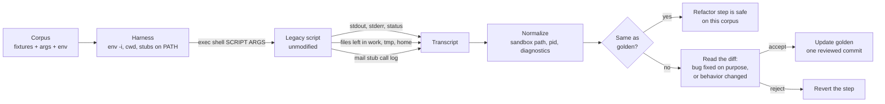

# Characterization Tests for Legacy Scripts

> [!summary] Claim
> A characterization test pins selected observations of what a script does today - exit status, stdout, stderr, files it leaves behind, and calls to stubbed commands - by running a corpus in a controlled working directory with a chosen environment and `PATH`.
> Review differences in those observations to decide which behavior changes to accept during a refactor.

Part of [Testing and Static Analysis](README.md) in [Shell and Unix Engineering](../README.md).

## TL;DR

- Run the unmodified script as a black box under `env -i` in a scratch directory with stub commands first on `PATH`, record status, stdout, stderr, regular files, and recorded calls as one normalized transcript, and compare it with a reviewed golden copy.
- Pin behavior at the process boundary before editing the script, then check whether an added seam such as a source guard preserves the same transcripts on the corpus.
- Trap: pinning nondeterminism or shell-specific text (pids, clock, `command not found` wording) gives a flaky suite, while normalizing too much gives a blind one; a corpus without the boundary cases lets a `-gt` to `-ge` mutant through.
- Sourcing a script that ends in an unguarded `main "$@"` runs it, and `exit` ends the shell environment that sourced it (POSIX.1-2024 XCU 2.15).
  Native zsh reads `/etc/zshenv` even for scripts, so check whether that file resets `PATH`; on this host `zsh -f` preserves the supplied path because the startup code that resets it checks `RCS`.
- When not to use it: when the behavior is already specified by a test or a contract (write a real unit test), when the script is small enough to rewrite and verify by reading, or when its effects are outside the sandbox (network, databases, hardware) and cannot be stubbed faithfully.

## Mental model



The corpus supplies inputs, and the harness controls the process inputs needed by the example.
Anything left uncontrolled that the script can observe, such as a host file, can still change the transcript.
The script's observable behavior flows into one text transcript through five channels (status, stdout, stderr, files, stub calls), and normalization removes what is legitimately different on every run.
The test compares the transcript with the golden copy.
A match means the step preserved the recorded observations on that case, and a mismatch fails the comparison for review.
Accepting updates the golden in a reviewed commit, which is how a pinned quirk becomes a decision; rejecting reverts the step.

## How it works

### What is being pinned, and why

Michael Feathers describes the purpose of characterization testing as documenting the behavior a system already has.
His procedure starts by loosening dependencies enough to run the code in a harness, then writing a test with a dummy expectation, running it to find the actual value, recording that value, and renaming the test to say what it documents.
Once a system is in production, callers may depend on behavior they have observed, so that behavior becomes part of the working specification (Feathers, "Characterization Testing").

A shell script exposes several useful channels at the process boundary, and a black-box transcript captures the ones the harness records for the inputs it exercises.
The ApprovalTests project uses the same snapshot-and-compare workflow for results such as complex objects (approvaltests.com).
The sibling [[Golden-Output-Tests]] covers the golden-file mechanics; this note covers what to pin in a script nobody understands, in what order, and how to make that safe.

### The observable surface of a script

| Channel | What it is | How the harness records it | What varies between runs |
|---|---|---|---|
| Exit status | The status the shell derives from the wait result or from a launch failure (POSIX.1-2024 XCU 2.8.2) | `rc=$?` after the subshell that `exec`s `env` | Failures, signals, or nondeterministic branches |
| stdout | Bytes on descriptor 1 | Redirect to a file, `cat` into the transcript | Clock, pid, temp names, locale ordering |
| stderr | Bytes on descriptor 2 | A separate file, never merged with stdout | Shell diagnostics (wording differs per shell), script path |
| Files | Every regular file under `work`, `tmp`, and `home` after the run | `find ... -type f \| LC_ALL=C sort`, then each file's contents | Names built from `$$` or a random suffix, timestamps inside |
| Calls | Arguments and inputs observed by recording stubs | A stub `mail` appends its argv and stdin to a call log; the `date` stub supplies a value without logging | Arguments, input data, and order of calls if the script varies them |

Stdout and stderr go to separate files because merging them ties the transcript to how the writers interleave, so a change in buffering would look like a change in behavior; separate files make each stream comparable on its own.
Not recorded, deliberately: network traffic, signals sent, environment inherited by children, file modes and mtimes, process lists.
Each is a channel a particular legacy script might depend on, and the harness has to grow a recorder for it when the script does (a `chmod` target needs a mode column; a `kill` needs a stub).

### The sandbox, down to the system call

The harness, `characterize.sh` in the lab, uses POSIX `sh` syntax and requires `mktemp` as an additional utility.
It creates a fresh directory with `mktemp -d "$CHAR_ROOT/sandbox.XXXXXX"`, then makes `bin`, `work`, `tmp`, and `home` under it.
The POSIX.1-2024 utility index omits `mktemp`, and macOS, FreeBSD, GNU coreutils, BusyBox builds with the applet enabled, and uutils supply the form used here (see Portability).
The run happens in a subshell: `cd` into `work`, then `exec env -i PATH=... HOME=... TMPDIR=... LC_ALL=C TZ=UTC CHAR_CALLS=... SHELL SCRIPT ARGS`, with stdin from `/dev/null`.
`env -i` is what makes the environment a controlled input.
POSIX requires `env -i` to invoke the utility with the environment supplied by its operands and discard its inherited environment (POSIX.1-2024 XCU `env`).
At the process boundary, `execve` takes the new program's environment through `envp` (POSIX.1-2024 XSH `exec`).
Caller values such as `USER`, `LANG`, `SSH_AUTH_SOCK`, and `HISTFILE` therefore disappear unless explicitly supplied, but the new shell can set its own variables during startup and the host's utilities and files still affect the run.

The harness runs the script as `SHELL SCRIPT`, which selects the interpreter explicitly for each shell run.
When macOS directly executes an executable script, it uses the interpreter named after `#!` (macOS `execve(2)`).
A characterization suite that only ever runs `dash script` has not tested `./script`, so keep at least one case that executes the file directly.

Command lookup is the second control.
For a bare command name, POSIX.1-2024 XCU 2.9.1.4 puts special built-ins, ordinary shell functions, and intrinsic utilities before the `PATH` search, with a separate list of names for which the result is unspecified.
A command name containing a slash goes directly to non-built-in utility execution.
Putting `sandbox/bin` first intercepts bare names that reach the `PATH` search, which is how the lab's `date` supplies a fixed instant and its `mail` records calls.
Test 9 uses `probe-env.sh` to require the stub string from bare `date` and a four-digit year from `/bin/date`, demonstrating that the absolute path bypasses the stub.
An implementation can also associate a built-in or a function with the directory found by a `PATH` search (XCU 2.9.1.4).
Check actual resolution before relying on a stub for a name such as `printf`, `kill`, or `test`, and see [[Mocking-Commands-via-PATH]] for the full treatment.

### Normalization is where suites go wrong

The transcript passes through `sed` twice.
The first pass replaces the sandbox path with `<SANDBOX>`, and it replaces two spellings: the logical path from `mktemp` and the physical path from `pwd -P`.
On the macOS host, `/var` resolves to `/private/var`, so a scratch path supplied under `/var` can differ from the physical spelling returned by `pwd -P` (host filesystem, measured 2026-11-26).
A script that prints `pwd -P` shows the physical form, and a script that echoes `$TMPDIR` shows the spelling it was given.
A normalizer needs both when they differ.
The second pass uses the case's own `sed` script.
In `normalize.sed`, `report\.[0-9][0-9]*\.tmp` becomes `report.<PID>.tmp`, and `by pid [0-9][0-9]*` becomes `by pid <PID>`.

Normalization rules should be anchored on the surrounding text, never on the shape of the value.
A catch-all `s/[0-9][0-9]*/N/g` also erases the `total 5` the script computed, so a refactor that miscounts passes.
The cheaper fix for nondeterminism is not to normalize but to remove its source: the clock is a stub (`date` prints `2026-01-02 03:04:05`), locale and timezone are fixed in `env -i`, and ordering is fixed by `LC_ALL=C sort` over the file list.
What cannot be removed, such as a pid in a name, is what the `sed` script is for.

### Seams, in the order to use them

Feathers identifies loosening dependencies enough to exercise the code in a harness as the hardest step.
For a script the options, from least to most invasive:

1. Process boundary (no edit).
   Run the whole script with chosen arguments, fixtures, and environment, and pin the transcript.
   The script's text stays untouched, and the observations describe its behavior under the chosen process inputs.
2. Variables the script already reads (no edit).
   `THRESHOLD` in the lab script, `TMPDIR`, `HOME`.
   Setting them through `-e NAME=VALUE` explores behavior without touching code.
3. Stubbed commands on `PATH` (no edit).
   Replaces collaborators, limited to bare names of external commands as above.
4. A source guard (a small edit).
   Wrap the final `main "$@"` so that the file can be sourced to define its functions, then call one function directly.
   The lab's guarded copy replaces the last line `main "$@"` with a three-line `if [ -z "${LEGACY_SOURCE_ONLY-}" ]` guard around that call.
   Leave the variable unset or empty during normal execution, and set it to a nonempty value before sourcing for tests.
   The guard uses POSIX parameter expansion and `test`, while the Bash comparison of `${BASH_SOURCE[0]}` with `$0` uses a Bash-specific variable (Bash Reference Manual, "Bash Variables").
   POSIX gives `.` no portable test for whether the current file was sourced, and leaves `return` outside a function or dot script unspecified (XCU 2.15).
5. Function override after sourcing (no edit beyond the guard).
   Redefine `notify` after `.`, and the later definition wins for every later call.
6. Mutated copies (no edit to the original).
   `sed` a copy to inject a fault and check that the suite notices; the lab does this twice.

Pin the process boundary before adding the source guard, then compare transcripts with the guard disabled (lab test 15).
That test compares five cases: basic, spaces, empty, over-threshold, and missing directory.
Include the no-argument and threshold-equality cases as well when the goal is parity across the full golden corpus.

### `.` and `exit`: why sourcing is dangerous

`.` executes the file's commands "in the current environment" (POSIX.1-2024 XCU 2.15, `dot`), not in a child.
So a legacy script that ends in an unguarded `main "$@"` runs `main` inside the sourcing shell, and if `main` calls `exit`, POSIX says the `exit` utility "shall cause the shell to exit from its current execution environment" unless that environment is a subshell, in which case only the subshell ends (POSIX.1-2024 XCU 2.15, `exit`).
dash shows the mechanism in two places: `dotcmd` in `src/main.c` calls `cmdloop(0)` on the pushed file in the same process, and `exitcmd` in the same file ends with `exraise(EXEXIT)`, which unwinds to the top (dash `src/main.c`, `dotcmd` and `exitcmd`).
`return` is the other exit from a sourced file: POSIX makes it stop "the current function or dot script", and dash's `returncmd` comment in `src/eval.c` says that outside a function it does "what ksh does; skip the rest of the file" (dash `src/eval.c`, `returncmd`).
The practical rule from the lab: a function that may call `exit` is called inside `( ... )`, and the exit status is read after the subshell (lab test 13).

### Differential characterization and the strength of a corpus

A characterization suite is only as strong as the cases in its corpus, and coverage is the wrong way to measure that.
Line coverage (see [[Coverage-with-kcov]], which is bash-only and line-level) tells you which lines a case reached, not whether the transcript would change if the line were wrong.
The direct measure is mutation: inject a fault and see whether any transcript changes.
The lab injects `-gt` to `-ge` in the threshold test.
With total 5 and threshold 3 the original and the mutant produce identical transcripts, so that case is blind to it; with total 5 and threshold 5 the mutant mails and the transcript shows the call (lab test 16).
That is the whole argument for boundary cases: an off-by-one is only visible at the boundary, and a corpus assembled from "typical" inputs never reaches it.
A second mutant adds `: >stray.txt` after the final `cat`; only the files section can see it (lab test 17), which is why files are a channel and not an afterthought.

The same transcripts support differential testing across a rewrite: run the old script and its replacement (in any language) through the same harness and diff the transcripts, with the old one as the oracle.
Every difference is either a bug the old one had, which you then decide whether to keep, or a bug the new one has.
Two behaviors the lab script pins on purpose are the kind a rewrite silently loses: a file name with a blank is split by `$(ls ...)` and counted as two skipped files (a pinned bug), and every run leaves `$TMPDIR/report.PID.tmp` behind (a pinned leak).

### Writing the first test: the loop in practice

The lab's workflow for one new case is the loop Feathers describes.
Build the fixture; run the harness and read the transcript; if every line is explained (or flagged as a question), save it as `golden/NAME.txt`; add a test named for the behavior ("a file name with a blank is split into two skipped names"), not for the line.
The first run is expected to differ from any guess, and the interesting transcripts are the ones where it does.
For this lab, three things surprised the author while building it: the pinned `skipped 2` for one file name, the `report.<PID>.tmp` file that stays behind, and that native zsh prints a `no matches found` diagnostic for an empty directory where every other shell stays silent.

## Numbers and limits

| Quantity | Value | Source |
|---|---|---|
| Reserved exit statuses | 126 found but not executable, 127 not found, above 128 killed by a signal | POSIX.1-2024 XCU 2.8.2 |
| `diff` exit status | 0 no differences, 1 differences found, above 1 an error | POSIX.1-2024 XCU `diff` |
| Transcript channels in the lab harness | 5 (status, stdout, stderr, files, calls) | `characterize.sh` in the lab |
| Lab size | 17 bats tests, 10 golden and probe transcripts, a 56 line script under test | lab, `wc -l` on 2026-11-26 |
| Size of the seam edit | 1 line replaced by 3 (`main "$@"` to a 3 line guard) | lab test 14 |
| Off-boundary corpus catching the `-gt` to `-ge` mutant | 0 of 1 | lab test 16 |
| Boundary case catching the same mutant | 1 of 1 | lab test 16 |
| Lab tests that passed in the one bats run | 17 of 17 under bash 5.3.15 (`LAB_SHELL=bash`), macOS 27.3, aarch64, 2026-11-26 | lab run |
| `wc -l` on 3 lines of input | 9 bytes, `       3` plus newline (7 leading spaces) | measured on macOS 27.3 with `od -c`, 2026-11-26 |
| Bats test timeout in the vault matrix | 60 seconds per test | the shell matrix configuration, 2026-11 |
| Bats release that added `run !` (negated command in a test) | 1.5.0 | bats-core docs "Gotchas", fetched 2026-11-26 |

Limits of the technique rather than numbers: the transcript is text, so a script that writes binary files needs a checksum column instead of `cat`; the file walk splits names on newlines, so a fixture with a newline in a name breaks it; the stubs cover `date` and `mail` only, and each new collaborator means a new stub; and two scripts that behave identically on the corpus can still differ outside it, which is why corpus design is the part that needs thought.

## Portability

The harness and lab run under whatever `LAB_SHELL` names; the table separates what was proven from what is only specified.
"Hand run" means an ad hoc execution of the harness or the sourcing commands on 2026-11-26 on the macOS 27.3 host, not the bats suite; the bats suite itself was run once, under bash 5.3.15.

| Shell or utility | Evidence | Behavior |
|---|---|---|
| POSIX sh | POSIX.1-2024 XCU 2.6.5, 2.9.1.4, 2.15 | Unquoted command substitution results undergo field splitting; a bare command name is searched in `PATH`, a name with a slash is not; `.` runs in the current environment and `exit` ends the shell |
| macOS bash 3.2.57 (`/bin/bash`) | Hand run; bats-core "Gotchas" | Harness transcript for the basic case is byte-identical to bash 5.3's; the `[[ ]]` mid-test caveat applies to the bats runner (below) |
| bash 5.3.15 | Lab run, 17 of 17 | All behaviors in the lab, including sourcing, `( main )` and the `-ge` mutant |
| zsh 5.9.2 native | Hand run; `zsh(1)` and zsh manual (Files, Options, Parameters, Expansion) | With `zsh -f`, the same transcripts as bash except an empty directory adds `summarize:4: no matches found: logs/*.log` on stderr (`NOMATCH` is set by default); without `-f` on this host the `date` stub was bypassed (a real date appeared) because `/etc/zshenv` rewrote `PATH`; a variable named `status` is read-only (`read-only variable: status`) |
| zsh `--emulate sh` | Hand run; zsh manual (Options) | Same transcripts as bash for basic, spaces, and empty (`SH_WORD_SPLIT` is set and `NOMATCH` is unset in `sh` emulation); sourcing and `( main )` behave as in bash |
| dash 0.5.13.5 (Homebrew build on the host) | Hand run; dash `src/main.c` | Same transcripts as bash for basic, spaces, and empty; sourcing with the guard defines `summarize`, unguarded sourcing ends the shell with usage and status 2 |
| ksh93u+ 2012-08-01 (`/bin/ksh`) | Hand run | Same transcripts as bash for basic, spaces, and empty; sourcing behaves as in bash |
| ksh93u+m, mksh, yash, posh, BusyBox ash | Not run here; POSIX.1-2024 XCU 2.6.5, 2.6.6, 2.9.1.4, 2.15 | POSIX specifies unquoted `$(...)` field splitting, leaving an unmatched `logs/*.log` pattern literal so `ls` fails into `2>/dev/null`, `PATH` search for bare names, and `.` and `exit` in the current environment; the bats file has an explicit `case` arm for each family |
| Raw `command not found` text | Hand run, bash and dash; POSIX.1-2024 XCU 2.9.1.4 | bash: `SCRIPT: line 3: nosuchcmd-xyz: command not found`; dash: `SCRIPT: 3: nosuchcmd-xyz: not found`; POSIX requires only status 127 and an error message (XCU 2.9.1.4), so the lab pins the status and normalizes the line |
| `mktemp -d TEMPLATE` | macOS `mktemp(1)`, FreeBSD `mktemp(1)`, GNU coreutils `src/mktemp.c`, BusyBox docs, uutils docs, POSIX.1-2024 utility index | Omitted from the POSIX.1-2024 utility index; creates a directory from a template ending in `XXXXXX` on macOS, FreeBSD, GNU coreutils (at least 3 consecutive `X`s in the last component), BusyBox (requires trailing `XXXXXX`), and uutils |
| `wc -l` | macOS host, POSIX.1-2024 XCU `wc`, GNU coreutils `src/wc.c`, BusyBox docs | POSIX specifies `"%d\n"` with no leading blanks when reading standard input; macOS pads the count to a fixed width (see Numbers), while GNU coreutils uses width 1 (`compute_number_width` in `src/wc.c`); the lab script strips spaces with `tr -d ' '` so both match |
| `diff` | POSIX.1-2024 XCU `diff` | Exit 0, 1, above 1; the lab does not depend on the output format, which is why test 14 compares with `cmp` rather than parsing `diff` output |
| `cp -R DIR/. DEST` | macOS host, POSIX.1-2024 XCU `cp`, BusyBox docs | Copies the hierarchy under `DIR/.`, including dotfiles, into an existing destination directory (`-R` is specified by POSIX.1-2024 XCU `cp` and supported by BusyBox `cp`) |

## Worked example

Lab: [lab](../labs/14-characterization-tests-for-legacy-scripts/).
The script under test is `legacy-report.sh`, reproduced verbatim: it sums the line counts of `*.log` files in a directory, writes `report.txt`, and mails when the total exceeds `THRESHOLD`.

```sh
#!/bin/sh
# legacy-report.sh - the script under characterization (lab fixture, deliberately legacy-shaped).
# Summarizes the line counts of the *.log files in a directory into ./report.txt and mails an
# alert when the total exceeds THRESHOLD (default 10). Known quirks, kept on purpose:
#   - it splits `ls` output at blanks, so a file name with a blank is miscounted as skipped files;
#   - it leaves $TMPDIR/report.PID.tmp behind on every run;
#   - it stamps the report with the clock and its own pid, so the output is never repeatable.
# Usage: legacy-report.sh DIR

THRESHOLD=${THRESHOLD:-10}

notify() {
  printf 'total=%s\n' "$1" | mail -s "log alert" ops@example.invalid
}

summarize() {
  total=0
  skipped=0
  # shellcheck disable=SC2045,SC2086,SC2248 # legacy quirk under test: names are split at blanks
  for f in $(ls "$1"/*.log 2>/dev/null); do
    if [ ! -f "$f" ]; then
      skipped=$((skipped + 1))
      continue
    fi
    n=$(wc -l <"$f" | tr -d ' ')
    echo "$f $n"
    total=$((total + n))
  done
  echo "total $total"
  echo "skipped $skipped"
}

main() {
  if [ "$#" -lt 1 ]; then
    echo "usage: legacy-report.sh DIR" >&2
    exit 2
  fi
  if [ ! -d "$1" ]; then
    echo "no such directory: $1" >&2
    exit 1
  fi
  tmp=${TMPDIR:-/tmp}/report.$$.tmp
  summarize "$1" >"$tmp"
  stamp=$(date '+%Y-%m-%d %H:%M:%S')
  {
    echo "report generated $stamp by pid $$"
    cat "$tmp"
  } >report.txt
  total=$(sed -n 's/^total //p' "$tmp")
  if [ "$total" -gt "$THRESHOLD" ]; then
    notify "$total"
  fi
  cat report.txt
}

main "$@"
```

The harness core, a simplified excerpt of `characterize.sh` (option parsing, stub creation, the file walk, and error handling omitted; the lab file builds the command in positional parameters so that nothing is field split, which native zsh would otherwise leave as one word):

```sh
sb=$(mktemp -d "$CHAR_ROOT/sandbox.XXXXXX")
mkdir "$sb/bin" "$sb/work" "$sb/tmp" "$sb/home"
(
  cd "$sb/work" || exit 70
  exec env -i PATH="$sb/bin:/usr/bin:/bin" HOME="$sb/home" TMPDIR="$sb/tmp" LC_ALL=C TZ=UTC \
    CHAR_CALLS="$sb/calls" ${CHAR_SHELL:-sh} "$script" "$@"
) >"$sb/stdout" 2>"$sb/stderr" </dev/null
rc=$?
```

Three fixtures drive the first tests: `basic` (`app.log` with 3 lines, `db.log` with 2), `spaces` (`app.log` with 1 line and `my file.log` with 2), and `empty`.
The transcript of the basic case, which is `golden/basic.txt` and is what the first test asserts (captured from a real harness run under bash 5.3.15, 2026-11-26):

```text
status: 0
--- stdout
report generated 2026-01-02 03:04:05 by pid <PID>
logs/app.log 3
logs/db.log 2
total 5
skipped 0
--- stderr
--- files
== tmp/report.<PID>.tmp
logs/app.log 3
logs/db.log 2
total 5
skipped 0
== work/logs/app.log
a
b
c
== work/logs/db.log
x
y
== work/report.txt
report generated 2026-01-02 03:04:05 by pid <PID>
logs/app.log 3
logs/db.log 2
total 5
skipped 0
--- calls
```

The same run with `-e THRESHOLD=3` differs only in its last section, which is the mail stub's record:

```text
--- calls
mail <-s> <log alert> <ops@example.invalid>
  | total=5
```

A test that checks the suite itself, test 16 of `characterization.bats`, verbatim:

```sh
@test "a boundary mutant is caught only by the boundary case" {
  local count golden
  fixture basic
  sed 's/ -gt / -ge /' "$LEGACY" >"$BATS_TEST_TMPDIR/mutant.sh"
  count=$(grep -c -e "-ge" "$BATS_TEST_TMPDIR/mutant.sh")
  [ "$count" -eq 1 ]
  chmod +x "$BATS_TEST_TMPDIR/mutant.sh"
  # off the boundary (total 5, threshold 3) original and mutant agree: the corpus is blind here
  char -f "$BATS_TEST_TMPDIR/fx/basic" -e THRESHOLD=3 -n "$HERE/normalize.sed" "$LEGACY" logs
  first=$output
  char -f "$BATS_TEST_TMPDIR/fx/basic" -e THRESHOLD=3 -n "$HERE/normalize.sed" "$BATS_TEST_TMPDIR/mutant.sh" logs
  [ "$first" = "$output" ]
  # on the boundary (total 5, threshold 5) the mutant mails and the transcript shows it
  char -f "$BATS_TEST_TMPDIR/fx/basic" -e THRESHOLD=5 -n "$HERE/normalize.sed" "$BATS_TEST_TMPDIR/mutant.sh" logs
  golden=$(cat "$HERE/golden/boundary.txt")
  [ "$output" != "$golden" ]
  [[ $output == *$'--- calls\nmail <-s> <log alert> <ops@example.invalid>\n  | total=5' ]] || false
}
```

The output of the one bats run of the whole file (`LAB_SHELL=bash bats --tap characterization.bats`, bash 5.3.15, macOS 27.3, 2026-11-26; the `|| false` guards on the `[[ ]]` assertions were added after this run and were not re-run, because lab checks were paused):

```text
1..17
ok 1 a normal run is pinned end to end: status, stdout, report file, leaked temp file, no mail
ok 2 an alert run records exactly one mail call with its arguments and body
ok 3 the threshold boundary is pinned: a total equal to THRESHOLD sends no mail
ok 4 no argument: status 2 and the script's own usage message
ok 5 a missing directory: status 1, the script's own message, nothing written
ok 6 a file name with a blank is split into two skipped names, in every shell (a pinned bug)
ok 7 an empty directory: native zsh adds a NOMATCH diagnostic, every other shell stays silent
ok 8 the clock and the pid make two raw transcripts differ; normalization makes them equal
ok 9 the sandbox hides the caller's environment, and PATH stubs catch only bare command names
ok 10 a missing command gives status 127 and a shell-specific diagnostic that normalization can pin
ok 11 sourcing the guarded copy defines the functions without running main
ok 12 sourcing the unguarded script runs main, and its exit ends the sourcing shell
ok 13 a function that calls exit must be called in a subshell, or it ends the test shell
ok 14 the seam is the only edit: the guarded copy differs from the original in the last line alone
ok 15 adding the seam changes no transcript on any corpus case
ok 16 a boundary mutant is caught only by the boundary case
ok 17 an added side effect appears in the files section
```

## Pitfalls

> [!warning] Pinning the clock, the pid, or a random name
> Trigger: the transcript contains `$$`, `date` output, or a `mktemp` suffix.
> Symptom: the suite passes locally and fails on the next run, so people regenerate the golden to make it green and the suite stops meaning anything.
> Fix: remove the source (stub `date`, fix `TZ` and `LC_ALL`) and normalize only what remains, with a pattern anchored on its surrounding text; lab test 8 shows two raw transcripts differing and two normalized ones agreeing.

> [!warning] Normalizing so much that regressions disappear
> Trigger: a catch-all substitution such as `s/[0-9][0-9]*/N/g` to quiet a flaky run.
> Symptom: `total 5` and `total 6` compare equal, so a miscount in the refactor is invisible.
> Fix: anchor each rule on its label (`by pid <PID>`, `report.<PID>.tmp`), and review `normalize.sed` as carefully as the script; every rule is a statement that this difference does not matter.

> [!warning] Pinning a shell's diagnostic text
> Trigger: a case whose stderr contains the shell's own message, such as a missing command.
> Symptom: the golden written under bash fails under dash.
> Measured 2026-11-26: bash prints `SCRIPT: line 3: nosuchcmd-xyz: command not found`, dash prints `SCRIPT: 3: nosuchcmd-xyz: not found`, and both include the script's absolute path.
> POSIX requires only exit status 127 and "an error message" (POSIX.1-2024 XCU 2.9.1.4), so the status is the contract and the text is not.
> Fix: pin the status, assert the command name appears in stderr, and map shell-generated lines to a fixed placeholder as `normalize-diag.sed` does (lab test 10); pin only script-authored messages verbatim.

> [!warning] `env -i` is not a clean room for zsh
> Trigger: running a `PATH`-stubbed script under native zsh on a machine with a `/etc/zshenv` that sets `PATH`.
> Symptom: the stub is skipped and the real command runs; on the macOS host used here the report header showed a real timestamp instead of the stub's `2026-01-02 03:04:05` under plain `zsh`, and the stub string under `zsh -f`.
> The zsh manual states the order: "Commands are first read from /etc/zshenv; this cannot be overridden", with later files controlled by the `RCS` and `GLOBAL_RCS` options (zsh(1), "STARTUP/SHUTDOWN FILES", zsh 5.9.2 man page on the host).
> On this host the file is guarded by `[[ -o rcs ]]`, which is why `-f` helps; a host whose `zshenv` sets `PATH` unconditionally defeats even that.
> Fix: run zsh with `-f` in the harness, and keep a probe case (`probe-env.sh`, lab test 9) that fails when a stub is not first on `PATH`, so the seam is verified on every run instead of assumed.

> [!warning] Sourcing a script runs it, and its `exit` ends your shell
> Trigger: `. ./legacy.sh` in a test, where the file ends in an unguarded `main "$@"` and `main` can `exit`.
> Symptom: the test shell dies with the script's status and later lines never run; in the lab `echo survived` is never printed and the status is 2 (lab test 12).
> A test runner may then report a vanished test rather than a failure.
> Fix: guard the final call (lab `legacy-report-seam.sh`), call functions that may `exit` inside `( ... )` and read `$?` after it (lab test 13), and prove the guard changed nothing (lab tests 14 and 15).

> [!warning] A PATH stub that the script bypasses
> Trigger: the script calls `/bin/date`, `/usr/bin/mail`, or `command -p date`, or the stubbed name is a shell built-in.
> Symptom: the real command runs and the transcript contains today's date or a real side effect. `probe-env.sh` shows it: the bare `date` prints the stub, `/bin/date` prints a real year.
> POSIX 2.9.1.4 does no `PATH` search for a name with a slash, and lets a built-in answer for a bare name in some cases.
> Fix: for absolute paths, either accept the real command (if it is harmless and deterministic) or make the path a variable the script already reads; do not stub built-ins.

> [!warning] A sandbox that is not one
> Trigger: running an unfamiliar legacy script with the caller's `HOME`, `PATH`, and working directory.
> Symptom: the script touches real files.
> The cautionary tale is the Steam launcher: issue 3671 in the `steam-for-linux` tracker is titled "Moved ~/.local/share/steam. Ran steam. It deleted everything on system owned by user."
> A commenter in that thread points at a line of the form `rm -rf "$STEAMROOT/"*` and notes that it expands to `rm -rf "/"*` if `$STEAMROOT` is empty (ValveSoftware/steam-for-linux issue 3671, fetched 2026-11-26).
> Fix: first run is always in a throwaway directory under an empty `env -i` environment with `HOME` pointing into it; reading a script is not enough to know which of its paths are derived from the environment.

> [!warning] A bats `[[ ]]` that cannot fail
> Trigger: a bats suite run by macOS's bash 3.2, with a `[[ ... ]]` assertion that is not the last command of the test.
> Symptom: the assertion fails and the test still passes.
> The bats-core documentation says the `set -e` handling of `[[ ]]` changed in Bash 4.1, that older versions "like 3.2 on MacOS" do not abort the test unless it is the last command, and recommends appending `|| false` (bats-core "Gotchas", fetched 2026-11-26).
> Fix: append `|| false` to every mid-test `[[ ]]` (the lab does), or use `[ ]`.

> [!warning] Harness variables that collide with a shell's special parameters
> Trigger: a harness helper that stores the exit status in a variable named `status`.
> Symptom: native zsh aborts with `read-only variable: status` before the script under test runs (measured 2026-11-26 while building this lab; the harness first used `status` and failed under `zsh`, the fix was to rename it `rc`).
> Fix: keep harness variable names out of the shells' special sets (`status` in zsh is measured here; bash has its own, such as `SECONDS` and `RANDOM`), and run the harness itself under every shell in the matrix.

> [!warning] Fixing a pinned bug and breaking a user
> Trigger: "correcting" an odd behavior while refactoring because the characterization test looks wrong.
> Symptom: a consumer relied on it.
> Feathers tells the story of being asked to fix a bug, fixing it, and having users complain because "they thought it was a feature" (Feathers, "Characterization Testing").
> Fix: keep the test and rename it to say what it documents ("characterizes: a name with a blank counts as two skipped files"); change behavior in a separate commit whose golden diff is the review artifact.

## Security and robustness

- A legacy script is untrusted input until proven otherwise.
  The harness runs it with an empty environment, a scratch `HOME`, `/dev/null` as stdin, a scratch working directory, and a `PATH` where the only non-system directory is the sandbox, which bounds accidents, not malice: the process still runs as your user with your network and your absolute paths.
  For a script you do not trust, run the harness in a container or VM with no credentials; the Steam incident above is the accident case.
- Fixtures and goldens are public artifacts in a public repository: never record real hostnames, tokens, or customer data in a transcript; build fixtures from `printf` and use obviously fake values.
- `rm -rf` of the sandbox is safe only if the path is built from `mktemp -d`, never from an argument; the lab never removes anything and leaves cleanup to the bats temporary directory.
- Quote every path in the harness; the lab's own fixture `my file.log` exists to catch the harness mishandling a blank.
- Bound every run: a legacy script that waits on stdin or a FIFO blocks forever.
  The harness closes stdin (`</dev/null`), and the suite sits under a per-test timeout (60 seconds in the vault matrix); give any script that opens a FIFO a guaranteed peer.
- A pinned bug can be a vulnerability.
  The `$(ls ...)` loop splits and globs; a pinned `skipped 2` is a record that the script mishandles file names, which for a script that deletes or uploads files is a finding for the security backlog, not just a quirk (see [[Command-Injection]]).
- Do not let the characterization run mutate the golden: the harness writes only inside the sandbox and the test compares; updating a golden is a deliberate, reviewed act.

## The principal's view

The decision is whether to characterize, rewrite, or leave alone, and the answer depends on the cost of being wrong rather than the age of the code.
Characterize when the script is critical, understood by nobody currently on the team, and about to change; the transcript suite is then the specification the change is checked against, and it is cheap relative to an outage.
Rewrite in a language with a real test ecosystem (Python, Go) when the script has grown logic, state, or data structures, and use the same transcripts as the oracle so the rewrite is checked rather than trusted.
Leave it alone, with a one-page note on what it does and no tests, when it runs once a quarter, has no dependents, and is faster to read than to cover.
The trade-off the technique forces is ossification: a golden suite resists every change, including good ones, so every pinned oddity needs an owner, a name that says it is an oddity, and a ticket that says whether it is a bug.
The failure mode on the other side is a brittle suite that people regenerate on red; the fix is the normalization and seam discipline above, and a rule that a golden changes only in a commit that says why.
For larger systems, the leverage is in making the seams permanent: a source guard, a `main` that takes its collaborators from variables, a stable `LAB_SHELL` matrix (see [[Cross-Shell-CI-Matrices]]), so the next script starts with a harness instead of a guess.
Prefer a unit-test framework ([[bats-core]], [[ShellSpec]], [[shUnit2]]) once a function is extracted and its contract is known; characterization is the scaffold you stand on to get there, not the building.
When review is the goal rather than a safety net, pair it with [[Reviewing-Shell-at-Staff-Level]]; static analysis ([[ShellCheck-Warning-Families]]) finds classes of bug without a corpus and complements transcripts, which find behavior change without a theory.

## Interview questions

> [!question] L5: Why does a characterization test assert behavior the author believes is a bug?
>
> > [!success]- Answer
> > Its purpose is to document what the system does, not what it should do (Feathers).
> > Once the script is in production, callers may depend on the quirk, so the first job is to detect any change to it.
> > The test is named for what it documents, and the decision to fix the bug is made separately, with the golden diff as the review artifact.
> >
> > Follow-up: How do you mark a pinned bug so nobody mistakes it for a requirement?

> [!question] L5: Why does the harness run the script under `env -i` rather than just setting the variables it cares about?
>
> > [!success]- Answer
> > `env -i` makes the inherited environment empty, so only the variables you name exist (POSIX.1-2024 XCU `env`).
> > Setting a few variables on top of the caller's environment leaves `USER`, `LANG`, `TZ`, `PATH` entries, and tool-specific variables that change output between machines.
> > A transcript that depends on the developer's terminal is not a specification.
> >
> > Follow-up: Name one shell for which `env -i` alone does not give a clean `PATH`, and the flag that fixes it.

> [!question] L5: Predict the output and the exit status.
>
> ```sh
> #!/bin/sh
> # legacy.sh ends with:  main "$@"      and main does: [ "$#" -lt 1 ] && { echo usage >&2; exit 2; }
> set --
> . ./legacy.sh
> echo survived
> ```
>
> > [!success]- Answer
> > It prints `usage` to stderr and never prints `survived`; the exit status is 2.
> > `.` runs the file in the current shell, so `main` runs there, and `exit` ends that shell (POSIX.1-2024 XCU 2.15 `exit`; dash `exitcmd` ends with `exraise(EXEXIT)`).
> > The fix is a guard around the last line, or `( main )` in a subshell for every call (lab tests 12 and 13).
> >
> > Follow-up: What changes if the sourcing is done as `( . ./legacy.sh )`?

> [!question] L6: Debug this harness fragment: under bash and dash it works, under `zsh` it prints `read-only variable: status` and nothing else.
>
> ```sh
> "$@" >"$sb/stdout" 2>"$sb/stderr"
> status=$?
> printf 'status: %s\n' "$status"
> ```
>
> > [!success]- Answer
> > In zsh `status` is a special parameter that aliases `$?` and is read-only, so the assignment is an error.
> > Rename the variable (the lab uses `rc`) and keep harness variables out of every shell's special names.
> > The broader lesson is that a harness which is meant to run under the shell matrix is itself code that must be portable, so it is run under every shell.
> >
> > Follow-up: What other variable names are special in bash or zsh and would bite a harness?

> [!question] L6: Your golden transcript was recorded under bash and fails under dash only on a stderr line for a missing command.
> What do you pin?
>
> > [!success]- Answer
> > Pin the exit status 127 and that the command name appears in stderr; do not pin the shell's wording.
> > POSIX requires 127 and an error message but not its text (XCU 2.9.1.4); measured here, bash says `line 3: nosuchcmd-xyz: command not found` and dash says `3: nosuchcmd-xyz: not found`, both with the script path.
> > Map shell-generated lines to a placeholder in the normalizer, and keep script-authored messages verbatim.
> >
> > Follow-up: How would you apply the same rule to the `sh: 1: syntax error` text?

> [!question] L6: A refactor changes the suite's transcript in only one case, and the author says the new output is correct.
> How do you decide whether to update the golden?
>
> > [!success]- Answer
> > Read the diff as a question about callers: who depends on the old output, and is the change documented?
> > If the old behavior was a bug nobody relies on, update the golden in a separate commit whose message names the behavior change, so the diff is the review artifact.
> > If you cannot tell, keep the old behavior and open a ticket; the cost of being wrong is asymmetric.
> >
> > Follow-up: What if the change is in the files section rather than stdout?

> [!question] L6: Your bats tests all pass on a Mac and a mid-test `[[ ... ]]` assertion is actually false.
> Why, and how do you fix it?
>
> > [!success]- Answer
> > The macOS system bash is 3.2, where a failing `[[ ]]` does not trigger `set -e` unless it is the last command of the function; bats-core documents this and recommends `|| false` (bats-core "Gotchas").
> > Append `|| false` to each mid-test `[[ ]]` or use `[ ]`.
> > An assertion that cannot fail is the same defect as a test that passes when the behavior is absent.
> >
> > Follow-up: Does the same rule apply to `(( ... ))`?

> [!question] L7+: A 3000 line deploy script has no tests and runs against production.
> You have two weeks and may not change its behavior.
> Lay out the plan.
>
> > [!success]- Answer
> > Week one is the harness and the black-box corpus: a sandbox with `env -i`, stubs for every external collaborator (ssh, scp, curl, database clients), a transcript that includes the call log, and cases chosen by reading the script for decisions (branches, thresholds, exit paths) and testing each boundary.
> > Measure the corpus by mutation (inject off-by-ones into a copy and require a transcript to change), not only by line coverage.
> > Week two adds a source guard, proves the transcripts unchanged, and extracts the riskiest functions behind unit tests.
> > Every pinned oddity gets a name and a ticket; nothing is "fixed" in the same change as the harness.
> >
> > Follow-up: Which collaborators cannot be stubbed faithfully, and what do you do about them?

> [!question] L7+: When is a characterization suite the wrong investment?
>
> > [!success]- Answer
> > When the behavior is already specified (write the spec as tests), when the script is small enough to rewrite and review by reading, when its important effects are outside the sandbox (network, hardware, a database whose semantics a stub would fake), or when it will be deleted soon.
> > The cost is also ossification: if nobody owns the pinned quirks, the suite becomes the reason nothing improves.
> > Prefer a rewrite with the old script as a differential oracle when the logic outgrew the language.
> >
> > Follow-up: How do you keep the golden files from being regenerated on every red?

> [!question] L7+: How do you know your characterization corpus is strong enough to trust a refactor?
>
> > [!success]- Answer
> > Coverage says which lines ran, not which behaviors are pinned.
> > Inject faults in a copy (flip a comparison, drop a flag, add a side effect) and require at least one transcript to change; the lab's `-gt` to `-ge` mutant is missed by an off-boundary case and caught at the boundary, and an added `: >stray.txt` is caught only by the files section.
> > Then use [[Coverage-with-kcov]] to find paths no case reaches, and add cases where a plausible mutant survives.
> >
> > Follow-up: What kinds of faults will no black-box transcript ever catch?

## Related

Prerequisites: [[Golden-Output-Tests]]

Next: [[Coverage-with-kcov]]

See also: [[bats-core]], [[bats-Helpers-and-Assertions]], [[ShellSpec]], [[shUnit2]], [[Mocking-Commands-via-PATH]], [[Cross-Shell-CI-Matrices]], [[Reviewing-Shell-at-Staff-Level]], [[ShellCheck-Warning-Families]], [[Command-Injection]], [[Command-Search-and-PATH]], [[Field-Splitting-and-IFS]], [[Subshells-and-the-Execution-Environment]]

## Further reading

- Michael Feathers, "Characterization Testing" (https://michaelfeathers.silvrback.com/characterization-testing): the definition, the run-paste-rename procedure, and the argument for leaving odd behavior pinned.
- POSIX.1-2024 XCU chapter 2, Shell Command Language (https://pubs.opengroup.org/onlinepubs/9799919799/utilities/V3_chap02.html): 2.8.2 exit status, 2.9.1.4 command search, 2.15 `dot`, `exit`, `return`.
- POSIX.1-2024 `env` (https://pubs.opengroup.org/onlinepubs/9799919799/utilities/env.html): the exact meaning of `-i`.
- POSIX.1-2024 `diff` (https://pubs.opengroup.org/onlinepubs/9799919799/utilities/diff.html): exit statuses 0, 1, above 1 for comparing a transcript with its golden.
- ApprovalTests (https://approvaltests.com/): the snapshot-and-approve workflow that golden transcripts follow.
- bats-core, "Gotchas" (https://bats-core.readthedocs.io/en/stable/gotchas.html): the bash 3.2 `[[ ]]` caveat, `run` semantics, and background-job file descriptor traps.
- dash `src/main.c` and `src/eval.c` (https://git.kernel.org/pub/scm/utils/dash/dash.git/plain/src/main.c): `dotcmd`, `exitcmd`, and `returncmd`, the implementation of sourcing, exit, and return.
- zsh(1), "STARTUP/SHUTDOWN FILES": why `/etc/zshenv` is read for every zsh and what `-f` changes.
- ValveSoftware/steam-for-linux issue 3671 (https://github.com/ValveSoftware/steam-for-linux/issues/3671): a primary record of what an unsandboxed run of a legacy script can do.
