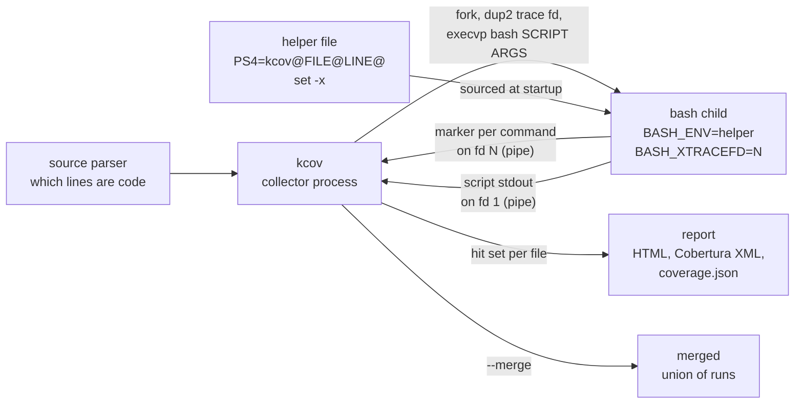

# Coverage with kcov

> [!summary] Claim
> kcov measures shell coverage by running the script under `bash` with line tracing switched on through `BASH_ENV`, reading one `kcov@FILE@LINE@` marker per executed command from a pipe, and comparing those lines with a heuristic line classifier, so it is a line-level measure of what bash executed, not a branch-level measure and not a measure of any other shell.

Part of [Testing and Static Analysis](README.md) in [Shell and Unix Engineering](../README.md).

## TL;DR

- Mechanism: kcov forks, points `BASH_ENV` at a helper that sets `PS4` to `kcov@${BASH_SOURCE}@${LINENO}@` and runs `set -x`, sends the trace to a private pipe, and turns each marker line into a "line executed" event.
- Rule: collect per test process, merge with `--merge`, gate on a ratchet of the merged line percentage, and exclude generated and vendored files by path.
- Trap: kcov always executes the script with `bash` (default `--bash-parser=bash`), so the `#!` line is ignored and a script written for dash is covered under bash.
- Portability: the collector needs `BASH_ENV`, `BASH_SOURCE`, and (for the PS4 method) `BASH_XTRACEFD`, which bash added in 4.1 (bash NEWS) but kcov only trusts from 4.2; macOS `/bin/bash` 3.2.57 falls back to stderr or needs `--bash-method=DEBUG`.
- When not to use it: when the question is "does this behave the same in dash, zsh, and BusyBox", which is a [[Cross-Shell-CI-Matrices]] question, or when you need branch or condition coverage, which kcov does not produce for shell.

## Mental model



The collector `kcov` creates two pipes, forks, and in the child moves the write end of one pipe onto a high file descriptor `N` and the write end of the other onto standard output before `execvp` of `bash`.
Bash reads the `BASH_ENV` helper while starting up, which sets `PS4` and turns on `set -x`, so every command the script runs emits a marker naming its file and line on descriptor `N`.
The parent drains that pipe line by line and turns each marker into a hit for that file and line.
In parallel a source parser decides which lines of each file are executable code, because a hit set is only meaningful against a denominator.
The report is the hit set divided by the code set, and `--merge` unions hit sets from several runs.

## How it works

### Process setup

kcov's bash engine is a script engine, not the DWARF-based engine it uses for compiled programs.
The README says compiled programs are measured from DWARF debug information (kcov README); the bash engine instead synthesizes events from text.

`BashEngine::start` does this (kcov master `src/engines/bash-engine.cc`, `BashEngine::start`):

- It creates two pipes with `pipe(2)`, one for the trace and one for the script's standard output.
- It writes `bash-helper.sh`, `bash-helper-debug-trap.sh`, `libbash_execve_redirector.so`, and `libbash_tracefd_cloexec.so` into kcov's output base directory.
- It runs `bashCanHandleXtraceFd()`, which runs the configured `bash-command` with `-c 'echo "$BASH_VERSION"'` through `popen` and parses `major.minor` with `fscanf`; the result is true when `major > 4 || (major == 4 && minor >= 2)`, and always false when the testing key `bash-force-stderr-input` is set.
  The threshold is stricter than bash itself: bash NEWS lists "New variable $BASH_XTRACEFD" among the features added in bash-4.1, so a bash 4.1 is put on the stderr path although it could honor the variable.
- In the child it picks the trace descriptor: `rlim_cur / 4` from `getrlimit(RLIMIT_NOFILE)` on every platform except FreeBSD, and 782 on FreeBSD.
  With a soft limit of 1024 that is descriptor 256 (arithmetic from the source, not measured here).
- It calls `dup2` to put the trace pipe on that descriptor and the stdout pipe on descriptor 1, closes the originals, and exports `KCOV_BASH_XTRACEFD` and `KCOV_BASH_COMMAND`.
- It calls `execvp` with `argv[0]` set to the configured bash command and the remaining arguments copied from kcov's own argument vector.

The last point is the one that surprises people: the command being exec'd is `bash`, never the interpreter on the script's `#!` line (kcov master `src/engines/bash-engine.cc`, `BashEngine::start`, the `vec[0] = xstrdup(command.c_str())` assignment).
The default of `bash-command` is `bash`, and `/usr/local/bin/bash` on FreeBSD (kcov master `src/configuration.cc`, `setupDefaults`).
`--bash-parser=cmd` changes it (kcov `doc/kcov.1`).

### The two collection methods

The default method is PS4 (`bash-use-ps4` defaults to 1 in `setupDefaults`; the usage text says "PS4 (default)").
It sets `BASH_ENV` to `bash-helper.sh`, which has exactly two lines of effect after a `#!/bin/sh` line and comments (kcov master `src/engines/bash-helper.sh`):

```sh
PS4='kcov@${BASH_SOURCE}@${LINENO}@'
set -x
```

POSIX requires `PS4` to be parameter-expanded before each trace line and written to standard error, and `LINENO` to be set to the line number within a script or function before each command (POSIX.1-2024 XCU 2.5.3 Shell Variables, `PS4` and `LINENO`; both are marked as User Portability Utilities features).
Outside a script or function the value of `LINENO` is unspecified, which is why some shells report 0 inside `-c` text.
`BASH_SOURCE` is a bash extension.
Bash writes the trace to standard error unless `BASH_XTRACEFD` names another descriptor (GNU bash manual, Bash Variables: "Bash writes the trace output generated when `set -x` is enabled to that file descriptor, instead of the standard error").
When the traced bash is older than 4.2 (by kcov's check) and the method is PS4, kcov sets the trace descriptor to 2, so the trace and the script's own diagnostics share one pipe (kcov master `src/engines/bash-engine.cc`, `BashEngine::start`, the `if (usePS4 && !m_bashSupportsXtraceFd) xtraceFd = 2` branch).

The alternative is `--bash-method=DEBUG`, which sets `BASH_ENV` to `bash-helper-debug-trap.sh` and `KCOV_BASH_USE_DEBUG_TRAP=1` (kcov master `src/engines/bash-helper-debug-trap.sh`):

```sh
set -o functrace
trap 'echo "kcov@${BASH_SOURCE}@${LINENO}@" >&$KCOV_BASH_XTRACEFD' DEBUG
unset BASH_ENV
```

The bash manual says a `DEBUG` trap runs before every simple command, `for`, `case`, `select`, `((`, double-bracket, and arithmetic `for` command, and before the first command of a function (GNU bash manual, Bourne Shell Builtins, `trap`; same text in the bash 5.3 `bash(1)` page).
`functrace` makes functions inherit the trap.
`unset BASH_ENV` keeps child bash processes from sourcing the helper again, so children are not traced; the PS4 helper does not unset it, so children are traced and write to the same descriptor.
In DEBUG mode the descriptor is still `rlim_cur / 4`, because the `xtraceFd = 2` fallback is guarded by `usePS4`, which is why this method works on bash 3.2.

### Reading markers

`BashEngine::checkEvents` reads one line from the trace pipe with `getline`, and handles it as follows (kcov master `src/engines/bash-engine.cc`, `BashEngine::checkEvents`):

- It searches the line for the substring `kcov@`, not an anchored prefix, because a nested expansion level makes bash repeat the first character of `PS4` and the line then begins `kkcov@` (bash manual, `PS4`: "The first character of the expanded value of PS4 is replicated multiple times, as necessary, to indicate multiple levels of indirection").
  The source carries a comment about this in `handleStdout`, the filter that strips markers from the script's output when there is no `BASH_XTRACEFD` ("redirection sometimes give kkcov@..."); that filter accepts a marker only at offset 0 or 1.
- It splits `cur.substr(kcovStr)` on `@`, requires at least three parts, takes part 1 as the file and part 2 as the line number, and calls `get_real_path` on the file.
- It drops markers whose file name contains `bash-helper.sh` or `bash-helper-debug-trap.sh`.
- If part 2 is not an integer it calls `error("%s is not an integer")` and returns false.
- On the first marker for a file it registers the file and parses it; for every marker it maps `getLineId(filename, line)` to an address and emits an `ev_breakpoint` event with `data = 1`.
  A line the parser did not classify as code maps to address 0.

Quote tracking (`getInputType`) follows single quotes and backslashes across trace lines so that a multi-line argument in a trace line does not get its continuation lines parsed as markers.

`continueExecution` polls the pipe and, when the pipe ends, calls `waitpid(m_child, &status, WNOHANG)`, drains remaining events, and reports `ev_exit_first_process` with `WEXITSTATUS(status)` for a normal exit; any other status logs "Other status" and reports `ev_error`.
When the trace descriptor is the real stderr (bash older than 4.2), a line without a marker is printed back to kcov's own stderr, so script diagnostics still reach the terminal.

### Deciding which lines are code

A hit set needs a denominator, and kcov has no bash parser, so `parseFileFull` classifies lines textually (kcov master `src/engines/bash-engine.cc`, `parseFileFull`).
The rules, in the order the function applies them:

- Blank lines, comment-only lines, lines starting with `;;`, a lone `{`, `}`, `(`, `)`, and the keywords `esac`, `fi`, `done`, `do`, `then`, `else` are not code.
- A line whose text starts with the characters `function` (so also a call to a command named `function_name`), or a line whose text before `()` is a single word, is a function header and not code.
- After a line ending in a backslash, continuation lines are not code ("only the first line is code").
- A here-document body is not code, and the marker word decides where it ends (with `<<-` and quoted markers handled).
  `done` followed by a static redirection or a here-document is not code either.
- Lines inside a multi-line quote are not code except the last; lines inside a multi-line arithmetic expression are not code except the last.
- Inside a `case`, a line ending in `)` is a pattern label and not code, unless it contains a `(` after its first character.

`--configure bash-use-basic-parser=1` switches to the simpler `parseFileBasic`, which only strips blanks, comments, the structural keywords and lone braces or parentheses, and lines starting with `function` (kcov master `src/configuration.cc` help text, `src/engines/bash-engine.cc`, `parseFileBasic`).
Which files get parsed: every file the script touches at run time, plus every file under the script's directory whose first 80 bytes score above `match_none` in `matchParser`, unless `--bash-dont-parse-binary-dir` is given, plus any directories from `--bash-parse-files-in-dir` (kcov master `src/engines/bash-engine.cc`, `parseDirectoryForFiles`; the long option is registered as `bash-parse-files-in-dirs` in `src/configuration.cc`, and the documented spelling works as a `getopt_long` abbreviation).
`matchParser` scores a `.sh` suffix 200, `#!/bin/bash` 400, `#!/bin/sh` 300, the substring `bash` 100, and the substring `sh` 50; anything else is `match_none`.

### Children, `/bin/sh` scripts, and the preload libraries

`--bash-handle-sh-invocation` sets `LD_PRELOAD` to `libbash_execve_redirector.so`, which wraps `execve`.
When the target file's first 128 bytes contain `/bin/sh`, `/bin/bash`, `/bin/ash`, or `/bin/dash`, the wrapper rewrites the call to `/bin/bash FILE ARGS`, so child scripts run under bash with the helper from `BASH_ENV` (kcov master `src/engines/bash-execve-redirector.c`).
The kcov help text calls this "Buggy on some systems".
`--bash-tracefd-cloexec` preloads `libbash_tracefd_cloexec.so`, whose constructor sets `FD_CLOEXEC` on the trace descriptor (read from `BASH_XTRACEFD`, or `KCOV_BASH_XTRACEFD` in DEBUG mode) so that exec'd children cannot write to it (kcov master `src/engines/bash-tracefd-cloexec.c`).
The manual page spells this option `--bash-tracefd-closeexec`, but the source registers `--bash-tracefd-cloexec` (kcov master `src/configuration.cc`).
`BashEngine::start` sets only `LD_PRELOAD` and never `DYLD_INSERT_LIBRARIES` (kcov master `src/engines/bash-engine.cc`, the only preload assignment is `doSetenv("LD_PRELOAD=...")`), and the macOS dynamic loader documents `DYLD_INSERT_LIBRARIES` as its variable for loading additional libraries first (macOS `dyld(1)` man page, which does not mention `LD_PRELOAD`), so by source reading neither preload option takes effect on macOS (not run, because kcov was not installed on the host).

### Output, merging, and exit status

kcov writes HTML, Cobertura XML at `out-path/exec-filename/cobertura.xml`, and JSON at `out-path/exec-filename/coverage.json` (kcov `doc/kcov.1`, HTML OUTPUT, COBERTURA OUTPUT, JSON OUTPUT).
`--collect-only` and `--report-only` split collection from reporting; `--merge OUT RUN...` merges earlier runs; `--dump-summary` prints a short summary on stdout; `--cobertura-only` writes only the XML (kcov `doc/kcov.1`).
`main` returns `runKcov`, which returns the result of `collector.run(file)` (kcov master `src/main.cc`, `runKcov`).
`Collector::run` returns `m_exitCode`, which the `ev_exit_first_process` handler sets from the event data, that is the script's `WEXITSTATUS` (kcov master `src/collector.cc`), so for a normal exit kcov exits with the script's own status.
A script killed by a signal produces `ev_error` instead, `m_exitCode` keeps its initial -1, and kcov exits with 255 (inferred from the source, not run).
The lab's mini collector also passes the status through and asserts it.

## Numbers and limits

| Quantity | Value | Source |
| --- | --- | --- |
| Default collection method | PS4 (`bash-use-ps4` = 1) | kcov master `src/configuration.cc`, `setupDefaults` (as of 2026-11) |
| Minimum bash for `BASH_XTRACEFD` as kcov checks it | 4.2 (bash itself added the variable in 4.1) | kcov master `src/engines/bash-engine.cc`, `bashCanHandleXtraceFd` (as of 2026-11); bash NEWS, bash-4.1 section |
| Trace descriptor number | `RLIMIT_NOFILE` soft limit / 4; 782 on FreeBSD | kcov master `src/engines/bash-engine.cc`, `BashEngine::start` (as of 2026-11) |
| Bytes of a file examined to pick the bash parser | 80 | kcov master `src/engines/bash-engine.cc`, `matchParser` |
| `matchParser` scores | 400 `#!/bin/bash`, 300 `#!/bin/sh`, 200 `.sh`, 100 `bash`, 50 `sh` | same function |
| Bytes of a file the `execve` redirector inspects | 128-byte buffer, at most 127 searched (the last byte is forced to NUL) | kcov master `src/engines/bash-execve-redirector.c` |
| Default output interval | 5000 ms | kcov `doc/kcov.1`, `--output-interval` |
| Default low and high coverage limits for report colours | 25 and 75 | kcov `doc/kcov.1`, `--limits` |
| Executable lines the lab classifier finds in `target.sh` | 17 of 31 | lab, asserted in `coverage.bats` |
| Lab coverage, run with argument `7` | 12 of 17 lines, 70% | lab, asserted in `coverage.bats` |
| Lab coverage, run with `FAIL=1` and no arguments | 11 of 17 lines, 64% | lab, asserted in `coverage.bats` |
| Lab coverage, union of those two traces | 15 of 17 lines, 88% | lab, asserted in `coverage.bats` |
| Overhead of tracing | not measured here | use the perf-loop method on the real suite before quoting a number |

The percentages come from the lab's own simplified classifier on a 31-line script, not from kcov, and were captured on the author's host with bash 5.3.15 (as of 2026-11).

## Portability

kcov's bash engine is a bash tool.
The table separates what the lab proves from what a cited source states.
Cells that say "lab asserts" are assertions in `coverage.bats`; cells that say "observed by hand" were run directly, on the macOS host or in the shell matrix's Debian 13 and Alpine 3.22 images (as of 2026-11).
The lab's per-family assertions were corrected to match those observations, but the full matrix has not run them.

| Environment | PS4 with `LINENO` expands under `set -x` | `BASH_XTRACEFD` redirects the trace | Usable as the kcov collector |
| --- | --- | --- | --- |
| POSIX sh | required (POSIX.1-2024 XCU 2.5.3, `PS4`, UP option); `LINENO` is unspecified outside a script or function | not specified: the expanded `PS4` "shall be written to standard error" (XCU 2.5.3, `PS4`) | no: `ENV` is read only by interactive shells (XCU 2.5.3, `ENV`), so there is no `BASH_ENV` equivalent |
| macOS bash 3.2.57 | yes; `LINENO` is 0 inside `-c` text (observed by hand) | no; trace stays on stderr (observed by hand; kcov source puts bash older than 4.2 on stderr) | PS4 method degrades to stderr; the DEBUG method wrote markers (observed by hand) |
| current bash (5.3.15 here) | yes (lab) | yes (lab); bash 4.1 or newer per bash NEWS | yes, the supported case |
| zsh native | no; `${LINENO}` stays literal (lab, observed by hand) | no (lab asserts) | no |
| zsh `--emulate sh` | yes (lab, observed by hand) | no (lab asserts) | no: zsh does not read `BASH_ENV` and has no `BASH_SOURCE`, and `--bash-parser` takes one program name (kcov master `src/configuration.cc`, `src/engines/bash-engine.cc`, `src/utils.cc` `executable_exists_in_path`), so `--emulate sh` cannot even be passed |
| dash | expanded, but Debian's dash 0.5.12-12 is built without `LINENO` support, so the marker is `kcov@@`; Alpine's dash 0.5.12 prints the number (lab asserts both, observed by hand) | no (lab asserts, observed by hand) | no, same reason |
| ksh93 | yes (lab asserts; observed by hand with macOS ksh93u+ 2012 and Debian ksh93u+m 1.0.10) | no (lab asserts, observed by hand) | no |
| mksh | yes; `LINENO` is 0 inside `-c` text and the real line in a file (lab asserts, observed by hand with mksh R59c on Debian) | no (lab asserts, observed by hand on Debian and Alpine) | no |
| yash | yes, but the traced words are quoted, as in `kcov@1@':' marker` (lab asserts, observed by hand with yash 2.58.1 on Alpine) | no (lab asserts, observed by hand) | no |
| posh | no: posh 0.14.1 writes `PS4` with no expansion at all, so the marker stays `kcov@${LINENO}@` although `LINENO` itself is set (lab asserts, observed by hand on Debian) | no (lab asserts, observed by hand) | no |
| BusyBox ash | yes; `LINENO` is 0 inside `-c` text (lab asserts, observed by hand with BusyBox 1.37.0) | yes: BusyBox ash honors `BASH_XTRACEFD` (lab asserts, observed by hand on Debian and Alpine) | no: kcov execs bash, not ash |
| GNU, BSD and macOS, BusyBox, uutils `awk` | `report.sh` uses only POSIX `awk` features (`getline` from a file, `sub`, `match`, `sprintf`) | not applicable | it passed under macOS one-true-awk 20200816 here; other awks are checked by the matrix |

The statement "no" in the last column is a statement about the helper files, which rely on `BASH_ENV`, `BASH_SOURCE`, and `functrace`, all bash features.
`--bash-parser` sets the `bash-command` key, which kcov checks with `executable_exists_in_path` and then runs as `execvp(command, [command, SCRIPT, ARGS...])`, so it names a single program, never a command with options (kcov master `src/configuration.cc`, `src/engines/bash-engine.cc`, `src/utils.cc`).
Pointing it at another shell still exports `BASH_ENV`, but only bash reads that variable for a non-interactive script (`bash(1)` 5.3, INVOCATION and `BASH_ENV`), so by source reading no marker is produced (kcov was not run with another shell).

## Worked example

The [lab](../labs/14-coverage-with-kcov/) is a mini collector that reproduces kcov's PS4 and DEBUG methods byte for byte in the helpers, plus a report script that applies a simplified version of kcov's line classifier.
It does not need kcov installed, which also means it does not prove anything about kcov's own code paths beyond the source reading above.

`collect.sh` (verbatim from the lab):

```sh
#!/bin/sh
# collect: run a bash script with kcov-style line tracing and keep the trace in a file.
# Usage: collect.sh ps4|debug TRACEFILE SCRIPT [ARG...]
# The traced shell is ${TRACE_BASH:-bash}; its exit status is this script's exit status.
method=$1
trace=$2
shift 2
here=$(CDPATH='' cd -- "$(dirname -- "$0")" && pwd) || exit 2
case $method in
  ps4) hook=$here/hook-ps4.sh ;;
  debug) hook=$here/hook-debug.sh ;;
  *)
    echo "collect: unknown method $method" >&2
    exit 2
    ;;
esac
: >"$trace" || exit 2
BASH_ENV=$hook BASH_XTRACEFD=7 KCOV_BASH_XTRACEFD=7 "${TRACE_BASH:-bash}" "$@" 7>>"$trace"
```

`hook-ps4.sh` is the same two effective lines as kcov's `bash-helper.sh`, `hook-debug.sh` the same three as `bash-helper-debug-trap.sh`.
`target.sh` is 31 lines (see the lab directory) with a function, a `case`, a loop, a command substitution, a child `bash -c`, a here-document, and a branch that runs only when `FAIL=1`.

Run it with argument `7`:

```sh
sh collect.sh ps4 run.trace target.sh 7
sh report.sh target.sh run.trace
```

The first lines of the trace, with the directory prefix removed from the file field (captured from a real run, bash 5.3.15, as of 2026-11):

```text
kcov@target.sh@12@rc=0
kcov@target.sh@13@'[' 1 -eq 0 ']'
kcov@target.sh@16@for a in "$@"
kcov@target.sh@17@classify 7
kcov@target.sh@5@case $1 in
kcov@target.sh@7@echo positive
kkcov@target.sh@20@echo child
kkcov@target.sh@20@tr '[:lower:]' '[:upper:]'
kcov@target.sh@20@upper=CHILD
kcov@target.sh@21@echo CHILD
kcov@target.sh@22@bash -c 'echo "from a child shell"'
kcov@@1@echo 'from a child shell'
kcov@target.sh@23@cat
```

Three facts are visible in it: the marker for a line inside a function (`case $1 in`, line 5) carries the script's line number, the two commands inside `$( )` start with `kkcov@`, and the child shell `bash -c` writes `kcov@@1@` with an empty file field.

The report (captured from the same run; `+` hit, `-` missed, `.` not code):

```text
.   1 #!/usr/bin/env bash
.   2 # target: a small script with a function, a case, a loop, a command substitution,
.   3 # a child shell, a here document, and a branch that only runs when FAIL=1.
.   4 classify() {
+   5   case $1 in
-   6     0) echo zero ;;
+   7     [1-9]*) echo positive ;;
-   8     *) echo other ;;
.   9   esac
.  10 }
.  11 
+  12 rc=0
+  13 if [ "$#" -eq 0 ]; then
-  14   echo "no arguments"
.  15 else
+  16   for a in "$@"; do
+  17     classify "$a"
.  18   done
.  19 fi
+  20 upper=$(echo "child" | tr '[:lower:]' '[:upper:]')
+  21 echo "$upper"
+  22 bash -c 'echo "from a child shell"'
+  23 cat <<EOF
.  24 heredoc line one
.  25 heredoc line two
.  26 EOF
+  27 if [ "${FAIL-}" = 1 ]; then
-  28   echo "failing"
-  29   rc=3
.  30 fi
+  31 exit "$rc"
12/17 lines covered (70%)
```

`coverage.bats` asserts the summary rows `12/17 lines covered (70%)`, `11/17 lines covered (64%)` for `FAIL=1` with no arguments, and `15/17 lines covered (88%)` for the union, plus the PS4 and DEBUG methods agreeing, the `kkcov@` and `kcov@@1@` markers, the `functrace` dependence, the `@`-in-filename trap, and the per-family `PS4` and `BASH_XTRACEFD` behavior.
The bats suite passed 15 of 15 on this host with `LAB_SHELL=bash` on the first run (bats 1.14.0, bash 5.3.15, as of 2026-11), and again after the per-family assertions were corrected; the full matrix has not run.

## Pitfalls

> [!warning] The shebang is ignored
> Trigger: a script with `#!/bin/sh` or `#!/bin/dash` is run as `kcov out ./script.sh`.
> Symptom: coverage is collected and passes, but the code ran under bash, so bashisms such as double-bracket tests succeed and a dash-only failure is invisible.
> Cause: `BashEngine::start` execs the configured `bash-command` with the script as an argument (kcov master `src/engines/bash-engine.cc`).
> Fix: treat kcov as a measure of which lines your tests reach, and prove portability separately in a [[Cross-Shell-CI-Matrices]] job.

> [!warning] Bash older than 4.2 shares stderr with the trace
> Trigger: kcov finds `bash` 3.2 first on `PATH`, as on stock macOS, or a bash 4.1, which has `BASH_XTRACEFD` but fails kcov's 4.2 check.
> Symptom: the PS4 method works only because kcov sets the trace descriptor to 2; the script's own stderr and the trace now travel in one pipe, and a script that redirects its own standard error (for example with `exec 2>/dev/null`) would also redirect where bash writes the trace (observed by hand with the lab collector and bash 3.2.57: after `exec 2>/dev/null` no further marker reached the collector).
> Observed by hand: with the lab collector and bash 3.2.57 as the traced shell, the main script's PS4 trace went to stderr and the trace file received only the lines written by a newer child bash that honored the inherited `BASH_XTRACEFD`.
> Fix: install bash 4.2 or newer and set `--bash-parser`, or use `--bash-method=DEBUG`, which does not depend on `BASH_XTRACEFD` (the lab's DEBUG run on 3.2.57 wrote markers).

> [!warning] The script overwrites the tracing state
> Trigger: the script sets its own `PS4`, runs `set +x`, or installs its own `DEBUG` trap.
> Symptom: coverage drops to zero after that line, with no error.
> Cause: the markers are the product of `PS4` expansion under `set -x` (PS4 method) or of the one `DEBUG` trap the shell holds (DEBUG method), so a script that reassigns them replaces kcov's instrument (observed by hand with the lab collector under bash 5.3.15: after `PS4='+ '` the next command traced as `+ echo b`, and after `trap 'true' DEBUG` in DEBUG mode no further marker arrived; `set +x` follows from the mechanism and was not run).
> Fix: grep the script and everything it sources for `PS4=`, `set +x`, and `trap ... DEBUG` before trusting a low number, and switch methods if only one is overwritten.

> [!warning] The `@` separator is not escaped
> Trigger: the script path contains `@`, for example a directory like `a@b.sh` or a path under a user-name-at-host directory.
> Symptom: kcov splits `kcov@FILE@LINE@` on `@`, reads a file name fragment as the line number, and `checkEvents` logs "is not an integer" and returns false.
> Observed in the lab: for the file `a@b.sh`, `awk -F@` field 3 of the marker is `b.sh`, not `2`.
> Fix: run coverage against a copy of the tree under a path without `@`.

> [!warning] Children are traced and can mis-attribute
> Trigger: the script starts `bash -c '...'` or another bash script while the PS4 method is active.
> Symptom: the child inherits `BASH_ENV` and `BASH_XTRACEFD` and writes markers into the same pipe; a `bash -c` child writes `kcov@@1@`, a marker with an empty file field that cannot name a source file (lab).
> Fix: `--bash-method=DEBUG` unsets `BASH_ENV`, so children are not traced; `--bash-tracefd-cloexec` is the option for keeping children off the descriptor in PS4 mode, and its own help text calls it buggy on some systems.

> [!warning] The report includes files you did not run
> Trigger: a coverage run over a script in a directory with other text files.
> Symptom: the HTML report lists files that never ran, at 0 percent, and the total drops.
> Cause: `parseDirectoryForFiles` walks the script's directory and parses every file for which `matchParser` returns anything other than `match_none`; a file whose first 80 bytes merely contain `sh` scores 50 (kcov master `src/engines/bash-engine.cc`).
> Fix: `--bash-dont-parse-binary-dir`, and name the directories you want with `--bash-parse-files-in-dir`.

> [!warning] Line coverage is not branch coverage
> Trigger: a one-line construct such as `test -f "$f" && rm "$f"` or `cmd || fallback`.
> Symptom: the line shows as covered when only the left side ran, because every command on a line shares one `LINENO` and one marker line is enough.
> Fix: put each branch on its own line where a coverage number matters, and assert behavior with tests (see [[Characterization-Tests-for-Legacy-Scripts]] and [[Golden-Output-Tests]]) rather than chasing the percentage.

> [!warning] Heuristic classification skews the denominator
> Trigger: long multi-line strings, arithmetic spanning lines, continuation lines, unusual here-document markers, or a function written as `name () {` with a body on the same line.
> Symptom: coverage below 100 percent for a fully exercised script, or lines that bash never traces counted as code.
> Cause: `parseFileFull` is a text classifier with special cases, not a parser (kcov master `src/engines/bash-engine.cc`).
> Fix: use `--exclude-line` and `--exclude-region` for structural noise, and read the HTML report line by line before setting a threshold.

## Security and robustness

- `BASH_ENV` makes every non-interactive bash startup source a file; kcov writes that file and two shared objects into its output directory and then points `BASH_ENV` and `LD_PRELOAD` at them (kcov master `src/engines/bash-engine.cc`, `BashEngine::start`), so the output directory must be private and not group- or world-writable.
- `LD_PRELOAD` of the `execve` redirector rewrites which interpreter runs any script whose first bytes mention `/bin/sh`, `/bin/bash`, `/bin/ash`, or `/bin/dash` (kcov master `src/engines/bash-execve-redirector.c`); that changes behavior of code under test, so do not enable it in a security test of the script.
- An xtrace trace contains expanded command lines, so a secret passed as an argument appears in the trace stream; kcov keeps the stream in a pipe, but the lab's mini collector writes it to a file, and any `set -x` capture in CI logs is a leak vector.
- The HTML report embeds the covered source text (kcov `doc/kcov.1`, HTML OUTPUT), so publishing coverage as a CI artifact publishes the source; check that no secret is embedded in the script before uploading.
- `--coveralls-id` takes a repository token when it is 32 characters or longer (kcov `doc/kcov.1`); a token passed on the command line is visible in the process table, so pass it from the CI service's secret mechanism and keep it out of logs.
- Robustness: bound every collection run with a timeout, because the engine waits for the child and a script that hangs hangs the coverage job; never leave the collector running after a failed test.

## The principal's view

The decision is whether a shell coverage number is worth its cost and what it may be used for.
kcov's value for shell is real but narrow: it answers "which lines of this script did the suite execute at least once under bash", cheaply and without changing the code.
Its limits are structural: line granularity, a heuristic denominator, bash only, and a collection path that depends on `BASH_ENV`, `PS4`, `BASH_XTRACEFD`, and in some modes `LD_PRELOAD`.

Use it as a finding tool and a ratchet, not as a target.
A ratchet means the CI job fails when the merged percentage drops below the last accepted value, which catches deleted tests and newly added untested code without anyone arguing about an absolute threshold.
An absolute gate such as 90 percent invites tests that execute lines without asserting anything, which is the failure [[Reviewing-Shell-at-Staff-Level]] is meant to catch in review.

Trade-offs to state plainly:

- Collection overhead and report size grow with the script, and nobody should quote an overhead figure for kcov on shell without measuring the real suite (not measured here).
- A green coverage job does not prove portability; it proves bash executed those lines.
- Merging runs only helps when each test process leaves a separate kcov output directory; parallel tests writing one directory is a design to avoid.

Use a different tool when:

- The goal is cross-shell behavior: run the suite under each shell in a matrix ([[Cross-Shell-CI-Matrices]]) and skip coverage there.
- The goal is to protect legacy behavior before refactoring: write characterization tests first ([[Characterization-Tests-for-Legacy-Scripts]]), then look at kcov to see which legacy paths they never touch.
- The script is large and the logic is dense: that is the signal to move the logic to a language with branch coverage and a real test runner, keeping the shell as glue.

## Interview questions

> [!question] L5: How does kcov measure coverage of a bash script when there is no compiled code and no DWARF information?
>
> > [!success]- Answer
> > It runs the script under `bash` with `BASH_ENV` pointing at a helper that sets `PS4` to `kcov@${BASH_SOURCE}@${LINENO}@` and enables `set -x`.
> > Each executed command then emits a marker line naming its file and line on a private descriptor, and kcov reads those lines from a pipe.
> > Those hits are compared against a textual classification of which lines are code.
> >
> > Follow-up: Why does the file descriptor number come from `RLIMIT_NOFILE` and not a constant?

> [!question] L5: Why does coverage of a script with `#!/bin/dash` still run under bash?
>
> > [!success]- Answer
> > kcov execs the configured `bash-command` with the script as its argument and never reads the `#!` line.
> > So the coverage figure describes bash's execution, and a dash-only failure is not detected.
> >
> > Follow-up: What would you add to CI so the dash behavior is also tested?

> [!question] L5: What is `BASH_XTRACEFD` for, and which bash version does kcov require for it?
>
> > [!success]- Answer
> > It sends `set -x` trace output to a chosen descriptor instead of standard error, separating the trace from diagnostics.
> > kcov checks `BASH_VERSION` and treats bash 4.2 or newer as supporting it, although bash NEWS lists the variable as new in bash 4.1.
> > Older bash gets the trace on stderr in the PS4 method, or can use the DEBUG method.
> >
> > Follow-up: What breaks if the script redirects its own descriptor 2 on bash 3.2?

> [!question] L6: Predict the output of `bash -c 'PS4="kcov@\${BASH_SOURCE}@\${LINENO}@"; set -x; x=$(echo hi)' 2>&1`.
>
> > [!success]- Answer
> > The output is two lines: `kkcov@@1@echo hi` and `kcov@@1@x=hi`.
> > The file field is empty because `bash -c` has no `BASH_SOURCE`, and the command inside the command substitution is at nesting level 2, so bash repeats the first `PS4` character.
> > That repetition is why kcov searches for `kcov@` and does not anchor at the start of the line.
> >
> > Follow-up: What would happen to a collector that anchored a regular expression at the start of the line?

> [!question] L6: Debug this: kcov reports 0 percent for every line after line 12 of `deploy.sh`, which sets `PS4='+ '` for readable logs; why, and how do you fix it?
>
> > [!success]- Answer
> > The PS4 method depends on `PS4` holding the marker template, so reassigning it stops marker output for everything after.
> > Either remove or guard the assignment under coverage, or run with `--bash-method=DEBUG`, which depends on a `DEBUG` trap and not on `PS4`.
> > A script that also installs its own `DEBUG` trap would defeat the second method as well.
> >
> > Follow-up: How would you detect this class of problem automatically in CI?

> [!question] L6: Why is a covered line not evidence that both sides of `test -f "$f" && rm "$f"` were tested?
>
> > [!success]- Answer
> > Every command on a physical line shares one `LINENO`, and one marker for that line is enough to count it covered.
> > The `rm` can be skipped on every run and the line still shows as hit.
> > Branch coverage needs per-command or per-branch accounting that kcov's shell engine does not provide.
> >
> > Follow-up: How would you restructure the code so a line-based tool can see the difference?

> [!question] L6: Four test files each run a part of one script; how do you get one coverage number for it?
>
> > [!success]- Answer
> > Run each test process under kcov with its own output directory, optionally with `--collect-only`, then combine them with `kcov --merge OUT RUN1 RUN2 ...` and report from the merged result.
> > Merging is a union of hit sets, so a line counts as covered when any run executed it.
> > Never point two concurrent runs at one directory.
> >
> > Follow-up: What is the failure mode if the runs used different source paths for the same file?

> [!question] L7: Design the CI gate for shell coverage for a repository with 200 scripts and a bats suite.
>
> > [!success]- Answer
> > Collect per test file, merge, publish the HTML as an artifact after checking for embedded secrets, and fail the job only on a drop against the last accepted merged percentage (a ratchet).
> > Exclude generated, vendored, and here-document-heavy files by path, and keep `--bash-dont-parse-binary-dir` set so unrelated files do not enter the denominator.
> > Run the cross-shell matrix as a separate job with no coverage, because the two jobs answer different questions.
> > Review the uncovered-line list on pull requests, not just the number.
> >
> > Follow-up: What would make you remove the gate entirely?

> [!question] L7: What are the security implications of running kcov on a script from an untrusted contributor?
>
> > [!success]- Answer
> > kcov executes the script, so coverage is code execution with the CI job's credentials and cannot be done safely on untrusted code without a sandbox.
> > It also exports `BASH_ENV` and optionally `LD_PRELOAD`, which source and load files from its output directory, so that directory must be private.
> > The trace contains expanded command lines, which can include secrets.
> >
> > Follow-up: Where in the pipeline would you place the sandbox boundary?

## Related

Prerequisites: [[Characterization-Tests-for-Legacy-Scripts]]

Next: [[Cross-Shell-CI-Matrices]]

See also: [[bats-core]], [[ShellSpec]], [[shUnit2]], [[Mocking-Commands-via-PATH]], [[Golden-Output-Tests]], [[Reviewing-Shell-at-Staff-Level]]

## Further reading

- kcov repository and README (https://github.com/SimonKagstrom/kcov): the supported languages, the basic invocation, `--merge`, and the include and exclude options.
- kcov manual page `doc/kcov.1` (https://raw.githubusercontent.com/SimonKagstrom/kcov/master/doc/kcov.1): every option named in this note, including `--bash-method` and the output formats.
- kcov bash engine source `src/engines/bash-engine.cc` (https://raw.githubusercontent.com/SimonKagstrom/kcov/master/src/engines/bash-engine.cc): the process setup, the marker reader, and the line classifier.
- kcov helpers `bash-helper.sh` and `bash-helper-debug-trap.sh` (https://raw.githubusercontent.com/SimonKagstrom/kcov/master/src/engines/bash-helper.sh): the two instruments in full.
- POSIX.1-2024 XCU chapter 2 (https://pubs.opengroup.org/onlinepubs/9799919799/utilities/V3_chap02.html): `PS4`, `LINENO`, `ENV`, and `set -x` as the standard defines them.
- GNU bash manual, Bash Variables (https://www.gnu.org/software/bash/manual/html_node/Bash-Variables.html): `BASH_XTRACEFD` and `PS4`, including the first-character repetition.
- GNU bash manual, Bourne Shell Builtins (https://www.gnu.org/software/bash/manual/html_node/Bourne-Shell-Builtins.html): the `DEBUG` trap and `functrace` interaction.
