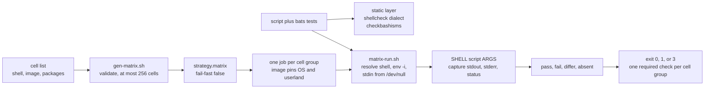

# Cross Shell CI Matrices

> [!summary] Claim
> A shell script is portable only to the cells you actually run it in, where a cell is the whole tuple of shell build, invocation name, environment, utilities, and OS image, so a CI matrix must make every cell explicit, hermetic, and impossible to skip silently.

Part of [Testing and Static Analysis](README.md) in [Shell and Unix Engineering](../README.md).

## TL;DR

- Mechanism: a driver runs the same script as `SHELL script ARGS` once per cell, from a scrubbed environment, with stdin from `/dev/null`, and turns each cell into pass, fail, differ, or absent; CI then runs one job per cell group.
- Rule: a cell that did not run is a failure (an absent shell exits non-zero), `fail-fast` is off, tolerated-failure cells are named explicitly, and assertions use feature detection and ranges (`> 128`), never shell names or exact signal statuses.
- Trap: the green run that proves nothing: a missing shell skipped by `|| continue`, `fail-fast: true` cancelling the cells you wanted verdicts from, or a script executed through its shebang so the cell under test was never the one in the table.
- Portability fact: the same bash binary is two cells when invoked as `bash` and as `sh`, a killed child reads 137 in bash, 265 in ksh93, and 393 in yash, and posh keeps a caller's `IFS` where POSIX requires the shell to reset it.
- When not to use it: when you control the interpreter (pin one shell in a container and test that), or when the script has grown into a program, in which case the matrix is paying to test a language the logic should not be written in.

## Mental model



The script and its tests feed two independent layers: a static layer (ShellCheck with an explicit dialect, `checkbashisms`) that never executes anything, and a dynamic layer that does.
The cell list is data, not YAML: a generator validates it and emits the JSON that a GitHub `strategy.matrix` expands into jobs, each job pinning an OS image and therefore a userland.
Inside a job the driver resolves each shell to an absolute path, scrubs the environment, and runs the script as an explicit argument of that shell (so the shebang plays no part), then classifies the result.
The classification collapses to an exit status that the job, and through it a required status check, either accepts or rejects, and an absent shell is rejected like any other failure.

## How it works

### A cell is a tuple, not a shell name

Six axes decide what a shell script does, and a matrix that varies only the first measures only the first.

1. Shell implementation and version: dash, bash, zsh, ksh93, mksh, yash, posh, BusyBox ash, each with releases that differ (dash 0.5.12 and 0.5.13, ksh93u+ 2012 and ksh93u+m, mksh R59 2020 and 2025, bash 3.2 and 5.3).
2. Invocation: the same binary changes mode with `argv[0]` and flags (bash named `sh` enters POSIX mode, `zsh --emulate sh`, `busybox ash`).
3. Environment: variables the shell may import at startup (`IFS` in posh), locale, `HOME`, `PATH`.
4. Utilities: `awk`, `sed`, `sort`, `grep`, `date`, `stat` are separate programs whose implementation (GNU, BSD and macOS, BusyBox, mawk, uutils) is chosen by the OS image, not by the shell.
5. Kernel and libc: signal numbers, pipe capacity, `PIPE_BUF`, which `/proc` files exist.
6. Terminal: CI has no controlling terminal, so job control and `isatty` branches take their non-interactive path.

The lab and the vault's own matrix treat the first three as one object (a row in `CANDIDATES`, an entry in a `-s LABEL=COMMAND` list) and the fourth and fifth as the image the row runs in.

### Who chooses the interpreter

Running `./script.sh` asks the kernel to choose, and running `SHELL script.sh` makes the caller choose.
On Linux `execve(2)` treats a file whose first line is `#!interpreter [optional-arg]` as an interpreter script and runs `interpreter [optional-arg] path arg...`; the whole string after the interpreter name is passed as one argument on Linux, and the text after `#!` is limited to 255 characters since Linux 5.1 (it was 127 before) (execve(2), man-pages, "Interpreter scripts").
A matrix must therefore invoke the shell explicitly: executing the script runs only the shell its shebang names, whatever the cell label says.
POSIX adds that the path of the standard shell cannot be assumed to be `/bin/sh` and recommends interrogating `command -v sh` or `getconf PATH`, and rewriting the `#!` line at install time (POSIX.1-2024 XCU `sh`, APPLICATION USAGE).
The lab driver passes the script to the shell as an operand (`/path/to/shell script args`), which is the `sh script` form of XCU `sh`, so `$0` is the script and no `#!` line is read.

bats itself is a bash program, so a bats suite is bash around a shell-agnostic target: the tests call `run SHELL script` and the shell under test is a parameter, here `LAB_SHELL` (see [[bats-core]]).
The bats-core README describes it as a TAP-compliant framework for Bash 3.2 or above, and `--formatter tap` forces TAP output, which a driver can count (bats-core README; `docs/source/usage.md`).

### The static layer, and its limit

ShellCheck chooses its dialect from the `shell` directive, then the shebang, then a `.bash`, `.bats`, `.dash`, `.ksh` extension, in that order, or from `-s`; the valid values are `sh`, `bash`, `dash`, `ksh`, and `busybox`, and `sh` means POSIX `sh`, not the system's, and "will warn of portability issues" (shellcheck(1), `--shell`).
The directive form is a comment, `# shellcheck shell=sh` (ShellCheck wiki, Directive).
Debian Policy 10.4 lets a script assume that `/bin/sh` implements POSIX.1-2017 plus a short list of extras, and says that checking with `checkbashisms` from devscripts, or running with an alternate shell such as posh, "may help uncover violations" (Debian Policy, ch-files, 10.4 Scripts).
`checkbashisms` flags constructs that are bashisms in the sense of "not required by POSIX", so some findings are legal under XSI or User Portability options (checkbashisms(1)); posh is the Policy-compliant Ordinary SHell, based on pdksh, and tracks the Policy's SUSv3 baseline (posh(1)).
The ShellCheck internals and warning families are in [[ShellCheck-Internals]] and [[ShellCheck-Warning-Families]].

The static layer sees syntax and a model of semantics.
It cannot see that posh keeps the caller's `IFS`, that a killed child reads 265 in ksh93, or that Debian's dash and upstream dash 0.5.12 disagree on `pipefail`, because those are runtime facts of a build.
That is the whole reason to execute: a matrix is a set of experiments on the builds you ship to.

### The driver

The lab's `matrix-run.sh` is 173 lines of POSIX sh that must itself run under every shell it drives, which fixes its style: no arrays, no `local`, no reliance on word splitting.
The vault's real runner is `19-Shell-and-Unix-Engineering/labs/run-matrix.sh`, written for bash 3.2, which embodies the same ideas at scale: an ordered `CANDIDATES` list of `label|family|command` rows, a "not installed" line for a missing shell instead of silent omission, de-duplication of two labels that resolve to one binary, a separate key `as-sh:` for a binary invoked under the name `sh`, and a per-suite kill timer (`LAB_SUITE_TIMEOUT`, default 600 seconds) plus `BATS_TEST_TIMEOUT` 60 seconds per test (bats-core `docs/source/writing-tests.md`).

The lab driver's decisions, each with its reason:

1. Resolve the first word of the command with `command -v` and run that absolute path.
   An unresolved word is `absent` (not found, or not executable), reported on its own line, counted, and fatal unless `-a` says otherwise; with no cell run at all the exit is 3 even under `-a`, because a matrix that ran nothing is not green.
2. Build the command line out of positional parameters only.
   A shell list entry such as `busybox ash` is split by a `case` on the first space (a loop of `${rest%% *}` and `${rest#* }`), not by unquoted expansion, because native zsh does not field split unquoted parameters and posh and dash have no arrays.
   The shell words are appended after the script arguments and the script arguments are then rotated behind them, so empty and space-containing arguments survive.
3. Prefix `env`, with `-i PATH=...` for a hermetic run and with each `-E NAME=VALUE` after the scrub.
   Resolving first keeps `env`'s own search from picking a different binary under the scrubbed `PATH`.
4. Redirect the cell's stdin from `/dev/null`.
   The cells are launched from inside a `while read` loop over the cell list, so without the redirect a cell that reads stdin would eat the list.
5. Capture stdout and stderr per cell in a scratch directory made by `mktemp -d` and removed by an `EXIT` trap (and by `HUP`, `INT`, `TERM` routed to `exit 1`).
6. Classify: non-zero status is `fail`; status 0 with `-e EXPECT` set and a byte difference (`cmp -s`) is `differ`; else `pass`.
7. Keep going after a failure, print one line per cell, then a summary, then exit 0 (all pass), 1 (any fail or differ), 2 (usage), or 3 (absent without `-a`, or nothing ran).

The driver has no per-cell timeout.
That is deliberate for a lab and wrong for CI: a cell that blocks (a FIFO with no peer, a stopped job) stalls the matrix, and the vault's runner launches every suite through a `detach` helper that starts a new session with no controlling terminal and kills the process group when its timer expires.

### The environment is part of the cell

POSIX.1-2024 XCU 2.5.3 says "The shell shall set IFS to <space><tab><newline> when it is invoked."
dash does exactly that: after importing every valid environment name it runs `setvareq(defifsvar, VTEXTFIXED)` with `defifsvar` defined as `"IFS= \t\n"` (dash `src/var.c`, `INIT` block).
zsh sets `ifs` from `DEFAULT_IFS_SH` (`" \t\n"`) under sh or ksh emulation and from `DEFAULT_IFS` otherwise, and `DEFAULT_IFS` is `" \t\n\203 "`, where the fourth character is the `Meta` marker followed by a space, which denotes the null character (zsh `Src/init.c`, `Src/zsh.h`), so native zsh starts with four bytes of `IFS`.
posh 0.14.1 does not reset: it inherits `IFS` from the environment (measured in the shell matrix, 2026-10).

The lab proves all three with one mechanism, `-E IFS=:` on a cell that prints the hex of `IFS`: bash 3.2.57, bash 5.3.15, dash 0.5.13.5, and ksh93u+ 2012 print `20090a` with or without the injection, native zsh prints `20090a00`, and `zsh --emulate sh` prints `20090a` (all measured on this host, 2026-11-26).
The lab's posh arm expects `3a` under injection and is not run here.
A hermetic `-i` run removes the whole class of leak, including variables a CI runner sets for itself.
Startup files are the second channel: POSIX says `ENV` is expanded and read only when an interactive shell is invoked (XCU `sh`, ENVIRONMENT VARIABLES), so a non-interactive cell does not read it under a conforming shell, but bash reads `BASH_ENV` for a non-interactive script (the premise of [[Coverage-with-kcov]]), which is another reason to scrub (see [[Bash-POSIX-Mode]] and [[Environment-Variables-and-Inheritance]]).

### Exit status and signals

POSIX.1-2024 XCU 2.8.2 fixes 127 for command not found and 126 for found but not executable, and says a command killed by a signal gets a status greater than 128 that identifies the signal "in an implementation-defined manner", and that implementations "are permitted to assign an exit status greater than 255".
The cell probe measures a child killed by `SIGKILL`: 137 (128 + 9) in bash, dash, and native or emulated zsh (this host), 265 (256 + 9) in ksh93u+ 2012 (this host), and, from the shell matrix, 256 + N in ksh93u+m and 384 + N in yash (so 393).
Two consequences for a harness.
First, asserting `status -eq 143` for a `SIGTERM` death is red under ksh93 (271) and yash (399) for no reason; assert `status -gt 128`.
Second, a harness that re-emits a child's status with `exit "$rc"` turns 265 into 9 (the low eight bits, as in the modulo-256 note under XCU 2.8.2), so a signal death collides with an ordinary exit code 9; the lab prints the raw `$?` in its report line for that reason.
See [[Exit-Status-and-Wait-Status]] for the wait-status mechanics.

### Version skew inside a family

A family name is not a feature set.
Upstream dash 0.5.12 has no `pipefail` entry in `src/options.c` and no `dollarsq` handling in `src/parser.c`, and upstream 0.5.13 has both (dash git tags `v0.5.12` and `v0.5.13`).
Yet the Debian build of 0.5.12 in the matrix image accepts `set -o pipefail` while leaving `$'...'` unexpanded (measured in the shell matrix, and the reason [[bats-core]] can state that dash accepts `pipefail` there), and Homebrew's 0.5.13.5 on this host accepts both.
So "dash" is at least three behaviors, a CI cell cannot be named by version alone, and the lab's dash arm for `$'...'` accepts exactly the two outcomes seen (`A` or `$\x41`) while the `pipefail` test avoids a per-family table and checks the probe against `set -o pipefail` itself.
The same applies to ksh93u+ 2012 against ksh93u+m 1.0.10 (different subscript evaluation and a `"$*"` null-`IFS` bug fixed upstream in 2025-03), to Alpine's mksh R59 2020/10/31 against Debian's R59 2025/04/26 (signal disposition of async jobs), and to BusyBox ash builds, where Alpine keeps an invalid imported name that Debian's build drops (all measured in the shell matrix).
Print the version string and the feature probes at the top of every cell, and branch on a probe or on `lab_shell_version`, never on `/etc/debian_version`.

### Encoding the matrix in GitHub Actions

`jobs.<job_id>.strategy.matrix` creates one job per combination of its variables, in the order the variables are written, and a matrix generates at most 256 jobs per workflow run, on hosted and self-hosted runners alike (GitHub docs, workflow syntax, `strategy.matrix`; as of 2026-11).
`include` adds keys to matching combinations or adds new ones, `exclude` removes combinations, and if only `include` is given each entry is its own job (GitHub docs, run job variations).
`fail-fast` applies to the whole matrix and defaults to `true`, which cancels all in-progress and queued jobs when one fails; `continue-on-error` applies to one job, so `continue-on-error: ${{ matrix.experimental }}` lets a named experimental cell fail without cancelling or failing the rest; `max-parallel` caps concurrency (GitHub docs, same pages).
The `jobs.<job_id>.if` condition is evaluated before the matrix is applied (workflow syntax).

A matrix can be data: one job writes `matrix=<JSON>` to `$GITHUB_OUTPUT`, and the next job reads `fromJSON(needs.<job>.outputs.<name>)` into `strategy.matrix` (GitHub docs, "Using an output to define two matrices").
The lab's `gen-matrix.sh` is that producer: it validates names, images, and packages against closed character sets, rejects duplicate names (they would collide as job names and as required-check names) and more than 256 cells, and so can print JSON with `printf` alone.
GitHub's own example passes a matrix value through `env:` and reads `"$color"` rather than splicing it into the script text, which is the safe pattern (see the Security section).

The `shell:` key decides what runs your `run:` block.
With none set, on Linux and macOS the command is `bash -e {0}`, falling back to `sh` if bash is not on `PATH`; `shell: bash` runs `bash --noprofile --norc -eo pipefail {0}`; `shell: sh` runs `sh -e {0}`; and a template such as `command [options] {0} [more_options]` runs any interpreter, where the first whitespace-delimited word is the command and `{0}` is the temporary script file (workflow syntax, `defaults.run.shell`, "Custom shell").
The default `run:` environment therefore already differs from your laptop (`-e`, and `pipefail` only when you spell out `bash`), and in a job with `container:` the default shell for `run` steps is `sh` instead of `bash` (workflow syntax, `jobs.<job_id>.container`), which makes a container matrix a cross-shell matrix by accident.
`shell:` can reference contexts, so one job definition can be a shell matrix over `matrix.shell`.

The hosted images fix which shells you get for free (as of 2026-11): the Ubuntu 24.04 image 20261116.376.1 lists Bash 5.2.21(1) and Dash 0.5.12-6ubuntu5, and its ShellCheck is 0.9.0-1 and coreutils 9.4-3ubuntu6.3; the macOS 15 image 20261118.0550.1 lists Bash 3.2.57(1) (runner-images READMEs).
Neither README lists zsh, ksh, mksh, yash, posh, or BusyBox among the installed software, so on Ubuntu every other cell is something the job installs (the macOS host here ships `/bin/zsh` and `/bin/ksh` in the base system), which is why this repository's own workflow installs zsh with `apt-get` and pins ShellCheck 0.11.0, shfmt 3.14.1, and bats 1.14.0 by SHA-256 rather than trusting the image.
The `-latest` labels move: the runner-images README says they point at the newest stable OS and migrate gradually over one to two months, and today `ubuntu-latest` is `ubuntu-26.04` while `macos-latest` is `macos-26` (as of 2026-11).
This repository's workflow records a real instance of that drift in a comment: its host-lab job is pinned to `ubuntu-24.04` because `ubuntu-latest` moved to 26.04, "whose coreutils print different diagnostics and layouts".

The alternative to one job per cell is one job that runs every cell itself.
This repository's `shell-matrix` job runs `labs/run-matrix.sh --containers` on one runner, which builds the Alpine and Debian images from `labs/matrix/*.Dockerfile` and runs the driver inside each as an unprivileged user.
You give up a status check per cell and the scheduler's parallelism, and you gain a single command that behaves the same on a laptop and in CI.

### Choosing the cells: additive, not multiplicative

The shell axis and the utility axis are close to independent, so a full product wastes jobs.
With S shells and U userlands, testing every shell on the userland of one image plus one reference shell on each additional userland costs S + (U - 1) cells, against S x U for the product; eleven shells and four userlands are 14 cells against 44, and the GitHub cap is 256.
The coupled cases are the exception and should be single named cells: BusyBox ash with BusyBox utilities (Alpine) is one cell because the pair is what a user has.
The utility axis is real and shell-independent: the lab shows `awk` in paragraph mode with `FS = ":"` giving 3 fields under mawk and 4 under gawk, the one true awk 20200816, and BusyBox awk, on the same shell (the divergence confirmed in the shell matrix, and measured on this host for gawk and the one true awk).
See [[Four-Userlands-GNU-BSD-BusyBox-uutils]] and [[Userland-Portability-Traps]].

Tier the cells by what they cost and what they tell you.
A pull-request tier runs the shells your users' `/bin/sh` actually is (dash, BusyBox ash, macOS's bash 3.2 in POSIX mode) plus current bash, because those are the interpreters a `#!/bin/sh` script meets.
A nightly tier adds the strict and exotic cells (posh, yash, mksh, ksh93, native zsh, `zsh --emulate sh`, older bashes) that find the portability bug before a user does.
Cells that exist to watch an upcoming release (a new bash) are `continue-on-error` and named experimental.

### What the matrix cannot see

A matrix of non-interactive batch runs says nothing about interactive behavior: with no controlling terminal, `set -m` prints "can't access tty; job control turned off" in dash and BusyBox ash and is rejected in zsh and posh, so job-control behavior needs a pseudo-terminal harness (shell matrix finding).
It does not see locale unless you set it: the Debian image sets no `LANG` or `LC_*`, so `LC_ALL=C.UTF-8` must be set by any cell that depends on UTF-8 (shell matrix finding).
It sees one kernel per image: a container shares the host kernel, so signal numbers, pipe capacity, and `PIPE_BUF` follow the host (Linux pipes default to 64 KiB, macOS starts at 16 KiB and grows to 64 KiB, shell matrix).

## Numbers and limits

| Quantity | Value | Basis |
| --- | --- | --- |
| Jobs one matrix may generate | 256 per workflow run | GitHub docs, workflow syntax `strategy.matrix` (as of 2026-11) |
| `fail-fast` default | `true`: any failure cancels in-progress and queued jobs | GitHub docs, workflow syntax (as of 2026-11) |
| Default shell, Linux and macOS, none given | `bash -e {0}` (falls back to `sh -e {0}`) | GitHub docs, `defaults.run.shell` (as of 2026-11) |
| `shell: bash` | `bash --noprofile --norc -eo pipefail {0}` | same |
| Default shell for `run` in a container job | `sh` | GitHub docs, `jobs.<job_id>.container` (as of 2026-11) |
| Ubuntu 24.04 image shells | Bash 5.2.21(1), Dash 0.5.12-6ubuntu5; ShellCheck 0.9.0-1 | runner-images README, image 20261116.376.1 (as of 2026-11) |
| macOS 15 image shell | Bash 3.2.57(1) | runner-images README, image 20261118.0550.1 (as of 2026-11) |
| `ubuntu-latest` and `macos-latest` | `ubuntu-26.04` and `macos-26` | runner-images README (as of 2026-11) |
| Linux `#!` line length | 127 characters before Linux 5.1, 255 since | execve(2) |
| Linux interpreter-of-interpreter depth | 4 recursions since Linux 2.6.28 | execve(2) |
| Status of a `SIGKILL`ed child | 137 bash, dash, zsh; 265 ksh93u+ 2012; 393 yash (384 + 9) | lab probe on this host for 137 and 265; shell matrix for yash |
| `IFS` bytes at startup | `20090a`; native zsh `20090a00` | lab probe on this host, `zsh.h` |
| Cells for S shells and U userlands | S + (U - 1) additive, S x U full product | arithmetic; 11 and 4 give 14 and 44 |
| Vault runner timers | 600 s per shell suite, 60 s per test | `labs/run-matrix.sh` defaults |
| Lab suite | 21 tests, all passing under the default `sh` (bash 5.3.15) on this host | lab run, 2026-11-26 |

## Portability

Legend: m = measured on this host on 2026-11-26 by the lab probe; M = confirmed in the vault's shell matrix (macOS host, Alpine 3.22, Debian 13) on 2026-10; L = asserted by a per-family arm of the lab tests that this host cannot run; S = stated by the cited source.

| Shell | `IFS` at startup, caller's `IFS=:` injected | Unquoted `$x` for `x="a  b"` | `$'\x41'` | Child killed by `SIGKILL` |
| --- | --- | --- | --- | --- |
| POSIX sh | set to space, tab, newline when invoked (S, XCU 2.5.3) | split (S, XCU 2.6.5) | specified (S, XCU 2.2.4) | greater than 128, may exceed 255 (S, XCU 2.8.2) |
| macOS bash 3.2.57 | `20090a`, injection ignored (m) | 2 fields (m) | `A` (m) | 137 (m) |
| bash 5.3.15 | `20090a`, injection ignored (m) | 2 fields (m) | `A` (m) | 137 (m) |
| zsh 5.9.2 native | `20090a00`, injection ignored (m, S `zsh.h`) | 1 field (m) | `A` (m) | 137 (m) |
| zsh `--emulate sh` | `20090a` (m, S `DEFAULT_IFS_SH`) | 2 fields (m) | `A` (m) | 137 (m) |
| dash | reset after import (S `var.c`); `20090a` (m on 0.5.13.5) | 2 fields (m) | 0.5.12 `$\x41`, 0.5.13 and later `A` (S, parser.c tags; M for Debian; m for 0.5.13.5) | 137 (m) |
| ksh93u+ 2012-08-01 (macOS `/bin/ksh`) | `20090a` (m) | 2 fields (m) | `A` (m) | 265 (m) |
| ksh93u+m 1.0.10 | `20090a` (L, M, S `ksh(1)`) | 2 fields (L, M, S `ksh(1)`) | `A` (L, M) | 265 (L, M) |
| mksh R59 | `20090a` (L, M, S `mksh(1)`) | 2 fields (L, M, S `mksh(1)`) | `A` (L, M) | 137 (L, M: 128 + N) |
| yash 2.58.1 | `20090a` (L, M, S `yash(1)`) | 2 fields (L, M, S `yash(1)`) | `A` (L, M) | 393 (L, M: 384 + N) |
| posh 0.14.1 | inherits: `3a` (L, M) | 2 fields (L, M, S `posh(1)`) | `$\x41` (L, M) | 137 (L, M: 128 + N) |
| BusyBox ash 1.37.0 | `20090a` (L, M, S XCU 2.5.3) | 2 fields (L, M, S XCU 2.6.5) | `A` (L, M) | 137 (L, M: 128 + N) |

Which shell a bare `sh` is differs by platform, and a cell's name must say so (M unless noted): Debian `sh` is dash 0.5.12, Alpine `sh` is BusyBox ash 1.37.0, macOS `/bin/sh` is bash 3.2.57 in POSIX mode.
The lab proves that one bash binary is two cells: invoked through a link named `bash` it reports `posix=off`, through a link named `sh` it reports `posix=on` (lab test, m; see [[Bash-POSIX-Mode]]).
Which other quirks a driver must tolerate, from the shell matrix (M):
- `sh -c 'cmd1; cmd2'` execs the last command in place of the shell in bash 5.1 and later, zsh, ksh93, yash, and BusyBox ash, and forks it in dash, mksh, posh, and bash 4.4 and earlier, so process-tree assertions differ.
- posh has no `alias`, no `-m`, no `$'...'`, and aborts on an empty `"$@"` under `set -u`.
- native zsh does not field split unquoted parameters; `zsh --emulate sh` does.

| `awk` implementation | Where it is the default (M unless noted) | Paragraph mode, `RS = ""`, `FS = ":"`, input `a:b` newline `c:d` |
| --- | --- | --- |
| gawk | not the default anywhere here; installed beside the default on Debian (M) and on this host (m) | 4 fields (lab arm; m for gawk) |
| one true awk 20200816 | macOS `awk` (m) | 4 fields (lab arm; m) |
| BusyBox awk | Alpine `awk` | 4 fields (lab arm; L, M) |
| mawk 1.3.4 | Debian `awk` | 3 fields (lab arm; M) |

POSIX paragraph mode makes newline a field separator in addition to `FS`, which gives 4 fields; mawk does not do that when `FS` is not a single space, which is the divergence the matrix confirmed.
GNU, BSD, BusyBox, and uutils differences for `sed`, `date`, `stat`, and the coreutils are not re-derived here: see [[Four-Userlands-GNU-BSD-BusyBox-uutils]] and [[sed-In-Place-Editing-Portability]].

## Worked example

The lab is [lab](../labs/14-cross-shell-ci-matrices/): `matrix-run.sh` (the driver), `cell-facts.sh` (the probe), `gen-matrix.sh` (the matrix producer), `bash-mode.sh`, and `cross-shell-ci-matrices.bats` (21 tests).
The probe, verbatim from the lab file, is the program each cell runs:

```sh
#!/bin/sh
# cell-facts.sh: print facts about the shell that runs this script, one key=value per line.
# Every value is computed here, by the shell under test, never looked up by name.
# Usage: SHELL cell-facts.sh
#   ifs_hex         the bytes of IFS when the script starts (POSIX.1-2024 XCU 2.5.3: the shell sets
#                   IFS to space, tab, newline when it is invoked, so 20090a)
#   split_count     how many fields an unquoted expansion of "a  b" yields (2; native zsh gives 1)
#   dollar_squote   what a dollar-single-quote word with a hex escape expands to (A, or $\x41)
#   sigkill_status  the status of a child killed by SIGKILL (128+9, 256+9 or 384+9, by shell)
#   pipefail        no, or yes/rc=N where N is the status of a pipeline "false | true" under pipefail

# shellcheck disable=SC3040 # pipefail is probed on purpose: a shell that lacks it fails the probing subshell

# Capture IFS before anything assigns it.
ifs_hex=$(printf '%s' "$IFS" | od -An -tx1 | tr -d ' \n')

IFS=' '
x='a  b'
# shellcheck disable=SC2086,SC2248 # the unquoted expansion is the probe
set -- $x
split_count=$#

# The dollar-single-quote word sits in a string given to eval, so shells that cannot parse it
# (or a formatter) never see it as source text.
code="dq=\$'\\x41'"
eval "$code"
# shellcheck disable=SC2154 # dq is assigned by the eval above
dollar_squote=$dq

# The child is /bin/sh, an external process, so the status is the outer shell's view of a signal death.
sigkill_status=$({
  /bin/sh -c 'kill -s KILL $$'
  printf '%s' "$?"
} 2>/dev/null)

pipefail=no
if (set -o pipefail) 2>/dev/null; then
  (
    set -o pipefail
    false | true
  )
  pipefail=yes/rc=$?
fi

printf 'ifs_hex=%s\n' "$ifs_hex"
printf 'split_count=%s\n' "$split_count"
printf 'dollar_squote=%s\n' "$dollar_squote"
printf 'sigkill_status=%s\n' "$sigkill_status"
printf 'pipefail=%s\n' "$pipefail"
```

The driver's core is below; this is a simplified excerpt (option parsing, the summary, and cleanup omitted) showing the one non-obvious part, how a list of words is built without arrays and without word splitting:

```sh
run_cell() {
  m_label=$1
  m_cmd=$2
  shift 2
  m_nargs=$#
  m_found=$(command -v "${m_cmd%% *}") || m_found=
  [ -x "$m_found" ] || { m_state=absent; return 0; }
  # Append the shell words after the script arguments, then rotate the script arguments behind them.
  m_rest=$m_cmd
  while [ -n "$m_rest" ]; do
    case $m_rest in
      *" "*) m_word=${m_rest%% *}; m_rest=${m_rest#* } ;;
      *) m_word=$m_rest; m_rest= ;;
    esac
    [ -z "$m_word" ] || set -- "$@" "$m_word"
  done
  m_i=0
  while [ "$m_i" -lt "$m_nargs" ]; do set -- "$@" "$1"; shift; m_i=$((m_i + 1)); done
  shift; set -- "$m_found" "$@"
  # (the real code prepends "env", "-i PATH=...", and each -E item the same way)
  env "$@" </dev/null >"$m_work/$m_label.out" 2>"$m_work/$m_label.err"
}
```

A GitHub job would call it as below (illustrative workflow, not a lab file; the Debian package names `dash`, `posh`, `mksh`, `yash`, `ksh93u+m`, `zsh`, and `busybox` match `labs/matrix/debian.Dockerfile` and manpages.debian.org):

```yaml
jobs:
  plan:
    runs-on: ubuntu-24.04
    outputs:
      matrix: ${{ steps.gen.outputs.matrix }}
    steps:
      - uses: actions/checkout@v4
      - id: gen
        run: |
          matrix=$(sh ci/gen-matrix.sh ci/shells.list)
          echo "matrix=$matrix" >> "$GITHUB_OUTPUT"
  test:
    needs: plan
    runs-on: ubuntu-24.04
    strategy:
      fail-fast: false
      matrix: ${{ fromJSON(needs.plan.outputs.matrix) }}
    name: test (${{ matrix.shell }})
    steps:
      - uses: actions/checkout@v4
      - run: IFS=,; set -f; sudo apt-get install -y --no-install-recommends $PKGS
        env:
          PKGS: ${{ matrix.packages }}
      - run: sh ci/matrix-run.sh -i -s "cell=$SHELL_CMD" tests/run.sh
        env:
          SHELL_CMD: ${{ matrix.shell }}
```

The assignment `matrix=$(...)` is on its own line so that, under the default `bash -e {0}`, a generator failure fails the step; writing `echo "matrix=$(sh ...)"` would report the status of `echo` and ship an empty matrix.

Running the driver on this host over the shells installed here, with `IFS=:` injected, gives the real output below (macOS `/bin/sh` ran the driver; the exit status was 3 because one cell was absent):

```sh
./matrix-run.sh -v -E IFS=: -s bash3.2=/bin/bash -s bash5.3=bash -s dash=dash -s zsh=zsh \
  -s zsh-sh="zsh --emulate sh" -s ksh93u-2012=ksh -s nosuch=no-such-shell ./cell-facts.sh
```

```text
bash3.2        pass   rc=0
    out: ifs_hex=20090a
    out: split_count=2
    out: dollar_squote=A
    out: sigkill_status=137
    out: pipefail=yes/rc=1
bash5.3        pass   rc=0
    out: ifs_hex=20090a
    out: split_count=2
    out: dollar_squote=A
    out: sigkill_status=137
    out: pipefail=yes/rc=1
dash           pass   rc=0
    out: ifs_hex=20090a
    out: split_count=2
    out: dollar_squote=A
    out: sigkill_status=137
    out: pipefail=yes/rc=1
zsh            pass   rc=0
    out: ifs_hex=20090a00
    out: split_count=1
    out: dollar_squote=A
    out: sigkill_status=137
    out: pipefail=yes/rc=1
zsh-sh         pass   rc=0
    out: ifs_hex=20090a
    out: split_count=2
    out: dollar_squote=A
    out: sigkill_status=137
    out: pipefail=yes/rc=1
ksh93u-2012    pass   rc=0
    out: ifs_hex=20090a
    out: split_count=2
    out: dollar_squote=A
    out: sigkill_status=265
    out: pipefail=yes/rc=1
nosuch         absent rc=-
matrix: 6 pass, 0 fail, 1 absent
```

`ksh93u-2012` shows 265 where the rest show 137, and only native `zsh` shows `20090a00` and one field; `nosuch` is `absent`, which is why the exit status is 3 and not 0.

## Pitfalls

> [!warning] An absent cell is a green cell
> Trigger: a loop `for s in dash posh yash; do command -v "$s" >/dev/null || continue; "$s" t.sh; done`, or a CI image that lost a package.
> Symptom: the run is green, the posh column was never executed, and only the last cell's status survives as the loop's exit status.
> Fix: report `absent` explicitly, count it, make it fatal by default (the lab driver exits 3, and 3 even when nothing ran), and allow it only per cell with a named flag, as the vault runner prints "not installed" and the lab prints `absent`.

> [!warning] `fail-fast` defaults to true
> Trigger: a shell matrix with the default `strategy.fail-fast`.
> Symptom: the first red cell cancels in-progress and queued jobs, so you see one shell's verdict and not the four that fail the same way (GitHub docs, workflow syntax).
> Fix: `fail-fast: false` for a portability matrix, and `continue-on-error: ${{ matrix.experimental }}` for cells that may fail without blocking.

> [!warning] The shebang decided, not the cell
> Trigger: the matrix executes `./script.sh` while the label says `dash`.
> Symptom: every cell runs the shebang's shell, so the matrix passes forever on one shell (the kernel follows `#!interpreter [optional-arg]`, execve(2)).
> Fix: run `SHELL script` as an operand, assert `$0` or a probe inside the run, and test the shebang line itself separately.

> [!warning] A version label does not name a feature set
> Trigger: a test keyed on "dash 0.5.12" or on `ID=debian`.
> Symptom: Debian's 0.5.12 accepts `set -o pipefail` though upstream 0.5.12 does not, and Homebrew's 0.5.13.5 expands `$'...'` where Debian's 0.5.12 does not, so a script "works on my machine" and fails in CI or the reverse (dash tags `v0.5.12` and `v0.5.13`; shell matrix).
> Fix: feature-detect (`(set -o pipefail) 2>/dev/null`), record the version string in the cell header, and branch on behavior.

> [!warning] The caller's environment leaks into the cell
> Trigger: a CI step exports `IFS`, `ENV`, `BASH_ENV`, a locale, or a token, and the cell is posh.
> Symptom: posh splits on the caller's `IFS` where POSIX XCU 2.5.3 requires the default, so a test passes or fails depending on the runner, and secrets are visible to the code under test.
> Fix: run cells under `env -i PATH=...` plus an explicit allow-list (`-i` and `-E` in the lab), and add an environment-injection test per matrix, as this lab does with `-E IFS=:`.

> [!warning] Asserting an exact signal status
> Trigger: `[ "$rc" -eq 143 ]` after a `SIGTERM`, or `exit "$rc"` in a harness.
> Symptom: ksh93 returns 271 and yash 399, and `exit 265` becomes 9, so a signal death masquerades as exit code 9 (XCU 2.8.2 allows more than 255; the exit code is the low eight bits).
> Fix: assert `> 128`, print the raw `$?`, and keep the cell's status in a variable rather than re-exiting with it.

> [!warning] The `-latest` label moves under you
> Trigger: `runs-on: ubuntu-latest` in a job whose assertions depend on coreutils, `dash`, or `stty` output.
> Symptom: the migration over one to two months changes the OS, and this repository had to pin `ubuntu-24.04` after `ubuntu-latest` moved to 26.04 and its coreutils printed different diagnostics (runner-images README; the workflow comment).
> Fix: pin the image label for tests that assert tool output, and keep one deliberately unpinned canary job.

> [!warning] A matrix over shells that ignores the utilities
> Trigger: a shell matrix on one OS image, then a user on another userland.
> Symptom: the shell cells are all green and the script fails on `awk` paragraph mode under mawk or on a utility option that BSD lacks, because those are not shell behaviors (the lab's awk test).
> Fix: add the utility axis as its own cells (S + (U - 1)), and see [[Userland-Portability-Traps]].

> [!warning] A cell that blocks stalls the whole matrix
> Trigger: a test opens a FIFO with no peer, or a stopped orphaned process group, with no timeout.
> Symptom: the suite hangs for hours; the shell matrix hung for hours on a `setpgid` group that was not orphaned in a container, and unbounded `while true; do printf ...; done | head` probes under ksh93 with `SIGPIPE` ignored spun at 100% CPU for a day (shell matrix findings).
> Fix: bound every cell (a watchdog that kills the process group, `timeout-minutes` on the job, a per-test limit), start suites in a new session with no controlling terminal, and check for orphans.

> [!warning] Skipped tests count as passes in a TAP summary
> Trigger: `skip` on a missing tool or an unsupported shell.
> Symptom: `ok N # skip` lines look green, and a cell that proves nothing reports success (the vault runner counts them apart for this reason).
> Fix: a missing tool or shell is a failure, and where shells legitimately differ, assert each family's behavior with a `case` whose default branch is `false`.

## Security and robustness

A matrix runs code from the repository under test, with the runner's privileges, N times.
- Inputs that define cells are code: a pull request that edits `ci/shells.list` chooses images and packages, so `gen-matrix.sh` validates every field against a closed character set (so no quote, backslash, or `$` can reach the JSON or a later shell line), rejects duplicate names, and caps the count at 256.
- Pass matrix values to scripts through `env:` and read them as quoted variables, as GitHub's own example does; splicing `${{ matrix.x }}` into `run:` text makes it part of the script the shell parses.
- Run under `permissions: contents: read`, as this repository's workflow does, and never expose secrets to cells; `env -i` keeps the runner's variables out of the code under test.
- Pin the tools the matrix depends on and verify them: this repository downloads ShellCheck 0.11.0, shfmt 3.14.1, and bats 1.14.0 and checks each against a recorded SHA-256 before installing, because the image's ShellCheck is 0.9.0-1.
- Resolve each shell to an absolute path before scrubbing `PATH`, so a hijacked or reordered `PATH` cannot substitute another binary for a cell.
- Make scratch space with `mktemp -d`, clean it with an `EXIT` trap, never let an argument choose a directory that is later removed with `rm -rf`, and run as an unprivileged user (the vault's containers run as uid 1000).
- Robustness is fail-closed: an unreadable expected-output file, a malformed cell, or zero cells is a usage error (exit 2), not an empty pass.

## The principal's view

The decision is not "which shells" but "which interpreter contract do we publish, and how do we keep it honest".
There are three defensible contracts.
Pin one interpreter (a bash of a stated minimum version, in a container or via a `#!/usr/bin/env bash` plus a version check) and test only that, with a small bash-version matrix (3.2 if macOS users run it, 4.4, 5.x) instead of a shell matrix.
Or publish "POSIX sh, tested on dash, BusyBox ash, and bash in POSIX mode", the contract for installers and `curl | sh` one-liners where you do not control the user's shell, and run the full tiered matrix because there the matrix is the product.
Or stop at the point where the script is a program (parsing, state machines, structured data, concurrency) and rewrite it in a language with one implementation; a matrix over eleven shells to protect 600 lines of shell is the cost of a language choice, not a testing problem.

The trade-off is explicit.
Each shell you add is a maintenance contract: a divergence found in posh or yash becomes a bug you must fix or a documented exception, and every cell multiplies flake surface and wall time (cells cost minutes; the cap is 256).
The downside of narrowness is the same in the other direction: a script tested only on bash 5 breaks on macOS's 3.2 and on Alpine's ash on the day a user runs it there.
Prefer additive cells (S + (U - 1)), tier them (pull-request shells your `sh` really is; nightly the strict and exotic ones), keep cells as data a generator validates, make absence and skips failures, and pin the image labels for tests that assert tool output.
Use a different tool when the question is not behavior across shells: coverage is [[Coverage-with-kcov]] (bash only), style is [[shfmt]], findings are [[ShellCheck-Warning-Families]], and review judgment is [[Reviewing-Shell-at-Staff-Level]].

## Interview questions

> [!question] L5: Why does a shell matrix run `SHELL script` rather than executing the script?
>
> > [!success]- Answer
> > Executing the script asks the kernel to honor the `#!` line, so every cell would run the shebang's shell whatever the label says.
> > Passing the script as an operand of the shell makes the cell's shell the interpreter and ignores the `#!` line.
> > On Linux `execve(2)` runs `interpreter [optional-arg] path arg...` for a `#!` script, with the text after `#!` limited to 255 characters since Linux 5.1.
> >
> > Follow-up: How would you still test the shebang line itself?

> [!question] L5: What is `/bin/sh` on Debian, Alpine, and macOS, and why does it matter for a matrix?
>
> > [!success]- Answer
> > Debian's `sh` is dash, Alpine's is BusyBox ash, and macOS's `/bin/sh` is bash 3.2.57 in POSIX mode.
> > A `#!/bin/sh` script therefore meets three different interpreters, so those three are the minimum cells for any such script.
> > The Ubuntu 24.04 hosted image ships Dash 0.5.12-6ubuntu5 and the macOS 15 image Bash 3.2.57.
> >
> > Follow-up: Why is "bash in POSIX mode" a different cell from "bash"?

> [!question] L5: Which GitHub Actions setting do you change first for a portability matrix, and why?
>
> > [!success]- Answer
> > `strategy.fail-fast: false`, because the default of `true` cancels in-progress and queued jobs on the first failure.
> > A portability matrix exists to show which cells fail, so cancelling the rest destroys the information.
> > A cell that may legitimately fail is `continue-on-error: ${{ matrix.experimental }}` instead.
> >
> > Follow-up: What does `max-parallel` trade, and what bounds the total job count?

> [!question] L6: Predict the output of `env IFS=: SHELL -c 'printf %s "$IFS" | od -An -tx1'` for bash, native zsh, `zsh --emulate sh`, and posh.
>
> > [!success]- Answer
> > bash prints `20 09 0a`, because the shell sets `IFS` to space, tab, newline on startup and ignores the caller's value (POSIX XCU 2.5.3).
> > Native zsh prints `20 09 0a 00`, because `DEFAULT_IFS` is `" \t\n\203 "` and includes the null character.
> > `zsh --emulate sh` prints `20 09 0a` from `DEFAULT_IFS_SH`.
> > posh 0.14.1 prints `3a`, because it inherits `IFS` from the environment.
> >
> > Follow-up: What change to the harness makes the posh result irrelevant to your tests?

> [!question] L6: Debug this: the job is green, but posh is not installed and the dash cell should be red.
>
> ```sh
> for s in dash posh yash; do
>   command -v $s >/dev/null || continue
>   $s t.sh
> done
> ```
>
> > [!success]- Answer
> > There are three bugs.
> > The `|| continue` skips an absent shell silently, so posh never ran and nothing reports it.
> > The loop's exit status is the status of the last command that ran, so a failure of dash is overwritten by yash's success.
> > `$s` is unquoted, which works for these single-word names and breaks for an entry such as `busybox ash` (and in native zsh an unquoted parameter is never split at all).
> > The fix is to record each status (`rc=0` before the loop and `"$s" t.sh || rc=1` inside it), print `absent` for a missing shell and count it, and exit non-zero when any cell failed or was absent.
> >
> > Follow-up: When is an absent shell allowed to be non-fatal?

> [!question] L6: A test asserts `[ "$rc" -eq 143 ]` after a child receives `SIGTERM` and is green on dash and bash but red on ksh93 and yash, so why and what is the fix?
>
> > [!success]- Answer
> > POSIX XCU 2.8.2 says only that a signal death gives a status greater than 128, identifying the signal in an implementation-defined manner, and that it may exceed 255.
> > bash and dash give 128 + 15 = 143, ksh93 gives 256 + 15 = 271, and yash gives 384 + 15 = 399.
> > Assert `[ "$rc" -gt 128 ]`, and if you must name the signal, branch on the shell family.
> > Do not re-exit with `exit "$rc"`, because the low eight bits of 271 are 15 and of 265 are 9.
> >
> > Follow-up: Why does the lab print `rc=` raw instead of normalizing it?

> [!question] L6: How do you size a matrix of 11 shells over 4 userlands, and what is the cost of each choice?
>
> > [!success]- Answer
> > The shell and utility axes are nearly independent, so test every shell on one userland and add one reference shell per other userland: 11 + 3 = 14 cells against 11 x 4 = 44.
> > The cost is the interactions you do not run, such as BusyBox ash with BusyBox utilities, which is why a coupled pair that users actually have is its own cell.
> > The hard ceiling is 256 jobs per matrix per workflow run.
> >
> > Follow-up: Which cells go in the pull-request tier and which in the nightly tier?

> [!question] L7+: You maintain an installer that users run as `curl ... | sh` on unknown machines, so what support contract and CI do you define?
>
> > [!success]- Answer
> > The contract is POSIX sh (POSIX.1-2024 XCU 2), tested on dash, BusyBox ash, and bash in POSIX mode in the pull-request tier, since those are what `sh` is on Debian, Alpine, and macOS.
> > The nightly tier adds posh and yash as strict checkers, mksh and ksh93 for the Korn family, and native and emulated zsh, with ShellCheck on `-s sh` as the static layer.
> > Cells are generated data (at most 256), hermetic (`env -i`), bounded by timeouts, and an absent shell fails the run.
> > Every divergence found becomes either a fix to portable syntax or a documented exception with an owner.
> >
> > Follow-up: What would make you give up and rewrite the installer in a compiled language?

> [!question] L7+: `ubuntu-latest` moved to a new LTS and 40 tests went red overnight, so what are the postmortem actions?
>
> > [!success]- Answer
> > The cause is that `-latest` labels migrate gradually over one to two months, so the OS under the job changed without a commit (runner-images README).
> > Pin `runs-on` to a versioned label for any job that asserts tool output, which is what this repository did when `ubuntu-latest` moved to 26.04 and coreutils diagnostics changed.
> > Keep one deliberately unpinned canary job that runs the same suite and is allowed to fail, so drift is visible before the pin is lifted.
> > Record the image version in the job log, and install your own pinned ShellCheck, shfmt, and bats with checksums, since the image's ShellCheck is 0.9.0-1.
> >
> > Follow-up: How do you decide when to lift the pin?

> [!question] L7+: A matrix suite hangs for hours once a week, so how do you find the cause and stop it recurring?
>
> > [!success]- Answer
> > First suspect a cell that blocks: a FIFO opened with no peer, a read on a terminal, or a stopped process group that no one will resume.
> > In a container the reaper is in the test's own session, so a `setpgid` group has a live parent in that session and is not orphaned, so `SIGTSTP` stops it and nothing continues it (shell matrix finding).
> > The fixes are structural: start every suite in a new session with no controlling terminal (a `detach` helper), kill the process group from a watchdog on a timeout, bound each test, set `timeout-minutes` on the job, and check for orphans afterwards.
> >
> > Follow-up: Why is a per-test timeout alone not enough?

## Related

Prerequisites: [[Coverage-with-kcov]]

Next: [[Reviewing-Shell-at-Staff-Level]]

See also: [[bats-core]], [[bats-Helpers-and-Assertions]], [[ShellCheck-Internals]], [[ShellCheck-Warning-Families]], [[shfmt]], [[ShellSpec]], [[shUnit2]], [[Mocking-Commands-via-PATH]], [[Golden-Output-Tests]], [[Characterization-Tests-for-Legacy-Scripts]], [[Shell-Feature-Portability-Map]], [[Dash-and-Bashisms]], [[Strict-POSIX-Shells-posh-and-yash]], [[BusyBox-ash]], [[Zsh-Emulation-Modes]], [[Bash-3-2-on-macOS]], [[Bash-POSIX-Mode]], [[Field-Splitting-and-IFS]], [[Dollar-Single-Quotes]], [[Exit-Status-and-Wait-Status]], [[Environment-Variables-and-Inheritance]], [[env-and-Shebang-Tricks]], [[Four-Userlands-GNU-BSD-BusyBox-uutils]], [[Userland-Portability-Traps]], [[Portable-sh-for-configure]]

## Further reading

- [POSIX.1-2024 XCU 2, Shell Command Language](https://pubs.opengroup.org/onlinepubs/9799919799/utilities/V3_chap02.html): the normative text for `IFS` at invocation (2.5.3), exit status and signals (2.8.2), pipeline status and `pipefail` (2.9.2), and `set -e` (2.15 `set`).
- [POSIX.1-2024 XCU sh](https://pubs.opengroup.org/onlinepubs/9799919799/utilities/sh.html): invocation forms, `command_string`, and the advice not to assume `/bin/sh`.
- [GitHub Docs: workflow syntax](https://docs.github.com/en/actions/reference/workflows-and-actions/workflow-syntax): the 256-job matrix cap, `fail-fast`, `continue-on-error`, and the exact command behind each `shell:` value.
- [GitHub Docs: run job variations](https://docs.github.com/en/actions/how-tos/write-workflows/choose-what-workflows-do/run-job-variations): `include` and `exclude` semantics and the `fromJSON` output pattern.
- [actions/runner-images](https://github.com/actions/runner-images): which shells and tool versions each hosted label contains and how `-latest` migrates.
- [execve(2)](https://man7.org/linux/man-pages/man2/execve.2.html): the interpreter-script rules that make a shebang pick the shell.
- [bats-core](https://github.com/bats-core/bats-core): the harness, its bash 3.2 floor, and the TAP and JUnit formatters.
- [shellcheck(1)](https://raw.githubusercontent.com/koalaman/shellcheck/master/shellcheck.1.md) and the [directive wiki](https://raw.githubusercontent.com/wiki/koalaman/shellcheck/Directive.md): the dialect list and the `shell=` directive.
- [Debian Policy 10.4, Scripts](https://www.debian.org/doc/debian-policy/ch-files.html): what a `/bin/sh` script may assume, and why posh and `checkbashisms` exist.
- [checkbashisms(1)](https://manpages.debian.org/unstable/devscripts/checkbashisms.1.en.html) and [posh(1)](https://manpages.debian.org/unstable/posh/posh.1.en.html): the static and the strict-runtime checkers.
- [dash `src/var.c`](https://git.kernel.org/pub/scm/utils/dash/dash.git/plain/src/var.c): how dash resets `IFS` after importing the environment.
- [zsh `Src/init.c`](https://raw.githubusercontent.com/zsh-users/zsh/master/Src/init.c) and [`Src/zsh.h`](https://raw.githubusercontent.com/zsh-users/zsh/master/Src/zsh.h): the emulation-dependent default `IFS`.
