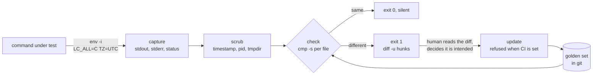

# Golden Output Tests

> [!summary] Claim
> A golden output test freezes what a command printed, as bytes in a file under version control, and fails on any later difference, so its value depends entirely on three decisions: what is captured (stdout, stderr and status as separate streams), what is normalized (only the fields that are legitimately volatile), and how the golden is allowed to change (only on purpose, never in CI).

Part of [Testing and Static Analysis](README.md) in [Shell and Unix Engineering](../README.md).

## TL;DR

- Mechanism: run the command in a pinned environment, store stdout, stderr and the exit status as three files, scrub the volatile fields with `sed`, and compare byte for byte with `cmp` against the committed copy.
- Rule: compare files, never `"$(...)"` strings, and keep the golden update a separate, explicit, human-run command that refuses to run in CI.
- Trap: command substitution strips every trailing newline (POSIX.1-2024 XCU 2.6.3), so a string comparison passes when the final newline is missing; a scrub that rewrites too much (every number, every path) hides real regressions.
- Portability: `diff -u`, `cmp -s`, `env -i` and `sed` with basic regular expressions are POSIX; `diff --strip-trailing-cr` and `--label` are GNU extensions (Apple's diff accepted the first one when measured here); the file order of an unquoted glob follows the locale's collating sequence (POSIX.1-2024 XCU 2.14.3), so pin `LC_ALL=C`.
- When not to use it: when the output is large, unstable by nature, or not the contract (use an assertion on the one field that matters), and when the thing under test is a decision, not a report.

## Mental model



The command runs with an empty environment plus two pinned variables, so nothing the caller exported can reach the output.
Its two output streams and its exit status land in three separate files, because merging them hides which stream changed and drops the status entirely.
The scrub step rewrites only the fields that differ on every run for legitimate reasons, so the comparison sees the same bytes each time.
The check compares each file with `cmp -s`, which is exact, and prints a unified diff only for the files that differ.
The only arrow back into the golden set goes through a human who has read that diff, and the update command refuses to run when `CI` is set, so a pipeline can never rewrite its own expectations.

## How it works

### Capturing: three streams, one environment

A shell runs `cmd >out 2>err` by opening each file with `open(2)` (create, truncate, write-only) in the child between `fork(2)` and `execve(2)`, then `dup2(2)`-ing the descriptors onto 1 and 2.
The parent collects the exit status with `waitpid(2)`, and the shell exposes it as `$?`.
The three files are therefore three independent facts, and a regression in one (a new warning on stderr, a status that moved from 0 to 1) shows up as a difference in exactly that file.
The lab's capture step is one line (`golden.sh`, `cmd_capture`):

```sh
env -i PATH="$PATH" LC_ALL=C TZ=UTC "$@" >"$dir/stdout" 2>"$dir/stderr" </dev/null
```

`env -i` "shall ... invoke utility with exactly the environment specified by the arguments; the inherited environment shall be ignored completely" (POSIX.1-2024 XCU env, `-i`).
That makes the output independent of the caller's `HOME`, `LANG`, `LC_*`, `TZ`, `IFS` and every other exported variable.
`PATH` is passed through on purpose, because the script still has to find `date` and `sed`.
Standard input is `/dev/null`, so a command that unexpectedly reads stdin sees EOF instead of hanging a CI job.
A fixed locale matters for two reasons.
Message catalogs and number formats change with `LC_MESSAGES` and `LC_NUMERIC`.
Pathname expansion sorts its results "according to the collating sequence in effect in the current locale" (POSIX.1-2024 XCU 2.14.3), so a golden produced under one locale can fail under another; the lab's `order: 10 9 B a` line is the byte order of `LC_ALL=C`, digits before upper case before lower case.

The bats `run` helper is a different capture strategy and is worth knowing precisely.
In bats-core v1.14.0, `run` executes the command in a subshell with `2>&1` appended (`bats_merge_stdout_and_stderr`), assigns `output="$("${pre_command[@]}" "$@")"`, and splits it with `bats_separate_lines` into `lines` (`bats-core v1.14.0 lib/bats-core/test_functions.bash, run`).
Three consequences follow, and the documentation states the first two: `$output` is the combined stdout and stderr; empty lines are left out of `${lines[@]}` unless `--keep-empty-lines` is given; and because `$output` is a command substitution, trailing newlines are gone (the `--keep-empty-lines` branch appends a sentinel `.` and strips it afterwards to preserve them, which is the standard idiom for this problem).
`run --separate-stderr` writes stderr to a temporary file and fills `$stderr` and `${stderr_lines[@]}` from it.
None of this stores the exit status of a *failed golden check* anywhere you can diff, so for a golden test write the streams to files yourself.
Assertion mechanics of `run` belong to [[bats-core]] and [[bats-Helpers-and-Assertions]].

### Normalizing: scrub the legitimate noise and nothing else

A field is legitimately volatile when it differs between two correct runs: a timestamp, a process id, a temporary directory chosen by `mktemp`, a hostname, a random identifier, a duration.
The lab's `scrub` subcommand applies three rules with one `sed` invocation per file:

```
s|<escaped tmpdir>|<TMPDIR>|g
s/[0-9]\{4\}-[0-9]\{2\}-[0-9]\{2\}T[0-9]\{2\}:[0-9]\{2\}:[0-9]\{2\}Z/<TIMESTAMP>/g
s/pid=[0-9][0-9]*/pid=<PID>/g
```

The expressions are POSIX basic regular expressions, so they run on every `sed`.
POSIX.1-2024 sed also standardizes `-E` for extended regular expressions (POSIX.1-2024 XCU sed, `-E`), but the lab does not need it.
Two design rules matter more than the syntax.
First, anchor each rule to its context: `pid=` before the digits, so `count=4242` survives.
A scrub that replaces every digit run turns a regression from "4 files" to "40 files" into a pass.
Second, treat the scrubbed path as literal text.
The lab escapes the BRE metacharacters of the directory (`sed 's/[][\.*^$|]/\\&/g'`) before using it in `s|...|...|g`, and a test proves that `/x/yzz/a` is not rewritten when the scrubbed path is `/x/y.z`.
Without the escape, `.` matches any character, and an unrelated line is silently rewritten.
The scrub rewrites each file through `"$f.new"` and `mv`, so an interrupted run cannot leave a half-written stdout.

### Comparing: `cmp` for the verdict, `diff` for the explanation

`cmp` reads both files and stops at the first differing byte.
POSIX.1-2024 XCU cmp specifies exit 0 for identical files, 1 for different files ("this includes the case where one file is identical to the first part of the other"), and greater than 1 for an error, and `-s` suppresses all output so that only the status carries the answer.
The input "can be any file type", so `cmp` is also correct for binary golden files.
The prefix clause in the exit status is why a golden check is built on `cmp`: a file that is a strict prefix of the other, such as a missing final newline, is a difference.
The popular weak alternative, `[ "$(cat golden)" = "$(cat actual)" ]`, discards trailing newlines on both sides, because the shell removes "one or more bytes that have the encoded value of a newline" from the end of a command substitution (POSIX.1-2024 XCU 2.6.3).
The same standard leaves the behavior unspecified "if the output contains any null bytes", so a string comparison is also wrong for binary output.
`bats-file`'s `assert_files_equal` is built on exactly this: `cmp -s "$file1" "$file2"` (`bats-file src/file.bash, assert_files_equal`, master, as of 2026-11).

`diff` is the explanation, not the verdict.
POSIX.1-2024 XCU diff specifies exit 0 for no differences, 1 for differences, and greater than 1 for an error, and the Linux man page for GNU diff gives 0, 1 and 2 ("if trouble").
`-u` produces "three lines of unified context" and `-U n` produces `n` lines; the header carries each file's name and modification time (POSIX.1-2024 XCU diff, `-u`, `-U n`).
Those two header lines are noise in a golden failure, so the lab drops them with `sed '1,2d'` and prints only the hunks.
POSIX says the change list "should be minimal", so the hunks are a readable edit script, but no byte of the verdict depends on `diff`: if `diff` itself fails (status above 1), the `cmp` verdict still stands.
For non-text input, POSIX.1-2024 makes it implementation-defined (in the POSIX locale) whether `diff` uses the "binary file output format", which contains the two pathnames and the string "differ", or the normal formats (POSIX.1-2024 XCU diff, Diff Binary Output Format).
Implementations also print the marker `\ No newline at end of file`; this is not in the POSIX diff page, and the Apple diff on this host printed it for a golden `a` plus newline against an actual `a` with no newline (measured here, 2026-11-26).

### Updating: the golden changes only on purpose

The update path is a separate subcommand because "regenerate and commit" is the most dangerous operation in a golden workflow: it turns any bug into the new truth.
The lab's `update` does three things.
It refuses when `CI` is set, so a pipeline never rewrites expectations (the check is `[ -z "${CI-}" ]`; GitHub Actions documents `CI` as "Always set to `true`", and GitLab CI/CD sets `CI` to `true` in every job, as of 2026-11).
It never creates a golden set as a side effect of `check`: a missing set is exit 2, not a pass, because a check that creates its own baseline passes on its first run against a broken command.
It replaces each file with `cp` to a dot-file in the golden directory and `mv -f` over the final name, so a reader never sees a half-written file.
That relies on `rename(2)` being atomic: the POSIX rationale says the specification "requires that the action of the function be atomic" (POSIX.1-2024 XSH rename, RATIONALE).
The replacement is atomic per file, not across the three; a crash between two renames leaves a mixed set, which the next `check` reports as a difference rather than hiding it, and git restores it.

What makes an update safe is the review of its diff.
A golden diff in a pull request is the specification change.
If a reviewer cannot tell from the diff whether the change is intended, the golden is too large or too noisy, which is a design defect to fix (see The principal's view below).

### Where golden tests sit among the others

A golden test proves "the output did not change", not "the output is right".
It is the cheapest way to pin the behavior of a script you did not write or no longer understand, which is the job of the next note, [[Characterization-Tests-for-Legacy-Scripts]]: record first, understand later.
For commands your script calls, replace them with controlled fakes first ([[Mocking-Commands-via-PATH]]), so the golden depends on your script's logic and not on the host's `date` or `curl`.
Whether the golden is stable across shells and platforms is a matrix question ([[Cross-Shell-CI-Matrices]]); whether the lines in it were reached is a coverage question ([[Coverage-with-kcov]]).

## Numbers and limits

| Quantity | Value | Source |
|---|---|---|
| `diff -u` context lines | 3 (`-u` acts like `-U3`); `-U n` shows up to `n` | POSIX.1-2024 XCU diff, as of 2026-11 |
| `diff` exit status | 0 same, 1 different, greater than 1 error; GNU: 0, 1, 2 | POSIX.1-2024 XCU diff; man7 diff(1), as of 2026-11 |
| `cmp` exit status | 0 identical, 1 different (a strict prefix counts), greater than 1 error | POSIX.1-2024 XCU cmp, as of 2026-11 |
| Trailing newlines kept by `"$(...)"` | 0 | POSIX.1-2024 XCU 2.6.3, as of 2026-11 |
| Null bytes in a command substitution | unspecified | POSIX.1-2024 XCU 2.6.3, as of 2026-11 |
| Timestamp resolution of the lab's scrub input | 1 second (`%S`) | `inventory.sh`, `date -u +%Y-%m-%dT%H:%M:%SZ` |
| Files in one golden set | 3 (`stdout`, `stderr`, `status`) | lab design |
| Size of the committed `inventory` golden | 102 bytes stdout, 0 bytes stderr, 2 bytes status | measured with `wc -c`, 2026-11-26 |
| Tests in the lab | 18, all passing under the `sh` on this machine's PATH, which reports bash 5.3.15 | measured, bats 1.14.0, 2026-11-26 |
| Files created for the 4 names `B`, `a`, `10`, `9` | 4 on a case-insensitive APFS volume; the first draft used `A`, `a`, `B`, `b` and the glob saw only 2 | measured, macOS Darwin 27.3.0, 2026-11-26 |
| Atomicity of `rename` | atomic within one filesystem; not across the 3 files of a set | POSIX.1-2024 XSH rename RATIONALE |

The numbers that bound a golden test in practice are not CPU: they are review attention (a diff of more than a screen is not read) and the number of volatile fields (each one is a scrub rule that can over-match).
No benchmark is claimed here, and none was run.

## Portability

| Shell or tool | Behavior relevant to golden tests | Evidence |
|---|---|---|
| POSIX sh | `env -i`, `cmp -s`, `diff -u`, `sed` with BRE, `mv`, and `"$(...)"` trailing-newline stripping are all specified | POSIX.1-2024 XCU env, cmp, diff, sed, 2.6.3 |
| macOS bash 3.2 | `golden.sh` and the 18 tests not run under it here | not run; the integrator's matrix decides |
| current bash | the full lab passed (18 of 18) with the PATH `sh` (bash 5.3.15) | measured, 2026-11-26 |
| zsh (native) | `golden.sh` capture, scrub and check against the committed golden returned 0 | ad hoc run on this host, 2026-11-26, not the bats suite |
| zsh `--emulate sh` | not run | not run; the integrator's matrix decides |
| dash | `golden.sh` capture, scrub and check against the committed golden returned 0 | ad hoc run on this host, 2026-11-26, not the bats suite |
| ksh93 | `golden.sh` passed under macOS `/bin/ksh`, which is ksh93u+ 2012-08-01 (`${.sh.version}` prints `Version AJM 93u+ 2012-08-01`); ksh93u+m was not run | ad hoc run on this host, 2026-11-26; version measured 2026-11-27 |
| mksh, yash | not run | not run; the integrator's matrix decides |
| posh | not run; posh aborts on an empty `"$@"` under `set -u` (measured in the shell matrix), so the lab script avoids `set -u` and writes `${1+"$@"}` | measured in the shell matrix; lab source |
| BusyBox ash | not run | not run; the integrator's matrix decides |
| GNU diff | `--strip-trailing-cr`, `--label LABEL`, `-N`, `-a` exist; exit status 0, 1, 2 | man7 diff(1), as of 2026-11 |
| BSD and macOS diff | accepted `--strip-trailing-cr` (exit 0 on `a` against `a` plus CR); printed `\ No newline at end of file` with `-u` | measured, Apple diff (`diff --version`: "Apple diff (based on FreeBSD diff)"), Darwin 27.3.0, 2026-11-26, rechecked 2026-11-27 |
| BusyBox and uutils diff | not checked | not run |
| macOS file system | case-insensitive by default, so fixture names that differ only in case collide | measured, 2026-11-26 (`diskutil info /` reports personality `APFS`, not `Case-sensitive APFS`) |
| bats `run` | merges stderr into `$output`; drops empty lines in `lines`; `--separate-stderr` and `--keep-empty-lines` exist | bats-core docs and v1.14.0 `test_functions.bash`, as of 2026-11 |

Do not read the not-run cells as "works": they are open until the matrix runs the lab.
The ad hoc rows exercised `capture`, `scrub` and `check` once each, not the whole test file.

## Worked example

The [lab](../labs/14-golden-output-tests/) has three files: `inventory.sh` (the command under test), `golden.sh` (capture, scrub, check, update), and `golden.bats` (18 tests), plus three committed golden sets under `golden/`.
The command under test mixes stable output with every kind of volatile field.
This is `inventory.sh`, verbatim:

```sh
#!/bin/sh
# inventory: print a small report that mixes stable fields with volatile ones.
# Volatile: the timestamp, the process id, the working directory, the environment.
# Usage: inventory.sh DIR
name=${0##*/}
if [ "$#" -ne 1 ]; then
  printf 'usage: %s DIR\n' "$name" >&2
  exit 2
fi
if ! cd "$1" 2>/dev/null; then
  printf '%s: cannot enter %s\n' "$name" "$1" >&2
  exit 1
fi
printf 'generated %s\n' "$(date -u +%Y-%m-%dT%H:%M:%SZ)"
printf 'pid=%d\n' "$$"
printf 'workdir=%s\n' "$PWD"
printf 'lc_all=%s tz=%s leak=%s\n' "${LC_ALL-unset}" "${TZ-unset}" "${GOLDEN_LEAK-unset}"
set -- *
printf 'order:'
for f in "$@"; do
  printf ' %s' "$f"
done
printf '\ncount=%d\n' "$#"
```

This is the check function of `golden.sh`, verbatim:

```sh
cmd_check() {
  [ "$#" -eq 2 ] || die 'usage: check GOLDEN ACTUAL'
  golden=$1
  actual=$2
  [ -d "$golden" ] || die "no golden set at $golden (create it deliberately with: update)"
  [ -d "$actual" ] || die "no actual set at $actual"
  rc=0
  for name in stdout stderr status; do
    [ -f "$golden/$name" ] || die "golden file missing: $golden/$name"
    [ -f "$actual/$name" ] || die "actual file missing: $actual/$name"
    if ! cmp -s "$golden/$name" "$actual/$name"; then
      rc=1
      printf 'golden: %s differs\n' "$name" >&2
      # The two header lines carry file names and mtimes, which are noise here.
      diff -u "$golden/$name" "$actual/$name" | sed '1,2d' >&2
    fi
  done
  return "$rc"
}
```

The loop lists the three names literally instead of reading them from a variable, because native zsh does not field split an unquoted `$names` and the loop would run once.
The same reason keeps `golden.sh` from assigning to a variable called `status`, which is a read-only special parameter in zsh: zsh 5.9 rejects `status=1` with `read-only variable: status` (measured on the macOS host, 2026-11-27); the rename was made before that run, and the old harness itself was not run under zsh.

A manual session, using the files from the lab (`DIR` is any scratch directory containing the four files `B`, `a`, `10`, `9`):

```sh
./golden.sh capture out sh ./inventory.sh DIR
./golden.sh scrub out DIR/..
./golden.sh check golden/inventory out
```

The scrubbed stdout the lab stores as `golden/inventory/stdout` (102 bytes; stderr is empty and status is `0`):

```
generated <TIMESTAMP>
pid=<PID>
workdir=<TMPDIR>/d
lc_all=C tz=UTC leak=unset
order: 10 9 B a
count=4
```

The two error paths are goldens too: `golden/missing-dir` has empty stdout, stderr `inventory.sh: cannot enter no-such-dir`, status `1`; `golden/usage` has empty stdout, stderr `usage: inventory.sh DIR`, status `2`.
Failing paths are where scripts change by accident, so they belong in the set.

What a regression looks like, from the lab's `a mismatch exits 1 and prints a unified diff without the header lines` test (golden says `old`, the actual output says `new`):

```
golden: stdout differs
@@ -1 +1 @@
-old
+new
```

The captured result of the suite on this machine (bats 1.14.0, `sh` on PATH reporting bash 5.3.15, 2026-11-26), with the TAP header and every test passing:

```
1..18
ok 1 capture records stdout, stderr and the exit status as three separate files
ok 2 capture succeeds even when the command fails: the status is data, not the exit code
ok 3 capture scrubs the environment: the script cannot see a variable the caller exported
ok 4 the raw output of two runs differs, the scrubbed output is identical
ok 5 scrub rewrites only the named fields: a digit run that is not a pid survives
ok 6 scrubbed capture of the success run matches the committed golden set
ok 7 the error cases are goldens too: a missing directory and a missing argument
ok 8 the glob order in the golden is the C-locale byte order, digits then upper case then lower case
ok 9 command substitution cannot see a missing final newline, cmp can
ok 10 a carriage return is a difference
ok 11 a mismatch exits 1 and prints a unified diff without the header lines
ok 12 a change in the exit status alone is a failure
ok 13 a missing golden set is an error, never a pass and never created implicitly
ok 14 a golden set with a missing file is an error, not a partial pass
ok 15 update replaces the golden set, leaves no temporary files, and the next check passes
ok 16 update creates a golden set that did not exist, only when asked
ok 17 update is refused when CI is set, and the golden set is untouched
ok 18 unknown subcommands and missing arguments are usage errors
```

The suite was run twice by mistake while capturing this output, against the final files, and both runs printed the same 18 passes; other shells were not run through bats.

## Pitfalls

> [!warning] The string comparison that cannot see a trailing newline
> Trigger: `[ "$(cat golden)" = "$out" ]` or `[ "$actual" = "$expected" ]` with both sides produced by command substitution.
> Symptom: a missing or extra final newline, or any number of trailing blank lines, passes, because the shell strips them (POSIX.1-2024 XCU 2.6.3).
> The lab's test `command substitution cannot see a missing final newline, cmp can` runs both comparisons on a golden `a` plus newline against an actual `a` with no newline: the string comparison exits 0, `golden.sh check` exits 1.
> Fix: compare files with `cmp -s` (as `bats-file`'s `assert_files_equal` does) or append a sentinel before capture, as bats does for `--keep-empty-lines`.

> [!warning] Merged streams and a lost exit status
> Trigger: asserting on bats `$output`, or on `out=$(cmd 2>&1)`.
> Symptom: a diagnostic moving from stderr to stdout is invisible, interleaving order between the two streams depends on buffering, and a command that now exits 3 instead of 0 still prints the same text.
> The bats documentation states that `$output` is the combined stdout and stderr; the exit status is a separate variable you must assert yourself.
> Fix: capture three files and make the status part of the golden, as the lab does (`golden/missing-dir/status` is `1`, and the test `a change in the exit status alone is a failure` shows status as a difference).

> [!warning] An inherited environment leaks into the output
> Trigger: a golden recorded on a laptop and checked on a CI runner with a different `LANG`, `TZ`, `HOME`, `COLUMNS`, `TERM`, or an exported variable the script reads.
> Symptom: the golden fails only in CI, or only on one developer's machine.
> Fix: run under `env -i` with the few variables the command needs, and put the pinned values in the golden (the lab's `lc_all=C tz=UTC leak=unset` line is a deliberate environment probe: a direct run prints `leak=from-the-caller`, a captured run prints `leak=unset`).

> [!warning] Locale-dependent order
> Trigger: a golden that records the output of an unquoted glob, `ls`, or `sort` without pinning the locale.
> Symptom: the same files list in a different order on a machine whose `LC_COLLATE` is not the C locale, because POSIX sorts pathname expansion "according to the collating sequence in effect in the current locale" (POSIX.1-2024 XCU 2.14.3).
> The lab's fixture names `B`, `a`, `10`, `9` list as `10 9 B a` under `LC_ALL=C`.
> No divergent locale was run here, so no divergent order is claimed; the rule is to pin the locale, not to learn each locale's order.
> Fix: `LC_ALL=C` in the capture environment, and `sort` explicitly where the order is part of the contract.

> [!warning] A scrub that is too broad, or too clever
> Trigger: `sed 's/[0-9][0-9]*/N/g'` to "remove the numbers", or a path substituted without escaping.
> Symptom: a regression from 4 files to 40 files, or an exit code in a message, passes; an unescaped `.` in the path rewrites `/x/yzz/a` when the scrubbed path is `/x/y.z`.
> The lab's test `scrub rewrites only the named fields` asserts that `count=4242` survives while `pid=4242` does not, and that the lookalike path is untouched.
> Fix: one rule per volatile field, anchored on its label, with the literal text escaped, and a test per rule that proves it does not over-match.

> [!warning] A golden that is created, not checked
> Trigger: a helper that writes the golden when it is missing and then compares against it.
> Symptom: the first run always passes, including against a broken command, and a deleted golden file silently re-baselines.
> Fix: a missing golden set is an error (the lab exits 2 and creates nothing: `[ ! -e "$BATS_TEST_TMPDIR/no-golden" ]`), and creation is the explicit `update` subcommand.

> [!warning] Updating in CI
> Trigger: an `UPDATE_GOLDEN=1`-style environment switch that a pipeline can set, or a "fix the failing check" job that regenerates the files.
> Symptom: the build goes green because the expectation was rewritten to match the bug.
> Fix: refuse in CI (the lab's `update` exits 2 with `refusing to update golden files when CI is set`, and the test confirms the golden is untouched), and review the golden diff like source.

> [!warning] Fixtures that collide on a case-insensitive file system
> Trigger: fixture names that differ only in case (`A` and `a`) on macOS.
> Symptom: the first draft of this lab created four names and the glob saw two (`count=2`), so the golden depended on the host's file system, not on the script.
> Fix: pick names that differ by more than case (`B`, `a`, `10`, `9`), and say in the golden what the fixture contained.

> [!warning] Over-large goldens
> Trigger: a golden of several hundred lines of `--verbose` output.
> Symptom: every legitimate change produces a diff nobody reads, so updates are approved by habit and the test stops guarding anything.
> Fix: golden the stable contract (a summary, a `--json` field, an error message), assert one field with a normal test for the rest, and keep each golden small enough to review in one screen.

## Security and robustness

- A golden file is executable policy: whoever can change it can make a bad build green, so protect the golden directory with the same review rules as the source (a `CODEOWNERS` entry, or the equivalent in your system).
- Goldens are committed and public in a public repository, so never capture real credentials, hostnames, usernames, tokens or customer data into one, and scrub or fake them at the source; if a real secret ever reaches a golden, rotating it is the fix, not rewriting history alone.
- Do not choose a scrub path or golden directory from untrusted input, and never `rm -rf` a path an argument chose; the lab writes only to directories the test created and removes nothing.
- Use `env -i` so a hostile or surprising environment cannot change what is recorded, and keep `PATH` explicit so the command under test cannot be redirected to a planted `date` or `sed`.
- Write goldens atomically (`cp` to a dot-file and `mv -f`) so a reader on another job never sees a partial file, and fail loudly when a golden file is missing: a missing expectation is not a pass.
- Bound the command under test with a timeout in real use (the lab closes stdin from `/dev/null` but does not bound runtime), or one hung command stalls the whole suite.
- Binary output is legal for `cmp` and unsafe in a command substitution (null bytes are unspecified, POSIX.1-2024 XCU 2.6.3); compare binary goldens as files.

## The principal's view

The decision is what to freeze.
A golden test is a very cheap test to write and a very expensive one to own, because every legitimate change to the output becomes a review of a diff.
Use one when the output itself is the contract (a generated config, a `--help` text, a report format, an error message that downstream tools parse), or when you must pin a legacy script before you understand it (the subject of [[Characterization-Tests-for-Legacy-Scripts]]).
Do not use one when the output has an unstable, unspecified or very large shape; assert the one field that matters, with `grep -q` or a bats assertion ([[bats-Helpers-and-Assertions]]), and keep the exact text only for the part consumers depend on.

The trade-off is brittleness against coverage of unknown unknowns.
A strict golden catches the change you did not think to assert, including a stray warning on stderr, and it also fails on cosmetic changes.
The downside is human: the more often goldens change for reasons that are not bugs, the faster reviewers learn to approve them without reading.
Control that with small goldens, narrow scrubs, a refuse-in-CI update, and a policy that a golden update is its own commit or at least its own clearly labeled hunk.

Change tools when the program stops being shell.
If the logic has data structures, move it to a language with a real test framework and keep shell as glue, with a few end-to-end goldens on the glue.
If the same golden must hold across shells, that is a matrix problem, not a golden problem ([[Cross-Shell-CI-Matrices]]), and a fixture that differs by shell family is a smell to remove with a stricter script, not to encode in two goldens.
Property-style checks (idempotence, round trips, "the sorted output is a permutation of the input") cover what a frozen example cannot, and a golden should not be used to avoid thinking about them.

## Interview questions

> [!question] L5: Why is `[ "$(./tool)" = "$(cat expected.txt)" ]` a weak golden check?
>
> > [!success]- Answer
> > Command substitution removes every trailing newline from both sides, so a missing or extra final newline, or extra trailing blank lines, still compares equal (POSIX.1-2024 XCU 2.6.3).
> > Built on `2>&1` it also loses stderr as a separate stream and the exit status, and its behavior on null bytes is unspecified.
> > Write the output to a file and compare files with `cmp -s`.
> >
> > Follow-up: What does `cmp` return when one file is a strict prefix of the other?

> [!question] L5: Which three things should a golden test of a command record, and why separately?
>
> > [!success]- Answer
> > Standard output, standard error, and the exit status.
> > A regression can move a message between streams or change only the status, and a merged capture hides both.
> > Separate files make the failing stream obvious in the diff.
> >
> > Follow-up: What does bats `run` give you by default, and what flag changes it?

> [!question] L5: What does `diff -u` exit with when the files differ, and why must a golden harness not use it as the verdict alone?
>
> > [!success]- Answer
> > It exits 1 for differences and greater than 1 for an error (POSIX.1-2024 XCU diff; GNU documents 0, 1, 2).
> > A harness that treats any nonzero status as failure conflates "different" with "could not run".
> > Use `cmp -s` for the verdict and `diff -u` only to explain it.
> >
> > Follow-up: Why drop the first two lines of a unified diff when showing a golden failure?

> [!question] L6: Predict the output.
>
> ```sh
> printf 'x\n\n' >g
> printf 'x' >a
> [ "$(cat g)" = "$(cat a)" ]; echo $?
> cmp -s g a; echo $?
> ```
>
> > [!success]- Answer
> > It prints `0` and then `1`.
> > Command substitution strips the trailing newlines from `g`, leaving `x`, so the string comparison succeeds.
> > `cmp` sees that `a` is a strict prefix of `g`, which POSIX counts as different (exit 1).
> >
> > Follow-up: Which of the two would a CI gate rely on, and what would you add so the failure is explained?

> [!question] L6: Debug this script, which has passed for months while the tool regressed twice.
>
> ```sh
> out=$(./tool 2>&1)
> if [ "$out" != "$(cat golden.txt)" ]; then
>   echo FAIL
>   diff golden.txt - <<<"$out"
> fi
> ```
>
> > [!success]- Answer
> > The comparison ignores trailing newlines, so any change in the final blank lines passes.
> > It merges stderr into stdout, so a stream change is invisible, and it never looks at the exit status, so a changed status passes.
> > The environment is not pinned, so it can fail for unrelated reasons that then train people to ignore it.
> > `<<<` is not POSIX, `echo FAIL` does not set a failing exit status, and a missing `golden.txt` makes `$(cat golden.txt)` empty, which compares equal to an empty output.
> > Capture three files under `env -i` with a pinned locale, compare with `cmp -s`, exit nonzero on difference, and treat a missing golden as an error.
> >
> > Follow-up: How would you make the first run on a new test fail instead of creating the baseline?

> [!question] L6: A golden fails only in CI. Name four causes and how you would find the real one.
>
> > [!success]- Answer
> > Locale or `TZ` differences, an inherited environment variable, a utility that differs by implementation (for example GNU against BSD `diff` or `date` options), and pathname expansion order under a different collating sequence (POSIX.1-2024 XCU 2.14.3).
> > Reproduce with `env -i` and the CI's values of the suspect variables, and compare the captured files with `cmp -l` or a unified diff.
> > Then pin the cause in the capture environment so it cannot recur.
> >
> > Follow-up: Why does the lab's `inventory.sh` print its own `LC_ALL`, `TZ` and a leak probe?

> [!question] L6: How do you let engineers update goldens without letting CI do it?
>
> > [!success]- Answer
> > Make update a separate subcommand, never a mode of check, and refuse it when `CI` is set.
> > A missing golden is an error, never an implicit create.
> > Write each file by copy-then-rename so readers never see a partial file (POSIX.1-2024 XSH rename specifies the rename as atomic), and require the diff to be committed and reviewed.
> >
> > Follow-up: What is still not atomic about replacing a three-file set, and how does a check expose a mixed set?

> [!question] L7+: A team has 400 goldens, most of them 300 lines, and updates them by habit.
> What do you change?
>
> > [!success]- Answer
> > The diagnosis is that the goldens encode too much, so reviewers cannot read the diffs and the test stops guarding.
> > Split by contract: keep exact goldens for output consumers parse (formats, error text, `--help`), replace the rest with targeted assertions on the field that matters, and scrub only labeled volatile fields.
> > Add a rule that a golden update is its own labeled hunk, make CI refuse updates, and track the update rate as a health metric: a rate near the change rate means the goldens are noise.
> > If large outputs are genuinely the contract, move the producer to a language with structured output and test the structure.
> >
> > Follow-up: How would you migrate without losing the coverage the current goldens provide?

> [!question] L7+: Design the golden strategy for a script that must behave identically under dash, bash 3.2, bash 5, zsh and BusyBox ash.
>
> > [!success]- Answer
> > One golden set per script, produced by a pinned environment, and the same golden checked under every shell, so any divergence is a finding about the script, not two expectations.
> > Where a shell legitimately differs, fix the script to be portable or branch the assertion on the shell family, rather than storing per-shell goldens that drift.
> > Keep implementation-defined output (`diff` markers, timestamps, option spellings) out of the golden by normalizing it or by not depending on it.
> > Run the matrix against the checked-in goldens, never regenerate per cell, and treat a cell-only diff as a bug report.
> >
> > Follow-up: Which parts of the golden harness itself must also be portable across those shells, and what broke the first draft of this lab's harness?

## Related

Prerequisites: [[Mocking-Commands-via-PATH]]

Next: [[Characterization-Tests-for-Legacy-Scripts]]

See also: [[bats-core]], [[bats-Helpers-and-Assertions]], [[ShellSpec]], [[shUnit2]], [[Coverage-with-kcov]], [[Cross-Shell-CI-Matrices]], [[Reviewing-Shell-at-Staff-Level]], [[ShellCheck-Internals]]

## Further reading

- [POSIX.1-2024 XCU diff](https://pubs.opengroup.org/onlinepubs/9799919799/utilities/diff.html): the normative `-u` and `-U n` formats, the "should be minimal" requirement, the binary-file case, and the exit statuses.
- [POSIX.1-2024 XCU cmp](https://pubs.opengroup.org/onlinepubs/9799919799/utilities/cmp.html): the exact-comparison utility, its `-s` and `-l` options, and the statement that a prefix counts as different.
- [POSIX.1-2024 XCU 2.6.3 Command Substitution](https://pubs.opengroup.org/onlinepubs/9799919799/utilities/V3_chap02.html): the trailing-newline rule and the null-byte caveat behind the string-comparison trap.
- [POSIX.1-2024 XCU 2.14.3 Patterns Used for Filename Expansion](https://pubs.opengroup.org/onlinepubs/9799919799/utilities/V3_chap02.html): the locale-dependent sort of glob results.
- [POSIX.1-2024 XCU env](https://pubs.opengroup.org/onlinepubs/9799919799/utilities/env.html): the `-i` semantics that make a capture independent of the caller's environment.
- [POSIX.1-2024 XCU sed](https://pubs.opengroup.org/onlinepubs/9799919799/utilities/sed.html): the portable substitution syntax and the `-E` option used for scrubbing.
- [POSIX.1-2024 XSH rename](https://pubs.opengroup.org/onlinepubs/9799919799/functions/rename.html): the atomicity requirement behind copy-then-rename updates.
- [bats-core: writing tests](https://bats-core.readthedocs.io/en/stable/writing-tests.html): the documented behavior of `run`, `$output`, `$lines`, `--separate-stderr` and `--keep-empty-lines`.
- [bats-core v1.14.0 test_functions.bash](https://raw.githubusercontent.com/bats-core/bats-core/v1.14.0/lib/bats-core/test_functions.bash): the implementation of `run`, including the stderr merge and the sentinel idiom.
- [bats-file file.bash](https://raw.githubusercontent.com/bats-core/bats-file/master/src/file.bash): `assert_files_equal`, a `cmp -s` wrapper you can use for goldens.
- [diff(1) in the Linux man-pages](https://man7.org/linux/man-pages/man1/diff.1.html): the GNU extensions (`--strip-trailing-cr`, `--label`, `-N`) and the 0, 1, 2 exit statuses.
