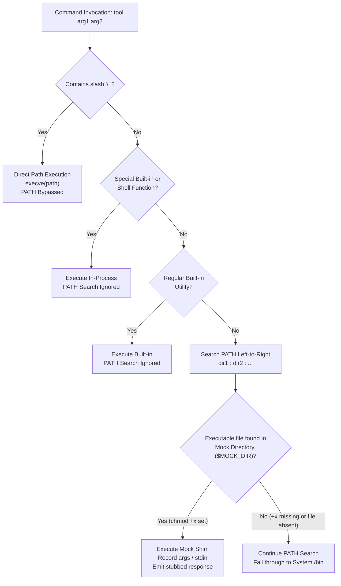

# Mocking Commands via PATH

> [!summary] Claim
> Prepending an isolated directory of executable shim scripts to `PATH` intercepts unqualified external command invocations across process boundaries without modifying script source code or relying on non-portable shell function export.

Part of [Testing and Static Analysis](README.md) in [Shell and Unix Engineering](../README.md).

## TL;DR

- Mechanism: The shell resolves unqualified command names by searching colon-separated directories in `PATH` from left to right, executing the first match whose executable bit is set.
- Rule: Always generate mocks inside a unique temporary directory created via `mktemp -d`, set `chmod +x`, and restore the original `PATH` in a guaranteed teardown hook.
- Trap: Hardcoded absolute paths (such as `/usr/bin/curl`) completely bypass `PATH` search and execute the host binary regardless of `PATH` order.
- Portability fact: Shell functions take precedence over `PATH` search in the current shell, but only `PATH` crosses `fork` and `execve` boundaries into child scripts and subshells portably.
- When not to use it: Do not use `PATH` mocking for built-in utilities (like `read` or `kill`, or `printf` in shells that build it in), for scripts invoking hardcoded absolute paths, or when deep system-call emulation requires dynamic linker interception or Linux namespaces.

## Mental model



When a shell encounters a simple command word, it first checks whether the name contains a slash character.
If a slash is present, the shell directly invokes the pathname via `execve(2)`, completely bypassing the `PATH` environment variable.
If the name contains no slash, the shell evaluates command precedence: special built-ins, current-shell functions, and intrinsic regular built-ins take priority over external disk searches.
When no built-in or function matches, the shell scans `PATH` components from left to right, probing each directory with `stat(2)` or `faccessat(2)`.
By prepending a dedicated mock directory containing executable scripts to `PATH`, test harnesses force the shell to resolve the mock shim before reaching production system directories.
If the mock shim lacks execute permissions, the kernel or shell skips the entry and continues traversing remaining directories until reaching system binaries.

## How it works

Command search in POSIX-compliant shells is governed by `(POSIX.1-2024 XCU 2.9.1.4)`.
When a command name contains no slashes, the shell follows a four-tier resolution ladder:
1. Special Built-in Utilities (such as `break`, `eval`, `exec`, `return`, `set`, `shift`, `trap`, `unset`).
2. Shell Functions defined in the execution environment of the current shell.
3. Intrinsic Utilities (`alias`, `bg`, `cd`, `command`, `fc`, `fg`, `getopts`, `hash`, `jobs`, `kill`, `read`, `type`, `ulimit`, `umask`, `unalias`, `wait`; `(POSIX.1-2024 XCU 1.7)`), which are never subject to a `PATH` search.
4. External file search across directories listed in the `PATH` environment variable.

Between tiers 1 and 2, the standard also lists names such as `declare`, `local`, and `let` whose results are unspecified.
Other built-ins such as `echo`, `printf`, `test`, `true`, and `pwd` are not intrinsic: POSIX.1-2024 lets a built-in run in tier 4 only when it is associated with the directory most recently tested during a successful `PATH` search.
In practice every shell in the matrix runs its own built-in `echo` and `printf` ahead of an earlier `PATH` mock, except that mksh R59 and posh 0.14.1 have no `printf` built-in, so a `printf` mock does run there (measured in the shell matrix; lab test 6).

The `PATH` environment variable is defined in `(POSIX.1-2024 XBD 8.3)` as an ordered, colon-separated list of directory pathnames.
The shell searches each directory in sequence from left to right.
An empty entry (represented by a leading colon, a trailing colon, or two adjacent colons `::`) designates the current working directory `.`.
The shell executes the first regular file matching the command name where access permissions permit execution.

At the operating system layer, command execution transitions through the `execve(2)` system call.
In the Linux kernel source `(fs/binfmt_script.c, load_script)`, when an executable file begins with the two magic bytes `#!` (ASCII 0x23 0x21), the kernel examines the first `BINPRM_BUF_SIZE` bytes (256, `include/uapi/linux/binfmts.h`) to parse the interpreter pathname and an optional single argument.
If an executable file lacks a binary format header and lacks a valid `#!` shebang line, the kernel returns the error `ENOEXEC` (Exec format error).
Per `(POSIX.1-2024 XSH 3 exec)`, when `execve` would fail with `ENOEXEC`, `execlp` and `execvp` shall execute a command interpreter (`sh`) with the script pathname as its first operand, and `(POSIX.1-2024 XCU 2.9.1.6)` requires the same fallback of the shell.
glibc's `execvp` implements it, but musl's does not: on Alpine a C program calling `execvp` on a shebang-less executable gets `ENOEXEC` (Exec format error) back, while the same program on Debian runs the script (measured in the shell matrix, as of 2026-11).

To avoid repeated filesystem traversal on every command invocation, production shells cache the resolved pathname of external commands in an internal hash table.
In GNU Bash `(bash-5.3 findcmd.c, search_for_command)`, the shell checks the command hash table before scanning disk directories.
However, `(POSIX.1-2024 XCU 2.9.1.4)` lets a shell remember a location only until `PATH` is the subject of an assignment, and requires a fresh search when a remembered location fails.
In Bash, variable assignment triggers `(bash-5.3 variables.c, sv_path)`, which calls `phash_flush()` to clear the command hash table.
In the Debian Almquist Shell `(dash src/exec.c, changepath)`, updating `PATH` invokes `clearcmdentry()` to flush cached pathnames.
In Zsh, external command resolution is maintained in the `cmdnamtab` hash table `(zsh hashtable.c)`, and setting `path` or `PATH` empties it `(zsh Src/params.c, arrfixenv)`.
POSIX also defines the `hash` utility `(POSIX.1-2024 XCU 4 hash)`: executing `hash -r` explicitly flushes all cached command locations across compliant shells.
posh 0.14.1 has no `hash` built-in at all, so portable test code writes `hash -r 2>/dev/null || PATH="$PATH"` (measured in the shell matrix).

The fundamental architectural advantage of `PATH` mocking over function mocking lies in process isolation and environment inheritance.
Environment variables are stored in the null-terminated `environ(7)` array and are copied across `fork(2)` and `execve(2)` boundaries.
When a test harness executes a child script (`./sync_service.sh` or `sh sync_service.sh`), child processes inherit the modified `PATH`.
In contrast, shell functions reside solely in the parent shell process's memory space.
Functions do not cross `execve(2)` boundaries into separate interpreter instances.
GNU Bash provides `export -f`, but this mechanism is non-standard, ignored by `dash`, `zsh`, `ksh93`, `mksh`, and POSIX `sh`, and historically introduced severe remote code execution vulnerabilities including Shellshock (CVE-2014-6271).
`PATH` manipulation remains the sole portable, specification-backed mechanism for cross-process command interception in Unix.

## Numbers and limits

The following bounds govern `PATH` resolution, process execution, and shim mocking across Unix systems:

| Parameter | Value / Limit | Operating System / Standard | Source / Citation |
| :--- | :--- | :--- | :--- |
| Shebang buffer (`BINPRM_BUF_SIZE`) | 256 bytes | Linux kernel 5.1+ (as of 2026-11; 128 in v5.0, raised by commit "exec: increase BINPRM_BUF_SIZE to 256", 2019-03-07, first present in v5.1-rc1) | Linux kernel `include/uapi/linux/binfmts.h` at tags v5.0 and v5.1-rc1 |
| Maximum pathname length (`PATH_MAX`) | 4096 bytes | Linux / glibc | `<linux/limits.h>`, POSIX minimum is 256; `getconf PATH_MAX /` on Debian 13 |
| Maximum pathname length (`PATH_MAX`) | 1024 bytes | macOS Darwin / FreeBSD | `<sys/syslimits.h>`; `getconf PATH_MAX /` on the macOS host |
| Single argument limit (`MAX_ARG_STRLEN`) | 131072 bytes (`PAGE_SIZE * 32` with 4 KiB pages) | Linux kernel | Linux kernel `include/uapi/linux/binfmts.h` |
| Total `execve` argument space (`ARG_MAX`) | 2097152 bytes (stack / 4) | Linux x86_64 / arm64 default (8 MiB stack limit) | `sysconf(_SC_ARG_MAX)`; `getconf ARG_MAX` on Debian 13 |
| Total `execve` argument space (`ARG_MAX`) | 1048576 bytes | macOS Darwin | `sysconf(_SC_ARG_MAX)`; `getconf ARG_MAX` on the macOS host |
| Command not found exit status | 127 | POSIX standard | `(POSIX.1-2024 XCU 2.8.2, 2.9.1.4)` |
| Command found but not executable exit status | 126 | POSIX standard | `(POSIX.1-2024 XCU 2.8.2)` |
| Signal termination exit status | 128 + N (256 + N in ksh93, 384 + N in yash) | Shell matrix measurement | Measured in vault shell matrix (as of 2026-11); POSIX requires only a value greater than 128 `(XCU 2.8.2)` |
| Bash command hash table initial size | 256 buckets (`FILENAME_HASH_BUCKETS`) | GNU Bash 5.3 | `(bash-5.3 hashcmd.h)` |
| External process mock latency overhead | about 3.5 ms per invocation (macOS host, bash 3.2); about 0.25 ms (Debian 13 container, bash 5.2) | Apple M3 Pro host and its Linux container | One 500-call loop of a `#!/bin/sh` shim, measured once (as of 2026-11) |
| In-process shell function latency | about 4.8 us per loop iteration (macOS host, bash 3.2, about 3.6 us of it loop overhead); about 1.9 us (Debian 13, bash 5.2) | Apple M3 Pro host and its Linux container | One 20000-call loop, measured once (as of 2026-11) |

## Portability

The table below contrasts command search, hash invalidation, and execution behavior across the shell matrix:

| Shell Family / Implementation | `PATH` Assignment Flushes Hash Cache | `hash -r` Supported | `ENOEXEC` Triggers Shell Fallback | Regular Builtins Override `PATH` | Exported Functions Cross `execve` | Empty Element in `PATH` Equals `.` |
| :--- | :--- | :--- | :--- | :--- | :--- | :--- |
| POSIX.1-2024 `sh` | Mandated (XCU 2.9.1.4) | Mandated (`hash` is intrinsic) | Mandated (XCU 2.9.1.6) | Intrinsic utilities only (XCU 1.7) | Not Specified (No) | Legacy feature (XBD 8.3) |
| GNU Bash 5.2.37 | Yes (`sv_path`) | Yes | Yes | Yes | Yes (`export -f` only) | Yes |
| macOS Bash 3.2.57 | Yes (`sv_path`) | Yes | Yes | Yes | Yes (`export -f` only) | Yes |
| Dash 0.5.12 | Yes (`changepath`) | Yes | Yes | Yes | No | Yes |
| Zsh 5.9 (native) | Yes (`arrfixenv` empties `cmdnamtab`) | Yes (also `rehash`) | Yes | Yes | No | Yes |
| Zsh 5.9 (`--emulate sh`) | Yes | Yes | Yes | Yes | No | Yes |
| BusyBox 1.37.0 `ash` | Yes | Yes | Yes | Yes | No | Yes |
| Ksh93u+m 1.0.10 | Yes (re-searches even without it) | Yes | Yes | Yes | No | Yes |
| Mksh R59 | Yes | Yes | Yes | Yes for `echo`; no `printf` built-in | No | Yes |
| Yash 2.58.1 | Yes | Yes | Yes | Yes | No | Yes |
| Posh 0.14.1 | Yes (re-searches even without it) | No (no `hash` built-in) | Yes | Yes for `echo`; no `printf` built-in | No | Yes |

The implementation rows were measured in the shell matrix (Debian 13, Alpine 3.22, and the macOS host, as of 2026-11); lab tests 4 to 7 prove the hashing, built-in, non-executable, and slash cases.
Every shell in the matrix runs its built-in `echo` ahead of a `PATH` mock, but only intrinsic utilities are guaranteed to beat `PATH` by POSIX.1-2024, and mksh and posh, lacking a `printf` built-in, run a `printf` mock.
When a command is invoked with an absolute or relative pathname containing a slash, every listed shell bypasses `PATH` search unconditionally.
When a candidate file in `PATH` lacks execute permission (`chmod -x`), every listed shell skips it and runs an executable candidate later in `PATH` (lab test 4).
When no executable candidate exists, bash (5.2.37 and macOS 3.2.57), zsh, BusyBox ash, mksh, ksh93u+m, posh, and Alpine's and macOS's dash report 126, whereas Debian's dash 0.5.12, yash 2.58.1, and macOS ksh93u+ 2012 report 127 (measured in the shell matrix).

## Worked example

The real test suite for this note is located in the companion [lab](../labs/14-mocking-commands-via-path/).
The production script under test, `sync_service.sh`, performs artifact synchronization by orchestrating `curl`, `date`, and `logger`:

```sh
#!/bin/sh
# sync_service.sh: synchronize artifacts to a remote endpoint.
# Relies on external utilities: curl, date, logger.
set -eu

ENDPOINT="${1:-}"
PAYLOAD="${2:-}"

if [ -z "$ENDPOINT" ]; then
  echo "sync_service: missing endpoint" >&2
  exit 1
fi

if [ -z "$PAYLOAD" ]; then
  echo "sync_service: missing payload" >&2
  exit 1
fi

timestamp=$(date +%s)

if ! response=$(curl -s -S --fail --data-binary "$PAYLOAD" "$ENDPOINT" 2>&1); then
  logger -p user.err "sync_service: upload failed to $ENDPOINT" 2>/dev/null || true
  echo "sync_service: upload failed: $response" >&2
  exit 2
fi

logger -p user.info "sync_service: upload succeeded at $timestamp" 2>/dev/null || true
printf 'SUCCESS: %s (timestamp: %s)\n' "$response" "$timestamp"
```

To test `sync_service.sh` without making external network calls or executing system logging daemons, the test suite constructs an isolated mock directory and prepends it to `PATH`.
The following test excerpt from `mock_test.bats` demonstrates stubbing responses and recording invocation arguments:

```bash
@test "successful command interception via PATH mock" {
  cat <<'EOF' >"$MOCK_DIR/curl"
#!/bin/sh
printf '{"status":"uploaded","id":42}\n'
exit 0
EOF
  chmod +x "$MOCK_DIR/curl"

  cat <<'EOF' >"$MOCK_DIR/date"
#!/bin/sh
printf '1700000000\n'
exit 0
EOF
  chmod +x "$MOCK_DIR/date"

  cat <<'EOF' >"$MOCK_DIR/logger"
#!/bin/sh
exit 0
EOF
  chmod +x "$MOCK_DIR/logger"

  # shellcheck disable=SC2030,SC2031 # PATH modification intentionally scoped to bats subshell test
  PATH="$MOCK_DIR:$PATH"
  run_lab "$SYNC_SERVICE" "https://api.example.com/v1/sync" "payload-bytes"
  [ "$status" -eq 0 ]
  [ "$output" = 'SUCCESS: {"status":"uploaded","id":42} (timestamp: 1700000000)' ]
}
```

Running the Bats test suite on the macOS host (`/bin/sh` is bash 3.2.57, as of 2026-11) yields the output below:

```text
1..7
ok 1 successful command interception via PATH mock
ok 2 mock spy records invocation arguments and environment
ok 3 mock simulates failure exit code and diagnostic stderr
ok 4 non-executable file in early PATH directory is skipped in search
ok 5 command hashing caches first lookup until hash table is cleared
ok 6 regular built-in utility takes precedence over PATH mock
ok 7 absolute pathname bypasses PATH search completely
```

## Pitfalls

> [!warning] Hardcoded Absolute Paths Bypass PATH Resolution
> Trigger: The script under test invokes utilities via explicit absolute paths such as `/usr/bin/curl` or `/bin/systemctl`.
> Symptom: Test execution ignores mock scripts in `$MOCK_DIR` and runs real host utilities, causing unexpected network mutations, production service restarts, or test failures on headless CI runners.
> Fix: Refactor production scripts to use unqualified command names with dependency-injection defaults, such as `: "${CURL:=curl}"` and calling `"$CURL"`, or isolate the execution environment inside a Linux mount namespace or container where `/usr/bin/curl` is bind-mounted to the mock binary.

> [!warning] Missing Executable Permission Causes Silent Passthrough
> Trigger: A mock script is written to `$MOCK_DIR/git` or `$MOCK_DIR/aws` via `cat <<EOF` but the author omits `chmod +x "$MOCK_DIR/git"`.
> Symptom: The shell's `PATH` traversal checks `access(path, X_OK)` on the mock file, encounters `EACCES`, skips the directory, and executes the real host binary located later in `PATH`.
> Fix: Always set executable permissions (`chmod +x "$mock_file"` or `install -m 0755`) immediately upon creating any mock script; assert in test setup that all files in `$MOCK_DIR` are executable.

> [!warning] Stale Hash Table Retains Prior Command Locations
> Trigger: A command is executed in the current shell, caching its filesystem location in the internal hash table, after which a mock script is created in a directory that was already in `PATH` without reassigning the `PATH` variable.
> Symptom: The shell continues invoking the cached binary path from its hash table, failing to execute the newly created mock script; bash, dash, zsh, BusyBox ash, mksh, and yash behave this way, while ksh93 and posh were measured re-searching and finding the new mock (lab test 5).
> Fix: Force command cache invalidation by calling `hash -r` or reassigning `PATH="$PATH"` after modifying filesystem directories (posh has only the second); see `(POSIX.1-2024 XCU 4 hash)`.

> [!warning] Leaking Mutated PATH Across Test Cases
> Trigger: A test modifies `PATH="$MOCK_DIR:$PATH"` in a shared environment without restoring the original value in an automated teardown block.
> Symptom: Subsequent tests execute stale mock scripts or fail completely because standard utilities like `sed`, `awk`, `grep`, or `rm` are shadowed or missing.
> Fix: Save `ORIG_PATH="$PATH"` in test setup and restore `PATH="$ORIG_PATH"` inside a `teardown()` function or shell trap (`trap 'PATH="$ORIG_PATH"; rm -rf "$MOCK_DIR"' EXIT INT TERM`).

> [!warning] Insecure Temporary Directories Enable PATH Hijacking (CWE-426 / CWE-377)
> Trigger: Creating a mock directory in a predictable world-writable path such as `/tmp/bin` or using relative paths like `PATH="./mocks:$PATH"`.
> Symptom: An unprivileged local attacker or malicious repository file can pre-create or drop arbitrary executables into the search path, executing arbitrary code with the privileges of the test runner.
> Fix: Always generate mock directories using `mktemp -d "${TMPDIR:-/tmp}/mock.XXXXXXXXXX"` which guarantees `0700` directory permissions, and never insert relative paths or empty colon-delimited components into `PATH`.

> [!warning] Argument and Stdin Corruption in Mock Spies
> Trigger: A mock spy script logs received arguments using `echo "$*"` or unquoted `echo "$@"`.
> Symptom: Arguments containing whitespace, embedded newlines, empty strings, or glob characters (`*`, `?`) are merged, word-split, or expanded into local filenames, corrupting the recorded call history.
> Fix: Record arguments using null-byte separation via `printf '%s\0' "$@" >> "$LOG_FILE"`, or serialize each invocation as a distinct JSON object or base64 stream.

## Security and robustness

Manipulating `PATH` interacts directly with operating system security boundaries and privileges.
Under the Common Weakness Enumeration, untrusted search paths are tracked as CWE-426.
If `PATH` contains an empty component (e.g., `PATH=":$PATH"`, `PATH="$PATH:"`, or `PATH="dir1::dir2"`), POSIX.1-2024 XBD 8.3 states that "a zero-length prefix is a legacy feature that indicates the current working directory", and every shell in the matrix honors it.
If a test suite executes inside an untrusted repository checkout, any command executed by the test can trigger a malicious script placed in the repository root.
A prominent real-world manifestation of search path vulnerabilities occurred in Canonical Snapcraft (CVE-2020-27348, published 2020-12-04), where snaps built by snapcraft before 4.4.4 could include the current directory in `LD_LIBRARY_PATH`, letting a malicious snap gain code execution within the context of another snap ([NVD](https://nvd.nist.gov/vuln/detail/CVE-2020-27348)).

When executing tests under elevated privileges, standard security mechanisms intentionally neutralize `PATH` modifications.
Upstream sudo disables `secure_path` by default, but many distributions set it in their shipped `/etc/sudoers` (typically `/usr/local/sbin:/usr/local/bin:/usr/sbin:/usr/bin:/sbin:/bin`) ([sudoers(5)](https://www.sudo.ws/docs/man/sudoers.man/)).
When it is set, `sudo` uses its value in place of the user's `PATH` to find the command, which keeps unprivileged users from executing malicious shims as root; without it, `env_reset` still keeps the caller's `PATH`.
Consequently, tests running commands via `sudo command` cannot be mocked via standard `PATH` manipulation unless `sudo` is itself replaced with a mock shim or the test user is in the group named by `exempt_group`, which `secure_path` does not affect.

Hermetic test design requires that mock directories be strictly isolated from concurrent processes.
In parallel test runners (such as `bats -j` or Python `pytest-xdist`), each concurrent worker must construct its own independent directory via `mktemp -d`.
Sharing a static mock directory across parallel workers introduces severe filesystem race conditions where one worker's mock script or call log overwrites another's.
Furthermore, all mock scripts should be created with `0700` permissions (`umask 077`), ensuring that no other local user on a shared CI agent can read recorded secrets or inject malicious payloads into the mock pipeline.

## The principal's view

At staff and principal engineering levels, mocking strategy is an architectural decision balancing fidelity, execution speed, and test maintenance cost.
`PATH` mocking is the industry-standard boundary for integration testing because it treats the script under test as a black box.
It requires zero modifications to production shell code, respects `fork` and `execve` process boundaries, and works across every shell in the matrix, within the built-in and hashing differences in Portability.

However, principal engineers enforce clear boundaries around where `PATH` mocking should and should not be used:
- Internal Unit Tests: When testing isolated functions inside a library script that will be sourced (`. library.sh`), in-process function overriding (`real_cmd() { ...; }`) is faster and avoids process invocation overhead.
- External Integration Tests: When testing executable CLI scripts (`./deploy.sh`), `PATH` mocking is mandatory because in-process functions cannot cross `execve` boundaries into separate interpreters.
- Complex Subsystems: When scripts interact with complex stateful services (such as AWS APIs, Docker daemons, or database engines), hand-rolled shell mock shims quickly degrade into fragile, hundreds-of-lines pseudo-interpreters.
When mock scripts start requiring persistent state engines, JSON parsers, or complex HTTP routing, principal engineers halt shell mocking and transition the testing architecture to containerized local emulators (such as LocalStack for AWS, MinIO for S3, or MockServer for REST APIs), or migrate the underlying script to Python or Go where robust mocking libraries and type-safe interfaces exist.

## Interview questions

> [!question] L5: How does the shell resolve an unqualified command name, and how does prepending a directory to `PATH` allow testing?
>
> > [!success]- Answer
> > The shell searches directories listed in `PATH` from left to right for an executable regular file matching the command name.
> > Prepending a temporary directory places mock executables earlier in the search order than system binaries.
> > The shell executes the mock shim on the first match, allowing tests to stub responses and record arguments without modifying script source code.
> >
> > Follow-up: What happens if the mock script lacks executable permissions?

> [!question] L5: Why does a shell function override a `PATH` mock in the current shell, but fail to intercept commands in an external script?
>
> > [!success]- Answer
> > POSIX command search precedence checks current-shell functions before scanning directories in `PATH`.
> > In the current shell process, a function of the same name intercepts unqualified command calls directly.
> > However, functions reside only in the parent shell's memory space and do not cross `fork` and `execve` boundaries when an external script is executed.
> > Environment variables like `PATH` are preserved in the process environment table across `execve`, making `PATH` mocking effective for child scripts.
> >
> > Follow-up: Why is Bash's `export -f` not considered a portable solution for child process function interception?

> [!question] L6: Predict the output: What does the second invocation of `tool` output in an interactive shell when an executable `/bin/dir1/tool` printing `SHADOW` is created after a prior invocation executed `/bin/dir2/tool` printing `FIRST` under `PATH="/bin/dir1:/bin/dir2:$PATH"` without reassigning `PATH`?
>
> > [!success]- Answer
> > The second invocation outputs `FIRST`.
> > The shell caches the resolved location of `tool` in its internal command hash table during the first lookup.
> > Creating a new file in an existing `PATH` directory does not automatically flush the hash table if `PATH` is not reassigned.
> > The shell uses the cached pointer to `/bin/dir2/tool` until `hash -r` is executed or `PATH` is reassigned.
> > This holds in bash, dash, zsh, BusyBox ash, mksh, and yash; ksh93 and posh were measured printing `SHADOW` because they search again (lab test 5).
> >
> > Follow-up: How do subshells created via command substitution `$(tool)` affect parent shell hash table state?

> [!question] L6: Debug this script: Identify three distinct root causes when a Bats test stubs `curl` by creating `$MOCK_DIR/curl` and setting `export PATH="$MOCK_DIR:$PATH"`, yet the script under test continues executing the real host binary.
>
> > [!success]- Answer
> > First, the script under test may invoke `curl` via a hardcoded absolute pathname like `/usr/bin/curl`, bypassing `PATH` search entirely.
> > Second, the mock file `$MOCK_DIR/curl` may lack the executable bit (`chmod +x`), causing the shell to skip it during `PATH` traversal.
> > Third, the script under test or an intermediate wrapper may execute `sudo curl` or reset `PATH` internally via `export PATH=/usr/bin:/bin`.
> >
> > Follow-up: How can production shell scripts be designed to remain mockable without compromising security?

> [!question] L6: What occurs at the kernel and libc levels when a mock script lacks a `#!` shebang line, and how do POSIX shells handle it?
>
> > [!success]- Answer
> > The kernel's `execve(2)` inspects the binary format header and returns `ENOEXEC` because neither ELF magic bytes nor `#!` are present.
> > POSIX shells and glibc's `execvp(3)` catch `ENOEXEC` and fall back to executing `sh` with the script passed as an operand; musl's `execvp` does not, and returns `ENOEXEC` (measured on Alpine).
> > The script executes successfully in standard shell contexts, but direct invocations from C or Go programs using bare `execve` fail with errno `ENOEXEC` (Exec format error).
> >
> > Follow-up: What is `BINPRM_BUF_SIZE` in the Linux kernel and what failure mode occurs if a shebang line exceeds it?

> [!question] L7: How does a mock spy script record arbitrary argument lists and standard input without risking argument splitting, character corruption, or filesystem blocking?
>
> > [!success]- Answer
> > Arguments must be serialized using null-byte delimiters via `printf '%s\0' "$@"` into a dedicated log file to prevent corruption from spaces, newlines, or glob patterns.
> > Standard input should be drained asynchronously or redirected to a temporary payload file using `cat > "$MOCK_DIR/stdin.$$.log"`.
> > For interactive or streaming utilities, mocks must avoid unbuffered FIFOs without guaranteed reader processes to prevent permanent process blocking.
> >
> > Follow-up: How would you design a mock spy that supports pass-through invocation of the real underlying system utility?

> [!question] L7: Explain the security implications of CWE-426 in the context of build and test harnesses, referencing CVE-2020-27348 and sudo `secure_path`.
>
> > [!success]- Answer
> > CWE-426 describes untrusted search path vulnerabilities where programs execute binaries or load libraries from untrusted locations.
> > In POSIX `PATH` resolution, an empty string element or trailing colon treats the current working directory as part of the search path.
> > CVE-2020-27348 in Snapcraft demonstrated how a current-directory entry in `LD_LIBRARY_PATH` let a malicious snap load its own shared libraries into another snap.
> > Sudo's `secure_path`, off upstream by default but set by many distributions, replaces the caller-controlled `PATH` to prevent unprivileged users from executing malicious shims with root privileges.
> >
> > Follow-up: How do Linux user namespaces provide a safer isolation boundary than `PATH` manipulation for multi-tenant CI workers?

> [!question] L7: Compare `PATH` mocking against `LD_PRELOAD` interception and Linux mount namespaces (`unshare -m`) across fidelity, isolation, and overhead.
>
> > [!success]- Answer
> > `PATH` mocking requires no root privileges and works across all architectures, but cannot intercept hardcoded absolute paths or builtins and incurs fork-exec process overhead.
> > `LD_PRELOAD` intercepts C library calls (`open`, `connect`, `execve`) even with hardcoded paths, but fails on statically linked binaries (Go, Rust with musl), and on macOS its `DYLD_INSERT_LIBRARIES` counterpart is stripped for SIP-protected binaries.
> > Mount namespaces provide complete fidelity by bind-mounting fake binaries over `/usr/bin/curl`, intercepting absolute paths and static binaries, but require Linux kernel namespace privileges.
> >
> > Follow-up: In a large monorepo with 50,000 shell integration tests, why might `PATH` mocking become a CI bottleneck compared to containerized mocks?

## Related

Prerequisites: [[shUnit2]]

Next: [[Golden-Output-Tests]]

See also: [[bats-core]], [[bats-Helpers-and-Assertions]], [[ShellSpec]], [[Characterization-Tests-for-Legacy-Scripts]], [[Cross-Shell-CI-Matrices]]

## Further reading

- [POSIX.1-2024 Shell Command Language (Section 2.9.1.4)](https://pubs.opengroup.org/onlinepubs/9799919799/utilities/V3_chap02.html) - Official standard specifying command search precedence, slash path handling, and exit status rules.
- [POSIX.1-2024 hash Utility Specification](https://pubs.opengroup.org/onlinepubs/9799919799/utilities/hash.html) - Formal specification of shell command hashing and the `-r` cache invalidation mechanism.
- [POSIX.1-2024 Environment Variables (Section 8.3)](https://pubs.opengroup.org/onlinepubs/9799919799/basedefs/V1_chap08.html) - Definitive rules for `PATH` syntax, colon delimiters, and empty component interpretation.
- [GNU Bash Source Code: findcmd.c](https://git.savannah.gnu.org/cgit/bash.git/tree/findcmd.c) - Implementation of command lookup, filesystem probing, and hash table caching in GNU Bash.
- [Linux Kernel Source: fs/binfmt_script.c](https://git.kernel.org/pub/scm/linux/kernel/git/torvalds/linux.git/tree/fs/binfmt_script.c) - Kernel binary handler parsing `#!` shebang lines and handling `ENOEXEC` conditions.
- [GNU C Library: posix/execvpe.c](https://sourceware.org/git/?p=glibc.git;a=blob;f=posix/execvpe.c) - Implementation of `PATH` walking and `ENOEXEC` shell script fallback execution in glibc.
- [CWE-426: Untrusted Search Path](https://cwe.mitre.org/data/definitions/426.html) - MITRE vulnerability classification detailing the security risks of untrusted directory elements in search paths.
- [CVE-2014-6271 (Shellshock) Vulnerability Record](https://nvd.nist.gov/vuln/detail/CVE-2014-6271) - Postmortem on the failure mode of exporting shell functions across process boundaries via environment variables.
