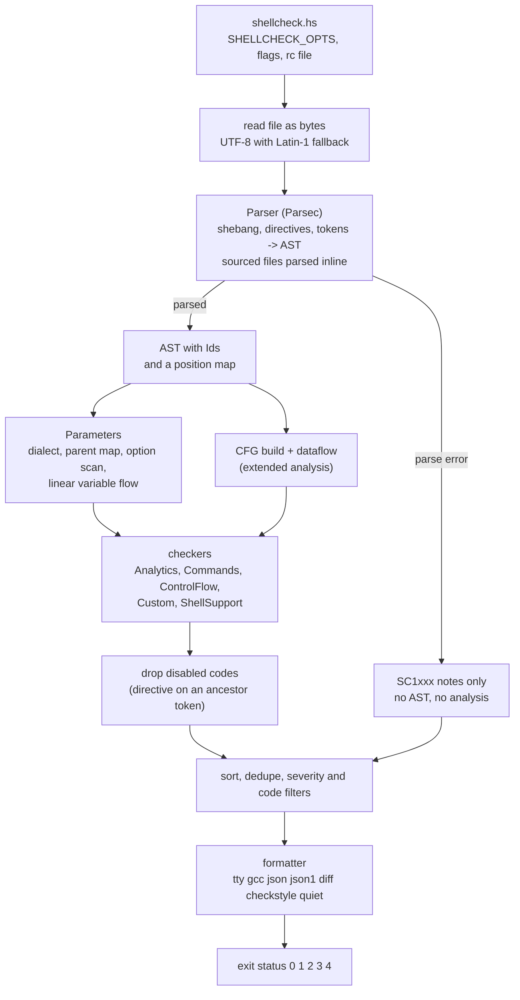

# ShellCheck Internals

> [!summary] Claim
> ShellCheck is a Parsec parser that builds a position-tagged syntax tree under one named dialect, followed by a tree walk and a control-flow-graph dataflow pass, so every finding is a statement about its model of your script and is wrong exactly where that model differs from the shell that really runs it.

Part of [Testing and Static Analysis](README.md) in [Shell and Unix Engineering](../README.md).

## TL;DR

- Mechanism: `shellcheck.hs` reads the file and its rc file, `ShellCheck.Parser` turns the text into an AST (or into parse errors and nothing else), and `ShellCheck.Analyzer` runs node checks, whole-script checks, command-name checks, and dialect-gated checks over it, with `ShellCheck.CFG` and `ShellCheck.CFGAnalysis` adding dataflow since 0.9.0.
- Rule: pin the ShellCheck version, give every script a shebang or a `shell=` directive that names its real dialect, gate CI on exit status 0, and treat exit statuses 2, 3, and 4 as tool failures rather than findings.
- Trap: a directive covers one AND-OR list (so `a; b` suppresses only `a`), a literal without blanks or glob characters is "clean" even when `IFS=:` will split it, and one syntax error silences every non-parser check.
- Portability fact: ShellCheck models five dialects (`sh`, `bash`, `dash`, `ksh`, `busybox sh`), refuses zsh with SC1071, and treats mksh, yash, and posh shebangs as unrecognized (SC1008) while analyzing them as bash.
- When not to use it: for zsh or fish, for judging runtime behavior (it never runs anything), as the only test of a script, or on generated files of thousands of lines without `extended-analysis=false`.

## Mental model



The driver reads the script and its configuration, and the parser decides the dialect and either returns a complete tree or only parse errors, because a failed parse sets the tree to nothing and the analyzer is skipped.
With a tree in hand, the analyzer derives `Parameters` once (dialect, a child-to-parent map, whole-file option scans, a linear variable-flow list) and optionally builds the control-flow graph and runs dataflow on it, then every checker walks the tree and emits comments keyed to token ids.
A final pass drops comments whose token has an ancestor carrying a matching `disable` directive, the checker sorts and deduplicates what is left, and a formatter turns positions into text, a diff, or JSON, while the exit status summarizes the whole run.

## How it works

### The driver and the system interface

`main` builds the argument vector from the words of `SHELLCHECK_OPTS` (split on runs of spaces) followed by the real command line, so the variable silently applies to every invocation in a session (ShellCheck `shellcheck.hs`, `getEnvArgs` and `main`).
The pure core is parameterized over a `SystemInterface` with three operations, `siReadFile`, `siFindSource`, and `siGetConfig` (`Interface.hs`), which is why the parser and analyzer never touch the filesystem themselves and the test suite can substitute `mockedSystemInterface`.
The IO implementation opens each file with `openBinaryFile`, checks whether the handle is seekable to decide whether the contents must be cached (a pipe or stdin cannot be re-read), reads strictly, and decodes UTF-8 with an ISO-8859-1 fallback for invalid sequences (`shellcheck.hs`, `inputFile` and `decodeString`).
A sourced file is readable only when `-x` is on (or the rc file says `external-sources=true`) or when its canonical path equals one of the files named on the command line, and `/dev/null` is always allowed (`shellcheck.hs`, `allowable`; `Parser.hs`, `readSource`).
Rc discovery is `getConfigPaths`: for the script's directory and every parent, `.shellcheckrc` then `shellcheckrc`, then `~/.shellcheckrc` and `$XDG_CONFIG_HOME/shellcheckrc`, and `findConfig` takes the first file that exists, so there is exactly one rc file and no merging.
The result is cached per directory, `--norc` skips the search, and `--rcfile` replaces it (`shellcheck.hs`, `getRcConfig`).
On git master after v0.11.0 (as of 2026-11), `.editorconfig` sections with `shellcheck.*` keys are also read and merged with the rc file, the rc file winning, and `--files-from` reads the file list from a file (`CHANGELOG.md` "Git" section, `shellcheck.1.md`).

Each file is checked independently and the per-file statuses are combined with `max` over the ordering `NoProblems < SomeProblems < SupportFailure < SyntaxFailure < RuntimeException`, then mapped to exit codes 0, 1, 4, 3, and 2 (`shellcheck.hs`, `statusToCode`).
Because the combine is `max` over that ordering, an unreadable file (exit 2) outranks findings (exit 1) in a multi-file run.
Flag errors are thrown before any file is read, which is why a bad flag exits 3 and a bad value (`-f nope`, `-s zsh`, `-S bogus`) exits 4.
The lab asserts all of these statuses against the real binary.

### Choosing the dialect

The dialect is one of five values, `Sh`, `Bash`, `Dash`, `BusyboxSh`, and `Ksh` (`Interface.hs`, `Shell`), and there is no zsh constructor.
The first match wins (`AnalyzerLib.hs`, `determineShell`; `Checker.hs`, `shellFromFilename`; `shellcheck.1.md` "-s"):

1. the `-s` flag, which overrides everything;
2. a `shell=` directive in the file or in the rc file;
3. the shebang, reduced to an interpreter name by `executableFromShebang` and mapped by `shellForExecutable` (`Data.hs`);
4. the file extension `.ksh`, `.bash`, `.bats`, `.dash`, or `.envrc` (a plain `.sh` deliberately does not count);
5. `Bash`, with SC2148 as an error when there was neither a shebang nor a directive.

`shellForExecutable` maps `sh` to Sh, `bash` and `bats` to Bash, `dash` and `ash` to Dash, `ksh`, `ksh88`, `ksh93`, and `oksh` to Ksh, and `busybox`, `busybox sh`, and `busybox ash` to BusyboxSh (`Data.hs`).
A second, stricter test runs at parse time (`Parser.hs`, `readScriptFile`): a shebang whose interpreter starts with `sh`, `ash`, `dash`, `busybox sh`, `bash`, `bats`, `ksh`, or `oksh` is good, one that starts with `awk`, `csh`, `expect`, `fish`, `perl`, `python`, `python3`, `ruby`, `tcsh`, or `zsh` is bad (SC1071 as an error, and the rest of the file is skipped), and anything else raises SC1008 and carries on.
The two lists disagree on purpose or by accident in two places the lab pins down: `#!/bin/busybox ash` is accepted by the dialect table but fails the parse-time test with SC1008, and `#!/bin/ash` is accepted but draws SC2187.
For a shebang such as `#!/bin/mksh`, SC1008 is raised, the dialect lookup finds nothing, and the analysis proceeds as Bash, so the findings describe a dialect the script does not use.

ShellCheck parses the shebang itself because the kernel's rule is different.
On Linux the entire string after the interpreter name is passed as one argument, the shebang line is limited to 255 characters since Linux 5.1 (127 before), and other systems split optional arguments differently (execve(2) "Interpreter scripts" and VERSIONS).
`executableFromShebang` therefore splits on words, understands `env` with `-S` and `--split-string`, skips `NAME=value` words, and strips directories, so it can name the interpreter for `#!/usr/bin/env -S bash -x`, a line that works on Linux only because `env -S` itself splits the single string the kernel passes it.

The dialect then does three things.
It gates whole checkers: the bashism checker runs only for `Sh`, `Dash`, and `BusyboxSh` and produces the SC3xxx codes, and the decimal-in-arithmetic check runs for those three plus `Bash` (`Checks/ShellSupport.hs`, `ForShell`).
It sets defaults that change what other checks conclude: `Ksh` assumes the last pipeline stage runs in the current shell, `Dash`, `BusyboxSh`, and `Sh` assume the `inherit_errexit` behavior (command substitutions inherit `errexit`), and only `Bash` and `Ksh` support arrays (`AnalyzerLib.hs`, `makeParameters` and `supportsArrays`).
And it changes severity and wording, so `[[ -n $1 ]]` is a warning (SC3010) under `sh` and an error under `dash`.

Four facts about the model are derived by scanning the whole file, not by following control flow (`AnalyzerLib.hs`, `isOptionSet'`, `containsAllexport`, `isOptionSet`):
`set -e`, `set -f`, `set -a`, and `set -o pipefail`, and for Bash `shopt -s lastpipe`, `shopt -s inherit_errexit`, and `shopt -s execfail`, count if they appear anywhere, in any branch, before or after the code they affect.
The lab shows `shopt -s lastpipe` after the pipeline it was meant to affect still silences SC2030 and SC2031.

### The parser

`ShellCheck.Parser` is a hand-written recursive-descent parser on Parsec, not a generated one: its type is `ParsecT String UserState (SCBase m)` over a reader-and-state monad, and it parses `String` rather than a token stream (`Parser.hs`, `SCParser`).
It does not follow the POSIX grammar productions mechanically (POSIX.1-2024 XCU 2.10.2); it accepts the union of the POSIX, Bash, and Ksh constructs it understands and attaches a recovery message (the SC1xxx codes) to many near-misses such as `//` used as a comment (SC1127), `elsif` (SC1131), or typographic quotes.
Every node is an `OuterToken Id (InnerToken Token)`, where `InnerToken` derives `Functor`, `Foldable`, and `Traversable`, so one generic `analyze` gives pre-order, post-order, and rewrite traversals over the whole tree (`AST.hs`).
Positions live outside the tree in a `Map Id (Position, Position)`, and a finding refers to a token id and is turned into a line and column only when it is formatted (`Checker.hs`, `tokenToPosition`).
A simple command is built as `T_Redirecting redirects (T_SimpleCommand assignments words)`, which is the AST form of POSIX's separation of assignments, redirections, and words in XCU 2.9.1.1 (`Parser.hs`, `readSimpleCommand`, `makeSimpleCommand`).

Four design consequences matter when a finding looks wrong.

- **Static word recognition.** POSIX performs alias substitution during token recognition, before the grammar sees the token (XCU 2.3.1), and a static parser cannot replay that, so ShellCheck does not expand aliases and instead warns when an alias is defined and used in the same parsing unit (SC2262, `Analytics.hs`, `checkAliasUsedInSameParsingUnit`).
- **Declaration utilities by name.** POSIX.1-2024 lets an implementation recognize declaration utilities by lexical analysis only (XCU 2.9.1.1), and ShellCheck does exactly that with a fixed list (`declare`, `export`, `local`, `readonly`, `typeset`, plus special parsing for `let`, `eval`, and `time`), so a wrapper that forwards its arguments to `export` is not recognized (`Parser.hs`, `readSimpleCommand`).
- **Two-pass array indices.** Whether `a[$i]=1` is arithmetic or a string key depends on a `declare -A` that may appear later, so the first pass stores `T_UnparsedIndex` and `reparseIndices` reparses it once the associative arrays are known (`Parser.hs`, `reparseIndices`).
- **Here-documents are deferred.** A `<<` registers a pending body, the body is read when the parser consumes the next newline, and `reattachHereDocs` attaches it to the right token afterwards (`Parser.hs`, `linefeed`, `readPendingHereDocs`, `reattachHereDocs`).

When a parse fails, `parseShell` returns no tree: the comments are the parse notes for the enclosing contexts, with each failed construct reported twice (once as "Couldn't parse this ..." at its start and once as "The mentioned syntax error was in this ...") plus the error itself (`Parser.hs`, `parseShell`, `notesForContext`).
`Checker.checkScript` then runs the analyzer only `maybe [] ... prRoot`, so a syntax error gives the SC1xxx codes and nothing else, and the lab shows the SC2086 on an earlier line appearing only after the missing `fi` is added.
Silencing a parse error with `disable` is cosmetic, because the parse still stops at that point (ShellCheck wiki "Directive").

### Directives and their scope

Directives are comments of the form `# shellcheck key=value ...` and are parsed as part of the grammar, not by a separate comment scanner (`Parser.hs`, `readAnnotation`, `readAnnotationWithoutPrefix`).
The recognized keys are `disable`, `enable`, `source`, `source-path`, `shell`, `external-sources`, and `extended-analysis`, an unknown key is SC1107, values may be quoted since 0.9.0, and a trailing `# reason` comment after the directive is accepted.
A `disable` value is a comma-separated list of codes, ranges, or `all`; a range `SC2000-SC3000` is half-open, so it excludes SC3000, and `all` is the range 0 to 1,000,000 (`Parser.hs`, `readRange`, `readAll`; `shellcheck.1.md` "disable").
`external-sources=true` inside a script is rejected (SC1144), because letting an untrusted file turn on file reads would defeat the default, so it can only come from the rc file.

Scope is decided by where the directive is read:

- Directives between the shebang and the first command are collected by `readScriptFile` and wrap the whole script, so a directive in that position is file-wide even when it is followed by other commands (`Parser.hs`, `readScriptFile`).
- Every other directive is read by `readAndOr`, so it wraps exactly one AND-OR list, which is a pipeline chain joined by `&&` and `||` and ending at `;`, `&`, or a newline (`Parser.hs`, `readAndOr`; POSIX.1-2024 XCU 2.9.3).
  `# shellcheck disable=SC2086` before `echo $1 && echo $2` covers both commands, and before `echo $1; echo $2` it covers only the first, which is the open ShellCheck issue 3448 (opened 2026-04-14) and is noted on the wiki "Ignore" page.
- A directive in front of a compound command such as `if`, a loop, a function, or a brace group covers everything inside it, and a directive in front of an `elif`, `else`, or a `case` branch is the parse error SC1123 (`Parser.hs`, `readAndOr`).
- Suppression happens after analysis: `filterByAnnotation` walks from the token a comment is attached to up through its ancestors and drops the comment if any ancestor is a `T_Annotation` whose `DisableComment` range contains the code (`AnalyzerLib.hs`, `filterByAnnotation`; `ASTLib.hs`, `isAnnotationIgnoringCode`).

The consequence of the last point is that a directive suppresses a finding by its position in the tree, not by its line, so reformatting a script can change which findings a directive hides.

### Following `source`

ShellCheck follows `source` and `.` at parse time and parses the sourced text inline as a `T_SourceCommand`, so the sourced assignments and functions are part of the tree that every later check sees (`Parser.hs`, `readSource`).
The file name comes from a `source=` directive if one is in effect, then from a literal argument, then from the argument with one leading dynamic word stripped (`"$dir/lib.sh"` becomes `./lib.sh`), and a name that starts with `~/` is refused (`Parser.hs`, `readSource`, `stripDynamicPrefix`).
A non-constant name gives SC1090, a file that cannot be read gives SC1091 with the reason, a recursion gives SC1093, a sourced file that fails to parse gives SC1094, and the parser stops at 100 nested `source` frames with SC1092 (`Parser.hs`, `readSource`, `shouldFollow`).
Resolution tries the name as given, relative to ShellCheck's working directory, and then the name under each `-P` path and `source-path` directive, where the special first component `SCRIPTDIR` means the directory of the script being checked (`shellcheck.hs`, `findSourceFile`).
Warnings located in sourced files are dropped unless `-a` is given, because `filterByAnnotation` treats a `T_Include` ancestor as an ignore unless `asCheckSourced` is set.

### The analysis driver

`analyzeScript` builds one `Parameters` record and runs five checker families, concatenated with `mconcat`, inside a `Reader`-`Writer`-`State` monad whose writer collects `TokenComment` values (`Analyzer.hs`, `AnalyzerLib.hs`, `runChecker`).
The families are the node and whole-script checks in `Analytics.hs`, the command checks in `Checks/Commands.hs`, the control-flow checks in `Checks/ControlFlow.hs` (scaffolding for a work in progress by its own header, with an empty list of effect checks as of 2026-11), `Checks/Custom.hs`, and the dialect-gated checks in `Checks/ShellSupport.hs`.

- **Node checks.** `nodeChecks` is a list of 103 functions that all run during a single traversal of the tree and emit comments for the tokens they match (`Analytics.hs`, `nodeChecks`, counted 2026-11-21).
- **Whole-script checks.** `treeChecks` holds the node-check bundle plus 14 checks that look at the entire tree, such as unused assignments (SC2034), unassigned references (SC2154), use before definition (SC2218), and the subshell-modification pair (SC2030 and SC2031).
- **Command checks.** `commandChecks` is a map keyed by command name, and a token is dispatched by `getLiteralString` of its first word: names containing a slash are looked up by basename, `builtin` unwraps to the builtin it names, and anything else is looked up by exact name and by basename (`Checks/Commands.hs`, `checkCommand`).
  A command whose name is not a literal, such as `"$rm" -rf "$dir/"*`, is never dispatched, and neither `sudo rm -rf "$d/"*` nor `command rm -rf "$d/"*` reached SC2115 in the 0.11.0 run I made for this note, while `/bin/rm -rf "$d/"*` did.
- **Dialect checks.** `ForShell` lists in `Checks/ShellSupport.hs` select the SC3xxx portability warnings.
- **Optional checks.** `optionalChecks` are disabled by default and switched on by name through `-o`, an `enable=` directive, or the rc file; 0.11.0 lists 11, and master adds `require-double-equals`, so 12 (`shellcheck --list-optional`; `Analytics.hs`, `optionalTreeChecks`, which holds 11 on master, plus `useless-use-of-cat` in `Checks/Commands.hs`, `optionalCommandChecks`).

The comment sort key is file, line, column, severity, code, and message, and duplicates are removed with `nub` (`Checker.hs`, `checkScript`).
Severities order as error, warning, info, style, `-S` keeps everything at or above the named level, and `-i` overrides `-e` when both name a code (`Checker.hs`, `shouldInclude`; `shellcheck.1.md`).

### The legacy linear variable flow

Before the dataflow engine, ShellCheck computed one linear list of `Assignment` and `Reference` events with explicit scope markers while walking the tree (`AnalyzerLib.hs`, `getVariableFlow`, `leadType`).
The scopes it opens are command substitution, backticks, `&`, `( ... )`, a stage of a multi-command pipeline (every stage, or every stage but the last when `lastpipe` is in effect), coproc, a bats test, and a function body.
Checks such as SC2034 (unused assignment), SC2154 (referenced but not assigned), and SC2030 and SC2031 (modification in a subshell) still use this list (`Analytics.hs`, `checkUnusedAssignments`, `checkUnassignedReferences`, `subshellAssignmentCheck`).
The list is a straight walk in tree order, so it has no notion of a branch, a loop, or a call, and the source comment calls it a "linear (bad) analysis of data flow" and a `TODO` to replace with a proper graph.

### The control-flow graph and dataflow

Since 0.9.0 the checks that need to know what a variable may hold at a point use a real control-flow graph (`CHANGELOG.md` v0.9.0: "ShellCheck now has a Data Flow Analysis engine ... Existing checks will gradually start using it, which may cause them to trigger differently (but more accurately)").
`ShellCheck.CFG.buildGraph` turns the tree into a graph of `CFNode` values connected by `CFEFlow`, `CFEErrExit`, `CFEExit`, and `CFEFalseFlow` edges, where a node applies effects such as `CFWriteVariable`, `CFReadVariable`, or `CFDefineFunction`, executes a command by literal name, or sets `$?` or `$!` (`CFG.hs`).
Functions and subshells are disjoint subgraphs rather than inlined bodies, and a call is resolved by name at analysis time (`CFG.hs`, `CFExecuteSubshell`, `CFDefineFunction`).

`ShellCheck.CFGAnalysis.analyzeControlFlow` is a classic iterative worklist analysis in the `ST` monad (`CFGAnalysis.hs`, `dataflow`).
It keeps a pending set of nodes, always takes the lowest-numbered one, merges the output states of its predecessors, applies the node's transfer function, and re-queues the successors if the output changed, stopping when the set is empty.
Shell scripts communicate through globals, so each function invocation is analyzed as its own dataflow problem with a per-node cache of results, and functions that were defined but never invoked are analyzed afterwards as stragglers so dead code still gets findings (`CFGAnalysis.hs`, `analyzeControlFlow`).
Three constants bound the search: 1,000,000 iterations before ShellCheck aborts with "DFA did not reach fix point" and a request to report a bug, a switch that disables the cache when 10,000 iterations are left because past bugs made cached states oscillate, and `cacheEntries` = 10, which bounds the cache because each insert keeps the new result plus the 10 before it, so a node holds at most 11 (`CFGAnalysis.hs`, `iterationCount`, `fallbackThreshold`, `cacheEntries`, and the `take cacheEntries old` insert).

The state per variable carries a literal value if known, a `SpaceStatus` of `SpaceStatusEmpty`, `SpaceStatusClean`, or `SpaceStatusDirty`, a `NumericalStatus`, and a set of possible property sets (integer, readonly, exported, and so on) (`CFGAnalysis.hs`).
The classification of a literal is the heart of the SC2086 decision, and it is only a character test: a value is clean when it is non-empty and contains none of space, tab, newline, `*`, `?`, or `[` (`CFGAnalysis.hs`, `literalToSpaceStatus`).
SC2086 is emitted when a variable reference that would be split is not provably clean or integer at that point, and the optional SC2248 ("prefer double quoting even when variables don't contain special characters") is the same check run in the opposite direction on the clean ones (`Analytics.hs`, `checkSpacefulnessCfg'`).
Extended analysis defaults to on, `--extended-analysis=false` or a directive turns it off, and with it off every reference looks possibly dirty, so the same clean script gains SC2086 findings (`AnalyzerLib.hs`, `makeParameters`; lab test "dataflow analysis treats a literal ...").

Because the character test does not look at `IFS`, `v=a:b; IFS=:; set -- $v` produces no SC2086 and the shell then splits `v` into two fields.
The probe `probe.sh ifs-split` in the lab prints that field count under the shell being tested, and native zsh prints 1 because it does not split unquoted parameters at all.

### Fixes and output

A finding may carry a `Fix`, a list of `Replacement` values with a start and end position, a replacement string, a precedence, and whether to insert before or after the region (`Interface.hs`; `Fixer.hs`).
The fixer flattens the file with `multiToSingleLine`, applies replacements with the highest precedence first, and keeps a prefix-sum tree (a Fenwick-style structure) so that each edit's length change shifts the positions of the later ones (`Fixer.hs`, `applyFix`, `applyReplacements2`, `PSTree`).
Internal columns use a tab stop of 8, and `makeNonVirtual` realigns them to one column per character for the formatters that want that (`Formatter/Format.hs`, `makeNonVirtual`).
The `json1` format counts a tab as one column and the legacy `json` format keeps the tab stop of 8, and the lab shows 7 against 14 for a script indented with one tab (`shellcheck.1.md` "FORMATS").
The `diff` format prints the fixes as a unified diff for `git apply` or `patch -p1`, `gcc` prints `file:line:column: severity: message [SCnnnn]`, `checkstyle` prints XML, and `quiet` stops at the first finding (`shellcheck.hs`, `formats`; `shellcheck.1.md`).
The `tty` format prints the source excerpt, colors when stdout is a terminal that is not `dumb`, and links `-W` wiki pages, three by default (`Formatter/Format.hs`, `shouldOutputColor`; `shellcheck.1.md` "-W").

### How ShellCheck tests itself

The test suite lives in the source as `prop_` functions placed beside the code they check, collected by Template Haskell (`quickCheckAll`) into each module's `runTests`, and `striptests` removes them to drop the QuickCheck and Template Haskell dependency and shrink the binary (`striptests`; `Analytics.hs`, `Parser.hs`).
The master `src/` tree has 28 modules, 20,067 lines (19,754 without the `Debug.hs` helper module), and 2,438 top-level `prop_` definitions (counted over the master tarball on 2026-11-21).
The optional checks carry a positive and a negative example that are verified by a property (`Analytics.hs`, `prop_verifyOptionalExamples`) and printed by `--list-optional`.

## Numbers and limits

| Quantity | Value | Source |
|---|---|---|
| Latest release (as of 2026-11-21) | v0.11.0; git master is ahead of it | GitHub releases API fetched 2026-11-21; `CHANGELOG.md` "Git" section |
| Dialects modeled | 5 (`sh`, `bash`, `dash`, `ksh`, `busybox sh`) | `Interface.hs`, `Shell` |
| Exit statuses | 0 clean, 1 findings, 2 unreadable file, 3 bad usage, 4 bad option value | `shellcheck.1.md` "RETURN VALUES"; lab test "the exit status separates ..." |
| Source tree | 28 modules, 20,067 lines (19,754 without `Debug.hs`), 2,438 `prop_` functions | counted over `src/` in the master tarball on 2026-11-21 |
| Node checks / whole-script checks / command-check entries | 103 / 14 / 45 listed (plus entries generated for declaring commands and sudo-like commands) | counted in `Analytics.hs` and `Checks/Commands.hs`, 2026-11-21 |
| Optional checks | 11 in 0.11.0, 12 on master | `shellcheck --list-optional` with 0.11.0; `Analytics.hs` and `Checks/Commands.hs` on master |
| DFA iteration limit | 1,000,000, then a crash that asks for a bug report | `CFGAnalysis.hs`, `iterationCount` |
| Cache-disable threshold | 10,000 iterations remaining | `CFGAnalysis.hs`, `fallbackThreshold` |
| Cache entries per node | `cacheEntries` = 10 older results kept behind the newest, so at most 11 | `CFGAnalysis.hs`, `cacheEntries` and its `take cacheEntries old` insert |
| Nested `source` frames | 100, then SC1092 | `Parser.hs`, `shouldFollow` |
| Clean-literal test | none of space, tab, newline, `*`, `?`, `[` | `CFGAnalysis.hs`, `literalToSpaceStatus` |
| Shebang length (kernel, not ShellCheck) | 255 characters since Linux 5.1, 127 before | execve(2) |
| Default `-S` floor and `-W` links | style (everything), 3 wiki links | `shellcheck.1.md` |
| Tab column in `json1` / `json` | 1 per tab / tab stop of 8 | `shellcheck.1.md`; lab test "json1 counts a tab ..." |
| Debian trixie package | shellcheck 0.10.0-1 (trixie-backports has 0.11.0-1~bpo13+1, forky and sid have 0.11.0-2) | `sources.debian.org` API fetched 2026-11-21 |
| CPU and memory, 2,501-line synthetic script | 1.35 s user and 123 MB RSS with extended analysis, 0.87 s and 50 MB without | measured here, 2026-11-21 |
| CPU and memory, 10,001-line script | 8.87 s and 427 MB with, 4.31 s and 140 MB without | measured here, 2026-11-21 |
| CPU and memory, 40,001-line script | with: killed at the 120 s alarm after 30.2 s user and 1.52 GB RSS; without: 19.0 s user, 554 MB, 105 s wall | measured here, 2026-11-21 |

The three timing rows come from one run each of ShellCheck 0.11.0 (Homebrew build) on an Apple-silicon macOS host that was running other jobs, so the wall times (35 s against 8.9 s of user CPU at 10,001 lines) are inflated and only the user-CPU and peak-RSS columns are comparable.
The script shape is `n` small functions (`local`, an `if`, an `echo`) followed by `n` calls, generated with `awk`, for `n` of 500, 2,000, and 8,000, so a different shape will cost differently.
Treat the rows as evidence of the growth rate, which is clearly superlinear with extended analysis (4 times the lines cost 6.6 times the CPU from 2,501 to 10,001), and not as a benchmark.

## Portability

The cells for the shell columns are the two probes in the lab (`probe.sh ifs-split` and `probe.sh lastpipe`) plus the dialect table above.
"Measured" means the probe was run on the macOS host on 2026-11-21; "measured in the shell matrix" means it was run under that shell in the Debian 13 and Alpine 3.22 matrix images on 2026-11-21, and the lab asserts the same value for that shell family, with the cited source as the reason for it.

| Shell | ShellCheck dialect for its shebang | `ifs-split` (fields) | `lastpipe` (what the parent sees) |
|---|---|---|---|
| POSIX sh (the specification) | `sh` is Sh | splits (POSIX.1-2024 XCU 2.6.5) | either: "any or all commands in a pipeline may be executed in the current environment" (XCU 2.13) |
| macOS bash 3.2.57 | `bash` is Bash | 2, measured | `unset`, measured |
| current bash (5.3.15 here) | `bash` is Bash | 2, measured | `unset` by default; `shopt -s lastpipe` runs the last stage in the current shell when job control is off (bash(1), shopt: "If set, and job control is not active, the shell runs the last command of a pipeline not executed in the background in the current shell environment") |
| zsh native (5.9.2) | refused with SC1071, not analyzed | 1, measured | `hi`, measured |
| zsh `--emulate sh` | refused with SC1071 | 2, measured | `unset`, measured; the last stage of a multi-stage pipeline forks in sh mode (zsh `Src/exec.c`, `execcmd_exec`) |
| dash (Homebrew 0.5.13.5 here) | `dash` is Dash; `ash` is Dash with SC2187 | 2, measured | `unset`, measured; every stage is forked (dash `eval.c`, `evalpipe`) |
| ksh93 (93u+ 2012-08-01 here; 93u+m 1.0.10 on Debian) | `ksh`, `ksh93`, `oksh` are Ksh | 2, measured on both | `hi`, measured on both (93u+m in the shell matrix); the ksh93 manual lists only "all elements of a pipeline except the last" as run in a subshell (ksh93 `sh.1`) |
| mksh (R59, Debian and Alpine) | SC1008, analyzed as Bash | 2, measured in the shell matrix | `unset`, measured in the shell matrix; every stage, the last included, goes through `exchild` (mksh `exec.c`, `TPIPE`) |
| yash (Alpine) | SC1008, analyzed as Bash | 2, measured in the shell matrix | `unset`, measured in the shell matrix; one fork per stage, except that the last stage is run in the shell itself when the shell is about to exit with no job control, no traps, and either a single command or `pipefail` off (yash `exec.c`, `exec_commands`) |
| posh 0.14.1 (Debian) | SC1008, analyzed as Bash | 2, measured in the shell matrix | `unset`, measured in the shell matrix; the last stage also goes through `exchild`, as in mksh (posh 0.14.1 `exec.c`, `TPIPE`) |
| BusyBox ash (1.37.0, Debian and Alpine) | `busybox sh` is BusyboxSh; `busybox ash` is SC1008 | 2, measured in the shell matrix | `unset`, measured in the shell matrix; every stage goes through `forkshell` (BusyBox `shell/ash.c`, `evalpipe`) |
| GNU, BSD and macOS, BusyBox, and uutils utilities | not involved: ShellCheck is one binary that never runs the script or its commands | `lint-shell.sh` needs only POSIX `find -type f` and `LC_ALL=C sort`; lab tests 27 and 28 (a stub `shellcheck` and usage errors) need no ShellCheck, while tests 25 and 26 need a real one, which the matrix images do not install, so as of 2026-11 those two have run only on the macOS host | not applicable |

Two portability facts sit outside the table.
The matrix images do not install ShellCheck at all (the Alpine and Debian Dockerfiles list no such package), and Debian trixie's package is 0.10.0 against the 0.11.0 the gate pins, so any lab assertion about ShellCheck behavior must hold for 0.9.0 or newer, which is what the lab's own version test requires.
The dialect names a script declares are about the interpreter that will run it, and the table shows why that matters: a script that relies on `echo hi | read -r v` setting `v` is correct under ksh93 and native zsh and silently wrong under bash, dash, mksh, yash, posh, BusyBox ash, and `zsh --emulate sh`, and ShellCheck only warns for the dialect you told it.

## Worked example

The lab is [lab](../labs/14-shellcheck-internals/): two scripts under test, `probe.sh` (what the shell under test does for two constructs ShellCheck models) and `lint-shell.sh` (a CI driver that picks files by shebang and maps ShellCheck's exit status), and 28 bats tests that run the real ShellCheck against fixtures written into the test's temporary directory.
Fixtures are written at run time because they are deliberately defective and the gate lints every lab file.

The probe, verbatim (`probe.sh`):

```sh
#!/bin/sh
# probe.sh MODE: print what the shell running this script does for a construct ShellCheck models.
#   ifs-split  v=a:b with IFS=: then an unquoted $v; print how many fields the shell produced.
#   lastpipe   a pipeline whose last stage is `read`; print what the parent shell sees in v afterwards.
# ShellCheck decides both from its own dialect model, never from the shell that will run the script.

# shellcheck disable=SC2030,SC2031 # lastpipe mode reads a variable set in a pipeline stage on purpose
case ${1-} in
  ifs-split)
    v=a:b
    IFS=:
    # shellcheck disable=SC2086,SC2248 # the unquoted expansion is the splitting being probed
    set -- $v
    printf '%s\n' "$#"
    ;;
  lastpipe)
    echo hi | read -r v
    printf '%s\n' "${v-unset}"
    ;;
  *)
    echo "usage: probe.sh ifs-split|lastpipe" >&2
    exit 2
    ;;
esac
```

The driver's shebang parser, a simplified excerpt of `lint-shell.sh` (the real file also validates its arguments, counts, and maps statuses):

```sh
shebang_interp() {
  first=
  IFS= read -r first <"$1" || [ -n "$first" ] || return 0
  case $first in
    '#!'*) ;;
    *) return 0 ;;
  esac
  rest=${first#??}
  read -r word1 word2 _extra <<EOT
$rest
EOT
  interp=${word1##*/}
  if [ "$interp" = env ]; then
    interp=${word2##*/}
  fi
  printf '%s\n' "$interp"
}
```

The test helper that makes the assertions discriminating, and one test, simplified excerpts of `shellcheck-internals.bats`:

```bash
# finding FILE POS CODE: succeed when the gcc-format $output reports CODE at POS (LINE or LINE:COLUMN).
finding() {
  local line
  while IFS= read -r line; do
    case $line in
      "$1:$2:"*"[$3]") return 0 ;;
      *) ;;
    esac
  done <<<"$output"
  return 1
}

@test "a later directive covers one AND-OR list: a && b is covered, a; b only its first command" {
  fixture scope.sh <<'EOF'
#!/bin/bash
true
# shellcheck disable=SC2086
echo $1 && echo $2
echo $3
# shellcheck disable=SC2086
echo $4; echo $5
EOF
  scn -f gcc scope.sh
  [ "$status" -eq 1 ]
  no_finding scope.sh 4 SC2086
  finding scope.sh 5:6 SC2086
  no_finding scope.sh 7:6 SC2086
  finding scope.sh 7:15 SC2086
}
```

The first version of `finding` had a bug that is worth remembering: it built the pattern `[SC$3]` and was called with `SC2086`, so it looked for `[SCSC2086]`, every positive assertion failed, and every `no_finding` assertion would have passed vacuously.
The positive assertions caught it on the first run, which is why each negative claim in the lab is paired with a positive one on the same fixture.

What the lab prints for the tests that matter most, captured on the macOS host on 2026-11-21 (ShellCheck 0.11.0, bats-core 1.14.0, `sh` on `PATH` being bash 5.3.15):

```text
1..28
ok 1 the installed ShellCheck is 0.9.0 or newer, the release that added dataflow analysis
ok 2 the exit status separates clean, findings, unreadable input, bad usage, and bad option values
ok 3 a syntax error stops the analysis: only parse codes appear until the script parses
ok 4 a zsh shebang is refused with SC1071 and not analyzed, and a shell directive overrides it
ok 5 the dialect comes from a shell directive, the shebang, then the extension, and -s beats the shebang
ok 6 only sh, ash, dash, bash, ksh, oksh, bats and busybox sh are accepted as shebang interpreters
ok 7 a directive before the first command is file-wide
ok 8 a later directive covers one AND-OR list: a && b is covered, a; b only its first command
ok 9 a directive in front of an elif is a parse error, because directives bind to whole commands
ok 10 dataflow analysis treats a literal without blanks or glob characters as clean
ok 11 dataflow analysis follows branches and function calls and keeps the last value on each path
ok 12 ShellCheck calls a value clean without looking at IFS, and the real shell then splits it
ok 13 ShellCheck models the last pipeline stage as a subshell except for ksh and a lastpipe option anywhere
ok 14 real shells disagree on whether the last pipeline stage runs in the current shell
...
ok 28 lint-shell.sh refuses a missing directory and a missing argument with status 2
```

The probe under the host shells, which is what the Portability cells marked "measured" come from:

```text
bash 5.3.15   ifs-split=2 lastpipe=unset
/bin/bash 3.2 ifs-split=2 lastpipe=unset
dash 0.5.13.5 ifs-split=2 lastpipe=unset
zsh 5.9.2     ifs-split=1 lastpipe=hi
zsh --emulate sh ifs-split=2 lastpipe=unset
ksh93u+ 2012  ifs-split=2 lastpipe=hi
```

And `lint-shell.sh` on the tree that test 25 builds (two shell scripts, a zsh script, an extensionless script with an `env` shebang, a `.sh` file with no shebang, and a text file):

```text
ok tree2/bin/tool
skip tree2/bin/z
fail tree2/lib/a.sh
tree2/lib/a.sh:2:6: note: Double quote to prevent globbing and word splitting. [SC2086]
ok tree2/lib/b
skip tree2/noshebang.sh
skip tree2/notes.txt
checked 3, failed 1, skipped 3
```

I ran the bats file four times on one host with one shell family.
The first run failed 15 of 27 tests, mostly because of the `finding` bug above.
The second run failed 1 of 27, a fixture that bats itself had rewritten (see Pitfalls).
The third run passed 27 of 27, and the fourth passed 28 of 28 after I added the shebang-table test.
No other shell has run the bats suite yet, and no ShellCheck other than 0.11.0 has run it; a fifth host run during review passed 28 of 28 again, and `probe.sh` alone has since been run under every shell in the Debian and Alpine matrix images with the values in the Portability table.

## Pitfalls

> [!warning] A directive covers one AND-OR list, not one line
> Trigger: `# shellcheck disable=SC2086` placed before `echo $1; echo $2`, or before several commands written on one line.
> Symptom: the first command is silent and the second still reports SC2086, because `readAndOr` wraps a single AND-OR list (the open ShellCheck issue 3448 and the wiki "Ignore" page describe it).
> Fix: put each command on its own line with its own directive, join them with `&&`, or wrap them in a brace group so the directive covers the compound command.

> [!warning] A directive before the first command is file-wide
> Trigger: a `disable` line after the shebang and before any command, written to silence one finding on the first function.
> Symptom: the code is suppressed for the whole file, hiding real findings, because `readScriptFile` reads those directives as file-level annotations (ShellCheck wiki "Directive").
> Fix: put a no-op such as `:` or `true` before the directive when you mean "this command only", and put file-wide directives in the rc file where a reviewer expects them.

> [!warning] "Clean" ignores `IFS`
> Trigger: `v=a:b; IFS=:; set -- $v`, or any unquoted expansion of a literal after `IFS` has been changed.
> Symptom: ShellCheck is silent because the value has no blank or glob character, yet the shell splits it into two fields, and the lab prints 2 under every shell but native zsh (`CFGAnalysis.hs`, `literalToSpaceStatus`).
> Fix: quote anyway, enable `quote-safe-variables` (SC2248) so clean-looking values are quoted too, and never rely on ShellCheck's silence about splitting in a script that assigns `IFS`.

> [!warning] A dialect ShellCheck does not know is analyzed as Bash
> Trigger: a `#!/bin/mksh`, `#!/bin/yash`, `#!/bin/posh`, or `#!/bin/busybox ash` shebang, or a file with a `.sh` name and no shebang.
> Symptom: SC1008 or SC2148 appears, the analysis carries on as Bash, and Bash-only constructs are accepted while a portable script is never checked for POSIX violations (`Parser.hs`, `verifyShebang`; `AnalyzerLib.hs`, `determineShell`).
> Fix: add `# shellcheck shell=sh` (or `busybox`, `dash`, `ksh`) as the first comment, and lint portable scripts with `-s sh` as well as their declared dialect.

> [!warning] Zsh code gets one error and no analysis
> Trigger: a zsh shebang, `-s zsh` (an unknown shell, exit status 4), or `shell=zsh` in a directive (SC1103, "This shell type is unknown").
> Symptom: SC1071 and nothing else, because the rest of the file is skipped; forcing it through with `# shellcheck shell=bash` produces findings about a language the script is not written in, since native zsh does not split unquoted parameters and runs the last pipeline stage in the current shell.
> Fix: lint zsh with `zsh -n` and test its behavior with bats, as the lab README does for its own zsh files.

> [!warning] Option detection is flow-insensitive
> Trigger: `echo hi | read -r v` followed later in the file by `shopt -s lastpipe`, or a `set -o pipefail` inside a branch that never runs.
> Symptom: ShellCheck assumes the option for the whole file and stays silent, while bash runs the pipeline before the option exists and leaves `v` unset (`AnalyzerLib.hs`, `isOptionSet`; lab test 13).
> Fix: set the option before the first pipeline it should affect, and when the value must survive the pipeline in a portable way, assign it from a command substitution instead.

> [!warning] Command checks need a literal command name
> Trigger: `rm -rf "$STEAMROOT/"*` is the textbook case (SC2115, and the 2015 report that a Steam client update deleted everything owned by the user is ValveSoftware/steam-for-linux issue 3671, linked from the ShellCheck wiki page for SC2115), but `"$rm" -rf "$dir/"*`, a wrapper function, or in the 0.11.0 run I made `sudo rm -rf "$d/"*` and `command rm -rf "$d/"*` are never dispatched to the `rm` check.
> Symptom: the dangerous expansion passes lint because `checkCommand` keys on `getLiteralString` of the first word (`Checks/Commands.hs`, `checkCommand`).
> Fix: write the destructive command literally with `${var:?}`, keep wrappers thin, and do not read a green lint as proof that no `rm` of an unset variable can run.

> [!warning] Sourced variables are invisible without `-x` or a hint
> Trigger: a script that `source`s a library and uses its variables, linted without `-x`.
> Symptom: SC1091 plus a run of SC2154 and SC2086 findings for variables the library defines, and the common reaction, `source=/dev/null`, makes the SC2154 noise permanent while a typo in a real variable name is lost in it (lab test "directives silence or redirect a source ...").
> Fix: lint with `-x` (or `external-sources=true` in the rc file), set `source-path=SCRIPTDIR` so a relative `source` resolves from the script and not from the working directory, and reserve `/dev/null` for files that truly cannot be read.

> [!warning] A syntax error hides everything else
> Trigger: a missing `fi`, `done`, or quote, or a directive placed before an `elif`.
> Symptom: only SC1xxx findings are reported, so the first clean run after the fix suddenly reports dozens of new findings, and a "fix lint errors" commit can look like it introduced them (`Checker.hs`, `checkScript`; `Parser.hs`, `parseShell`; lab test 3).
> Fix: treat any SC1xxx error as a stop in CI, fix the syntax first, then review the findings that appear.

> [!warning] The result depends on the ShellCheck version and flags
> Trigger: a CI image that installs the distribution's package while developers use Homebrew, or a changed `--extended-analysis` setting.
> Symptom: the same script passes in one place and fails in the other: Debian trixie ships 0.10.0 while the latest release is 0.11.0, the 0.9.0 release notes warn that checks "may trigger differently" once they use dataflow, 0.11.0 disabled SC2002 by default, and a clean literal flips between silent and SC2086 with the extended-analysis switch (`CHANGELOG.md`; `sources.debian.org`).
> Fix: pin one version (the ShellCheck README itself advises installing a specific version), print `shellcheck --version` in the CI log, and keep the optional checks you rely on in the rc file.

> [!warning] An unknown optional check is accepted silently by 0.11.0
> Trigger: `shellcheck -o quote-safe-varibles file.sh`, with a typo in the check name.
> Symptom: in 0.11.0 the run exits 0 and the check is simply off, while git master after v0.11.0 rejects an unknown `-o` name with exit status 4 (`shellcheck.hs`, `parseOption` on master; the 0.11.0 behavior I ran with `-o nonesuch`).
> Fix: assert in CI that every name in the rc file appears in `shellcheck --list-optional`, which the lab does for the six names its own rc uses.

> [!warning] Extended analysis can cost gigabytes on a large generated script
> Trigger: linting a 10,000-line or larger generated shell file.
> Symptom: my synthetic 10,001-line script took 8.9 s of CPU and 427 MB with extended analysis and 4.3 s and 140 MB without, and the 40,001-line one was killed at 120 s after reaching 1.5 GB (measured here, one run each, a loaded machine).
> Fix: put `# shellcheck extended-analysis=false` in generated files, as the man page suggests for files of 2000 lines or more, and bound the lint step with a timeout and a memory limit.

> [!warning] Bats rewrites any line that starts with `@test`, even inside a heredoc
> Trigger: a test that writes a `.bats` fixture with a heredoc whose body contains a line starting with `@test`.
> Symptom: the fixture on disk is not what the test file shows, and the ShellCheck run on it fails in a way unrelated to what the test was proving; the lab hit this in its own first run (the preprocessor matches `^[[:blank:]]*@test[[:blank:]]+(.*[^[:blank:]])[[:blank:]]+\{(.*)$` line by line in `bats-preprocess`).
> Fix: spell the keyword differently in the fixture and substitute it when writing the file, as the lab does with `TEST` and `${body//TEST /@test }`.

## Security and robustness

ShellCheck never executes the script it reads, so linting an untrusted file does not run it, but it does read other files on the script's behalf when `-x` is on.
The man page explains the default: `external-sources` "defaults to `false` only due to ShellCheck's origin as a remote service for checking untrusted scripts" and "can safely be enabled for normal development", which means the default protects a service and the rc-file setting is right for a repository you control.
`external-sources=true` is refused inside a script (SC1144) so that a checked file cannot turn the read on for itself.

The parse and analysis stages are not resource-bounded for adversarial input.
The parser caps nested `source` frames at 100, and the dataflow loop aborts after 1,000,000 iterations with an internal-error message, but a large input can still take minutes and gigabytes (measured above), so a lint service for untrusted input should disable extended analysis, set a CPU and memory limit, and treat a crash as a failure of the tool.

The suppression mechanism is part of the attack surface for a code-review process.
A reviewer reading a diff can miss `# shellcheck disable=all`, which has been valid since 0.8.0 (`CHANGELOG.md`), or a range such as `disable=SC1000-SC9999`, and the effect is to switch the gate off for the whole file or the following command.
A repository can enforce a policy with a grep step that rejects `disable=all`, rejects any directive without a trailing `# reason`, and lists new `disable` lines for review, which is the convention the lab README requires of every lab script.

ShellCheck is a lint, not a security scanner, and its blind spots are exactly the places injection hides.
It finds unquoted expansions (SC2086), `rm` of a possibly empty path (SC2115), ssh command strings and here-documents expanded on the client side (SC2029, SC2087), `find -exec sh -c` that injects file names (SC2156), and `eval` of arrays (SC2294), by rule on literal command names (`Checks/Commands.hs`, `Analytics.hs`).
It does not see a command named by a variable, an alias, a dynamically sourced file, data that reaches `eval` as a string, `IFS` changes, or anything decided at run time, and it cannot tell that a value is attacker-controlled, so it complements the threat modeling in [[Shell-Threat-Model]] and [[Command-Injection]] and does not replace tests.

Robustness of the gate itself is mostly about exit statuses.
Status 1 means findings and statuses 2, 3, and 4 mean ShellCheck did not do its job, so a driver should fail loudly on 2, 3, and 4 and report them differently, which is what `lint-shell.sh` does and what its stub test proves.
A driver that selects files by `*.sh` misses extensionless scripts and lints files it cannot check; selecting by shebang, as `lint-shell.sh` does, matches how ShellCheck itself decides what a file is.
`SHELLCHECK_OPTS` changes every run in the environment that sets it, so a CI job that depends on defaults should unset it, as the lab's `setup` does.

## The principal's view

The decision is how much of the review burden to move onto a static gate, and the answer is a pinned, blocking ShellCheck on every shell file plus a short, reviewed rc file, because the checks catch whole classes of bugs (quoting, unset variables, subshell scope, dead code) at a cost of seconds per file and almost no maintenance.
The trade-off is that the model is a dialect and a set of heuristics, so a green run proves "none of the patterns the tool knows about, under the dialect you declared" and nothing about what the shell does, and every version bump can add findings (the 0.9.0 dataflow change said so explicitly), which is the price of pinning and upgrading deliberately.

The practical shape for a large estate is:

- one rc file at the repository root, remembering that only the nearest rc file is read, so a nested rc file replaces the root one instead of extending it and must restate every directive it needs (`shellcheck.hs`, `findConfig`);
- file discovery by shebang, with a documented list of dialects the estate allows, so `zsh`, `mksh`, and unrecognized shebangs are routed to the right tool or given a `shell=` directive;
- `-S` at `warning` for a first blocking gate on legacy code, tightened later, and optional checks enabled where they match a rule the team already has (`check-extra-masked-returns` when scripts use `set -e`, `add-default-case`, `quote-safe-variables`);
- a ratchet for existing violations (record the per-directory count from `-f json1` and fail only on increase) rather than a mass `disable`, and a policy check that every `disable` carries a reason;
- a second run with `-s sh` for scripts that claim POSIX portability, because a `#!/bin/bash` script run by `sh` on a Debian host is a different program, and a cross-shell CI run from [[Cross-Shell-CI-Matrices]] to catch what the model cannot.

Use something else when the question is not syntax and dataflow.
Behavior needs tests: [[bats-core]] with [[Mocking-Commands-via-PATH]] for commands, [[Golden-Output-Tests]] for output, and a matrix for dialect differences such as the last-pipeline-stage rule above.
Formatting belongs to [[shfmt]], not ShellCheck.
Code that parses structured data, keeps state across steps, or needs more than a few hundred lines is better written in a language with a type checker, and a static lint on shell is then a safety net for the glue and not the design.

## Interview questions

> [!question] L5: What does ShellCheck report for `if [[ -n $1 ]]; then ...` in a script that starts with `#!/bin/sh`, and what changes under `#!/bin/bash`?
>
> > [!success]- Answer
> > ShellCheck reports SC3010, "In POSIX sh, `[[ ]]` is undefined", as a warning.
> > The shebang selects the `Sh` dialect, and the bashism checker is gated by `ForShell [Sh, Dash, BusyboxSh]`.
> > With `#!/bin/bash` the dialect is `Bash`, that checker does not run, and the line is accepted.
> > Under `#!/bin/dash` the same construct is an error rather than a warning.
> >
> > Follow-up: what if there is no shebang and the file is named `tool.sh`?

> [!question] L5: What do ShellCheck's exit statuses mean, and which ones should fail a CI job?
>
> > [!success]- Answer
> > 0 means every file was scanned with no findings, and 1 means every file was scanned and some had findings.
> > 2 means a file could not be processed, 3 means bad usage such as an unknown flag or no files, and 4 means a bad option value such as an unknown format or `-s zsh`.
> > All non-zero statuses should fail the job, but 2, 3, and 4 mean the tool did not run correctly and should be reported as an infrastructure failure, not as a lint finding.
> > In a multi-file run an unreadable file (2) outranks findings (1) in the combined status.
> >
> > Follow-up: why does a missing file in the middle of a list still let ShellCheck check the others?

> [!question] L5: Predict the output: for a `lit.sh` containing `#!/bin/sh`, `a=hello`, and `echo $a`, what do `shellcheck lit.sh`, `shellcheck --extended-analysis=false lit.sh`, and `shellcheck -o quote-safe-variables lit.sh` print?
>
> > [!success]- Answer
> > The first prints nothing and exits 0, because the dataflow pass knows `a` holds the literal `hello`, which has no blank or glob character, so it is clean.
> > The second reports SC2086 on line 3, because without the control-flow graph ShellCheck cannot prove anything about `a`.
> > The third reports SC2248, "Prefer double quoting even when variables don't contain special characters", and not SC2086.
> > The same check emits SC2086 for variables that may need quoting and SC2248, only when enabled, for those that provably do not.
> >
> > Follow-up: what would change if the assignment were `a=$1`?

> [!question] L6: Why is `$2` still flagged when `# shellcheck disable=SC2086` sits above `echo $1; echo $2`, and what are three fixes?
>
> > [!success]- Answer
> > Directives are read by `readAndOr`, so they wrap one AND-OR list, and `echo $1; echo $2` is two lists.
> > The directive covers `echo $1` only.
> > One fix is a directive per command, another is to join the commands with `&&` so they form one list when that is the intended logic, and the third is a brace group, because a directive in front of a compound command covers everything inside it.
> > A directive before the first command of the file is file-wide, which is usually too broad.
> >
> > Follow-up: why is a directive in front of an `elif` a parse error?

> [!question] L6: Debug this script: ShellCheck is clean, yet it prints an empty line instead of `hi`, so what is wrong and why was the lint quiet?
>
> > ```bash
> > #!/bin/bash
> > echo hi | read -r v
> > shopt -s lastpipe
> > echo "$v"
> > ```
> >
> > [!success]- Answer
> > In bash the last pipeline stage runs in a subshell unless `lastpipe` is set before that pipeline starts, so `read` sets `v` in a child and the parent's `v` stays unset.
> > ShellCheck decides `hasLastpipe` by scanning the whole file for `shopt -s lastpipe`, with no notion of order or reachability, so it assumes the option holds everywhere and drops SC2030 and SC2031.
> > The fix is to move `shopt -s lastpipe` above the pipeline (it only takes effect when job control is off, which is the case in a script), or to avoid the pattern with `v=$(echo hi)`.
> > The lab proves the lint is silent and the probe proves the shell behavior.
> >
> > Follow-up: how does the same script behave under ksh93, and what does ShellCheck assume for `#!/bin/ksh`?

> [!question] L6: A script sources `lib/common.sh` and uses its variables, and ShellCheck reports SC1091 and SC2154, so what are the options and which is the least harmful?
>
> > [!success]- Answer
> > SC1091 means the file was not read, either because `-x` is off (only files named on the command line are read) or because the path did not resolve.
> > Enabling `-x` or `external-sources=true` in the rc file lets ShellCheck read the file, and then the sourced assignments count and SC2154 goes away.
> > A relative path is resolved from ShellCheck's working directory, not the script's, so add `source-path=SCRIPTDIR` or run from the right directory.
> > `source=/dev/null` silences SC1091 but leaves SC2154, and disabling SC2154 afterwards hides real typos, so it is the most harmful choice.
> >
> > Follow-up: what does ShellCheck do with `source "$dir/lib.sh"`?

> [!question] L6: A team writes zsh scripts and wants ShellCheck in CI. What happens, and what would you do?
>
> > [!success]- Answer
> > A zsh shebang gives SC1071 and no analysis, and `-s zsh` exits 4 because zsh is not one of the five dialects.
> > Forcing `shell=bash` makes ShellCheck check a different language: native zsh does not split unquoted parameters and runs the last pipeline stage in the current shell, so findings and silences are both unreliable.
> > I would lint zsh syntax with `zsh -n`, test behavior in bats, and move shared logic into POSIX sh files that ShellCheck can check.
> >
> > Follow-up: how would you keep the zsh files out of the ShellCheck run automatically?

> [!question] L7+: Why can ShellCheck be neither sound nor complete, and which of its limits would you fix by testing and which by process?
>
> > [!success]- Answer
> > It analyzes a model: one dialect per file, a character test for "clean" that ignores `IFS`, option detection by scanning the whole file, command checks keyed on literal names, no alias expansion, and no view of dynamic sourcing or `eval` strings.
> > Each limit is a place where the model and the real shell can differ, and the lab pins four of them to executable facts.
> > Behavior differences between shells (the last pipeline stage, native zsh splitting, `IFS` handling) are fixed by a cross-shell test matrix, because only running the code can show them.
> > Policy gaps (unreviewed `disable`, version drift, wrong declared dialect) are fixed by process: a pinned version, a reason on every directive, `shell=` where the shebang lies, and a CI check that the declared dialect matches the interpreter in the deployment image.
> >
> > Follow-up: which of these limits could ShellCheck itself close, and which are fundamental?

> [!question] L7+: How would you roll ShellCheck out across 4,000 scripts in a monorepo that already has thousands of findings?
>
> > [!success]- Answer
> > Pin the version and run it from one wrapper that selects files by shebang and distinguishes exit 1 from 2, 3, and 4, as `lint-shell.sh` does, so the gate cannot pass because the tool failed.
> > Start at `-S error` or `-S warning` as a blocking gate, and record per-directory finding counts from `-f json1` as a baseline that may only go down, instead of mass-disabling codes.
> > Put one rc file at the root and remember that the nearest rc file wins and is not merged, so any nested rc must restate everything, and prefer `--rcfile` in the wrapper for predictability.
> > Add a policy check that rejects `disable=all` and any directive without a reason, route zsh and unknown shebangs to other tools or a `shell=` directive, and bump the ShellCheck version in a separate, reviewed change because new releases add findings.
> > Measure the slowest files, and set `extended-analysis=false` with a timeout on generated ones.
> >
> > Follow-up: how would you stop a pull request from raising the baseline without blocking unrelated work?

> [!question] L7+: Explain what ShellCheck's dataflow engine computes, how it terminates, and what you would do for a 40,000-line generated script that makes the lint step run for minutes.
>
> > [!success]- Answer
> > It builds a control-flow graph with function and subshell subgraphs, then runs an iterative worklist analysis whose state maps each variable to a literal, a space status (empty, clean, dirty), a numerical status, and a set of property sets such as integer or readonly.
> > It terminates when no node's output changes, caches function-invocation results per node (the newest plus `cacheEntries` = 10 older ones), disables the cache if 10,000 iterations remain, and aborts after 1,000,000 iterations with an internal error.
> > The cost is superlinear in script size (my measurements went from 1.35 s to 8.87 s of CPU for four times the lines, and the 40,001-line script reached 1.5 GB before being killed).
> > For generated code I would put `extended-analysis=false` in the file, accept that SC2086 then fires on every unquoted reference, bound the step with a timeout and memory limit, and lint the generator's templates instead of its output.
> >
> > Follow-up: which findings does turning dataflow off make noisier, and which does it leave alone?

## Related

Prerequisites: [[Shell-Grammar]], [[Token-Recognition]], [[Subshells-and-the-Execution-Environment]]

Next: [[ShellCheck-Warning-Families]]

See also: [[Field-Splitting-and-IFS]], [[Pipelines-and-And-Or-Lists]], [[pipefail-and-PIPESTATUS]], [[Shell-Options-shopt]], [[Aliases]], [[Simple-Commands-and-Assignment-Prefixes]], [[POSIX-2024-Changes]], [[Reading-the-POSIX-Standard]], [[Exit-Code-Contracts]], [[Command-Injection]], [[Shell-Threat-Model]], [[shfmt]], [[bats-core]], [[Cross-Shell-CI-Matrices]], [[Reviewing-Shell-at-Staff-Level]], [[Bash-3-2-on-macOS]], [[BusyBox-ash]], [[Four-Userlands-GNU-BSD-BusyBox-uutils]]

## Further reading

- ShellCheck `shellcheck.1.md` on master: the authoritative description of flags, directives, rc files, formats, exit statuses, and known incompatibilities.
- ShellCheck `src/ShellCheck/Parser.hs`: how shebangs, directives, `source`, here-documents, and error recovery are really handled.
- ShellCheck `src/ShellCheck/CFGAnalysis.hs`: the dataflow engine, its constants, and the clean-literal test behind SC2086.
- ShellCheck `src/ShellCheck/AnalyzerLib.hs` and `Checks/Commands.hs`: `Parameters`, the whole-file option scans, directive filtering, and command-name dispatch.
- ShellCheck `CHANGELOG.md`: what changed in each release, including the 0.9.0 dataflow warning and the unreleased changes after v0.11.0.
- ShellCheck wiki pages "Directive" and "Ignore": the documented scope rules and the issue 3448 caveat.
- POSIX.1-2024 Shell Command Language, XCU 2: token recognition and alias substitution (2.3, 2.3.1), field splitting (2.6.5), order of processing and declaration utilities (2.9.1.1), pipelines (2.9.2), and the execution environment (2.13).
- Linux man-pages `execve(2)`, "Interpreter scripts": the kernel's shebang rules that ShellCheck deliberately does not copy.
- Source of the last-pipeline-stage rule in each shell: `dash` `src/eval.c` (`evalpipe`), mksh `exec.c`, zsh `Src/exec.c` (`execcmd_exec`), yash `exec.c`, BusyBox `shell/ash.c`, and the bash(1) man page's `shopt` entry for `lastpipe` (bash 5.3).
- ValveSoftware/steam-for-linux issue 3671: the original report behind the SC2115 example.
