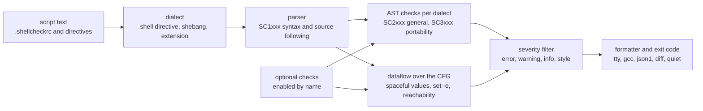

# ShellCheck Warning Families

> [!summary] Claim
> A ShellCheck code is a claim about a specific runtime divergence in a specific shell dialect, so the useful unit is the family (expansion safety, masked exit status, dataflow, dialect support, reachability, evaluation time, source following), not the individual number, and its severity label is not a ranking of how much the bug costs.

Part of [Testing and Static Analysis](README.md) in [Shell and Unix Engineering](../README.md).

## TL;DR

- Mechanism: ShellCheck parses the script for one of five dialects, runs per-dialect AST checks and a dataflow pass over a control flow graph, and prints codes in three ranges: SC1xxx (parse and source following), SC2xxx (general analysis), SC3xxx (constructs undefined in the chosen dialect).
- Rule: fix the family at its root (quote, assign then export, call outside the condition, declare the real dialect), and suppress with `# shellcheck disable=SCnnnn # reason` only after the lab-style check that the shell really does what you intend.
- Trap: severity is not importance, because `SC2086`, `SC2181` and `SC2162` are `info`, so a gate at `-S warning` silently skips the three most common causes of data-dependent shell failures (observed with ShellCheck 0.11.0 on this host).
- Portability fact: `sh` in ShellCheck means POSIX sh, not the system's `/bin/sh`, and ShellCheck has no zsh, mksh, yash or posh dialect, so a green run says nothing about those shells.
- When not to use it: as proof of correctness or as a substitute for running the script (it cannot see through `eval`, dynamic `source`, other processes, or the values data takes at runtime), and not as the only gate for a script big enough to deserve a real language.

## Mental model



The script text and its configuration (`.shellcheckrc`, `.editorconfig`, in-file directives) feed the dialect decision, which picks the file's shell from a `shell` directive, then the shebang, then the extension.
The parser runs next and is where SC1xxx comes from, including the decision whether to follow a `source` into another file.
Two kinds of check then run on the resulting tree: AST checks gated by the dialect (this is where every SC3xxx comes from) and checks that consult a dataflow analysis of the control flow graph, such as whether an expanded variable can contain spaces or whether a command is reachable.
Optional checks are switched on by name and join the same two paths, every finding is filtered by severity, and the formatter turns what remains into output and an exit code.

## How it works

### Numbering, severity, and where the families live

ShellCheck codes fall in three ranges, which also describe where in the source they come from.

- SC1xxx comes from the parser: `parseProblem` and `parseNote` calls in `src/ShellCheck/Parser.hs` (shellcheck master, fetched 2026-11-21), for example SC1017 for a literal carriage return and SC1090/SC1091 for sourcing.
- SC2xxx comes from the analyzer: `err`, `warn`, `info` and `style` calls in `src/ShellCheck/Analytics.hs`, `Checks/Commands.hs` and `Checks/ShellSupport.hs`, plus the control flow checks.
- SC3xxx comes from `checkBashisms` in `src/ShellCheck/Checks/ShellSupport.hs`, which only runs when the dialect is one that lacks the construct.

`SC2039` was the old catch-all "in POSIX sh, something is undefined"; it was retired in v0.7.2 (2021-04-19) and replaced by one SC3xxx code per construct (ShellCheck wiki, SC2039).
Because a range can be disabled with `# shellcheck disable=SC3000-SC4000` (the end of the range is exclusive, per the man page), a file-level portability decision is a one-line directive instead of dozens of suppressions.

Every finding carries one of four severities: `error`, `warning`, `info`, `style` (`Severity` in `src/ShellCheck/Interface.hs`).
The default minimum is `style`, so everything shows; `-S SEVERITY` raises the floor.
The gcc formatter spells `info` as `note`, and the json1 formatter spells it `info` (observed).
The severity is assigned per call site by the check's author, it reflects how likely the pattern is to be wrong, and it does not reflect how bad the consequence is.

| Code | Severity (0.11.0, observed) | Family |
|---|---|---|
| SC2045 `for f in $(ls)` | error | expansion safety |
| SC2155 `export x=$(cmd)` | warning | exit status masking |
| SC2064 double-quoted `trap` | warning | evaluation time |
| SC2034 unused variable | warning | dataflow |
| SC2086 unquoted expansion | info | expansion safety |
| SC2181 `$?` test | info | exit status masking |
| SC2162 `read` without `-r` | info | read semantics |
| SC2248 quote a safe variable | style (optional) | expansion safety |

The exit code is independent of the filter in a surprising way: `shellcheck -S error` on a file that has only info findings exits 0, while plain `shellcheck` on the same file exits 1 (observed).
The documented codes are 0 (no issues), 1 (issues), 2 (some files could not be processed), 3 (bad syntax of the invocation) and 4 (bad options), per the man page.

### Dialect selection

The man page states the order: a `shell` directive, then the shebang, then a `.bash`, `.bats`, `.dash` or `.ksh` extension.
`Data.hs` (`shellForExecutable`) maps names to the five dialects the `Shell` type in `Interface.hs` defines: `Sh`, `Bash`, `Dash`, `Ksh`, `BusyboxSh`; `bats` maps to Bash, `ash` to Dash, `busybox`, `busybox sh` and `busybox ash` to BusyboxSh, and `ksh88`, `ksh93` and `oksh` to Ksh (the same table in the v0.11.0 tag and on master, fetched 2026-11-21).
There is no entry for zsh, mksh, yash or posh.

What ShellCheck does with a shell it does not know, observed with 0.11.0 on a script that used an array:

| Shebang | Result |
|---|---|
| `#!/bin/zsh` | `SC1071` error "ShellCheck only supports sh/bash/dash/ksh/'busybox sh' scripts", and no other analysis |
| `#!/usr/bin/env mksh` | `SC1008` error "This shebang was unrecognized", then bash-flavored analysis (SC2086, SC2128, no SC3xxx) |
| `#!/bin/busybox ash` | `SC1008`, then dash-flavored analysis (SC3030 "In dash, arrays are not supported"), although `shellForExecutable` lists `busybox ash`; `#!/bin/busybox sh` is accepted without SC1008 |
| none | `SC2148` error "Tips depend on target shell and yours is unknown", then bash-flavored analysis |
| `#!/bin/sh` plus `# shellcheck shell=bash` | the directive wins, no SC3xxx |

The man page says `sh` "refers to POSIX `sh` (not the system's)", so `-s sh` is the strictest of the five and warns about portability even where every real `/bin/sh` you ship on would accept the construct.
The cost of an unrecognized shebang is silent: the run still produces findings, so nothing looks wrong, but the SC3xxx family is gone.

### Family 1: expansion safety (SC2086, SC2046, SC2035, SC2045, SC2013, SC2248, SC2223)

The mechanism is POSIX field splitting and pathname expansion.
After parameter expansion, command substitution and arithmetic expansion, the shell scans the results that were not in double quotes for field splitting (POSIX.1-2024 XCU 2.6.5), then treats each resulting field as a pattern for pathname expansion unless `set -f` is on (POSIX.1-2024 XCU 2.6.6).
So `echo $1` is, in the words of the SC2086 page, "Split the first argument by IFS (spaces, tabs and line feeds). Expand each of them as if it was a glob."
An empty unquoted expansion contributes zero fields, which is why an optional argument is correctly written `${opt:+"$opt"}` and not `"$opt"` (which passes one empty argument).

SC2086 and SC2248 are one check, `checkSpacefulnessCfg'` in `Analytics.hs`, run in two passes (`dirtyPass` true or false).
For each `${...}` reference that is not already quoted, not an array expansion, not a counting reference like `${#v}` and not a command name, it asks the control flow analysis for the variable's value state at that point.
A value is "clean" when the analysis marks its space status clean (known to hold no spaces or glob characters) or the variable is integer-typed; otherwise it is dirty.
The dirty pass reports SC2086 (info); the clean pass reports SC2248 (style) and only runs when the optional check `quote-safe-variables` is enabled.
The practical consequence, observed with 0.11.0 on a bash script: `clean=hello; echo $clean` and `n=$((1 + 2)); echo $n` are silent by default, while `dirty="a b"`, `cmd=$(date)` and `$1` each draw SC2086, and with `-o quote-safe-variables` the first two draw SC2248.
The same function emits SC2223 ("This default assignment may cause DoS due to globbing") for `: ${dflt:=*/*/*}`, which the SC2086 page explains as a denial of service when the value is something like `*/*/*/*/*/*`, because the pattern walks the directory tree.

SC2035 is the same hazard one level out: a glob as the first operand lets a file named like an option become an option, because the utility sees the expanded names and not the pattern (POSIX Utility Syntax Guideline 10, `--`, XBD 12.2).
The fixes are `./*` or `-- *`, and the wiki warns that `./*` changes member names when passed to GNU `tar`, where `--` is the safer one.
SC2045 (error) and SC2012, SC2010 and SC2013 are the same family applied to `ls` output and to `for x in $(cat file)`: the output is split into words and globbed, so a line `foo *` becomes `foo` plus every file name in the directory.

The same splitting hazard shows up in three more codes.
SC2068 (error, observed with 0.11.0) flags an unquoted `$@` or `${array[@]}`: `"$@"` expands to exactly the original arguments, while `$@` re-splits and re-globs each one, so with the arguments `a b` and `*` the unquoted form produces more than two words (SC2068 wiki; measured here in bash and dash, where quoted gave 2 and unquoted gave the two split words plus every name the `*` matched).
SC2206 and SC2207 (both warning) flag `arr=( $var )` and `arr=( $(cmd) )`, which split and glob while filling an array; the sanctioned fixes are `mapfile -t` or `read -r -a` in bash and a `while IFS= read -r` loop in ksh (SC2206 and SC2207 wikis).
SC2006 (info) flags legacy backticks, which have undefined quoting behavior in POSIX and nest badly, in favor of `$(...)` (SC2006 wiki).

The allowed exceptions are the ones the shell defines: `set -f` stops globbing and `IFS=''` stops splitting (empty IFS: "no field splitting shall occur", POSIX.1-2024 XCU 2.6.5), and the lab shows both.
Splitting you really want (`gcc $(pkg-config --libs openssl) client.c`) should be written with `read -ra`, `mapfile`, an array or a function, or suppressed with a reason (SC2046 wiki).

### Family 2: exit status masking (SC2155, SC2312, SC2005, SC2181, SC2164, SC2015, SC2310, SC2311, SC2320)

The common mechanism is that a command's status is only observable at one place, and a surrounding construct can replace it.

- A simple command with no command name "shall complete with the exit status of the command substitution whose exit status was the last to be obtained" (POSIX.1-2024 XCU 2.9.1.3), so `x=$(cmd)` carries `cmd`'s status, and `x="$(a)/$(b)"` carries only `b`'s.
- When there is a command name, the status is the command's: `export X=$(false)` leaves `$?` at 0 and, in the standard's own words, "execution continues, even if set -e is in effect", with the fix being to separate the assignment from the export (POSIX.1-2024 XCU 2.15, export, APPLICATION USAGE).
  This is SC2155 for `export`, `local`, `readonly` and `declare`.
- `echo "$(cmd)"` (SC2005) loses the status the same way, and so does a command substitution inside another command's arguments (SC2312, optional).

`check-extra-masked-returns` (SC2312) is the most detailed of these and is worth reading as code: `checkExtraMaskedReturns` in `Analytics.hs` walks arguments, assignments, here-documents, arrays, pipelines without `pipefail`, `[[ ]]` conditions and process substitutions, and flags a command substitution unless it is the last simple command in its container.
It exempts "harmless" commands (its own tests show `dirname`, `basename` and `time` not being flagged), declaring commands handled by SC2155 (except `local -r`), and a deliberate mask written as `|| true`, `|| :` or `|| echo`.
Observed with 0.11.0 under the check: `cd "$(dirname "$0")/lib"` is silent, `x=$(false)$(true)` is flagged, and `x=$(false)true` is not, because the status of the second is that of its only substitution.

SC2181 flags `[ $? -ne 0 ]` after a command.
Three things go wrong: an inserted command changes what `$?` means, `[` overwrites `$?` before the handler can report it, and under `set -e` the shell has already exited at the failing command so the handler never runs (lab: `status`).
SC2164 flags a `cd` that is not guarded; `checkUncheckedCdPushdPopd` skips `cd` on the left of `||` or `&&`, in a condition, as the last command in a function, and for `cd /`, `cd ..` and the like, and it is switched off entirely when `hasErrexit` is true, which the wiki states as "Having a `set -e` command anywhere in the script will disable this message" (observed: the same two-line script warns without `set -e` and is silent with it).
SC2015 flags `A && B || C`, which runs `C` when `A` is true and `B` fails.

SC2310 and SC2311 are the `set -e` family, optional under `check-set-e-suppressed`, and they only fire when the script enables errexit.
POSIX defines the exemption: `-e` is "ignored when executing the compound list following the while, until, if, or elif reserved word, a pipeline beginning with the ! reserved word, or any command of an AND-OR list other than the last" (POSIX.1-2024 XCU 2.15, set, `-e`).
So a function called as an `if` condition runs with errexit off for its entire body, and `checkSetESuppressed` reports every call placed in a `!`, `&&`, `||`, `if`, `until` or `while` condition (SC2310).
SC2311 is bash-specific: POSIX says the failing `false` in `echo $(false; echo one) two` makes the substitution's subshell exit, but bash outside POSIX mode clears errexit in a command substitution unless `shopt -s inherit_errexit` is set (the wiki and `checkSetESuppressed`, which stays quiet when `inherit_errexit` or `set -o posix` appears).
Measured by hand here: with `set -e; f() { false; echo f-continued; }; x=$(f)`, bash 5.3 and bash 3.2.57 run `f` to the end and assign `f-continued`; with `inherit_errexit` (bash 5.3) or `set -o posix` (both) the shell exits with status 1; dash, zsh and ksh93u+ exit with status 1 by default.
In the shell matrix images, mksh, yash and posh also exit with status 1, while BusyBox ash 1.37.0 behaves like bash: it runs `f` to the end, assigns `f-continued` and exits 0.
The lab asserts this split (`errexit`).

### Family 3: dataflow and variable lifecycle (SC2034, SC2154, SC2153, SC2128)

These checks use the control flow graph and track assignments, which is what makes them useful and what limits them.
SC2034 (unused) and SC2154 (referenced but not assigned) are deliberately blind to indirection: the SC2034 page calls the false positive on a variable only reached through `${!name}`, `eval` or a nameref "an intentional design decision", chosen because tracking indirect references is unsolvable in general and a linter should keep true positives at the price of some false positives.
SC2154 fires only for variables with a lowercase letter in the name unless `check-unassigned-uppercase` is enabled, on the convention that uppercase names are environment; SC2153 covers the uppercase near-miss `MYVARIABLE` for `MY_VARIABLE`.
The runtime fact behind both is POSIX's: an unset parameter expands to the empty string unless `set -u` is on, in which case "the expansion shall fail with the consequences specified in 2.8.1" (POSIX.1-2024 XCU 2.15, set, `-u`), and `set -u` aborts a non-interactive shell (lab: `unset`).

SC2128 is the dataflow check with the largest dialect dependence.
`$myarray` is `${myarray[0]}` in bash and ksh93, which is why ShellCheck warns that only the first element is given; zsh's native arrays expand to every element, while `zsh --emulate sh` prints only the first element (lab); dash, posh and BusyBox ash reject the assignment `a=(foo bar)` as a syntax error (lab: `arrays`).
The same construct therefore means "first element", "all elements" or "syntax error" depending on a shell ShellCheck may not model.

### Family 4: dialect support (SC3xxx, SC2148, SC1008, SC1071)

`checkBashisms` is a table keyed by construct, with a list of dialects that lack each one, so the same line produces different codes under different `-s` values.
Observed on a 16-line fixture with 14 common bashisms (`[[ ]]`, array assignment, `${x:0:1}`, `${x/a/b}`, `echo -n`, `local`, `<<<`, `$'a'`, `(( 1 ))`, `+=`, `${!x}`, `&>`, `let`, `trap : SIGINT`), a `function g { :; }` line, which `sh` reports as SC2113 outside the SC3xxx range, and a plain `. /dev/null` as a control:

| Dialect (`-s`) | Distinct SC3xxx codes | Not flagged that `sh` flags |
|---|---|---|
| `sh` | 14 | none |
| `dash` | 12 | `echo -n` (SC3037), `local` (SC3043) |
| `busybox` | 6 | `$'a'` (SC3003), `[[ ]]` (SC3010), `&>` (SC3020), `echo -n` (SC3037), `local` (SC3043), `trap : SIGINT` (SC3048), `${x:0:1}` (SC3057), `${x/a/b}` (SC3060) |
| `ksh` | 0 | everything |
| `bash` | 0 | everything |

The dash row reflects what ShellCheck models as supported by dash: `echo -n` and `local` are accepted there even though POSIX does not define them, and POSIX itself says so for `echo` (an operand of `-n`, `-e` or `-E` gives implementation-defined results, and a backslash in an operand does too; POSIX.1-2024 XCU echo).
The `sh` dialect is therefore a statement about the standard, `dash` a statement about one implementation, and choosing between them is the decision a portability policy needs to make explicit.

One dialect-dependent SC2xxx is worth knowing: `export tmpdir=$(mktemp -d)` draws SC2155 in every dialect but SC2046 ("Quote this to prevent word splitting") only under `sh` (observed).
I did not find the reason for the dialect split stated in the wiki; the SC2155 page records `export g=$(printf '%s' "foo 2")` failing as `export: 2: bad variable name` in dash 0.5.8-2.10, and the shell matrix measured the same split for posh 0.14.1.

### Family 5: reachability and indirect calls (SC2317, SC2329)

SC2317 flags a command after `exit` or after a call to a function that always exits; SC2329 flags a function that is never invoked before the script ends in an `exit`.
The wiki for SC2329 says a function defined in a script that does not end in `exit` is assumed reachable because another file may source it, and admits that "ShellCheck is currently bad at figuring out functions that are invoked via `trap`".
Observed with 0.11.0: a script with `cleanup() { ...; }; trap cleanup EXIT` and a body is silent, but ending it with `exit 0` makes it report SC2329 on `cleanup`, and a command after that `exit` also draws SC2317.
The remedy is a function-level `# shellcheck disable=SC2329 # invoked from the EXIT trap`, not a file-wide disable that also hides real dead code.

### Family 6: evaluation time (SC2064, SC2016, SC2029, SC2115)

A double-quoted `trap "rm -rf $dir" EXIT` is expanded when the trap is set, and the expanded text is then parsed again as shell code when the trap fires (SC2064; lab: `trap`).
`ssh host "echo $HOSTNAME"` expands on the client (SC2029).
`echo 'Hello $name'` does not expand at all (SC2016), which ShellCheck reports because beginners expect it to, and which the wiki says is safe to disable globally if you know the difference.
SC2059 is the same evaluation-time hazard for `printf`: `printf "Hello, $name\n"` makes the data part of the format string, so any `%` or backslash in the value is interpreted (SC2059 wiki).
Measured here with the value `96%` followed by a newline in the format, bash 5.3 prints `96`, reports ``invalid format character`` and exits 1, and dash prints `96`, reports `invalid directive` and exits 2; the fix is `printf '%s\n' "$name"`.
SC2115 is the destructive case of an empty expansion: `rm -rf "$STEAMROOT/"*` becomes `rm -rf /*` when the variable is empty, and the fix is `"${STEAMROOT:?}/"*`, which fails the command when the variable is unset or null.

### Family 7: parser notes and source following (SC1xxx)

`readSource` in `Parser.hs` handles `source` and `.`.
A non-constant file name gives SC1090 (warning, "can't follow non-constant source"); a file that cannot be read gives SC1091 (info, "Not following"); a file that is already being read gives SC1093; a sourced file that fails to parse gives SC1094.
By default ShellCheck only follows files given on the command line (plus `/dev/null`); `-x` or `external-sources=true` lets it open any sourced file, and the man page notes this defaults to false "only due to ShellCheck's origin as a remote service for checking untrusted scripts".
`shouldFollow` caps nesting: at 100 `source` frames it reports `SC1092` ("Stopping at 100 'source' frames") as an error.
When a script sources a file ShellCheck cannot find, every variable that file defines shows up as SC2154 in the caller, which is why `# shellcheck source=./lib.sh` (or `source-path=SCRIPTDIR`) is the first fix and a blanket `disable=SC2154` the last.

### Optional checks, configuration, and directive scope

Optional checks are subjective rather than more comprehensive, and "may conflict with each other" (Optional wiki), so `-o all` is for evaluation only.
`shellcheck --list-optional` on 0.11.0 prints eleven: `add-default-case` (SC2249), `avoid-negated-conditions`, `avoid-nullary-conditions`, `check-extra-masked-returns` (SC2312), `check-set-e-suppressed` (SC2310, SC2311), `check-unassigned-uppercase` (SC2154), `deprecate-which` (SC2230), `quote-safe-variables` (SC2248), `require-double-brackets` (SC2292), `require-variable-braces` (SC2250) and `useless-use-of-cat` (SC2002).
The `Analytics.hs` on master, fetched on 2026-11-21, also registers `require-double-equals` (SC2338), which the installed 0.11.0 does not list, so a pinned version decides which checks exist.
SC2002 stopped being on by default in 0.11.0 (SC2002 wiki).

Configuration is read from `.shellcheckrc` or `shellcheckrc` in the script's directory and every parent, falling back to `~/.shellcheckrc` and `$XDG_CONFIG_HOME/shellcheckrc`, plus `.editorconfig` keys prefixed `shellcheck.`, with `.shellcheckrc` winning conflicts; `SHELLCHECK_OPTS` is prepended to the command line (man page).
A directive before the first command is file-wide; otherwise it applies to the next command or block, and only file-wide `enable` directives count.

## Numbers and limits

| Quantity | Value | Source |
|---|---|---|
| Severities, highest first | error, warning, info, style; default floor `style` | man page, `Interface.hs` (master, 2026-11-21) |
| Exit codes | 0 clean, 1 findings, 2 unprocessable files, 3 bad syntax, 4 bad options | man page |
| `-S error` on a file with only info findings | exits 0; plain run exits 1 | measured here, ShellCheck 0.11.0 |
| `source` nesting limit | 100 frames, then SC1092 error | `Parser.hs`, `shouldFollow` (master, 2026-11-21) |
| `disable=` range end | exclusive: `SC3000-SC4000` covers SC3000 to SC3999 | man page |
| Optional checks in 0.11.0 | 11 | measured here, `shellcheck --list-optional` |
| SC3xxx codes on a 16-construct fixture | sh 14, dash 12, busybox 6, ksh 0, bash 0 | measured here, ShellCheck 0.11.0 |
| Advice on large scripts | disable extended analysis for 2000+ line generated scripts | man page, `extended-analysis` |
| Lab tests | 13 `@test` blocks: one per probe mode (12) plus the scratch-directory test | `test.bats` |

## Portability

The rows are what the lab asserts, run on the authoring host (macOS) where the shell exists there, and what POSIX.1-2024 states otherwise.
Rows for mksh, yash, posh and BusyBox ash were not run on the authoring host; their cells marked "matrix" were measured by running the same snippet in the Debian and Alpine shell matrix images (mksh R59, yash 2.58.1, posh 0.14.1, BusyBox 1.37.0), and cells marked "spec" follow the standard.

| Shell | Unquoted `$v` of `x y`, and glob `*.txt` over three files (SC2086) | `a=(foo bar); printf '<%s>' $a` (SC2128, SC3030) | Errexit inside `x=$(f)` (SC2311) | `for w in $(cat list)` with a `*` word, five words or three (SC2013) | Failed `cd` status (SC2164) |
|---|---|---|---|---|---|
| POSIX sh | split to 2, glob to 3 (XCU 2.6.5, 2.6.6) | not defined | subshell exits (XCU 2.15, set, `-e`) | words plus globbed names | greater than 0 (XCU cd) |
| macOS bash 3.2.57 | 2 and 3 (lab) | `<foo>` (lab) | continues in non-POSIX mode, exits as `sh` (lab) | 5 (lab) | 1 (measured by hand) |
| bash 5.3 | 2 and 3 (lab) | `<foo>` (lab) | continues unless `inherit_errexit` or POSIX mode (lab) | 5 (lab) | 1 (measured by hand) |
| zsh native | 1 and 1, no splitting or globbing of parameters (lab) | `<foo><bar>` (lab) | exits (lab) | 3, the `*` is not expanded (lab) | 1 (measured by hand) |
| `zsh --emulate sh` | 2 and 3 (lab) | `<foo>` (lab) | exits (lab) | 5 (lab) | 1 (measured by hand) |
| dash | 2 and 3 (lab) | syntax error (lab) | exits (lab) | 5 (lab) | 2 (measured by hand) |
| ksh93 (u+ 2012 on macOS) | 2 and 3 (lab) | `<foo>` (lab) | exits (lab) | 5 (lab) | 1 (measured by hand) |
| mksh | split to 2 (matrix), glob to 3 (spec) | `<foo>` (matrix) | exits (matrix) | 5 (matrix) | 2 (matrix) |
| yash | split to 2 (matrix), glob to 3 (spec) | `<foo><bar>` (matrix) | exits (matrix) | 5 (matrix) | 2 (matrix) |
| posh | split to 2 (matrix), glob to 3 (spec) | syntax error (matrix) | exits (matrix) | 5 (matrix) | 1 (matrix) |
| BusyBox ash | split to 2 (matrix), glob to 3 (spec) | syntax error (matrix) | continues, like bash outside POSIX mode (matrix) | 5 (matrix) | 2 (matrix) |

Facts that hold in every row (POSIX.1-2024 XCU 2.15, export, and the lab): `export x=$(false)` leaves `$?` at 0 and continues under `set -e`, a plain `x=$(false)` leaves 1 and stops, and `x="$(false)/$(true)"` is 0 while `x="$(true)/$(false)"` is 1.
`read` without `-r` turns `a\b` into `ab` and joins a line ending in a backslash with the next (XCU read, DESCRIPTION, and the lab); the standard's explicit portability rule is narrower, saying portable applications "need to specify -r whenever they specify -d delim" when the delimiter is not a newline, because implementations differ on which backslash sequence continues a line (XCU read, APPLICATION USAGE).
A double-quoted trap string expands when the trap is set, and a single-quoted one when it fires.

Utilities, for the SC2035 family: the lab uses `cat` and a file named `-u`, the one `cat` option POSIX defines, so `cat *` treats `-u` as an option and prints only the other file; macOS `cat` was run here, and GNU coreutils 9.7 `cat` and BusyBox 1.37.0 `cat` gave the same result in the shell matrix images (only `b.txt` printed for `cat *`, both files for `cat -- *`); uutils `cat` was not run, but its argument parser declares `-u` as an accepted option that is ignored (`IGNORED_U` in `src/uu/cat/src/cat.rs`, main branch, fetched 2026-11-21), so a file operand named `-u` is consumed as that option there too.
The `--` and `./` fixes work because the utility never sees a leading `-` (POSIX XBD 12.2, Utility Syntax Guideline 10).

The same table in terms of ShellCheck: it models `sh`, `bash`, `dash`, `ksh` and `busybox`, so findings and silence both refer to those five, and zsh, mksh, yash and posh behavior is outside what it can confirm (`SC1071` for zsh, `SC1008` plus a bash-flavored guess for an unrecognized shebang, as observed above).

## Worked example

The lab is [lab](../labs/14-shellcheck-warning-families/).
It runs the hazardous form and the fixed form of each family under the shell being tested, and asserts the per-shell result; ShellCheck itself is not run by the lab because the matrix images do not carry it.

Simplified excerpt from `families-probe.sh` (lines copied unchanged, each of two of its twelve modes cut short):

```sh
mode_masking() {
  # export is the command, so the substitution's status is discarded (POSIX.1-2024 XCU 2.15, export)
  # shellcheck disable=SC2155,SC2046,SC2034 # deliberate hazard: export discards the substitution status
  export masked=$(false)
  printf 'export-assign=%s\n' "$?"
  # shellcheck disable=SC2034 # the value is deliberately unused; only the status matters
  unmasked=$(false)
  printf 'plain-assign=%s\n' "$?"
  # shellcheck disable=SC2312,SC2034 # deliberate: only the last substitution's status survives; the value is unused
  x="$(true)/$(false)"
  printf 'last-false=%s\n' "$?"
  # shellcheck disable=SC2312,SC2034 # deliberate: only the last substitution's status survives; the value is unused
  x="$(false)/$(true)"
  printf 'first-false=%s\n' "$?"
```

```sh
mode_errexit() {
  # f fails at its first command; a shell whose substitution inherits errexit stops there
  r=$(
    set -e
    f() {
      false
      printf 'f-continued'
    }
    x=$(f)
    printf 'after:%s' "$x"
  )
  case $r in
    "") printf 'subst-inherits-errexit=yes\n' ;;
    *) printf 'subst-inherits-errexit=no\n' ;;
  esac
```

Output the lab produced under dash on the authoring host (`families-probe.sh MODE`, each mode printed separately and joined here):

```text
quoting:   split=2 quoted-split=1 glob=3 quoted-glob=1 unquoted-empty=0 quoted-empty=1 alt-value-empty=0 noglob=1 ifs-empty=1 cmdsubst-split=2 cmdsubst-quoted=1
masking:   export-assign=0 plain-assign=1 last-false=1 first-false=0 errexit-export=reached errexit-plain=stopped useless-echo=0
status:    indirect=missed direct=detected errexit-indirect=handler-skipped errexit-direct=handler-ran
cd:        cd-status=2 unchecked=wrote-in-wrong-directory checked=safe
read:      raw=a\b cooked=ab joined=xy joined-raw=x\ trimmed=<pad> kept=<  pad  >
errexit:   subst-inherits-errexit=yes condition-output=f-continuedcondition-true
dashglob:  unsafe=y-only prefixed=x-and-y ended=x-and-y
lines:     expanded=aa.txt expanded=bb.txt for-words=5 while-lines=2
arrays:    array=rejected
```

Under native zsh the same probe prints `split=1 glob=1` for `quoting`, `for-words=3` with no `expanded=` lines for `lines`, and `array=<foo><bar>` for `arrays`; under bash 5.3 `errexit` prints `subst-inherits-errexit=no`.

ShellCheck itself was run by hand, outside the lab, on this fixture with ShellCheck 0.11.0 (`shellcheck -f gcc bad.sh`):

```sh
#!/bin/sh
set -e
out=$(mktemp)
export tmpdir=$(mktemp -d)
cd "$tmpdir"
rm *.o
for f in $(ls *.c); do
  cc -c $f -o ${f%.c}.o
done
if [ $? -ne 0 ]; then echo failed; fi
[ -f "$out" ] && echo exists || echo missing
read line < "$out"
trap "rm -rf $tmpdir" EXIT
if [[ $line == y* ]]; then echo yes; fi
echo -n "done"
arr=(a b)
echo $arr
unused=1
echo "$typo"
```

```text
4:8: warning: Declare and assign separately to avoid masking return values. [SC2155]
4:15: warning: Quote this to prevent word splitting. [SC2046]
6:4: note: Use ./*glob* or -- *glob* so names with dashes won't become options. [SC2035]
7:10: error: Iterating over ls output is fragile. Use globs. [SC2045]
7:15: note: Use ./*glob* or -- *glob* so names with dashes won't become options. [SC2035]
8:9: note: Double quote to prevent globbing and word splitting. [SC2086]
8:15: note: Double quote to prevent globbing and word splitting. [SC2086]
10:6: note: Check exit code directly with e.g. 'if ! mycmd;', not indirectly with $?. [SC2181]
12:1: note: read without -r will mangle backslashes. [SC2162]
13:14: warning: Use single quotes, otherwise this expands now rather than when signalled. [SC2064]
14:4: warning: In POSIX sh, [[ ]] is undefined. [SC3010]
14:13: warning: In POSIX sh, == in place of = is undefined. [SC3014]
15:6: warning: In POSIX sh, echo flags are undefined. [SC3037]
16:5: warning: In POSIX sh, arrays are undefined. [SC3030]
17:6: warning: Expanding an array without an index only gives the first element. [SC2128]
17:6: note: Double quote to prevent globbing and word splitting. [SC2086]
18:1: warning: unused appears unused. Verify use (or export if used externally). [SC2034]
19:7: warning: typo is referenced but not assigned. [SC2154]
```

Reading it as families: line 4 is masking plus a dialect-dependent quote (SC2046 appears only under `sh`), lines 6 to 8 are expansion safety, line 10 is masking, line 12 is read semantics, line 13 is evaluation time, lines 14 to 16 are dialect support, lines 17 and 18 and 19 are dataflow.
Line 5 has no SC2164 because line 2 turned on `set -e`.
With `-S error` only line 7 remains and the exit code is still 1.

A second fixture shows the optional `set -e` family (`shellcheck -o check-set-e-suppressed,check-extra-masked-returns -f gcc mask.sh`):

```sh
#!/bin/bash
set -e
f() { local d; d=$(false); echo "$d"; }
if f; then echo ok; fi
x=$(f)
g() { local y=$(true); echo "$y"; }
cd "$(dirname "$0")/lib"
```

```text
4:4: note: This function is invoked in an 'if' condition so set -e will be disabled. Invoke separately if failures should cause the script to exit. [SC2310]
5:1: warning: x appears unused. Verify use (or export if used externally). [SC2034]
5:5: note: Bash implicitly disabled set -e for this function invocation because it's inside a command substitution. Add set -e; before it or enable inherit_errexit. [SC2311]
6:13: warning: Declare and assign separately to avoid masking return values. [SC2155]
```

## Pitfalls

> [!warning] A gate at `-S warning` skips the commonest bugs
> Trigger: CI runs `shellcheck -S warning` to keep noise down.
> Symptom: `echo $1`, `[ $? -ne 0 ]`, `read` without `-r` and `rm *` pass, because SC2086, SC2181, SC2162 and SC2035 are `info`; the same file under plain `shellcheck` exits 1.
> Fix: gate at the default floor, take a one-time baseline of existing findings, and use `-e` or directives with reasons for the families you reject, not the severity filter.

> [!warning] Quoting a variable that is meant to split
> Trigger: SC2086 on `make $options file` where `options="-j 5 -B"`, and the quick fix is `make "$options" file`.
> Symptom: `make` receives the single argument `-j 5 -B` and fails, or with an empty value receives an empty argument.
> Fix: use an array in bash, ksh and zsh, a function with `set --` for POSIX, or `${opt:+"$opt"}` for an optional single argument, all from the SC2086 page; the lab `alt-value-empty=0` shows the last form passes no argument when empty.

> [!warning] `export x=$(cmd)` and `local x=$(cmd)` hide the failure
> Trigger: one-line declare-and-assign, usually with `set -e` on.
> Symptom: `$?` is 0 and `set -e` does not fire, so the script continues with an empty value; POSIX documents this for `export X=$(false)`, and the lab prints `export-assign=0 errexit-export=reached` against `plain-assign=1 errexit-plain=stopped`.
> Fix: assign, then export or declare: `x=$(cmd)` then `export x`; for `local`, `local x` then `x=$(cmd)` (SC2155 wiki).
> ShellCheck deliberately does not warn for `local -r x=$(cmd)` unless `check-extra-masked-returns` is on.

> [!warning] `A && B || C` is not if-then-else
> Trigger: `[ -n "$dry" ] && echo "would delete" || rm file`.
> Symptom: when `echo` fails (the wiki's example is stdout closed with `>&-`), `rm` runs although `$dry` was set; the lab shows `and-or-ran-c` where an `if` prints nothing for the else branch.
> Fix: write the `if`.

> [!warning] A function in an `if` condition runs without `set -e`
> Trigger: `set -e`, then `if backup; then ...; fi` where `backup` does `cp` then `rm`.
> Symptom: a failed `cp` does not stop the `rm`; the lab prints `condition-output=f-continuedcondition-true`, meaning the body after the failing command ran and the condition was true.
> Fix: call the function on its own line and let errexit work, or chain with `&&` inside the function, as the SC2310 page suggests (see also BashFAQ 105, which the wiki links).

> [!warning] Command substitution and errexit differ between bash and the standard
> Trigger: `set -e` in a bash script that calls a function inside `$( )`.
> Symptom: the function keeps running after a failed command in bash 5.3 and 3.2.57 (measured), because bash clears errexit in the substitution unless `inherit_errexit` or POSIX mode is on; BusyBox ash 1.37.0 also continues (measured in the shell matrix), while dash, zsh, ksh93u+, mksh, yash and posh stop.
> Fix: `shopt -s inherit_errexit` (new in bash 4.4 per the bash NEWS file; bash 3.2 rejects it as an invalid shell option name, measured), or `x=$(set -e; f)`, or check the status explicitly.

> [!warning] An empty expansion in a destructive path
> Trigger: `rm -rf "$STEAMROOT/"*` with the variable unset.
> Symptom: `rm -rf /*`; Steam for Linux issue 3671 (opened 2015-01-14, "Moved ~/.local/share/steam. Ran steam. It deleted everything on system owned by user.") reports deleted user files, a commenter suspected `rm -rf "$STEAMROOT/"*` at line 468 of `steam.sh`, and the SC2115 page cites the issue.
> Fix: `"${STEAMROOT:?}/"*`, and for a command substitution, assign to a variable first and then apply `:?`, because "forks and execs can fail due to external system limits" (SC2115 wiki).

> [!warning] A double-quoted `trap`
> Trigger: `trap "rm -rf $tmpdir" EXIT`.
> Symptom: the value is baked in when the trap is set, so a later reassignment is ignored (the lab prints `double-quoted=early` against `single-quoted=late`), and a value containing a quote or `;` becomes shell code when the trap runs.
> Fix: `trap 'rm -rf "$tmpdir"' EXIT`, with the variable assigned before the trap is armed or tested for emptiness inside it.

> [!warning] A script that passes on macOS and fails on Debian
> Trigger: `#!/bin/sh` with `a=(x y)` or `[[ ]]`, tested where `/bin/sh` is bash 3.2 in POSIX mode (macOS).
> Symptom: the script runs on the developer's laptop and fails with a syntax error under dash (the lab prints `array=rejected` for dash, posh and BusyBox ash and `array=<foo>` for bash), and ShellCheck under `-s sh` already says SC3030.
> Fix: believe the SC3xxx codes, or change the shebang to the shell that is actually required; do not disable the whole range unless the shebang matches the claim.

> [!warning] Green ShellCheck on a script it does not model
> Trigger: a zsh, mksh, yash or posh script.
> Symptom: zsh gets one `SC1071` error and no analysis; an unrecognized shebang such as `#!/usr/bin/env mksh` gets `SC1008` followed by bash-flavored findings and no SC3xxx, which look like a real check; the same array line is `<foo><bar>` in zsh and `<foo>` in bash.
> Fix: add a `shell=` directive only for a dialect ShellCheck models, run the shell's own syntax check (`zsh -n`), and test behavior with bats.

> [!warning] Suppressing a family that the fix would have removed
> Trigger: `# shellcheck disable=SC2154` at the top of a file because a sourced library defines the variables.
> Symptom: real typos in the file stop being reported; `echo "hello $tagret"` silently expands to `hello ` (the lab prints `plain=<hello >`) or aborts under `set -u`.
> Fix: tell ShellCheck where the library is with `# shellcheck source=./lib.sh`, `source-path=SCRIPTDIR`, or `-x`.

> [!warning] A false SC2329 on a trap handler
> Trigger: `trap cleanup EXIT` in a script that ends with `exit`.
> Symptom: SC2329 "This function is never invoked" (observed with 0.11.0), plus SC2317 for any command after the `exit`; the SC2329 wiki admits the trap blind spot.
> Fix: a directive on the function with a reason, not a file-wide disable.

## Security and robustness

ShellCheck is a defensive tool for the classes of bug that become vulnerabilities when the data is hostile, and it is a heuristic one.

- Unquoted expansions are the root of command and argument injection in shell: a value with a space becomes extra arguments, and a value with a leading `-` becomes an option (SC2086, SC2035, [[Argument-Injection-and-Double-Dash]]).
- Code built in a string is re-parsed: SC2064 (`trap`), SC2029 (a remote command assembled on the client) and the SC2086 exception for `eval` mean that a value from an attacker must be quoted for the second parse, for example with `printf %q` where available (SC2029 wiki).
- Empty-expansion destruction (SC2115) is a robustness bug that an attacker only needs to trigger once; `${var:?}` turns it into a failure.
- ShellCheck sees one script's syntax and, with `-x`, the files it sources; it does not see `eval` strings, other processes, values read from files at runtime, or the environment.
  It reports a possible split, not that the value is attacker-controlled.
- Enabling `-x` or `external-sources=true` lets ShellCheck open any file a script names, which the man page says is off by default "only due to ShellCheck's origin as a remote service for checking untrusted scripts"; treat it as a local-development setting, and do not run it with `-x` on untrusted input as a privileged user.
- A suppression is a security-relevant diff: `# shellcheck disable=SC2086 # reason` should be reviewed as carefully as the code it guards, and a file-wide disable of an expansion family should be rejected in review.
- Pin the version: new versions add and renumber findings (SC2329 exists in 0.11.0; `require-double-equals` is on master only), so an unpinned CI gate fails on a tool release and not on a code change.

## The principal's view

The decision is what ShellCheck is allowed to block, and the trade-off is noise against escaped defects.

- Gate on the default floor, not `-S warning`, because the info-level families (SC2086, SC2181, SC2162, SC2035) are the ones that cause incidents, and handle legacy code with a recorded baseline per file, not a lowered floor.
- Choose the dialect as a contract: `sh` means "POSIX, runs under dash, BusyBox ash and macOS `/bin/sh`", `dash` means "Debian and Ubuntu `/bin/sh`", `bash` means "bash is a declared dependency".
  Mixing them silently is how the macOS-green, Debian-red failure ships.
- Enable the optional checks that map to real failure modes and have an unambiguous fix: `check-extra-masked-returns`, `check-set-e-suppressed`, `add-default-case`, `quote-safe-variables` if the team wants one quoting rule; leave style-only checks (`require-variable-braces`, `require-double-brackets`) to a style guide and `shfmt`, not to the gate.
- Require a reason on every suppression and prefer line scope; a function-level `disable` for SC2329 on a trap handler is fine, a file-level one for SC2086 is not.
- Treat ShellCheck as necessary and insufficient: the lab proves the runtime facts the warnings stand on, bats proves the behavior ([[bats-core]]), and a matrix proves the dialects ([[Cross-Shell-CI-Matrices]]).
- Use a different tool when the script has outgrown its guarantees: when the logic needs real data structures, error values or tests of its own, a Python or Go program is cheaper than a stack of ShellCheck directives, and for a shell the tool does not model (zsh, mksh, yash, posh), use that shell's own checker plus tests.

The downside of strictness is review friction and churn when the pinned version moves; the downside of leniency is that the findings stop being read.

## Interview questions

> [!question] L5: Why does ShellCheck warn about `echo $1`, and what is the fix?
>
> > [!success]- Answer
> > An unquoted expansion is split on `IFS` and each field is then used as a pathname pattern (POSIX.1-2024 XCU 2.6.5 and 2.6.6).
> > So `echo $1` with the first argument `a  *` prints `a` and every file name in the directory.
> > The fix is `echo "$1"`; ShellCheck reports it as SC2086 at `info` severity.
> >
> > Follow-up: What do you do when you need splitting, for example for a list of compiler flags?

> [!question] L5: Predict the output of `f() { local x=$(false); echo $?; }; f` in bash, and say how to make it print 1.
>
> > [!success]- Answer
> > It prints `0`, because `local` is the command and it succeeds; the status of the substitution is discarded.
> > Declare first and assign second: `f() { local x; x=$(false); echo $?; }` prints `1`.
> > This is SC2155, and POSIX documents the same behavior for `export X=$(false)`.
> >
> > Follow-up: Why does `export x=$(false)` not stop a script running with `set -e`?

> [!question] L5: What is wrong with `make; if [ $? -ne 0 ]; then echo failed; fi`?
>
> > [!success]- Answer
> > The test depends on `$?` still being `make`'s status, so inserting any command between them changes what is tested.
> > `[` also overwrites `$?`, so the handler cannot report the real status.
> > Under `set -e` the shell exits at `make` and the handler never runs.
> > Write `if ! make; then ...; fi`; ShellCheck says SC2181.
> >
> > Follow-up: How do you keep the status and also capture the output?

> [!question] L6: Your CI runs `shellcheck -S warning` and a script with `rm *` and `read line` passes; why, and what do you change?
>
> > [!success]- Answer
> > SC2035 (`rm *`) and SC2162 (`read` without `-r`) are `info`, so the floor of `warning` filters them out.
> > Severity reflects the author's confidence that a pattern is wrong, not the cost of the bug.
> > Gate at the default floor, baseline the existing findings, and reject a family with `-e` or a directive and a reason.
> >
> > Follow-up: What does `shellcheck -S error` return on a file that has only info findings?

> [!question] L6: Predict the output: `a=(foo bar); printf '<%s>' $a` in bash, in zsh, and in dash.
>
> > [!success]- Answer
> > bash prints `<foo>`, because `$a` is `${a[0]}`, which is what SC2128 warns about.
> > Native zsh prints `<foo><bar>`, because zsh expands every element; `zsh --emulate sh` prints `<foo>` again.
> > dash rejects the assignment with a syntax error (`Syntax error: "(" unexpected`), so nothing is printed and the status is non-zero.
> > The lab asserts these per shell family.
> >
> > Follow-up: What does ShellCheck say about the same line under `#!/bin/sh`, and under `#!/bin/zsh`?

> [!question] L6: Debug this script, which deletes the text files even when the copy fails.
>
> ```sh
> #!/bin/bash
> set -e
> backup() { cp ./*.txt /backup; rm ./*.txt; }
> if backup; then echo "backed up"; fi
> ```
>
> > [!success]- Answer
> > `backup` is the condition of an `if`, so errexit is ignored for its whole body (POSIX.1-2024 XCU 2.15, set, `-e`), and a failed `cp` does not stop the `rm`.
> > ShellCheck reports this as SC2310 when `check-set-e-suppressed` is enabled.
> > Call `backup` on its own line, or write `cp ./*.txt /backup && rm ./*.txt` inside it so the dependency is explicit.
> >
> > Follow-up: Why does the same problem appear for `x=$(backup)` in bash but not in dash?

> [!question] L7+: A script passes ShellCheck on a laptop but fails in a Debian container with a syntax error; how do you diagnose it?
>
> > [!success]- Answer
> > Find the declared dialect: a `shell` directive, then the shebang, then the extension decide which SC3xxx checks run.
> > With `#!/bin/bash` ShellCheck is satisfied by a bashism, and the container runs it under `/bin/sh`, which is dash on Debian.
> > With `#!/bin/sh` the findings were probably suppressed with `disable=SC3000-SC4000` or the laptop's `/bin/sh` is bash 3.2 in POSIX mode, which accepts what dash rejects.
> > The fix is to make the shebang and the dialect agree and test under the target shell in a matrix.
> >
> > Follow-up: Why is `-s dash` not a safe stand-in for `-s sh`?

> [!question] L7+: Design the ShellCheck policy for a monorepo with 2,000 shell scripts, many of them legacy.
>
> > [!success]- Answer
> > Pin the ShellCheck version and the optional checks in a root `.shellcheckrc`, and give each directory its dialect through `shell=` in `.editorconfig` or the rc file.
> > Gate at the default floor; record current findings per file as a baseline so new code is held to the standard and old code is ratcheted.
> > Require a reason on every `disable`, allow line and function scope, and reject file-wide disables of the expansion and masking families in review.
> > Disable extended analysis for generated scripts over about 2,000 lines (the man page's own advice), and run a matrix and bats tests for behavior, because ShellCheck cannot see runtime values.
> >
> > Follow-up: How do you upgrade the pinned version without blocking everyone for a day?

> [!question] L7+: A zsh script is clean under ShellCheck; what does that tell you?
>
> > [!success]- Answer
> > Nothing: ShellCheck has no zsh dialect and reports `SC1071` ("only supports sh/bash/dash/ksh/'busybox sh'") and stops.
> > If a `shell=bash` directive is added to get findings, they describe bash semantics, where unquoted parameters split and arrays start at index 0, which are wrong for native zsh.
> > Use `zsh -n` for syntax, tests for behavior, and write portable code for `zsh --emulate sh` if it must run in both.
> >
> > Follow-up: Which of the seven families in this note change meaning under native zsh?

## Related

Prerequisites: [[ShellCheck-Internals]], [[Field-Splitting-and-IFS]], [[Pathname-Expansion]], [[errexit-Semantics-and-Exceptions]]

Next: [[shfmt]]

See also: [[Robust-Shell-Scripting-and-ShellCheck]], [[inherit_errexit-and-errtrace]], [[Traps-and-EXIT]], [[The-read-Builtin]], [[printf-versus-echo]], [[Indexed-Arrays]], [[Dash-and-Bashisms]], [[Zsh-Emulation-Modes]], [[Argument-Injection-and-Double-Dash]], [[Hostile-Filenames]], [[Cross-Shell-CI-Matrices]], [[bats-core]], [[Reviewing-Shell-at-Staff-Level]]

## Further reading

- ShellCheck manual page, https://github.com/koalaman/shellcheck/blob/master/shellcheck.1.md - dialect selection order, severities, directives, rc files, exit codes, and the `extended-analysis` advice.
- ShellCheck wiki, `SC2086`, https://github.com/koalaman/shellcheck/wiki/SC2086 - the canonical statement of what an unquoted expansion does and the sanctioned exceptions.
- ShellCheck wiki, `SC2155`, https://github.com/koalaman/shellcheck/wiki/SC2155 - the declare-and-assign rule and the dash splitting bug.
- ShellCheck wiki, `SC2310`, https://github.com/koalaman/shellcheck/wiki/SC2310 and `SC2311`, https://github.com/koalaman/shellcheck/wiki/SC2311 - errexit suppression in conditions and command substitutions.
- ShellCheck wiki, `SC2312`, https://github.com/koalaman/shellcheck/wiki/SC2312 - the masked-return family and the process substitution workaround.
- ShellCheck wiki, `SC2329`, https://github.com/koalaman/shellcheck/wiki/SC2329 - the trap blind spot, in the maintainers' words.
- ShellCheck wiki, `SC2039`, https://github.com/koalaman/shellcheck/wiki/SC2039 - the retired portability catch-all and the list of constructs it covered.
- ShellCheck wiki, Optional, https://github.com/koalaman/shellcheck/wiki/Optional, and Directive, https://github.com/koalaman/shellcheck/wiki/Directive - how optional checks and directives are scoped.
- ShellCheck source, `Analytics.hs`, https://github.com/koalaman/shellcheck/blob/master/src/ShellCheck/Analytics.hs - `checkSpacefulnessCfg'`, `checkExtraMaskedReturns`, `checkSetESuppressed` and `checkUncheckedCdPushdPopd`.
- ShellCheck source, `Checks/ShellSupport.hs`, https://github.com/koalaman/shellcheck/blob/master/src/ShellCheck/Checks/ShellSupport.hs - the dialect table behind SC3xxx.
- ShellCheck source, `Parser.hs`, https://github.com/koalaman/shellcheck/blob/master/src/ShellCheck/Parser.hs - `readSource` and the 100-frame source limit.
- POSIX.1-2024 Shell Command Language, https://pubs.opengroup.org/onlinepubs/9799919799/utilities/V3_chap02.html - sections 2.6.5, 2.6.6, 2.9.1.3 and 2.15 (`export`, `set`).
- POSIX.1-2024 `read`, https://pubs.opengroup.org/onlinepubs/9799919799/utilities/read.html, `cd`, https://pubs.opengroup.org/onlinepubs/9799919799/utilities/cd.html, and `echo`, https://pubs.opengroup.org/onlinepubs/9799919799/utilities/echo.html - the utilities behind SC2162, SC2164 and SC3037.
- Steam for Linux issue 3671, https://github.com/ValveSoftware/steam-for-linux/issues/3671 - the original report cited by SC2115.
