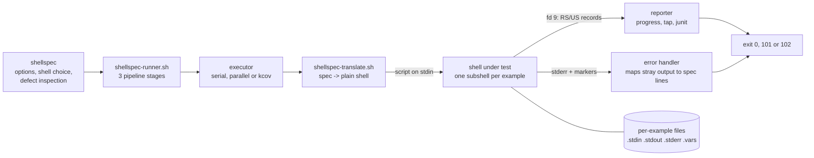

# ShellSpec

> [!summary] Claim
> ShellSpec is a BDD test framework written in POSIX shell that translates each spec file into a plain script, runs every example in its own subshell with stdout, stderr and status captured to files, and probes the shell under test for known defects before it trusts it, so one spec can run unchanged on dash, bash, zsh, ksh, mksh, yash, posh and BusyBox ash.

Part of [Testing and Static Analysis](README.md) in [Shell and Unix Engineering](../README.md).

## TL;DR

- Mechanism: `shellspec` runs a line-oriented translator that turns `Describe`, `It`, `When` and `The` lines into ordinary shell functions, then pipes the generated script into a fresh shell process; each example runs in a subshell and its evaluation output goes to per-example files.
- Rule: use `When call` for unit tests of functions (current shell, variables visible, errexit off) and `When run` for anything that may `exit` or rely on `set -e` (subshell, errexit on, variables discarded).
- Trap: an unhandled stdout, stderr or non-zero status is a warning, and warnings count as failures by default (`--warning-as-failure` is on), so a spec that never asserts the output of the code it calls exits 101.
- Portability: the framework itself targets bash >= 2.03, dash >= 0.5.4, zsh >= 3.1.9, BusyBox ash >= 1.20.0, mksh >= R28, ksh93 >= 93s, yash >= 2.29 and posh >= 0.3.14 (README, ShellSpec 0.28.1, which also lists bosh, ksh88, pdksh and the BSD shells), and it works around shell bugs it detects with a 13-variable defect inspection.
- When not to use it: when the team already writes `bats` and only needs TAP output, when the code under test is not a POSIX-family shell, or when you need a maintained release stream (the last tagged release is 0.28.1 from 2021-01-11, as of 2026-11).

## Mental model



`shellspec` first picks the shell, runs `libexec/shellspec-inspection.sh` in it and `eval`s the output as `SHELLSPEC_DEFECT_*` variables.
The runner starts the executor, the reporter and the error handler as three stages of one pipeline and combines their exit statuses.
The executor runs the translator and pipes the generated script into the shell under test, which is a separate process from the `shellspec` command.
Inside that process every example is a subshell; the evaluation writes to files, the framework reads them back into variables, and expectations compare those variables.
Results leave on file descriptor 9 as structured records for the reporter, while anything the example prints to stderr outside the evaluation is caught by the error handler and fails the example.

## How it works

### 1. Startup, shell choice and inspection

The `shellspec` script is itself `#!/bin/sh` and begins with `[ "$PPID" ] || { echo "Unsupported shell. (Bourne shell?)" >&2; exit 1; }` and `set -e -u -f` (`shellspec` 0.28.1).
It finds the project root by walking up to a directory holding a `.shellspec` file, reads options from `$XDG_CONFIG_HOME/shellspec/options` (else `$HOME/.config/shellspec/options`), `$HOME/.shellspec-options`, `.shellspec` and `.shellspec-local`, in that order (`enum_options_file` in `lib/libexec/shellspec.sh`), then parses the command line.
The shell that runs specs is the one running `shellspec` unless `--shell` is given (docs/cli.md); with the default `auto` it asks `current_shell`, which reads `/proc/PID/cmdline` and falls back to `ps` where `/proc` is missing (`lib/libexec/shellspec.sh`; README, Requirements).
It then runs the inspection in that shell: `eval "$($SHELLSPEC_SHELL "$SHELLSPEC_INSPECTION" || echo false)"` (`shellspec`).
If the inspection exits non-zero it aborts with the message `Shell inspection failed. This shell is not supported.`

`libexec/shellspec-inspection.sh` is a list of tiny behavioral probes, each printing an assignment when the defect is present.
Version 0.28.1 defines 13 `SHELLSPEC_DEFECT_*` variables: `EMPTYPARAMS`, `READONLY`, `BUILTIN`, `REDEFINE`, `SHELLFLAG`, `ERREXIT`, `ZSHEXIT`, `SUBSHELL`, `SETE`, `XTRACE`, `EXPORTP`, `SIGNAL` and `SANDBOX`.
The probes encode the bug history of real shells, and the source comments name them: `EMPTYPARAMS` is `"$@"` with no parameters under `set -u`; `REDEFINE` is a function redefined in `$(...)` leaking to the parent (ksh); `BUILTIN` is busybox 1.1.3 not letting a function shadow a builtin; `SHELLFLAG` is posh 0.10.2 ignoring `set -u`; `ERREXIT` is bosh 2020/04/10; `SIGNAL` is posh 0.8.5 failing `kill -l 2`.
The defect list drives workarounds later: for example `shellspec_evaluation_run_subshell` uses `$( ... )` instead of `( ... )` when `SHELLSPEC_DEFECT_SUBSHELL` is set, and `shellspec_evaluation_run_subshell_` wraps `exit` for zsh 4.2.5 when `SHELLSPEC_DEFECT_ZSHEXIT` is set (`lib/core/evaluation.sh`).
The inspection also records capabilities: `SHELLSPEC_DEBUG_TRAP` (`(trap '' DEBUG)` succeeds, which kcov needs), `SHELLSPEC_BUILTIN_PRINTF`, `SHELLSPEC_MSLEEP` (`sleep 0.1` works), `SHELLSPEC_TTY` and `SHELLSPEC_CLONE_TYPE` (how to serialize variables: `posix`, `bash`, `zsh`, `yash`, `ksh` or an `old_*` variant).
It sets `PATH` to `/` to check that a sandboxed `$SHELLSPEC_SHELL` can still start (`SHELLSPEC_DEFECT_SANDBOX`, commented "busybox ash on cygwin"), and then to the empty string to learn whether `printf` and `print` are builtins, so later code can avoid forking.
This note's lab ships a simplified excerpt as `defects.sh` that prints the probes that fire.

### 2. Translation: a spec is code, not data

`libexec/shellspec-translate.sh` reads each spec file once, line by line, and emits shell.
The grammar is a lookup table of words in `lib/libexec/grammar/dsls`: `Describe`, `Context` and `ExampleGroup` map to `block_example_group`; `It`, `Example` and `Specify` to `block_example`; `When` to `evaluation when`; `The` to `expectation the`; `Assert`, `Before` (`BeforeEach`), `After` (`AfterEach`), `BeforeAll`, `AfterAll`, `BeforeCall`, `AfterCall`, `BeforeRun`, `AfterRun`, `Todo`, `Pending`, `Skip`, `Data`, `Parameters`, `Include`, `Intercept`, `Mock`, `Path`, `Set` and `Dump` to their own handlers; a second table, `lib/libexec/grammar/directives`, maps `%const`, `%text`, `%puts`, `%putsn`, `%preserve`, `%logger`, `%printf` and `%sleep` to directives.
Prefixes `x` and `f` skip or focus a block (`xIt`, `fDescribe`).
A line that matches no word is copied through, which is why ordinary function definitions inside a `Describe` work.

An example becomes this shape (schematic and abridged from `trans_block_example`):

```text
(
shellspec_example_id ID EXAMPLE_NO BLOCK_NO
shellspec_block3() {
shellspec_filter ...
shellspec_example_block
}; shellspec_example3() {
shellspec_example @ --
}; shellspec_yield3() { :;
  ...the body lines of the It...
}; shellspec_block3)
```

The enclosing `( ... )` means the example already runs in a subshell, and the nested function trick lets a group yield to its children with `shellspec_yield`.
`When` becomes `shellspec_invoke_data` plus `shellspec_statement when ...` (for example `shellspec_statement when call echo hi`, as `shellspec --translate` 0.28.1 prints it), followed by `. "$SHELLSPEC_VARS_FILE"` if that file exists; `The` becomes `shellspec_statement expectation ...` (`trans_evaluation`, `trans_expectation`).
Because the generated line is `shellspec_statement the stdout should equal "$x"`, the arguments are expanded by the shell at run time, so a `$x` in a spec line sees the example's variables.
The same property means a spec file is arbitrary shell code with a DSL on top, not a declarative document.

The translated script starts with `#!/bin/sh` and a prologue that sets `PATH="$SHELLSPEC_MOCK_BINDIR:$SHELLSPEC_SUPPORT_BINDIR:$PATH"` (read-only under `--sandbox`), clears any DEBUG trap and sources `lib/bootstrap.sh`.
After translation of a spec file the translator runs `wait` as a "workaround for ksh88" that segfaulted on many files (`shellspec-translate.sh`).
Syntax errors (a missing `End`, a `Describe` inside an `It`) are emitted as `shellspec_abort` calls so the failure surfaces at run time with the spec line number, not as an opaque shell parse error.

### 3. The example runtime

`shellspec_example` in `lib/core/dsl.sh` is the heart.
It sets the per-example file names from `SHELLSPEC_STDIO_FILE_BASE` (`$SHELLSPEC_TMPBASE/<spec_no>/<example_id>`): `.stdin`, `.stdout`, `.stderr`, `.leak`, `.trace` and `.vars`.
Then it runs `( set -e; shift; shellspec_invoke_example ... 3>&2 )` and, if the status is non-zero, reports `ABORTED` and `FAILED`.
That is why `exit` in a `When call` function ends the example with "aborted" rather than killing the run, and why variables never leak between examples.

`shellspec_invoke_example` runs the `Before` hooks, then `shellspec_yield 2>"$SHELLSPEC_LEAK_FILE"`, then the `After` hooks, then decides the verdict.
Anything the example body writes to stderr outside the evaluation lands in the leak file; if it is non-empty the example is `LEAK` and fails.
The verdict logic, in order: `NOT_IMPLEMENTED` (reported with `TODO`) if no `When` and no `The` ran; the `WARNED` flag is raised if no expectation ran, or if a non-zero status, stdout or stderr was produced but never used as a subject; `FIXED` or `TODO` for `Pending`; then `FAILED` if there was a leak or a failed expectation, else `WARNED` if the flag is up, else `SUCCEEDED`, so a failure outranks a warning (`shellspec_invoke_example`).
"Unhandled" state is a toggle: `shellspec_evaluation_cleanup` sets `UNHANDLED_STATUS` when the status is non-zero, `UNHANDLED_STDOUT` when stdout is non-empty and `UNHANDLED_STDERR` when stderr is non-empty (`shellspec_toggle`), and each subject (`shellspec_subject_stdout`, `shellspec_subject_status`) switches its own flag off with `shellspec_off`.

### 4. `call`, `run`, `run script`, `run command`, `run source`

The five evaluations are in `lib/core/evaluation.sh` and the docs give this comparison (docs/references.md):

| | `call` | `run` | `run command` | `run script` | `run source` |
|---|---|---|---|---|---|
| Subshell | no | yes | yes | yes | yes |
| Target | function | function or command | command | shell script | shell script |
| Stops with `set -e` | no | yes | - | yes | yes |
| Catches `exit` | no | yes | - | yes | yes |
| Hooks | `BeforeCall`, `AfterCall` | `BeforeRun`, `AfterRun` | `BeforeRun`, `AfterRun` | `BeforeRun`, `AfterRun` | `BeforeRun`, `AfterRun` |
| `Intercept` | no | no | - | no | yes |
| Coverage | yes | yes (function only) | no | yes | yes |

`shellspec_evaluation_call` runs `set +e`, then executes the function as `shellspec_evaluation_execute shellspec_around_call "$@" &&:`.
Both mechanisms switch errexit off: the explicit `set +e`, and the `&&:` that makes the call the non-last element of an AND-OR list, where POSIX ignores `-e` (POSIX.1-2024 XCU 2.15, `set`, option `-e`: "The -e setting shall be ignored when executing ... any command of an AND-OR list other than the last").
`shellspec_evaluation_run` does the reverse: it reads whether the user's errexit setting was on (`SHELLSPEC_ERREXIT`, saved in `lib/bootstrap.sh` before the framework forces `set -e` for itself), and calls `shellspec_evaluation_run_subshell -e` or `+e` after `set +e`.
The `set +e` before the subshell is essential: a subshell that is the left side of `&&`, `||`, an `if` condition or a `!` pipeline inherits the ignore-errexit context, so `set -e` inside it would silently do nothing (the lab's test 7 shows this, test 8 shows the cure).
When `SHELLSPEC_DEFECT_SUBSHELL` is set (some shells report 1 for `return 2` from a function under `set -e` in a subshell), the subshell is replaced by a command substitution, with `&&:` added for `run script` (`shellspec_evaluation_run_subshell`).

Redirections are applied by small wrapper functions, `shellspec_evaluation_to_stdout` (`"$@" > "$SHELLSPEC_STDOUT_FILE"`), `..._to_stderr`, and `..._from_stdin` (`< "$SHELLSPEC_STDIN_FILE"`).
Without `Data`, stdin comes from `$SHELLSPEC_STDIN_DEV`, which is `/dev/null` unless the inspection found a usable `/dev/tty` (`SHELLSPEC_TTY`), so a test that reads stdin sees end of file rather than hanging on the CI log.
`run script` runs an executable script with `$SHELLSPEC_SHELL`, not with the interpreter named in its shebang (docs/cli.md: "ShellSpec ignores shebang and runs the shell script in the specified shell"), and forwards the shebang's own options through `shellspec_shebang_arguments`; a script that exists but is not executable is run directly, so the operating system's error message is what gets captured (`shellspec_evaluation_run_script`).
`run source` loads the script with `.` after defining `test` and `__` helpers when `Intercept` is active, so a spec can stop a script at a named point.

After the evaluation, `shellspec_evaluation_cleanup` reads the files back with `shellspec_readfile`, a `read -r` loop that preserves trailing newlines and a missing final newline (a command substitution would strip every trailing newline, POSIX.1-2024 XCU 2.6.3).
The `stdout` subject then applies `shellspec_chomp`, which removes every trailing LF; the `entire stdout` subject keeps the captured bytes (`lib/core/subjects/stdout.sh`).
NUL bytes cannot live in a shell variable, so a test of binary output must go through a file subject.

### 5. Variables across the process boundary: `%preserve` and clone

A `run` or a command-based mock executes in a different process, so its assignments vanish.
`%preserve NAME[:AS]` calls `shellspec_clone`, which writes a re-sourceable declaration of the variable to `$SHELLSPEC_VARS_FILE`; the translated `When` sources that file afterwards (`trans_evaluation`).
How a variable is serialized depends on `SHELLSPEC_CLONE_TYPE`, chosen from `typeset -p` behavior in the inspection, because arrays, attributes and quoting differ between bash, zsh, ksh and yash (`libexec/shellspec-inspection.sh`; one `shellspec_clone_TYPE` function per type in `lib/core/clone.sh`, each preceded by an `unset` line).
The docs list the three cases that need it: `When run`, command-based `Mock` and function mocks called through command substitution (README, `%preserve`).

### 6. Hooks, mocks, parameters

`BeforeEach`, `AfterEach`, `BeforeAll` and `AfterAll` are registered by index in `lib/core/hook.sh`; each hook runs with stdin from `/dev/null`, and a before or after hook that writes anything to stderr counts as a hook error and fails the example (`shellspec_call_before_hooks` returns 1 when the error file is non-empty).
`BeforeCall`/`AfterCall` and `BeforeRun`/`AfterRun` wrap only the evaluation and stop the chain on a non-zero status.

Function-based mocks are plain function definitions in the spec, and the README recommends them for speed.
A command-based mock `Mock NAME ... End` writes an executable script `$SHELLSPEC_MOCK_BINDIR/NAME` whose shebang is `#!$SHELLSPEC_SHELL` (`shellspec_gen_mock_code`), prepended to `PATH` in the translated prologue; nested mocks of one name stack as `NAME#1`, `NAME#2` and are swapped back by `shellspec_unmock` at the end of the block (`shellspec_mock`, `shellspec_unmock`).
The README states the consequences: a command mock cannot mock functions or builtins, cannot see unexported variables, and needs `%preserve` to return values.
See [[Mocking-Commands-via-PATH]] for the general technique and its hazards.
`Parameters` generates one run of the example body per row; the example numbering and `#N` suffix of the stdio base name come from `shellspec_parameterized_example`.

### 7. Runner, reporter protocol and exit status

`libexec/shellspec-runner.sh` wires three processes: the executor, the reporter and an error handler, with exit codes captured through file descriptor 5 and combined at the end.
The final status follows `shellspec-runner.sh`: `0` for success, the failure code (default `101`) for failing examples, the error code (default `102`) for a fatal problem; every status other than 0 and the failure code, `102` included, is reported as "Fatal error occurred, terminated with exit status N." (`parser_definition.sh` sets `FAILURE_EXIT_CODE=101` and `ERROR_EXIT_CODE=102`, both overridable).
The runtime writes machine records to `SHELLSPEC_OUTPUT_FD` (9): each record starts with an RS byte and carries `key:value` fields separated by US bytes (`shellspec_output_raw` in `lib/core/output.sh`), for example `type:example`, `type:statement`, `type:result`.
Formatters are `progress`, `documentation`, `tap`, `junit`, `failures`, `null` and `debug` (docs/cli.md; `--format` help in `parser_definition.sh`); a `junit` generator is the CI integration point.
The error handler reads stderr lines containing `shellspec_marker:FILE LINENO` markers that the runtime prints as it advances, so when something writes to stderr outside an example it can say "Unexpected output to stderr occurred at line 12-18 in 'a_spec.sh'" (`error_handler` and `detect_range` in `shellspec-executor.sh`).

Parallelism is per spec file: `--jobs N` starts N workers that claim files with `mkdir "$JOBDIR/N.lock"` (an atomic create-or-fail, chosen over `set -C` for posh 0.10.2) and a reducer that prints results in file order (`worker`, `job` and `reduce` in `lib/libexec/parallel-executor.sh`; `reduce` waits for `N.done` in file order).
`--random specfiles|examples[:SEED]` shuffles through a list pass (the runner runs `shellspec-list.sh` with `shuffle` into a file, then feeds that list to the executor; `examples` is labelled "slow" in the `--help` text); `--quick`, `--repair` and `--next-failure` use `.shellspec-quick.log`; `--fail-fast[=N]` stops after N failures; `--xtrace` needs `BASH_XTRACEFD` or falls back to trace-only (docs/cli.md).
Details of coverage belong to [[Coverage-with-kcov]]; here only the contract: `--kcov` needs Kcov v35 or newer (the script aborts below 35), only bash, zsh and ksh qualify because the shell must accept a `DEBUG` trap, and coverage "measures only `The` evaluation and `Include`" (docs/cli.md), so a spec that runs a script with `When run command` or `When run` on an external script gets no line coverage of it.

### 8. What the lab models and what it leaves out

`labs/14-shellspec/` holds `translate.sh` (a 106-line translator for a six-word DSL), `minispec.sh` (the runtime: one subshell per example, files for stdout and stderr, `call` and `run`, unhandled warnings, verdict files) and `defects.sh` (the probes above).
It deliberately omits hooks, mocks, `Parameters`, `%preserve`, the reporter pipeline, parallelism, tracing, sandboxing and the per-shell workarounds.
Its `call` ignores errexit only through the `&&:` idiom, whereas ShellSpec also runs `set +e`; the observable result is the same.

## Numbers and limits

| Quantity | Value | Source |
|---|---|---|
| Latest tagged release | 0.28.1, published 2021-01-11 (as of 2026-11); `master` has later unreleased commits, newest seen 2024-09-12 | GitHub releases and commits API, fetched 2026-11-21 |
| Defect variables in the inspection | 13 `SHELLSPEC_DEFECT_*` | `shellspec` (`export SHELLSPEC_DEFECT_` lines) and `libexec/shellspec-inspection.sh`, counted |
| Default exit codes | 0 pass, 101 failures, 102 fatal | `lib/libexec/optparser/parser_definition.sh` |
| Warnings fail the run | on by default (`--warning-as-failure`) | `parser_definition.sh` |
| Minimum shells | bash 2.03, dash 0.5.4, zsh 3.1.9, BusyBox ash 1.20.0, mksh R28, ksh93 93s, yash 2.29, posh 0.3.14 | README, Supported shells |
| Kcov requirement | v35 or later | `shellspec` (aborts when the version number is below 35) |
| Subshells per example | 1 for the example, plus 1 for each `When run` and each `Assert` | `shellspec_example`, `shellspec_evaluation_run_subshell`, `shellspec_assert` |
| Per-example files | `.stdin .stdout .stderr .leak .trace .vars` | `shellspec_example` in `lib/core/dsl.sh` |
| Output descriptor for reporter records | fd 9 | `SHELLSPEC_OUTPUT_FD` in `shellspec` |
| Temp dir | `$TMPDIR` (else `$TMP`, else `/tmp`) plus `shellspec.UNIXTIME.PID`, created with `umask 0077` and `mkdir`, then checked empty | `shellspec`, `mktempdir` in `lib/libexec/runner.sh` |
| `ulimit -n` floor under Kcov | raised to 1024 when lower | `lib/libexec/kcov-executor.sh` |
| Lab size | 16 bats tests, 106-line translator, 256-line runtime, 81-line probe script | `wc -l` in this lab |
| Lab run | 16 of 16 tests passed in each of two runs under `sh` resolving to bash 5.3.15 on macOS (2026-11-21); the matrix run belongs to the integrator | this lab |

## Portability

ShellSpec's own support statements come from README and `docs/shells.md` for 0.28.1.
"Lab" cells were measured on this macOS host on 2026-11-21 by running `defects.sh`; "matrix" cells are facts the vault's shell matrix confirmed on 2026-10-25 and 2026-10-26.

| Shell | ShellSpec 0.28.1 statement | Lab or matrix evidence |
|---|---|---|
| POSIX sh (specification) | Requires only a few POSIX utilities: `cat`, `date`, `env`, `ls`, `mkdir`, `od`, `rm`, `sleep`, `sort`, `time`, `ps`, `kill`, `printf` | POSIX.1-2024 XCU 2.15 `set -e` exception for AND-OR lists is what `call` relies on; lab test 7's probe holds on every host shell and every matrix image shell (dash, bash, ksh93u+m, mksh, posh, yash, zsh, BusyBox ash), measured 2026-11-21 |
| macOS bash 3.2 (`/bin/sh`, `/bin/bash`) | Listed for macOS 10.10 to 10.16 as bash 3.2.57 | Lab: probes print `DEBUG_TRAP` then `done`; no defect fires |
| Current bash | bash >= 2.03; Kcov-capable | Lab: bash 5.3.15 prints `DEBUG_TRAP` then `done` |
| zsh native | zsh >= 3.1.9; zsh 4.2.5 has broken errexit handling | Lab: zsh 5.9.2 prints `DEBUG_TRAP` then `done`; matrix: native zsh does not field split unquoted expansions |
| zsh `--emulate sh` | Same binary; Kcov-capable | Lab: zsh 5.9.2 with `--emulate sh` prints `DEBUG_TRAP` then `done`; matrix: this mode does field split |
| dash | dash >= 0.5.4 | Lab: dash on this host prints only `done` (no defect, no `DEBUG` trap, so no Kcov); matrix: Debian `sh` is dash 0.5.12 |
| ksh93 | ksh93 >= 93s; 93q and 93r "sometimes abort due to unstable bugs" | Lab: ksh93u+ 2012-08-01 prints `REDEFINE`, `DEBUG_TRAP`, `done`; matrix: ksh93u+ evaluates a command substitution inside an arithmetic subscript, ksh93u+m 1.0.10 does not, and 1.0.10 inserts a backslash into `"$*"` with a null `IFS` |
| mksh | mksh >= R28; tested R28 to R59c | Matrix: non-interactive mksh catches `SIGTERM`, so a kill racing the child's `exec` can be swallowed; Alpine's R59 2020 has a `cat` builtin |
| yash | yash >= 2.29; tested 2.29 to 2.50 | Matrix: yash reports 384 + N for a signalled child where most shells give 128 + N; `<(cmd)` is process redirection, not substitution |
| posh | posh >= 0.3.14; 0.8.5 has broken `trap`, 0.10 and 0.10.2 ignore `set -u` and `set -e` | Matrix: posh 0.14.1 aborts on an empty `"$@"` under `set -u` (the `EMPTYPARAMS` probe), has no `alias` builtin, and mis-parses a nested quote in `${x%pattern}` |
| BusyBox ash | BusyBox >= 1.20.0; 1.1.3 cannot shadow builtins, 1.15.3 and 1.19.4 have broken `readonly` | Matrix: Alpine's BusyBox 1.37.0 keeps an invalid environment name that Debian's build drops |
| GNU, BSD, macOS, BusyBox utilities | The inspection probes `sleep 0.1` and records `SHELLSPEC_MSLEEP`; `time -p` or a bash/ksh timing script is chosen at startup | `shellspec` (the `command_path "time"` branch) and the inspection; the lab itself runs only `grep`, `head`, `tail`, `cat` and `printf` |
| uutils | No statement in README or `docs/shells.md` | Not tested here |

Two portability rules fall out of the matrix facts.
Pass `${1+"$@"}` rather than `"$@"` in any helper that may run under `set -u` on posh.
A spec that asserts an exit status for a killed child must branch on the shell, because 128 + N, 256 + N (ksh93) and 384 + N (yash) all occur.

## Worked example

The lab is [lab](../labs/14-shellspec/).
The spec is written in the DSL that `translate.sh` understands; this is `spec/sample_spec.sh` verbatim:

```text
# shellcheck shell=sh
Include subject.sh

Describe 'sample'
Describe 'greet'
It 'says hello'
When call greet world
The stdout should eq 'hello world'
End
End
It 'keeps a quote ('"'"') in the description'
When call bump
The variable COUNTER should eq 1
End
It 'reports an unhandled stdout as a warning'
When call greet unhandled
The status should be success
End
End
```

`translate.sh` turns it into the plain script below (captured on 2026-11-26); nothing in it is a DSL any more, and the directive comment passes through unchanged:

```text
. "$MS_LIB/minispec.sh"
# shellcheck shell=sh
. "$MS_LIB/subject.sh"

ms_ex1() {
ms_when call greet world
ms_the stdout should eq 'hello world'
}
ms_example 'sample greet says hello' ms_ex1
ms_ex2() {
ms_when call bump
ms_the variable COUNTER should eq 1
}
ms_example 'sample keeps a quote ('\'') in the description' ms_ex2
ms_ex3() {
ms_when call greet unhandled
ms_the status should be success
}
ms_example 'sample reports an unhandled stdout as a warning' ms_ex3
ms_end
```

Running that script (with `MS_LIB` pointing at the lab and `MS_WORK` at an empty scratch directory) printed:

```text
ok 1 - sample greet says hello
ok 2 - sample keeps a quote (') in the description
warn 3 - sample reports an unhandled stdout as a warning
  WARNING: unhandled stdout
3 examples, 0 failures, 1 warnings
```

and exited 101, because the third example called `greet` but only asserted on status.
The runtime's core, a simplified excerpt of `ms_when` from `minispec.sh`, shows the `call` and `run` difference in a dozen lines:

```sh
ms_when() {
  MS_KIND=$1
  shift
  case $MS_KIND in
    call)
      # Current shell; the AND-OR list makes errexit inert inside the call.
      "$@" >"$MS_OUT" 2>"$MS_ERR" <"$MS_IN" &&:
      MS_STATUS=$?
      ;;
    run)
      # Subshell; set +e first so the subshell's own set -e is not inherited as "ignored".
      set +e
      (
        set -e
        "$@"
      ) >"$MS_OUT" 2>"$MS_ERR" <"$MS_IN"
      MS_STATUS=$?
      set -e
      ;;
  esac
}
```

The bats file `labs/14-shellspec/shellspec.bats` runs 16 tests through `run_lab` and `run_lab_c` and asserts, among others: isolation between examples (a variable set in example 1 is undefined in example 2); `call` keeps `COUNTER` while `run` discards it; `run` catches `exit 3` and reports status 3 while `call` aborts the example with `not ok 2 - ... (aborted: exit status 3)`; `run` stops at the first `false` while `call` reaches the next command; `stdout` drops three trailing newlines while `entire stdout` keeps them; and the defect probes print the per-family sets shown in the Portability table.

## Pitfalls

> [!warning] `When call` hides errexit bugs
> Trigger: a function under test does `set -e` style work, for example `false; echo reached`, and the spec uses `When call`.
> Symptom: the function runs past the failure and the test passes, because errexit is off in `call` (lab test 6: `call` prints `reached`, `run` stops with status 1).
> Fix: use `When run` for anything that relies on errexit; keep `call` for pure functions where you need to assert variables.

> [!warning] Subshell on the left of `&&` ignores `set -e`
> Trigger: copying the framework's idea as `( set -e; cmd ) || report`, or an `if ( set -e; cmd ); then`.
> Symptom: `set -e` inside the subshell is inert, so later commands run after a failure (lab test 7; measured on bash 3.2.57, bash 5.3.15, dash, zsh 5.9.2 native and `--emulate sh`, and ksh93u+ 2012-08-01, and in the shell matrix images on ksh93u+m 1.0.10, mksh, posh 0.14.1, yash 2.58.1 and BusyBox ash).
> Fix: do what `shellspec_evaluation_run` does: `set +e`, run the subshell as a standalone command, capture `$?` on the next line, then restore `set -e` (lab test 8).

> [!warning] Unhandled output is a failure
> Trigger: `When call greet` followed only by an assertion on status, or no assertion at all.
> Symptom: the example is `WARNED`, and since `--warning-as-failure` defaults to on the run exits 101 (lab: 3 examples, 0 failures, 1 warnings, exit 101).
> Fix: assert `stdout`, `stderr` and `status`, or deliberately consume them; use `--no-warning-as-failure` only as a migration aid.

> [!warning] Stderr in the example body fails the example
> Trigger: a debug `echo "x" >&2` or an unquoted command that warns, placed in the `It` body outside the evaluation.
> Symptom: the example fails with a leak report; the error handler also prints "Unexpected output to stderr occurred at line N-M" (`shellspec_invoke_example`, `error_handler`).
> Fix: send diagnostics through `%logger`, which writes to the log file (default `/dev/tty`, option `--log-file`), or capture the stderr inside the evaluation.

> [!warning] Noisy hooks
> Trigger: a `BeforeEach` that runs a command printing to stderr, such as `mkdir` on an existing directory.
> Symptom: the example fails with `BEFORE_EACH_ERROR` even though the hook returned 0, because `shellspec_call_before_hooks` treats a non-empty error file as failure (`lib/core/hook.sh`).
> Fix: make hooks silent, with `2>/dev/null` or `mkdir -p`.

> [!warning] Command-based `Mock` cannot see your variables or functions
> Trigger: `Mock curl` whose body reads `$URL` set earlier in the spec, or calls a function defined in the spec.
> Symptom: the variable is empty and the function is "not found", because the mock is a separate script started with `#!$SHELLSPEC_SHELL` (README, "Command-based mock").
> Fix: `export` the variable, return data with `%preserve`, or use a function-based mock; bash alone can pass functions with `export -f`.

> [!warning] `"$@"` on posh under `set -u`
> Trigger: a helper under test that expands `"$@"` with no arguments under `set -u`.
> Symptom: posh 0.14.1 aborts with "@: parameter not set" although POSIX exempts `@` and `*` (POSIX.1-2024 XCU 2.15, `set -u`; matrix-confirmed); ShellSpec itself detects this as `SHELLSPEC_DEFECT_EMPTYPARAMS`.
> Fix: write `${1+"$@"}`.

> [!warning] Old shells and mocks
> Trigger: running a spec that mocks `date` or `printf` as a function on busybox 1.1.3 or ksh88.
> Symptom: the builtin wins and the mock is ignored (`SHELLSPEC_DEFECT_BUILTIN`; `docs/shells.md`: "Builtin commands cannot be mocked").
> Fix: drop those shells from the matrix, or mock a command that is not a builtin there; the README says a command-based mock cannot mock shell builtins either.

> [!warning] `exit` inside `When call`
> Trigger: testing a function that calls `exit 3` with `call`.
> Symptom: the example subshell exits, no expectation runs, and the report says aborted with status 3 (lab test 5: `not ok 2 - ... (aborted: exit status 3)`).
> Fix: `When run` catches `exit`; reserve `call` for functions that `return`.

## Security and robustness

- A spec file is code that the translator pastes into a script and runs; treat a spec from an untrusted pull request exactly as you would untrusted shell, including on CI runners that hold secrets.
- The translator evaluates parts of the DSL with `eval`; for example `%const NAME=VALUE` goes through `trans_constant` (`eval "putsn $1=\\'$2\\'"`), so quoting in spec text is part of the attack surface.
- `--sandbox` makes `PATH` empty and `readonly` apart from the support-bin and mock directories, and its `--help` text (`parser_definition.sh`) says it "is not a security feature and does not provide complete isolation": a command given by absolute path still runs.
- Use containers for real isolation; ShellSpec has an experimental `--docker IMAGE` option that runs the specs in a container (docs/cli.md).
- The temporary directory is created with `umask 0077` and `mkdir`, then verified empty, and the run aborts "to avoid security risk" if files already exist (`mktempdir`); the name `shellspec.UNIXTIME.PID` is predictable, so the safeguard is the exclusive create, not the name.
- The runner checks that files under the temp directory are executable; on a `noexec` mount it warns that some features will not work, because command mocks are executables there.
- Mock scripts are written with a `#!` line naming the shell under test, so a shell path with spaces would break them; keep `--shell` values simple.
- `--keep-tmpdir` leaves mock scripts and captured stdout and stderr on disk, which may contain secrets from the code under test; clean it in CI.
- Exit codes are an API: `101` means tests failed and `102` means the harness failed, so CI should treat them differently (a `102` is an infrastructure fault, not a regression).

## The principal's view

The decision is not "ShellSpec or bats" in the abstract; it is where you want the test boundary.
If the unit of test is a script run as a process, with its arguments, environment and output, [[bats-core]] with [[bats-Helpers-and-Assertions]] is simpler and more widely known, and it is what the vault's labs use.
If the unit is a function or a sourced library, and you need to assert variables, mock functions in-process, run the same spec on eight shells, and get Kcov line coverage, ShellSpec is the stronger tool, because `When call` and `%preserve` exist for exactly that.

The costs are real.
The DSL is a second language, translated by code that is itself shell, so failures can surface as translator or runtime errors (a stray `End` is "Syntax error: Unexpected 'End' in spec/b_spec.sh line 3", then exit 102, measured with ShellSpec 0.28.1 on 2026-11-21); the last tagged release is from January 2021 (as of 2026-11) while `master` has newer unreleased commits, so pin a tag or a commit and vendor it.
The portable-runtime design trades speed for reach: a subshell per example, files for output, no external commands in the core (docs/architecture.md), and `--random examples` is labelled slow in its own `--help` text.
Coverage only sees `The` evaluations and `Include`d files and only in bash, zsh and ksh, and `run command` or an external command gets none (docs/references.md, Coverage row; README, "About testing external commands"), so scripts run as external commands need a different approach, see [[Coverage-with-kcov]].

Use a different tool when the shell logic has grown real data structures; as a rule of thumb that is a signal to move the logic to Python or Go and keep shell as glue, and to cover the glue with a handful of end-to-end tests and [[Golden-Output-Tests]].
For legacy scripts with no tests, start with [[Characterization-Tests-for-Legacy-Scripts]] before a unit framework, and gate the whole thing with [[Cross-Shell-CI-Matrices]] so the shells ShellSpec claims to support are the shells you actually ship on.

## Interview questions

> [!question] L5: What is the difference between `When call` and `When run`?
>
> > [!success]- Answer
> > `call` runs the function in the example's own subshell with errexit off, so variables set by the function are visible to later expectations and `exit` ends the example.
> > `run` executes in an extra subshell with errexit on when the spec asked for it, so `set -e` stops the function, `exit` is caught and its status becomes the subject, and variables are discarded.
> > Use `call` for pure functions and variable assertions, and `run` for anything that exits or depends on errexit.
> >
> > Follow-up: How do you assert a variable after `When run`?
> > Register `AfterRun` with a function that calls `%preserve NAME`, which writes the declaration to the vars file that the next line sources.

> [!question] L5: A spec calls `greet world` and asserts only `The status should be success`. What does ShellSpec report?
>
> > [!success]- Answer
> > The example is a warning for unhandled stdout, and with `--warning-as-failure` (the default) the run exits 101.
> > Unhandled stdout, stderr or a non-zero status each produce a warning; an example with no expectation does too.
> > The lab shows `warn 3 - ...` and `WARNING: unhandled stdout`.
> >
> > Follow-up: What if the function wrote to stderr?
> > Then an unhandled stderr warning appears as well, unless the spec asserts `The stderr should ...`.

> [!question] L6: Why does ShellSpec run `set +e` before the subshell in `When run`?
>
> > [!success]- Answer
> > A subshell that is part of a condition or a non-last AND-OR element inherits the ignore-errexit context, so a `set -e` inside it has no effect.
> > POSIX says `-e` is ignored for any command of an AND-OR list other than the last (POSIX.1-2024 XCU 2.15, `set`).
> > `set +e` first lets the subshell run as an ordinary statement whose `set -e` is honored, and the status is read from `$?` on the next line.
> >
> > Follow-up: Which shells behave differently?
> > None, among the shells measured: the lab measured bash 3.2.57, bash 5.3.15, dash, zsh 5.9.2 and ksh93u+ 2012 as ignoring it, and a run in the shell matrix images on 2026-11-21 found the same in Debian's dash 0.5.12, bash, ksh93u+m 1.0.10, mksh, posh 0.14.1, zsh and BusyBox ash, and in Alpine's BusyBox ash and yash 2.58.1.

> [!question] L6: Predict the output.
>
> > ```sh
> > set -e
> > f() { false; echo reached; }
> > f || echo failed
> > echo end
> > ```
>
> > [!success]- Answer
> > It prints `reached` and `end`, and never `failed`.
> > `f` is the left side of `||`, so errexit is ignored for its whole body, `echo reached` runs and returns 0, and the `||` branch is skipped.
> > This was measured on bash 3.2.57, bash 5.3.15, dash, zsh 5.9.2 and ksh93u+ 2012-08-01, and in the shell matrix's Debian image on dash 0.5.12, bash, ksh93u+m 1.0.10, mksh, posh 0.14.1, zsh and BusyBox ash (2026-11-21).
> >
> > Follow-up: What changes if `f` is called as a plain statement?
> > Then `false` triggers errexit and the shell exits before `reached`.

> [!question] L6: Debug this: a command-based mock returns an empty string.
>
> > ```sh
> > Describe 'fetch'
> >   Mock curl
> >     echo "$BODY"
> >   End
> >   It 'prints the body'
> >     BODY=hello
> >     When call fetch
> >     The stdout should eq hello
> >   End
> > End
> > ```
>
> > [!success]- Answer
> > `Mock curl` creates a separate executable script, so it only sees exported variables, and `BODY` is not exported.
> > Write `export BODY=hello`, or define a function `curl() { echo "$BODY"; }` instead, which runs in the current shell.
> > A function mock is faster; a command mock is needed when the call crosses a process boundary or the name is not a valid function name such as `docker-compose`.
> >
> > Follow-up: How would the mock return a value to the spec?
> > Call `%preserve` inside the mock to write the variable to the vars file.

> [!question] L6: Why does the translated spec run in a separate shell process rather than inside `shellspec`?
>
> > [!success]- Answer
> > The shell under test must be the shell that ShellSpec's core scripts run in, and `--shell` can choose any shell, so the translated script is piped into `$SHELLSPEC_SHELL` while the `shellspec` command stays a stable `/bin/sh` program (docs/architecture.md states that the translated specfile "is executed in a separate process from shellspec command"; the rationale is this note's reading).
> > Separate processes also mean a crash or `exit` in the spec shell leaves the runner and reporter alive to report it.
> >
> > Follow-up: What carries results back?
> > Records on file descriptor 9, with markers on stderr for line attribution.

> [!question] L7+: How does ShellSpec decide a shell is usable, and what do you do when a defect is reported?
>
> > [!success]- Answer
> > It runs `libexec/shellspec-inspection.sh` inside the chosen shell and `eval`s the printed assignments; 13 `SHELLSPEC_DEFECT_*` variables encode known bugs such as `"$@"` under `set -u`, function redefinition in `$(...)`, and broken `set -e` inside functions.
> > The framework warns for fatal defects (`BUILTIN`, `READONLY`, `SHELLFLAG`, `ERREXIT`, `SIGNAL`) and switches code paths for the rest.
> > A principal engineer treats a warning as a support-matrix decision: either drop that shell version from CI or accept reduced features, and record which.
> >
> > Follow-up: Why probe behavior instead of testing version strings?
> > Distributions patch shells, so a version number says little; the probe tests the behavior the framework needs.

> [!question] L7+: Design a CI strategy for a 40-script shell library tested with ShellSpec across shells.
>
> > [!success]- Answer
> > Pin ShellSpec by tag or vendor the tree, because the last release is January 2021 and `master` moves.
> > Run each spec file under every supported shell with `--shell`, use `--jobs` because parallelism is per spec file, and keep spec files small and balanced.
> > Publish JUnit with `--output junit` (generators write to files; `--format` picks the one reporter on stdout) and treat exit 102 as infrastructure failure, 101 as test failure.
> > Run Kcov only on bash, zsh or ksh, since the shell must accept a `DEBUG` trap (`shellspec` aborts otherwise; docs/cli.md), and do not read coverage as covering scripts run as external commands or with `run command`.
> > Add the shells that your users really have, and use [[Cross-Shell-CI-Matrices]] for the pool design.
> >
> > Follow-up: How do you keep the matrix from hiding shell-specific skips?
> > Make shell-specific expectations explicit per shell in the spec and fail on an unrecognized shell rather than skip.

> [!question] L7+: What are the failure modes of the per-example file protocol, and how would you harden it?
>
> > [!success]- Answer
> > Variables cannot hold NUL bytes, so binary output is truncated or mangled; `shellspec_readfile` keeps trailing newlines but a command substitution would not, which is why the framework avoids it.
> > A `noexec` temp directory breaks command mocks, and a full temp directory breaks capture.
> > `--keep-tmpdir` can leak secrets from captured output.
> > Hardening is to point `--tmpdir` at a per-job private directory, use file subjects for binary data, and delete the directory in CI cleanup.
> >
> > Follow-up: Which stream is hardest to capture correctly?
> > Stdin for interactive programs; ShellSpec uses `/dev/null` unless a usable `/dev/tty` exists.

## Related

Prerequisites: [[bats-Helpers-and-Assertions]]

Next: [[shUnit2]]

See also: [[bats-core]], [[Mocking-Commands-via-PATH]], [[Coverage-with-kcov]], [[Golden-Output-Tests]], [[Cross-Shell-CI-Matrices]], [[Characterization-Tests-for-Legacy-Scripts]], [[Reviewing-Shell-at-Staff-Level]], [[errexit-Semantics-and-Exceptions]], [[Subshells-and-the-Execution-Environment]], [[Command-Substitution]]

## Further reading

- ShellSpec 0.28.1 `README.md`: the DSL tutorial, supported shells, mocking and `%preserve`; start here for syntax.
- ShellSpec 0.28.1 `docs/references.md`: the evaluation comparison table (`call`, `run`, `run script`, `run source`) that defines the semantics.
- ShellSpec 0.28.1 `docs/architecture.md`: the one-page picture of runner, executor, translator, reporter and the specfile process.
- ShellSpec 0.28.1 `docs/shells.md`: the tested shells and versions, with the per-shell defect notes.
- ShellSpec 0.28.1 `libexec/shellspec-inspection.sh`: the defect probes themselves, each a three-line behavioral test.
- ShellSpec 0.28.1 `lib/core/evaluation.sh` and `lib/core/dsl.sh`: the code behind `call`, `run`, the per-example subshell and the verdict logic.
- ShellSpec 0.28.1 `libexec/shellspec-translate.sh`: the translator, to see exactly what a spec becomes.
- POSIX.1-2024 XCU 2.15 `set`, option `-e`: the errexit exceptions that `call` and `run` are built around.
- POSIX.1-2024 XCU 2.6.3 Command Substitution: the trailing-newline rule that forces file-based capture.
