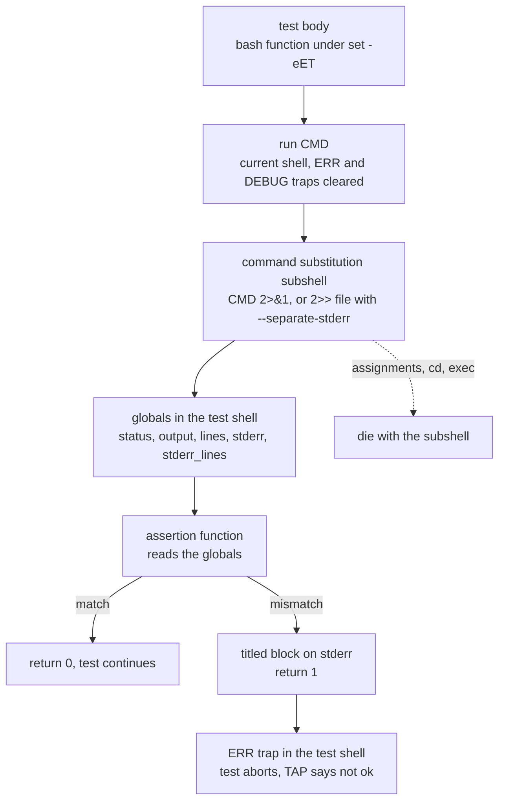

# bats Helpers and Assertions

> [!summary] Claim
> A bats assertion is an ordinary bash function that reads the globals `status`, `output` and `lines` left by the last `run`, prints a diagnostic on stderr, and returns 1, so the whole mechanism rests on three facts: `run` captures through a subshell, the test body runs under `set -e`, and a function failure is just a nonzero return.

## TL;DR

- Mechanism: `run CMD` executes `CMD` in a command substitution, stores `status`, `output` (trailing newlines stripped, stderr merged) and `lines` (empty lines dropped), and always returns 0; helpers such as `assert_output` then compare those globals and `return 1` on mismatch.
- Rule: assert on the exact status and the whole output, pin the status with `run -N` or `assert_failure N`, and use `--separate-stderr` when the stream matters.
- Trap: anything that must persist (a variable, a `cd`, an `exec`) is lost inside `run`, `run CMD | filter` captures nothing, and an assertion called under `if`, `||`, `&&` or a leading `!` cannot fail the test.
- Portability: bats and its libraries are bash only; the code under test can be any shell, and its exit status for a signal-killed child differs by shell (143 in most, 271 in ksh93, 399 in yash), so `assert_failure 143` is not portable.
- When not to use it: for portable-sh test suites that must run under the shell they test, use [[ShellSpec]] or [[shUnit2]]; for pure unit tests of data transforms, a real language test framework beats string assertions.

## Mental model



The test body runs in a bash process with errexit and the ERR trap enabled, and `run` lowers both for the duration of the call so that a failing command cannot abort the test before its result is recorded.
The command itself runs in a command substitution subshell with stderr redirected into stdout (or into a temp file under `--separate-stderr`), and the shell reads its whole stdout back into `output`.
After the substitution `run` splits `output` into `lines`, records the status, restores the traps, and returns 0 unless you asked it to check the status.
An assertion is then a plain function in the test shell: it reads those globals, and on mismatch it pipes a message through a decorator to stderr and returns 1.
That return value reaches the ERR trap only if errexit is active at the call site, which is why the same assertion silently does nothing under `if`, `||` or `&&`.
Everything the subshell did to its own environment is discarded when the substitution ends, which is the dotted arrow.

## How it works

### The test shell and why a failing helper fails the test

Each `@test` block becomes a bash function, and bats evaluates a test file once to count tests and then once per test in its own process (bats-core `docs/source/writing-tests.md`, "Writing tests").
`libexec/bats-core/bats-exec-test` starts with `set -eET` on line 2 (bats-core 1.14.0): errexit, `ERR` trap inheritance into functions and subshells, and `DEBUG`/`RETURN` trap inheritance.
A command that fails in the test body therefore triggers the ERR trap, and the trap marks the test failed and prints the failed command.
POSIX defines the exceptions that make this fragile: the `-e` setting is ignored for a pipeline beginning with `!`, for the compound list after `if`, `while` or `until`, and for any command of an AND-OR list other than the last (POSIX.1-2024 XCU 2.15, `set -e`).
It also says the failure of a command inside a command substitution does not cause the outer shell to exit.
Every helper in this note inherits those rules: an assertion is "just a command that returns 1", and it only fails the test where errexit applies.

### `run`: capture, strip, split

The implementation is the function `run` in `lib/bats-core/test_functions.bash` (bats-core 1.14.0, line 310).
In order:

1. It parses leading flags: `!` sets an expected-status sentinel of -1, `-N` sets an expected status N (rejected if non-numeric or greater than 255), `--keep-empty-lines`, `--separate-stderr`, and `--` ends option parsing.
2. It saves the `INT`, `ERR` and `DEBUG` traps with `trap -p`, installs its own `INT` handler and clears `ERR` and `DEBUG`.
3. It chooses the stderr plumbing: by default `bats_merge_stdout_and_stderr` runs `"$@" 2>&1`; with `--separate-stderr` it creates a file with `mktemp "${tmpdir}/separate-stderr-XXXXXX"` (tmpdir is `BATS_TEST_TMPDIR`, else `BATS_FILE_TMPDIR`, else `BATS_RUN_TMPDIR`) and `bats_redirect_stderr_into_file` runs `"$@" 2>>file`.
4. It runs `set +eET` after saving the flags and captures `output="$("${pre_command[@]}" "$@")"` followed by `status=$?`.
5. Without `--keep-empty-lines` the command substitution strips every trailing newline, as POSIX requires (POSIX.1-2024 XCU 2.6.3: bytes encoded as newline at the end of the output "shall not be included in the replacement").
6. With `--keep-empty-lines` it runs the command followed by `printf .` inside the substitution and strips the dot afterwards with `output="${output%.}"`, so trailing newlines survive.
7. `bats_separate_lines lines output` fills the array; without the flag it is `IFS=$'\n' read -d '' -r -a lines <<<"$output"`, and because `IFS` is only a newline, runs of newlines collapse and empty lines disappear.
   With the flag it is a `while read` loop that first removes one trailing newline to compensate for the one the here-string adds.
8. Under `--separate-stderr` it reads the file back with `read -d '' -r stderr` and splits `stderr_lines` the same way; otherwise it unsets `stderr` and `stderr_lines`.
9. It sets `BATS_RUN_COMMAND="${*}"`, restores the shell flags with `set "-$origFlags"`, and then applies the status check: `!` fails if the status is 0, `-N` fails if the status differs, and a mismatch sets `BATS_ERROR_SUFFIX`, prints the output, restores the traps and returns 1.
10. With no expected status and `status` equal to 127 it calls `bats_generate_warning` (BW01).

Three consequences follow directly from this code.
First, `run` is a function in the test shell, so `output`, `status` and `lines` are ordinary globals that survive until the next `run`.
Second, the command runs in a subshell, which the bats documentation states plainly: "changes will not persist after `run` completes" (writing-tests.md, `run`).
Third, because the capture is a command substitution, a NUL byte in the output is unspecified (POSIX.1-2024 XCU 2.6.3), so binary output needs `bats_pipe ... \| hexdump` or similar.

### `bats_pipe`: pipes inside `run`

`run foo | grep bar` is parsed by bash as `(run foo) | grep bar`, so `grep` reads the output of `run` (which is nothing, since `run` captures into variables and prints nothing) and the variables are set in a pipeline subshell and lost (bats-core `gotchas.md`, "My piped command does not work under run").
`bats_pipe` (bats-core 1.10.0, 2023-07-15) takes the pipe as the literal argument `\|`, escapes every other argument with `printf -v ... "%q"`, and `eval`s the joined string, so the pipeline runs inside the `run` subshell.
Its default exit status mimics `pipefail`: it walks `PIPESTATUS` from the right and returns the last nonzero entry; `-N` returns the status of the stage at position N, and `--returned-status=N` accepts negative values counting from the end.
It refuses a call with no `\|` at all, because that is almost certainly a typo for `|` (test_functions.bash, `bats_pipe`, "Usage error: No `\|`s found").

### `load`, `bats_load_library` and `BATS_LIB_PATH`

`load` is `bats_load_safe` plus `exit 1` on failure.
Its slug resolution in 1.14.0 is: a relative slug is prefixed with `BATS_TEST_DIRNAME`; if `slug.bash` is a file it is sourced; else if `slug` is a file it is sourced; else, "retained for backwards compatibility", if `type -P "$1"` finds an executable file on `PATH` it is sourced.
`source` happens inside the function `bats_internal_load`, which is why a bare `declare` in a loaded file is local to that call and vanishes on return, and why the docs advise `declare -g` (gotchas.md, "Variables I `declare` in a `load`-ed file are not visible").
`bats_load_library` (bats-core 1.6.0, 2022-02-24) searches the colon-separated `BATS_LIB_PATH`; for each directory it tests `DIR/NAME` as a file, then `DIR/NAME/load.bash`, and the first hit wins (`find_in_bats_lib_path`).
The `bats` launcher exports `BATS_LIB_PATH=${BATS_LIB_PATH-/usr/lib/bats}` (libexec/bats-core/bats, line 129), the default added in 1.8.0.
`bats_load_library_safe` returns 1 with the message "Could not find library '...' relative to test file or in BATS_LIB_PATH" instead of exiting.

### bats-support: `fail` and the formatting layer

bats-support is a small library of helpers for other helper libraries (bats-support README).
Its `load.bash` records `BATS_SAVED_PATH="${BATS_SAVED_PATH-$PATH}"` and sources `output.bash`, `error.bash` and `lang.bash`.
`fail` in `src/error.bash` is two lines: print its arguments (or all of stdin) on stderr and `return 1`.
It never calls `exit`, so it also works in `setup` and in helper functions, and the caller decides whether the nonzero return aborts anything.
`output.bash` supplies the layout primitives: `batslib_print_kv_single WIDTH KEY VALUE...` prints `printf '%-*s : %s\n'` rows, `batslib_print_kv_multi` prints `KEY (N lines):` followed by the raw value, `batslib_print_kv_single_or_multi` picks between them depending on whether any value has more than one line, `batslib_prefix` indents, `batslib_mark` marks a line with a symbol, and `batslib_decorate TITLE` frames stdin as a blank line, `-- TITLE --`, the text, `--` and a blank line.
`lang.bash` provides `batslib_is_caller`, which inspects `FUNCNAME` to check whether a helper was called from a given function (bats-file uses it to restrict `temp_make` to `setup`, `setup_file`, `@test`, `teardown` and `teardown_file`, bats-file `src/temp.bash`).

The detail that matters operationally is how `batslib_decorate` runs `cat`.
On bats-support master (commit 787ac476, 2026-10-29) it is `PATH="$BATS_SAVED_PATH" command cat -`, so a test that prepends a fake `cat` to `PATH` cannot corrupt the diagnostics.
The latest tagged release, v0.3.0 (2022-03-04), still has a bare `cat -` at `src/output.bash` lines 41 and 276 and no `BATS_SAVED_PATH` logic, so on the release a PATH mock of `cat` replaces the framing (as of 2026-11).
bats-core exports `BATS_SAVED_PATH` itself since 1.10.0 (`bin/bats` line 70 in 1.14.0; present in `bin/bats` at v1.10.0, absent at v1.9.0) and uses it for its own internals (`bats_execute`), so only the library side lags.

### bats-assert: the assertions

bats-assert's own definition is: "an assertion is a function that perform a test and returns 1 on failure or 0 on success", with diagnostics on stderr "to make assertions usable outside of `@test` blocks", and the most recent `run` supplies the status and output (bats-assert README).
The files sourced by `load.bash` in v2.2.4 (2025-10-14) define `assert`, `refute`, `assert_equal`, `assert_not_equal`, `assert_success`, `assert_failure`, `assert_output`, `refute_output`, `assert_line`, `refute_line`, `assert_regex` and `refute_regex`.
The same v2.2.4 files also define the four stderr variants: `assert_stderr` in `assert_output.bash`, `refute_stderr` in `refute_output.bash`, `assert_stderr_line` in `assert_line.bash` and `refute_stderr_line` in `refute_line.bash` (bats-assert v2.2.4 `src/`); they read `stderr` and `stderr_lines`, so they need `run --separate-stderr`.
The README on master (2026-10-18) lists all four; tags before v2.2.4 may lack them, so check the tag you install before relying on the stderr variants.
The mechanics worth knowing, all from `src/*.bash`:

- `assert_equal ACTUAL EXPECTED` compares with `[[ $1 != "$2" ]]` and labels `$2` as `expected`, so the order is actual first.
- `assert_success` and `assert_failure` start with `: "${output?}"` and `: "${status?}"`, so calling them before any `run` aborts with a parameter-not-set error instead of passing.
- `assert_failure` with no argument accepts every nonzero status; with an argument it requires an exact match and reports "command failed as expected, but status differs".
  The README summary line "Assert exit status is 0 or 1" is looser than the code, which tests `status == 0` and nothing else.
- `assert_output`, `refute_output`, `assert_stderr` and `refute_stderr` share `__assert_stream` and `__refute_stream`, which dispatch on `${FUNCNAME[1]}`; the modes are literal (default), `-p` partial (`[[ $stream == *"$expected"* ]]`), `-e` regexp (`[[ $stream =~ $expected ]]`) and `-`/`--stdin` to read the expectation from stdin; `-p` with `-e` is an error.
- With no arguments at all, `assert_output` means "non-empty" and `refute_output` means "empty"; with only an option and no operand the expectation is the empty string, which a partial match always satisfies.
- The anchors `^` and `$` bind to the whole output and not to each line, because the regexp is applied to `$output` as one string (README note under `assert_output`).
- `assert_line` and `refute_line` use the `lines` array, so they never see blank lines unless `run --keep-empty-lines` was used; `-n INDEX` checks one element (an index past the end compares against an empty string); a negative index is accepted by the validator `^-?([0-9]|[1-9][0-9]+)$`.
- A regexp is validated first by `__check_is_valid_regex` (defined in `src/refute_line.bash`), which runs `[[ '' =~ $regex ]]` and treats status 2 (not 1) as "invalid regular expression", so a malformed pattern produces an `ERROR:` block instead of a false mismatch; on bash 5.3 and later it also captures the detailed message.
- `assert` and `refute` run `"$@"` as a simple command, which is why a compound command such as `[[` cannot be passed and needs `bash -c` (README note under `assert`).
- `assert_regex VALUE PATTERN` is independent of `run` and reports the `nocasematch` state as `case : sensitive` or `insensitive`.

### bats-file: filesystem assertions and its portability branches

bats-file adds `assert_exists`, `assert_file_exists`, `assert_dir_exists`, `assert_link_exists`, `assert_fifo_exists`, `assert_file_executable`, `assert_file_permission`, `assert_file_owner`, `assert_file_size_equals`, `assert_file_empty`, `assert_file_contains`, `assert_symlink_to`, `assert_files_equal`, their `_not_` counterparts, and `temp_make` and `temp_del` (bats-file README index).
Its source shows how a helper library absorbs utility differences.
`assert_file_permission` and `_bats_get_file_owner` branch on `[[ "$OSTYPE" == darwin* ]]` to choose BSD `stat -f '%A'` and `stat -f %Su` versus GNU `stat -c "%a"` and `stat -c %U`, so every non-darwin host takes the `-c` branch.
`assert_symlink_to` uses `readlink -f` off macOS and an internal `_bats_file_readlinkf_macos` emulation on darwin.
`assert_file_size_equals` takes `wc -c "$file" | awk '{print $1}'` and so depends on `awk` being present.
`temp_make` calls `mktemp -d -- "${BATS_TMPDIR}/${template}"` and is restricted to `setup`, `setup_file`, a test, `teardown` or `teardown_file` via `batslib_is_caller --indirect` (its error message names only the first three); `temp_del` is `rm -r -- "$path"` with two escape hatches, `BATSLIB_TEMP_PRESERVE=1` and `BATSLIB_TEMP_PRESERVE_ON_FAILURE=1` (the latter only from teardown).
The latest bats-file release is v0.4.0 (2023-08-23) (as of 2026-11).
For new tests prefer `BATS_TEST_TMPDIR`, which bats-core has provided since 1.4.0 (2021-07-23) and removes automatically, over `temp_make`.

### Other bats-core helpers that behave like assertions

- `skip [REASON]` sets `BATS_TEST_SKIPPED`, marks the test completed and calls `exit 0`; `setup` and `teardown` still run for skipped tests (writing-tests.md, `skip`).
- `bats_require_minimum_version X.Y.Z` (1.7.0) exits the file with failure on an older bats and raises the guaranteed floor so that BW02 stays quiet when `run` flags are used.
- `bats_test_function --description D --tags T -- CMD...` (1.11.0, 2024-03-24) registers tests from a loop, which `@test` inside a `for` cannot do because of preprocessing.
- `bats::on_failure` (1.12.0, 2025-05-18) is a hook called before `teardown` only when a test aborts.
- The warnings BW01 (`run` returned 127), BW02 (flags without a version guard) and BW03 (`setup_suite` defined outside `setup_suite.bash`) print after the run and do not change the exit status; this was measured with a test using `run --keep-empty-lines` without a guard, which printed BW02 and exited 0 (bats-core 1.14.0, 2026-11-21).

## Numbers and limits

| Item | Value | Source |
| --- | --- | --- |
| `run -N` range | 0 to 255; larger is "Usage error" | bats-core 1.14.0 `run()` |
| `run` flags `!`, `-N`, `--keep-empty-lines`, `--separate-stderr` | since 1.5.0 (2021-10-22) | bats-core CHANGELOG 1.5.0 |
| `bats_load_library`, `BATS_LIB_PATH` | since 1.6.0 (2022-02-24); default `/usr/lib/bats` since 1.8.0 | CHANGELOG 1.6.0, 1.8.0 |
| `bats_require_minimum_version`, BW01, BW02 | since 1.7.0 (2022-05-14) | CHANGELOG 1.7.0 |
| `BATS_TEST_TMPDIR`, `BATS_FILE_TMPDIR`, `BATS_SUITE_TMPDIR` | since 1.4.0 (2021-07-23) | CHANGELOG 1.4.0 |
| `bats_pipe` | since 1.10.0 (2023-07-15), documented in 1.11.1 | CHANGELOG 1.10.0, 1.11.1 |
| `run --errexit` / `BATS_RUN_ERREXIT` | since 1.14.0 (2026-07-21) | CHANGELOG 1.14.0, `libexec/bats-core/bats` option `--errexit` |
| Latest releases | bats-core 1.14.0, bats-assert v2.2.4 (2025-10-14), bats-support v0.3.0 (2022-03-04), bats-file v0.4.0 (2023-08-23) (as of 2026-11) | GitHub releases API |
| Lines for `printf 'a\n\nb\n\n'` | `lines` has 2 entries and `${#output}` is 4 by default; with `--keep-empty-lines` 4 entries and length 6 | measured here, bats 1.14.0, 2026-11-21 |
| Lab report output | 3 entries by default, 6 with `--keep-empty-lines` | lab, test 2 and test 3 |
| `batslib_print_kv_single` widths | `assert_equal` 8, `assert_success` 6, `assert` 10, partial 9 | bats-assert `src/*.bash` |
| `run` with a function containing `false; echo after` | default: status 0, output `after`; with `--errexit`: status 1, empty output | measured here, bats 1.14.0, 2026-11-21 (hand probe, not in the lab) |
| Lab result | 28 tests, all passing, `LAB_SHELL` unset (`sh` is macOS bash 3.2.57), one run | lab, run 2026-11-21 |

The 1.14.0 `run --errexit` row needs a caveat.
The CHANGELOG lists `--errexit` under "Added" and also lists under "Fixed" that `run` now honors `set -e` in your functions and "the new behavior should be the default".
The measured behavior on the installed 1.14.0 is opt-in: without the flag the function ran past `false`, and only `bats --errexit` made `run` stop at it.
Treat the flag as the contract and do not rely on either default.

## Portability

The assertion libraries need bash (`[[`, arrays, `FUNCNAME`, `local -r`), and bats itself is a bash program, so the portability question is about the code under test and about what `run` can observe of it.

| Shell under test | `$?` after a SIGTERM-killed child | `set -e` skips `!` pipeline | Basis |
| --- | --- | --- | --- |
| POSIX sh (spec) | greater than 128, implementation-defined, may exceed 255 | yes | POSIX.1-2024 XCU 2.8.2 and 2.15 `set -e` |
| macOS bash 3.2.57 | 143 | yes | measured here 2026-11-21 |
| bash 5.3.15 | 143 | yes | measured here 2026-11-21; the `!` and `[[` results reproduced on bash 5.3.20 |
| zsh 5.9.2 native | 143 | yes | measured here 2026-11-21 |
| zsh 5.9 `--emulate sh` (Debian) | 143 | yes | measured in the shell matrix image 2026-11-21 |
| dash (Homebrew build; Debian `sh` is dash 0.5.12) | 143 | yes | measured here 2026-11-21, and in the shell matrix image |
| ksh93u+ 2012-08-01 (macOS `/bin/ksh`) | 271 | yes | measured here 2026-11-21 |
| ksh93u+m 1.0.10 (Debian) | 271 (256 + 15) | yes | measured in the shell matrix image 2026-11-21 |
| mksh R59c (Debian) | 143 | yes | measured in the shell matrix image 2026-11-21 |
| yash 2.58.1 (Alpine) | 399 (384 + 15) | yes | measured in the shell matrix image 2026-11-21 |
| posh 0.14.1 (Debian) | 143 | yes | measured in the shell matrix image 2026-11-21 |
| BusyBox ash 1.37.0 (Alpine `sh`) | 143 | yes | measured in the shell matrix image 2026-11-21 |

The lab asserts the signal status per family in test 9 and the `!` exemption in test 10, both through `run_lab_c`, but it has been run only under macOS `/bin/sh`; the rows for the other shells were measured by hand with the same two commands in the shell matrix images, and the 128 + N, 256 + N and 384 + N rule matches what the matrix confirmed for earlier labs.
Because POSIX permits statuses above 255 for signal deaths, a status assertion such as `assert_failure 143` is correct for most shells and wrong for ksh93 and yash; pin only "nonzero", or compute the expected value per shell family as the lab does.

Two bash-version facts affect test bodies themselves, not the code under test.
On macOS bash 3.2.57, `set -e; [[ 1 == 2 ]]; echo reached` printed `reached`, and a false `[[` inside a function did not abort it either, while bash 5.3.15 exited at the `[[` (measured here 2026-11-21).
The bats gotcha says the same: the `set -e` handling of `[[ ]]` and `(( ))` changed in Bash 4.1, and appending `|| false` works everywhere.
Use `[ ]` in tests, or an assertion function, so a test is not silently lenient on a bash 3.2 runner.

| Utility area | GNU | BSD and macOS | BusyBox | uutils | Basis |
| --- | --- | --- | --- | --- | --- |
| `stat` format flag used by bats-file | `-c %a`, `-c %U` | `-f %A`, `-f %Su` | not claimed | not claimed | bats-file `src/file.bash`, `OSTYPE` branch |
| `readlink -f` | used directly | emulated by `_bats_file_readlinkf_macos` | not claimed | not claimed | bats-file `src/file.bash` |
| `wc -c FILE \| awk '{print $1}'` in `assert_file_size_equals` | same code path | same code path | same code path | same code path | bats-file `src/file.bash`, no branch |

The bats-file row says what the code branches on, not which utilities exist on which platform; every non-darwin host is sent down the GNU branch.

## Worked example

The lab is [lab](../labs/14-bats-helpers-and-assertions/).
It contains `report.sh` (the script under test), `libs/mini-assert/load.bash` (a small reimplementation of the bats-support and bats-assert mechanism, not those libraries), `declare_probe.bash` and `helpers.bats` (28 tests).
Every `run` of the code under test goes through `run_lab`, `run_lab_c` or a thin wrapper that adds `run`'s own flags in front of the shell words.

`report.sh`, verbatim:

```sh
#!/bin/sh
# report.sh STATUS: print a report with empty lines on stdout, a warning on stderr, exit STATUS.
# The probe for what bats `run` captures: stdout and stderr in order, empty lines, trailing newlines.
printf 'alpha\n\nbeta\n\n\n'
printf 'warn: disk almost full\n' >&2
exit "${1:-0}"
```

The wrapper and the setup, verbatim from `helpers.bats`:

```bash
setup() {
  load ../lib/lab
  bats_require_minimum_version 1.10.0
  export BATS_LIB_PATH="$BATS_TEST_DIRNAME/libs"
  bats_load_library mini-assert
  REPORT="$BATS_TEST_DIRNAME/report.sh"
}

# run_lab_flags RUN_FLAG... -- ARG...: like run_lab, with flags for `run` itself before the shell.
run_lab_flags() {
  local -a flags=()
  while [ "$1" != -- ]; do
    flags+=("$1")
    shift
  done
  shift
  lab_shell_words
  run "${flags[@]}" "${LAB_SHELL_WORDS[@]}" "$@"
}
```

Two tests that pin the capture rules, verbatim:

```bash
@test "run drops empty lines from lines by default" {
  run_lab "$REPORT" 0
  [ "${#lines[@]}" -eq 3 ]
  [ "${lines[0]}" = alpha ]
  [ "${lines[1]}" = beta ]
  [ "${lines[2]}" = "warn: disk almost full" ]
}

@test "run --keep-empty-lines keeps empty lines and the trailing newline" {
  run_lab_flags --keep-empty-lines -- "$REPORT" 0
  [ "${#lines[@]}" -eq 6 ]
  [ "${lines[0]}" = alpha ]
  [ -z "${lines[1]}" ]
  [ "${lines[2]}" = beta ]
  [ -z "${lines[3]}" ]
  [ -z "${lines[4]}" ]
  [ "${lines[5]}" = "warn: disk almost full" ]
  [ "${output: -1}" = $'\n' ]
}
```

The mechanism of an assertion is shown by testing the assertion itself: `run assert_output want` executes the helper in a subshell that inherits the `output` of the previous `run`, and then overwrites `output` with the helper's stderr, so the test can inspect the diagnostic (simplified excerpt of the lab test "a literal mismatch prints a titled block with expected and actual"):

```bash
run_lab_c 'echo have'
assert_output have
run assert_output want
[ "$status" -eq 1 ]
[ "${lines[0]}" = "-- output differs --" ]
[ "${lines[1]}" = "expected : want" ]
[ "${lines[2]}" = "actual   : have" ]
[ "${lines[3]}" = "--" ]
```

The last test runs the real `bats` on a generated file to show the three behaviors that are hard to see from inside one test: what a bare `[ ]` reports, what a mid-test negation does, and what `skip` does.
The generated file is, verbatim:

```bash
#!/usr/bin/env bats
bats_require_minimum_version 1.5.0

setup() {
  bats_load_library mini-assert
}

@test "neg-mid" {
  ! true
  true
}

@test "run-neg" {
  run ! true
}

@test "raw-bracket" {
  run printf have
  [ "$output" = want ]
}

@test "mini-assert" {
  run printf have
  assert_output want
}

@test "skipper" {
  skip "why"
  false
}
```

Output of `bats --tap` on that file (captured from a hand run of the generated file, bats 1.14.0, 2026-11-21; the lab test asserts the `ok`/`not ok` lines, the two diagnostic lines and that `have` appears once):

```text
1..5
ok 1 neg-mid
not ok 2 run-neg
# (in test file scratch/nested2.bats, line 14)
#   `run ! true' failed, expected nonzero exit code!
not ok 3 raw-bracket
# (in test file scratch/nested2.bats, line 19)
#   `[ "$output" = want ]' failed
not ok 4 mini-assert
# (from function `assert_output' in file labs/14-bats-helpers-and-assertions/libs/mini-assert/load.bash, line 160,
#  in test file scratch/nested2.bats, line 24)
#   `assert_output want' failed
#
# -- output differs --
# expected : want
# actual   : have
# --
#
ok 5 skipper # skip why
```

`neg-mid` passes although `! true` is false, because errexit ignores a leading `!` unless it is the last command; `raw-bracket` fails without showing either value; `mini-assert` shows both.
The lab invokes the public Bats runner with a clean environment and relies on the outer test's timeout to bound the entire nested run.

The lab output, captured from one run on 2026-11-21 with `bats --tap` and `LAB_SHELL` unset (so `sh`, macOS bash 3.2.57):

```text
1..28
ok 1 run merges stderr into output and strips trailing newlines
ok 2 run drops empty lines from lines by default
ok 3 run --keep-empty-lines keeps empty lines and the trailing newline
ok 4 run --separate-stderr fills stderr and stderr_lines and leaves them out of output
ok 5 run succeeds whatever the status and records BATS_RUN_COMMAND
ok 6 run -N and run ! check the status and return 1 on a mismatch
ok 7 a missing command reports status 127 inside the shell
ok 8 assert_failure without a status accepts any nonzero status, so pin the status
ok 9 a signal-killed child gives 128+N in most shells, 256+N in ksh93 and 384+N in yash
ok 10 set -e does not exit for a negated pipeline, which is why bats needs run !
ok 11 run executes a function in a subshell, so its assignments are lost
ok 12 run CMD | filter captures nothing, while run bats_pipe keeps the output
ok 13 bats_pipe returns the last failing status, and -N picks one stage
ok 14 load runs inside a function: a bare declare is local, a plain assignment is global
ok 15 bats_load_library takes the first match along BATS_LIB_PATH
ok 16 bats_load_library_safe returns 1 with a message instead of exiting
ok 17 the decorator keeps working when a test puts a fake cat first on PATH
ok 18 a literal mismatch prints a titled block with expected and actual
ok 19 assert_output --partial and --regexp match substrings and patterns
ok 20 an invalid regular expression is an error, not a mismatch
ok 21 regexp anchors bind to the whole output, not to each line
ok 22 assert_output with no argument means non-empty and refute_output with none means empty
ok 23 assert_line matches exactly, as a substring, or at an index into the non-empty lines
ok 24 assert_equal takes the actual value first and the expected value second
ok 25 assert_success reports the status and the output of the failed command
ok 26 multi-line values are printed as indented blocks with a line count
ok 27 assert takes a simple command, so a compound [[ needs bash -c
ok 28 a nested bats run shows what a bare [ ] hides, what a negation skips, and what skip does
```

The lab was run once, under the default shell only, before the final comment-only ShellCheck suppressions were added; ShellCheck and shfmt were each run once on the final files with the labs configuration and reported nothing.
The shell matrix and mutation tests were not run (paused by instruction).

## Pitfalls

> [!warning] The command runs in a subshell
> Trigger: `run myfunc` where `myfunc` sets a variable, changes directory, or calls `exec`.
> Symptom: the assertion after `run` sees the old value, the working directory is unchanged, and an `exec` in a directly called function replaces the test shell so the test stops without a result (gotchas.md, "My test stops without reporting a result when the code under test uses exec").
> Fix: call the function without `run` when you need its side effects, or assert on `$output` and files; use `run ./script.sh` for scripts that `exec`.
> The lab proves the variable case in test 11.

> [!warning] `run cmd | filter` captures nothing
> Trigger: `run foo | grep bar`.
> Symptom: `grep` reads an empty stream, `output` is unset in the test shell because the pipeline stage was a subshell, and the test either fails mysteriously or passes vacuously.
> Fix: `run bats_pipe foo \| grep bar`, `run sh -c 'foo | grep bar'`, or a wrapper function.
> The bats docs give the `jq -e` variant: `jq` receives no input, executes no filter and succeeds.
> The lab proves both forms in test 12.

> [!warning] A failing assertion that errexit does not see
> Trigger: `assert_output x || true`, `if assert_output x; then`, `assert_output x && next`, or `! assert_output x`.
> Symptom: the test passes although the assertion returned 1, because POSIX ignores `-e` in those positions (POSIX.1-2024 XCU 2.15, `set -e`) and bash follows it.
> Fix: call assertions as standalone commands, express the negative with `refute_output` or `run assert_output x` plus a status check, and for a negated external command use `run !`.
> bats documents the same hole for `! true` mid-test (gotchas.md, "My negated statement"); the lab proves it in test 10 for the shell and in test 28 for the runner.

> [!warning] `assert_failure` without a status accepts a typo
> Trigger: `run mytool --bogus-flag` followed by `assert_failure`.
> Symptom: any nonzero status passes: usage error 2, a missing binary (127), a permission problem (126), a segfault (139), or a failure of the wrong kind.
> Fix: pin the status with `assert_failure 2` or `run -2 mytool ...`, and assert the message with `assert_output`.
> The BW01 warning exists for exactly this class: a typo in the command string leaves `run` "successful" and the code 127 hidden (BW01.md, citing bats-core issue 578).
> Inside the shell a missing command reports 127 as POSIX requires (POSIX.1-2024 XCU 2.8.2), which the lab proves in test 7; pin it with `run -127` when it is intended.

> [!warning] Trailing newlines and empty lines are invisible by default
> Trigger: asserting output that ends in blank lines, or asserting a line index in output with blank lines.
> Symptom: `assert_output 'x'` passes for `x`, `x\n` and `x\n\n\n`; `lines[1]` is the second non-empty line, and `assert_line ''` can never match (lab test 23).
> Fix: use `run --keep-empty-lines` (and a `bats_require_minimum_version 1.5.0` guard) when blank lines are part of the contract, or compare files with `cmp`/`diff` for byte-exactness, which is the territory of [[Golden-Output-Tests]].

> [!warning] Anchors apply to the whole output
> Trigger: `assert_output --regexp '^two$'` on two-line output `one` and `two`.
> Symptom: the assertion fails although a line equals `two`, because `^` and `$` bind to the string `$output` (bats-assert README note); the lab proves it in test 21.
> Fix: use `assert_line --regexp '^two$'`, which matches per element of `lines`.

> [!warning] `run` clobbers the state an assertion reads
> Trigger: `run assert_x ...` to test a failure, then a plain `assert_y` that expects the earlier command's output.
> Symptom: the second assertion reads the diagnostic text of the first, or `$output` is unset after a `run` inside a pipeline.
> Fix: re-run the command under test before each independent assertion, or copy `$output` to a local variable first; the lab does this in tests 19 and 21.

> [!warning] Released bats-support frames diagnostics with a bare `cat`
> Trigger: a test that puts a fake or recording `cat` first on `PATH` (see [[Mocking-Commands-via-PATH]]) and then triggers a failing assertion, on bats-support v0.3.0.
> Symptom: the "-- title --" block contains the mock's output in place of the message.
> Fix: use bats-support master or a vendored copy that has `PATH="$BATS_SAVED_PATH" command cat -`, and keep mocks to the commands under test.
> The lab's mini-assert has the saved-PATH form and test 17 shows both the effect of the fake `cat` and the survival of the diagnostic.

> [!warning] `[[ ]]` and `(( ))` do not fail a test on bash 3.2
> Trigger: `[[ "$output" == x ]]` in a test run by macOS system bash 3.2.57.
> Symptom: a false `[[` mid-test does not abort it (measured here: `set -e; [[ 1 == 2 ]]; echo reached` printed `reached`), while bash 5.3.15 aborts; the same test passes on one runner and fails on another.
> Fix: use `[ ]`, an assertion function, or append `|| false` (gotchas.md, "`[[ ]]` (or `(( ))` did not fail my test").

> [!warning] Background jobs hold file descriptor 3
> Trigger: a test starts a daemon or `sleep 100 &`.
> Symptom: bats hangs after the last test until the background process exits, because it inherited the TAP descriptor (gotchas.md, "Background tasks prevent the test run from terminating"; writing-tests.md, "File descriptor 3").
> Fix: start such jobs with `3>&-`, and bound every test with `BATS_TEST_TIMEOUT`.

> [!warning] `declare` in a loaded helper is function-local
> Trigger: `declare TEST_ROOT=/x` in `helpers.bash` loaded with `load`.
> Symptom: `TEST_ROOT` is empty in the tests because `source` ran inside `bats_internal_load`.
> Fix: a plain assignment, or `declare -g` on bash 4.2 or later; the lab proves the local `declare` and the global assignment in test 14 and does not exercise `declare -g`, which bash 3.2 rejects.

> [!warning] A typo in `load` can source a file from `PATH`
> Trigger: `load helpr` when no `helpr.bash` or `helpr` exists next to the test but an executable file of that name is on `PATH`.
> Symptom: `bats_load_safe` falls through to `type -P` and `source`s it (test_functions.bash, "loading from PATH (retained for backwards compatibility)").
> Fix: always load with an explicit relative or absolute path, and keep `PATH` clean in CI.

## Security and robustness

- Tests run with the developer's or CI runner's privileges, and `load`, `bats_load_library` and `BATS_LIB_PATH` all `source` code, so a world-writable directory in `BATS_LIB_PATH` (the default includes `/usr/lib/bats`) or in `PATH` is code execution as the test user; vendor libraries at a pinned commit and verify the checkout.
- `bats_pipe` quotes each argument with `%q` before `eval`, so data arguments are safe, but an argument that is exactly the single character `|` is not escaped and is read as a pipe operator (test_functions.bash, `bats_pipe`); do not pass untrusted data as a bare `|`.
- A failing assertion prints the full `output` and, from `assert_success` and `assert_failure`, the `stderr` too, so tokens, passwords or customer data printed by the code under test end up in CI logs; keep secrets out of tested output, use obviously invalid placeholders, and be careful with `--show-output-of-passing-tests`, `--verbose-run` and `--gather-test-outputs-in`, which broaden what is retained.
- `temp_del` runs `rm -r -- "$path"` on whatever it is given and "can be used to delete any file or directory" (bats-file README); an empty or wrong variable is a recursive delete, so prefer `BATS_TEST_TMPDIR`, which bats creates and removes.
- Keep every scratch path under `BATS_TEST_TMPDIR` and never construct a path from test input for `rm`, as the lab does.
- Robust tests assert exact statuses and exact output, run each case in its own `BATS_TEST_TMPDIR`, bound background work with a timeout, and fail loudly when a tool is missing instead of skipping.
- Do not suppress the warnings: BW01 and BW02 are the framework telling you a test may be passing for the wrong reason.

## The principal's view

The decision is how much assertion machinery to own.
The default is bats-core plus bats-support and bats-assert pinned to a commit, because the assertion layer is the part of a shell test suite that engineers read when it fails, and a titled expected-versus-actual block saves minutes on every red build.
Write your own helpers only for domain assertions (a JSON status line, a manifest layout) and build them on `fail` and the `batslib_*` formatters so they return 1, print on stderr and compose, as the stock ones do.
The trade-off is a dependency chain with uneven release cadence: bats-core ships regularly, bats-assert's last tag is v2.2.4 (2025-10-14), bats-support's is v0.3.0 (2022-03-04), and master has fixes the tags lack.
Pin the exact commit, review the diff when updating, and run the suite on the oldest bash you support, because the helpers lean on `[[`, arrays and `FUNCNAME`, and the framework's own `set -e` semantics differ on bash 3.2.
Choose a different tool when the test must execute under a non-bash shell (use [[ShellSpec]], whose runner is portable, or [[shUnit2]]), when you need to assert on the shell's own behavior across a matrix (see [[Cross-Shell-CI-Matrices]]), or when the logic under test is more than a few hundred lines of data transformation and should live in a language with real types and a debugger.
Use bats for what it is good at: a command's exit status, stdout, stderr and filesystem effects, with the code under test run as a separate process so its failures cannot corrupt the test shell.
In review ask: does each test pin the status, does each assertion fail when the behavior is absent, and is the negative case written with `run !` or `refute_*` (see [[Reviewing-Shell-at-Staff-Level]]).

## Interview questions

> [!question] L5: What does `run` do, and why does `run false` not fail the test?
>
> > [!success]- Answer
> > `run` executes its arguments in a subshell via command substitution and stores the status in `$status`, the combined stdout and stderr (trailing newlines stripped) in `$output`, and the non-empty lines in `$lines`.
> > It returns 0 regardless, so the test continues, and you assert on the variables.
> > `run -N` and `run !` (bats-core 1.5.0 and later) add an implicit status check that returns 1 on mismatch.
> >
> > Follow-up: When is it better not to use `run`?
> > When you only need the command to succeed, because the test body runs under `set -e` and a bare command fails the test with a clearer trace.

> [!question] L5: Predict the output: after `run printf 'a\n\nb\n\n'`, what are `${#lines[@]}` and `${#output}`, and what changes with `run --keep-empty-lines`?
>
> > [!success]- Answer
> > By default `output` is `a`, newline, newline, `b` (the command substitution strips the two trailing newlines), so the length is 4 and `lines` has 2 entries because the empty line is dropped.
> > With `--keep-empty-lines` the dot trick keeps the trailing newlines, so the length is 6 and `lines` has 4 entries: `a`, empty, `b`, empty.
> > This was measured with bats 1.14.0 and the same pattern is asserted in the lab as 3 versus 6 entries.
> >
> > Follow-up: Which bats release made `--keep-empty-lines` stop counting a phantom trailing line?
> > 1.10.0, per the CHANGELOG entry for issue 711.

> [!question] L5: Debug this script: `@test "t" { run foo | grep -q bar; [ "$status" -eq 0 ]; }` fails or passes for the wrong reason - why?
>
> > [!success]- Answer
> > Bash parses the pipe first, so `run foo` is one pipeline stage in a subshell and `grep` reads what `run` printed, which is nothing.
> > `status` and `output` are set in that subshell and never reach the test shell, so `$status` is stale or unset.
> > Fix with `run bats_pipe foo \| grep -q bar`, or `run sh -c 'foo | grep -q bar'`, or a wrapper function.
> >
> > Follow-up: What does `bats_pipe` return as its status by default?
> > The last nonzero status among the stages, like `pipefail`; `-N` selects the stage at position N.

> [!question] L6: Why does `assert_failure` alone make a weak test, and what should you write instead?
>
> > [!success]- Answer
> > With no argument it accepts every nonzero status, including 127 for a mistyped command and 126 for a permission problem, so a broken test setup still passes.
> > Pin the status with `assert_failure 2` or `run -2 cmd`, and assert the diagnostic with `assert_output --partial`.
> > BW01 exists because a 127 under `run` otherwise stays hidden.
> >
> > Follow-up: How would you portably assert that a child died of SIGTERM?
> > Not with `143`, because POSIX allows statuses above 255 and ksh93 reports 271 and yash 399; assert nonzero and check the signal through the shell under test.

> [!question] L6: Why does `assert_output` fail for `^two$` when a line is exactly `two`?
>
> > [!success]- Answer
> > The regexp is applied to the whole `$output` string with bash `=~`, so `^` and `$` anchor the start and end of the output and not of each line.
> > Use `assert_line --regexp '^two$'`, which tests each element of `lines`.
> > Remember that `lines` omits empty lines unless `--keep-empty-lines` was given.
> >
> > Follow-up: What does `assert_output -e '('` do?
> > It reports an `ERROR:` block, because the validator treats regex status 2 as an invalid pattern, not as a non-match.

> [!question] L6: A test runs `run check_counter`, where the function increments `COUNTER`, and then asserts `COUNTER` is 1 but sees 0 - why?
>
> > [!success]- Answer
> > `run` executes the function in a command substitution subshell, so the increment is lost when it returns.
> > Call `check_counter` directly (letting `set -e` catch failure) and assert on `COUNTER`, or print the value and assert on `$output`.
> >
> > Follow-up: What does the same rule imply for a function that calls `exec`?
> > The `exec` replaces the test shell when called directly, so wrap it in `run` or an explicit subshell.

> [!question] L6: How does bats-support keep a mocked `cat` from corrupting assertion diagnostics?
>
> > [!success]- Answer
> > On master, `batslib_decorate` and `batslib_err` run `PATH="$BATS_SAVED_PATH" command cat -`, where `BATS_SAVED_PATH` is the `PATH` at load time (and bats-core exports it itself since 1.10.0), so a `PATH` mock is bypassed.
> > The tagged v0.3.0 release (2022-03-04) still uses a bare `cat -`, so on that release the mock wins.
> >
> > Follow-up: What else does bats-core run with the saved `PATH`?
> > Its own internals, through `bats_execute`.

> [!question] L7+: Why can `assert_output x || true` and `! assert_output x` not do what they look like, and how do you write a real negative assertion?
>
> > [!success]- Answer
> > An assertion fails the test only by returning 1 into an errexit context, and POSIX ignores `-e` for any AND-OR command other than the last, for `if` conditions, and for a pipeline beginning with `!`.
> > So `|| true` swallows the failure and a leading `!` turns the assertion's failure into success without tripping `-e`.
> > Use `refute_output`, or `run assert_output x` followed by `[ "$status" -eq 1 ]`, and for an external command use `run !`.
> >
> > Follow-up: What happens if `! cmd` is the last command in the test?
> > Its negated status becomes the function's return code, so it does fail the test.

> [!question] L7+: Design a custom assertion helper for a domain check, and say what contract it must follow to behave like the stock ones.
>
> > [!success]- Answer
> > It should read `status` and `output` or `lines` from the last `run`, guard them with `: "${output?}"`, never call `exit`, print a titled block on stderr using `fail` and the `batslib_*` formatters, and `return 1`.
> > It must be called as a standalone command so errexit applies, it should support `--` to stop option parsing, and it should validate regexps before matching so a bad pattern is an error rather than a mismatch.
> > Add a test that calls it through `run` and asserts both the status 1 and the exact diagnostic.
> >
> > Follow-up: Why is returning, not exiting, the right choice?
> > Because helpers must work in `setup`, in other helpers and under `run`, and exiting would kill the test shell without the framework's reporting.

> [!question] L7+: What are the likely causes when a suite passes on Linux CI but fails on a colleague's Mac in `assert_file_permission` and in a `[[` check?
>
> > [!success]- Answer
> > bats-file branches on `OSTYPE` between BSD `stat -f %A` and GNU `stat -c %a`, so a missing or wrong branch for the platform changes results, and a custom helper that calls `stat -c` fails on macOS.
> > The `[[` check is lenient under errexit on bash 3.2 and strict on bash 4.1 or later, so a false `[[` mid-test is ignored by the system bash.
> > Run CI on both platforms, use `[ ]` or `|| false`, and pin the bash used to run bats.
> >
> > Follow-up: How would you prove which bash is running the tests?
> > Print `$BASH_VERSION` from a `setup_file` and compare it against the matrix.

## Related

Prerequisites: [[bats-core]]

Next: [[ShellSpec]]

See also: [[shUnit2]], [[Mocking-Commands-via-PATH]], [[Golden-Output-Tests]], [[Characterization-Tests-for-Legacy-Scripts]], [[Coverage-with-kcov]], [[Cross-Shell-CI-Matrices]], [[ShellCheck-Warning-Families]], [[Reviewing-Shell-at-Staff-Level]]

## Further reading

- bats-core, "Writing tests" (`docs/source/writing-tests.md`): `run`, `bats_pipe`, `load`, `bats_load_library`, `skip`, `setup` and `teardown`, and the special variables; the authoritative contract for every helper in this note.
- bats-core, "Gotchas" (`docs/source/gotchas.md`): the documented traps (negation, `[[`, `declare` in `load`, pipes under `run`, `exec`, background jobs).
- bats-core `lib/bats-core/test_functions.bash` at v1.14.0: the implementation of `run`, `bats_pipe`, `load`, `bats_load_library` and `skip`.
- bats-core warnings BW01, BW02 and BW03 (`docs/source/warnings/`): why `run` flags need a version guard and why exit 127 is flagged.
- bats-core CHANGELOG (`docs/CHANGELOG.md`): when each helper appeared and the 1.14.0 `--errexit` change.
- bats-assert README and `src/`: the assertion API, option semantics and the exact diagnostics.
- bats-support README and `src/`: `fail`, the `batslib_*` formatters and the saved-`PATH` decorator.
- bats-file README and `src/file.bash`: filesystem assertions and the `stat` and `readlink` branches.
- POSIX.1-2024 Shell Command Language, XCU 2.6.3, 2.8.2 and 2.15 (`set`): command substitution newline stripping, exit status for signals and missing commands, and the `-e` exceptions that decide whether an assertion can fail a test.
