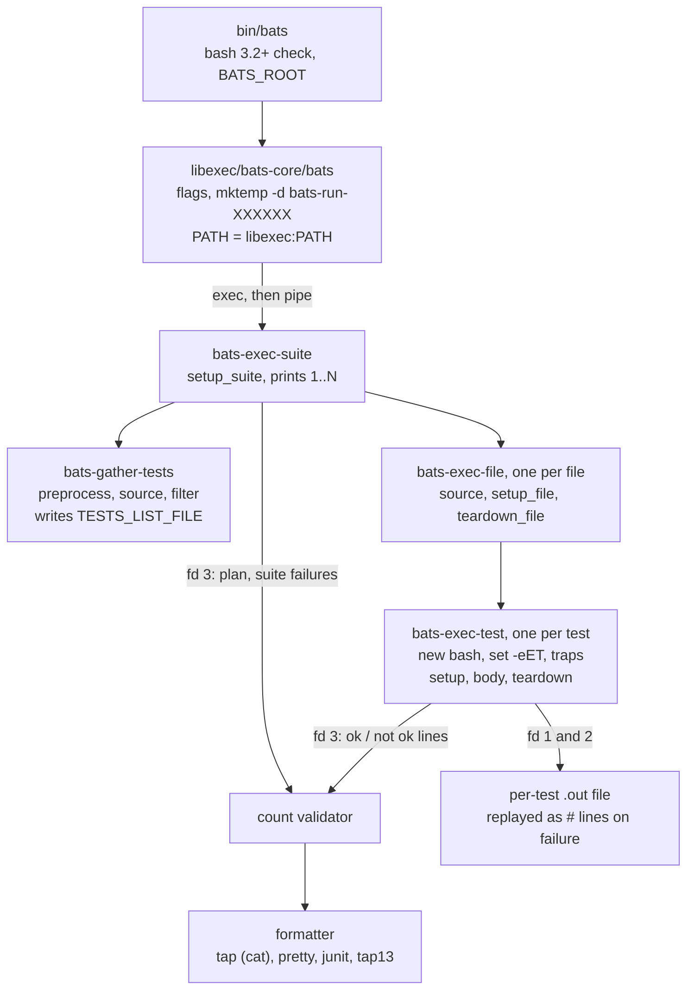

# bats-core

> [!summary] Claim
> bats-core is a bash program that rewrites each `.bats` file into plain bash functions, evaluates the file several times to count and then run the tests, and runs every test in its own bash process under `set -e` with an ERR trap, reporting through a TAP stream on file descriptor 3, so a test passes exactly when its last unguarded command succeeds.

Part of [Testing and Static Analysis](README.md) in [Shell and Unix Engineering](../README.md).

## TL;DR

- Mechanism: `bats-preprocess` turns every `@test "name" {` line into a function definition plus a `bats_test_function` registration, `bats-gather-tests` sources the result to build the plan, and `bats-exec-test` forks a fresh bash per test with `set -eET`, so failure is "a command returned non-zero where errexit applies" (bats-core 1.14.0 `libexec/bats-core/bats-preprocess`, `bats-exec-test`; POSIX.1-2024 XCU 2.15 `set`, option `-e`).
- Rule: call the code under test through `run`, assert `$status` and `$output` (or use `run -N` and `run !`), and keep everything that is not a test, a helper, or a hook out of free code, because the file is evaluated n+2 times.
- Trap: errexit has holes, so a bare `! cmd`, a `[[ ]]` or `(( ))` mid-test on bash 3.2, and a pipe after `run` all pass silently; and a background job inherits file descriptor 3 and keeps the whole run waiting.
- Portability fact: bats itself needs bash 3.2 or newer and refuses any other shell at startup, but the script under test can be run by any shell as `run dash script.sh`, so a bats suite is a bash harness around a shell-agnostic target (`bin/bats`).
- When not to use it: for a script that is really a program (parsing, state machines, concurrency), test the rewrite in a real language; for tests that must themselves run under dash or ksh, use a framework that runs in the target shell (see [[ShellSpec]] and [[shUnit2]]).

## Mental model



The front end `bin/bats` checks for bash 3.2 or newer, resolves its own path, and execs the internal `bats` script, which parses flags, creates a private run directory with `mktemp -d`, puts its own `libexec` directory first on `PATH`, and execs `bats-exec-suite` as the first stage of a pipeline that ends in a formatter.
`bats-exec-suite` first asks `bats-gather-tests` to preprocess and source every file so it can print the TAP plan line `1..N` before any test has run, then walks the files, and for each file runs `bats-exec-file`, which sources the file once more for `setup_file` and then starts a new `bats-exec-test` process per test.
Each test process sends its `ok` or `not ok` line down file descriptor 3, which is the pipe toward the count validator and the formatter, while the test's own standard output and standard error go to a per-test file that is replayed with a `# ` prefix only if the test fails.
That split is the whole design: descriptors 1 and 2 belong to the code under test, descriptor 3 belongs to bats, and every surprise in this note (the hang, the n+2 evaluations, the silent passes) follows from it or from errexit.

## How it works

### Front end and run directory

`bin/bats` runs under `set -euo pipefail`, then tests `BASH_VERSION` with POSIX `[ ]` before using any bash syntax, and exits with `bats: this program needs to be run by Bash >= 3.2` otherwise (bats-core 1.14.0 `bin/bats`).
It resolves symlinks with `greadlink -f` when `greadlink` is on `PATH` and `readlink -f` otherwise, falling back to a POSIX shell implementation that walks `ls -dl` output with a limit of 40 symlinks, exports `bats_readlinkf` with `export -f`, and `exec`s `libexec/bats-core/bats` through `env`.
The inner script exports `BATS_LIBEXEC`, sets `PATH="$BATS_LIBEXEC:$PATH"`, creates `BATS_RUN_TMPDIR` with `mktemp -d "${BATS_TMPDIR}/bats-run-XXXXXX"` where `BATS_TMPDIR` defaults to `${TMPDIR:-/tmp}`, and installs an exit trap that removes it unless `--no-tempdir-cleanup` was given (`libexec/bats-core/bats`).
Because `mktemp -d` creates mode 0700 directories, per-run state is private to the invoking user.
The final line is `exec bats-exec-suite ... | bats_test_count_validator | bats-format-X`, so the whole run is one pipeline, executed under `set -o pipefail`, whose exit status is non-zero when the suite, the count validator, or the formatter fails (`libexec/bats-core/bats` v1.14.0).

### Discovery

Arguments are files or directories.
A directory contributes its top-level `*.bats` files (extension from `BATS_FILE_EXTENSION`), or, with `-r`, every match from `find -L ... -print0 | sort -z`.
`setup_suite.bash` is looked up next to each argument in turn (the argument's directory, or the argument itself if it is a directory) and the first hit wins, unless `--setup-suite-file` names one, and bats runs `setup_suite` once before all files and `teardown_suite` once after (`libexec/bats-core/bats`, `bats-exec-suite`).
A `setup_suite` defined inside a `.bats` file is never called; bats warns with BW03 instead, because suite hooks must live in `setup_suite.bash` (`lib/bats-core/warnings.bash`).

### Preprocessing: `@test` is not bash

`@test "name" {` is not valid bash, so `bats-preprocess` rewrites the file line by line with the regular expression `^[[:blank:]]*@test[[:blank:]]+(.*[^[:blank:]])[[:blank:]]+\{(.*)$` (`libexec/bats-core/bats-preprocess`).
It also accepts the bash-valid form `name() { # @test`, which is the syntax ShellCheck (since 0.7) and shfmt (since 3.2.0, `-ln bats`) can process (bats-core FAQ).
Real output for a small file, produced by running `bats-preprocess` on it:

```bash
# input                                   # output
# bats test_tags=fast                     # bats test_tags=fast
@test "a/b c_d-e" {                       bats_test_function --description a/b\ c_d-e  --tags "fast" --tags "" -- test_a-2fb_c-5fd-2de;test_a-2fb_c-5fd-2de() { 
  run echo hi                               run echo hi
  [ "$output" = hi ]                        [ "$output" = hi ]
}                                         }
@test "empty" { }                         bats_test_function --description empty  --tags "" --tags "" -- test_empty;test_empty() { :;  }
```

Four consequences follow from the mechanism.
The rewrite keeps one output line per input line (the registration and the function header share the line of the `@test`), so line numbers in failure reports match the `.bats` file, and `bats_extract_line` reads the failing source line from the original file.
The rewrite knows nothing about here-documents or quoting, so a line that merely starts with `@test` inside a heredoc is rewritten too; a test that writes a fixture `.bats` file must not have `@test` at the start of any physical line of its own source.
Names are encoded into function names: an all-`[[:alnum:] _-]` name maps `_` to `-5f`, `-` to `-2d`, and space to `_`; any other name is encoded character by character with `-%02x` for every non-alphanumeric character (`bats_encode_test_name`); the encoded form of `a/b c_d-e` is `test_a-2fb_c-5fd-2de`, which is `$BATS_TEST_NAME`.
An empty body gets a leading `:;` so `{ }` is legal bash.

### Evaluation: why free code runs n+2 times

The documentation says each file is evaluated n+1 times for n tests; reading bats 1.14.0 and counting shows n+2 when at least one test runs (as of 2026-11).
The evaluations are: once in `bats-gather-tests` (it sources the preprocessed file in a subshell with `bats_test_function` replaced by a registering version that applies the filters and appends `file TAB args` lines to `TESTS_LIST_FILE`); once in `bats-exec-file`, whose `bats_run_setup_file` sources the file to obtain `setup_file` and `teardown_file`; and once in each `bats-exec-test`, which sources the file with the real `bats_test_function` so that `BATS_TEST_COMMAND` and the tags of the selected test are set.
Measured with a counter appended from free code: a file with 3 tests appended 5 lines and a file with 2 tests appended 4 (bats 1.14.0, macOS, bash 5.3.15).
Registration is therefore cheap but not free: every `source` of the script under test, every `load`, and every `command -v` check outside a function is paid n+2 times, and any output from free code reaches the terminal outside the formatter and can precede the plan line, which the TAP specification forbids (a plan must be the first non-diagnostic line or the last; TAP spec).
The gather phase also detects duplicate registrations: two dynamic tests whose `--` arguments are identical abort the run with `Duplicate test name(s) in file` (observed, bats 1.14.0).

### Dynamic registration

`bats_test_function --description TEXT --tags A,B -- command args...` registers a test whose body is `command args...` (bats 1.11.0).
Because the preprocessor turns `@test` into a function definition, a loop around `@test` only redefines one function; the supported loop is `bats_test_function` with a distinct argument per iteration.
In `bats-exec-test`, the `bats_test_function` defined in `lib/bats-core/test_functions.bash` passes the description through `eval "printf -v test_description '%s' \"$2\""` so that variable references resolve (the registering override in `bats-gather-tests` stores the description without `eval`), which makes data-derived descriptions an injection point (see Security and robustness).

### Suite, file, and test process structure

`bats-exec-suite` runs `setup_suite` with `set -eET`, then for each file calls `bats-exec-file`, which reads the file's slice of `TESTS_LIST_FILE`, creates `BATS_FILE_TMPDIR` as `$BATS_RUN_TMPDIR/file/<file number>`, runs `setup_file`, loops over the tests, and finally runs `teardown_file`.
Each test is a separate `bats-exec-test` process, so a variable set in a test, `setup`, or `teardown` cannot leak into the next test; only variables exported by `setup_file` or `setup_suite` are inherited, because those run in ancestor processes and children receive only the environment.
The call order is `setup_suite`, then per file `setup_file`, then per test `setup`, the test, `teardown`, then `teardown_file`, and finally `teardown_suite` (bats-core writing-tests docs).
Per test the process creates `BATS_TEST_TMPDIR` as `$BATS_RUN_TMPDIR/test/<suite test number>` with `mkdir` (not `mkdir -p`, so a collision is an error), and `BATS_SUITE_TMPDIR` is `$BATS_RUN_TMPDIR/suite`.
`BATS_TEST_RETRIES` makes `bats-exec-file` rerun a failed test: `bats-exec-test` exits 126 to signal "retry", the tmpdir is removed, and only the final attempt prints a result.

### Inside `bats-exec-test`

The script starts `set -eET`, which is errexit plus inheritance of the ERR trap and the DEBUG trap into functions and subshells.
`bats_perform_test` installs `trap ... EXIT` and the traps from `bats_setup_tracing`, `trap 'bats_debug_trap "$BASH_SOURCE" "$_"' DEBUG` and `trap 'bats_error_trap "$_"' ERR` (`lib/bats-core/tracing.bash`), then runs:

```bash
{
  bats_set_stacktrace_limit
  setup "$@"
  "$@"
} >>"$BATS_OUT" 2>&1 4>&1
BATS_TEST_COMPLETED=1
```

(`bats-exec-test`, `bats_perform_test`.)
The redirections are processed left to right, so inside the block descriptors 1, 2 and 4 all refer to the per-test file `BATS_OUT`, while descriptor 3 (`exec 3<&1` executed earlier, before the redirect) is still the pipe to the formatter.
If any command fails where errexit applies, bash exits the process immediately, the EXIT trap runs `teardown`, finds `BATS_TEST_COMPLETED` empty, and prints `not ok N description` on descriptor 3, followed by a stack trace and the failing source line.
If the block completes, the same teardown path prints `ok N description`.
The DEBUG trap fires before every simple command in test code and records `BASH_LINENO` and `BASH_SOURCE` so the ERR and EXIT handlers can name the right line, because bash reports wrong line numbers inside those handlers on several versions (the long table in `tracing.bash` documents bash 4.0.44 and 4.4.20 cases); paths under `BATS_ROOT` and added with `bats_add_debug_exclude_path` are skipped so library internals do not pollute traces.
`run` removes the ERR and DEBUG traps for its duration, which is why `--trace` shows a command line for `run` but not for what runs inside it.

### Failure detection is errexit, so it inherits errexit's holes

A test fails when a command fails where errexit is active, or when the last command's status is the function's status.
POSIX.1-2024 XCU 2.15 `set -e` lists the exceptions: the failure of any command in a multi-command pipeline other than the whole pipeline, a command in the compound list after `while`, `until`, `if`, or `elif`, a pipeline beginning with `!`, and any command of an AND-OR list other than the last; and the application-usage note says `-e` is ignored inside a function called from such a context (POSIX.1-2024 XCU 2.15 `set`).
Every bats gotcha about "my assertion did not fail" is one of those clauses:

| Written in a test | Why errexit ignores it | Reliable form |
|---|---|---|
| `! cmd` mid-test | pipeline beginning with `!` | `run ! cmd` (bats 1.5.0), or `cmd && false` |
| `cmd1 \|\| cmd2` where `cmd1` must succeed | non-last AND-OR list member | one command per line |
| `[[ a = b ]]` or `(( x ))` mid-test on bash 3.2 | bash 3.2 does not apply errexit to these compound commands unless they are last | `[ ]`, or append `\|\| false` |
| `run cmd` followed by a pipe into `grep` | `run` is one pipeline stage; its output never reaches `grep` | `run bats_pipe` with an escaped pipe (see Pitfalls), or `run bash -c '...'` |
| assertion inside `if` or after `&&` in a helper | condition context disables errexit for the whole function body | return the status explicitly |

The `[[ ]]` row is measured: on macOS `/bin/bash` 3.2.57 a failing `[[ 1 = 2 ]]` and `(( 1 == 2 ))` followed by another command let the test pass, while bash 5.3.15 fails the test on the same file (bats 1.14.0, 2026-11-21).

### `run`

`run` is a function in `lib/bats-core/test_functions.bash`.
It saves the current INT, ERR and DEBUG traps, disables the last two, turns errexit off with `set +eET`, and executes `output="$("${pre_command[@]}" "$@")"`, so the command runs in a command-substitution subshell with standard error merged by `2>&1` (or appended to a file with `--separate-stderr`), then stores `status=$?`.
Three properties follow.
First, a subshell cannot change the test's variables, so `run bump` leaves a counter untouched while the same call without `run` increments it (measured: `after-run=0`, `direct=1`).
Second, command substitution strips trailing newlines (POSIX.1-2024 XCU 2.6.3), so without `--keep-empty-lines` `$output` never ends in one, and null bytes cannot be stored in a shell variable; with `--keep-empty-lines`, `run` prints a sentinel `.` inside the substitution and removes it afterwards, so trailing newlines survive (measured: `run --keep-empty-lines printf 'a\n\n'` leaves `$output` as `$'a\n\n'`, bats 1.14.0).
Third, `lines` is built with `IFS=$'\n' read -d '' -r -a`, and a newline in `IFS` is whitespace, so consecutive newlines collapse and empty lines vanish unless `--keep-empty-lines` is given, which switches to a `while IFS= read -r` loop.
`run` returns 0 whatever the command did; it fails only for `run -N` (status differs from N), `run !` (status was 0), or a usage error, and `-N` is limited to 0..255.
The 1.13.0 changelog says `run` unsets `output`, `stderr`, `lines` and `stderr_lines` at its start so a previous call cannot leak (#1105); the 1.14.0 source contains no such unset, but it overwrites `output` and `lines` on every call and unsets `stderr` and `stderr_lines` when `--separate-stderr` is not given, so a completed call leaves no stale value either way (`test_functions.bash` v1.14.0).
Its flags date from 1.5.0 and need `bats_require_minimum_version 1.5.0`, or bats (1.7.0 and later) prints warning BW02 (changelog 1.5.0 and 1.7.0).
A command that exits 127 triggers BW01 unless the test passed `run -127`, because "command not found" is almost always a typo (`lib/bats-core/warnings.bash`).
Version 1.14.0 added the `bats --errexit` option (or `BATS_RUN_ERREXIT=1`), which wraps every `run` command in a `set -eET` subshell (`bats_errexit_subshell`), and made `run` honour a `set -e` the function sets for itself (changelog 1.14.0, #1118); by default the commands under `run` still run with errexit off (measured: a function `false; echo after` gives `status=0 output=after` under plain `bats` and `status=1` under `bats --errexit`).
`--errexit` is an option of `bats`, not of `run`: `run --errexit f` is a usage error that returns 1 (measured, bats 1.14.0).

### `skip`, `load`, and libraries

`skip` sets `BATS_TEST_SKIPPED` and `BATS_TEST_COMPLETED` and then calls `exit 0`, so it ends the test process on the spot; the TAP line becomes `ok N name # skip reason`, and `setup` and `teardown` still run (docs).
`load` resolves a name relative to the test file, tries `NAME.bash` before `NAME` for backward compatibility, and `source`s the file inside the `load` function, so a plain `declare` in the helper creates a variable local to `load`; `declare -g` fixes it but does not exist in bash 3.2 (measured: `/bin/bash` 3.2.57 answers `declare: -g: invalid option`).
`bats_load_library` searches the colon-separated `BATS_LIB_PATH` (default `/usr/lib/bats`) for `NAME` and `NAME/load.bash`.
The helper libraries `bats-support`, `bats-assert` and `bats-file` are a separate topic (see [[bats-Helpers-and-Assertions]]).

### The TAP stream and formatters

The suite prints the plan first (`1..N`), each test process prints one line per test, and `bats_test_count_validator` compares the number of `ok`/`not ok` lines with the plan and appends `# bats warning: Executed X instead of expected Y tests` with status 1 on mismatch, which catches a test process that died without reporting.
bats claims TAP version 12 and documents that descriptor 3 is the supported way to print from a test (`echo '# text' >&3`), because anything on descriptors 1 and 2 is hidden unless the test fails or `--show-output-of-passing-tests` is given (writing-tests docs).
Formatters are `tap` (a pass-through `cat` when no report formatter is configured), `tap13`, `junit` and `pretty`; any formatter other than plain `tap` makes bats pass `-x`, which turns on the extended TAP lines `suite FILE` and `begin N NAME` that only formatters understand.
The help text says `pretty` is the default on a terminal, but the 1.14.0 source sets `formatter=${BATS_FORMATTER:-'tap'}` and only `--pretty` selects pretty, and the project's own changelog lists "pretty formatter was not the default on interactive shells anymore (#1220)" as fixed in the unreleased section (as of 2026-11).

### Parallelism

`--jobs N` hands files to GNU `parallel` (or `rush`) with `--keep-order`, and tests inside a file are throttled by a semaphore built from marker files `slot-N` in `$BATS_RUN_TMPDIR/semaphores`, serialised by `flock` or `shlock` and polled in a loop with `sleep 1` (`lib/bats-core/semaphore.bash`, whose own TODO comment says to "avoid busy waiting by using signals").
Output of a file appears only when it finishes, test order is not guaranteed, and suites with shared files or ordering dependencies break; `BATS_NO_PARALLELIZE_WITHIN_FILE=true` exported from `setup_file` opts a single file out (usage docs).
The unreleased changelog lists several fixes in this area (atomic slot claims, preserved exit status of the wrapper), so treat `--jobs` as the least mature feature and pin the version.
This note did not measure parallel runs; the statements above are from the source and the usage documentation.

### Filters, tags, focus, timeouts

`--filter REGEX` and `--negative-filter REGEX` (1.13.0) match the description with bash `=~`.
Tags come from `# bats test_tags=a, b` (applies to the next test) and `# bats file_tags=` (applies to following tests) and are selected with `--filter-tags a,!b`, where commas mean AND and repeating the flag means OR; an empty list selects only untagged tests (measured with 1.14.0).
A test tagged `bats:focus` filters out every other test and forces exit status 1 even when everything passes, unless `BATS_NO_FAIL_FOCUS_RUN=1`, so a committed focus tag cannot hide the rest of the suite in CI (measured: `ok 1 focused`, exit 1).
`BATS_TEST_TIMEOUT=N` starts a background countdown at the start of the test (setup included): after N seconds it finds the test process's descendants by parsing `ps -Ao pid,ppid,args` (or `ps -ef` where `-o` fails) in a bash loop and sends them SIGTERM (`bats_find_processes_of`, `bats_kill_processes_of` in `bats-exec-test`), and the test is reported as `not ok ... # timeout after Ns` (measured line: `not ok 1 sleeps # timeout after 2s`).
A 2 second timeout took 21 seconds of wall time to report on a macOS host under heavy load (load average above 100), so the timeout is a fuse, not a stopwatch (single observation, 2026-11-21).
`--filter-status failed` reads run logs from `.bats/run-logs` next to the first test path and refuses to run if that directory does not exist.
The feature floors, from the changelog, are: `run -N` and `run !` 1.5.0; `setup_suite` 1.7.0; tags, `BATS_TEST_RETRIES`, `BATS_TEST_TIMEOUT` 1.8.0; `bats:focus` 1.9.0; `bats_pipe` 1.10.0; `bats_test_function` 1.11.0; `bats::on_failure` 1.12.0; `--abort` and `--negative-filter` 1.13.0; `--errexit` and "no tests found is an error" 1.14.0.

### Testing shell scripts with bats

The working pattern is black-box: `run sh script.sh args`, then assert `$status`, `$output` or `${lines[n]}`, and the effects in `$BATS_TEST_TMPDIR`.
To test a function rather than a script, `source` the file inside `setup` or the test (never in free code, where an error aborts the gather phase with hard-to-read output) and call the function directly, not through `run`, when you need its side effects in the current shell.
Make a script sourceable by guarding its `main` call; the guard is a design question covered in the sibling notes on mocking and characterization ([[Mocking-Commands-via-PATH]], [[Characterization-Tests-for-Legacy-Scripts]]).

## Numbers and limits

| Quantity | Value | Source |
|---|---|---|
| Evaluations of a `.bats` file when n tests run | n+2 (3 tests gave 5, 2 tests gave 4); the docs say n+1 | measured, bats 1.14.0, macOS, bash 5.3.15; docs `writing-tests` (as of 2026-11) |
| Minimum bash for the runner | 3.2 | `bin/bats` v1.14.0; changelog 1.11.0 (#873) |
| Descriptors open in a test body | 0, 1, 2, 3 and the pipes 10, 11, 12 (10 and 12 share fd 3's pipe); 4 is `BATS_OUT` | measured with `lsof`, bats 1.14.0 serial run, macOS |
| `run -N` range | 0 to 255 | `test_functions.bash` v1.14.0 |
| Internal retry status of `bats-exec-test` | 126 | `bats-exec-file`, `BATS_RETRY_RETURN_CODE` |
| Exit status of `bats` | 0 all pass, 1 any failure, 1 for an empty suite since 1.14.0, 1 for a passing focus run | usage docs; changelog 1.14.0; measured |
| `declare -g` on bash 3.2 | rejected with `invalid option` | measured, `/bin/bash` 3.2.57 |
| Default `BATS_LIB_PATH` | `/usr/lib/bats` | `libexec/bats-core/bats` v1.14.0 |
| Default formatter in 1.14.0 | `tap`, despite the help text | `libexec/bats-core/bats` v1.14.0; changelog unreleased (#1220) |
| TAP version produced | 12 | writing-tests docs; TAP specification |
| Latest release | 1.14.0, 2026-07-21 | changelog (as of 2026-11) |
| Wall time to report a 2 s `BATS_TEST_TIMEOUT` | 21 s at load average above 100 | single measurement, 2026-11-21 |

## Portability

bats has two portability questions that must not be confused: where the runner runs, and which shell runs the code under test.

| Environment | bats-core runner | Code under test via `run` | Evidence |
|---|---|---|---|
| POSIX `sh` | not portable: `@test` is not POSIX and `bin/bats` needs bash features after a `[ ]` check | any POSIX script | `bin/bats` v1.14.0 |
| macOS bash 3.2 | supported minimum; `[[ ]]` and `(( ))` mid-test do not fail the test; no `declare -g` | script runs in 3.2 | measured, 3.2.57; docs gotcha |
| current bash (5.x) | fully supported; all errexit exceptions above apply | script runs in 5.x | measured, 5.3.15 |
| zsh (native and `--emulate sh`) | refuses: `bats: this program needs to be run by Bash >= 3.2`, status 1 | `run zsh script` works; native zsh does not word-split unquoted parameters | measured, zsh 5.9.2, native; lab test asserts both families |
| dash | refuses with the same message, status 1, because both Homebrew dash 0.5.13.5 and the dash in the Debian matrix image accept `set -o pipefail`; a dash without `pipefail` would die at that line first | `run dash script` works | measured, macOS dash 0.5.13.5 and Debian matrix image, 2026-11-21; the lab branches on whether `set -o pipefail` succeeds |
| ksh93 | refuses with the same message, status 1 | `run ksh script` works | measured, macOS ksh93u+ 2012-08-01 and Debian ksh93u+m, 2026-11-21 |
| mksh, yash, posh, BusyBox ash | mksh, yash 2.58.1 and BusyBox ash refuse with the same message, status 1; posh 0.14.1 has no `pipefail` and dies first with `set: pipefail: bad option`, status 1 | `run SHELL script` works | measured by running `bin/bats --version` under each shell in the Debian and Alpine matrix images, 2026-11-21; lab per-family arm |
| GNU userland | bats calls `mktemp -d`, `readlink -f` (or `greadlink`), `ps -Ao pid,ppid,args`, and `flock`, all present in GNU userland | n/a | source `bin/bats`, `bats-exec-test`, `semaphore.bash` |
| BSD and macOS userland | `readlink -f` may be absent, so bats falls back to a POSIX implementation (or `greadlink`); `shlock` is used when `flock` is missing | n/a | source `bin/bats`, `semaphore.bash` |
| BusyBox and uutils | BusyBox 1.37.0 `ps -Ao pid,ppid,args` prints a `PID PPID COMMAND` header that bats' column search accepts, and BusyBox `sort -z` sorts NUL-separated input; the uutils coreutils tree has no `ps` utility, so the process snapshot must come from another package | n/a | measured, Alpine matrix image, 2026-11-21; uutils `src/uu` directory listing on GitHub (as of 2026-11) |

Running the executable under a foreign shell is the one cross-shell fact the lab asserts per family: `bash` prints `Bats <version>`, every other family exits non-zero without printing a version, and the families that accept `set -o pipefail` print the exact refusal message and exit 1.
Everything else about a foreign shell is about the script under test, which the lab runs through `run_lab` so the matrix can swap the interpreter while bats stays on bash.

## Worked example

The lab is [lab](../labs/14-bats-core/): a script under test (`lines.sh`), tests that drive it through `run_lab` under whichever shell the matrix selects (`lines.bats`), and a second suite (`bats-mechanics.bats`) that writes fixtures, runs the real `bats` on them in a scrubbed environment, and asserts on the TAP stream.

```sh
#!/bin/sh
# lines: count the lines of a file, or of standard input when the operand is "-".
# Usage: lines.sh [-n] FILE|-
#   -n  print the bare number instead of "<count> <name>"
# Exit status: 0 success, 2 unreadable input, 64 usage error (sysexits EX_USAGE).
usage() {
  printf 'usage: lines [-n] FILE|-\n' >&2
  exit 64
}

bare=
if [ "${1-}" = -n ]; then
  bare=1
  shift
fi
[ "$#" -eq 1 ] || usage

name=$1
if [ "$name" = - ]; then
  count=$(wc -l | tr -d ' ')
elif [ -r "$name" ]; then
  count=$(wc -l <"$name" | tr -d ' ')
else
  printf 'lines: cannot read: %s\n' "$name" >&2
  exit 2
fi

if [ -n "$bare" ]; then
  printf '%s\n' "$count"
else
  printf '%s %s\n' "$count" "$name"
fi
```

Two of the tests in `lines.bats`, verbatim:

```bash
@test "a file name with spaces is counted and echoed intact" {
  printf 'a\nb\nc\n' >"$BATS_TEST_TMPDIR/my file.txt"
  run_lab "$LINES" "$BATS_TEST_TMPDIR/my file.txt"
  [ "$status" -eq 0 ]
  [ "$output" = "3 $BATS_TEST_TMPDIR/my file.txt" ]
}

@test "run -2 --separate-stderr keeps the diagnostic out of output" {
  missing="$BATS_TEST_TMPDIR/missing"
  # run's flags must precede the command, so this test splits LAB_SHELL itself instead of run_lab.
  lab_shell_words
  run -2 --separate-stderr "${LAB_SHELL_WORDS[@]}" "$LINES" "$missing"
  [ -z "$output" ]
  # shellcheck disable=SC2154 # stderr is set by run --separate-stderr
  [ "$stderr" = "lines: cannot read: $missing" ]
}
```

Captured output of the eight `lines.bats` tests (bats 1.14.0, `LAB_SHELL=bash`, macOS, bash 5.3.15, 2026-11-21; the numbers start at 22 because `bats-mechanics.bats` sorts first in the directory run):

```
ok 22 no operand is a usage error with status 64 and the usage on stderr
ok 23 a file name with spaces is counted and echoed intact
ok 24 -n prints the bare number
ok 25 the operand - reads standard input
ok 26 run -2 --separate-stderr keeps the diagnostic out of output
ok 27 run without --separate-stderr merges the diagnostic into output
ok 28 the script runs under the shell under test while the test itself runs in bash
ok 29 the bats executable itself refuses to run under a shell that is not bash
```

The errexit holes, as a simplified excerpt of `fixtures/gotchas.fixture` (the lab fixture asserts the same ok and not-ok pattern under its own test names) and the output of running that excerpt directly:

```bash
@test "negation mid-test is ignored" {
  ! true
  echo reached >&3
}
@test "double bracket mid-test" {
  [[ 1 = 2 ]]
  echo reached-dbl >&3
}
@test "failing test shows line" {
  run echo hi
  [ "$output" = bye ]
}
```

```
# bash 5.3.15                                # bash 3.2.57 (PATH starts with a dir whose bash is /bin/bash)
reached                                      reached
ok 1 negation mid-test is ignored            ok 1 negation mid-test is ignored
not ok 2 double bracket mid-test             reached-dbl
# (in test file gotcha.bats, line 6)         ok 2 double bracket mid-test
#   `[[ 1 = 2 ]]' failed                     not ok 3 failing test shows line
not ok 3 failing test shows line             # (in test file gotcha.bats, line 19)
# (in test file gotcha.bats, line 19)        #   `[ "$output" = bye ]' failed
#   `[ "$output" = bye ]' failed
```

The `bats-mechanics.bats` tests assert the measured facts in this note: the n+2 evaluation count, hook order `suite-setup file-setup setup t1 teardown setup t2 teardown file-teardown suite-teardown`, the encoded name `test_a-2fb_c-5fd-2de`, that `run` loses variables and eats pipes, the descriptor leak and its release, the timeout kill, tags and focus, and the version-gated 1.14.0 behaviors.
A trial of this suite showed a harness trap worth knowing: inside a test `PATH` starts with bats' `libexec` directory, so `command -v bats` and a nested `env -i ... bats` resolve to the internal script, which needs `bats_readlinkf` exported by `bin/bats` and fails with `bats_readlinkf: command not found`; the suite now removes that directory from `PATH` before starting a nested run.

## Pitfalls

> [!warning] Silent pass: negation, `[[ ]]`, and `(( ))`
> Trigger: `! cmd`, `[[ a = b ]]` or `(( x == y ))` in the middle of a test, the last two on bash 3.2 (the default macOS bash).
> Symptom: the test is green although the assertion is false; the same suite is red on Linux CI with bash 5 (measured above; bats gotchas page).
> Fix: use `run ! cmd`, use `[ ]` or append `|| false`, and run the suite under the oldest bash you support.

> [!warning] The pipe after `run`
> Trigger: `run cmd args | grep pattern`.
> Symptom: bash parses the pipe outside `run`, so `grep` reads an empty stream and fails or succeeds regardless of `cmd`; measured `consumer-bytes=0` for `run printf 'foo\n' | wc -c`.
> Fix: `run bats_pipe cmd \| grep pattern` (note the backslash, 1.10.0 and later), `run bash -c '...'`, or wrap the pipeline in a function and `run` the function.

> [!warning] A background job hangs the run
> Trigger: a test or `setup_file` starts a server or `sleep` in the background without redirecting descriptors.
> Symptom: every test reports `ok`, then bats sits there until the job exits, because the job holds the TAP pipe open and the validator and formatter wait for end of file; closing only descriptor 3 does not help, since the same pipe is held on 3, 10 and 12 (measured: with `3>&-` only, bats returned after 7 seconds with the job's marker file already present; closing descriptors 3 to 30 released bats after 1 second with the marker absent; bats docs on descriptor 3 and issue 205).
> Fix: start such jobs with every descriptor above 2 closed and the standard streams redirected, for example a `close_extra_fds` loop as in the lab fixture, and stop the job in `teardown`.

> [!warning] Free code is evaluated n+2 times
> Trigger: `source ./script.sh`, `echo`, or an expensive check at file top level.
> Symptom: output before the plan line corrupts the TAP stream for strict consumers, setup cost is multiplied by n+2, and an error in free code aborts the gather phase with a `1..1 / not ok 1 bats-gather-tests` stream (source, `bats_gather_tests_exit_trap`).
> Fix: do work in `setup_file`, `setup`, or the test, and keep free code to function definitions and `load`.

> [!warning] `bats` inside a test is not the bats you started
> Trigger: a test that invokes `bats` (a bats-on-bats test, a wrapper that shells out to `bats`) or any other tool named `bats`.
> Symptom: `bats_readlinkf: command not found` and `//bats-core/validator.bash: No such file or directory` under `env -i`, because the first `PATH` entry is the internal `libexec/bats-core` directory (`libexec/bats-core/bats`, `export PATH="$BATS_LIBEXEC:$PATH"`); observed in this lab's first run.
> Fix: drop `$BATS_LIBEXEC` from `PATH` before the nested call; do not rely on `BATS_SAVED_PATH`, which the front end exports but which this note did not check across versions.

> [!warning] `run` always succeeds
> Trigger: `run cmd` followed by no check of `$status`.
> Symptom: the suite is green while `cmd` fails; the only signal is warning BW01 for exit 127 (bats gotchas page).
> Fix: use `run -0 cmd` or `run -N cmd` (1.5.0 and later), or assert `$status` on the next line.

> [!warning] `teardown` fails differently from a test
> Trigger: a `teardown` whose failing command is not last.
> Symptom: errexit is disabled inside `teardown`, so `false; echo more` passes and the rest runs, while `return 1` fails the test and skips the rest; measured `after-false` printed and `ok`, versus `not ok` with no `after-return`.
> Fix: end `teardown` with the command whose status you care about, or return explicitly.

> [!warning] Variables from `load` vanish
> Trigger: a helper loaded with `load` that uses `declare VAR=...`.
> Symptom: the variable is empty in the test, because `load` is a function and `declare` is local to it (bats gotchas page).
> Fix: assign without `declare`, or use `declare -g` where bash is 4.2 or newer; bash 3.2 rejects `-g` (measured).

> [!warning] Parallel runs expose hidden coupling
> Trigger: `--jobs N` on a suite that writes to a shared path or depends on test order.
> Symptom: failures that disappear when run serially; output appears per file only after the file finishes (usage docs).
> Fix: write only under `BATS_TEST_TMPDIR`, mark files that cannot be parallel with `BATS_NO_PARALLELIZE_WITHIN_FILE`, and run the suite several times when first enabling `--jobs`.

> [!warning] Version drift in CI
> Trigger: relying on `--abort`, `--negative-filter`, `--errexit`, or the "no tests is an error" behavior without pinning the bats version.
> Symptom: `Error: Bad command line option` on an older distribution package, or a suite that silently passes with zero tests on an older version and now fails on 1.14.0 (changelog 1.14.0).
> Fix: pin the version, call `bats_require_minimum_version`, and use `--allow-empty-suite` or the `BATS_ALLOW_EMPTY_SUITE` variable listed in the unreleased changelog where an empty suite is legitimate.

> [!warning] Timeout noise and cost
> Trigger: `BATS_TEST_TIMEOUT` set for the whole suite.
> Symptom: in this lab's first run, 21 lines of `bats-exec-test: line 266: kill: (PID) - No such process` appeared on standard error with the timeout set to 60 seconds; line 266 is the `kill` in `bats_kill_processes_of`, which the countdown reaches only when a timeout expires and which signals every pid from a `ps` snapshot taken just before (`bats_find_processes_of`, `bats-exec-test` v1.14.0); the cause of those 21 lines was not established, and three later runs of a 30-test file with the same timeout printed nothing on standard error.
> Fix: treat the timeout as a safety net, set it in `setup_file` or on the command line, and expect noise on stderr.

## Security and robustness

A `.bats` file is code that bats `source`s, as are `setup_suite.bash`, every `load`ed helper and everything on `BATS_LIB_PATH`, so running a pull request's tests is running its author's code with the runner's credentials; use an unprivileged job, no secrets, and no `pull_request_target`-style trigger for tests from forks.
`BATS_LIB_PATH` defaults to `/usr/lib/bats` and `load` of a bare name falls back to searching `PATH` (`bats_load_safe`), so a writable library directory or a poisoned `PATH` is a code-execution path; load helpers by relative path from the repository.
Dynamic test descriptions are evaluated twice: `bats_test_function` (`lib/bats-core/test_functions.bash`, sourced by `bats-exec-test`) runs `eval "printf -v test_description '%s' \"$2\""` on the already expanded text, so a description containing `$(...)` or a backtick executes it.
Measured with bats 1.14.0: registering `--description 'case $(touch injected)'` created the file `injected` and printed the test as `ok 2 case `.
A generator that builds descriptions from file names in a corpus directory, from a git branch name, or from any other external data is therefore an injection point; sanitize descriptions to a safe character set or register with a neutral description and put the data in an argument after `--`.
An NVD keyword search for `bats-core` returns no CVE (as of 2026-11); a search of the upstream issue tracker for the description `eval` and for injection finds no issue reporting this behavior (as of 2026-11).
`bats_pipe` quotes each argument with `printf %q` before its `eval`, so arguments with spaces are safe; the `\|` markers are the only metacharacters it interprets.
Robustness rules that follow from the mechanism: write only under `BATS_TEST_TMPDIR` (per test, removed with the run directory); never leave a background job (the hang above, and an orphan that outlives the suite); bound every wait in a test with `lab_poll`-style loops, because the suite itself is only protected if `BATS_TEST_TIMEOUT` is set; pass inputs as arguments, never by interpolating them into `bash -c` strings; and run the suite with `TMPDIR` pointed at a private directory when the default `/tmp` is shared.

## The principal's view

The decision is not "bats or not" but "where does the boundary between shell and program sit".
Use bats for the contract of a command-line tool or a deployment script: exit statuses, messages on the right stream, files created, and behavior with hostile arguments, run against the real interpreter that ships (`run dash script.sh`), because that is what a user observes.
The price is that the harness is bash-only and implemented with a DEBUG trap, an ERR trap, and several evaluations of every file, so it is slow per test, sensitive to bash version, and unsuitable for thousands of micro-tests; keep tests few and meaningful, and keep heavy loops in the code under test where the traps do not fire.
Pin the bats version (vendored, npm, or a container) and the oldest bash in CI, add bash 3.2 if you ship to macOS, and treat `--jobs` and `BATS_TEST_TIMEOUT` as optimizations to enable after the suite is deterministic.
If the logic grows beyond what a reviewer can hold in one screen (parsing, retries, concurrency, state machines), do not add more bats tests around it: rewrite that part in a language with a real test runner and keep a thin shell wrapper under bats.
If the requirement is that tests themselves execute inside dash, ksh, or BusyBox ash, bats cannot do it, and a framework that runs in the target shell is the right tool ([[ShellSpec]], [[shUnit2]]); for CI structure across shells see [[Cross-Shell-CI-Matrices]], and for what a reviewer should look for in a shell change see [[Reviewing-Shell-at-Staff-Level]].

## Interview questions

> [!question] L5: What does `run` do, and why can a test using it still pass when the command failed?
>
> > [!success]- Answer
> > `run` executes the command in a command-substitution subshell with stderr merged into stdout, stores the exit status in `$status` and the text in `$output` and `$lines`, and itself returns 0.
> > A failing command therefore never fails the test by itself.
> > The test must assert on `$status`, or use `run -N` or `run !` (1.5.0 and later), which make `run` return non-zero on a mismatch.
> >
> > Follow-up: Why is `run cmd | grep x` wrong, and what are two correct spellings?

> [!question] L5: Predict the result: `@test "t" { ! true; echo done >&3; }`.
>
> > [!success]- Answer
> > The test passes and `done` appears on the TAP stream.
> > errexit ignores a pipeline that begins with `!` (POSIX.1-2024 XCU 2.15 `set`), so the failed negation does not abort the test process.
> > `run ! true` fails the test, and so does `true && false` or `! true || false`.
> >
> > Follow-up: What changes if the negated command is the last command in the test?

> [!question] L5: Why do variables set in `setup` reach the test but variables set in the test never reach the next test?
>
> > [!success]- Answer
> > `setup` and the test run in the same `bats-exec-test` process, one after the other, so they share variables.
> > Each test is a separate process, so nothing survives to the next test except files on disk.
> > Only variables exported by `setup_file` or `setup_suite` reach every test, because those run in ancestor processes and the tests inherit only the environment.
> >
> > Follow-up: How would you pass an array from `setup_file` to the tests?

> [!question] L6: Debug this: every test passes but the whole `bats` run then hangs for minutes, and one test started a daemon with `./server &`.
>
> > [!success]- Answer
> > The background job inherits file descriptor 3, which is the pipe carrying the TAP stream to the validator and formatter, so end of file never arrives while the job lives.
> > Closing only descriptor 3 is not enough: a test body here held the same pipe on descriptors 3, 10 and 12, so close every descriptor above 2 (a loop, as bats does with `{0..255}` for its own watchdog) and redirect 0, 1 and 2.
> > Stop the daemon in `teardown`, and bound any wait with a timeout.
> >
> > Follow-up: Why does a `setup_file` that starts a daemon need the same treatment?

> [!question] L6: Why is a suite green on a Mac and red on Ubuntu when a test has `[[ "$output" == *foo* ]]` in the middle of its body?
>
> > [!success]- Answer
> > macOS ships bash 3.2, where a failing `[[ ]]` (and `(( ))`) is not subject to errexit unless it is the last command, so the test passes on the Mac; bash 4.1 and later fail the test.
> > The Ubuntu result is the correct one.
> > Use `[ ]`, add `|| false`, or use an assertion helper, and keep a bash 3.2 job in CI if you ship to macOS.
> >
> > Follow-up: How would you detect this class of problem mechanically in review?

> [!question] L6: How many times is a `.bats` file evaluated, and what does that imply for code at the top of the file?
>
> > [!success]- Answer
> > Once in `bats-gather-tests` to build the plan, once in `bats-exec-file` for `setup_file`, and once per test in `bats-exec-test`: n+2 for n tests in bats 1.14.0 (measured: 3 tests, 5 evaluations), though the documentation still says n+1.
> > Free code therefore runs repeatedly, must be idempotent and cheap, and must not print.
> > Put work in `setup_file` or `setup`, and keep free code to definitions and `load`.
> >
> > Follow-up: Why must the file be evaluated before any test runs?

> [!question] L6: How do you make bats test a `#!/bin/sh` script under dash and BusyBox ash, given that bats itself needs bash?
>
> > [!success]- Answer
> > bats itself must run under bash, but the test chooses the interpreter for the code under test: `run dash ./script.sh args`, `run busybox ash ./script.sh args`.
> > Drive the interpreter from a variable so CI can loop over shells, assert exact output per shell where behavior legitimately differs, and keep the bats runner on one pinned bash.
> > bats refuses to start under dash or zsh, so the harness cannot be moved into the target shell.
> >
> > Follow-up: What would you use if the tests had to run inside the target shell?

> [!question] L7: What is the risk, and the fix, when a test generator builds descriptions from the names of files in a fixtures directory?
>
> > [!success]- Answer
> > `bats_test_function` evaluates the description a second time with `eval`, so a file named with `$(...)` or a backtick runs a command during the run; measured with 1.14.0, a description `case $(touch injected)` created the file.
> > Anyone who can add a file to the fixtures directory (a pull request, a data feed) gets code execution on the runner.
> > Sanitize descriptions to a safe alphabet, or register with a neutral description such as an index and pass the real name as an argument after `--`.
> >
> > Follow-up: Where else in a test suite does external data reach `eval` or `source`?

> [!question] L7: Design the CI for a 400-test bats suite that ships to macOS and Linux, and decide whether to enable `--jobs`.
>
> > [!success]- Answer
> > Pin the bats version and run jobs on bash 3.2 (macOS), the oldest supported bash, and current bash, because errexit semantics differ.
> > Keep tests independent (everything under `BATS_TEST_TMPDIR`, no order dependence), then enable `--jobs` only after repeated serial and parallel runs agree, because ordering is not guaranteed and per-file output is delayed.
> > Set `BATS_TEST_TIMEOUT` as a fuse and accept that it is slow to fire under load; fail the job on an empty suite and on a leftover `bats:focus` (both already exit 1 on 1.14.0).
> > Run ShellCheck and shfmt over the `.bats` files through the bash-compatible `# @test` syntax or their bats support.
> >
> > Follow-up: What evidence would make you drop bats for this suite?

> [!question] L7: When is bats the wrong tool, and what do you reach for?
>
> > [!success]- Answer
> > It is wrong when the logic under test is a program, not a command: parsing, state, concurrency, or anything needing mocks of in-process functions; there a real language and test runner is more precise and faster.
> > It is wrong when the tests must run inside dash, ksh, or BusyBox, because the runner is bash-only; use a framework that runs in the target shell.
> > It is right for black-box checks of exit status, streams, and files for a script or CLI, where the cost is one bash process per test.
> >
> > Follow-up: How do you decide when a growing shell script should move out of bats-style tests entirely?

## Related

Prerequisites: [[shfmt]]

Next: [[bats-Helpers-and-Assertions]]

See also: [[ShellCheck-Internals]], [[ShellSpec]], [[shUnit2]], [[Mocking-Commands-via-PATH]], [[Golden-Output-Tests]], [[Characterization-Tests-for-Legacy-Scripts]], [[Coverage-with-kcov]], [[Cross-Shell-CI-Matrices]], [[Reviewing-Shell-at-Staff-Level]]

## Further reading

- bats-core writing-tests documentation (https://bats-core.readthedocs.io/en/stable/writing-tests.html): the authoritative list of `run`, `load`, hooks, tags, descriptor 3, and special variables.
- bats-core gotchas and FAQ (https://bats-core.readthedocs.io/en/stable/gotchas.html, https://bats-core.readthedocs.io/en/stable/faq.html): the maintainers' own list of silent-pass and hang traps.
- bats-core changelog (https://raw.githubusercontent.com/bats-core/bats-core/master/docs/CHANGELOG.md): the feature floors and the unreleased fixes used above.
- `libexec/bats-core/bats-exec-test` and `lib/bats-core/tracing.bash` at tag v1.14.0 (https://github.com/bats-core/bats-core/tree/v1.14.0): the per-test process, traps, and the bash-version table of wrong line numbers.
- `libexec/bats-core/bats-gather-tests` and `bats-preprocess` at v1.14.0: how registration, filtering, and name encoding work.
- POSIX.1-2024 Shell Command Language (https://pubs.opengroup.org/onlinepubs/9799919799/utilities/V3_chap02.html): sections 2.6.3, 2.8.1, 2.9.2 and 2.15 `set` define errexit, command substitution, and `pipefail`.
- Test Anything Protocol specification (https://testanything.org/tap-specification.html): why the plan line, diagnostics with `#`, and `# SKIP` look as they do.
