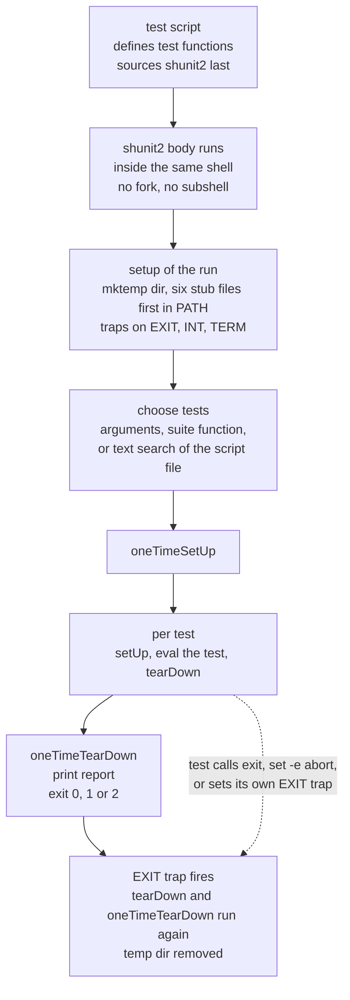

# shUnit2

> [!summary] Claim
> shUnit2 is a 1,343-line POSIX `sh` library whose last-line `. shunit2` turns the shell that runs your test file into the test runner, which makes it the one xUnit framework that tests shell code inside the very shell that will run it, at the price of no isolation between tests, text-scan discovery, an `eval` core in its assertions, and a latest release (2.1.8, 2020-03-29) that predates years of unreleased fixes.

Part of [Testing and Static Analysis](README.md) in [Shell and Unix Engineering](../README.md).

## TL;DR

- Mechanism: you source `shunit2` as the last line of the test script, and sourcing runs the whole suite in your shell: it greps the script text for `test*` names, runs `setUp`, the test, and `tearDown` in-process with `eval`, prints a report, and calls `exit`.
- Rule: assert with the quoted two- and three-argument forms, always give a message, keep `setUp` and `tearDown` idempotent, keep `set -e` out of the test file, and vendor one pinned copy of the file.
- Trap: every test shares one shell, `failures=` counts failed asserts plus one per test that returns non-zero (it is not a count of failed tests), and in 2.1.8 `assertNull` and `assertTrue` `eval` their argument, so a quote in a value is code.
- Portability: it runs under bash, dash, ksh93 and zsh with identical reports for the same suite, but zsh needs `shwordsplit` and `SHUNIT_PARENT` before the source line, `zsh --emulate sh` is refused outright, and the line-number macro is only right in bash.
- When not to use it: when you need a process per test, command mocks, parallelism, a per-test timeout, or TAP or JUnit output from a released version; use [[bats-core]] or [[ShellSpec]], and keep shUnit2 for code that must be exercised inside a specific shell.

## Mental model



The test file is the program, and shUnit2 is a library sourced at the bottom of it, so by the time shUnit2 runs every test function already exists in the shell's function table.
The arrow from the test script to the shUnit2 body is a plain `.` command: no `fork` happens, which is why a variable set by one test is visible to the next and why one `exit` anywhere ends the whole run.
Setup creates a private directory and puts six two-line executables in it at the front of `PATH`, so that hooks you did not define still resolve to something that exits 0.
Test selection is a text search of the script file, not a query of the shell, and each chosen name is run through `eval` between `setUp` and `tearDown`.
The dashed arrow is the failure path: anything that leaves the shell early lands in the EXIT trap, which reports an unknown failure and exits 2 unless the test replaced that trap, in which case shUnit2's cleanup never runs.

## How it works

Primary sources: the v2.1.8 `shunit2` script (cited by function name, `shunit2 v2.1.8, <function>`), its README, the master branch for what changed, and POSIX.1-2024 for the shell semantics it leans on.
Claims marked "lab" are asserted by [lab](../labs/14-shunit2/), which vendors v2.1.8 with only its shebang line removed; claims marked "ad hoc" were measured by hand on the macOS host and are not in the lab.

### 1. Sourcing is running

The first lines of the script are a load guard and four constants: `command [ -n "${SHUNIT_VERSION:-}" ] && exit 0`, then `SHUNIT_VERSION='2.1.8'`, and `SHUNIT_TRUE=0`, `SHUNIT_FALSE=1`, `SHUNIT_ERROR=2` (shunit2 v2.1.8, top of file).
The guard does `exit 0`, not `return 0`: if `SHUNIT_VERSION` is already set when the file is sourced, the shell that sourced it exits with status 0, silently, and no test runs (lab).
Everything after the guard is straight-line code that ends in `exit`, so nothing you write after the `. shunit2` line in the test file runs in 2.1.8 (lab).

POSIX describes `.` as executing the commands "in the current environment", and leaves open whether the file is parsed and executed as a program or parsed whole as one compound list first (POSIX.1-2024 XCU `dot`).
That is the entire mechanism: a library that is a program in disguise.
The same page notes that when `file` has no slash the shell searches `PATH`, and that the file need not be executable, so write `. ./shunit2` or `. "$SHUNIT2_LIB"` with a path, never a bare `. shunit2` that finds whatever is first on `PATH`.

The library calls its helpers as `command [ ... ]` rather than `[ ... ]`.
`command` suppresses the shell function lookup of command search (POSIX.1-2024 XCU `command`, and XCU 2.9.1.4 item 1c), so a test file that defines a function named `[` cannot redirect shUnit2's own conditionals.
The protection is partial: `expr`, `grep`, `echo`, `egrep`, `xargs`, `cut`, `tput` and `test` are called bare, and a function or a `PATH` shim with one of those names changes what shUnit2 does (lab: a `grep` function makes `assertContains` report `Not found`).
It also uses `[ A -o B ]` throughout; POSIX.1-2024 removed the obsolescent `-a` and `-o` binary primaries and the parentheses from `test` (XCU `test`, Change History, Austin Group Defect 1330), so the source is portable only because every shell still accepts them.

Constants are made read-only by running `set | grep '^__SHUNIT_' | cut -d= -f1` and calling `readonly` on each name, with `readonly -g` under zsh 4 and later, and a second `grep -a` pass when the first output is a `Binary file` message (shunit2 v2.1.8, top of file).
That parses the output of `set`, whose format is shell specific; it is one reason the zsh branch exists.

### 2. Per-run environment: a temp directory, six stubs, three traps

`_shunit_mktempDir` first tries `( exec mktemp -dqt shunit.XXXXXX 2>/dev/null )`; if that fails it builds a name from `/usr/bin/od` on `/dev/urandom`, else from `$RANDOM`, else from `date` divided by the PID, and creates it with `( umask 077 && command mkdir ... )` under `${TMPDIR:-/tmp}` (shunit2 v2.1.8, `_shunit_mktempDir`).
Both branches are exercised by the lab: the first through a `mktemp` shim on `PATH`, the second through a failing one.
`SHUNIT_TMPDIR` is the subdirectory `tmp` of that directory, and it is the only scratch space the framework promises to delete.

`_shunit_mktempFunc` writes six files into the directory, each containing `#! /bin/sh` and `exit 0`, and marks them executable: `oneTimeSetUp`, `oneTimeTearDown`, `setUp`, `tearDown`, `suite`, and `noexec`.
Then `PATH="${__shunit_tmpDir}:${PATH}"` puts the directory first, and `noexec 2>/dev/null || _shunit_fatal 'Please declare TMPDIR with path on partition with exec permission.'` proves the directory is not mounted `noexec`.
The effect is that the main flow can call `setUp` unconditionally.
If the suite defines a function `setUp`, the function wins, because functions are found before `PATH` in command search (POSIX.1-2024 XCU 2.9.1.4); if not, `PATH` finds the stub, which exits 0 (lab: `command -v setUp` prints a path inside the run directory when undefined and the bare name when defined).
The price is a fork and exec of `/bin/sh` for each undefined hook call, so a suite with no `setUp` and no `tearDown` pays two process creations per test for nothing.

Three traps are installed: `trap '_shunit_cleanup EXIT' 0`, `trap '_shunit_cleanup INT' 2`, `trap '_shunit_cleanup TERM' 15`.
POSIX defines condition `0` as equivalent to `EXIT`, and says a new `trap` action overrides the previous one (POSIX.1-2024 XCU `trap`).
Two consequences follow, and both are in the lab.
A test that runs `trap '...' 0` replaces shUnit2's cleanup, so the report is printed but the run directory is never removed, in bash, dash and ksh93; zsh runs an `EXIT` trap set inside a function when that function returns and keeps the outer trap, so it does not leak (zsh manual, Functions; the `POSIX_TRAPS` option, which `emulate sh` turns on, switches that behavior off).
A `SIGHUP` or `SIGQUIT` has no trap at all; POSIX says the `EXIT` condition "may occur" when the shell dies from a signal whose action is the default, so the run directory can be left behind.

### 3. Mode and test selection

If the number of arguments is zero, or the first argument is `--`, shUnit2 is in sourced mode and the script under test is `${SHUNIT_PARENT:-$0}`; otherwise the first argument names a file and shUnit2 is in standalone mode, where it sources that file itself with `.` after the setup above (shunit2 v2.1.8, "Determine the operating mode").
In every shell measured (bash, dash, ksh93u+, zsh) a sourced file given no arguments sees the sourcing script's positional parameters, which is how `./test.sh -- testTwo otherFunction` reaches shUnit2 (lab); POSIX `dot` takes no argument operands, and its Rationale notes that only the KornShell form does (POSIX.1-2024 XCU `dot`).
Test names without the `--` marker are read as a file name and are fatal (lab: `shunit2:FATAL unable to read from testContains`, status 2).

Which tests run is decided in this order (shunit2 v2.1.8, "Command line selected tests or suite selected tests"):

1. If at least two arguments remain, each one after the first is passed to `suite_addTest`, in order, and may be any function name.
2. Otherwise the `suite` function is called; it is the deprecated hand-written suite, and `suite_addTest testB; suite_addTest testA` fixes both the set and the order (lab).
3. If the list is still empty, `_shunit_extractTestFunctions` builds it by running `egrep` over the script file with the regular expression `^\s*((function test[A-Za-z0-9_-]*)|(test[A-Za-z0-9_-]* *\(\)))`, trimming each hit with `sed`, and joining the names with `xargs`.

The third step is why the README's "walk through any functions defined" is wrong in a way that matters: nothing asks the shell for its functions.
Only text in the one file named by `$0` (or `SHUNIT_PARENT`) can match, so a `testFoo` that comes from a sourced include is never run (lab), a helper named `testdirHelper` is run as a test (lab), a function written `testSpaced () {` and one indented two spaces are found (lab), and a commented-out `# testOld() {` is not.
A suite in which nothing matches runs zero tests and reports `Ran 0 tests.` and `OK` with status 0 (lab), so a typo in a prefix turns the suite green.
The `function name {` form in the pattern is syntax that dash cannot parse at all, so a file using it fails before shUnit2 is sourced (dash 0.5.x on macOS, measured ad hoc: `Syntax error: "}" unexpected`, status 2).
The regex itself is not portable: `\s` in an extended regular expression is outside POSIX, which leaves a backslash before an ordinary character undefined (POSIX.1-2024 XBD 9.4.2), and `egrep` is only mentioned by POSIX as a historical command that implementations may keep (XCU `grep`, Rationale).

`suite_addTest` appends to `__shunit_suite` and counts with `expr`, so `Ran N tests.` is the length of the suite, not the number of tests that were reached.
If a fatal error stops the run after test 3 of 10 (a failing `setUp`, say), the report still says `Ran 10 tests.` (lab: `Ran 2 tests.` for a suite whose first `setUp` failed).

### 4. Running a test

`_shunit_execSuite` loops `for _shunit_test_ in ${__shunit_suite}` and, for each name, does this (shunit2 v2.1.8, `_shunit_execSuite`):

1. Sets `__shunit_testSuccess` to true and clears skipping.
2. Runs `setUp`; a non-zero status is `_shunit_fatal "setup() returned non-zero return code."`, which prints and does `exit 2`, and the message says `setup()` although the hook is `setUp` (lab).
3. Prints `${__SHUNIT_TEST_PREFIX}${_shunit_test_}`, so the test name appears after `setUp` output and before the test's own output (lab).
4. Runs `eval "${_shunit_test_}"`; if the status is non-zero it prints `shunit2:ERROR NAME() returned non-zero return code.`, sets the test to failed, and increments the failed-assert counter once more.
5. Runs `tearDown`; a non-zero status is fatal, with `tearDown() returned non-zero return code.`
6. Adds one to `__shunit_testsPassed` or `__shunit_testsFailed` with `expr`.

There is no subshell around any of this, so the code under test runs in the process that holds shUnit2's own variables.
A variable, function, `cd`, `umask` or shell option set in one test is still set in the next (lab: a function and a variable defined in `testA_defines_state` are visible in the next test).
There is no timeout either: a test that blocks blocks the suite, and the only bound is whatever the caller wraps around the script.
Because the name goes through `eval`, a test name taken from the command line is code.

### 5. The assertions

Every assertion has the same skeleton: `${_SHUNIT_LINENO_}` strips an optional `--lineno N` pair, an argument-count check calls `_shunit_error` and returns 2, `_shunit_shouldSkip` returns early when skipping, the message is built from the optional first argument, and the work ends in `_shunit_assertPass` or `failNotEquals`-style helpers (shunit2 v2.1.8, `assertEquals` and the functions after it).
What each one does underneath is what decides its cost and its traps.

| Assertion | Mechanism in 2.1.8 | Consequence |
|---|---|---|
| `assertEquals`, `assertSame` | `[ "$expected" = "$actual" ]`, string comparison | `1` and `01` differ (lab: `assertNotEquals 1 01` passes) |
| `assertNotEquals`, `assertNotSame` | the negation, same comparison | same |
| `assertContains` | `echo "$container"` piped to `grep -F -- "$content"` | a newline in the needle is a pattern list and matches either line, an empty needle always matches (lab); `echo` is a shell-dependent printer of the container (see [[printf-versus-echo]]) |
| `assertNotContains` | the same pipeline, inverted | `assertNotContains abc ''` always fails with `Found` (lab) |
| `assertNull` | builds the string `[ -z '$1' ]` and passes it to `assertTrue` | the value is spliced into code that is `eval`ed; a single quote in it is a code injection (lab) |
| `assertNotNull` | `test -n` on a value passed through a small `sed` escaper | no `eval`, but it forks `sed` up to four times |
| `assertTrue`, `assertFalse` | a number is an exit status; anything else is run as `( eval "$condition" ) >/dev/null 2>&1` | a subshell, so side effects are lost and all output is discarded (lab); an empty string fails both of them (lab) |
| `fail`, `failNotEquals`, `failSame`, `failFound`, `failNotFound` | record a failure and print; they compare nothing | used by hand-written checks |

`assertTrue` decides "number or expression" with `expr "$condition" : '\([0-9]*\)'` and compares the match to the whole string, so only a string made entirely of digits is an exit status.
`assertTrue 0` and `assertFalse 1` pass; `assertTrue 1` fails and prints a bare `ASSERT:` line, because the message is empty and the call still passes an empty argument to the printer (lab).
That one `expr` call has a second effect: for a non-numeric condition it prints an empty string and exits 1 (POSIX.1-2024 XCU `expr`, EXIT STATUS: 1 when the result is null or zero), and the script assigns it with a bare `shunit_match_=\`expr ...\``, which is exactly what `set -e` turns into an exit (see the pitfall below).

Messages are printed with `${__SHUNIT_CMD_ECHO_ESC}`, which is `echo -e` when `echo -e test` prints `test`, and plain `echo` where it prints `-e test` (dash).
Either way the shell's `echo` interprets backslash escapes in the message, so `assertEquals 'C:\temp' 'C:\tmp'` prints the expected value with a tab where `\t` was (lab).

The line-number macros are `_ASSERT_EQUALS_` and its siblings, each defined as `eval assertEquals --lineno "${LINENO:-}"`; used as `${_ASSERT_EQUALS_} '"two words"' x y`, the arguments are parsed twice, so a message containing a space must be double-quoted inside single quotes or the argument count is wrong (lab: `assertEquals() requires two or three arguments; 4 given`).
`LINENO` evaluated inside `eval` inside a function is shell specific: bash reports the line in the file, dash a negative offset, ksh93u+ and zsh the constant 1 (lab arms; ad hoc on this host: bash 3.2.57 and 5.3 give the file line, dash `-5`, ksh93u+ 2012 and zsh 5.9.2 give `1`).
The README lists bash, ksh, pdksh and zsh as supporting line numbers; for the two latter families measured here that is not what the number means.

### 6. Counting, skipping, and the report

Counting is a set of `expr` calls on global counters: `_shunit_assertPass` runs two (passed and total), `_shunit_incFailedCount` runs two (failed and total), and the test loop runs one more per test, plus one inside `suite_addTest`.
The lab measures it with an `expr` shim: a suite of one test with no asserts costs 2 executions (one in `suite_addTest`, one for the passed-test counter), ten passing `assertEquals` cost 22, and one string `assertTrue` costs 5 (the extra one is the digit-match `expr` above).
`failures=` in the final line is `__shunit_assertsFailed`, which counts failed asserts plus one for each test function that returned non-zero.
A test whose last command is `false`, or a failing assert that is the last statement of the test, therefore counts twice (lab: three tests, five failures).
The exit status is 1 if any test failed, derived from `__shunit_testsFailed`; the report text does not say how many tests failed.

`startSkipping` sets a flag that makes every later assert and fail in that test a counted no-op, `isSkipping` returns its state, and the next test's loop iteration clears it.
The report then reads `OK (skipped=N)`, and N counts skipped assert calls, not tests (lab: `skipped=3` for one `assertEquals`, one `assertTrue` and one `fail`).

### 7. Exit, cleanup, and the second tearDown

After the loop the main flow runs `oneTimeTearDown`, then `_shunit_generateReport`, then `command [ "${__shunit_testsFailed}" -eq 0 ]; exit $?`.
`exit` runs the `EXIT` trap, `_shunit_cleanup EXIT`, which checks a flag `__shunit_clean` that nothing in the main flow has set yet, so it runs `tearDown` and `oneTimeTearDown` again, then removes the directory with `command rm -fr`.
The guard exists to stop a signal handler and an exit handler from both cleaning; it does not stop the normal path from cleaning twice.
The visible result is that every suite's `tearDown` and `oneTimeTearDown` run once more after the `OK` line (lab: the trace ends `OK`, `hook: tearDown`, `hook: oneTimeTearDown`).

The same handler is the catch-all for everything that leaves the main flow early.
If the report was not yet generated, it calls `_shunit_assertFail 'unknown failure encountered running a test'`, prints the report, and exits 2.
That is what a test sees when it calls `exit`, even `exit 0` (lab), when `setUp` or `oneTimeSetUp` fails fatally (lab), or when `set -e` aborts the shell (lab).
For `INT` and `TERM` the handler warns `trapped and now handling the (TERM) signal`, runs the teardowns, disables the `EXIT` trap, and does `exit 130` or `exit 143`; POSIX requires that an `EXIT` trap run before the shell terminates and that an `exit` inside it ends the shell at once (POSIX.1-2024 XCU `exit`), so the explicit status wins (lab: 143 in bash, dash and ksh93; zsh reaches the `EXIT` trap again and exits 2).

### 8. Color

`SHUNIT_COLOR` defaults to `auto`, which means `_shunit_colors` runs `tput colors` and enables color when the number is at least 8; when `tput` fails the function prints `16`, which also enables it.
Nothing in `auto` asks whether the output is a terminal, so a suite that writes to a pipe or a CI log gets raw `ESC[1;31m` sequences whenever `TERM` is set to something with colors, or unset (lab for `TERM=xterm-256color`; ad hoc on this host for `TERM` unset; `TERM=dumb` printed `-1` and no color).
The accepted values in 2.1.8 are `always`, `auto` and `none`; a comment in the source and the "never" spelling suggest otherwise, but `SHUNIT_COLOR=never` is `shunit2:FATAL unrecognized color option 'never'` with status 2 (lab).

### 9. What master changed, and what is still unreleased

The latest release is v2.1.8, published 2020-03-29; master identifies itself as `2.1.9pre`, its most recent commit I saw is dated 2026-03-15, and issue 164 asking for a release tag has been open since 2022-12-21 (GitHub API and issue page, as of 2026-11).
Debian's `shunit2 2.1.8-4` (trixie, forky, sid) is not the upstream release: its patch series carries six patches, among them an upstream fix for issue 37 (`assertTrue` with `set -e`) and a `tput` guard for an unset `TERM` (Debian sources, as of 2026-11), while the Homebrew formula's stable version is 2.1.8.

Running master's script against the same probes shows what changed in behavior (ad hoc, not in the lab):

| Behavior | 2.1.8 | master (2.1.9pre) |
|---|---|---|
| `assertNull "x'; touch f; echo '"` | runs `touch`, reports pass | no `eval`; fails normally |
| `assertTrue 'x=inner; true'` | condition runs in a subshell | condition runs by `eval` in the current shell, so `x` is `inner` afterward |
| a failing assert that is the last command of a test | `failures` +2 and an ERROR line | `failures` +1 and an ERROR line (measured: `failures=1` where 2.1.8 prints 2) |
| `. shunit2` at the end of the test file | ends with `exit` | `return`; the script continues and its own status is that of its last command |
| `SHUNIT_COLOR=never` | fatal | accepted |
| JUnit XML | none | `-- --output-junit-xml=FILE` and `--suite-name=NAME`, documented in the master README as "still unreleased" |
| test discovery | `egrep` | `grep -E` |
| timing | none | `date +%s.%N` and `bc`, `dc` or `expr`; the timestamp uses GNU `date -d @N`, which BSD `date` rejects (`illegal time format`, measured on macOS) |

The practical rule is that "shUnit2" in a bug report or a blog post can mean either, and the behaviors differ in ways that change verdicts.
Pin a version, and say which.

## Numbers and limits

| Quantity | Value | Source |
|---|---|---|
| Latest release | v2.1.8, published 2020-03-29 | GitHub releases API (as of 2026-11) |
| Master version string and latest commit seen | `2.1.9pre`, commit dated 2026-03-15 | master `shunit2`, commits API (as of 2026-11) |
| Size of the v2.1.8 script | 1,343 lines, 39,506 bytes, Apache-2.0 | the fetched file |
| Stub executables created per run | 6 (`oneTimeSetUp`, `oneTimeTearDown`, `setUp`, `tearDown`, `suite`, `noexec`) | `_shunit_mktempFunc` |
| Traps installed | 3 (conditions 0, 2, 15) | main body of the script |
| Exit status | 0 all tests passed; 1 some test failed; 2 fatal, unknown failure, or `exit` inside a test; 130 and 143 for INT and TERM | `_shunit_cleanup`, main body; 0, 1, 2 and 143 in the lab |
| `expr` executions, one test with no asserts | 2 | lab |
| `expr` executions per passing `assertEquals` | 2 | lab (22 for ten, minus 2) |
| `expr` executions, one passing string `assertTrue` | 5 in total, 3 for the assertion | lab |
| Failures counted for one failing assert that ends a test | 2 | lab |
| Wall time, one test with no asserts, one run, macOS, Apple M3 Pro, load average about 12 | dash 420 ms, ksh93u+ 230 ms, Homebrew bash 5.3.20 260 ms | ad hoc, measured 2026-11-21 with `/usr/bin/time -p`, one run each, so an upper bound |
| Wall time, 1,000 passing `assertEquals` in one test, one run, same host and load | dash 11.2 s, ksh93u+ 6.1 s, bash 5.3.20 4.7 s, so about 4 to 11 ms per assert | ad hoc, measured 2026-11-21, one run each, so an upper bound |
| `NVD` records for the keyword `shunit2` | 0 | NVD CVE API 2.0, queried 2026-11-21 |
| Upstream's own shell list in `test_runner` | `/bin/sh ash /bin/bash /bin/dash /bin/ksh /bin/mksh /bin/zsh` | master `test_runner` |

The per-assert time is the point of the table: each passing assert is two process creations of `expr`, which dominate by count, and the differences work out to about 2 to 5 milliseconds per `expr` on this host (for example (4,670 ms minus 260 ms) divided by 2,000 executions is 2.2 ms under bash and (11,160 ms minus 420 ms) divided by 2,000 is 5.4 ms under dash), so a suite of a few hundred asserts takes seconds, not milliseconds.
Measure on your own host before using the figures; the lab pins the count of executions, which is stable, rather than the time, which is not.

## Portability

Evidence column: lab means asserted by the bats file for the family named (run here under bash 5.3 only, so the other families are matrix expectations); ad hoc means measured by hand on this macOS host and not asserted by the lab; spec and source mean quoted from the cited text.

| Platform | What holds | Evidence |
|---|---|---|
| POSIX sh (specification) | `.` runs the file in the current environment; `command` skips functions; a later `trap` overrides an earlier one; an `exit` in an EXIT trap ends the shell | POSIX.1-2024 XCU `dot`, `command`, `trap`, `exit` |
| macOS bash 3.2.57 | the five basic suites give byte-identical output to bash 5.3; `LINENO` is the file line | ad hoc |
| current bash (5.3) | all 31 lab tests pass | lab |
| zsh 5.9, native | needs `setopt shwordsplit` and `SHUNIT_PARENT=$0` before the source line; without them it exits 2 with `command not found: echo -e`, because the fatal helper's unquoted `echo -e` is one word; `EXIT` traps set in functions are function-scoped; `set -e` exits status 1 with no report; macro line number is 1 | lab, ad hoc |
| zsh `--emulate sh` | refused: `setopt` lists only options that differ from the emulation's defaults, and `shwordsplit` is on by default there, so shUnit2's `setopt` then `grep` check can never pass; the lab prologue runs `emulate zsh` first and then behaves like native zsh | lab; zsh manual `setopt` |
| dash (macOS dash-16) | runs the suites unchanged; `function name {` is a syntax error; macro line number is negative; `echo` interprets backslashes | lab (arms), ad hoc |
| ksh93u+ 2012 (macOS `/bin/ksh`) | identical reports to bash; macro line number 1 | ad hoc, lab arm |
| ksh93u+m 1.0.10 | not measured by the author | not measured |
| mksh, yash, posh | not measured by the author; upstream's runner lists `mksh`; posh 0.14.1 inherits `IFS` from the environment (shell matrix), and the suite loop depends on the default `IFS` | source, matrix |
| BusyBox ash | not measured by the author; `egrep` with `\s` is a runtime dependency of discovery on whatever `egrep` BusyBox provides | not measured |
| GNU utilities | upstream's `egrep` wrapper prints `egrep: warning: egrep is obsolescent; using grep -E` from grep 3.8 on, which shUnit2 2.1.8 triggers once per run; Debian's grep 3.11 package ships an `egrep` that runs `grep -E` with no warning | GNU grep NEWS, release 3.8 (2022-09-02), and `src/egrep.sh`; Debian measured in the shell matrix |
| BSD and macOS utilities | `mktemp -t` uses the per-user temp directory first and `TMPDIR` only as a fallback, and keeps the `XXXXXX` in the name (`shunit.XXXXXX.cNOPWdhWZf`); `od` pads its output with trailing blanks that the `sed` stripping leading ones leaves in place, so the fallback directory name ends in blanks | macOS `mktemp(1)`, ad hoc |
| uutils, BusyBox utilities | not measured by the author | not measured |

The lab runs every suite under the shell named by `LAB_SHELL`; for zsh every suite starts with `emulate zsh`, `setopt shwordsplit` and `SHUNIT_PARENT=$0`, which is the README's recipe plus the `emulate zsh` that makes the emulation case work.
The lab's `suite` helper also drops the `egrep` obsolescence line from captured output, so that the same expected text holds whether or not the platform's `egrep` warns (upstream GNU grep 3.8 and later does; Debian's packaged wrapper, BSD grep on macOS and BusyBox do not).

## Worked example

The lab is [lab](../labs/14-shunit2/): the vendored `vendor/shunit2-2.1.8.lib`, ten suites, one file of standalone-mode tests, and `shunit2.bats`, whose 31 tests run each suite (and a number of generated ones) under the shell under test and assert the reports.
The smallest useful suite is `suite_basic.sh`; the `[ -n "${ZSH_VERSION:-}" ] && { ... }` block before the first test is the zsh prologue, and the last line is the one that runs everything.

```sh
#!/bin/sh
# shellcheck disable=SC2317,SC2329 # shUnit2 calls the test functions by name through eval
# The smallest useful shUnit2 suite: every function whose name starts with "test" is a test.
# shUnit2 is a library: the last line sources it, and sourcing it runs the suite and then exits.
# zsh needs the shwordsplit option and the script name set before shUnit2 is sourced (README, "Zsh").
# shellcheck disable=SC2034 # SHUNIT_PARENT is read by shUnit2 when it is sourced
[ -n "${ZSH_VERSION:-}" ] && {
  emulate zsh
  setopt shwordsplit
  SHUNIT_PARENT=$0
}

testEquality() {
  assertEquals 1 1
}

testStringsCompareAsStrings() {
  assertNotEquals 1 01
}

testNullness() {
  assertNull ''
  assertNotNull x
}

testCondition() {
  assertTrue '[ 2 -gt 1 ]'
}

testContains() {
  assertContains 'hello world' 'lo wo'
}

# shellcheck source=/dev/null
. "$SHUNIT2_LIB"
```

Run under the default shell of the lab, its output is:

```text
$ sh ./suite_basic.sh
testEquality
testStringsCompareAsStrings
testNullness
testCondition
testContains

Ran 5 tests.

OK
$ echo $?
0
```

The suite that shows how shUnit2 counts is `suite_status.sh`.
Three tests, four failed asserts, and two tests whose status is non-zero: the number after `failures=` is five.

```sh
#!/bin/sh
# shellcheck disable=SC2317,SC2329 # shUnit2 calls the test functions by name through eval
# How shUnit2 counts: "failures" counts failed asserts, plus one for each test that returns non-zero.
# shellcheck disable=SC2034 # SHUNIT_PARENT is read by shUnit2 when it is sourced
[ -n "${ZSH_VERSION:-}" ] && {
  emulate zsh
  setopt shwordsplit
  SHUNIT_PARENT=$0
}

testAssertFailsButTestReturnsZero() {
  assertEquals 1 2
  return 0
}

testAssertsPassButLastCommandFails() {
  assertEquals 1 1
  false
}

testTwoFailingAsserts() {
  assertEquals first 1 2
  assertEquals second a b
}

# shellcheck source=/dev/null
. "$SHUNIT2_LIB"
```

```text
$ sh ./suite_status.sh
testAssertFailsButTestReturnsZero
ASSERT:expected:<1> but was:<2>
testAssertsPassButLastCommandFails
shunit2:ERROR testAssertsPassButLastCommandFails() returned non-zero return code.
testTwoFailingAsserts
ASSERT:first expected:<1> but was:<2>
ASSERT:second expected:<a> but was:<b>
shunit2:ERROR testTwoFailingAsserts() returned non-zero return code.

Ran 3 tests.

FAILED (failures=5)
$ echo $?
1
```

Reading the output top to bottom: in `testAssertFailsButTestReturnsZero` the assert is counted once because the test ends with `return 0`; in `testAssertsPassButLastCommandFails` no assert failed, but the last command did, so the test is counted once; in `testTwoFailingAsserts` two asserts fail and the second one is also the last command, so the test is counted three times.
The ordering and the extra tearDown are visible in `suite_hooks.sh`, whose output ends with the two hooks running again after the report.

```text
$ sh ./suite_hooks.sh
hook: oneTimeSetUp
hook: setUp
testOne
body: one
hook: tearDown
hook: setUp
testTwo
body: two
hook: tearDown
hook: oneTimeTearDown

Ran 2 tests.

OK
hook: tearDown
hook: oneTimeTearDown
$ echo $?
0
```

The bats side is a thin driver (simplified excerpt of `shunit2.bats`): every suite is started through `run_lab`, and a small helper removes the one line that upstream GNU grep 3.8 and later adds.

```bash
suite() {
  local line filtered=''
  run_lab "$@"
  while IFS= read -r line; do
    case $line in
      'egrep: warning:'*) ;;
      *) filtered=${filtered:+$filtered$'\n'}$line ;;
    esac
  done <<<"$output"
  output=$filtered
}

@test "failures counts failed asserts plus one for every test that returns non-zero" {
  suite "$BATS_TEST_DIRNAME/suite_status.sh"
  [ "$status" -eq 1 ]
  case $output in
    *$'Ran 3 tests.\n\nFAILED (failures=5)') ;;
    *) false ;;
  esac
}
```

## Pitfalls

> [!warning] Tests share one shell
> Trigger: a test sets a variable, defines a function, changes directory, or sets `IFS` or an option.
> Symptom: a later test passes or fails depending on order; a failing test only fails when run after another (lab: the second test sees the first test's variable and function).
> Fix: reset state in `setUp`, run the code under test inside `( ... )` when you want isolation, or run one test per process with `script.sh -- testName`; when every test must be isolated, use [[bats-core]].

> [!warning] `failures=` is not a test count
> Trigger: reading `FAILED (failures=5)` as five failed tests.
> Symptom: three tests produced five failures; a test that ends with a failing assert counts twice (lab).
> Fix: read the `ASSERT:` and `shunit2:ERROR` lines, and parse the exit status, not the number.
> Master removed the second count, so the same suite reports different numbers on 2.1.8 and master.

> [!warning] A green run with no tests
> Trigger: a typo in the prefix (`Test`, `check_`), tests defined in a sourced include, or `SHUNIT_VERSION` already set in the environment.
> Symptom: `Ran 0 tests.` and `OK`, status 0, or no output at all and status 0 when the load guard fires (lab for both).
> Fix: have CI assert that the count in `Ran N tests.` is the expected N, and add one canary test that must fail on purpose in a separate job.

> [!warning] `set -e` and shUnit2 do not mix
> Trigger: `set -e` (or `#!/bin/sh -e`) in the test file or in a script it sources, then a passing `assertTrue '[ ... ]'`, `assertFalse`, or `assertNull`; with GNU `expr`, also `assertNotNull` and `assertTrue 0`.
> Symptom: the shell exits in the middle of the assertion and the report says `ASSERT:unknown failure encountered running a test` with status 2; in zsh the process ends with status 1 and no report (lab).
> Cause: the `assertTrue` path assigns `` shunit_match_=`expr ... : '\([0-9]*\)'` ``, and `expr` exits 1 when the match is empty, which `set -e` treats as a failed command; `assertEquals`, `assertSame` and `assertContains` avoid that path (lab: `assertEquals 1 1` passes under `set -e`).
> Upstream: issue 37 (opened 2015-06-26, closed 2020-03-29) and issue 174 (open since 2023-10-25, `assertNotNull` under bash 5.1.16); the 2.1.8 release notes list `-e` as a known bug.
> A GNU `expr` exits 1 when the matched text is the single digit `0` (POSIX: null or zero), so the numeric forms reach the same abort: `assertNotNull` passes `$?` to `assertTrue`, which is how issue 174 arises; measured in the shell matrix's Debian image (coreutils 9.7), where a passing `assertNotNull msg something` and `assertTrue 0` each end in `unknown failure` with status 2 under bash and dash, while the macOS `expr` exits 0 for `0`.
> Fix: no `set -e` in the test file; if the code under test sets it, source that code inside a subshell or reset with `set +e` in `setUp`.
> See [[errexit-Semantics-and-Exceptions]] for why a command substitution's status matters.

> [!warning] `assertNull` and `assertTrue` evaluate their argument
> Trigger: passing command output, a file's contents, or any value you do not control to `assertNull`, or a string built from such a value to `assertTrue`.
> Symptom: in 2.1.8, `assertNull "x'; touch \"\$LAB_MARKER\"; echo '"` creates the marker file and reports success, because the last command of the injected code is `echo`; the same suite's honest failure shows the assert is otherwise working (lab).
> Fix: compare with `assertEquals '' "$value"` and never splice values into the string given to `assertTrue`; master no longer evals in `assertNull`, but `assertTrue` still runs its string.
> This is a test-harness injection, not a vulnerability in the code under test; it matters when a test feeds attacker-influenced data through an assert.
> See [[Command-Injection]] and [[eval-and-sh-c]].

> [!warning] Failure output that lies or says nothing
> Trigger: `assertTrue` or `assertNull` without a message, or a value containing a backslash.
> Symptom: a bare `ASSERT:` line with nothing after it (lab); `C:\temp` printed with a real tab where `\t` was, because the message goes through `echo` (lab).
> Fix: always pass a message to `assertTrue`, `assertFalse`, `assertNull` and `assertNotNull`; keep backslashes out of expected values or print them with `printf` in your own `fail` call.

> [!warning] tearDown and oneTimeTearDown run twice
> Trigger: a `tearDown` that is not idempotent: `rmdir` of a directory it already removed, a `kill` of a PID it already reaped, a counter decrement.
> Symptom: `shunit2:WARN tearDown() returned non-zero return code.` after the `OK` line, or a spurious side effect at exit; the second run is a deliberate part of the exit trap (lab).
> Fix: write teardown hooks that are safe to run any number of times, and do not rely on them running exactly once.

> [!warning] Discovery by text
> Trigger: tests defined in a sourced file, defined with `eval`, or a helper whose name starts with `test`.
> Symptom: the include's tests do not run; the helper runs as a test (lab).
> Fix: define tests in the one script file named by `$0`, name helpers with a different prefix, or list the names after `--`; use `suite_addTest` only if you accept a deprecated API.
> A dash target cannot use the `function name {` form, which the regex accepts.

> [!warning] A test that sets an EXIT trap or calls `exit`
> Trigger: `trap '...' 0` inside a test, or any `exit` in the code under test.
> Symptom: `exit` ends the run with `unknown failure` and status 2, even `exit 0`; a replaced EXIT trap leaves the run directory behind in bash, dash and ksh93 (lab).
> Fix: run code that may `exit` in a subshell, `( code_under_test )`, and have the test assert on the status; compose traps instead of replacing them (see [[Traps-and-EXIT]] and [[Cleanup-Traps-and-Re-Raising-Signals]]).

> [!warning] Mocking a command the framework uses
> Trigger: a test defines a function named `grep`, `expr`, `echo` or `cut`, or puts a shim with one of those names, or `sed`, on `PATH` ahead of the system (2.1.8 calls `sed` as `command sed`, so only a `PATH` shim reaches it).
> Symptom: assertions fail for a value that is present (lab: a `grep` function that returns 1 makes `assertContains 'hello world' hello` print `Not found:<hello>`), counters become garbage when `expr` is replaced, and the failure is blamed on the code under test.
> Fix: restrict mocks to the commands the code under test calls, remove them in `tearDown` with `unset -f`, and see [[Mocking-Commands-via-PATH]] for isolating a mock to one process.

> [!warning] zsh without the prologue
> Trigger: running an unmodified suite under zsh.
> Symptom: `_shunit_fatal:1: command not found: echo -e` and exit 2 under native zsh, and `shunit2:FATAL zsh shwordsplit option is required for proper operation` under `zsh --emulate sh`; the first message hides the cause, because the fatal helper itself needs word splitting (lab).
> Fix: before the source line, `setopt shwordsplit` and `SHUNIT_PARENT=$0`; for the emulation case switch with `emulate zsh` first; `zsh -y` supplies only the option, so `SHUNIT_PARENT` is still required (ad hoc).

> [!warning] ANSI escapes in CI logs, and a non-portable `never`
> Trigger: `SHUNIT_COLOR` left at `auto` in a job whose log is stored or parsed.
> Symptom: escape sequences in the log; `SHUNIT_COLOR=never` aborts the run with status 2 in 2.1.8 (lab).
> Fix: set `SHUNIT_COLOR=none` in CI.

> [!warning] Master and a release behave differently
> Trigger: a suite developed against a distribution package or a master checkout and then run on another version.
> Symptom: `. shunit2` returns on master but exits on 2.1.8, so `. shunit2; echo "exit status $?"` prints on master only and a CI script that relied on the sourced file's exit may now finish with status 0 after failing tests (ad hoc: the failing suite sourced under master left `$?` at 1 and the script ended with status 0).
> Fix: pin one version and checksum it; end the script with `exit $?` right after the source line, which is harmless on 2.1.8 and correct on master.

## Security and robustness

- The `eval` surface is wider than the README suggests: `assertTrue` and `assertFalse` run their string, `assertNull` builds one in 2.1.8, test names given after `--` are `eval`ed, and the line-number macros are `eval` prefixes; every one of them executes with the privileges of the test run.
- Test data is often attacker-influenced (parsers, log lines, filenames from a fuzzer); feeding it to `assertNull` or into an `assertTrue` string turns a unit test into code execution on the CI runner, with the runner's secrets (see [[Command-Injection]]).
- Temp files: the normal path is `mktemp -dqt`, which creates a mode-0700 directory atomically; the fallback is a guessable name made by `mkdir` under `umask 077`, which fails closed (fatal) when the name exists but is a denial-of-service if an attacker pre-creates names in a shared `TMPDIR` (see [[Temporary-File-Attacks]] and [[mktemp]]).
- `PATH` is prefixed with the run directory, which is owner-only; a hostile `TMPDIR` that points at a directory another user can write to is the risk, not the stubs themselves.
- Supply chain: shUnit2 is one file under Apache-2.0 whose README names one primary author, with no release since 2020-03-29, and distro builds that differ from upstream (Debian carries six patches on 2.1.8); vendor the exact bytes you reviewed, record the checksum next to them, and treat a version bump as a code review.
- NVD returned no CVE record for the keyword `shunit2` when queried on 2026-11-21; that is absence of reports, not evidence of safety, and the `eval` paths above are exactly the kind of weakness that would not be filed as a CVE in a test framework.
- Robustness: the load guard exits 0 silently, and a suite with zero tests exits 0; any gate that runs shUnit2 should check the count in the report, and the exit status of the wrapper, not just the presence of the word `OK`.
- Output can leak: failure messages print the compared values, so a secret compared in an assertion appears in the log.

## The principal's view

The decision is not "shUnit2 or bats" in the abstract; it is where the code under test runs and what failure costs.
If the artifact is a shell library or an installer that must behave identically in dash, ksh93, mksh and zsh, shUnit2's one real advantage is that the test executes in the target shell, in process, with the function table and the variables the library will see, and a vendored 1,343-line file adds one dependency that is itself portable `sh`.
Characterization of legacy scripts with a handful of functions is another fit (see [[Characterization-Tests-for-Legacy-Scripts]]).

The costs are specific.
No isolation means test order is part of the contract, and a failing test can poison the next ones.
No subshell means an `exit` or a stray `set -e` in the code under test kills the run with a report that blames "unknown failure".
Two process creations per assert make a large suite slow wherever process creation is expensive (about 4 to 11 ms per assert on the macOS host measured here).
There is no per-test timeout, no mocking beyond what you build yourself, no parallelism, no machine-readable output in a released version, and no release since 2020-03-29.
The README's own list of known bugs is the honest summary of the risk.

For a CLI that you can run as a process, use [[bats-core]]: one process per test, TAP output, and helpers described in [[bats-Helpers-and-Assertions]].
For a spec-style suite with built-in mocks and coverage, use [[ShellSpec]].
If you need cross-shell proof as well, run whichever runner you pick under each shell from a matrix (see [[Cross-Shell-CI-Matrices]]); the lab in this note does exactly that, with bats driving shUnit2 suites under a swappable shell.
When the logic under test grows past a few hundred lines or needs data structures, the principal-level answer is usually a different language with a real test framework, and a thin shell wrapper tested at the process boundary.

Operational policy if you keep shUnit2: vendor one version, pin its checksum, pick a single canonical shell for the fast path and a matrix for portability, assert the test count in CI, disable color, forbid `set -e` in test files, and treat assertion messages as mandatory.
Review it as described in [[Reviewing-Shell-at-Staff-Level]].

## Interview questions

> [!question] L5: Why must `. shunit2` be the last line of the test script, and what happens to lines after it?
>
> > [!success]- Answer
> > Sourcing runs the entire suite in the current shell, including the report, and the script ends with `exit`.
> > Every `test*` function must already be defined when it runs, so it goes last.
> > In 2.1.8 any line after it never runs; on master the sourced file `return`s instead, so lines after it do run.
> >
> > Follow-up: What is the exit status of the script if tests fail and you add `echo done` after the source line on master?

> [!question] L5: How does shUnit2 decide which functions are tests?
>
> > [!success]- Answer
> > It does not ask the shell: it runs `egrep` with a regular expression for `test` names over the text of the script file named by `$0` (or `SHUNIT_PARENT`), and runs what matches in file order.
> > A function from a sourced include is not found, and a helper named `testsomething` is run.
> > You can override this by passing names after `--`, or with a `suite` function.
> >
> > Follow-up: What does the report say when nothing matches?

> [!question] L5: Predict the output and the exit status.
>
> ```sh
> #!/bin/sh
> testA() { assertEquals 1 2; }
> testB() { assertEquals 1 1; false; }
> . ./shunit2
> ```
>
> > [!success]- Answer
> > The output is `testA`, `ASSERT:expected:<1> but was:<2>`, a `shunit2:ERROR testA() returned non-zero return code.` line, `testB`, a `shunit2:ERROR testB() ...` line, then a blank line, `Ran 2 tests.`, a blank line, and `FAILED (failures=3)`.
> > testA fails once as an assert and once because it returned non-zero (its last command was the failing assert), and testB fails once because `false` was its last command.
> > The status is 1.
> >
> > Follow-up: What would `failures=` be on master for the same script?

> [!question] L6: Debug this script: it passes under `sh test.sh` without `set -e` and dies with "unknown failure" with it.
>
> ```sh
> #!/bin/sh
> set -e
> testFileExists() { assertTrue '[ -f /etc/hosts ]'; }
> . ./shunit2
> ```
>
> > [!success]- Answer
> > `assertTrue` decides whether its argument is a number with `` shunit_match_=`expr "$cond" : '\([0-9]*\)'` ``.
> > For a non-numeric string `expr` prints nothing and exits 1, and under `set -e` an assignment whose command substitution fails ends the shell.
> > The EXIT trap catches it, prints `unknown failure encountered running a test`, and exits 2.
> > Remove `set -e` from the test file, or use `[ -f /etc/hosts ]; assertTrue $?` so only a number reaches `assertTrue`.
> >
> > Follow-up: Why does `assertEquals` survive the same `set -e`?

> [!question] L6: Why does shUnit2 create six executable files in a temporary directory and put it first in `PATH`?
>
> > [!success]- Answer
> > So that `setUp`, `tearDown`, `oneTimeSetUp`, `oneTimeTearDown` and `suite` can be called unconditionally.
> > Functions win command search over `PATH`, so a hook you define is used; if you do not, `PATH` finds a stub that exits 0.
> > The sixth, `noexec`, is run once to prove the directory is not on a `noexec` mount.
> > The cost is a fork and exec per undefined hook call.
> >
> > Follow-up: What breaks if `TMPDIR` is on a `noexec` mount, and where does shUnit2 report it?

> [!question] L6: Why does `tearDown` appear to run one extra time after the `OK` line?
>
> > [!success]- Answer
> > The main flow runs the per-test and one-time teardowns, then calls `exit`, which fires the `EXIT` trap.
> > `_shunit_cleanup EXIT` checks a flag that only it sets, so it runs `tearDown` and `oneTimeTearDown` again before removing the temp directory.
> > Teardown hooks must therefore be idempotent.
> >
> > Follow-up: What does a test that installs its own `EXIT` trap do to this?

> [!question] L6: Why does a suite that works under bash and dash exit 2 under `zsh --emulate sh`, and how do you fix it without changing shUnit2?
>
> > [!success]- Answer
> > shUnit2 checks `setopt | grep "^shwordsplit$"`, and zsh's `setopt` lists only options that differ from the current emulation's defaults; `SH_WORD_SPLIT` is on by default under `sh` emulation, so it is never listed and the check always fails.
> > Under native zsh the same missing option makes the fatal helper's unquoted `echo -e` fail, which hides the message.
> > Before sourcing, run `emulate zsh; setopt shwordsplit; SHUNIT_PARENT=$0` when `ZSH_VERSION` is set.
> >
> > Follow-up: What else does `emulate zsh` change that a test could notice?

> [!question] L7+: Where can attacker-controlled data turn into code inside a shUnit2 run, and how would you fix each?
>
> > [!success]- Answer
> > `assertNull` in 2.1.8 splices its value into a string and evals it, so a quote closes the string; `assertTrue` and `assertFalse` eval whatever string is passed; test names after `--` go through `eval`; the line-number macros are `eval` prefixes.
> > Fix by comparing with `assertEquals '' "$value"`, passing only constants or numbers to `assertTrue`, validating names against `[A-Za-z0-9_]*`, and running the suite with no secrets in its environment.
> > Master removes the `assertNull` case but leaves the others.
> >
> > Follow-up: Why can the injected `assertNull` report success?

> [!question] L7+: Which tools do you choose to test a 3,000-line installer that runs on Alpine, Debian and macOS, plus a library of POSIX functions that other scripts source, and why?
>
> > [!success]- Answer
> > Use [[bats-core]] for the installer: it is a process-level program, so each test needs its own process, mocks via `PATH`, and a TAP stream.
> > Use shUnit2, or [[ShellSpec]], for the sourced library, because the unit under test runs inside a shell and the question is whether it behaves the same in dash, BusyBox ash, bash and zsh.
> > Run both from a shell matrix, vendor and pin shUnit2, assert the test count, and keep the matrix itself in CI rather than in the framework.
> >
> > Follow-up: What would make you rewrite the installer's logic in another language instead?

> [!question] L7+: How would you get per-test isolation and a reasonable time budget out of shUnit2 without forking the project?
>
> > [!success]- Answer
> > Run one test per process: the script accepts `-- testName`, so a driver lists the names and starts `sh script.sh -- name` for each, with a timeout, and aggregates the statuses.
> > That gives isolation, a per-test timeout, and parallelism, at the cost of one startup per test (230 to 420 ms on the macOS host, depending on the shell) and the loss of `oneTimeSetUp` sharing.
> > To cut the per-assert cost, assert with fewer calls, since each pass is two `expr` executions.
> >
> > Follow-up: What does that driver need to do about the second `tearDown` at exit?

## Related

Prerequisites: [[ShellSpec]]

Next: [[Mocking-Commands-via-PATH]]

See also: [[bats-core]], [[bats-Helpers-and-Assertions]], [[Cross-Shell-CI-Matrices]], [[Characterization-Tests-for-Legacy-Scripts]], [[Golden-Output-Tests]], [[Reviewing-Shell-at-Staff-Level]], [[Traps-and-EXIT]], [[errexit-Semantics-and-Exceptions]], [[Command-Search-and-PATH]], [[The-eval-Builtin]], [[printf-versus-echo]], [[Zsh-Emulation-Modes]], [[Zsh-versus-POSIX]], [[Strict-POSIX-Shells-posh-and-yash]], [[BusyBox-ash]], [[mksh]], [[mktemp]], [[Command-Injection]], [[Temporary-File-Attacks]]

## Further reading

- `https://github.com/kward/shunit2/blob/v2.1.8/shunit2`: the 1,343-line source; read `_shunit_execSuite`, `_shunit_cleanup`, `assertTrue` and the main body at the end.
- `https://github.com/kward/shunit2/blob/v2.1.8/README.md`: the documented API, the zsh requirements, and the macro quoting rule.
- `https://github.com/kward/shunit2/blob/master/doc/RELEASE_NOTES-2.1.8.md`: the known-bugs list, including `set -e` and signal handling on old shells.
- `https://github.com/kward/shunit2/issues/37`, `https://github.com/kward/shunit2/issues/174` and `https://github.com/kward/shunit2/issues/164`: the `set -e` bug reports and the request for a new release, the primary record of what is unreleased.
- `https://pubs.opengroup.org/onlinepubs/9799919799/utilities/V3_chap02.html`: POSIX.1-2024 shell command language; `dot`, `command`, `trap`, `exit` and `set -e` are the pages this design rests on.
- `https://zsh.sourceforge.io/Doc/Release/Shell-Builtin-Commands.html` and `https://zsh.sourceforge.io/Doc/Release/Options.html`: why `setopt` hides `shwordsplit` under emulation and what `POSIX_TRAPS` changes.
- `https://cgit.git.savannah.gnu.org/cgit/grep.git/plain/NEWS`: release 3.8 is where `egrep` began to warn, which every 2.1.8 run triggers wherever `egrep` is upstream's wrapper.
- `https://sources.debian.org/src/shunit2/2.1.8-4/debian/patches/`: what a distribution changed on top of 2.1.8.
