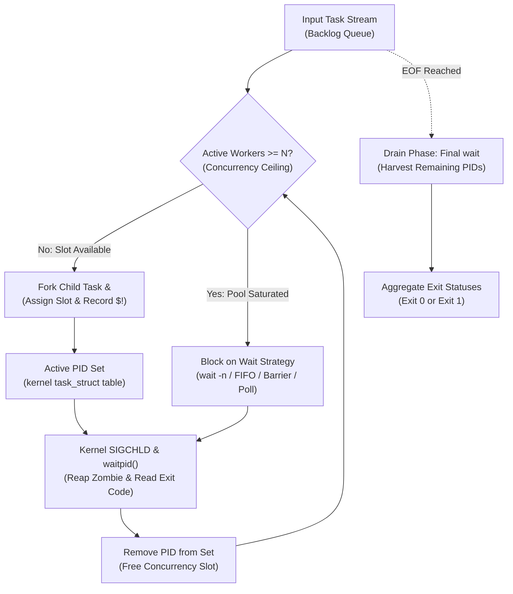

# Bounded Job Pools

> [!summary] Claim
> Bounded concurrency in POSIX shell requires actively controlling process creation and reaping child exit statuses, where pure standard shell provides only coarse synchronization barriers or head-of-line blocking queues, while non-blocking slot recycling requires non-standard extensions, external descriptor semaphores, or dedicated job coordinators.

Part of [Concurrency and Scheduling](README.md) in [Shell and Unix Engineering](../README.md).

## TL;DR

- Mechanism: Spawns asynchronous worker subshells with `&`, maintains a concurrency ceiling `N` by halting new forks when the active queue fills, and reaps completed worker processes with `wait`.
- Rule: Always redirect standard input from `/dev/null` for background workers inside `while read` loops, track worker PIDs explicitly, and isolate exit status harvesting from `set -e`.
- Trap: Relying on `wait "$oldest_pid"` or batch barriers creates severe head-of-line blocking that idles processor cores, while naively executing bare `wait` discards the exit status of every job in bash and yash, and of every job still running when it starts in mksh and posh (measured in the shell matrix).
- Portability fact: The reactive any-child wait extension `wait -n` exists only in GNU Bash 4.3+ and BusyBox ash built with `ASH_BASH_COMPAT` (on in the Debian and Alpine builds), while POSIX sh, dash, zsh, ksh93, mksh, yash, and posh have no builtin that waits for whichever child exits first (measured in the shell matrix, as of 2026-11).
- When not to use it: When workloads require dynamic work stealing, high task dispatch rates exceeding 100 jobs per second, granular CPU pinning, or guaranteed line serialization, where engineers should deploy [[xargs-P]], [[GNU-parallel]], or a compiled service in Go or Rust.

## Mental model



The task dispatcher ingests a stream of work items from an input source and checks the current count of active child processes against the configured concurrency ceiling `N`.
If a concurrency slot is free, the shell forks an asynchronous subshell with `&`, records its process ID from `$!` into the active tracking set, and immediately advances to the next task.
When the active worker count reaches `N`, the pool saturates and must block execution until at least one running process terminates and yields its slot.
Under an event-driven model using `wait -n`, the kernel delivers a `SIGCHLD` signal and the shell reaps the first available zombie child via `waitpid()`, collecting its termination status and immediately recycling the vacant slot for the next pending job.
Under a FIFO or batch barrier strategy, the dispatcher blocks specifically on designated historical PIDs, which introduces idle bubbles if younger tasks terminate out of order.
Once the task backlog is exhausted, the pool transitions to a terminal drain phase where a final wait sweeps all remaining active workers, aggregates their individual exit codes, and exits cleanly.

## How it works

Bounded concurrency in Unix shell scripts manages four interdependent subsystems: process creation via `fork()`, kernel state tracking through process tables, signal delivery via `SIGCHLD`, and status harvesting through the `waitpid(2)` system call.
When a shell evaluates an asynchronous command terminated by an ampersand (`&`), it executes the pipeline in a subshell environment created by `fork()` or `clone()` (POSIX.1-2024 XCU 2.9.3.1).
When job control is disabled (`set +m`, the standard state for non-interactive shell scripts), the shell assigns standard input for the asynchronous command to an open file description behaving as `/dev/null` unless explicitly redirected (POSIX.1-2024 XCU 2.9.3.1).
Furthermore, when job control is disabled, asynchronous commands inherit an action of ignored (`SIG_IGN`) for `SIGINT` and `SIGQUIT` (POSIX.1-2024 XCU 2.12).
The kernel assigns the child a unique process ID (`pid_t`), and the parent shell records this integer in the special parameter `$!`.
In the kernel, when the child terminates by calling `exit_group(2)` or receiving a terminating signal, the kernel deallocates its address space, memory mappings, and open file descriptor table.
However, the kernel retains the process descriptor (`struct task_struct` on Linux) in the `EXIT_ZOMBIE` state.
The zombie process retains its PID, exit code, and resource consumption counters until its parent reaps it using `waitpid(2)` or `waitid(2)`.
Concurrently, the kernel dispatches an asynchronous `SIGCHLD` signal to the parent process to notify it of state transitions.
Under POSIX.1-2024 XCU 2.13, process IDs created for asynchronous AND-OR lists constitute "known process IDs" in the shell execution environment.
The shell need not retain more than the `{CHILD_MAX}` most recent entries in its list of known process IDs (POSIX.1-2024 XCU 2.9.3.1), and once a process ID is successfully waited for, it is removed from that list (POSIX.1-2024 XCU `wait`).

Managing concurrency within a pure shell script requires implementing a strategy to throttle process generation so that no more than `N` child processes execute simultaneously.
Historically, shell engineers have employed four distinct architectural strategies, each with distinct performance characteristics, kernel overheads, and failure modes.

### 1. The Batch Barrier Strategy (`batch`)

The batch barrier strategy dispatches workers in fixed cohorts of size `N`.
The loop spawns `N` concurrent background jobs, accumulates their PIDs, and then blocks completely by executing `wait $p1 $p2 ... $pN` (or a sequential loop over the cohort) before dispatching the next cohort.
At the kernel level, the shell executes `waitpid(pid, &status, 0)` sequentially for each PID in the cohort.
The primary advantage is simplicity and POSIX conformance: it requires no non-standard builtins or complex PID tracking data structures.
The fatal flaw of the batch strategy is the straggler problem, also known as head-of-line barrier blocking.
Execution time for each cohort is bounded by the slowest task: `T_cohort = max(t_1, t_2, ..., t_N)`.
If `N - 1` workers finish in 50 milliseconds but a single worker runs for 10 seconds, `N - 1` processor cores sit completely idle for 9.95 seconds.
In the worst case, where every cohort holds one straggler that dominates its runtime, processor utilization approaches `1 / N`.

### 2. The Sliding FIFO Window Strategy (`oldest`)

The sliding FIFO window strategy maintains an active queue of running PIDs up to length `N`.
When the queue reaches capacity `N`, the dispatcher extracts the oldest PID in the queue (the head of the FIFO) and blocks on `wait "$oldest_pid"`.
Once that specific child terminates, the dispatcher reaps its status, removes it from the queue, and launches the next task.
While this avoids global barriers between cohorts, it suffers from severe out-of-order head-of-line blocking.
Because the dispatcher explicitly waits on the oldest PID rather than whichever PID finishes first, any straggler at the front of the FIFO blocks the entire dispatch loop.
If the first worker takes 10 seconds while subsequent workers in slots 2 through `N` complete in 100 milliseconds, the queue cannot advance.
The running worker count drains from `N` down to 1, leaving `N - 1` slots idle while pending tasks languish in the backlog.

### 3. The Polling Sweep Strategy (`poll`)

To avoid blocking on a specific PID, the polling strategy maintains a list of running PIDs and iterates through them in non-blocking mode.
Because POSIX `wait` provides no non-blocking flag, the loop checks whether each child is alive using the null signal: `kill -0 "$pid" 2>/dev/null`.
`kill -0` still succeeds on an unreaped zombie (measured on macOS and Linux), so the check works only because the shell itself reaps finished children into its job table; once it has, `kill -0` fails and the script executes `wait "$pid"` to collect the saved exit status and free a slot.
If all `N` slots remain occupied, the script executes `/bin/sleep 0.1` or `/bin/sleep 1` before re-polling.
This strategy achieves work-stealing characteristics in pure POSIX sh, but it introduces three severe engineering defects:
First, dispatch latency is coupled to sleep duration: if a slot frees up immediately after a poll sweep, it remains idle for the remainder of the sleep interval.
Second, polling burns CPU cycles and generates frequent timer wakeups, preventing processor cores from entering low-power C-states.
Third, it introduces the PID recycling race condition.
On systems with high process churn, if a child exits, the shell reaps it, and the kernel recycles its PID to an unrelated new process owned by the same user before the next poll iteration, `kill -0 "$pid"` succeeds.
The script incorrectly assumes its worker is still running and holds the pool slot for as long as the unrelated process lives, which for a daemon is effectively forever.

### 4. The Event-Driven Reactive Strategy (`wait -n`)

The reactive strategy relies on the `wait -n` builtin extension, introduced in GNU Bash 4.3 (2014) and supported in BusyBox ash when compiled with `CONFIG_ASH_BASH_COMPAT=y` (`ash.c` defines `BASH_WAIT_N` as `ENABLE_ASH_BASH_COMPAT`; both the Debian and Alpine BusyBox 1.37.0 builds have it, measured in the shell matrix).
Instead of waiting for a specific PID, `wait -n` instructs the shell to suspend execution until *any* single background child process terminates, immediately returning that child's exit status.
In GNU Bash 5.1+, the `-p var` option was introduced: `wait -n -p terminated_pid`, which populates `terminated_pid` with the exact process ID of the reaped child.
In GNU Bash 5.3 (`builtins/wait.def` and `jobs.c`), `wait_builtin` processes the `-n` flag by invoking `wait_for_any_job(wflags, &pstat)`.
Under the hood, Bash installs a `SIGCHLD` handler (`sigchld_handler` in `jobs.c`), which calls `waitchld(-1, 0)` to reap whatever has exited.
When any child terminates, the kernel fires `SIGCHLD`, and `waitchld` calls `waitpid(-1, &status, WNOHANG)` in a loop (adding `WUNTRACED` only when job control is active), updating its internal job table entries to `JDEAD`.
When `wait -n` executes, `wait_for_any_job` first scans the job table for any job already marked `JDEAD`.
If one exists, it reports and removes it immediately without blocking.
If no dead jobs are present, it falls through to `wait_for`, whose `waitchld(pid, 1)` call blocks inside `waitpid(-1, &status, 0)`, an interruptible sleep in the kernel, until the next child exits; bash 5.3's `jobs.c` contains no `sigsuspend` or `pause` call.
This recycles a slot as soon as the kernel reports the exit, with zero polling overhead.
However, `wait -n` is non-standard (POSIX.1-2024 `wait` has no options): in the shell matrix dash (`Illegal option -n`), ksh93 (`-n: unknown option`), and yash (not a valid option) exit 2, mksh (`-n: unknown option`) and posh (`invalid option -- 'n'`) exit 1, and zsh treats `-n` as a job name and exits 127 (`job not found: -n`).

### Alternative Synchronization: Descriptor Semaphores

When strict POSIX portability is required without polling or head-of-line blocking, engineers use file descriptor semaphores.
By initializing a named pipe (FIFO) containing `N` newline-terminated tokens, the dispatcher acquires a concurrency slot by reading one token line (`read -r _ <&3`) and each worker releases its slot upon exit by writing a token line back (`printf '.\n' >&3`); the newline matters, because `read` consumes up to a newline, so bare `.` bytes would be swallowed together and the next `read` would block.
Detailed implementation mechanics and race conditions for this approach are covered in [[Descriptor-Semaphores]] and [[Named-Pipes-for-IPC]].

## Numbers and limits

| Metric / Parameter | Value / Limit | Scope / Environment | Primary Source / Provenance |
| :--- | :--- | :--- | :--- |
| Minimum `{_POSIX_CHILD_MAX}` | 25 processes | POSIX invariant minimum per real user ID | POSIX.1-2024 XBD `<limits.h>` (as of 2026-11) |
| Standard Linux `kernel.pid_max` | 32,768 (kernel default) to 4,194,304 (64-bit limit) | Linux kernel system-wide PID limit; 4,194,304 measured in the Debian and Alpine matrix containers | `PID_MAX_DEFAULT` (0x8000) and `PID_MAX_LIMIT` in Linux `include/linux/threads.h`; distributions often raise the sysctl to the limit (as of 2026-11) |
| Linux `threads-max` | Scales with RAM; 128,559 measured | System-wide thread/process capacity | `/proc/sys/kernel/threads-max` in the matrix containers (as of 2026-11) |
| Default `RLIMIT_NPROC` (`ulimit -u`) | `threads-max / 2` unless PAM overrides it; 64,279 measured | Per-user process limit on modern Linux | `fork_init()` in Linux `kernel/fork.c` sets it to `max_threads/2`; `ulimit -u` in the Alpine matrix container; PAM `limits.conf` can lower it (as of 2026-11) |
| macOS `kern.maxproc` | Scales with RAM; 9,000 measured | System-wide process table limit | `sysctl kern.maxproc` on the macOS 27 matrix host (as of 2026-11) |
| macOS `kern.maxprocperuid` | Scales with RAM; 6,000 measured (`ulimit -u` agrees) | Per-UID process ceiling on macOS | `sysctl kern.maxprocperuid` on the macOS 27 matrix host (as of 2026-11) |
| Linux cgroup v2 `pids.max` | User-defined (default `max`) | Hard ceiling within container/cgroup slice | Linux kernel `cgroup-v2.rst` (as of 2026-11) |
| POSIX Retained Child Table | `{CHILD_MAX}` entries | Most recent known async PIDs a shell need retain | POSIX.1-2024 XCU 2.9.3.1 (as of 2026-11) |
| Bash Job Table Allocation | Dynamic (`js.j_jobslots`) | Dynamically resized array in `jobs.c` | GNU Bash 5.3 source `jobs.c` (as of 2026-11) |
| Uniform 7-Job Pool Runtime (N=3) | ~3.2 seconds | 7 x 1s jobs run under limit 3 | Measured once with lab `pool.sh oldest 3` under macOS `/bin/sh` |
| Standard Signal Exit Status | `128 + N` (SIGTERM = 143) | Bash, Dash, Zsh, Mksh, Posh, BusyBox | Measured in lab `pools.bats` test 11 |
| ksh93 Signal Exit Status | `256 + N` (SIGTERM = 271) | AT&T ksh93u+ and ksh93u+m | Measured in lab `pools.bats` test 11 |
| Yash Signal Exit Status | `384 + N` (SIGTERM = 399) | Yash native signal status offset | Measured in lab `pools.bats` test 11 |

## Portability

The table below summarizes shell built-in behavior, job tracking semantics, and concurrency handling across major Unix shell implementations, as measured in the shell matrix and by direct probes of the matrix images (as of 2026-11).
"Inherits stdin" means the job keeps the enclosing loop's redirected input: bash, for example, applies the POSIX `/dev/null` default only when no enclosing command has redirected stdin.

| Shell / Environment | `wait -n` Support | Bare `wait` Status Retention | Background Stdin Default | Pipeline Stage Environment | Signal Exit Status Offset |
| :--- | :--- | :--- | :--- | :--- | :--- |
| POSIX sh (Standard) | No (`wait` has no options) | Discards every status (XCU `wait` rationale) | Redirects to `/dev/null` | Subshell; current shell allowed as an extension (XCU 2.13) | `> 128` (unspecified value) |
| macOS bash 3.2.57 | No (`-n: invalid option`, exits 2) | Forgets every job (127) | Inherits stdin (steals input) | Subshell (jobs isolated) | `128 + N` (143 for SIGTERM) |
| GNU Bash 5.2.37 (matrix) | Yes (4.3+; `-p` in 5.1+) | Forgets every job (127) | Inherits stdin (steals input) | Subshell (unless `lastpipe`) | `128 + N` (143 for SIGTERM) |
| zsh 5.9 (native) | No (`job not found: -n`, exits 127) | Keeps every status | Inherits stdin (steals input) | Current shell (jobs visible) | `128 + N` (143 for SIGTERM) |
| zsh (`--emulate sh`) | No (exits 127) | Keeps every status | Inherits stdin (steals input) | Subshell (jobs isolated) | `128 + N` (143 for SIGTERM) |
| dash 0.5.12 | No (`Illegal option -n`, exits 2) | Keeps every status | Redirects to `/dev/null` | Subshell (jobs isolated) | `128 + N` (143 for SIGTERM) |
| AT&T ksh93u+m 1.0.10 | No (`-n: unknown option`, exits 2) | Keeps every status | Inherits stdin (steals input) | Current shell (jobs visible) | `256 + N` (271 for SIGTERM) |
| mksh R59 | No (`-n: unknown option`, exits 1) | Forgets running jobs (127) | Redirects to `/dev/null` | Subshell (jobs isolated) | `128 + N` (143 for SIGTERM) |
| yash 2.58.1 | No (not a valid option, exits 2) | Forgets every job (127) | Redirects to `/dev/null` | Subshell (jobs isolated) | `384 + N` (399 for SIGTERM) |
| posh 0.14.1 | No (`invalid option -- 'n'`, exits 1) | Forgets running jobs (127) | Redirects to `/dev/null` | Subshell (jobs isolated) | `128 + N` (143 for SIGTERM) |
| BusyBox 1.37.0 ash | Build option `ASH_BASH_COMPAT`; yes in Debian and Alpine builds | Keeps every status | Redirects to `/dev/null` | Subshell (jobs isolated) | `128 + N` (143 for SIGTERM) |

## Worked example

The companion [lab](../labs/15-bounded-job-pools/) demonstrates the four pooling strategies (`batch`, `oldest`, `poll`, and `waitn`), worker concurrency bounding, and signal propagation.
Below is a simplified excerpt of the core process pool dispatcher from `labs/15-bounded-job-pools/pool.sh`; the excerpt adds `</dev/null` to the worker launch, which the lab omits because its workers read no input:

```sh
# Simplified excerpt from labs/15-bounded-job-pools/pool.sh
# Dispatches worker specifications with bounded concurrency limit N.

start() {
  secs=${2%%:*}
  case $2 in
    *:*) code=${2#*:} ;;
    *) code=0 ;;
  esac
  "$here/worker.sh" "$events" "$1" "$secs" "$code" </dev/null &
  pid=$!
  live="$live $pid"
  total=$((total + 1))
}

case $strategy in
  oldest)
    # FIFO Strategy: when active count reaches limit, block on oldest PID
    for spec in "$@"; do
      id=$((id + 1))
      count_live
      if [ "$nlive" -ge "$limit" ]; then
        set -- $live
        head=$1
        wait "$head"
        reap "$?"
        forget "$head"
      fi
      start "$id" "$spec"
    done
    for p in $live; do
      wait "$p"
      reap "$?"
    done
    ;;

  waitn)
    # Event-Driven Strategy: requires Bash 4.3+ or BusyBox ash
    running=0
    for spec in "$@"; do
      id=$((id + 1))
      if [ "$running" -ge "$limit" ]; then
        wait -n
        reap "$?"
        running=$((running - 1))
      fi
      start "$id" "$spec"
      running=$((running + 1))
    done
    while [ "$running" -gt 0 ]; do
      wait -n
      reap "$?"
      running=$((running - 1))
    done
    ;;
esac
```

When executing seven 1-second workers under a concurrency ceiling of `N=3`, the pool restricts concurrency to exactly three simultaneous processes (`maxrun.sh` reports a peak of 3) and completed in 3.2 seconds in one run under macOS `/bin/sh`:

```console
$ ./labs/15-bounded-job-pools/pool.sh oldest 3 events.log 1 1 1 1 1 1 1
jobs=7 ok=7 failed=0 codes=
```

Inspecting the start (`+ ID PID`) and end (`- ID`) records in `events.log`, appended in real-time order, confirms the bounded overlapping cohorts (PIDs differ per run, and same-instant records can appear in any order):

```text
+ 3 56032
+ 2 56031
+ 1 56030
- 1
- 2
- 3
+ 4 56042
+ 5 56043
+ 6 56044
- 4
- 6
- 5
+ 7 56049
- 7
```

Workers 1, 2, and 3 launch concurrently.
As the first three complete at the 1-second boundary, workers 4, 5, and 6 immediately saturate the newly freed slots.
Finally, worker 7 executes in isolation and the pool terminates cleanly with exit code 0.

## Pitfalls

> [!warning] Stdin Theft in Loop Workers
> Trigger: Spawning asynchronous workers inside a `while read -r line` loop without explicit stdin redirection (`cmd "$line" &`).
> Symptom: In GNU Bash, Zsh, and AT&T ksh93, background child processes inherit standard input connected to the loop's file or pipeline; the child reads concurrently with `read`, consuming chunks of input and causing the loop to skip items silently.
> Fix: Always explicitly isolate worker standard input by redirecting from `/dev/null`: `cmd "$line" </dev/null &`.

> [!warning] Subshell Pipeline Isolation Erases Job Visibility
> Trigger: Feeding work items to a loop via a pipeline: `cat tasks.txt | while read -r task; do work "$task" & done; wait`.
> Symptom: In dash, bash (without `lastpipe`), mksh, yash, posh, BusyBox ash, and `zsh --emulate sh`, the loop at the end of the pipeline executes in an isolated subshell environment (measured in the shell matrix); POSIX.1-2024 XCU 2.13 puts each command of a multi-command pipeline in a subshell but allows the current shell as an extension, which native zsh and ksh93 use for the last stage.
> The background child PIDs belong to the child subshell; the parent shell's final `wait` has zero registered child processes and immediately returns 0, terminating the script while workers are still running.
> Fix: Avoid upstream pipelines into loops; use input redirection directly on the loop: `while read -r task; do work "$task" & done < tasks.txt; wait`.

> [!warning] set -e Aborts Immediately on Worker Failure
> Trigger: Running a job pool under `set -e` (`errexit`) when a worker exits with a non-zero exit code, and calling `wait "$pid"`.
> Symptom: When `wait "$pid"` evaluates the terminated child, `wait` returns the child's non-zero status code.
> Under `set -e`, the parent shell treats this as a fatal command failure and terminates immediately.
> Any sibling workers running in background slots become orphaned processes re-parented to PID 1, continuing to run without supervision.
> Fix: Shield the `wait` invocation from `set -e` by capturing the exit code explicitly: `wait "$pid" || code=$?`, or evaluate it inside a conditional block.
> Real Incident: No public postmortem ties a fleet failure to this exact `set -e` pattern; the often-cited Knight Capital Group loss (2012) came from a manual deployment in which a technician did not copy the new code to one of eight SMARS servers and no second technician reviewed it (SEC Release No. 34-70694, 2013), the same failure class of a partial rollout that nothing detected.

> [!warning] PID Recycling Race in Polling Loops
> Trigger: Using `kill -0 "$pid"` to poll worker completion on a system with high process turnover and small PID ceilings (`kernel.pid_max = 32768`).
> Symptom: A worker terminates and the shell reaps it; before the poll loop checks its PID, an unrelated new process owned by the same user is assigned the recycled PID.
> The `kill -0` check succeeds, causing the pool to believe the worker is still active, freezing the pool slot for as long as that process lives.
> Fix: Never rely on polling loops for process completion; use `wait -n` where available, or deploy file descriptor semaphores ([[Descriptor-Semaphores]]).
> Real Incident: The PID-reuse race in signalling a process by number is the problem Linux process file descriptors address (`pidfd_open(2)`, Linux 5.3): a pidfd names one process, and its man page notes the PID cannot have been recycled while the caller holds it.
> CVE-2019-18276, sometimes cited here, is a bash privilege-dropping flaw in `disable_priv_mode`, unrelated to PID reuse, per NVD.

> [!warning] Straggler Starvation via Head-of-Line Blocking
> Trigger: Utilizing the sliding FIFO (`wait $oldest_pid`) or batch barrier strategy on workloads with high execution variance.
> Symptom: A single long-running task blocks queue progression.
> Even though `N - 1` worker slots finish immediately, no new tasks can be dispatched until the straggler finishes.
> Processor utilization collapses toward `1 / N`, multiplying total job runtimes.
> Fix: In Bash 4.3+, use `wait -n` to refill slots dynamically as each individual process finishes.
> In pure POSIX sh, use FIFO token buckets ([[Descriptor-Semaphores]]) or offload to [[xargs-P]].
> Real Incident: Google's MapReduce paper (Dean and Ghemawat, OSDI 2004, sections 3.6 and 5.3) documents stragglers lengthening whole jobs: with backup tasks disabled, the last few stragglers finished 300 seconds late and the sort benchmark took 1283 seconds, 44% longer.

> [!warning] Bare wait Destructive Status Purge
> Trigger: Calling bare `wait` (with no operands) to drain a batch, followed by `wait "$pid"` to collect individual task exit codes.
> Symptom: In GNU Bash and yash, bare `wait` reaps all child processes and purges their saved exit statuses from the internal job table; mksh and posh purge every job that was still running when the bare `wait` started (measured in the shell matrix).
> This is the conforming behavior: the POSIX.1-2024 XCU `wait` rationale states that a successful bare `wait` discards the exit status of all asynchronous AND-OR lists, so dash, BusyBox ash, ksh93, and zsh keeping them is an extension.
> Any subsequent `wait "$pid"` returns 127 ("not a child of this shell"), permanently destroying the exit statuses of all workers.
> Fix: Track all spawned PIDs in an explicit list and reap them individually by PID: `for p in $live; do wait "$p"; done`.

## Security and robustness

Running concurrent processes in shell scripts exposes the operating system to fork bombs, PID exhaustion, and denial of service if concurrency bounds fail.
If a loop spawns unbounded background processes (`for item in *; do process "$item" & done`), the fork rate can exceed kernel process ceilings (`RLIMIT_NPROC` or `kernel.pid_max`).
When the process table saturates, `fork()` fails with `EAGAIN` ("Resource temporarily unavailable").
At this threshold, critical system daemons, SSH servers, and logging agents cannot spawn helper processes, precipitating a full system lockup.
To secure shell pools against process exhaustion, production scripts should verify and enforce resource bounds:

```sh
# Verify process headroom before initializing pool
# ulimit -u is not POSIX (dash rejects it) and may print "unlimited"
max_procs=$(ulimit -u 2>/dev/null) || max_procs=unlimited
if [ "$max_procs" != unlimited ] && [ "$limit" -ge "$max_procs" ]; then
  echo "Error: pool limit $limit exceeds ulimit -u ($max_procs)" >&2
  exit 2
fi
```

In containerized Linux environments, administrators must enforce hard process ceilings via the cgroup v2 PID controller.
Setting `pids.max` (for example, `systemd-run --scope -p TasksMax=128 ./pool.sh`) guarantees that even if a shell loop malfunctions, the cgroup kernel controller denies additional `clone()` calls without compromising host stability.

Robust job pools must also guarantee clean process teardown during termination.
When a user presses `Ctrl+C` or a job scheduler issues `SIGTERM`, default shell behavior is to terminate the parent script immediately.
Because background jobs run in independent process groups when job control is active, or ignore `SIGINT`/`SIGQUIT` when job control is disabled, and because a `SIGTERM` sent to the parent's PID alone never reaches them, child processes continue executing as orphans re-parented to PID 1 (or the nearest subreaper).
A production pool must register signal traps to terminate all active child PIDs and reap them before exiting:

```sh
on_term() {
  trap - TERM INT
  [ -z "$live" ] || kill -TERM $live 2>/dev/null
  wait
  exit 143
}
trap on_term TERM INT
```

Finally, child workers must be isolated from the parent shell's file descriptors.
Background jobs should always close unneeded descriptors (`exec 3>&-`), redirect stdin from `/dev/null`, and run under standard locale settings (`LC_ALL=C`) to ensure deterministic parsing and prevent file descriptor leaks.

## The principal's view

Staff-plus engineers view shell-based bounded job pools as an architectural compromise: acceptable for bootstrapping, minimal CI runners, and environments with zero external dependencies, but dangerous when scaled to enterprise data pipelines.
Pure POSIX sh lacks an event-driven child reaping primitive.
Attempting to build work-stealing job queues in portable shell inevitably forces engineers to choose between the latency penalties of polling, the straggler stalls of FIFO queues, or the IPC complexities of descriptor semaphores.

When evaluating concurrency architectures, apply the following decision framework:

1. Use Shell Pools (`pool.sh` with `wait -n` or FIFO) ONLY when:
   - Writing standalone installation or bootstrap scripts on bare-metal systems.
   - Operating in constrained environments (such as initramfs, Alpine recovery containers, or minimal embedded rootfs) where no external binaries exist.
   - Concurrency limit `N` is small (`N <= 8`) and total task count is under 100.

2. Migrate to System Utilities ([[xargs-P]] or [[GNU-parallel]]) when:
   - Tasks are uniform command executions processing files or streams.
   - Workload requires line-buffered output capture without interleaved corruption ([[Output-Interleaving-and-Append-Atomicity]]).
   - `xargs` with `-P` (a GNU, BSD, and BusyBox extension; POSIX.1-2024 XCU `xargs` has no `-P`) or GNU Parallel is available on the target image.

3. Migrate to Go, Rust, or Python when:
   - Tasks require dynamic work-stealing, worker thread pools, or shared in-memory state.
   - Task dispatch rate exceeds 100 tasks per second (where shell `fork()` and `execve()` overhead degrades performance).
   - The pipeline requires granular timeout controls, exponential backoff retries, structured JSON logging, or OpenTelemetry distributed tracing.
   - Process failure blast radius must be strictly contained without leaving orphaned processes on build runners.

## Interview questions

> [!question] L5: What does the following script print in GNU Bash versus Dash, and why?
> ```sh
> /bin/sleep 1 &
> pid=$!
> wait
> wait "$pid"
> echo "exit=$?"
> ```
>
> > [!success]- Answer
> > In GNU Bash, the script prints `exit=127`.
> > In Dash, the script prints `exit=0`.
> > Under POSIX.1-2024 XCU `wait`, bare `wait` waits for all known children and exits 0, and its rationale states that a successful bare `wait` discards the exit status of all asynchronous AND-OR lists.
> > GNU Bash conforms: it purges all reaped child statuses from its internal job table, causing the subsequent `wait "$pid"` to report that the process ID is unknown (exit code 127).
> > Dash, as an extension, keeps the job in its table until a `wait` names it, returning the child's true status (0) (both measured in the shell matrix).
> >
> > Follow-up: How do you portably inspect the exit status of a background job after calling `wait`?

> [!question] L5: Why does a script like `while read -r url; do curl -s "$url" & done < list.txt` occasionally skip lines when run under GNU Bash?
>
> > [!success]- Answer
> > In GNU Bash, background processes spawned inside a loop inherit the loop's open file descriptor 0.
> > If the invoked utility (`curl`) reads from standard input, it races with the shell's `read` builtin, consuming lines from `list.txt`.
> > This causes subsequent `read -r url` iterations to miss records.
> > The defect is resolved by explicitly redirecting child input: `curl -s "$url" </dev/null &`.
> >
> > Follow-up: Why does this input theft occur in GNU Bash and Zsh but not in Dash or Mksh?

> [!question] L6: Debug this script: Identify the three critical concurrency and reliability bugs in this parallel processing loop.
> ```sh
> set -e
> cat tasks.txt | while read -r item; do
>   if [ $(jobs -r | wc -l) -ge 4 ]; then
>     wait -n
>   fi
>   process_task "$item" &
> done
> wait
> ```
>
> > [!success]- Answer
> > Bug 1: The loop is downstream of a pipeline (`cat tasks.txt | while ...`), which forces the loop into an isolated subshell in Bash and POSIX sh.
> > When the loop finishes, the parent shell executes the final `wait`, but knows zero child processes, terminating prematurely while workers are still running.
> > Bug 2: `set -e` is active, so if the worker that `wait -n` reaps exited non-zero, the script immediately crashes, orphaning all running workers (the final bare `wait` always exits 0, so it hides failures instead).
> > Bug 3: `jobs -r | wc -l` runs inside a command substitution `$(...)`, which executes in another subshell where the job table is frequently unpopulated or non-portable: in the shell matrix only bash and yash counted running jobs correctly, while dash, zsh, mksh, and ksh93 gave other counts.
> >
> > Follow-up: Rewrite this loop to be robust in Bash without using pipelines.

> [!question] L6: Analyze the mathematical throughput penalty of a sliding FIFO window pool (`wait "$oldest_pid"`) compared to an event-driven pool (`wait -n`).
>
> > [!success]- Answer
> > In an event-driven pool, active worker slots are replenished immediately upon any worker termination, achieving an average concurrency of `N`.
> > In a sliding FIFO pool, the dispatcher blocks on the oldest process regardless of other process completions.
> > If worker runtimes follow a heavy-tailed distribution where task 1 takes `T_long` and tasks 2 through `N` take `T_short` (`T_long >> T_short`), slots 2 through `N` empty after `T_short`.
> > The dispatcher remains blocked on task 1 for the duration `T_long - T_short`, reducing active concurrency to 1.
> > Total processor idle time scales as `(N - 1) * (T_long - T_short)`, collapsing parallel efficiency toward `1 / N`.
> >
> > Follow-up: How can you measure straggler delays in production shell scripts using timestamps?

> [!question] L6: How does GNU Bash implement `wait -n` internally down to the system call level, and why can it not be implemented as an external binary?
>
> > [!success]- Answer
> > GNU Bash installs a `SIGCHLD` handler (`sigchld_handler` in `jobs.c`, which calls `waitchld(-1, 0)`).
> > When a child process terminates, the kernel delivers `SIGCHLD`, and Bash reaps the zombie via `waitpid(-1, &status, WNOHANG)` (plus `WUNTRACED` only under job control), marking the corresponding entry in its job table as `JDEAD`.
> > When `wait -n` is invoked, `wait_for_any_job` checks the job table for any `JDEAD` entry; if none exists, it calls `wait_for`, which blocks in `waitpid(-1, &status, 0)` through `waitchld(pid, 1)` until a child exits (bash 5.3 source; no `sigsuspend` or `pause`).
> > It cannot be implemented as an external binary because Unix process semantics dictate that only the parent process can reap its children via `waitpid(2)`.
> > An external binary is an independent process and has no kernel authorization to inspect or reap sibling processes.
> >
> > Follow-up: What error code does `waitpid(2)` return if an external binary attempts to wait on a shell's child PID?

> [!question] L7: Design an atomic, signal-safe bounded process pool in pure POSIX sh without using `wait -n` or polling.
>
> > [!success]- Answer
> > A pure POSIX sh event-driven pool is implemented using descriptor semaphores over a named pipe (FIFO).
> > The script creates a FIFO via `mkfifo`, opens it for read-write on a dedicated file descriptor (`exec 3<>pipe`; POSIX leaves `O_RDWR` on a FIFO to the implementation, and it does not block on macOS or Linux, measured in the shell matrix), and writes `N` newline-terminated tokens into the descriptor.
> > Before spawning a worker, the loop blocks on `read -r _ <&3`, consuming one token line from the pipe buffer (only the dispatcher reads, so no other reader can split a token).
> > The worker runs asynchronously: `( process_task "$item"; printf '.\n' >&3 ) &`; the newline matters, because `read` consumes up to a newline.
> > When the worker terminates, it writes a token byte back into the FIFO, immediately unblocking the parent's `read` call.
> > To handle termination signals, an EXIT/TERM trap must remove the FIFO file and send `SIGTERM` to the process group.
> >
> > Follow-up: What deadlocks occur if a worker process crashes due to `SIGKILL` before writing its token back to descriptor 3?

> [!question] L7: Compare how Linux cgroup v2 `pids.max`, `RLIMIT_NPROC`, and `kernel.pid_max` interact when a shell script triggers an unbounded fork storm.
>
> > [!success]- Answer
> > `kernel.pid_max` is the global kernel ceiling defining the maximum integer value for a process ID; when exceeded, the kernel wraps around to search for unused PIDs.
> > `RLIMIT_NPROC` is a per-real-UID limit enforced across all processes owned by that user ID across the entire operating system.
> > `pids.max` in cgroup v2 is a hierarchical limit enforced strictly within a cgroup subtree regardless of UID.
> > When any of these limits is reached, `clone()` or `fork()` fails and returns `-EAGAIN` to user space.
> > If a shell script fork storm hits `pids.max`, only that cgroup container is affected; if it hits `RLIMIT_NPROC`, the user is locked out of logging in via new SSH sessions across the host.
> >
> > Follow-up: How does systemd use cgroup v2 `TasksMax` to protect against shell script fork bombs in production services?

> [!question] L7: In high-throughput CI/CD container runners, why do orphaned worker processes from crashed shell pools fail to be reaped, and how does `PR_SET_CHILD_SUBREAPER` solve this?
>
> > [!success]- Answer
> > In standard Unix, when a parent process crashes, its running children are orphaned and re-parented to PID 1 (`init`).
> > In Docker or minimal container environments where a script runs as PID 1 without an init system (like `tini` or `dumb-init`), PID 1 frequently lacks a `SIGCHLD` reap loop, causing dead child processes to accumulate as persistent zombies (`EXIT_ZOMBIE`).
> > These zombies retain process table slots until the container dies, eventually exhausting the container PID limit.
> > Setting `prctl(PR_SET_CHILD_SUBREAPER, 1)` marks the runner process as a subreaper.
> > Any orphaned processes in child subtrees are re-parented to the subreaper rather than PID 1, allowing the CI runner daemon to reap orphaned background workers cleanly.
> >
> > Follow-up: How does an init process like `tini` forward signals to orphaned process groups?

## Related

Prerequisites: [[Background-Jobs-and-wait]]

Next: [[xargs-P]]

See also: [[Descriptor-Semaphores]], [[Named-Pipes-for-IPC]], [[GNU-parallel]], [[Output-Interleaving-and-Append-Atomicity]], [[Signal-Propagation-to-Children]], [[Graceful-Shutdown]], [[Overlap-Prevention-and-Missed-Runs]], [[cron]], [[systemd-Timers]], [[launchd]]

## Further reading

- POSIX.1-2024 Shell & Utilities (XCU) Section 4 `wait`: Authoritative standard defining `wait` operands, bare `wait` semantics, and child process ID retention.
- POSIX.1-2024 Shell Command Language (XCU 2.9.3.1) "Asynchronous AND-OR Lists": The specification governing background subshell execution, default stdin assignment, and known process IDs.
- GNU Bash Source Code (`builtins/wait.def` and `jobs.c`): Definitive implementation of `wait_builtin`, `wait_for_any_job`, and the asynchronous `SIGCHLD` job table handler.
- Dash Source Code (`src/jobs.c`): Reference implementation of minimal POSIX child process tracking and synchronous status preservation.
- Linux Kernel Documentation (`cgroup-v2.rst`): Technical specification of the cgroup v2 process controller (`pids.max` and `pids.current`).
- Linux Kernel man-pages `waitpid(2)` and `clone(2)`: System call interfaces governing kernel process termination, zombie state retention, and signal notification.
- W. Richard Stevens and Stephen A. Rago, *Advanced Programming in the UNIX Environment* (3rd Edition), Chapter 8: The definitive reference on Unix process control, zombies, and race conditions.
- Jeffrey Dean and Sanjay Ghemawat, *MapReduce: Simplified Data Processing on Large Clusters* (OSDI 2004): Seminal analysis of the straggler problem in distributed bounded parallel computation.
