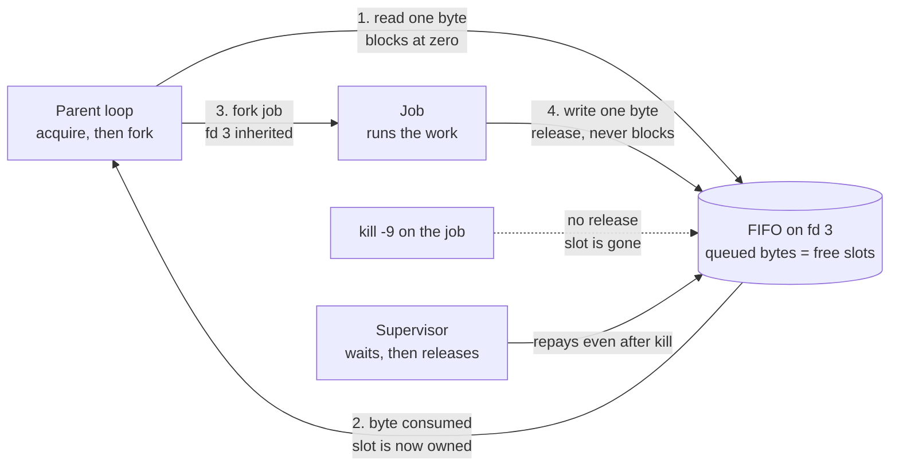

# Descriptor Semaphores

> [!summary] Claim
> A FIFO opened read-write on a spare descriptor is a counting semaphore for shell scripts: its value is the number of bytes queued, a one-byte `read` acquires, a one-byte write releases, and the kernel does the blocking, wakeup and atomicity.

Part of [Concurrency and Scheduling](README.md) in [Shell and Unix Engineering](../README.md).

## TL;DR

- Mechanism: `mkfifo -m 600 f; exec 3<>f` then queue N newlines; `read -r t <&3` takes a token and blocks at zero; `printf '\n' >&3` returns one.
- Rule: acquire in the parent before forking the job and release when the job is finished; hold tokens only in a process whose death you can detect and repay.
- Trap: a token is not owned by anything, so `kill -9` on a job that repays its own token loses the token for good; repay from the supervising process instead.
- Portability: POSIX lets `exec 3<>fifo` fail on a FIFO (it works on Linux and macOS), POSIX leaves it unspecified whether descriptor 3 reaches external commands (mksh and ksh93 close it), POSIX guarantees only descriptors 0 to 9, and the builtin `read` takes whole lines, so a non-newline token (GNU make uses `+`) needs `dd bs=1 count=1`.
- When not to use it: when `wait -n` or `xargs -P` already bounds the work, when the limit must survive across unrelated processes or reboots, or when the script needs a timed or non-blocking acquire in a shell that has no `read -t`.

## Mental model



The parent takes a byte from the FIFO (arrow 1), which blocks while the FIFO is empty and so holds the loop at N concurrent jobs.
It then forks the job (arrow 3), which inherits descriptor 3 and writes a byte back when the work is done (arrow 4), waking exactly one blocked acquirer.
The dotted arrow is the failure mode: nothing in the kernel ties a byte to the process that took it, so a job that dies before arrow 4 leaves the count permanently low, and only a supervisor that survives the job can repay the slot.

## How it works

### The object: a counter made of buffered bytes

A pipe is a kernel byte buffer with a blocking read side and a blocking write side.
If you treat each byte as one unit of a resource, the number of bytes queued is the value of a counting semaphore.
Acquire is "remove one byte, sleeping while there is none", and release is "append one byte".
The kernel supplies everything a semaphore needs: sleeping when the value is zero, waking a waiter when a unit appears, and mutual exclusion on the counter.

In Linux the queue is a ring of page-sized `pipe_buffer` slots, and a one-byte write is merged into the tail slot when that slot is mergeable and has room (linux fs/pipe.c, `anon_pipe_write`, the `PIPE_BUF_FLAG_CAN_MERGE` branch), so a page holds 4096 tokens rather than one.
A reader that finds the pipe empty sleeps with `wait_event_interruptible_exclusive` on the pipe's read wait queue, and a writer that makes an empty pipe non-empty wakes that queue with `wake_up_interruptible_sync_poll` (linux fs/pipe.c, `anon_pipe_read` and `anon_pipe_write`).
The reader side of a FIFO is the same code: `fifo_pipe_read` calls `anon_pipe_read` (linux fs/pipe.c).
The "exclusive" wait means a wakeup is aimed at one sleeper, which is what a semaphore post should do, but neither POSIX nor the Linux man page promises which waiter wins, so never rely on fairness.

POSIX gives the pieces separately.
`pipe()` and a FIFO deliver data "on a first-in-first-out basis" (POSIX.1-2024 XSH pipe).
A write of `{PIPE_BUF}` bytes or fewer "shall not be interleaved with data from other threads performing write operations on the same pipe or FIFO" (POSIX.1-2024 XSH write), and `{PIPE_BUF}` is 4096 on Linux and at least 512 by POSIX (pipe(7)).
A one-byte release is therefore atomic against every other release, and a one-byte acquire cannot return half a token.

### Creating it: why the FIFO is opened read-write

```sh
mkfifo -m 600 "$dir/sem"
exec 3<>"$dir/sem"
```

`[n]<>word` "shall cause the file whose name is the expansion of word to be opened for both reading and writing on the file descriptor denoted by n" (POSIX.1-2024 XCU 2.7.7).
That is one open file description with both access modes, and it is the whole trick.
Opened read-only, a FIFO blocks the opener until some process opens it for writing, and a write-only open blocks until a reader exists (POSIX.1-2024 XSH open, `O_NONBLOCK`; Linux fifo(7)).
A reader that has no writer left gets end-of-file, not a wait, so a semaphore built from a read-only descriptor would report "no token" as EOF the moment the last writer exited.
Holding both ends in the same process means the writer count never drops to zero while the shell lives, so an empty semaphore blocks instead of returning EOF.
The lab asserts the contrast in every shell family: `read` on a pipe whose writer has exited returns status 1 at once (observed under bash 3.2.57 as macOS `/bin/sh` and under bash 5.3.15).

The price is portability.
POSIX does not require it to work: if the implementation cannot open a FIFO for simultaneous read and write, `open()` "shall fail", and the rationale says an implementation "is allowed to reject the use of O_RDWR on a FIFO" (POSIX.1-2024 XSH open, `O_RDWR` and RATIONALE).
Linux documents that it succeeds, "both in blocking and nonblocking mode" (Linux fifo(7)), and the shell matrix confirms it on macOS and Debian.

`mkfifo -m 600` matters because the default mode is read and write for everyone, filtered by the umask (POSIX.1-2024 XCU mkfifo: the mode is `S_IRUSR | S_IWUSR | S_IRGRP | S_IWGRP | S_IROTH | S_IWOTH` unless `-m` is given), and any user who can open the FIFO can drain or inflate the semaphore.

Keep the FIFO's lifetime bound to the open descriptors.
"The kernel maintains exactly one pipe object for each FIFO special file that is opened by at least one process" (Linux fifo(7)), so once the last descriptor closes the queued bytes are gone.
The lab host confirms it: three bytes written through a descriptor that is then closed read back as zero queued bytes from a fresh open.
That makes the semaphore self-cleaning, which is an advantage over lock files and System V semaphores, and a trap for anyone who expects the token count to persist between runs.
You can `rm` the path as soon as every participant has opened it, which leaves an anonymous semaphore that only descendants can reach.

### Acquire: why a one-byte `read` takes exactly one token

```sh
read -r sem_token <&3
```

The `read` utility "shall read a single logical line from standard input" (POSIX.1-2024 XCU read), so the token must be a newline or the call keeps consuming bytes (the lab proves this below).
The harder question is how much a shell reads from a non-seekable input before it stops: a shell that read 4096 bytes into a buffer would swallow every queued token on the first acquire.
The implementations avoid that in different ways.

- bash decides per call.
  When the descriptor is a pipe, `read_builtin` sets `unbuffered_read = 1` and then reads one byte at a time with `zread (fd, &c, 1)` until the delimiter; for other inputs it reads buffered and calls `zsyncfd` afterwards to seek back (bash-5.3 builtins/read.def, `read_builtin`: `input_is_pipe = fd_ispipe (fd)`, the `unbuffered_read` assignments, the `zread`/`zreadc` branch and the final `zsyncfd`).
- dash reads `read`'s input through its input stack, `pushstdin()` then `pgetc()` in `readcmd` (dash src/miscbltin.c, `readcmd`).
  At startup `input_init` records whether stdin is seekable, and for stdin that is not bufferable `preadfd` peeks with `tee(2)` into a private pipe and consumes only what the parser used, falling back to one-byte reads when `tee` returns `EINVAL` (dash src/input.c, `input_init`, `stdin_tee`, `preadfd`; the current tree reports 0.5.13.6 in `configure.ac`, and the `tee` path is present from the v0.5.13 tag on).
  dash 0.5.12, the `sh` of Debian 13, has no `tee` path: its `readcmd` reads one byte per call with `read(0, &c, 1)` (dash v0.5.12 src/miscbltin.c), which is equally safe for tokens.
- The lab does not read the other shells' sources; it asserts the outcome instead: after one `read -r` on a FIFO holding five newlines, exactly four remain, in every shell family.
  A probe in the shell matrix's Debian 13 image found four of five left under dash 0.5.12, bash, mksh R59, ksh93u+m 1.0.10, posh, BusyBox ash and zsh.

The token variable is irrelevant, but it must be a plain name: `status` is read-only in zsh, and the lab found that out the hard way.

A byte that is not a newline needs a byte-exact reader.
`dd bs=1 count=1 <&3 >/dev/null` issues one `read(2)` of one byte and is POSIX, at the price of a fork and exec per acquire.
bash's `read -n` and `read -N` exist in `read.def` but not in POSIX, whose `read` page lists only `-r` and `-d` (POSIX.1-2024 XCU read, OPTIONS; bash-5.3 builtins/read.def, `read_builtin` option switch).
`read -u fd` is also shell-specific, which is why the lab writes `read -r token <&3` instead.

### Release: one atomic byte that cannot block unless the pipe is full

```sh
printf '\n' >&3
```

A release is a single `write(2)` of one byte, within the `{PIPE_BUF}` atomicity guarantee above.
It blocks only if the pipe is full, which means the number of queued tokens has reached the pipe capacity.
The invariant is `queued + held = N`.
The danger is on initialisation: filling N tokens into a pipe whose capacity is below N blocks forever in `sem_open`, because the only reader is the same process.
So N must stay below the capacity (see Numbers and limits).

### The pool pattern, and where to acquire

The idiom is to acquire in the parent, fork, and release in the child.

```sh
while [ "$i" -lt "$njobs" ]; do
  sem_wait || exit 1
  { work; sem_post; } &
  i=$((i + 1))
done
wait
```

Acquiring in the parent turns the semaphore into back-pressure on the spawn loop: the loop stops forking at N live jobs.
Acquiring in the child instead forks every job at once and bounds only the work, so a 50,000-item loop creates 50,000 processes that all sleep on the FIFO, which is the fork-and-memory spike the semaphore was meant to prevent.
That distinguishes this note from [[Bounded-Job-Pools]], which bounds the pool with `wait -n` and job-table bookkeeping and needs no descriptor.

### Token ownership and failure

Nothing in the kernel attaches a byte to the process that read it.
System V semaphores can: an operation with `SEM_UNDO` "will be automatically undone when the process terminates" (Linux semop(2)).
A pipe has no such hook.
So when a job dies after acquiring and before releasing, one slot is gone for the life of the semaphore.

The lab kills a token holder with `SIGKILL` and counts what is left from a semaphore that started at three.

| Pattern | Who repays the token | Tokens left after `kill -9` on the worker |
|---|---|---|
| A: the worker repays from an `EXIT` trap | the killed process itself | 2 (leaked) |
| B: a supervisor repays after the worker exits | a separate process | 3 |

An `EXIT` trap covers normal exit and the catchable signals a shell turns into an exit, and it cannot run on `SIGKILL`, an OOM kill, or a kernel panic.
So the robust pattern is `{ worker; sem_post; } &`: the worker is one process and the shell that repays is another, and only the loss of both together leaks a slot.
The supervisor itself can still die, in which case the pool as a whole is dying and the FIFO goes with it.
Kill the process group rather than single pids ([[Signal-Propagation-to-Children]], [[Graceful-Shutdown]]).

### Descriptor inheritance: every child holds the semaphore

Descriptor 3 stays open in every subshell and background job, and in every external command, unless the shell marks it close-on-exec or you close it.
POSIX allows either: when `exec` opens descriptors above 2, "it is unspecified whether those file descriptors remain open when the shell invokes another utility" (POSIX.1-2024 XCU `exec`).
The lab runs an external probe that asks `fcntl(3, F_GETFD)`: descriptor 3 is open there under bash, zsh and dash on the draft host, and in the shell matrix images also under posh, yash and BusyBox ash; `3>&-` on that one command closes it.
ksh93 and mksh are the exceptions: macOS `/bin/ksh` (ksh93u+ 2012-08-01), ksh93u+m 1.0.10 on Debian 13, and mksh R59 on both Alpine and Debian hide descriptor 3 from the external command, so the lab asserts "closed" for the `ksh93` and `mksh` families.
See [[Close-on-Exec-and-Descriptor-Inheritance]] and [[Descriptor-Duplication-and-Closing]].

This is a hazard in both directions.
A child that should not touch the pool can drain tokens or push extra ones, and a daemon launched from a job holds the FIFO open after the parent exits.
Close the descriptor for anything that is not part of the pool: `cmd 3>&-`.

### Blocking, signals and timeouts

A shell blocked in `read <&3` on an empty semaphore is blocked in a builtin.
POSIX says a trap for a signal received "while the shell is waiting for the completion of a utility executing a foreground command" is not run until the command completes, and only `wait` is required to return early (POSIX.1-2024 XCU 2.12).
On the draft host that did not hold for the builtin: with a `TERM` trap installed and a `TERM` sent while the shell sat blocked in `read -r x <&3`, the trap ran immediately in bash 5.3.15, Homebrew dash, zsh and macOS ksh93u+ (ad hoc probe, not asserted by the lab).
Do not rely on it: for a portable shutdown, run the blocking acquire in the foreground only in the parent loop, install the trap before the loop, and make the trap exit.

POSIX `read` has no timeout.
bash has `-t`, and `read_builtin_timeout` in `read.def` implements it with `select` or `SIGALRM` (bash-5.3 builtins/read.def, `read_builtin_timeout`); a timed or non-blocking acquire in portable shell does not exist.
If a script needs "try, and otherwise skip this item", use a different primitive (see the comparison below).

### The make jobserver is this pattern with a wire format

GNU make's jobserver is a descriptor semaphore, and reading its source is the best check on the idiom.

- Tokens are one byte: `static char token = '+';` (GNU make src/posixos.c).
- The top-level make writes `slots - 1` tokens, because "every make assumes that it always has one job it can run" (GNU make src/main.c: `jobserver_setup (job_slots - 1, jobserver_style)`).
  A client that is already running as a job therefore owns one slot without holding a token and must only acquire extra tokens for extra parallelism.
- Make 4.4 added a named-pipe style: `--jobserver-auth=fifo:PATH`.
  The server calls `mkfifo (fifo_name, 0600)` in the temporary directory, opens the read side `O_RDONLY|O_NONBLOCK` "else it will hang until the write side is open", then the write side `O_WRONLY`; clients open `O_RDONLY` then `O_WRONLY` (GNU make src/posixos.c, `jobserver_setup`, `jobserver_parse_auth`).
  `--jobserver-style=pipe` keeps the older two-descriptor form `--jobserver-auth=R,W`; the NEWS file for 4.4 (31 Oct 2022) says other tools "will need to be enhanced as described in the GNU Make manual" to join the new style, and that `jobserver-fifo` appears in `.FEATURES` (GNU make NEWS, Version 4.4).
- Releasing writes the same token byte back (`jobserver_release`).
  Acquiring waits with `pselect` so a `SIGCHLD` cannot be missed, then does a non-blocking `read` of one byte, and retries on `EAGAIN` when "someone sniped our token" (GNU make src/posixos.c, `jobserver_acquire`).
- The old pipe style leaked descriptors into recipes that were not make: GNU make 4.4 added a `MAKEFLAGS` option that disables the jobserver when it closes the pipes, so that sub-processes "that invoke make" cannot take "other open file descriptors as jobserver pipes" (GNU make NEWS, Version 4.4; the NEWS file cites Savannah bugs 57242 and 62397).

The lab's `borrow.sh` is a client of that protocol.
Its token is `+`, not a newline, so the builtin `read` cannot take it and the lab uses `dd bs=1 count=1`, and the lab proves that `read -r` on a FIFO holding `+`, `+`, newline returns `++` and leaves nothing: one `read` took two tokens.

The draft host also ran the real thing once (GNU Make 4.4.1, macOS, `gmake -j3` with a single recipe that runs `borrow.sh`, not asserted by the lab):

```text
MAKEFLAGS= -j3 --jobserver-auth=fifo:/.../GMfifo28691
token=+
held=1
returned=2
```

Two slots were free in the FIFO (3 minus the implicit one), the client took one (`held=1`) and returned it (`returned=2`).
The prefix of that FIFO's file name on 4.4.1 is `GMfifo` (the format string `%s/GMfifo%lld` in the Homebrew 4.4.1 binary), whereas the current source reads `GmFIFO` (`FNAME_PREFIX` in `jobserver_setup`), so match on the `fifo:` prefix, never on the name.
When the same experiment used a makefile with three recipes that each tried to borrow a token, the run hung until killed after roughly 95 seconds: make had already handed both tokens to the sibling recipes, so each client waited for a token that only another waiting client could return.
That is the deadlock the "implicit slot" rule prevents: a job must not demand a token for itself, only for extra work that it can run without waiting on a sibling.

### Where the descriptor semaphore sits among the alternatives

| Primitive | Reachable from a shell | Survives holder death | Cross-process without a common ancestor | Notes |
|---|---|---|---|---|
| FIFO tokens (this note) | yes | no, the token leaks | only via a named FIFO and a keeper process | blocking acquire, no timeout in POSIX `read` |
| `wait -n` pool | yes | yes, the job table sees the exit | no | see [[Bounded-Job-Pools]] |
| `xargs -P`, `parallel -j` | yes | yes | no | see [[xargs-P]], [[GNU-parallel]] |
| `parallel --semaphore` | yes | yes | yes, through advisory lock files | see [[GNU-parallel]] |
| N lock files with `flock` | yes where `flock` exists | yes, locks drop at close | yes | see [[File-Locking-Semantics]] and [[Locking-and-Stale-Locks]] |
| POSIX named semaphore | no, C only | no | yes, by name `/somename` (Linux sem_overview(7)) | needs a helper binary |
| System V semaphore | no, C only | yes, with `SEM_UNDO` (semop(2)) | yes | persists in the kernel until removed |
| `eventfd` with `EFD_SEMAPHORE` | no, C only | no | by passing the descriptor | read returns 1 and decrements by 1 (eventfd(2)) |

The descriptor semaphore wins when the job set is already a shell script and the limit applies to its own descendants.
It loses wherever the limit must be shared by unrelated invocations that start independently, because the tokens live only as long as one process holds the FIFO open.

## Numbers and limits

| Quantity | Value | Source |
|---|---|---|
| Atomic write size on a pipe or FIFO | at most `{PIPE_BUF}` bytes, one byte is always safe | POSIX.1-2024 XSH write |
| `{PIPE_BUF}` | 4096 on Linux; POSIX requires at least 512 | pipe(7), as of 2026-11 |
| Linux pipe capacity | 65,536 bytes by default (16 pages of 4096) | pipe(7), as of 2026-11 |
| Linux capacity can be set | `F_SETPIPE_SZ` since 2.6.35, limited by `/proc/sys/fs/pipe-max-size` for unprivileged users | pipe(7) |
| Linux per-user page limits | `pipe-user-pages-soft` and `pipe-user-pages-hard` since 4.5; past the soft limit new pipes get fewer than 16 pages | pipe(7) |
| macOS FIFO capacity in one-byte tokens | 8192 | lab probe (`fifotool capacity`, as run by `semprobe.sh capacity`), macOS 27.3 arm64, measured twice on 2026-11-26; the lab itself asserts only at least 4096 |
| Pipe capacity in the shell matrix | macOS anonymous pipes start at 16 KiB and grow to 64 KiB; Linux defaults to 64 KiB | measured in the shell matrix, 2026-10 |
| Descriptors a script can rely on in redirections | 0 to 9; higher is implementation-defined | POSIX.1-2024 XCU 2.7 |
| Maximum semaphore value | the pipe capacity | derived: tokens are bytes in the pipe |
| Cost of one acquire and release with builtins | about 47 microseconds in dash, 62 in bash 5.3.15, 62 in zsh (20,000 cycles in 0.94 s, 1.25 s, 1.24 s) | ad hoc single run on macOS 27.3 arm64, 2026-11-26, not asserted by the lab; noisy |
| Cost of one acquire with `dd bs=1 count=1` plus a builtin release | about 14.4 milliseconds (1,000 cycles in 14.39 s) | ad hoc single run, bash 5.3.15, same host; dominated by the fork and exec |
| Make jobserver token count | `-j N` queues `N - 1` tokens | GNU make src/main.c, `jobserver_setup (job_slots - 1, ...)` |
| Lab pool run | 6 one-second jobs with 3 tokens need at least two one-second waves, so at least 2 seconds | derived from `pool.sh 3 6` |

The capacity row is the bound on N.
A pool above 65,536 on Linux, or above 8192 on a macOS FIFO, blocks in `sem_open` and never reaches the work.
Real pools are far smaller, so in practice the capacity limit is a reason to be suspicious of an N in the thousands, not a tuning knob.

## Portability

Cells marked "lab" are asserted by the lab in the shell family named in the first column.
"Observed" means seen on the macOS host or in the shell matrix's Alpine 3.22 and Debian 13 images (one-off probes, 2026-11-26); a cell that says only "lab" is the lab's assertion and has not yet been run in the shell matrix.

| Shell | `exec 3<>fifo` on a FIFO | `read -r t <&3` takes exactly one newline token | Descriptor 3 visible to an external command |
|---|---|---|---|
| POSIX sh (specification) | may fail: `open()` "shall fail" where the implementation does not support it (POSIX.1-2024 XSH open, `O_RDWR`) | yes, `read` reads one line (XCU read) | unspecified for descriptors above 2 opened by `exec` (XCU `exec`) |
| macOS bash 3.2.57 (`/bin/sh`) | lab, observed | lab, observed | lab: open, observed |
| current bash (5.3.15 on macOS; Debian 13) | lab, observed | lab, observed | lab: open, observed |
| zsh native (macOS; Debian 13) | lab, observed | lab, observed | lab: open, observed |
| `zsh --emulate sh` | lab | lab | lab: open |
| dash (Homebrew on macOS; 0.5.12 on Debian 13) | lab, observed | lab, observed | lab: open, observed |
| ksh93 (macOS `/bin/ksh` 93u+ 2012-08-01; 93u+m 1.0.10 on Debian 13) | lab, observed | lab, observed | lab: closed, observed on both |
| mksh (R59 on Alpine and Debian 13) | lab, observed | lab, observed on Debian | lab: closed, observed on both |
| yash (Alpine) | lab, observed | lab | lab: open, observed |
| posh (Debian 13) | lab, observed | lab, observed | lab: open, observed |
| BusyBox ash (Alpine; Debian 13) | lab, observed | lab, observed on Debian | lab: open, observed |

| Utility or fact | GNU | BSD and macOS | BusyBox | uutils |
|---|---|---|---|---|
| `mkfifo -m 600` | POSIX option (XCU mkfifo); lab | draft host (macOS): `prw-------` observed | lab | not tested |
| `dd bs=1 count=1` takes exactly one byte | lab | lab, observed on macOS | lab | not tested |
| FIFO opened read-write succeeds | Linux fifo(7) | draft host observed | lab | not applicable |

Known matrix facts that affect the pattern:

- bash 5.3.15 prints a "Killed" job notice on stderr when a background job dies of `SIGKILL`.
  The lab wraps the `wait` in `{ ...; } 2>/dev/null` so the notice does not leak into captured output, because the shell matrix measured a similar job notice ("Terminated") from bash 3.2.
- zsh reserves `status` (read-only) and `path` (tied to `PATH`) as parameter names; on the draft host `zsh -c 'path=/x; echo $PATH'` printed `PATH=/x` and assigning `status` failed with "read-only variable".
  The lab scripts avoid both names.
- ksh93 and mksh hide descriptor 3 from external commands, so a script that hands the semaphore to a helper should pass the FIFO path and let the helper open it, as `worker.sh` does.

## Worked example

The lab is [lab](../labs/15-descriptor-semaphores/).
The semaphore is three small functions (`sem.sh`):

```sh
# shellcheck shell=sh
# sem.sh - a counting semaphore made of a FIFO opened read-write on descriptor 3.
# Source it with: . ./sem.sh
#
#   sem_open FIFO N   create FIFO, open it on descriptor 3, queue N tokens (one newline each)
#   sem_wait          take one token; blocks while the semaphore is 0
#   sem_post          put one token back
#
# The semaphore value is the number of bytes queued in the FIFO.
# Descriptor 3 stays open in this shell and in every subshell and background job it forks.

sem_open() {
  mkfifo -m 600 "$1" || return 1
  exec 3<>"$1" || return 1
  sem_left=$2
  while [ "$sem_left" -gt 0 ]; do
    printf '\n' >&3 || return 1
    sem_left=$((sem_left - 1))
  done
}

sem_wait() {
  # shellcheck disable=SC2034 # the token value is unused, taking it is the point
  read -r sem_token <&3
}

sem_post() {
  printf '\n' >&3
}
```

The pool that uses it (`pool.sh`) measures its own concurrency from a log that each job appends to with `O_APPEND` single-line writes, so the peak is computed from the real order of events rather than from timing:

```sh
#!/bin/sh
# pool.sh - run JOBS one-second jobs with at most N running at once.
# usage: pool.sh N JOBS LOG DIR      bounded by a descriptor semaphore
#        pool.sh unbounded JOBS LOG  control run: no semaphore
# Each job appends "s" to LOG when it starts and "e" just before it finishes (and, in the bounded
# run, before it returns its token), so the running count at any point in LOG never exceeds N.
# Prints "max=<peak running count> jobs=<jobs finished>", plus "tokens=<queued>" when FIFOTOOL names
# the fifotool binary.
set -u
here=$(dirname "$0")
# shellcheck source=sem.sh
. "$here/sem.sh"

n=${1:?usage: pool.sh N JOBS LOG DIR}
njobs=${2:?usage: pool.sh N JOBS LOG DIR}
log=${3:?usage: pool.sh N JOBS LOG DIR}
: >"$log"

if [ "$n" != unbounded ]; then
  dir=${4:?usage: pool.sh N JOBS LOG DIR}
  sem_open "$dir/sem" "$n" || exit 1
fi

i=0
while [ "$i" -lt "$njobs" ]; do
  if [ "$n" != unbounded ]; then
    sem_wait || exit 1
  fi
  {
    printf 's\n' >>"$log"
    /bin/sleep 1
    printf 'e\n' >>"$log"
    if [ "$n" != unbounded ]; then
      sem_post
    fi
  } &
  i=$((i + 1))
done
wait

peak=$(awk '$1 == "s" { c++; if (c > m) m = c } $1 == "e" { c-- } END { print m + 0 }' "$log") || exit 1
done_jobs=$(awk '$1 == "e" { c++ } END { print c + 0 }' "$log") || exit 1
printf 'max=%s jobs=%s\n' "$peak" "$done_jobs"
if [ "$n" != unbounded ] && [ -n "${FIFOTOOL-}" ]; then
  left=$("$FIFOTOOL" count "$dir/sem") || exit 1
  printf 'tokens=%s\n' "$left"
fi
```

`fifotool` is a small C helper in the lab that counts queued tokens (it drains and refills, because `FIONREAD` reported 0 on a macOS FIFO), measures capacity, and tests whether a descriptor is open.
Its `count` is only meaningful when no other process touches the FIFO, which is how the lab uses it: after the workers have finished.

Expected output, from the lab's assertions (the lab passed all 13 tests under bash 5.3.15 on the draft host, and the current scripts, with `mkfifo -m 600`, passed all 13 under macOS `/bin/sh`, bash 3.2.57, on 2026-11-26):

```text
$ pool.sh 3 6 log dir          # three tokens, six jobs
max=3 jobs=6
tokens=3
$ pool.sh 1 3 log dir          # one token: a mutex
max=1 jobs=3
tokens=1
$ pool.sh unbounded 6 log      # control: no semaphore
max=6 jobs=6
$ semprobe.sh read1 dir        # one read takes one token of five
left=4
$ semprobe.sh plusread dir     # '+' '+' newline, one read
got=++ left=0
$ semprobe.sh block dir        # acquire on an empty semaphore
blocked=yes woke=yes status=0
$ semprobe.sh kill dir A       # kill -9, worker repays itself
pattern=A left=2
$ semprobe.sh kill dir B       # kill -9, supervisor repays
pattern=B left=3
$ semprobe.sh jobserver dir    # make-style client, dd as the byte reader
token=+
held=1
returned=2
```

The control run is what makes `max=3` meaningful: with the semaphore removed the same six jobs reach `max=6`, so the measurement does see concurrency.

## Pitfalls

> [!warning] Token leak on SIGKILL
> Trigger: a job repays its own token (in a trap or in the last line of the job) and is killed by `SIGKILL`, an OOM kill, or an `exec` failure before that line.
> Symptom: the pool silently shrinks by one slot per casualty, throughput decays, and a pool of N whose jobs all die eventually blocks forever on `sem_wait`.
> Fix: repay from a different process than the one doing the work (`{ worker; sem_post; } &`), and treat a pool whose count drifts as a bug to detect, for example by counting tokens at the end (the lab's `tokens=3` line).
> Evidence: the lab's pattern A leaves 2 of 3 tokens after one `kill -9`, pattern B leaves 3.

> [!warning] Acquire inside the child
> Trigger: `for f in *; do { read -r _ <&3; work "$f"; printf '\n' >&3; } & done`.
> Symptom: every iteration forks immediately; the work is bounded but the process table is not, and the shell can exhaust process or memory limits long before any token is contended.
> Fix: acquire in the parent loop before the `&`.

> [!warning] Non-newline tokens with `read`
> Trigger: a client of a protocol whose tokens are not newlines, such as the GNU make jobserver's `+`, uses `read` to acquire.
> Symptom: `read` consumes bytes until a newline arrives, so it swallows every queued token (the lab shows one `read` taking `++` and leaving zero) and then blocks.
> Fix: take exactly one byte with `dd bs=1 count=1`, or with a shell-specific `read -n 1` where portability is not needed, and write back the byte you read.

> [!warning] A client that demands a token for itself
> Trigger: every running make recipe tries to borrow a jobserver token before it can proceed.
> Symptom: the observed hang: three recipes under `gmake -j3` each blocked in `dd` after make had already given its two tokens to the siblings, and the run did not finish until killed after roughly 95 seconds.
> Fix: follow the protocol's "one implicit slot per job" rule: a job already owns a slot, and acquires tokens only for extra parallelism it can use without waiting on its siblings (GNU make src/main.c, comment above `jobserver_setup`).

> [!warning] Initial fill past the pipe capacity
> Trigger: `sem_open "$f" 100000` on Linux (capacity 65,536 by default) or `sem_open "$f" 10000` on a macOS FIFO (capacity 8192 in the lab).
> Symptom: the script hangs in the fill loop with no output, because the only reader is the process that is writing.
> Fix: keep N far below the capacity, and bound the initial fill with a limit check before the loop.

> [!warning] Semaphore on a descriptor above 9 or on a descriptor already in use
> Trigger: `exec 10<>"$fifo"` for a "free" high number, or reusing a descriptor number that a sourced file or another function already opened.
> Symptom: on the draft host `exec 10<>f` succeeded in bash, but dash and macOS ksh93u+ answered `exec: 10: not found` and native zsh answered `command not found: 10`, because they read `10` as a command word (ad hoc probe, not asserted by the lab); two components that pick the same number silently share one descriptor.
> Fix: POSIX guarantees only descriptors 0 to 9 (POSIX.1-2024 XCU 2.7); pick a documented number from 3 to 9 and keep it in one place.

> [!warning] Inheriting the semaphore into a long-lived child
> Trigger: a job starts a daemon or a pager without `3>&-`.
> Symptom: the daemon holds the FIFO open, so the tokens persist and the pipe object stays alive after the parent is gone, and the daemon (or anything it execs) can read or write tokens.
> Fix: `cmd 3>&-` for every command that is not part of the pool, and `exec 3>&-` in the parent at the end.

> [!warning] Tokens do not persist
> Trigger: a "persistent" semaphore shared by separate script invocations through a named FIFO with no process holding it open.
> Symptom: the first invocation fills the FIFO and exits, the kernel frees the pipe object (the lab host reads back zero bytes after the last close), and the next invocation sees an empty FIFO and blocks forever.
> Fix: use a lock-based primitive for cross-invocation limits ([[Overlap-Prevention-and-Missed-Runs]], [[Locking-and-Stale-Locks]]) or run a keeper process that holds the FIFO for the life of the group.

## Security and robustness

- A named FIFO is an access-control object.
  Anyone who can open it can read tokens (a denial of service on the pool) or write extra bytes (raising the concurrency limit beyond what the owner intended).
  Create it with `mkfifo -m 600` inside a private directory made by `mktemp -d`, never at a guessable path in a shared directory such as `/tmp` (GNU make creates its FIFO with mode 0600, `mkfifo (fifo_name, 0600)` in `jobserver_setup`).
- Unlink the path once every participant has it open (`rm -f "$dir/sem"`), so only descendants that inherited descriptor 3 can reach the semaphore.
- Close the semaphore in every child that is not part of the pool (`3>&-`); an inherited descriptor is full semaphore authority, which is the class of bug the GNU make 4.4 NEWS entry about stray descriptors describes.
- Bound the blocking: a script that waits on a semaphore that no process will ever release hangs forever.
  Use a supervising timeout around the whole run, and in bash prefer `read -t` where a timeout is safe to add.
- Watch the failure paths, not the success path: tokens must be repaid on `exec` failure, on `set -e` exit, and on a signal.
  See [[Graceful-Shutdown]] and [[Signal-Propagation-to-Children]] for the trap and process-group side.
- The `read` that takes a token returns status 1 at end-of-file; an unchecked `sem_wait` after an unexpected EOF lets the loop run with no token held, so test the status (`sem_wait || exit 1`).

## The principal's view

The decision is whether a shell script should carry its own scheduler at all.
For a loop over N independent items on one machine, `xargs -P` or `parallel -j` is the right answer: the tool owns the child table, retries nothing silently, and leaks nothing when a child is killed.
Choose the descriptor semaphore when the structure of the work does not fit a flat list of items: a pipeline of different stages that share one resource limit, a script that must spawn from inside its own functions, or a wrapper that must share a limit with GNU make's jobserver.

The trade-off is explicit.
You get a kernel-backed blocking primitive in a dozen lines and no dependency, and you take on token accounting yourself: no ownership, no undo, no timeout, no fairness guarantee, and a hard ceiling at the pipe capacity.
The leak-on-kill property is the one that bites in production, so the supervisor pattern is not optional.

Switch tools when the limit must be shared across unrelated processes or hosts (a lock directory, `flock` with N files, a database advisory lock, or a real queue), when the work must be retried or timed out per item (a language with a real task runner), or when correctness depends on cleaning up after a crash (System V semaphores with `SEM_UNDO` in C, or a supervisor such as systemd).
A shell script that needs a timed or non-blocking acquire is a signal to move that part to Python or C rather than to stack workarounds.

## Interview questions

> [!question] L5: How does a FIFO become a counting semaphore in a shell script?
>
> > [!success]- Answer
> > Create the FIFO with `mkfifo`, open it read-write on a spare descriptor with `exec 3<>fifo`, and queue N newline bytes.
> > Acquire with `read -r t <&3`, which blocks at zero because the shell itself keeps a write end open.
> > Release with `printf '\n' >&3`, one atomic byte.
> > The semaphore value is the number of bytes queued.
> >
> > Follow-up: Why open it with `<>` and not just `<`?

> [!question] L5: Where should the acquire happen, in the parent loop or in the background job, and why?
>
> > [!success]- Answer
> > In the parent, before forking the job.
> > Acquiring in the child forks every job at once and bounds only the work, not the number of processes.
> > Acquiring in the parent blocks the spawn loop at N live jobs, which is the back-pressure you want.
> >
> > Follow-up: What changes if the parent is itself a background function?

> [!question] L5: Predict the output.
>
> > [!success]- Answer
> > ```sh
> > mkfifo -m 600 f; exec 3<>f
> > printf '++\n' >&3
> > read -r got <&3
> > printf '%s\n' "$got"
> > ```
> > It prints `++`, and the FIFO is then empty.
> > `read` takes one line and a line ends only at a newline, so a single call consumed both `+` tokens.
> > The lab asserts `got=++ left=0`.
> >
> > Follow-up: What takes exactly one `+` instead?

> [!question] L6: Why does one `read` take one token and not a buffer of them?
>
> > [!success]- Answer
> > Because the shell must not read past what it consumes from a non-seekable input.
> > bash switches to one-byte reads when the descriptor is a pipe, dash 0.5.13 and later peek with `tee(2)` or fall back to one-byte reads, and dash 0.5.12 always reads one byte, so a one-byte acquire leaves the other tokens queued.
> > The lab asserts four tokens remain after one `read` on a FIFO of five, in every shell family.
> >
> > Follow-up: What would break if a shell buffered 4096 bytes?

> [!question] L6: Debug this script: it has N tokens but the machine runs out of processes.
>
> > [!success]- Answer
> > ```sh
> > exec 3<>"$fifo"
> > for i in $(seq "$N"); do printf '\n' >&3; done
> > for f in *.dat; do
> >   { read -r _ <&3; process "$f"; printf '\n' >&3; } &
> > done
> > wait
> > ```
> > The acquire is inside the background group, so the loop forks one process per file immediately and only the work is throttled.
> > Move `read -r _ <&3 || exit 1` into the loop body before the `{`, and repay from the group after the work.
> > Add a supervisor (`{ ( process "$f" ); printf '\n' >&3; } &`) so a killed worker cannot leak the token.
> >
> > Follow-up: What else is wrong if `process` is killed by `SIGKILL`?

> [!question] L6: A worker is killed by the OOM killer and the pool slowly stalls. Why, and how do you fix it?
>
> > [!success]- Answer
> > The worker repaid its own token, and `SIGKILL` cannot run a trap, so the token is gone.
> > After enough kills every token is missing and `sem_wait` blocks forever.
> > Repay from a different process, `{ worker; sem_post; } &`, so the repay survives the death of the worker.
> > The lab shows 2 of 3 tokens left after the unsupervised kill and 3 of 3 after the supervised one.
> >
> > Follow-up: What happens if the supervisor is killed too?

> [!question] L7+: Design a limit of 4 concurrent heavy jobs shared by three unrelated cron-started scripts.
>
> > [!success]- Answer
> > A descriptor semaphore is the wrong primitive: the kernel frees the pipe object when the last descriptor closes, so the tokens vanish between runs and nobody owns them.
> > Use four lock files taken with `flock` (or `mkdir` locks with staleness checks), which drop at close and survive a crash, or a single keeper process that holds the FIFO open and serves it.
> > A keeper reintroduces a supervision problem, so prefer the lock files unless a blocking wait without polling is required.
> > See [[Locking-and-Stale-Locks]].
> >
> > Follow-up: How does `parallel --semaphore` solve this?

> [!question] L7+: You want a shell script to participate in a `make -j16` jobserver. What are the rules and the traps?
>
> > [!success]- Answer
> > Read `--jobserver-auth` from `MAKEFLAGS`: a `fifo:PATH` form in make 4.4 and later, or `R,W` descriptors for the pipe style.
> > Tokens are single bytes, usually `+`, so take one with a byte-exact read (`dd bs=1 count=1`), not the builtin `read`, and write back the same byte.
> > Your own job already holds the implicit slot, so only acquire extra tokens for extra parallelism, and never wait for a token while holding all of a sibling's work.
> > Close the descriptors for children that are not part of the protocol, because the 4.4 NEWS describes stray descriptors being mistaken for a jobserver.
> > In the old pipe style make passes the descriptors only to recipes it considers recursive, so a script run from a recipe make does not consider recursive may not see them (GNU make src/posixos.c, `jobserver_pre_child`: `if (recursive && js_type == js_pipe)`).
> >
> > Follow-up: What is the failure mode if every job demands a token?

> [!question] L7+: Why is `exec 3<>fifo` not strictly POSIX, and what do you do about it?
>
> > [!success]- Answer
> > POSIX `open()` lets an implementation fail on `O_RDWR` of a FIFO, and the rationale permits it.
> > Linux documents that it succeeds, and the shell matrix confirms it on macOS and Debian.
> > Accept that behaviour and document it, since the script already depends on `mkfifo`, and test the open at startup so it fails loudly where the platform refuses.
> > Two separate opens (`3<fifo 4>fifo`) are the alternative, but each open blocks until the peer exists, so they need a deliberate ordering or a background opener.
> >
> > Follow-up: What does holding both ends in one process change about end-of-file?

## Related

Prerequisites: [[Named-Pipes-for-IPC]]

Next: [[Output-Interleaving-and-Append-Atomicity]]

See also: [[Bounded-Job-Pools]], [[Background-Jobs-and-wait]], [[xargs-P]], [[GNU-parallel]], [[Signal-Propagation-to-Children]], [[Graceful-Shutdown]], [[Overlap-Prevention-and-Missed-Runs]], [[Pipes-and-FIFOs]], [[PIPE_BUF-and-Write-Atomicity]], [[File-Descriptors-and-Open-File-Descriptions]], [[Close-on-Exec-and-Descriptor-Inheritance]], [[Descriptor-Duplication-and-Closing]], [[The-read-Builtin]], [[File-Locking-Semantics]], [[Locking-and-Stale-Locks]], [[SIGPIPE-and-EPIPE]]

## Further reading

- POSIX.1-2024 XCU `read` (https://pubs.opengroup.org/onlinepubs/9799919799/utilities/read.html): the exact line-reading and EOF contract that makes a newline the only safe builtin token.
- POSIX.1-2024 XCU 2.7 and 2.7.7 (https://pubs.opengroup.org/onlinepubs/9799919799/utilities/V3_chap02.html): the redirection syntax, the 0 to 9 descriptor guarantee, and `<>`.
- POSIX.1-2024 XSH `open` and `write` (https://pubs.opengroup.org/onlinepubs/9799919799/functions/open.html, https://pubs.opengroup.org/onlinepubs/9799919799/functions/write.html): FIFO open blocking rules, the `O_RDWR` allowance, and `{PIPE_BUF}` atomicity.
- POSIX.1-2024 XCU `mkfifo` (https://pubs.opengroup.org/onlinepubs/9799919799/utilities/mkfifo.html): default creation mode and `-m`.
- Linux `pipe(7)` and `fifo(7)` (https://man7.org/linux/man-pages/man7/pipe.7.html, https://man7.org/linux/man-pages/man7/fifo.7.html): capacity, `PIPE_BUF`, limits, and FIFO lifetime.
- Linux `fs/pipe.c` (https://raw.githubusercontent.com/torvalds/linux/master/fs/pipe.c): the read and write paths, one-byte merging, and exclusive wakeups.
- GNU make `src/posixos.c` and `NEWS` (https://raw.githubusercontent.com/mirror/make/master/src/posixos.c, https://raw.githubusercontent.com/mirror/make/master/NEWS): the reference implementation of the same pattern and its fixes.
- bash `builtins/read.def` (https://raw.githubusercontent.com/mirror/bash/master/builtins/read.def): how `read` avoids over-reading a pipe.
- dash `src/input.c` and `src/miscbltin.c` (https://git.kernel.org/pub/scm/utils/dash/dash.git/plain/src/input.c, https://git.kernel.org/pub/scm/utils/dash/dash.git/plain/src/miscbltin.c): the `tee(2)` based stdin handling.
- Linux `semop(2)`, `sem_overview(7)` and `eventfd(2)` (https://man7.org/linux/man-pages/man2/semop.2.html, https://man7.org/linux/man-pages/man7/sem_overview.7.html, https://man7.org/linux/man-pages/man2/eventfd.2.html): the kernel semaphores a shell cannot reach, and the undo and semaphore-mode semantics a pipe lacks.
