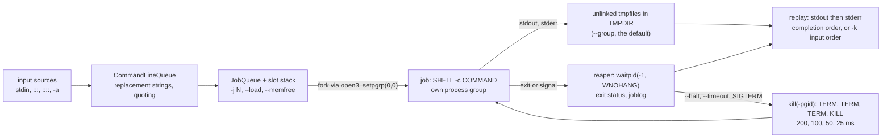

# GNU parallel

> [!summary] Claim
> GNU parallel is a single Perl program that turns a stream of input records into shell command lines, runs them in a bounded number of job slots as separate process groups, and gives them back to you in a deterministic shape (grouped output, a failure count, a resumable joblog) - at the price of a second round of shell parsing, a few milliseconds per job, and a pile of defaults that differ from `xargs`.

Part of [Concurrency and Scheduling](README.md) in [Shell and Unix Engineering](../README.md).

## TL;DR

- Mechanism: `parallel` builds a command string from a template and each input record, forks per job, calls `setpgrp(0,0)`, and `exec`s `$shell -c COMMAND` (parallel 20261022, `Job::start`), so every job is a fresh shell in its own process group.
- Rule: the arguments are shell-quoted for you but the command is not, so quote the command once for the shell that runs the job, pin the job shell with `PARALLEL_SHELL`, and put anything non-trivial in an exported script.
- Trap: the job shell is not `/bin/sh` by default - it is the shell that started `parallel` (found by walking its ancestors and then looked up by name on `PATH`), so a one-liner that works in bash can fail under zsh, and functions, aliases and unexported variables do not exist in the job at all.
- Portability fact: GNU parallel is not in POSIX (POSIX.1-2024 `xargs` has no `-P`), it is a different program from moreutils `parallel` that often wins the `PATH` race, and its exit status is a failure count capped at 101, not a pass-through.
- When not to use it: tiny jobs where 3-10 ms of Perl per job dominates, environments without Perl, jobs that need a real scheduler (dependencies, retries with backoff, cluster resources), or any pipeline where untrusted text can reach the command position or a `{= =}` expression.

## Mental model



Input records flow left to right: each record (a line, or a NUL-terminated record with `-0`) is substituted into the command template, with the substituted value shell-quoted but the template left alone, and the resulting string waits in the job queue until a slot is free.
When a slot frees, `parallel` forks, the child makes itself a process-group leader and `exec`s the job shell, and the parent keeps the read side of the job's output.
Output goes to temporary files that are unlinked at creation, so nothing reaches your terminal until the job finishes and `parallel` replays stdout and then stderr, in completion order or, with `-k`, in input order.
A reaper loop collects exit statuses with a non-blocking `waitpid`, writes the joblog, and when a halt condition, a timeout, or a SIGTERM to `parallel` itself fires, kills the whole process group of the affected jobs with an escalating signal sequence.

## How it works

### Position in the stack

GNU parallel is one Perl file (parallel_design(7), "One file program"), released roughly monthly with date version numbers such as `20261022` (parallel NEWS, as of 2026-11).
It targets old systems on purpose: Perl 5.8.0 is the stated floor and "cannot depend on a compiler" is the stated reason for Perl (parallel_design(7), "Choice of programming language", "Old Perl style").
POSIX does not specify it.
The nearest specified tool is `xargs`, and the POSIX.1-2024 synopsis is `xargs [-prtx] [-E eofstr|-0] [-I replstr|-L number|-n number] [-s size] [utility [argument...]]` with no `-P` (POSIX.1-2024 XCU xargs); parallelism in `xargs` is an extension, covered in [[xargs-P]].
The man page positions `parallel` as a superset: "written to have the same options as xargs" and "a substitute for xargs or cat | bash" (parallel(1) 20261022, DESCRIPTION).

### From records to a command line

The input is read once, record by record, from `:::` arguments, `::::` files, `-a` files, or stdin; by default a record ends at a newline and nothing else is special, so spaces survive (lab test 6), unlike POSIX `xargs`, where blanks split arguments (POSIX.1-2024 XCU xargs, "If the -0 option is not specified").
`-0` switches the delimiter to NUL (lab test 6).
If the command has no replacement string, ` {}` is appended; `parallel echo ::: a b` runs `echo a` and `echo b` (parallel(1), `{}`).
Replacement strings cut the input apart: `{.}` drops the extension, `{/}` takes the basename, `{//}` the dirname, `{/.}` basename without extension (lab test 5), `{#}` is the job sequence number, `{%}` the slot, `{n}` the n-th input source, and `{= perl =}` evaluates Perl with `$_` bound to the value (parallel(1), `{}` through `{=`).
`-n N` and `-N N` pack N arguments per command (lab test 7); `-m` and `-X` pack as many as the command-line limit allows, `-m` spreading them evenly across slots and `-X` repeating the context around each `{}` (parallel(1), `-m`, `-X`).
The limit comes from `Limits::Command`, which discovers it by binary search over `ARG_MAX`, caches it on disk, and subtracts room for wrappers (parallel_design(7), "Code structure: packages"); see [[Program-Startup-argv-envp-and-ARG_MAX]] for what the kernel enforces.

Quoting is asymmetric, and it is the most important rule in the tool.
Substituted values are quoted with `shell_quote_scalar_default`: a value made only of `-_.+a-z0-9/` (matched case-insensitively) is left bare, the empty string becomes `''`, anything else is wrapped in single quotes with embedded `'` rewritten as `'"'"'` (parallel 20261022 src/parallel, `shell_quote_scalar_default`), which `--dry-run` shows (lab test 4).
The command itself is not quoted, and "The exception is if the command starts with a replacement string; then the string is not quoted" (parallel(1), `{}`).
The assembled string is then handed to a shell, so the command is parsed twice: once by the shell that started `parallel`, and once by the job shell (parallel_design(7), "Always running commands in a shell").
That is why `parallel echo '*' ::: x` prints the files in the current directory, and `-q` (quote the command, which must then be a simple command) prints `* x` (lab test 3).
`--shell-quote` prints the quoted form of its input so you can nest `parallel` in `ssh` or another `parallel` (parallel(1), `--shell-quote`).

### Which shell runs the job

The job shell is chosen once at startup (parallel 20261022 src/parallel, option processing, "Shell"):

1. `$PARALLEL_SHELL` if set;
2. otherwise the first shell found by walking up the ancestors of `parallel` (`parent_shell`), matching a fixed name list: `ash bash bsd-csh csh dash fdsh fish fizsh ion ksh ksh93 lksh mksh pdksh posh rbash rc rush rzsh sash sh static-sh tcsh yash zsh` and their login spellings with a leading `-` (parallel 20261022 src/parallel, `parent_shell`);
3. otherwise `$SHELL`, then `/bin/sh` (parallel(1), `$PARALLEL_SHELL`).

On Linux the walk reads `/proc/PID/cmdline` (skipping a leading `busybox`, `rosetta` or `qemu-` word); elsewhere it uses a `ps` table (`pid_table`).
The match yields only a name: `parent_shell` then runs `which` on it, so the job shell is the first binary of that name on `PATH`, not necessarily the ancestor's own binary, and on Linux the first matching ancestor ends the search even when `which` finds nothing, which drops through to `$SHELL` (parallel 20261022 src/parallel, `parent_shell`).
Measured on the macOS host: from `/bin/sh` (bash 3.2.57) the jobs ran `/run/current-system/sw/bin/sh` (bash 5.3.15), the first `sh` on `PATH`, and from `/bin/zsh` they ran a Nix-profile `zsh` (hand-run, 2026-11-21).
In the Debian matrix image, `busybox ash` has no `ash` on `PATH`, so jobs ran `$SHELL` instead (hand-run, 2026-11-21).
With `--fast` the shell is `$PARALLEL_SHELL`, then `dash`, then `/bin/sh`, never the parent (parallel 20261022 src/parallel, option processing).
The design document lists where the guess fails: when `parallel` is `exec`ed, and when it is the last command of `sh -c`, because several shells `exec` the last command and the shell vanishes from the ancestry; appending `&& true` defeats that (parallel_design(7), "Which shell to use").
The lab proves the positive case (test 21): started from a script run by the shell under test, with `PARALLEL_SHELL` unset, the job runs in that shell, and the lab's `gp.sh` deliberately does not `exec` for that reason.
The test identifies the shell family from variables such as `BASH_VERSION`, so it cannot tell `/bin/sh` from another `sh` on `PATH`; the `PATH` lookup above is shown by the hand-run, not by the lab.
The first hand-run of this note showed the trap live: the tool harness that produced the transcripts runs commands under zsh, so `parallel echo '[{}]' ::: 'a b'` printed `zsh:1: no matches found: [a b]` - zsh treated the unquoted `[a b]` in the command as a glob (hand-run, 2026-11-21; not a lab test).

### Job slots

`-j N` (alias `-P`, `--max-procs`) sets N slots per machine; the default is `100%`, one per CPU thread; `0` means as many as possible; `N%`, `+N`, `-N`, arithmetic expressions, and a file name that is re-read when a job finishes are accepted (parallel(1), `--jobs`).
Slots are modeled as a stack with lazy evaluation: take one from the stack when a job starts, push it back when the job ends, which is why `` never repeats among concurrently running jobs, but with `--retries` the slot is not updated and `$PARALLEL_JOBSLOT` differs from ``).
The lab shows slots are a hard bound and not a hint: six 2-second jobs under `-j3` peak at exactly 3 running, and under `-j1` never overlap (lab tests 1 and 2).

The effective slot count is also clamped by resources.
`processes_available_by_system_limit` reserves 12 file handles up front and 4 more per slot ("every simultaneous process uses 2 filehandles to write to and 2 filehandles to read from"), and it forks two dummy `exec sleep 10101` processes up front plus one per slot to test the process limit, then kills them; for a finite `-j` it counts dummy jobs instead of reading input to do so (parallel 20261022 src/parallel, `processes_available_by_system_limit`, `reserve_process`).
Measured on this host with `ulimit -n 64` and `-j100`, `parallel` warned "Only enough file handles to run 12 jobs in parallel" (hand-run, 2026-11-21).
That clamp is why a wide `-j` costs startup time proportional to N, and why the man page quotes 150-250 ms of startup (parallel(1), BUGS, "Startup").

### Spawn: fork, setpgrp, exec

For each job `Job::start` sets environment variables in `parallel`'s own environment before forking: `PARALLEL_SEQ`, `PARALLEL_PID`, `PARALLEL_JOBSLOT`, and a fresh `PARALLEL_TMP` name; the child inherits them (parallel 20261022 src/parallel, `Job::start`).
It then calls `open3_setpgrp`, which on current Perls is `open3($stdin_fh, ">&OUT", ">&ERR", "-")`, a fork, and in the child:

```perl
# Each child gets its own process group to make it safe to killall
eval{ setpgrp(0,0) };
eval{ setpriority(0,0,$opt::nice) };
exec($Global::shell,"-c",$command)
```

(parallel 20261022 src/parallel, `open3_setpgrp_internal`).
The system calls are `fork`, `setpgid(0, 0)` (Perl's `setpgrp(0,0)`, which perlfunc documents as POSIX `setpgid(2)` or BSD `setpgrp(2)`, with `setpgrp(0,0)` the portable form; the host Perl 5.34.1 reports `d_setpgid='define'` and `d_bsdsetpgrp='undef'` in `perl -V`), `setpriority`, and `execve` of `$SHELL -c COMMAND`; `-c` reads the command string and no commands from stdin (POSIX.1-2024 XCU sh, `-c`).
A hand-run `ps -o pid=,pgid= -p $$` inside a job printed equal numbers (`55960 55960`), confirming the job shell is its own group leader (hand-run, macOS, 2026-11-21).
If `open3("-")` is not supported or bash cannot call an exported function through it, an external Perl wrapper does the same `setpgrp` and `exec` instead, selected by a self-test and cached per host (parallel 20261022 src/parallel, `redefine_open3_setpgrp`).

The job's stdin is a pipe created by `open3` whose write end `parallel` never writes to, not parallel's stdin: `echo secret | parallel -j1 'cat; echo end {}' ::: a` prints only `end a` (lab test 10).
Only `--semaphore` jobs pass `<&STDIN` through, and `--tty` or `--open-tty` give the job `/dev/tty` (parallel 20261022 src/parallel, `Job::start`).
Do not confuse this with POSIX asynchronous lists, where the shell redirects stdin from `/dev/null` when job control is off (POSIX.1-2024 XCU 2.9.3.1); here stdin is an empty pipe, and the visible effect (EOF immediately) is similar.

### Output: grouping on disk

By default (`--group`) `parallel` opens two temporary files per job under `$TMPDIR` (template `parXXXXX`), unlinks both names immediately and keeps the descriptors, passes them as the job's stdout and stderr, and replays stdout then stderr when the job ends (parallel 20261022 src/parallel, `openoutputfiles`; parallel_design(7), "Buffering on disk").
Consequences the design states: nothing to clean up after a crash or power loss, a disk can be full with no visible files, and throughput is bounded by the disk; the author measured it against the in-memory `gargs` up to 30000 MB of job output (parallel_design(7), "Comparing to buffering in memory", a vendor benchmark on one machine).
Each grouped job costs about 0.5 ms CPU (parallel(1), `--group`).
`parallel` probes for a full disk by writing an 8193-byte file once per second, because 8192 gave wrong answers on some filesystems (parallel_design(7), "Disk full").

The alternatives change who owns the descriptors:

- `-u` / `--ungroup` duplicates `parallel`'s own stdout and stderr into the job (`open($outfhw,">&",$Global::fh{1})`), so output "bypasses GNU parallel internal processing" and half lines mix: with two jobs each writing `x-`, sleeping, then writing `x` and a newline, ungrouped output starts `a-b-` (lab test 11).
- `--line-buffer` / `--lb` uses non-blocking pipes and prints only whole lines, but lines from different jobs interleave; the same probe yields the whole lines `a-a` and `b-b` (lab test 11).
  With `-k`, `--results`, `--compress`, or `--files` it buffers on disk again (parallel(1), `--line-buffer`).
- `-k` / `--keep-order` changes only the order of printing, not of execution: with sleeps `2` and `0`, the default prints `0` then `2`, and `-k` prints `2` then `0` (lab test 12).

For how concurrent appends to one descriptor interleave without `parallel`, see [[Output-Interleaving-and-Append-Atomicity]].

### Reaping, exit status, the joblog

The main loop (`drain_job_queue`) starts jobs while slots are free, then sleeps with an exponential back-off that is halved whenever progress is made and capped at 1 second (parallel_design(7), "Exponentially back off"; parallel 20261022 src/parallel, `drain_job_queue`); it busy-waits on purpose, because jobs may be held back by `--load` or `--timeout` rather than by a free slot.
The reaper calls `waitpid(-1, WNOHANG)`; a normal exit records `$? >> 8`, a death by signal records `128 | $?` as the status and `$? & 127` as the signal (parallel 20261022 src/parallel, `reaper`).
The final exit status is "the number of failed jobs", with 1-100 meaning that many, 101 meaning more than 100, 255 for other errors, and `--halt` altering it (parallel(1), EXIT STATUS; parallel 20261022 src/parallel, `halt`).
The lab confirms 0, 3, and the 101 cap for 105 failing jobs (lab test 13), and that `--halt now,fail=1` returns the failing job's own status (7) and starts nothing after it (lab test 14).
A job that `parallel` kills (for example by `--timeout`) gets `Exitval -1` in the joblog and counts as failed (parallel(1), EXIT STATUS), see [[Exit-Status-and-Wait-Status]] for how the kernel encodes this.

`--joblog FILE` writes one tab-separated line per finished job: `Seq Host Starttime JobRuntime Send Receive Exitval Signal Command` (lab test 17; parallel(1), `--joblog`).
`--resume` skips every `Seq` already in the log, `--resume-failed` also reruns the failures with the command you give now, and `--retry-failed` reruns only the failures and takes the command from the log, "ignores the command and arguments on the command line" (parallel(1), `--retry-failed`; lab tests 17 and 18).
The key property: they identify work by sequence number only, so the input, command, and joblog "all have to remain unchanged" or `parallel` "may run wrong commands" (parallel(1), `--resume`).

### Killing: process groups and the term sequence

`--timeout`, `--memfree`, `--halt now`, an INT or TERM to `parallel` itself, and other unrecoverable conditions kill jobs by group: "Every job is started as its own process group. This way any (grand)*children will get killed, too." (parallel_design(7), "Killing jobs").
`kill_sleep_seq` negates each job pid and sends the sequence from `--term-seq`, default `TERM,200,TERM,100,TERM,50,KILL,25` (signal, then milliseconds to wait for the group to die); a negative pid addresses a process group (POSIX.1-2024 XSH `kill()`, "If pid is negative, but not -1"; parallel 20261022 src/parallel, `kill_sleep_seq`, `kill_sleep`).
The lab shows the consequence in both trigger paths:

- a job that starts a 30 second `sleep` of its own and `--timeout 1` kills the grandchild too, the joblog says `-1 15` for Exitval and Signal, and `parallel` exits 1 (lab test 15);
- sending SIGTERM to `parallel` while that job runs kills the grandchild and `parallel` (lab test 16): the handler calls `wait_and_exit(255)`, which kills every running job's group when the status is non-zero (parallel 20261022 src/parallel, signal setup, `wait_and_exit`).

Two more signal behaviors are in the source and the man page: SIGHUP means "start no new jobs, wait for the running ones" and SIGUSR1 lists the running jobs on stderr (parallel(1), COMPLETE RUNNING JOBS BUT DO NOT START NEW JOBS, LIST RUNNING JOBS; `start_no_new_jobs`), and SIGPIPE received by `parallel` is forwarded to every job's process group (`sigpipe`, `signal_children`).
Because each job is a separate group, a job that calls `setsid` or daemonizes escapes the kill, and with `--tty` `parallel` "cannot kill the jobs" at all (parallel(1), `--tty`).
Generic propagation rules are in [[Signal-Propagation-to-Children]]; shutdown design is in [[Graceful-Shutdown]]; groups and sessions in [[Sessions-Process-Groups-and-Controlling-Terminals]].

### Semaphores: `sem` and `--semaphore`

`parallel --semaphore` runs the command in the background and, once `-j` of them are running, waits for one to finish before starting another, "a counting semaphore", with `--jobs 1` the default and thus a mutex; `sem` is an alias, and the lock lives under `$PARALLEL_HOME/semaphores` (parallel(1), `--semaphore`, `--semaphore-name`; parallel_design(7), `Semaphore`: "a lock file and advisory locking").
The semaphore name defaults to the controlling tty, so scripts must set `--id` (parallel(1), `--semaphore-name`).
Two separate `parallel` invocations then serialize: `S a E a S b E b` with `-j1` (lab test 19).
Other primitives for the same job are in [[Descriptor-Semaphores]] and [[Bounded-Job-Pools]].

### Functions, aliases, variables

A job is a new process, so only exported environment survives.
For bash functions, `export -f` the function and set the job shell to bash; the lab shows a function is invisible to jobs (exit status 1) unless exported, and visible after `export -f f` with `PARALLEL_SHELL=bash` (lab test 20).
For aliases and for zsh, ksh, mksh, pdksh, csh, tcsh and fish, the man page says to use `env_parallel`, a per-shell function that dumps the current aliases, functions and variables into `$PARALLEL_ENV`, which `parallel` prepends to every command (parallel(1), `command`; parallel_design(7), "env_parallel"; the tarball ships `env_parallel.{ash,bash,csh,dash,fish,ksh,mksh,pdksh,sh,tcsh,zsh}`).
`parset` is a shell function (so it can set variables in the caller), which is why `... | parset` fails: the pipeline runs it in a subshell (parallel_design(7), "parset"; see [[Subshells-and-the-Execution-Environment]]).
Variables set inside a job never reach the parent: `count=$((count+1))` in a job is lost, as with any child process (see [[Environment-Variables-and-Inheritance]]).

### Other modes, scoped

- `--pipe` reads blocks (default `--block 1M`) from stdin, cuts them at record boundaries, and feeds each block to a job's stdin through a small Perl wrapper that never starts the command if there is no data; the block grows 30% whenever a record exceeds it (parallel(1), `--pipe`; parallel_design(7), `--pipe`, "--block-size adjustment").
  `--pipepart` seeks into a file instead and hands byte ranges to the jobs, so `parallel` does not read the data itself (parallel_design(7), "--pipepart vs. --pipe").
  `--fifo` and `--cat` give the job a named pipe or temporary file instead of stdin (parallel_design(7), "Wrapping"); the plumbing is in [[Named-Pipes-for-IPC]] and [[Pipes-and-FIFOs]].
- `-S`/`--sshlogin`, `--transfer`, `--return`, `--cleanup`, `--onall` run jobs over `ssh`; the wrapper hex-encodes the command so no quoting layer is needed and watches its parent pid so a lost `sshd` kills the remote group (parallel_design(7), "The remote system wrapper").
  These were not exercised here; remote quoting is in [[SSH-Remote-Command-Quoting]].
- `--fast` (added in 20240922 and rewritten in 20260522, parallel NEWS) batches jobs into shell-script chunks of 300 growing 1.5x to 1000 jobs, run sequentially inside one shell per chunk; options such as `--timeout`, `--retries`, `--halt` and `--delay` then apply per chunk, not per job (parallel_design(7), "Fast mode"; parallel(1), `--fast`).
- `--shard`, `--bin`, `--round-robin`, `--group-by`, SQL-backed `--sqlmaster` and `--sqlworker`, `--tmux`, `--results`, and `--template` exist; this note covers the single-host command-line path.

### The citation notice

When stderr is a terminal, no `will-cite` file exists in the config directory, and the run count in `runs-without-willing-to-cite` has reached 5, `parallel` prints an academic citation request on stderr; `--will-cite` or `--plain` silences one run, and `parallel --citation` prints the BibTeX entry, silences it permanently, and runs nothing (parallel 20261022 src/parallel, `citation_notice`, `citation`; parallel(1), `--citation`).
The project documents this as a funding mechanism cleared as GPLv3-compatible (parallel_design(7), "Citation notice"); it never fires with stderr redirected, so CI and cron do not see it, and the lab passes `--will-cite` anyway.

## Numbers and limits

| Quantity | Value | Source and date |
|---|---|---|
| Default job slots | `100%` of CPU threads (12 on the lab host) | parallel(1) `--jobs`; `parallel --number-of-threads` printed 12, hand-run 2026-11-21 |
| Slots under `-j3` / `-j1` with 2 s jobs | peak 3 / peak 1 running at once | lab tests 1 and 2 (macOS arm64, `sh` = bash 5.3.15, parallel 20261022, 2026-11-21) |
| Documented job-start overhead | 3-10 ms per job, plus 1 ms per MB of output | parallel_design(7) "Choice of programming language", parallel(1) BUGS "Job startup" (as of 2026-11) |
| Documented startup | about 250 ms first run, 150 ms after | parallel(1) BUGS "Startup" (as of 2026-11) |
| CPU per job, 200 `true` jobs, `-j1` | 3.36 s user+sys = 16.8 ms per job | hand-run `/usr/bin/time -p`, single run, host load average 76-155, 2026-11-21 |
| Same, `-j8` | 2.28 s user+sys = 11 ms per job | same conditions |
| Same, `-X` (one command line) | 0.14 s user+sys in total | same conditions |
| Same, `--fast -j8` | 0.42 s user+sys = 2.1 ms per job | same conditions |
| `xargs -n1 -P1 true` vs `xargs -n1 -P1 sh -c true`, 200 inputs | 0.55 s vs 1.87 s user+sys = 2.7 vs 9.4 ms per job | same conditions; macOS `xargs` |
| Wall clock under that load | 500 `true` jobs with `-j1` took 129 s real for 8.6 s user+sys | hand-run; the host was saturated by other jobs, so wall time here says nothing about `parallel` |
| `--fast` claim | "1 million jobs in 10 seconds"; fast path about 0.1 ms per job, 0.5 ms through the normal queue | parallel NEWS 20260522 and parallel_design(7) "Fast mode" (quotes confirmed in the 20261022 tarball); the maintainer's figures, not reproduced here because the host was saturated |
| Memory | about 17 MB RSS regardless of job count; about 400 bytes per job when `--bar`, `--eta` or `--halt N%` force counting all jobs | parallel_design(7) "Memory usage" (as of 2026-11) |
| File handles | 12 reserved + 4 per slot | parallel 20261022 src/parallel, `processes_available_by_system_limit`; with `ulimit -n 64` and `-j100` it ran 12 jobs, hand-run 2026-11-21 |
| Exit status | 0; 1-100 = failures; 101 = more than 100; 255 other | parallel(1) EXIT STATUS; lab test 13 proved 0, 3 and 101 |
| Kill sequence | `TERM`, 200 ms, `TERM`, 100 ms, `TERM`, 50 ms, `KILL`, 25 ms | parallel(1) `--term-seq`; parallel 20261022 src/parallel, `kill_sleep_seq` |
| Reaper back-off | exponential, capped at 1 s | parallel_design(7) "Exponentially back off" |
| Disk-full probe | 8193-byte file written every second | parallel_design(7) "Disk full" |
| `--compress` | 8 processes per job; first compressor found in a fixed speed-ordered list | parallel_design(7) "Compression" |
| Command-line limit | `--show-limits`: 1045224 maximal, 521112 usable; `getconf ARG_MAX` 1048576 | hand-run, macOS arm64, 2026-11-21 |
| `--pipe` default block | 1M; grows 30% when a record is larger | parallel(1) `--pipe`; parallel_design(7) "--block-size adjustment" |
| `--pipe` throughput | "around 500 MB/sec" (design) vs "around 1 GB/s input, and 100 MB/s output" (man page); the two documents disagree | parallel_design(7) `--pipepart vs. --pipe`; parallel(1) `--pipe` (both quotes confirmed in the 20261022 tarball); the maintainer's figures, not reproduced here |
| `--pipepart` throughput | 1 GB/s per core | parallel_design(7) `--pipepart vs. --pipe` |
| Tested range | 32 MB router to 2 TB, 128 cores; scales to "around 100 machines" | parallel_design(7) "Scalability up and down" |
| Empty input | zero jobs; POSIX `xargs` runs the utility once without `-r` | lab test 8; POSIX.1-2024 XCU xargs; macOS `xargs` also ran nothing, hand-run |
| Lab timing | 21 tests, 0.9 s to 10.8 s each | lab run, `bats --timing`, 2026-11-21 |

## Portability

`parallel` is a Perl program, so most "portability" is about which shell runs the jobs and which tools surround it.
Cells say whether they are lab-asserted (the lab has an arm for that family, run once on the macOS host with `sh` = bash 5.3.15; the integrator's matrix decides the rest), measured by hand in the shell-matrix images or on the host, cited from a source, or stated as the maintainer's own figure.

| Environment | What holds | Evidence |
|---|---|---|
| POSIX sh | no `parallel`, no `xargs -P`; `sh -c` reads the command string and nothing from stdin | POSIX.1-2024 XCU xargs synopsis, XCU sh `-c` |
| macOS bash 3.2 (`/bin/sh`) | the ancestor matches by the name `sh`, and `which sh` picks the first `sh` on `PATH`: `/bin/sh` itself on a stock `PATH`, but on the lab host `/run/current-system/sw/bin/sh` (bash 5.3.15), which is why the lab run reports `sh` = bash 5.3.15; `export -f` from bash 3.2 with `PARALLEL_SHELL=/bin/bash` (3.2.57) runs the function | hand-run on the macOS host, 2026-11-21; `parent_shell` source; lab arms (tests 20, 21) not run on 3.2 |
| current bash | job shell is bash with `PARALLEL_SHELL` unset; `export -f f` plus `PARALLEL_SHELL=bash` runs the function; unexported function gives exit 1 | lab tests 20 and 21, bash 5.3.15, 2026-11-21; Debian matrix image ran `/usr/bin/bash`, hand-run; man page says `export -f` |
| zsh, native | detected as the job shell (the first `zsh` on `PATH`), so an unquoted `[...]` in the command is a glob; functions need `env_parallel` | Debian matrix image ran `/usr/bin/zsh`, hand-run 2026-11-21; hand-run showed `zsh:1: no matches found`; parallel(1) `command`; lab test 21 arm not run |
| zsh `--emulate sh` | the ancestor is `zsh` by name, so jobs run native zsh, not sh-emulation | Debian matrix image ran `/usr/bin/zsh` from `zsh --emulate sh`, hand-run 2026-11-21; `parent_shell` matches the process name |
| dash | in the name list; job shell is dash (no `BASH_VERSION` and friends set) | Debian matrix image ran `/usr/bin/dash` from both `sh` and `dash`, and the macOS host ran Homebrew `dash`, hand-run 2026-11-21; `env_parallel.dash` exists |
| ksh93, mksh | `ksh93`, `mksh`, `lksh`, `pdksh` are in the name list; `env_parallel.ksh`, `.mksh`, `.pdksh` exist | Debian matrix image ran `/usr/bin/ksh93` (from `ksh93` and `ksh`), `/usr/bin/mksh` and `/usr/bin/lksh`, hand-run 2026-11-21; tarball file list |
| yash, posh | `yash` and `posh` are in the name list; no `env_parallel.yash` or `.posh` ships | posh: Debian matrix image ran `/usr/bin/posh`, hand-run 2026-11-21; yash: listed in the `parent_shell` name list (src/parallel line 7633), not run because neither matrix image has `yash`; tarball file list |
| BusyBox ash | `ash` is in the name list, but `busybox ash` needs an `ash` name that `which` can find, else `parallel` falls back to `$SHELL`; on Alpine `/bin/ash` exists, but the matrix image has no Perl, so `parallel` cannot run there at all | Debian matrix image: no `ash` on `PATH`, jobs ran `$SHELL` (`/usr/bin/bash` with `SHELL=/bin/bash`), hand-run 2026-11-21; Alpine: `command -v perl` failed |
| GNU parallel vs moreutils `parallel` | different programs; moreutils rejects `--version` with "illegal option -- -" and a Homebrew install put it first in `PATH` on the lab host | hand-run, 2026-11-21; the lab's `setup` fails unless `parallel --version` starts with `GNU parallel` |
| GNU vs BSD/macOS `xargs` | POSIX says run once on empty input without `-r`; macOS `xargs` printed nothing and `parallel` runs zero jobs | POSIX.1-2024 XCU xargs; hand-run and lab test 8 |
| Perl | 5.8.0 is the declared floor; the lab host used system Perl 5.34.1, the Debian matrix image has Perl 5.40.1, and the Alpine image has none | parallel_design(7) "Old Perl style"; `perl -v` on the host and in the images, 2026-11-21 |

## Worked example

[lab](../labs/15-gnu-parallel/)

The lab runs real GNU parallel 20261022 (unpacked from the GNU tarball) through `gp.sh`, which silences the citation notice and pins `PARALLEL_SHELL=/bin/sh`, from whichever shell the matrix selects through `LAB_SHELL`.
Two of its helper scripts, verbatim:

```sh
#!/bin/sh
# job-events.sh EVENTS ID [SECONDS]: record "S ID" in EVENTS, sleep, then record "E ID".
# Each record is one short append, so concurrent jobs interleave whole lines in real-time order.
printf 'S %s\n' "$2" >>"$1"
/bin/sleep "${3:-2}"
printf 'E %s\n' "$2" >>"$1"
```

```sh
#!/bin/sh
# max-concurrency.sh EVENTS: print the most jobs that were running at once, from job-events.sh records.
awk '$1 == "S" { run++; if (run > max) max = run } $1 == "E" { run-- } END { print max + 0 }' "$1"
```

Simplified excerpt of the slot test (the real test also counts the six `E` records):

```bash
@test "-jN gives N job slots: six 2 s jobs under -j3 peak at exactly 3 running" {
  : >"${EV}"
  run_lab "${GP}" -j3 "${LABDIR}/job-events.sh" "${EV}" {} ::: 1 2 3 4 5 6
  [ "${status}" -eq 0 ]
  run_lab "${LABDIR}/max-concurrency.sh" "${EV}"
  [ "${output}" = 3 ]
}
```

Simplified excerpt of the process-group test:

```bash
@test "--timeout kills the job's whole process group and the joblog records signal 15" {
  run_lab "${GP}" -j1 --timeout 1 --joblog "${BATS_TEST_TMPDIR}/log" \
    "${LABDIR}/grandchild.sh" "${BATS_TEST_TMPDIR}/gc.pid" {} ::: x
  [ "${status}" -eq 1 ]
  read -r gc <"${BATS_TEST_TMPDIR}/gc.pid"
  lab_poll 5 gone "${gc}"
  fields=$(awk -F'\t' 'NR == 2 { print $7, $8 }' "${BATS_TEST_TMPDIR}/log")
  [ "${fields}" = "-1 15" ]
}
```

Captured output of the whole file: `LAB_SHELL=sh bats --timing gnu_parallel.bats` on macOS 27.3 arm64, where `sh` resolved to bash 5.3.15, GNU parallel 20261022, Perl 5.34.1, 2026-11-21 (the only run; the host was heavily loaded):

```text
1..21
ok 1 -jN gives N job slots: six 2 s jobs under -j3 peak at exactly 3 running in 5324ms
ok 2 -j1 serializes: two 2 s jobs never overlap in 5209ms
ok 3 arguments are shell-quoted but the command is not: a glob in the command expands, -q stops that in 6711ms
ok 4 --dry-run prints the exact shell command line each job would run in 907ms
ok 5 replacement strings take apart the input: {.} {/} {//} {/.} in 912ms
ok 6 input is split on newline only (spaces survive) and -0 splits on NUL in 3082ms
ok 7 -n3 packs three arguments per command line in 3970ms
ok 8 empty input runs no job at all in 1422ms
ok 9 {#} and {%} are expanded by parallel, $PARALLEL_SEQ only by the job shell in 1500ms
ok 10 a job does not inherit parallel's stdin in 1370ms
ok 11 output is grouped per job by default, mixed by -u, whole-line by --lb in 10806ms
ok 12 -k prints in input order, not completion order in 7743ms
ok 13 exit status is the number of failed jobs, capped at 101 in 3043ms
ok 14 --halt now,fail=1 stops at the first failure and returns that job's status in 1645ms
ok 15 --timeout kills the job's whole process group and the joblog records signal 15 in 3121ms
ok 16 SIGTERM to parallel kills the running job's process group, not just the shell in 1161ms
ok 17 --joblog is TSV with a header, and --resume skips every Seq already logged in 936ms
ok 18 --retry-failed reruns only the failed Seq, taking the command from the joblog in 902ms
ok 19 --semaphore with -j1 is a mutex across separate parallel invocations in 5257ms
ok 20 an unexported shell function is invisible to jobs; bash needs export -f and PARALLEL_SHELL=bash in 1056ms
ok 21 with PARALLEL_SHELL unset, jobs run in the shell that started parallel in 994ms
```

Hand-run transcripts of the behaviors the tests assert (same host, `PARALLEL_SHELL=/bin/sh`):

```text
$ parallel --dry-run echo {} ::: "it's" 'a b'
echo 'it'"'"'s'
echo 'a b'
$ parallel -j1 --halt now,fail=1 'echo ran {}; exit 7' ::: 1 2 3; echo "status=$?"
ran 1
parallel: This job failed:
echo ran 1; exit 7
status=7
```

## Pitfalls

> [!warning] The other `parallel`
> Trigger: `parallel` on `PATH` is moreutils `parallel` (it is the first one on the lab host, `/opt/homebrew/bin/parallel` linked to moreutils), or a distribution made `--tollef` compatibility global.
> Symptom: `parallel --version` prints "illegal option -- -" (measured), or the man-page examples silently behave differently; the GNU project obsoleted `--tollef` in 20130222 and removed it one year later, after distributions made it global and users could not run the documented examples (parallel_design(7), "--tollef").
> Fix: check `parallel --version | head -1` for `GNU parallel`, and call the full path or set `PATH` explicitly in scripts.

> [!warning] The command is parsed twice
> Trigger: a command with `*`, `[...]`, `$`, `;`, `|` or `>` written without thinking about both shells, for example `parallel echo '*' ::: x`.
> Symptom: the glob expands in the job (`f1 f2 x`, lab test 3); under zsh an unmatched `[a b]` aborts the job with `no matches found` (hand-run); `-q` then fixes quoting but disables redirections and pipes in the command (parallel_design(7), "Always running commands in a shell").
> Fix: write the job as a script or an exported function and call it, or pin `PARALLEL_SHELL=/bin/sh` and quote once for that shell; never rely on the interactive shell's dialect.

> [!warning] Wrong job shell
> Trigger: `parallel` run as the last command of `sh -c` (several shells `exec` it and vanish from the ancestry), from `exec`, or from a Perl `system` whose shell differs (parallel_design(7), "Which shell to use"); or a different binary with the same name earlier on `PATH`, because the detected name is resolved with `which` (`parent_shell`; on the lab host `/bin/sh` jobs ran bash 5.3.15, hand-run).
> Symptom: bash-isms such as `{1..3}`, `[[ ]]`, `export -f`, `$RANDOM` work interactively and fail in jobs, or the reverse.
> Fix: set `PARALLEL_SHELL` explicitly in every script; append `&& true` only as a workaround for the documented exec case.

> [!warning] Functions, aliases and variables do not exist in the job
> Trigger: `f() { ...; }` then `parallel f ::: x`, or `count=$((count+1))` inside a job.
> Symptom: `command not found` and exit status 1 for one job (lab test 20, all families); variables set in jobs never reach the caller.
> Fix: bash: `export -f f` and `PARALLEL_SHELL=bash`; other shells: `env_parallel`; or move the logic into a script file and pass state as arguments or files (parallel(1), `command`).

> [!warning] `$VAR` expanded by the wrong shell
> Trigger: `parallel echo $PARALLEL_SEQ-{} ::: a`, or `echo $$` in the command.
> Symptom: the invoking shell expands the variable before `parallel` runs, so the job sees an empty value: `seq=-a` instead of `seq=1-a` (lab test 9).
> Fix: write `\$PARALLEL_SEQ` or use `{#}`; the man page's QUOTING section covers `\$\$` and `\\\$VAR` for the cases where neither shell should expand it.

> [!warning] Exit status is a count, capped at 101
> Trigger: `parallel ... && next-step`, or code that treats `$?` as the first failing job's status.
> Symptom: three failures of `exit 7` give status 3; 105 failures give 101 (lab test 13); with `--halt now,fail=1` it is the failing job's own status (lab test 14); `--timeout` kills count as failures with `Exitval -1`.
> Fix: use `--joblog` and read the `Exitval` and `Signal` columns for the truth, and treat `$?` only as zero or non-zero (see [[Exit-Status-and-Wait-Status]]).

> [!warning] `--resume` trusts sequence numbers
> Trigger: rerunning with `--resume` after the input list, its order, or the command changed.
> Symptom: jobs are skipped by `Seq` even though they now mean something else, so wrong or missing work with a clean exit; the man page warns "parallel may run wrong commands" (parallel(1), `--resume`).
> Fix: make the input immutable and sorted, derive the joblog name from a hash of input and command, and prefer idempotent jobs that check their own output.

> [!warning] Output buffering consumes disk, not memory
> Trigger: jobs that print gigabytes, `$TMPDIR` on a small or tmpfs filesystem, or `--line-buffer` combined with `-k` or `--results`.
> Symptom: the disk is full with no visible file (the files are unlinked), output may be lost when the disk fills, and tmpfs `$TMPDIR` "may kill your system for larger outputs and cause you to lose output" (parallel_design(7), "Buffering on disk", "Disk full").
> Fix: set `--tmpdir` to a filesystem sized for the largest concurrent output, write bulk results to files with `--results` or inside the job, or use `-u` only when you do not care about interleaving.

> [!warning] Process-group kill misses daemons
> Trigger: a job that calls `setsid`, double-forks, or is started with `--tty`.
> Symptom: `--timeout`, `--halt now`, and SIGTERM to `parallel` leave the escaped process running; `--tty` "cannot kill the jobs" (parallel(1), `--tty`).
> Fix: run services outside `parallel`, or give the job an inner supervisor; the lab shows only the ordinary-descendant case (tests 15 and 16).

> [!warning] Per-job overhead for tiny jobs
> Trigger: millions of sub-millisecond jobs, such as `parallel gzip ::: *.small`.
> Symptom: `parallel` itself burns more CPU than the work: about 17 ms of CPU per `true` job against about 3 ms for `xargs -n1` on the measurement host (single runs, loaded host); the man page says to batch with `-X` (parallel(1), BUGS, "Job startup").
> Fix: batch with `-X`, `-m` or `-n`, run several `parallel`s as in the man page's "Speeding up fast jobs" example, try `--fast` after reading its per-chunk semantics, or use `xargs -P` ([[xargs-P]]).

> [!warning] Wide `-j` hits file handles and `ulimit -u`
> Trigger: `-j0` or a large `-j` under a small `ulimit -n` or `ulimit -u`.
> Symptom: "Only enough file handles to run 12 jobs in parallel" (hand-run at `ulimit -n 64`), "Cannot spawn any jobs", or a long startup while dummy `sleep` processes are forked (parallel 20261022 src/parallel, `processes_available_by_system_limit`).
> Fix: pick `-j` from the work (`-j 100%`, `-j+2`), and raise `ulimit -n` for wide fan-out; see [[Bounded-Job-Pools]] for sizing.

> [!warning] Stdin is not shared
> Trigger: a job that reads stdin, such as `ssh host cmd` that used to consume the loop's input in a `while read` loop, or `cat` waiting for the caller's data.
> Symptom: the job sees EOF at once (lab test 10).
> Fix: pass data as arguments or files, use `--pipe` for block input, or `--tty` for an interactive program (which forces `-j1` and `-u` by default, parallel(1), `--tty`).

## Security and robustness

- Untrusted input in the command position is code execution: if the command starts with a replacement string, the value is not quoted, so `parallel {} ::: "$untrusted"` runs the untrusted text as a command (parallel(1), `{}`).
  Keep a fixed command first, and `{= =}` expressions fixed too: the replacement language is Perl and has "full access to all of GNU parallel's internal functions and data structures" (parallel(1), `{= =}`).
- Quoted values are safe against the job shell, not against the command you wrote: an input starting with `-` is still an option (`parallel echo ::: -n` hands `echo` the string `-n`, hand-run), so use `--` or a `./` prefix only where the command accepts it, and never prefix a path blindly because an absolute path would become wrong.
- Two real CVEs are symlink races on predictable temporary files: CVE-2015-4155 ("GNU Parallel before 20150422, when using --pipe, --tmux, --cat, --fifo, or --compress, allows local users to write to arbitrary files via a symlink attack on a temporary file") and CVE-2015-4156 (the `--cat` or `--fifo` with `--sshlogin` variant, fixed in 20150522), both CWE-59 (NVD records; fix versions from parallel NEWS 20150422 and 20150522: "overwrite one of your own files with a single byte" within "a time window of 15 ms").
  The lesson generalizes: `$TMPDIR` should be a private directory, and current `parallel` creates names with `mkstemp`-style `tempfile` and unlinks them (parallel 20261022 src/parallel, `tmpfile`; see [[Temporary-File-Attacks]]).
- The design doc names Shellshock as the model attack, and `--unsafe` is the switch that lets `parallel` run "on input that are untested" (parallel(1), `--unsafe`; parallel_design(7), "Shell shock").
  The function-transfer code reads both the `BASH_FUNC_name()` and the `BASH_FUNC_name%%` encodings (parallel_design(7), "Shell shock").
- Configuration is ambient: options come from `$PARALLEL`, `~/.parallel/config`, and `/etc/parallel/config`, in that precedence after the command line (parallel(1), DEFAULT PROFILE), so a stray profile can change `-j`, add `--tag`, or insert a wrapper; scripts should pass `--plain` to ignore all of it (parallel(1), `--plain`, which also warns that `$PARALLEL` is parsed as options; hand-run 2026-11-21: a `--tag` in `$PARALLEL_HOME/config` tagged output without `--plain` and not with it) and set `PARALLEL_HOME` to a private path, as the lab does.
- Robustness checklist: pass `--joblog` for forensics; set `--timeout` for anything that can hang; prefer `--halt soon,fail=N` to `now` unless the jobs are safe to kill; set `--tmpdir`; count failures from the joblog; never use `--will-cite` in a script you publish for others if you want the notice to reach them (parallel(1), `--citation`).

## The principal's view

Use GNU parallel for operator-grade fan-out on one machine or a few: file batches, per-host checks, one-off backfills, anything where you want ordered or grouped output, a joblog you can resume from, `--halt` rules, and replacement strings that save a loop.
Do not make it a hidden dependency of a production data path.
Its costs are real: a Perl runtime, a double shell parse that is a perpetual source of quoting bugs, 3-10 ms of overhead per job, a citation notice with a policy attached, and a failure signal (a capped count) that is easy to misread.

| Need | Use | Why |
|---|---|---|
| Fan out a few thousand independent commands, want a resumable log | GNU parallel | `--joblog`, `--resume-failed`, `-k`, `--halt` are built in |
| Minimal environment, simple per-item command | `xargs -0 -P` ([[xargs-P]]) | no Perl, no second parse of the command, but no grouping or log; POSIX has no `-P` |
| Portable shell script with a hard cap | a bounded pool with `wait -n` or descriptor tokens ([[Bounded-Job-Pools]], [[Descriptor-Semaphores]], [[Background-Jobs-and-wait]]) | POSIX-only, no extra dependency |
| Dependency graph, incremental rebuilds | `make -j` or a build system | jobs have prerequisites, which `parallel` does not model |
| Cluster resources, retries with backoff, accounting | a real scheduler (Slurm, Kubernetes Jobs, a queue) | `parallel` over `ssh` is a convenience, not a scheduler |
| Logic that needs state, structured errors, or untrusted input | a program in a real language with a worker pool | the shell boundary is the problem, not the tool |

The staff-plus decisions: pin the job shell and the config (`PARALLEL_SHELL`, `PARALLEL_HOME`, `--plain`), write the job as a script under version control rather than as a quoted string, make every job idempotent so `--resume` and retries are safe, size `-j` against the real bottleneck (disk, network, memory, file handles) and measure, and treat the exit status as a boolean while the joblog carries the facts.
When overlap between scheduled runs is the concern, the guard belongs at the scheduler level ([[Overlap-Prevention-and-Missed-Runs]]).

## Interview questions

> [!question] L5: What does `parallel echo '*' ::: x` print in a directory containing `f1` and `f2`, and what does `-q` change?
>
> > [!success]- Answer
> > It prints `f1 f2 x`.
> > Arguments from `:::` are shell-quoted, but the command is not, and the job shell parses the whole command string, so the `*` is a glob in the job's working directory.
> > With `-q` the command words are quoted, so the job runs `echo '*' x` and prints `* x`.
> > Lab test 3 asserts both.
> >
> > Follow-up: why does `-q` break `parallel -q echo '{}' '>' out.{} ::: 1` from writing a file?

> [!question] L5: How do you limit `parallel` to three concurrent jobs, and how would you prove the limit held?
>
> > [!success]- Answer
> > Use `-j3` (or `-P3`).
> > Have each job append a start line and an end line to a shared file with single short writes, then compute the peak overlap with `awk`.
> > Lab test 1 does this with six 2-second jobs and asserts a peak of exactly 3.
> > The slot count is a hard bound: a slot stack guarantees two running jobs never share a `{%}`.
> >
> > Follow-up: what happens to `-j100` when `ulimit -n` is 64?

> [!question] L5: What exit status does `parallel` return when 3 of 10 jobs fail, and when 150 fail?
>
> > [!success]- Answer
> > It returns the number of failed jobs: 3, and 101 for any count above 100.
> > Status 255 means another error, and `--halt` can change the rule: with `fail=1` it is the failing job's own status.
> > Lab tests 13 and 14 assert the 3, the 101 cap, and the 7 from a job that does `exit 7`.
> >
> > Follow-up: where do you find which job failed and with which signal?

> [!question] L6: Predict the output. In bash, what do these print (PARALLEL_SEQ unset)?
>
> > [!success]- Answer
> > `parallel -j1 echo seq=\$PARALLEL_SEQ-{} ::: a` prints `seq=1-a`.
> > `parallel -j1 echo seq=$PARALLEL_SEQ-{} ::: a` prints `seq=-a`.
> > In the second form the invoking shell expands the unset `PARALLEL_SEQ` to nothing before `parallel` starts, and in the first the backslash makes the job shell expand it after `parallel` has put `PARALLEL_SEQ=1` in the job's environment.
> > Lab test 9 asserts both lines.
> >
> > Follow-up: which replacement string gives the same number without any escaping?

> [!question] L6: Debug this script: it processes five logs but the loop mostly fails and `$?` is 5.
>
> ```bash
> #!/bin/bash
> process() { gzip -k "$1"; }
> ls *.log | parallel process {}
> echo "failed: $?"
> ```
>
> > [!success]- Answer
> > `process` is a shell function, and jobs are new shell processes that do not inherit it, so each job fails with `command not found` and `parallel` counts five failures.
> > Fix it with `export -f process` and `PARALLEL_SHELL=bash`, or with a script file, and replace `ls *.log |` with `parallel process ::: *.log` so file names with newlines or leading dashes are not mangled by `ls` and word splitting.
> > Lab test 20 shows the invisible-function behavior and the `export -f` repair.
> >
> > Follow-up: how would you make `parallel` itself fail the script on the first bad file?

> [!question] L6: Why does `parallel` buffer output on disk by default, and when would you turn that off?
>
> > [!success]- Answer
> > Unbuffered output from concurrent jobs mixes mid-line unless you size every write carefully, so it groups per job: two temporary files per job, unlinked at creation and kept open, replayed as stdout then stderr when the job ends.
> > The costs are disk use and latency (nothing prints until the job ends).
> > Use `--lb` for whole-line streaming from long jobs, `-u` when interleaving is acceptable and speed matters, and `-k` to fix the print order only.
> > Lab test 11 shows `a-b-` mixing under `-u` and whole lines under `--lb` and by default.
> >
> > Follow-up: why does `--lb` with `-k` fall back to disk buffering?

> [!question] L6: A job started by `parallel` spawns its own children; `--timeout` fires. Which processes die, and which escape?
>
> > [!success]- Answer
> > Every ordinary descendant dies, because each job is a process-group leader (`setpgrp(0,0)` after the fork) and `parallel` signals the negative pid with `TERM`, 200 ms, `TERM`, 100 ms, `TERM`, 50 ms, `KILL`.
> > A descendant that called `setsid` or `setpgid` into another group escapes, and with `--tty` `parallel` cannot kill the job at all.
> > Lab tests 15 and 16 prove the grandchild dies on `--timeout` and on SIGTERM to `parallel`.
> >
> > Follow-up: how would you stop a job's daemonizing grandchild from escaping?

> [!question] L7+: Compare `--resume`, `--resume-failed`, and `--retry-failed`, and design a safe re-run of a 10,000-job backfill that failed halfway.
>
> > [!success]- Answer
> > All three read the joblog and identify jobs by `Seq` alone.
> > `--resume` skips every logged `Seq` and ignores exit values, `--resume-failed` reruns failures and unrun jobs with the command you give now, and `--retry-failed` reruns only failures and takes the command from the log.
> > A safe design freezes and sorts the input file, names the joblog after a hash of the input and the command, makes each job idempotent (write to a temp name, rename on success), uses `--halt soon,fail=N` to stop early, and after the run verifies counts from the joblog rather than from `$?`.
> > Lab tests 17 and 18 assert the skip and retry semantics.
> >
> > Follow-up: what silently goes wrong if the input list is regenerated in a different order between runs?

> [!question] L7+: A service accepts file names from users and a script does `parallel {} ::: "$names"`. Review it.
>
> > [!success]- Answer
> > If the command starts with a replacement string the value is not quoted, so the untrusted text is executed as a command, which is arbitrary code execution.
> > Even with a fixed command, a value starting with `-` is an option, and a `{= =}` expression is Perl with full access to `parallel`'s internals, so no user text may reach it.
> > Fix: fixed command first, `--` or a `./` prefix where valid, `--plain` and a private `PARALLEL_HOME` so ambient config cannot change behavior, a private `TMPDIR` (see the 2015 symlink CVEs), and a script file that validates its single argument.
> >
> > Follow-up: what does `--shell-quote` give you that `-q` does not?

> [!question] L7+: When would you replace `parallel` with `xargs -P` or a hand-rolled pool, and what do you lose?
>
> > [!success]- Answer
> > Replace it where Perl is unavailable, where the per-job overhead dominates (about 3-10 ms documented, about 17 ms of CPU against about 3 ms for `xargs` measured on one loaded host), or where the double shell parse is a recurring bug source.
> > With `xargs -0 -P` you lose output grouping, the joblog and resume, `--halt`, slot numbers, and process-group kill, and you gain an exit status that is 123 for any invocation failing 1-125 on GNU and one fewer dependency; with a `wait -n` pool you lose even `-P` convenience but gain POSIX-only portability (`wait -n` itself is not POSIX; see the sibling notes).
> > The call is about who owns failure handling: if `parallel` features are load-bearing, keep it and pin its environment.
> >
> > Follow-up: how does `--fast` change the semantics of `--timeout` and `--halt`?

## Related

Prerequisites: [[xargs-P]]

Next: [[Named-Pipes-for-IPC]]

See also: [[File-Discovery-and-Batch-Execution-Find-Fd-Xargs-Parallel]], [[Bounded-Job-Pools]], [[Background-Jobs-and-wait]], [[Descriptor-Semaphores]], [[Output-Interleaving-and-Append-Atomicity]], [[Signal-Propagation-to-Children]], [[Graceful-Shutdown]], [[Overlap-Prevention-and-Missed-Runs]], [[Exit-Status-and-Wait-Status]], [[Sessions-Process-Groups-and-Controlling-Terminals]], [[Environment-Variables-and-Inheritance]], [[Program-Startup-argv-envp-and-ARG_MAX]], [[Quoting-Backslash-Single-and-Double]], [[Temporary-File-Attacks]], [[SSH-Remote-Command-Quoting]]

## Further reading

- GNU parallel source tarball (`src/parallel`, `parallel.pod`, `parallel_design.pod`, `NEWS`), https://ftp.gnu.org/gnu/parallel/parallel-latest.tar.bz2 - the implementation and the maintainer's own man page and design rationale; every `parallel 20261022` citation above is from this tarball.
- `parallel_design(7)` (in the tarball as `src/parallel_design.pod`) - why it is one Perl file, how grouping, killing, the shell guess, and the remote wrapper work, and the author's benchmarks.
- `parallel(1)` (`src/parallel.pod`) - the option reference, QUOTING, EXIT STATUS, and ENVIRONMENT VARIABLES sections.
- POSIX.1-2024 `xargs`, https://pubs.opengroup.org/onlinepubs/9799919799/utilities/xargs.html - what the standard promises (no `-P`, run-once on empty input) and the `{ARG_MAX}-2048` bound.
- POSIX.1-2024 `kill()` and `setpgid()`, https://pubs.opengroup.org/onlinepubs/9799919799/functions/kill.html and https://pubs.opengroup.org/onlinepubs/9799919799/functions/setpgid.html - the process-group signaling and grouping that `parallel`'s kill sequence relies on.
- POSIX.1-2024 `sh`, https://pubs.opengroup.org/onlinepubs/9799919799/utilities/sh.html, and the Shell Command Language section 2.9.3.1 (asynchronous AND-OR lists), https://pubs.opengroup.org/onlinepubs/9799919799/utilities/V3_chap02.html - `-c` semantics and background-job rules.
- NVD records for CVE-2015-4155 and CVE-2015-4156, via https://services.nvd.nist.gov/rest/json/cves/2.0?keywordSearch=GNU%20parallel - the two symlink-race CVEs and their CWE-59 classification.
