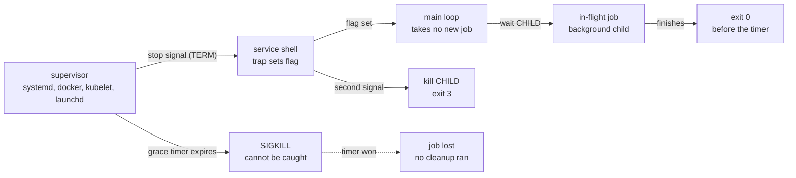

# Graceful Shutdown

> [!summary] Claim
> A shell service shuts down gracefully only if it installs a trap for the supervisor's stop signal, runs its work as a background job it can `wait` on, finishes or aborts that work inside the supervisor's grace period, and exits with a status the supervisor understands; every other arrangement ends in `SIGKILL`.

Part of [Concurrency and Scheduling](README.md) in [Shell and Unix Engineering](../README.md).

## TL;DR

- Mechanism: the supervisor sends a stop signal (default `SIGTERM`), starts a grace timer, and sends `SIGKILL` when it expires; the shell turns the signal into a flag in a `trap`, and the main loop acts on the flag.
- Rule: run the work as a background job and `wait` for it, because POSIX defers a trap until a foreground command ends but makes `wait` return at once with a status above 128 (POSIX.1-2024 XCU 2.12).
- Trap: a status above 128 from `wait` means either "my trap interrupted the wait" or "the child was killed by a signal"; only `kill -0 PID` says which.
- Portability fact: two signals sent while a trap is pending collapse into one in bash and dash but run two traps in zsh, so a "press Ctrl-C twice to force" protocol must not depend on counting signals in the shell.
- When not to use it: a service that must drain real work, hold locks, or flush state belongs in a language with real signal handling and structured concurrency; keep the shell as a thin launcher that ends in `exec`.

## Mental model



The supervisor sends the stop signal to the service shell and, at the same moment, starts a grace timer.
The shell's trap does no work itself: it records the request, and the main loop notices the flag, stops taking new jobs, and `wait`s for the one child already running.
If the child finishes before the timer fires, the shell exits 0 and the supervisor sees a clean stop.
If a second signal arrives, the handler escalates and the loop kills the child and exits 3; if the timer fires first, the kernel delivers `SIGKILL`, which no trap can see, and the job and any cleanup are lost.

## How it works

### 1. The supervisor contract

Every supervisor implements the same two-step protocol: a catchable signal, then a timer, then `SIGKILL`.
What differs is who receives the signal, which signal it is, and how long the timer is.

- `docker stop` sends `SIGTERM` to the container's main process, then `SIGKILL` after a grace period (docs.docker.com, `docker container stop`).
  The first signal comes from the image's `STOPSIGNAL` or `--stop-signal`; the timeout is `-t`, or the container's `--stop-timeout`, or the daemon default of 10 seconds for Linux containers and 30 for Windows (as of 2026-11).
  `-t -1` waits forever.
- Kubernetes records a grace period on the Pod (default 30 seconds), runs any `preStop` hook, and then asks the runtime to send `TERM` to process 1 of each container; when the period expires it sends `SIGKILL` to whatever is left (kubernetes.io, Termination of Pods).
  If the `preStop` hook outlives the grace period the kubelet grants a single 2-second extension; the hook's time comes out of the same budget.
  Containers in a Pod receive `TERM` in an arbitrary order unless sidecar ordering applies.
- systemd sends `KillSignal=` (default `SIGTERM`), always followed by `SIGCONT` so a stopped task can act on it, and optionally `SIGHUP` (`SendSIGHUP=`, default no).
  After `TimeoutStopSec=` it sends `FinalKillSignal=` (default `SIGKILL`) unless `SendSIGKILL=no` (systemd.kill(5), systemd.service(5), systemd 262 docs).
  `DefaultTimeoutStopSec=` is 90 seconds in both the system and user manager (systemd-system.conf(5), as of 2026-11).
- launchd sends `SIGTERM` and then `SIGKILL` after `ExitTimeOut`, whose default is "system-defined" and where 0 means infinity and "should not be used, as it can stall system shutdown forever" (launchd.plist(5)).
  A job that opted into Pressured Exit "will ignore SIGTERM rather than exiting by default", so it needs a `dispatch(3)` source to handle the signal.

### 2. Who gets the signal

The signal's target decides whether a shell sees it at all.

- `docker stop` and the kubelet signal one process: the container's PID 1.
  A Dockerfile `ENTRYPOINT` in shell form runs `/bin/sh -c`, which "does not pass signals": the executable is not PID 1 and "doesn't receive a SIGTERM from docker stop" (docs.docker.com, Dockerfile reference, ENTRYPOINT).
  The exec form, or ending the script with `exec`, makes the service itself PID 1.
- PID 1 of a PID namespace is special: other members of the namespace can send it only signals for which it has installed a handler, even privileged ones, and a process in an ancestor namespace likewise, except `SIGKILL` and `SIGSTOP`, which are forcibly delivered (pid_namespaces(7)).
  A shell that is PID 1 and has no `TERM` trap therefore silently drops the daemon's `SIGTERM`, and the stop takes the full grace period.
- systemd's default `KillMode=control-group` sends the signal to every process in the unit's cgroup.
  `KillMode=mixed` sends `SIGTERM` to the main process only and `SIGKILL` to the rest; `process` and `none` are "not recommended" (systemd.kill(5)).
  Group delivery kills the in-flight child at the same instant it signals the shell, which defeats a drain (see the lab, test 9).
- `sh -c 'a; b'` ends by `exec`ing `b` in bash 5.1+, zsh, ksh93, yash and BusyBox ash, but forks it in dash, mksh, posh and bash 4.4 and older (measured in the shell matrix), so whether the signal reaches the shell or the final command depends on the shell.
  Process-group and session mechanics are the subject of [[Signal-Propagation-to-Children]].

### 3. Signals are flags, not messages

Standard signals do not queue: "If multiple instances of a standard signal are generated while that signal is blocked, then only one instance of the signal is marked as pending" (signal(7)).
A shell that wants "second signal means force" must therefore be careful about what it counts.

- bash: the C handler `trap_handler` calls `set_trap_state`, which does `pending_traps[sig]++`; `run_pending_traps` then runs the trap once for a non-`SIGCHLD` signal, clearing the counter (bash-5.3 trap.c, `set_trap_state`, `run_pending_traps`).
  The source comment there notes the loop "could be made into a counter".
- dash: `onsig` sets `gotsig[signo - 1] = 1` and `pending_sig = signo`; one flag per signal, so two arrivals before dispatch make one trap (dash trap.c, `onsig`).
- zsh: while it waits for a foreground job, `waitforpid` and `zwaitjob` call `queue_traps`, which sets `trap_queueing_enabled` unless `TRAPSASYNC` is set or the wait is the `wait` builtin; `handletrap` then appends each arrival to `trap_queue`, and `unqueue_traps` runs one trap per entry once the job ends, so two arrivals while a foreground command runs yield two trap runs afterwards (zsh Src/signals.c, `handletrap`, `queue_traps`, `unqueue_traps`; Src/jobs.c).
- The lab measures all three: with two `TERM`s one second apart during a foreground job, bash 3.2, bash 5.3 and dash log `term-received` once and exit 0, while zsh 5.9.2 (native and `--emulate sh`) logs `term-received` and `force-requested` and exits 3.

### 4. What POSIX guarantees, and the consequence for the main loop

POSIX.1-2024 XCU 2.12 (Signals and Error Handling) gives two rules that shape every shell service:

1. "When a signal for which a trap has been set is received while the shell is waiting for the completion of a utility executing a foreground command, the trap associated with that signal shall not be executed until after the foreground command has completed."
2. When the shell is waiting in `wait`, "the reception of a signal for which a trap has been set shall cause the wait utility to return immediately with an exit status >128, immediately after which the trap associated with that signal shall be taken."

Rule 1 is why a script that runs its worker in the foreground cannot react to `SIGTERM` until the worker ends: with a 30-second job and a 10-second grace the trap runs at second 30, after `SIGKILL`.
Rule 2 is the escape: start the job with `&`, record `$!`, and `wait "$!"`.
The implementations visibly follow it:

- bash `wait_builtin` sets `wait_intr_flag`, `setjmp`s to `wait_intr_buf`, and on a trapped signal returns `128 + wait_signal_received` (bash-5.3 builtins/wait.def).
- dash `waitcmd` takes its `sigout` path and returns `128 + pending_sig` (dash jobs.c, `waitcmd`).
- zsh `waitforpid` and `zwaitjob` call `signal_suspend`, then return `128 + last_signal` when the signal is trapped and is not `SIGCHLD` (zsh Src/jobs.c).
- BusyBox ash `waitcmd` returns `128 | pending_sig` (BusyBox shell/ash.c, `waitcmd`).
- ksh93 returns 1 for an interrupted `wait` (`job_wait` sets `exitval = 1`, matrix-confirmed on ksh93u+m 1.0.10 and ksh93u+ 2012), which still obeys "not zero" but is not above 128; the lab observes `other:1` on ksh93u+ 2012.

### 5. The ambiguity in "above 128" and the `wait` loop

`wait` returns the same kind of number in two different situations: its own interruption (child still running) and the child's death by signal (POSIX.1-2024 XCU 2.8.2 assigns "an exit status greater than 128" to a command terminated by a signal, and says implementations may exceed 255).
Conflating them gives a service that believes its job is done while it is still running, or the reverse.
The robust loop, used verbatim by the lab, is:

```sh
while kill -0 "$child" 2>/dev/null; do
  wait "$child"
  rc=$?
done
wait "$child" 2>/dev/null   # collect the real status once the child is gone
```

`kill -0` tests existence and permission without delivering anything.
After the loop the shell still remembers the child's status in every shell the lab ran, so one more `wait` returns it; a 127 means the loop's own `wait` already consumed it (POSIX `wait`: an unknown PID is treated as exited with status 127).
The loop's residual hazard is PID reuse between the child's reaping and the `kill -0`; on Linux the kernel's `pid_max` default is 32768 and 64-bit systems can raise it to 2^22 (proc_sys_kernel(5)), and systemd's `sysctl.d/50-pid-max.conf` sets it to 4194304 on 64-bit systems, so the window is small but not zero.

### 6. Draining versus aborting

The lab's `service.sh` implements both strategies, because they are different contracts:

- Drain: first signal sets `stopping`, the loop takes no new job, the in-flight job finishes, exit 0.
  Second signal sets `forcing`; the loop kills the child once and exits 3.
  Cost: the stop takes as long as the longest job, so the grace period must exceed it.
- Abort: the trap itself kills the child and exits 143 at once.
  Cost: the job is lost, so the work must be idempotent or resumable.
- Foreground and ignore are the failure modes: a deferred trap (rule 1) and a trap that logs but does not stop.
  Servers use the same split: nginx treats `TERM` and `INT` as "fast shutdown" and `QUIT` as "graceful shutdown" (nginx.org, Controlling nginx); PostgreSQL's `SIGTERM` is Smart Shutdown (wait for sessions), `SIGINT` is Fast Shutdown (abort transactions), `SIGQUIT` is Immediate Shutdown (children get `SIGQUIT`, then `SIGKILL` after 5 seconds), and its manual warns that `SIGKILL` prevents releasing shared memory and semaphores (postgresql.org, 18.5 Shutting Down the Server).
  A supervisor that sends the default `SIGTERM` to PostgreSQL therefore gets Smart Shutdown, which waits for every session to end and can outlast the grace period.

### 7. Exit status is part of the interface

After handling `TERM` a shell can exit 0, exit 143 (`exit 143` in the trap), or re-raise by resetting the trap and sending the signal to itself.
They look different to the supervisor: the lab shows `exited 143` for the abort trap, which is a plain exit, not death by `SIGTERM` (the lab's supervisor reads the kernel's `WIFEXITED` versus `WIFSIGNALED`, which a shell's `$?` cannot).
systemd treats an exit code of 0, or the signals `SIGHUP`, `SIGINT`, `SIGTERM` and `SIGPIPE` (except for `Type=oneshot`), as clean (systemd.service(5), `Restart=` and `SuccessExitStatus=`).
A shell that exits 143 is therefore an unclean exit, not restarted by `Restart=on-success`, restarted by `Restart=on-failure`, and shown as failed in `systemctl status`, unless the unit lists `SuccessExitStatus=143`.
POSIX says only that death by signal gives a status above 128 and "implementation-defined" encoding; matrix measurements give 128+N in most shells, 256+N in ksh93 and 384+N in yash.

### 8. `EXIT` traps and subshells

POSIX.1-2024 XCU 2.15 (`trap`): the `EXIT` condition "shall occur when the shell terminates normally (exits), and may occur when the shell terminates abnormally as a result of delivery of a signal (other than SIGKILL) whose trap action is the default."
So `trap cleanup EXIT` alone is not a portable shutdown handler; trap `TERM` and `INT` explicitly and `exit` from them so `EXIT` fires.
When a subshell is entered, "traps that are not being ignored shall be set to the default actions" (same section), so a `( ... )` or a pipeline stage that receives the signal dies without running the parent's trap; bash's `trap_handler` re-sends the signal to itself in that case (bash-5.3 trap.c, `SUBSHELL_IGNTRAP` branch).
Signals "ignored on entry to a non-interactive shell cannot be trapped or reset" (same section), so a script started with `nohup` or by a parent that ignored `TERM` cannot be made to drain.
A related rule, XCU 2.12: asynchronous lists run without job control inherit `SIGINT` and `SIGQUIT` as ignored, so `kill -INT` on a `&` child does nothing in most shells (posh differs, per the matrix).

## Numbers and limits

| Quantity | Value | Source |
|---|---|---|
| `docker stop` default grace | 10 s Linux, 30 s Windows; `-t -1` waits forever | docs.docker.com `docker container stop` (as of 2026-11) |
| Kubernetes `terminationGracePeriodSeconds` default | 30 s | kubernetes.io, Termination of Pods (as of 2026-11) |
| Kubernetes `preStop` overrun extension | one-off 2 s | kubernetes.io, Termination of Pods (as of 2026-11) |
| systemd `DefaultTimeoutStopSec` | 90 s, system and user manager | systemd-system.conf(5), systemd 262 docs (as of 2026-11) |
| systemd `FinalKillSignal=` / `KillSignal=` | `SIGKILL` / `SIGTERM`, `SIGCONT` always follows the kill signal | systemd.kill(5) (as of 2026-11) |
| launchd `ExitTimeOut` | system-defined default, 0 means infinity | launchd.plist(5) (as of 2026-11) |
| PostgreSQL immediate shutdown | children get `SIGKILL` after 5 s | postgresql.org 18.5 (as of 2026-11) |
| Pending standard signals per process | 1 per signal number (no queue) | signal(7) |
| Signal exit status encoding | 128+N bash, dash, zsh; 256+N ksh93; 384+N yash | shell matrix, 2026-10 |
| Linux `pid_max` default | 32768 kernel default, up to 2^22 on 64-bit; 4194304 under systemd's `50-pid-max.conf` | proc_sys_kernel(5); systemd sysctl.d/50-pid-max.conf (as of 2026-11) |
| Lab: drain, 4 s job, TERM at 1 s | stop takes 2907 to 3040 ms (9 runs, 7 shell configurations) | lab, this Mac, 2026-11-21 and 2026-11-26 |
| Lab: abort trap | 20 to 30 ms | lab, same runs |
| Lab: `SIGTERM` to whole group during drain | 21 to 81 ms, job killed | lab, same runs |
| Lab: stubborn service, grace 2 s | `SIGKILL` at 2024 to 2044 ms | lab, same runs |
| Lab: drain needing about 5 s more, grace 1 s | `SIGKILL` at 1020 to 1053 ms, job lost | lab, same runs |

## Portability

| Shell or utility | Trap deferred during foreground job; two signals | `wait` interrupted by a trapped signal | Evidence |
|---|---|---|---|
| POSIX sh | trap after the command; order of multiple pending traps unspecified | returns >128, then the trap runs | POSIX.1-2024 XCU 2.12 |
| macOS bash 3.2.57 (`/bin/sh`, `/bin/bash`) | one trap | >128, child alive | lab, 2026-11-21 |
| bash 5.3.20 (Homebrew) | one trap | >128, child alive | lab, 2026-11-26 |
| zsh 5.9.2 native | two traps, second counts as force (`exited 3`) | >128, child alive | lab, 2026-11-21 |
| zsh 5.9.2 `--emulate sh` | two traps (`exited 3`) | >128, child alive | lab, 2026-11-21 |
| dash (macOS `/bin/dash`) | one trap | >128, child alive | lab, 2026-11-21 |
| ksh93u+ 2012 (macOS `/bin/ksh`) | one trap | 1, child alive | lab, 2026-11-21 |
| ksh93u+m 1.0.10 | not run here | 1 (`job_wait` sets `exitval = 1`) | shell matrix, 2026-10 |
| mksh | not asserted by the lab; catches `SIGTERM` non-interactively, so a kill between `fork` and `exec` can be swallowed | not asserted by the lab | shell matrix, 2026-10 |
| yash | not asserted by the lab; exit status of a signaled child is 384+N | not asserted by the lab | shell matrix, 2026-10 |
| posh | not asserted by the lab; leaves `SIGINT` and `SIGQUIT` at default in `&` lists | not asserted by the lab | shell matrix, 2026-10 |
| BusyBox ash | not asserted by the lab | source returns `128 \| pending_sig` | BusyBox shell/ash.c `waitcmd` |
| GNU, BSD, BusyBox, uutils utilities | the lab uses only `/bin/sleep`, `kill` (builtin) and `grep`; no utility divergence is relied on | n/a | not exercised |

The `.bats` file asserts only the shells measured for this note in the foreground test and the interrupted-`wait` test: bash, dash and ksh93 (one trap, or `1` from `wait` in ksh93) and zsh (two traps).
For any other shell family those two tests skip with a message instead of asserting a prediction.
BusyBox ash's `signal_handler` keeps one `gotsig` flag per signal, like dash, but that is a reading of the source, not a measured result.

## Worked example

[lab](../labs/15-graceful-shutdown/)

The lab has three parts: `service.sh` (a job loop with four stop behaviours), `wait-probe.sh` (what `wait` returns), and `supervise.c` (a small supervisor that signals, applies a grace period, escalates to `SIGKILL`, and reports the kernel's view of how the process ended).
A shell's `$?` cannot tell `exited 143` from `killed by SIGTERM`, so the C supervisor is part of the experiment, not decoration.

Simplified excerpt of the drain mode of `service.sh` (the full file also has `abort`, `foreground` and `stubborn`):

```sh
on_signal_drain() {
  if [ "$stopping" -eq 0 ]; then
    stopping=1
    log term-received
  else
    forcing=1
    log force-requested
  fi
}
trap on_signal_drain TERM INT

while [ "$stopping" -eq 0 ] && [ "$n" -lt "$max" ]; do
  n=$((n + 1))
  log "start $n"
  /bin/sleep "$unit" &       # the job is a background child
  child=$!
  wait_job                   # the kill -0 / wait loop from section 5
  log "done $n ok"
done
[ "$forcing" -ne 0 ] && { log "exit forced $n"; exit 3; }
log "exit drained $n"
exit 0
```

Run it under the supervisor (the tests do this; `sup` is `supervise` compiled with `"${CC:-cc}"`):

```sh
sup -r "$W/ready" -t TERM            -- sh service.sh drain "$W" 4   # one TERM
sup -r "$W/ready" -t TERM -n 2 -i 1  -- sh service.sh drain "$W" 6   # two TERMs, 1 s apart
sup -r "$W/ready" -t TERM -w 2       -- sh service.sh stubborn "$W" 100
```

Captured output on this Mac (`sh` is bash 3.2.57 in POSIX mode; the timings are from one run on 2026-11-21 and vary by tens of milliseconds; the `stragglers no` line that follows `escalated` in each column is omitted):

```text
## drain TERM, 4 s job            ## two TERMs, 6 s job            ## stubborn, grace 2 s
exited 0                         exited 3                         signaled KILL
escalated no                     escalated no                     escalated yes
sent 1                           sent 2                           sent 1
elapsed_ms 2917                  elapsed_ms 1047                  elapsed_ms 2044
log: start 1                     log: start 1                     log: start 1
     term-received                    term-received                    term-ignored
     done 1 ok                        force-requested
     exit drained 1                   done 1 killed
                                      exit forced 1
```

Reading the output: in the first column the job ran to the end after the signal (the stop took about 3 s of a 4 s job signaled at 1 s) and the service exited 0; in the second the second signal killed the child and the service exited 3 after about 1 s; in the third the service logged the signal and kept running until `SIGKILL` at the end of the 2 s grace.
The elapsed figure is measured from the first stop signal to reaping the leader.

## Pitfalls

> [!warning] Foreground worker defers the trap
> Trigger: `trap cleanup TERM` followed by `./worker` in the foreground.
> Symptom: `docker stop` or `systemctl stop` takes the full grace period and ends in `SIGKILL`, because POSIX.1-2024 XCU 2.12 delays the trap until the foreground command ends; the lab's `foreground` mode shows the trap running only after the 4 s job, and `stubborn` shows the end state.
> Fix: start the worker with `&`, record `$!`, and `wait` in a `kill -0` loop; or `exec` the worker so the signal reaches it directly.

> [!warning] Shell as PID 1 drops the signal
> Trigger: a Dockerfile `ENTRYPOINT command` in shell form, or a script that is PID 1 with no `TERM` trap.
> Symptom: the stop always takes the full timeout (10 s by default for `docker stop`); the Docker reference states the executable "doesn't receive a SIGTERM from docker stop", and pid_namespaces(7) says PID 1 accepts from inside its namespace only signals it has a handler for, and from an ancestor namespace likewise except `SIGKILL` and `SIGSTOP`.
> Fix: exec form (`ENTRYPOINT ["/app/run.sh"]`) and `exec` as the script's last command, or install an explicit `TERM` trap.

> [!warning] A status above 128 does not mean the child is gone
> Trigger: `wait "$pid"; rc=$?; [ "$rc" -gt 128 ] && echo killed`.
> Symptom: the service decides the job was killed while it is still running (interrupted `wait`), and in ksh93 the interrupted `wait` returns 1, so a `> 128` test also misses it; the lab's `wait-probe.sh` shows `gt128` with the child alive for bash, dash and zsh and `other:1` for ksh93u+ 2012.
> Fix: loop on `kill -0`, then collect the real status with one more `wait`.

> [!warning] Counting signals in the shell
> Trigger: "second `SIGTERM` means force", implemented by incrementing a counter in the trap.
> Symptom: two signals arriving while a foreground command runs count once in bash and dash and twice in zsh; standard signals do not queue (signal(7)).
> Fix: make the force path time-based (a deadline in the main loop) or driven by a different signal, and keep the supervisor's `SIGKILL` as the real backstop.

> [!warning] Grace period shorter than the drain
> Trigger: a 60 s job with the default 30 s Kubernetes grace, or a `preStop` hook that sleeps for 25 s of it.
> Symptom: `SIGKILL` lands mid-job; the lab's "grace shorter than the drain" test shows `signaled KILL` and no `exit drained` line.
> Fix: budget `preStop` plus the longest unit of work plus a margin inside the grace (`terminationGracePeriodSeconds`, `TimeoutStopSec=`, `ExitTimeOut`), or make jobs resumable so losing one is cheap.

> [!warning] Group signal defeats the drain
> Trigger: systemd's default `KillMode=control-group` while the service drains a child.
> Symptom: the child is killed at the same instant as the shell is signaled; the lab (`-G`) logs `done 1 killed` within about 30 ms where the same drain without `-G` takes about 3 s.
> Fix: `KillMode=mixed`, which sends `SIGTERM` only to the main process and `SIGKILL` to the rest after the timeout (systemd.kill(5)).

> [!warning] Exit 143 looks like failure
> Trigger: `trap '...; exit 143' TERM` under a systemd unit with `Restart=on-success` or a status check.
> Symptom: the unit is recorded as failed with exit code 143, because systemd's clean statuses are 0 and the signals `SIGHUP`, `SIGINT`, `SIGTERM`, `SIGPIPE`, not the number 143 (systemd.service(5)).
> Fix: exit 0 after a successful drain, or declare `SuccessExitStatus=143`; reserve a non-zero status for a forced stop.

> [!warning] Signal lost between fork and exec
> Trigger: a supervisor signals a freshly started background child, or the shell itself right after launch.
> Symptom: in mksh, which catches `SIGTERM` in the child between `fork` and `execve`, the signal is swallowed and `wait` can report 0 (shell matrix, 2026-10).
> Fix: wait until the child has exec'd before signaling it; the lab's supervisor waits for a ready file and one second.

> [!warning] SIGKILL escalation leaves state behind
> Trigger: a service whose cleanup removes lock files, pidfiles, shared memory, or temporary directories only in a trap.
> Symptom: after `SIGKILL` the next start sees stale state; PostgreSQL's manual warns that `SIGKILL` "will prevent the server from releasing shared memory and semaphores" and kills the `postgres` process "without letting it relay the signal to its subprocesses".
> Fix: make startup tolerate and repair stale state; never rely on a trap as the only cleanup.

## Security and robustness

- A trap action is run as `eval action` (POSIX.1-2024 XCU 2.15, `trap`), so interpolating untrusted data into a `trap '...' TERM` string is command injection; quote with a function name and read variables at run time (`trap on_term TERM`).
- `SIGKILL` and `SIGSTOP` cannot be caught, blocked or ignored (signal(7)), so shutdown logic is a courtesy, never an enforcement; anything that must hold on crash needs crash-safe state (atomic rename, a lock tied to an open descriptor, not to a pidfile).
- Stopping by pidfile reads a stale number: after the process exits the PID can be recycled by an unrelated one, and `kill` will signal it if the uid permits; check the process identity (command line, start time) or use the supervisor's own handle.
- A trap that does real work can be re-entered by a second signal; set a flag and act in the main loop, as `service.sh` does, rather than doing slow cleanup in the handler.
- Signals ignored on entry cannot be trapped in a non-interactive shell (POSIX `trap`), so a launcher that sets `SIG_IGN` for `TERM` (for example a `nohup`-style wrapper) silently disables the whole mechanism; check with `trap -p` where supported.
- Every wait in a test or supervisor needs a bound: an unbounded wait on a child that stopped, or a FIFO with no peer, hangs CI; the lab's `supervise` bounds READY at 10 s and the child at grace plus 5 s, and `SIGKILL`s the group before exiting.

## The principal's view

The decision is where the stop contract lives.
For a one-shot job runner or a thin launcher, a shell with one `TERM` trap, a background child, and a `wait` loop is correct, cheap to audit, and survives every supervisor in the table above.
The moment the service needs more than "finish the current unit, then exit" - connection draining, health-state transitions, multi-stage shutdown, coordinated deadlines - the shell is the wrong tool: counting signals is shell-dependent, a trap cannot run during a foreground command, `wait` statuses are ambiguous, and nothing in a shell enforces a deadline.
Move that logic into a program in a language with a real event loop (select on a signal descriptor, a context deadline, an explicit state machine), and leave the shell as an `exec` shim.
The trade-offs: a drain strategy costs wall-clock time at every deploy (the grace must cover the longest job), while an abort strategy costs lost or repeated work and demands idempotence; the supervisor's timeout is a hard budget, so choose it from the measured p99 of a unit of work, not from the default.
Whichever route, set the supervisor explicitly (`KillMode=mixed`, `TimeoutStopSec=`, `terminationGracePeriodSeconds`) instead of inheriting defaults, and test the stop path in CI the way this lab does, with a real supervisor and exact expected statuses.

## Interview questions

> [!question] L5: A container running `ENTRYPOINT /app/run.sh` takes exactly 10 seconds to stop every time. Why?
>
> > [!success]- Answer
> > The shell form runs the command under `/bin/sh -c`, which does not pass signals, so the application never sees the `SIGTERM` from `docker stop`.
> > If a script is PID 1 with no `TERM` handler, the kernel drops the signal anyway, because a process in an ancestor namespace can signal PID 1 only if it has a handler, except for `SIGKILL` and `SIGSTOP`.
> > Nothing reacts, so after the default 10 seconds for Linux containers the container gets `SIGKILL`.
> >
> > Follow-up: How do you fix it without changing the application?

> [!question] L5: Why does the lab run the worker as `/bin/sleep "$unit" &` and `wait` instead of just `/bin/sleep "$unit"`?
>
> > [!success]- Answer
> > POSIX.1-2024 XCU 2.12 defers a trap until a foreground command completes.
> > It also makes `wait` return immediately with a status above 128 when a trapped signal arrives.
> > Only the background-plus-`wait` form lets the shell react while the job runs.
> >
> > Follow-up: What does the trap do differently in the foreground form when two signals arrive?

> [!question] L5: What does `trap 'echo trapped' TERM; /bin/sleep 3 & wait $!; echo "status=$?"` print when `SIGTERM` reaches the shell one second in?
>
> > [!success]- Answer
> > In bash, dash and zsh the `wait` returns at once with 143 (128 plus 15), then the trap prints `trapped`, then the script prints `status=143`.
> > That matches the lab's `first_wait` line (status above 128, child still alive).
> > The sleep is still running and is not waited for; it ends about two seconds later and is not collected unless the script waits again.
> > ksh93 returns 1 from the interrupted `wait`, so it prints `status=1`.
> >
> > Follow-up: How do you tell this case from a `wait` on a child killed by `SIGTERM`?

> [!question] L6: Debug this script, which should remove its temp directory on `systemctl stop` but leaves it behind and shows `Result: timeout`?
>
> ```sh
> trap 'rm -rf "$tmp"; exit 0' TERM
> tmp=$(mktemp -d)
> ./convert-large-file "$tmp"
> ```
>
> > [!success]- Answer
> > `./convert-large-file` runs in the foreground, so the trap is deferred until it ends.
> > `TimeoutStopSec=` (90 seconds by default) expires first and systemd sends `SIGKILL`, which cannot be caught, so the `rm` never runs.
> > Run the converter in the background, `wait` for it in a `kill -0` loop, and let the trap kill it, or `exec` it and move the cleanup into the converter.
> > Also make the start-up path remove stale temp directories, because `SIGKILL` can still arrive.
> >
> > Follow-up: What changes if the unit uses `KillMode=control-group` and the converter is a child?

> [!question] L6: Your trap does `exit 143` after cleanup. Under systemd the unit shows as failed. What is going on and what do you do?
>
> > [!success]- Answer
> > systemd counts exit code 0 and death by `SIGHUP`, `SIGINT`, `SIGTERM` or `SIGPIPE` as clean, but 143 is an ordinary exit code that is not in the list.
> > The lab shows the kernel reports `exited 143` for the trap's `exit`, not `signaled TERM`.
> > Exit 0 after a successful drain, add `SuccessExitStatus=143`, or reset the trap and re-send the signal to yourself so the death is a real `SIGTERM`.
> >
> > Follow-up: Why is exiting 0 on a forced stop (second signal) a bad idea?

> [!question] L6: Why not detect "the child is gone" with `wait "$pid"; [ $? -gt 128 ]`?
>
> > [!success]- Answer
> > The same range means "my `wait` was interrupted by a trapped signal" and "the child was killed by a signal".
> > In the first case the child is alive; in the second it is gone.
> > In ksh93 an interrupted `wait` returns 1, so a status test is wrong in the other direction.
> > Loop on `kill -0 "$pid"` and collect the status with one more `wait`.
> >
> > Follow-up: What race remains in that loop, and what bounds it?

> [!question] L7+: Design a shutdown path for a queue-consumer shell service on Kubernetes that must not lose or double-process a message. What are your constraints?
>
> > [!success]- Answer
> > The budget is `preStop` time plus the longest message plus margin, all inside `terminationGracePeriodSeconds` (30 seconds by default; one 2-second overrun extension for `preStop`).
> > The signal goes to PID 1 only, so the script must `exec` or install a `TERM` trap and must be PID 1 or have a forwarding init.
> > Use a drain: stop pulling on `TERM`, finish the in-flight message in a background job under a `kill -0` loop, acknowledge it, exit 0.
> > Because `SIGKILL` can still arrive, the message must be acknowledged after processing and the work idempotent, giving at-least-once delivery rather than exactly-once.
> >
> > Follow-up: When would you stop using a shell for this?

> [!question] L7+: A rolling deploy drops about 1 percent of in-flight requests although every service traps `TERM`. Where do you look, and which parts are shell-specific?
>
> > [!success]- Answer
> > First the timeline: the load balancer may still route to a pod after it starts terminating, because endpoint removal runs concurrently with the kubelet's `TERM`; the service must keep serving until its in-flight requests finish.
> > Then the budget: `preStop` and drain time against the grace period.
> > The shell-specific parts are the foreground-worker deferral, PID 1 signal dropping, group versus main-process delivery, and a counted second signal that behaves differently in zsh.
> > Verify by running the real supervisor and asserting the kernel's exit status and log order, as the lab does.
> >
> > Follow-up: How would you prove the fix in CI without a cluster?

> [!question] L7+: Compare `KillMode=control-group`, `mixed` and `process` for a shell service that drains a child, and say which you choose.
>
> > [!success]- Answer
> > `control-group` signals every process in the cgroup at once, which kills the child immediately; the lab shows 21 to 81 ms.
> > `mixed` signals only the main process with `SIGTERM` and sends `SIGKILL` to the rest after the timeout or after the main process exits, which permits a drain.
> > `process` kills only the main process and lets others escape the unit, which systemd documents as not recommended.
> > Choose `mixed` for a draining launcher, with `TimeoutStopSec=` set from the measured drain time.
> >
> > Follow-up: What does `SendSIGHUP=` add and when does it matter?

## Related

Prerequisites: [[Signal-Propagation-to-Children]]

Next: [[cron]]

See also: [[Background-Jobs-and-wait]], [[Bounded-Job-Pools]], [[Overlap-Prevention-and-Missed-Runs]], [[systemd-Timers]], [[launchd]]

## Further reading

- POSIX.1-2024 XCU 2.12 Signals and Error Handling: the two deferral rules this note rests on (pubs.opengroup.org/onlinepubs/9799919799/utilities/V3_chap02.html).
- POSIX.1-2024 `wait` and `trap`: exact statuses and the `EXIT` condition (same site, utilities/wait.html and 2.15).
- signal(7) Linux man page: standard signals do not queue, `SIGKILL` and `SIGSTOP` cannot be caught.
- pid_namespaces(7): why PID 1 ignores signals it has no handler for.
- Docker `container stop` and Dockerfile reference: default 10 s timeout, `STOPSIGNAL`, shell versus exec form.
- Kubernetes, Termination of Pods: the full ordered termination flow, `preStop`, the 2 s extension.
- systemd.kill(5), systemd.service(5), systemd-system.conf(5): `KillMode=`, `TimeoutStopSec=`, clean exit statuses.
- launchd.plist(5): `ExitTimeOut` and Pressured Exit.
- PostgreSQL 18.5 Shutting Down the Server and nginx Controlling nginx: the smart, fast and immediate shutdown vocabulary.
- bash-5.3 `trap.c` and `builtins/wait.def`, dash `trap.c` and `jobs.c`, zsh `Src/jobs.c` and `Src/signals.c`: the implementations behind the portability table.
