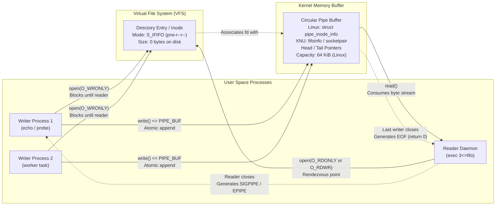
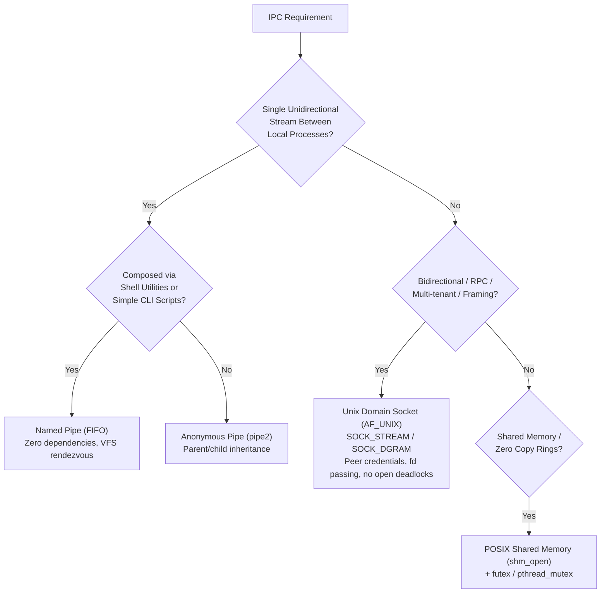

# Named Pipes for IPC

> [!summary] Claim
> A named pipe (FIFO) binds standard kernel pipe buffer semantics to a filesystem directory entry, enabling uncoupled, stream-oriented interprocess communication across arbitrary processes without disk I/O, governed by blocking rendezvous, reader-tracked EOF, and `PIPE_BUF` atomic writes.

## TL;DR
- Mechanism: A filesystem directory entry with inode type `S_IFIFO` points to an in-memory kernel ring buffer where data is passed directly between processes without touching persistent disk storage.
- Rule: Always hold a persistent descriptor (`exec 3<>"$fifo"`) in long-running services to avoid premature EOF cycles, and close inherited descriptors (`3>&-`) in child processes to ensure clean shutdown.
- Trap: Running `while read -r line < "$fifo"` opens and closes the FIFO on every line, dropping unbuffered input and blocking repeatedly on writer rendezvous.
- Portability fact: `PIPE_BUF` write atomicity is 4096 bytes on Linux but only 512 bytes on macOS and POSIX systems.
- When not to use it: Avoid named pipes for bidirectional request-response on a single FIFO, broadcast messaging, high-concurrency datagram framing, or untrusted multi-tenant queues; use Unix domain sockets or shared memory instead.

## Mental model



A named pipe exposes a directory entry whose inode is marked with file type `S_IFIFO`, existing purely as a filesystem rendezvous address.
When processes issue `open(2)` system calls against the FIFO pathname, the Virtual File System (VFS) allocates or attaches to an internal in-memory ring buffer (`struct pipe_inode_info` in Linux, or a connected socket pair in macOS XNU) rather than allocating disk data blocks.
Writers block in `open(2)` until at least one reader opens the FIFO, and readers block until a writer arrives, completing the initial rendezvous.
Data transferred via `write(2)` appends directly into kernel memory pages; writes of size less than or equal to `PIPE_BUF` are guaranteed atomic, preventing interleaving across multiple concurrent writers.
The reader consumes bytes sequentially from the buffer until all writers close their file descriptors, at which point the kernel signals end-of-file (returning 0 bytes), while any write attempt to a FIFO with zero readers raises `SIGPIPE` or fails with `EPIPE`.

## How it works

### Filesystem Representation and Inode Creation

A named pipe is created using the `mkfifo(1)` shell utility `(POSIX.1-2024 XCU 4.mkfifo)` or the `mkfifo(3)` / `mkfifoat(2)` C library functions `(POSIX.1-2024 XSH mkfifo)`.
Under POSIX, `mkfifo(path, mode)` is semantically equivalent to `mknod(path, mode | S_IFIFO, 0)`.
In the filesystem directory table, the FIFO entry consumes a normal directory slot and an inode structure.
However, the inode data blocks remain unallocated: `ls -l` displays the file type character `p`, and `stat(2)` reports `st_size = 0` regardless of how much data is buffered in memory.
The permission bits of the newly created FIFO are calculated by masking the requested mode with the calling process file mode creation mask (`umask`), unless explicit permissions are provided via `mkfifo -m <mode>`.

In GNU coreutils (`src/mkfifo.c`), when `-m` is specified on a path containing a directory prefix, `mkfifo` opens the parent directory using `O_PATHSEARCH | O_DIRECTORY` (otherwise using `AT_FDCWD`) and executes `mkfifoat(dirfd, relname, newmode)` followed by `lchmodat(dirfd, relname, newmode)`.
BusyBox (`coreutils/mkfifo.c`) parses mode options via `getopt_mk_fifo_nod(argv)` and directly invokes `mkfifo(*argv, mode)`.

### Kernel In-Memory Structures: Linux vs. XNU

Once opened, all I/O bypasses the underlying filesystem storage driver completely.
Operating system kernels implement the underlying storage buffer using divergent architectures:

1. **Linux Kernel (`fs/pipe.c`)**:
Linux maintains an in-memory `struct pipe_inode_info` associated with the vfs inode (`inode->i_pipe`).
The data buffer is structured as a circular ring of `struct pipe_buffer` descriptors, each holding a pointer to a physical kernel memory page (`struct page *`).
The ring maintains monotonic indices `head` and `tail` that wrap naturally as unsigned 32-bit integers (`pipe_index_t` is `unsigned int`, or `unsigned short` when `CONFIG_WATCH_QUEUE` is set), masked off against `pipe->ring_size - 1` upon dereference.
Mutual exclusion is maintained by `mutex_lock(&pipe->mutex)`.
When the first reader or writer calls `fifo_open(struct inode *inode, struct file *filp)`, the kernel allocates `pipe_inode_info` via `alloc_pipe_info()` and sets `filp->private_data = pipe`.
Writers increment `pipe->w_counter` and `pipe->writers`; readers increment `pipe->r_counter` and `pipe->readers`.

2. **Apple XNU / BSD (`bsd/miscfs/fifofs/fifo_vnops.c`)**:
Unlike Linux's dedicated page ring, macOS XNU and traditional 4.4BSD implement FIFOs by coupling two connected Unix domain stream sockets internally.
When `fifo_open(struct vnop_open_args *ap)` is invoked, XNU allocates a `struct fifoinfo` on the vnode (`vp->v_fifoinfo`).
XNU calls `socreate(AF_LOCAL, &rso, SOCK_STREAM, 0)` and `socreate(AF_LOCAL, &wso, SOCK_STREAM, 0)`, interconnecting them via `soconnect2(wso, rso)`.
The write socket is marked with `SS_CANTRCVMORE` and has its send buffer low-water mark set to `PIPE_BUF` (`wso->so_snd.sb_lowat = PIPE_BUF`), while the read socket is marked with `SS_CANTSENDMORE`.
File operations on the FIFO are translated directly to socket operations (`DTYPE_SOCKET`).

### Rendezvous Semantics and the Open Matrix

Opening a named pipe enforces a strict rendezvous contract governed by the access mode and the `O_NONBLOCK` status flag `(POSIX.1-2024 XSH open)`:

| Open Mode | `O_NONBLOCK` Clear (Blocking) | `O_NONBLOCK` Set (Non-blocking) |
| :--- | :--- | :--- |
| `O_RDONLY` | Blocks until another process opens the FIFO for writing. | Returns immediately with a valid file descriptor; does not wait for a writer. |
| `O_WRONLY` | Blocks until another process opens the FIFO for reading. | Fails immediately with exit status -1 and sets `errno = ENXIO` if no reader exists; returns immediately if a reader is open. |
| `O_RDWR` | Succeeds immediately on Linux and macOS without blocking; acts as both reader and writer. | POSIX specifies `O_RDWR` on a FIFO as undefined or implementation-dependent; succeeds immediately on Linux and Darwin. |

On Linux, `fifo_open` in `fs/pipe.c` handles `FMODE_READ`:
```c
if (!is_pipe && !pipe->writers) {
    if (filp->f_flags & O_NONBLOCK) {
        /* suppress EPOLLHUP until we have seen a writer */
        filp->f_pipe = pipe->w_counter;
    } else {
        if (wait_for_partner(pipe, &pipe->w_counter))
            goto err_rd;
    }
}
```
For `FMODE_WRITE`:
```c
if (!is_pipe && (filp->f_flags & O_NONBLOCK) && !pipe->readers)
    goto err; /* ret = -ENXIO */
```
For `FMODE_READ | FMODE_WRITE`:
```c
pipe->readers++;
pipe->writers++;
pipe->r_counter++;
pipe->w_counter++;
if (pipe->readers == 1 || pipe->writers == 1)
    wake_up_partner(pipe);
```
Because `O_RDWR` increments both `readers` and `writers` within the kernel structure, a process opening a FIFO with `exec 3<>"$fifo"` can never block waiting for an external partner.

### Data Transfer, Buffering, and `PIPE_BUF` Atomicity

Data written to a FIFO flows as an unformatted byte stream: no message boundaries, delimiters, or record headers are imposed by the kernel `(POSIX.1-2024 XSH read, write)`.
When a process writes to a FIFO:
- If `nbyte <= PIPE_BUF`:
The write is guaranteed to be atomic `(POSIX.1-2024 XSH write)`.
The entire buffer is written in a single contiguous sequence without interleaving with data from other concurrent writers.
If insufficient space remains in the buffer and `O_NONBLOCK` is clear, the calling thread blocks until sufficient space opens to accept the entire payload.
If `O_NONBLOCK` is set, `write()` transfers no data and returns -1 with `errno = EAGAIN`.
- If `nbyte > PIPE_BUF`:
Atomicity is not guaranteed.
The write payload may be fragmented into partial chunks and interleaved arbitrarily with concurrent writes from other processes.

When a reader attempts to read from an empty FIFO:
- If at least one writer has the FIFO open and `O_NONBLOCK` is clear:
`read(2)` blocks until data is appended or all writers close their descriptors.
- If at least one writer has the FIFO open and `O_NONBLOCK` is set:
`read(2)` returns -1 with `errno = EAGAIN`.
- If zero writers have the FIFO open:
`read(2)` returns 0 immediately, which signifies end-of-file (EOF).

### Disconnection, EOF, and `SIGPIPE`

The lifecycle of a FIFO connection is fundamentally asymmetric:
- **Reader Termination (Writer Fault)**:
When a process writes to a FIFO whose readers have all closed their descriptors, the kernel generates a `SIGPIPE` signal for the writing thread.
If the process ignores `SIGPIPE` (`trap '' PIPE` in shell) or handles it, the `write()` system call returns -1 and sets `errno = EPIPE`.
If unhandled, the default signal action terminates the writing process immediately.
- **Writer Termination (Reader EOF)**:
When all processes holding write descriptors close the FIFO, readers draining the remaining buffered data encounter EOF (`read()` returns 0).
If a reader re-executes `read(2)` after EOF, it will continue to receive 0 until another process opens the write end, resetting the rendezvous.

### Polling and Multiplexing (`poll`, `select`)

The `poll(2)` and `select(2)` interfaces multiplex I/O readiness across FIFOs `(POSIX.1-2024 XSH poll)`:
- `POLLIN` is set when data is available to read without blocking, or when all writers have closed (in which case a read returns 0 EOF without blocking).
- `POLLOUT` is set when space exists in the pipe buffer to write at least 1 byte without blocking.
- `POLLHUP` indicates that the last writer has closed the write end.
Under POSIX, `POLLHUP` and `POLLOUT` are mutually exclusive, but `POLLHUP` and `POLLIN` can coincide if unread data remains in the buffer.

In Linux `fs/pipe.c` (`pipe_poll`), the kernel suppresses `EPOLLHUP` on a non-blocking reader if no writer has ever connected:
`if (!pipe->writers && filp->f_pipe != pipe->w_counter) mask |= EPOLLHUP;`
Because `filp->f_pipe` is initialized to `pipe->w_counter` when opened with `O_NONBLOCK` without writers, `POLLHUP` is not reported initially; it triggers only after a writer actually connects (`pipe->w_counter++`) and subsequently disconnects.
In macOS XNU, polling on a reader after the writer exits reports readable status under `select(2)`, but `poll(2)` revents does not assert `POLLHUP`.

## Numbers and limits

The following table documents kernel boundaries, protocol constants, and operational limits governing named pipes.

| Metric / Parameter | Value (Linux) | Value (macOS / Darwin) | Specification / Authority | Operational Implication |
| :--- | :--- | :--- | :--- | :--- |
| `_POSIX_PIPE_BUF` | 512 bytes | 512 bytes | POSIX.1-2024 `<limits.h>` | Minimum guaranteed atomic write limit across any compliant POSIX implementation. |
| `PIPE_BUF` | 4096 bytes (4 KiB) | 512 bytes | Linux `limits.h` / Darwin `syslimits.h` | Writes up to this threshold are guaranteed atomic; writes exceeding it can tear and interleave. |
| Default buffer capacity | 65,536 bytes (64 KiB) | 8,192 bytes (8 KiB) for FIFOs (16,384 to 65,536 bytes for anonymous `pipe(2)`) | Linux `fs/pipe.c` (`PIPE_DEF_BUFFERS 16`); Darwin `net.local.stream.sendspace` (`uipc_usrreq.c`) and lab capacity probe | Writers block once unread data reaches this capacity; macOS backs FIFOs with an 8 KiB `AF_LOCAL` stream socket buffer. |
| Unprivileged max capacity | 1,048,576 bytes (1 MiB) | Immutable (fixed) | Linux `/proc/sys/fs/pipe-max-size` (Linux 2.6.35+) | Non-root users cannot increase buffer size beyond 1 MiB via `F_SETPIPE_SZ`. |
| Buffer capacity resize | `fcntl(fd, F_SETPIPE_SZ, size)` | Unsupported (`n/a`) | Linux `fcntl(2)` (Linux 2.6.35+) | Allows dynamic buffer tuning in Linux; unavailable on macOS / BSD. |
| User page soft limit | 16,384 pages (64 MiB) | Unsupported (`n/a`) | Linux `/proc/sys/fs/pipe-user-pages-soft` (Linux 4.5+) | Exceeding soft quota shrinks newly allocated pipe buffers to 2 pages (8 KiB). |
| User page hard limit | 0 (unlimited) | Unsupported (`n/a`) | Linux `/proc/sys/fs/pipe-user-pages-hard` (Linux 4.5+) | Hard ceiling on total buffer memory per unprivileged UID; fails pipe allocation when hit. |
| Minimum buffer floor | 2 pages (8192 bytes) | 1 socket buffer | Linux `PIPE_MIN_DEF_BUFFERS` (`fs/pipe.c`, Linux 5.14+, commit 46c4c9d1beb7) | Prevents token starvation deadlocks in semaphore/jobserver pipes under quota pressure. |
| `SIGPIPE` signal number | 13 | 13 | POSIX.1-2024 `<signal.h>` | Signal delivered synchronously to thread writing to a FIFO with zero readers. |
| Uncaught `SIGPIPE` exit code | 141 (bash, dash, zsh, mksh) | 141 (bash, zsh) | Standard shell conventions (`128 + 13`) | Exit status reported by shells when a background writer terminates on broken pipe. |
| ksh93 `SIGPIPE` exit code | 269 (`256 + 13`) | 269 (`256 + 13`) | AT&T ksh93 signal numbering convention | Measured in the shell matrix under ksh93u+ and ksh93u+m 1.0.10. |
| yash `SIGPIPE` exit code | 397 (`384 + 13`) | 397 (`384 + 13`) | Yash shell signal numbering convention | Measured in the shell matrix under yash 2.58.1. |
| Minimum disk space consumed | 0 bytes | 0 bytes | POSIX.1-2024 `stat.st_size` | Directory entry uses an inode; zero filesystem data blocks are allocated. |

## Portability

The table below summarizes FIFO support, redirection behaviors, and edge-case handling across shell families and core utilities.
All entries reflect behaviors verified in the shell matrix and primary source trees `(as of 2026-11)`.

| Shell / Tool | `mkfifo` Creation Utility | `exec [n]<>fifo` (`O_RDWR` Open) | Process Substitution (`<(cmd)`) | `SIGPIPE` Process Exit Status | Multi-byte Filename Handling |
| :--- | :--- | :--- | :--- | :--- | :--- |
| **POSIX sh (spec)** | Supported (`XCU 4.mkfifo`) | Unspecified open mode (`XCU 2.7.7`) | Not specified | `> 128` (typically `128 + 13`) | Depends on LC_CTYPE locale |
| **macOS bash 3.2** | External `/usr/bin/mkfifo` | Supported; opens `O_RDWR` without blocking | Supported via `/dev/fd` or fallback FIFOs | 141 | Fully supported (UTF-8) |
| **bash 5.3** | Builtin loadable or external | Supported; opens `O_RDWR` without blocking | Supported via `/dev/fd` or `make_named_pipe()` | 141 | Fully supported (UTF-8) |
| **zsh (native)** | External utility | Supported; opens `O_RDWR` without blocking | Supported; manages child descriptors | 141 | Fully supported (UTF-8) |
| **zsh (`--emulate sh`)** | External utility | Supported; opens `O_RDWR` without blocking | Supported; manages child descriptors | 141 | Fully supported (UTF-8) |
| **dash 0.5.12** | External utility | Supported; opens `O_RDWR` without blocking | Not supported (syntax error) | 141 | Byte-transparent |
| **ksh93u+m 1.0.10** | Builtin `mkfifo` or external | Supported; opens `O_RDWR` without blocking | Supported (uses internal descriptors) | 269 | Fully supported |
| **mksh R59** | External utility | Supported; opens `O_RDWR` without blocking | Not supported (syntax error) | 141 | Byte-transparent |
| **yash 2.58.1** | External utility | Supported; opens `O_RDWR` without blocking | Process redirection only (not procsub) | 397 | Fully supported |
| **posh 0.14.1** | External utility | Supported; opens `O_RDWR` without blocking | Not supported (syntax error) | 141 | Byte-transparent |
| **BusyBox ash 1.37** | Applet `mkfifo` (NOEXEC) | Supported; opens `O_RDWR` without blocking | Not supported | 141 | Byte-transparent (`bb_simple_perror_msg`) |
| **GNU coreutils 9.x** | `mkfifo` with `-m`, `-Z`, `--context` | N/A (utility) | N/A (utility) | N/A | Fully supported via `lchmodat` |
| **BSD / macOS core** | `mkfifo` with `-m` octal/symbolic | N/A (utility) | N/A (utility) | N/A | Fully supported |
| **uutils coreutils** | Rust implementation of `mkfifo` | N/A (utility) | N/A (utility) | N/A | Fully supported |

## Worked example

The following script implements a concurrent Remote Procedure Call (RPC) request-reply architecture using named pipes.
A central server listens on a shared request FIFO (`req`), while individual clients create private reply FIFOs (`reply.<id>`) to receive isolated, non-interleaved responses.
The code is a standalone simplified excerpt of `mode_rpc` from the verified lab test suite at [lab](../labs/15-named-pipes-for-ipc/).

```sh
#!/bin/sh
# fifo-ipc-rpc: Request-Reply multiplexing over named pipes
set -eu

d=$(mktemp -d "${TMPDIR:-/tmp}/fifo-rpc.XXXXXX")
trap 'rm -rf "$d"' EXIT

# rpc_serve N: serve N requests of the form "ID WORD" from fd 3; reply with WORD upcased.
rpc_serve() {
  left=$1
  while [ "$left" -gt 0 ] && read -r id word <&3; do
    printf '%s\n' "$word" | tr '[:lower:]' '[:upper:]' >"$d/reply.$id"
    left=$((left - 1))
  done
}

# rpc_client ID WORD: create a private reply FIFO, send one request, read the reply.
rpc_client() {
  mkfifo "$d/reply.$1" || return 1
  printf '%s %s\n' "$1" "$2" >"$d/req"
  cat "$d/reply.$1" >"$d/out.$1"
  : >"$d/done.$1"
}

# Server initialization
mkfifo "$d/req"
exec 3<>"$d/req" # Persistent hold-open descriptor prevents premature server EOF

# Launch server in background
rpc_serve 3 &
server_pid=$!

# Dispatch concurrent clients
rpc_client c1 hello &
rpc_client c2 world &
rpc_client c3 fifo &

# Await completion and collect results
wait "$server_pid"
exec 3>&- # Release persistent descriptor

for id in c1 c2 c3; do
  printf 'reply.%s=%s\n' "$id" "$(cat "$d/out.$id")"
done
printf 'server-exited=yes\n'
```

### Captured Output

When executed in the laboratory environment, the probe completes the three requests, verifies that client responses remain perfectly routed without crosstalk, and exits cleanly:

```text
reply.c1=HELLO
reply.c2=WORLD
reply.c3=FIFO
server-exited=yes
```

## Pitfalls

> [!warning] Pitfall 1: Premature EOF and CPU Spinning in Reader Loops (`while read < FIFO`)
> **Trigger**: Using input redirection on the loop boundary instead of the process boundary:
> `while read -r line < "$fifo"; do process "$line"; done`
> **Symptom**: Each iteration performs a fresh `open(2)`, reads one line, and closes the read end.
> When a single writer sends several lines in one open, the loop reads the first line and the rest is discarded when the reader closes, so the writer can die of `SIGPIPE`.
> The loop then blocks forever in `open(2)` waiting for the next writer, and never finishes (measured in the lab: `reopen-loop-finished=no`, `reopen-loop-lines=a` against a writer sending `a`, `b`, `c`, while a single open for the whole loop yields `a,b,c`).
> **Fix**: Open the FIFO once across the entire compound loop:
> `while read -r line; do process "$line"; done < "$fifo"`
> For a server that must survive across multiple successive writer disconnections, hold a persistent descriptor open in read-write mode:
> `exec 3<>"$fifo"; while read -r line <&3; do process "$line"; done`

> [!warning] Pitfall 2: Descriptor Inheritance Delays Reader EOF Indefinitely (CVE-2002-0767)
> **Trigger**: Spawning background child processes or worker threads while holding a persistent read-write descriptor (`exec 3<>"$fifo"`), without closing descriptor 3 before fork/exec.
> **Symptom**: When the parent script finishes and closes its descriptor (`exec 3>&-`), the reader process hangs indefinitely waiting for EOF because the background child inherited descriptor 3, keeping `pipe->writers > 0`.
> **Incident / CVE**: In CVE-2002-0767, `simpleinit` leaked its open control FIFO descriptor to child processes upon system initialization, allowing unprivileged child processes to send commands back to the init daemon and escalate privileges to root.
> **Fix**: Explicitly close non-standard descriptors before launching background jobs:
> `{ child_command; } 3>&- &`
> In C applications, always mark IPC file descriptors with `O_CLOEXEC` (`FD_CLOEXEC`).

> [!warning] Pitfall 3: Deadlock on Opposing Open Order in Bidirectional IPC
> **Trigger**: Two processes attempting bidirectional communication using two FIFOs (`fifo_a` and `fifo_b`), where Process 1 opens `fifo_a` for reading then `fifo_b` for writing, while Process 2 opens `fifo_b` for reading then `fifo_a` for writing.
> **Symptom**: Both processes block unconditionally inside `open(2)` and sleep forever (deadlock).
> Neither process can advance to open its partner's write end.
> **Fix**: Enforce a global, strict total ordering on FIFO acquisition across all processes (e.g. always open `fifo_a` before `fifo_b`).
> Alternatively, open both FIFOs with `O_RDWR` (`exec 3<>"$fifo_a" 4<>"$fifo_b"`), which never blocks on initial open under Linux and Darwin.

> [!warning] Pitfall 4: Unhandled `SIGPIPE` Abruptly Terminating Critical Services
> **Trigger**: A background writer script emits logging or metrics data to a FIFO whose consumer service has crashed, restarted, or closed its read descriptor.
> **Symptom**: The writer process vanishes silently with exit status 141 (or 269 under ksh93, 397 under yash), producing neither core dump nor standard error diagnostic unless explicit signal handlers are attached.
> **Fix**: In shell, trap `PIPE` explicitly if the writer must survive consumer outages:
> `trap '' PIPE; printf '%s\n' "$data" > "$fifo" || handle_disconnect`
> In C, set `signal(SIGPIPE, SIG_IGN)` and check for `errno == EPIPE` on return from `write()`.

> [!warning] Pitfall 5: Record Tearing and Interleaving Beyond `PIPE_BUF`
> **Trigger**: Multiple concurrent writers logging messages larger than `PIPE_BUF` (4096 bytes on Linux, 512 bytes on macOS) to a common ingest FIFO.
> **Symptom**: Log entries from different processes become intermingled at arbitrary byte offsets, corrupting JSON objects, structured headers, and line delimiters.
> **Fix**: Restrict individual write payloads to strictly less than or equal to `PIPE_BUF` bytes, and emit each message via a single `write(2)` system call (e.g. using `printf` inside an atomic block, or C `write()` buffers).
> Payloads exceeding `PIPE_BUF` must use private per-client FIFOs or length-prefixed protocol framing.

> [!warning] Pitfall 6: Buffer Quota Exhaustion Causing Token Starvation Deadlocks
> **Trigger**: Operating in containers or multi-tenant environments where `/proc/sys/fs/pipe-user-pages-soft` is exceeded, causing the Linux kernel to drop newly created pipe buffer capacity to 2 pages (8192 bytes), combined with non-drained semaphore tokens.
> **Incident**: Alex Xu (Hello71) reported on the Linux kernel mailing list (`lore.kernel.org/lkml/1628086770.5rn8p04n6j.none@localhost/`, August 2021) that after the per-user pipe page limit was added, a process over the soft limit received single-page pipes, and a write of a full page, a read of one byte fewer than a page, then a write of one byte hung forever.
> GNU Make's jobserver token pipes hit this.
> Linus Torvalds committed the fix, "pipe: increase minimum default pipe size to 2 pages" (commit 46c4c9d1beb7, Linux 5.14), which is the `PIPE_MIN_DEF_BUFFERS` floor.
> **Fix**: Run Linux 5.14 or newer, avoid depending on a pipe holding more than one page, and raise `/proc/sys/fs/pipe-user-pages-soft` for build servers that create many pipes.

> [!warning] Pitfall 7: Insecure FIFO Creation in World-Writable Directories (CVE-2015-1838)
> **Trigger**: Creating named pipes with predictable pathnames in shared directories like `/tmp` or `/var/tmp` without using private directory anchoring: `mkfifo /tmp/app-control-fifo`.
> **Symptom**: An unprivileged local attacker pre-creates a symlink or malicious FIFO at that path, hijacking sensitive control commands or causing privileged daemons to hang indefinitely in `open(2)`.
> **Incident / CVE**: CVE-2015-1838 (NVD: `modules/serverdensity_device.py` in SaltStack before 2014.7.4 "does not properly handle files in /tmp") and CVE-2016-1247 (NVD: Debian, Ubuntu, and Gentoo nginx packages let local users with the web server account gain root via a symlink attack on the error log) are the same bug class: a privileged process trusts a predictable path in a directory another user can write.
> Neither CVE involves a FIFO; a pre-planted FIFO at such a path is the denial-of-service variant of the same attack, because the privileged `open(2)` then blocks forever.
> **Fix**: Always anchor named pipes inside a dedicated directory created with `mktemp -d` and restrictive permissions (`0700`):
> `tmpdir=$(mktemp -d); mkfifo -m 600 "$tmpdir/control.fifo"`

## Security and robustness

### Directory Placement and Symlink Hijacking

A named pipe in a shared directory (`/tmp`) is vulnerable to pre-creation and denial-of-service attacks.
Because `mkfifo` fails with `EEXIST` if the path already exists, naive creation scripts often execute:
```sh
[ -p "$FIFO" ] || mkfifo "$FIFO"
```
This check contains a time-of-check to time-of-use (TOCTOU) race condition.
An attacker can place a FIFO at that pathname in advance, open the read end, and intercept proprietary data written by the privileged application.
Even worse, an attacker can open the write end of the FIFO, keeping readers permanently blocked or feeding forged instructions into the command processor.
To secure FIFO rendezvous points:
- Always isolate the FIFO within a private directory owned by the application UID with mode `0700` (`mktemp -d`).
- If opening an existing FIFO from C, use `open(path, O_RDONLY | O_NOFOLLOW)` or verify via `fstat(fd, &st)` that `st.st_uid` matches the trusted peer.

### Denial of Service via Deadlock and Stalled Writers

Because blocking `open()` requires a peer to rendezvous, an unprivileged user with write permission to an application FIFO can refuse to write data after opening, or open the FIFO for reading and refuse to consume bytes.
If a server uses synchronous `open(path, O_WRONLY)` or `write(fd, buf, len)` without a timeout, a malicious or hung consumer will stall the server thread permanently.
To achieve robustness in production architectures:
- Use non-blocking opens (`O_NONBLOCK`) coupled with `poll(2)` or `select(2)` and strict timeout deadlines.
- If implementing an IPC server in shell, never open a client-provided FIFO in the main process thread; perform client communication inside forked worker subshells wrapped with watchdog alarms.

### Data Framing and Trust Boundaries

A FIFO provides an unauthenticated, unverified byte stream.
The operating system does not attach process credentials (such as UID, GID, or PID) to bytes moving through a named pipe.
If multiple clients write to a shared request FIFO:
- Messages must be formatted as discrete records delimited by newlines or explicit binary length prefixes.
- The server cannot verify the identity of the client originating a given line via socket peer credentials (`SO_PEERCRED` does not exist for FIFOs).
- If mutual authentication or authorization is required across process boundaries, Unix domain stream sockets (`AF_UNIX`) must be used instead of named pipes.

## The principal's view

To a Principal Engineer, named pipes represent a sharp, minimal architectural abstraction: they are zero-disk-overhead, kernel-buffered synchronization primitives with zero network stack overhead, perfectly suited for local shell-level pipeline decomposition.
However, their operational scope is strictly bounded:



The staff-plus decision matrix dictates:
1. **Use Named Pipes when**:
   - Decoupling asynchronous shell pipelines across independent terminal sessions or systemd units where process lifetimes do not overlap.
   - Funneling multi-process log streams into a single local processor where line lengths are strictly under `PIPE_BUF` (4096 bytes).
   - Implementing simple unidirectional command queues without third-party daemons or compiled binaries.
2. **Reject Named Pipes in favor of Unix Domain Sockets (`AF_UNIX`) when**:
   - Communication is bidirectional or follows an RPC request-response pattern.
   Managing paired FIFOs (`req` and `reply.<id>`) introduces filesystem garbage collection problems, open-order deadlock hazards, and descriptor leak vulnerabilities.
   - Client identity must be attested (`SO_PEERCRED` / `LOCAL_PEERCRED`).
   - File descriptor passing (`SCM_RIGHTS`) is required.
   - Message boundaries must be preserved without in-band parsing (`SOCK_DGRAM` or `SOCK_SEQPACKET`).
3. **Reject Named Pipes in favor of Shared Memory when**:
   - Throughput demands exceed 10 GiB/s, or microsecond-level latency constraints prohibit the kernel buffer copy overhead and context switching inherent in `read()` / `write()` loops.

## Interview questions

> [!question] L5: Predict the output when a script runs `while read -r line < "$fifo"; do echo "got: $line"; done` against a writer emitting three lines via separate `echo` commands.
>
> > [!success]- Answer
> > With three separate `echo` writers the reader typically prints `got: line1`, `got: line2`, and `got: line3`, and then blocks forever in `open(2)` waiting for a fourth writer.
> > Each `echo` opens the FIFO for writing, which rendezvouses with the reader's fresh `open(2)`, appends one line, and closes on exit; the reader's `read` takes that line and the loop closes the read end before reopening.
> > The loop never terminates on EOF, because every iteration reopens the FIFO and blocks until a new writer arrives.
> > The loss appears when one writer sends several lines in a single open: the reader consumes the first line, closes, and the remaining buffered lines are discarded (the lab's `reopen-loss` mode shows `a` kept and `b`, `c` lost).
> > The correct idiom places the redirection on the loop termination: `done < "$fifo"`, which maintains a single open file description across all iterations, so the loop reads every line and ends on EOF once the last writer closes.
> >
> > Follow-up: How does adding `exec 3<>"$fifo"` prior to the loop change the reader's behavior across multiple disconnected writers?

> [!question] L5: Explain why `open(path, O_WRONLY | O_NONBLOCK)` on a FIFO fails with `ENXIO` when no reader is present, whereas `open(path, O_RDONLY | O_NONBLOCK)` succeeds immediately.
>
> > [!success]- Answer
> > An `O_RDONLY | O_NONBLOCK` open succeeds immediately because a reader can harmlessly enter an idle polling state waiting for data to arrive.
> > Conversely, an `O_WRONLY | O_NONBLOCK` open fails immediately with `ENXIO` because writing to a pipe with no readers is fundamentally illegal in Unix and would instantly generate `SIGPIPE` or `EPIPE`.
> > Allowing a non-blocking writer to succeed without a reader would leave write attempts with nowhere to deliver data and nobody to notify.
> > POSIX.1 explicitly mandates this asymmetry in `open(2)` to allow writers to detect whether a consuming daemon is active before writing.
> >
> > Follow-up: Under what circumstances will `open(path, O_WRONLY | O_NONBLOCK)` succeed without returning an error?

> [!question] L6: Debug this script: A developer creates a background processing pipeline using `exec 3<>"$FIFO"` and spawns background workers, but when the script finishes and executes `exec 3>&-`, the consumer daemon never exits and hangs indefinitely.
>
> > [!success]- Answer
> > Child background processes spawned by the script inherited open file descriptor 3 across `fork(2)`.
> > In Unix, child processes inherit all parent file descriptors unless the `FD_CLOEXEC` flag is set.
> > Although the parent script closed its own copy of descriptor 3 via `exec 3>&-`, the background child processes still retain open copies of descriptor 3 pointing to the same open file description.
> > Because descriptor 3 was opened with read-write mode (`<>`), the kernel maintains `pipe->writers > 0` as long as any child process remains alive.
> > The consumer daemon never receives EOF because EOF is delivered only when all write descriptors across all processes in the system are closed.
> > The fix is to explicitly close descriptor 3 when spawning background jobs: `{ worker; } 3>&- &`.
> >
> > Follow-up: How would you prevent this issue programmatically in a C application creating worker processes?

> [!question] L6: Why does bidirectional communication between two processes using a single FIFO fail, and what sequence of calls produces a circular deadlock?
>
> > [!success]- Answer
> > A single FIFO provides only one shared byte stream with no channel separation between requests and responses.
> > If Process A writes a request into the FIFO and immediately calls `read()` on the same FIFO to fetch the response, Process A will race against Process B and frequently consume its own request bytes.
> > If both processes attempt to open the FIFO symmetrically using separate read and write file descriptors in opposite order, a deadlock occurs during `open(2)`.
> > If Process A calls `open(O_RDONLY)` while Process B calls `open(O_RDONLY)`, both processes block in the kernel waiting for a writer, sleeping forever.
> > True bidirectional communication requires either two independent FIFOs opened in strict identical order, or a full-duplex Unix domain socket pair.
> >
> > Follow-up: What happens if both processes open the single FIFO with `O_RDWR`?

> [!question] L6: Explain how `PIPE_BUF` limits govern write atomicity in named pipes, and predict what happens when two processes simultaneously write 4096 bytes versus 4097 bytes on Linux.
>
> > [!success]- Answer
> > `PIPE_BUF` defines the maximum payload size that the kernel guarantees to write atomically into a pipe or FIFO without interleaving with concurrent writes.
> > On Linux, `PIPE_BUF` is 4096 bytes.
> > When two concurrent processes each write 4096 bytes, the kernel acquires the pipe mutex and transfers each 4096-byte buffer in its entirety; the reader receives either `Payload A` followed by `Payload B` or vice-versa, with both payloads completely intact.
> > When both processes write 4097 bytes, the payload exceeds `PIPE_BUF`, so atomicity is forfeit under POSIX.1-2024.
> > The kernel may write a partial slice of Payload A (e.g. 4096 bytes), yield or release the mutex, write a slice of Payload B, and then write the remaining byte of Payload A, resulting in torn and corrupted application records.
> >
> > Follow-up: What is the value of `PIPE_BUF` on macOS Darwin, and what are the cross-platform implications for log forwarding scripts?

> [!question] L7: Compare the internal kernel implementations of named pipes between Linux (`fs/pipe.c`) and macOS XNU (`bsd/miscfs/fifofs/fifo_vnops.c`), and explain the architectural implications for event polling and buffer resizing.
>
> > [!success]- Answer
> > Linux implements named pipes natively via a circular page ring (`struct pipe_inode_info`) managed by head and tail sequence indices and a dedicated mutex.
> > Apple XNU implements named pipes as a thin VFS wrapper over a connected pair of Unix domain stream sockets (`socreate(AF_LOCAL, SOCK_STREAM)` coupled via `soconnect2()`).
> > Because Linux owns the page ring, it supports dynamic capacity querying and resizing via `fcntl(fd, F_GETPIPE_SZ)` and `fcntl(fd, F_SETPIPE_SZ)` up to `/proc/sys/fs/pipe-max-size`.
> > macOS XNU relies on fixed socket buffer quotas and cannot resize FIFO capacities via `fcntl`, returning errors or lacking the definitions entirely.
> > For event notification, Linux suppresses `EPOLLHUP` on non-blocking reader opens until a writer has connected and subsequently disconnected (`filp->f_pipe != pipe->w_counter`), whereas XNU socket-backed FIFOs report readability immediately upon writer departure without asserting standard `POLLHUP` flags.
> >
> > Follow-up: How does the Linux kernel protect against buffer page exhaustion caused by unprivileged users opening thousands of maximum-size FIFOs?

> [!question] L7: In a high-throughput RPC architecture using FIFOs on Linux, analyze the failure modes under high concurrency when multiple workers read from a single request FIFO.
>
> > [!success]- Answer
> > When multiple worker processes read from a single FIFO, the kernel treats them as competing consumers, distributing data across workers on arbitrary byte boundaries unless read sizes match exact message chunks.
> > If workers execute variable-length `read()` calls, messages are fragmented across different worker processes, destroying protocol framing.
> > Under high concurrency, waking multiple threads sleeping on `pipe->rd_wait` creates a thundering herd problem, inducing significant scheduler and context-switching overhead.
> > If the pipe buffer fills (64 KiB), incoming client writers block synchronously in `write(2)`, propagating backpressure and deadlocking client processes if clients run in the same thread pool as consumers.
> > Furthermore, client reply routing requires creating thousands of per-client reply FIFOs in the filesystem, introducing severe VFS inode contention, dentry cache bloat, and disk directory modification overhead.
> >
> > Follow-up: How would you replace this architecture with Unix domain sockets while preserving zero-copy throughput?

> [!question] L7: Why did POSIX.1 leave the behavior of `open(path, O_RDWR)` on a FIFO undefined, and what starvation hazard arises when a single process communicates with itself via `O_RDWR`?
>
> > [!success]- Answer
> > POSIX left `O_RDWR` on FIFOs undefined because historical Unix implementations disagreed sharply: System V supported bidirectional read-write FIFOs, whereas 4.4BSD rejected `O_RDWR` opens with `EINVAL` to enforce unidirectional stream discipline.
> > Modern Linux and Darwin both support `O_RDWR` opens without blocking, incrementing both reader and writer counters simultaneously.
> > However, if a single process uses an `O_RDWR` descriptor to buffer data for its own later consumption, a self-deadlock hazard arises.
> > If the process writes more data than the kernel buffer capacity (64 KiB on Linux), the `write(2)` call blocks synchronously waiting for space to clear.
> > Because the only thread capable of reading from the FIFO to free buffer space is the thread currently blocked in `write()`, the process deadlocks permanently with itself.
> >
> > Follow-up: How can an application safely use `O_RDWR` on a FIFO without risking self-deadlock?

## Related

Prerequisites: [[GNU-parallel]]

Next: [[Descriptor-Semaphores]]

See also: [[01-CS-Foundations/Operating-Systems/IPC-Complete-Guide|IPC Complete Guide]]

## Further reading
- POSIX.1-2024 Base Specifications Issue 8 (`pubs.opengroup.org/onlinepubs/9799919799/`): Defines the formal standards for `mkfifo(1)` (XCU Chapter 4) and `open(2)`, `read(2)`, `write(2)`, `poll(2)` (XSH System Interfaces).
- Linux Kernel Source (`fs/pipe.c`): Primary implementation reference for the circular page buffer ring, `PIPE_BUF` atomicity locks, and `fifo_open` partner rendezvous.
- Apple XNU Source (`bsd/miscfs/fifofs/fifo_vnops.c`): Primary reference for BSD socketpair-backed FIFO implementation and macOS Vnode operations.
- GNU Bash Source (`subst.c`): Implementation of shell process substitution and temporary named pipe management (`make_named_pipe`).
- Michael Kerrisk, Linux Man-Pages (`fifo(7)` and `pipe(7)`): Comprehensive operational reference on pipe capacity, buffer exhaustion quotas, and edge-case signals.
- Alex Xu (Hello71), Linux Kernel Mailing List (`lore.kernel.org/lkml/1628086770.5rn8p04n6j.none@localhost/`) and Linux commit 46c4c9d1beb7: the single-page pipe hang under the per-user pipe page limit that GNU Make's jobserver exposed, and the 2-page floor that fixed it.
